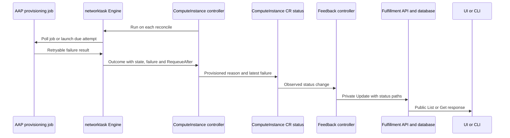

# Expose ComputeInstance Provisioning Failures During Retries

## Summary

Reuse the `Provisioned` condition for retry progress and add a singular
`last_provisioning_failure` field to ComputeInstance status. The operator
maps retryable AAP provisioning failures into these system-owned fields, the
feedback bridge persists them, and CLI status commands render them. UI
integration follows its separate development path against the same API. VM power state, metering, and retry scheduling remain
unchanged. See [PRD](prd.md) for detailed requirements.

## Motivation

A retryable provisioning failure is recorded internally as a
`NetworkJobStatus` with state `Retrying`, but the ComputeInstance controller
only checks `Outcome.Failed()`, which is true only for a final `Failed`
outcome. When no KubeVirt VM exists yet, the controller therefore overwrites
the visible `Provisioned` condition with `WaitingForVM`. The retry remains
scheduled, but tenants see the same generic waiting state as a first
provisioning attempt and lose the failure details
[Codebase: osac-operator/internal/controller/computeinstance_controller.go].

`ComputeInstanceState` is the VM power/lifecycle state and is metered together
with `state_transition_time`. A `RETRYING` state would conflate provisioning
work with power state and fragment the metering timeline. The accepted
ComputeInstance status model keeps conditions orthogonal to lifecycle state,
so retry belongs in a condition
[Codebase: enhancement-proposals/enhancements/OSAC-1027-computeinstance-phase-condition-expansion/README.md].

The current job message is operational rather than a reviewed tenant-facing
contract. It can contain task and manager names, AAP job IDs, provider text,
and the next retry time. A purpose-built latest-failure value can expose a
stable reason, a bounded tenant-safe message, the failed attempt number, and
an observation timestamp without exposing job internals.

### Goals

- Preserve `ComputeInstanceState` as the metered VM power/lifecycle state.
- Represent retry through stable reasons on the existing `Provisioned` condition.
- Expose only the latest provisioning failure, with explicit success clearing.
- Derive tenant-safe failure details from already classified engine outcomes.
- Keep retry classification, backoff, limits, and scheduling unchanged.
- Deliver CLI retry/failure reporting and the API contract consumed by the
  separately developed UI.

### Non-Goals

- Do not add retry limits, timeouts, or new transient/permanent classification.
- Do not change retry backoff or job launch behavior.
- Do not expose `status.jobs`, job history, AAP logs, or raw provider errors.
- Do not expand VM operation, configuration, or deletion status; that broader
  work belongs to OSAC-6578.
- Do not add roles, permissions, or a support-only diagnostic surface.
- UI implementation and browser coverage follow the separate UI development
  path; the PRD UI requirement remains and is not claimed delivered here.

## Proposal

The shared ComputeInstance contract reuses the existing `Provisioned`
condition and gains one singular structured status field. The operator sets them from the provision task
outcome, the feedback controller synchronizes them through the existing
private Update path, and the public List and Get responses expose them to the
existing UI and CLI consumers. No endpoint, request shape, or writable field
is added.

### Workflow Description

Starting from a newly created ComputeInstance whose first provisioning attempt
fails with a retryable error:

1. The controller calls `Engine.Run` synchronously on each reconcile. The
   engine polls AAP or launches an attempt, persists the job entry including
   its optional structured failure snapshot,
   and returns an `Outcome` with `Entry.State`, `Entry.Attempt`, and
   `RequeueAfter`. The proposed failure classification also carries the
   public failure reason, fixed message, failed attempt, and observation time.
2. On a retryable failure, the returned entry is `Retrying`. The controller
   sets `Provisioned=False`, reason `RetryScheduled`, and replaces
   `last_provisioning_failure` with the newly observed failure.
3. The controller returns `ctrl.Result{RequeueAfter: outcome.RequeueAfter}`.
   Controller-runtime schedules another reconcile after the existing backoff.
   No callback, event subscription, or engine-to-controller signal is added.
4. When backoff expires, the next `Engine.Run` launches the next attempt and
   returns a running entry. A running attempt after a recorded failure sets
   `Provisioned=False`, reason `RetryRunning`, retaining that failure.
   A first attempt without a prior failure retains existing progress semantics.
5. On every poll, the controller derives status from the returned outcome.
   Job success removes `last_provisioning_failure` and the retry reason, but
   does not itself set `Provisioned=True`. Existing `WaitingForVM` or
   `ProvisioningStorage` status remains until the infrastructure-readiness
   check sets `Provisioned=True/InfrastructureReady`. Another retryable failure replaces the failure
   and returns to `RetryScheduled`; terminal failure uses `ProvisioningFailed`.
6. An engine/status-write error is returned from reconciliation without
   publishing status derived from a failed write. Controller-runtime retries
   with a fresh object. Condition and failure updates are persisted together
   through the controller's normal status update before returning its result.
   If the engine job write succeeded but the later controller status write
   fails, the next outcome restores failure details from the persisted job
   snapshot, including the original observation time. Success similarly
   replays clearing from the persisted successful job state.
7. The feedback controller maps the condition and failure into the private
   ComputeInstance object, including `status.last_provisioning_failure` in its
   explicit Update mask. Public List/Get expose both to authorized UI and CLI
   consumers. Presentation is defined in separate UX files.



The diagram shows the unchanged provisioning path on the left and the additive
status propagation path on the right. The engine still owns retry scheduling;
only the classification needed for tenant-safe display is carried forward.

### API Extensions

No service or endpoint is added. `ComputeInstanceStatus` receives these
additive, output-only changes:

```protobuf
enum ComputeInstanceProvisioningFailureReason {
  COMPUTE_INSTANCE_PROVISIONING_FAILURE_REASON_UNSPECIFIED = 0;
  COMPUTE_INSTANCE_PROVISIONING_FAILURE_REASON_PROVIDER_REPORTED = 1;
  COMPUTE_INSTANCE_PROVISIONING_FAILURE_REASON_RESULT_REJECTED = 2;
  COMPUTE_INSTANCE_PROVISIONING_FAILURE_REASON_TIMED_OUT = 3;
  COMPUTE_INSTANCE_PROVISIONING_FAILURE_REASON_JOB_LOST = 4;
  COMPUTE_INSTANCE_PROVISIONING_FAILURE_REASON_JOB_NOT_STARTED = 5;
  COMPUTE_INSTANCE_PROVISIONING_FAILURE_REASON_INVALID_RESULT = 6;
  COMPUTE_INSTANCE_PROVISIONING_FAILURE_REASON_PROVIDER_ERROR = 7;
}

message ComputeInstanceProvisioningFailure {
  ComputeInstanceProvisioningFailureReason reason = 1;
  string message = 2;
  int32 attempt = 3;
  google.protobuf.Timestamp observed_at = 4;
}

message ComputeInstanceStatus {
  // Existing fields 1 through 12 remain unchanged.
  optional ComputeInstanceProvisioningFailure last_provisioning_failure = 13;
}
```

No condition enum value is added. The status field uses the first unused
field number after 12.

The failure reason describes the already observed failure source; it does not
reclassify retryability:

| Engine outcome | Failure reason | Tenant-safe message |
|---|---|---|
| Valid `osac_error` | `PROVIDER_REPORTED` | `Provisioning failed.` |
| Successful job with malformed or unexpected `osac_result` | `RESULT_REJECTED` | `Internal error` |
| Failed job with a missing or malformed `osac_error` | `INVALID_RESULT` | `Internal error` |
| AAP timeout | `TIMED_OUT` | `The provisioning attempt timed out.` |
| AAP job no longer exists | `JOB_LOST` | `Internal error` |
| AAP never started the job | `JOB_NOT_STARTED` | `Internal error` |
| AAP job ended with an infrastructure error | `PROVIDER_ERROR` | `Internal error` |

`parseOSACError` validates the JSON shape, field types, and non-empty
message; it does not establish that message content is safe to expose.
No `osac_error.message` or operational job text is copied to public status.
Provider-reported failures use the fixed message `Provisioning failed.`;
internal failures use `Internal error`; timeout retains its specific message.
Structured reason values distinguish the observed sources. More actionable
provider-specific text requires a separately reviewed tenant-facing error
contract; parsing alone is insufficient. This intentionally limits detail
available to tenants, who may need support for further diagnosis.

Final failure is existing engine behavior, not a new classification introduced
by this design. For the non-cleanup `provision` task, the engine reaches
`Failed` only when:

1. AAP reports a failed job with a valid `osac_error` whose `retryable` value
   is `false`.
2. AAP reports a failed job with a missing or malformed `osac_error`.
3. AAP reports a successful job whose `osac_result` is malformed or contains
   an unexpected key, which the existing no-output acceptance rule rejects.

Valid retryable `osac_error`, AAP timeout, AAP infrastructure error, a lost
job, and a job AAP never started remain `Retrying`. A terminal failure stays
final for the same desired configuration; only a later configuration change
starts a new provision attempt.

The existing condition represents retry without a second Boolean:

| Field | Meaning |
|---|---|
| `type` | CR: `Provisioned`; API: `COMPUTE_INSTANCE_CONDITION_TYPE_PROVISIONED` |
| `status` | `False` while infrastructure is incomplete, including retry; `True` only when the existing infrastructure-readiness check passes. API values use `CONDITION_STATUS_FALSE` / `CONDITION_STATUS_TRUE`. |
| `reason` | `RetryScheduled` during backoff or `RetryRunning` during a retry attempt; existing progress/success/final-failure reasons otherwise. |
| `message` | Fixed lifecycle explanation below; never provider or operational job text. |

| Provision job state | `Provisioned` | Message | `last_provisioning_failure` |
|---|---|---|---|
| First attempt running | `False`, existing progress reason | Existing progress message | Absent |
| Retry waiting for backoff | `False`, `RetryScheduled` | A provisioning attempt failed; another attempt is scheduled. | Latest failure |
| Retry attempt running | `False`, `RetryRunning` | A provisioning retry is running. | Retained latest failure |
| Retry job succeeds, infrastructure not ready | `False`, `WaitingForVM` or `ProvisioningStorage` | Existing progress message | Absent |
| Infrastructure becomes ready | `True`, `InfrastructureReady` | Existing success message | Absent |
| Final failure | `False`, `ProvisioningFailed` | Provisioning failed; no retry is scheduled. | Latest failure |
| Delete cancels the job | Existing delete behavior; no retry reason remains | Existing delete message | Absent |

Consumers identify active retry only when `Provisioned=False` and reason is
`RetryScheduled` or `RetryRunning`. They never infer it from the presence of
a failure, since terminal failures retain that field too, or parse messages.

An example public status during retry is:

```json
{
  "status": {
    "state": "COMPUTE_INSTANCE_STATE_STARTING",
    "conditions": [
      {
        "type": "COMPUTE_INSTANCE_CONDITION_TYPE_PROVISIONED",
        "status": "CONDITION_STATUS_FALSE",
        "reason": "RetryScheduled",
        "message": "A provisioning attempt failed; another attempt is scheduled."
      }
    ],
    "last_provisioning_failure": {
      "reason": "COMPUTE_INSTANCE_PROVISIONING_FAILURE_REASON_PROVIDER_REPORTED",
      "message": "Provisioning failed.",
      "attempt": 2,
      "observed_at": "2026-11-11T08:15:00Z"
    }
  }
}
```

`last_provisioning_failure` is a singular, output-only object:

| Field | Type | Meaning |
|---|---|---|
| `reason` | `ComputeInstanceProvisioningFailureReason` enum | Observed failure source from the mapping above; does not determine retryability. |
| `message` | string | Fixed public message from the source mapping; never the provider-supplied message. |
| `attempt` | int32 | One-based number of the provisioning attempt that failed, using the engine's existing attempt counter; not the currently running retry's number. |
| `observed_at` | protobuf Timestamp | Time the engine observed the failed outcome; retained with that failure during backoff and an active retry. |

A later failed attempt replaces the entire object. Success, deletion that
cancels provisioning, or a fresh attempt for a new desired configuration
removes it. A terminal failure retains it until that clearing event.

When the field is present, `reason` is not `UNSPECIFIED`, `message` is
non-empty, `attempt` is at least 1, and `observed_at` is set. The field is
removed, rather than replaced with an empty message, when the failure clears.
Public callers cannot write it; the existing public Update path rejects all
status paths, while the operator uses the private feedback path.

### Implementation Details/Notes/Constraints

The operator CRD mirrors the public status shape:

```go
type ComputeInstanceProvisioningFailure struct {
    Reason     string      `json:"reason,omitempty"`
    Message    string      `json:"message,omitempty"`
    Attempt    int32       `json:"attempt,omitempty"`
    ObservedAt *metav1.Time `json:"observedAt,omitempty"`
}
```

`ComputeInstanceStatus` gains
`LastProvisioningFailure *ComputeInstanceProvisioningFailure`; the existing
`Provisioned` condition carries retry progress. The failure reason strings are
`ProviderReported`, `ResultRejected`, `TimedOut`, `JobLost`,
`JobNotStarted`, `InvalidResult`, and `ProviderError`. CRD deepcopy,
manifests, and Helm CRD copies are regenerated from source.

`NetworkJobStatus` gains an optional internal `LastFailure` snapshot
(JSON `lastFailure`), with reason, fixed tenant-safe message, failed attempt,
and observation time. These fields use the same semantics as the public
failure object. The field is populated for the ComputeInstance `provision`
task; unrelated tasks leave it absent. This is a singular checkpoint, not a
failure history, and `status.jobs` remains private.

| Internal `lastFailure` field | Type | Semantics |
|---|---|---|
| `reason` | string | PascalCase source classification mapped to the public failure enum |
| `message` | string | Fixed public message from the mapping above |
| `attempt` | int32 | Failed launch number, at least 1; independent of the current job attempt |
| `observedAt` | metav1.Time | Original failed-outcome observation time, preserved on replay |

The optional pointer is omitted when clear; a present snapshot requires all
four fields. Only the `provision` task projection reaches the public
ComputeInstance failure field; no job IDs or operational messages are copied.

`networktask.Outcome` gains a `Retrying()` method and an optional failure
classification value. `Engine.fail` persists the failure snapshot atomically
with the job's `Retrying` or `Failed` state before returning the outcome.
The operational job message and retry decision remain unchanged. Every later
outcome for that entry, including backoff polls, running retries, and terminal
failure reads, returns the snapshot. Launching a retry preserves it with its
original failed-attempt number and observation time; the job's current attempt
may advance independently. Another failure replaces it; success, cancellation
for deletion, or a fresh attempt for a new desired configuration clears it.

The controller projects the checkpoint into `last_provisioning_failure` and
evaluates active retry before the generic no-VM `WaitingForVM` branch. An
engine write conflict returns an error before publishing an outcome. If the
engine write succeeds but the controller's later status write conflicts or
the process restarts between them, a fresh read recovers the same checkpoint.
The next reconcile republishes it without parsing operational message text,
re-reading the failed AAP job, or inventing a new observation timestamp.
A persisted successful job state causes the next reconcile to clear stale
public failure data even if the original clearing write failed.

On restart, retry timing follows the existing engine behavior reconstructed
from the persisted job entry; this design does not change backoff semantics.
Existing entries without a failure snapshot do not fabricate historical
failure details. They can report retry from job state, but the failure object
remains absent until a newly observed failed outcome supplies the checkpoint.
No in-memory failure cache is required. Regenerate the affected shared job
CRD schemas alongside the ComputeInstance schema.

The separately developed UI consumes public `Provisioned` retry reasons and
the latest-failure object through generated types. UI implementation, type
baseline selection, presentation, and browser coverage belong to that UI
workflow. Generated types are never edited by hand.

CLI changes are:

- `osac get computeinstances` adds a `PROVISIONING` column containing
  `Retrying` or `-`, and a `LAST FAILURE` column containing the reason label
  or `-`.
- `osac describe computeinstance ID|NAME` adds rows for provisioning retry,
  failure reason, failure message, failed attempt, and observed time.
- The renderer formats the timestamp as RFC 3339 and omits failure rows when
  the field is absent.

Proto sources are edited only under `proto/private/`. The implementation runs
`make -C proto generate` and `make -C proto lint`, then reviews the generated
public and Go diffs. Operator CRD generation runs `make manifests generate`,
`make helm-crds`, and `make check-helm-crds`.

### Documentation Impact

The implementation stories must update the public API reference for the new
status fields and CLI help/output examples. UI documentation and i18n
updates follow the separate UI development path. No separate
end-user runbook change is required because the tenant-facing behavior is
limited to the existing List, Get, and CLI status surfaces.

### Security Considerations

No authentication or authorization rule changes. Callers who can already
List or Get a ComputeInstance can read its new status fields; callers who
cannot read the instance receive the existing denial and no failure data.

The failure field is output-only and system-owned. Safe diagnostics are
selected at the engine-to-controller boundary rather than copied from
`NetworkJobStatus.Message`. All public failure messages use fixed strings;
parsed provider text is never passed through. AAP job IDs, task and
manager names, logs, raw tracebacks, and unreviewed provider errors are not
exposed.

### Failure Handling and Recovery

- **Retryable attempt fails:** the controller sets `Provisioned=False/RetryScheduled` and the
  latest failure. The engine's existing backoff and requeue are unchanged.
- **Retry is running:** the controller changes the condition reason to
  `RetryRunning` and retains the previous failure.
- **Retry job succeeds:** the failure snapshot and public failure clear, and
  the retry reason is replaced by existing infrastructure progress status.
  Only the existing readiness check sets `Provisioned=True/InfrastructureReady`.
- **Retry fails again:** the singular failure is replaced with the newer
  attempt; no history is accumulated.
- **Final failure occurs:** the engine reaches it only in the terminal cases
  defined in API Extensions. The controller sets `Provisioned=False` with
  reason `ProvisioningFailed` and retains the latest failure until a later provision
  attempt succeeds or a new desired configuration starts a fresh attempt.
- **ComputeInstance is deleted:** the engine cancels the pending retry, the
  existing deletion status replaces the retry reason and the failure field
  is removed. Broader deletion diagnostics remain with OSAC-6578.
- **Controller status write fails or operator restarts:** the job checkpoint
  reconstructs the original failure, attempt, and observation time, including
  when retry launch has already advanced the current attempt. A successful
  job state reconstructs clearing. Retry timing retains existing semantics.
- **Feedback Update fails:** the existing feedback reconciliation retries.
  Provisioning and retry behavior do not depend on this status write; the UI
  and CLI remain on the last persisted status until the update succeeds.
- **Failure source is missing or malformed:** a missing or malformed
  `osac_error` uses the fixed `INVALID_RESULT` message, while a malformed or
  unexpected `osac_result` uses the fixed `RESULT_REJECTED` message. Neither
  path falls back to raw operational job text.
- **AAP reports an infrastructure error:** the controller uses the fixed
  `PROVIDER_ERROR` message and the engine retains its existing retry decision.

### RBAC / Tenancy

No RBAC or tenancy changes are required. ComputeInstance authorization,
tenant/project filtering, and the `osac.openshift.io/tenant` isolation model
are unchanged. Tenant Admins and Tenant Users who already have read access see
the same status fields; no cross-tenant support view is introduced.

### Observability and Monitoring

No new observability changes. Existing operator logs, Kubernetes conditions,
and component monitoring apply. No metric, alert, event, or tracing contract
is added, and metering does not consume the new fields. No Kubernetes Event is
emitted for a retry or terminal failure; the status fields are the
tenant-facing source of truth and avoid creating event churn or duplicate
support signals.

### Risks and Mitigations

| Risk | Mitigation |
|---|---|
| Older Fulfillment builds reject the new field-mask path during rollout | Deploy the Fulfillment service and operator from the same additive contract release; the feedback controller retries transient Update failures, and workload reconciliation does not depend on the status write |
| Older UI or CLI clients do not understand the new enum or field | The change is protobuf-additive. Old clients continue existing behavior; updated UI and CLI are required for the new display |
| A provider omits or malforms `osac_error`, or returns an unexpected `osac_result` | Strict parsing and no-output acceptance remain the gate; those outcomes use fixed `INVALID_RESULT` or `RESULT_REJECTED` messages |
| UI consumes stale generated types | The separate UI development path owns its API baseline and reviewed type generation |
| UI presentation diverges from the API contract | Separate UX files define presentation against the retry condition and structured latest-failure fields |

### Drawbacks

The API gains one nested message and one status field,
and the UI must render two status concepts instead of one. Tenant-safe
messages also intentionally omit provider internals, so support engineers may
still need administrator-side diagnostics. These costs are justified because
the alternative either corrupts power-state semantics or exposes unsafe
operational job data.

## Alternatives (Not Implemented)

- **Do nothing.** This requires no contract or UI change, but it leaves retry
  hidden behind `WaitingForVM` and provides no actionable failure detail.
- **Add `RETRYING` to `ComputeInstanceState`.** This is simple for a single
  status label, but it conflates provisioning work with VM power state and
  creates metering transitions that do not represent a power change.
- **Add a separate retry condition.** This duplicates retry information already
  expressible through `Provisioned` reasons and creates another condition to
  synchronize; the existing condition is reused instead.
- **Use only the `Provisioned` condition reason and message.** This avoids a
  new status field, but it loses a machine-readable failure reason, attempt
  count, and observation timestamp, and makes UI and CLI parsing string-based.
- **Expose `status.jobs` or job history.** This requires no new status model,
  but it leaks internal task, manager, AAP job ID, and retry-scheduling
  details and retains more than the PRD's single latest failure.
- **Retain a failure history.** This could help debugging, but the PRD requires
  only the latest failure and explicit clearing after success; history would
  add storage and privacy exposure without a requirement.

## Delivery Ownership

CLI implementation and deployed CLI/API coverage are delivered with this
design under OSAC-6008; they are not moved to OSAC-6578. UI implementation,
type generation, and browser coverage follow the separate UI development
path. The UI requirement remains part of the overall feature; this backend
and CLI delivery does not claim to complete it. No separate UI tracking issue
has been identified here; that cross-workflow tracking remains unresolved.

## Test Plan

The detailed requirement-to-interface matrix is in
[testplan.md](testplan.md). The required tiers are:

- **Unit:** engine failure-source mapping, condition precedence, output-only
  API mapping and CLI rendering. UI rendering cases are separately owned.
- **Integration:** operator Envtest for retry and clearing semantics; Kind
  ComputeInstance integration for the real API, database, installed operator,
  and controlled AAP boundary; Fulfillment authorization and tenant isolation.
- **E2E:** deployed CLI and API journeys using a real AAP test job that fails
  once with a retryable `osac_error` and succeeds on its next attempt; browser
  presentation coverage depends on the separate UX specification.

### Unit Tests

- Table-test every failure source in the reason mapping.
- Assert `Retrying` takes precedence over `WaitingForVM`.
- Assert job success clears failure/retry while preserving infrastructure
  progress; only infrastructure readiness sets `Provisioned=True`.
- Assert public Update rejects the new status path.
- Assert UI consumers and CLI output expose retry and failure data; detailed
  UI presentation assertions belong to the separate UX specification.

### Integration Tests

- Use Envtest to replace the failure across retry attempts and recover the
  original checkpoint after status conflicts, retry launch, and restart.
- Verify job success clears failure before VM/storage readiness, and a failed
  clearing write converges on the next reconcile.
- Use the Kind ComputeInstance suite to verify CR-to-public-API feedback.
- Use the deployed Fulfillment suite to verify tenant authorization and
  cross-tenant denial.

### E2E Tests

- Run a CLI journey that observes retry and failure, then success clearing.
- Verify deployed ComputeInstance fields during retry and after success.
- Defer browser presentation checks until the separate UX specification is available.
- Disclose that the AAP playbook is a controlled test fixture and does not
  prove every real provider failure mode.

## Graduation Criteria

Graduation criteria will be defined when targeting a release. Expected stages:
Dev Preview, Tech Preview, then GA based on production deployment feedback.

## Upgrade / Downgrade Strategy

The protobuf and CRD changes are additive and require no database migration.
The shared job schema adds an optional checkpoint; older entries have none
and no historical timestamp or failure is synthesized for them.
The operator derives retry reasons and the optional failure field on its
next reconcile of an existing ComputeInstance. Updated UI and CLI clients
display the fields; older clients ignore them or show an unknown enum label.

Downgrade to an older operator stops writing the new fields. Existing
protobuf data is retained where the older serializer preserves unknown
fields, but older UI and CLI clients do not display it. Workload provisioning
and existing retry behavior remain available; only the new visibility is
lost.

## Version Skew Strategy

Fulfillment and the operator should roll out from the same release containing
the additive contract. If a new operator briefly runs against an older
Fulfillment build, its private Update may fail until the service is current;
the existing feedback retry converges the status after both components are
available. Provisioning and retry reconciliation do not depend on that status
write. Older UI and CLI clients continue to render the existing power state.

## Support Procedures

Failure is detected through the VM list or details page,
`osac describe computeinstance`, or the ComputeInstance CR conditions and
`lastProvisioningFailure` field. The fixed message and structured reason summarize the
observed source; administrators continue using existing operator logs and AAP
job diagnostics for internal investigation.

There is no independent feature flag. Rolling back the UI, CLI, or operator
removes the new visibility but does not stop provisioning retries or affect
running workloads. Re-applying the additive release restores status
synchronization without manual data repair.

## Infrastructure Needed

None.

---

## Provenance

Authored: draft @ design 0.15.0 - 87d14ea, workspace OSAC-6011 @ b8e43caed
Final: respond @ design 0.15.0 - 922de34, workspace OSAC-6011 @ b8e43caed

> Context changed between draft and respond.

<!-- ai-workflow-provenance:{"schema_version":1,"provenance_kind":"session","workflow":"design","workflow_version":"0.15.0","ai_workflows":"922de34","source_repo":"b8e43caed","source_repo_branch":"OSAC-6011","commits_behind_main":0,"commits_ahead_main":0,"main_ref":"main","phases":["draft","revise","respond","respond","respond","respond","respond"],"authoring_modes":["skill"],"context_changed":true,"origin_untracked":false} -->
