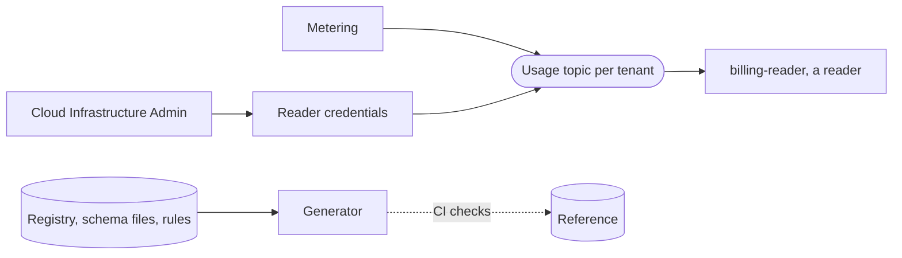

# The metering event contract

## Summary

Metering writes each tenant's usage to Kafka as usage events, and their shape lives only in
OSAC code. This design publishes the contract:

- **A generated reference.** A generator walks the metering code and writes a document a
  person reads plus a schema file a tool checks. A stale copy fails the build.
- **A published schema never changes.** A new field is a new schema with a version and an effective date.
- **Reading access.** Each reader gets credentials that can only read a single tenant's topic,
  granted and revoked as configuration.

See [PRD](prd.md) for detailed requirements.

## Motivation

- The usage events are described by code alone; a reader outside couples to types that change in any release.
- A Cloud Provider Admin whose billing system has no OSAC adapter has no path to the usage data.
- The only credentials that can read the usage topics are OSAC's own; the platform cannot share them.
- OSAC-6060, customer-developed adapters, needs this contract first.

## Behavior changes

- The usage event schemas become immutable files in the metering code, each with a version
  and an effective date. CI fails the build on any change to a published file.
- A generator writes the reference and the schema check into `osac-metering`; CI fails a stale copy.
- The metering chart grants and revokes a reader as a values entry, like the echo adapter.
- The Kafka resource runs a Kafka exporter that reports how far behind each reader is. The
  usage pipeline itself changes nothing, no new service runs, and the contract documents
  what runs on main.

## Goals and Non-Goals

### Goals

- One contract over the usage pipeline: payload, reading rule, lifecycle, transport, access.
- A reference generated from the code, so it cannot drift.
- Grant and revoke a reader as configuration, with no OSAC credential shared and no restart.
- A worked example a team runs against a dev deployment in an afternoon.
- Grants for one tenant. A grant covers a single metered tenant.

### Non-Goals

- The raw event log, `osac.events.<tenant>`. It carries internal resource snapshots.
- The adapter extension point, SDKs, and conformance kits. That is OSAC-6060.
- Pricing, rating, invoicing. The reader prices; OSAC meters.
- Provider adapters. M360 is OSAC-3784; Red Hat Cost Management is OSAC-4284.
- User identity on usage events. They carry none today; OSAC-6154 may add one.

## Proposal

### Big picture

| Who | When | What it does |
|---|---|---|
| Metering | Every minute | Writes usage events and corrections to the tenant's usage topic. |
| Generator and CI | Every pull request | Regenerates the reference from the code and fails a stale or changed copy. |
| Cloud Infrastructure Admin | Onboarding, offboarding | Adds or removes the reader in the chart values. |
| Reader | Always | Keeps its own place, drops repeats by event id, sums. |

### Key ideas

1. **The contract publishes metering's output alone.** Usage events, corrections, transport, and the reading rule.
2. **A published schema never changes.** A new field is a new schema with a version and an effective date.
3. **Access copies the adapter pattern.** Credentials that can only read, one set per reader, granted as chart values.

### Running example

Tenant `acme`, VM `vm-7` of instance type `small`, project `web`. Dana is the Cloud
Infrastructure Admin. `billing-reader` is a reader an outside team owns.

| Time | What happens |
|---|---|
| 09:00 | Dana adds `billing-reader` for tenant `acme` to the chart values; Strimzi issues its password. |
| 10:01 | Metering sends 20 s of compute for `vm-7`, then 60 s at 10:02 and 60 s at 10:03. |
| 10:04 | `vm-7` stopped at 10:02:30; metering sends a correction of -30 s for the span past the stop. |
| 10:04 | `billing-reader` sums the four usage events: 110 s of compute, dimension `small`. |
| 11:00 | A restart resends the 10:04 event; `billing-reader` drops it by event id. |

## Design Details

### What the contract covers

The contract covers the usage topics and the events on them. The event log, the failed-record
topics, and the usage database stay internal.

A usage event is one CloudEvent in JSON, type `osac.resource.heartbeat.v1`; a CloudEvent is
a common envelope for events on Kafka. The payload carries three groups of fields:

- Identity: the tenant, the resource, the meter, and the billing dimensions.
- Quantity: one interval, `from` inclusive and `to` exclusive, an amount, and a unit.
- Provenance: the sending minute, metering's place in the log, and the rules revision.

The generated reference lists every field, its unit, and whether it is required. Timestamps
are UTC with whole seconds. The amount is text with six digits after the point, so reading
it never yields an approximate binary number.

**The reading rule is one sentence.** Add every usage event; a correction is a negative one.
The billable quantity for one resource and meter is the total.

**The event id drops repeats.** The id is a hash of the identity, the interval, and the minute. It leaves out the
amount, so a resend keeps its id and the reader drops the copy. A correction is sent in a later round, so its
sending minute differs and its id never matches the event it corrects. A reader never mistakes a correction for
a repeat.

**Every usage event names its schema version.** It is the type-name suffix, `.v1`. A reader that
receives an event whose type it does not know logs an error and raises an alert; it never skips the event silently.

Metering derives usage from resource states, which the reader never sees. A resource starts
billing when a rule revision says its state is billable, and each minute metering sends the
difference since the last. A state or dimension change re-keys the usage. A stop sends a
final correction for the span billed past it.

| Transport fact | The rule |
|---|---|
| Topic naming | One usage topic per tenant, named `osac.metering.heartbeat.<tenant>` |
| Ordering | Each topic has one part, so events arrive in the order metering sent them |
| Delivery | At least once; repeats carry the same event id |
| Retention | Set per installation, indefinite by default; it is metering's recovery window |

Metering creates a tenant's topic on first use; a reader knows its topic from its grant. The contract publishes the
per-tenant usage pipeline of OSAC-5753, which replaced the shared-topic layout of the older OSAC-985 metering design.

### Schemas never change

The usage event schema lives as a file in the metering code, with a version and the date it
takes effect, the way billing rule revisions carry theirs.

A published schema never changes. A new field is a new schema: a new file with the next version and its effective
date. The old file stays, so its records stay readable; deleting one fails the build. CI hashes the published files
and fails the build on a changed bit, a rename, a version number used again, or a changed effective date.

Replay uses the versions. Metering rebuilds usage by reading each record with the schema in
effect when it was written, so a rebuild always produces the same usage.

A new resource type changes no schema. Its name travels as data, so new offerings need no new version.

The resource events metering reads are protos that follow the add-only rule, and drift tests
already enforce it. The usage event schemas metering writes get the immutable files above.

### Reading access

**Each reader gets credentials that can only read usage events.** The metering chart holds
a list of readers as values in the platform repository. Each entry names one tenant and
renders one `KafkaUser`, the object Strimzi uses for a Kafka account, and Strimzi issues
the password into a Secret. The connection needs TLS and the password, and the reader must
trust the shared OSAC CA. The admin hands over the password, the CA certificate, and the
address, out of band.

**A reader sees the usage events of the tenant its grant names.** The credentials read that
one topic alone; a topic the grant does not name stays invisible to the reader. Metering
skips the built-in tenants, which have no usage topics.

**Revocation restarts nothing.** The admin removes the entry and applies the change with a helm upgrade, which
re-renders the `KafkaUser` alone. The metering deployment carries no checksum of these values, so no OSAC service
restarts. Strimzi deletes the user and password, and the broker refuses the credentials. New connections are
refused at once. An open connection ends at its next re-authentication, which the broker's listener forces
within a bounded window set per installation. Each grant and revocation is a commit in the platform repository,
naming who, when, and which reader.

**A reader cannot write and cannot disturb the billing pipeline.** The broker denies every
operation the grant does not allow. Each reader keeps its own place in the stream, and
OSAC's adapters keep theirs. A slow reader delays only itself, and owns its own retries and
failed records.

**The provider can see how far behind each reader is, and who each reader is.** A reader reads under its own name,
the name in the chart values, and its lag and identity are reported under that name. Kafka's listings show who holds
access. No Kafka exporter runs today; this design adds Strimzi's, and monitoring carries the gap to the provider.

### The generated reference

A generator walks three inputs that already exist as data:

1. the metering registry, which lists every resource type and its tracked fields;
2. the schema files, which carry the JSON field names and shapes, including the billing account id;
3. the default rule revisions shipped with the chart, which name each meter, unit, dimension, and billable state.

It writes a document a person reads and a schema file a tool checks into
`osac-metering/docs/contract/`. CI regenerates both and fails the check on any diff.

A new resource type appears in the reference with no code change. Dimension names are still
a Go map (`rules/dimensions.go`), so a new dimension needs that one code edit.

### The billing account id

A usage event carries `external_billing_account_id` when the tenant has one; a tenant
without one omits it. Metering sets it from the tenant's recorded identity. Each event is
attributed to the account its id names, so a reader groups events by id when a tenant
changes accounts.

### The worked example

The example is a small Go program beside the echo adapter. It reads the usage topics under
its own name, drops repeats by event id, sums the amount per resource, meter, and
dimensions, and prints the billable total. Its README documents the run against a dev
deployment: grant the example's user, deploy, run it, and read `vm-7`'s 110 seconds. The
password, the CA certificate, and the bootstrap address arrive as environment variables
from a mounted Secret; the repository carries none.

## What happens when

| Situation | What happens |
|---|---|
| A published schema file changes | CI fails the build, on any bit. |
| Usage is rebuilt from Kafka | Each record is read with the schema in effect then; the total is the same. |
| A usage event is delivered twice | The copy carries the same event id; the reader drops it. |
| A revoked reader reconnects | The broker refuses the connection at once. |
| A revoked reader keeps running | Its open connection ends at the next re-authentication; OSAC services keep running. |
| A reader writes, or reaches for OSAC's place | The broker denies it; the credentials can only read. |
| The reader meets an unknown event type | It logs an error and raises an alert; it never skips the event silently. |

## Risks and Mitigations
- **Schema versions multiply over time.** Only a genuinely new field buys a version; new resource types cost nothing.
- **A slow reader falls behind, and old records expire with retention.** Lag is visible, and retention is
  metering's recovery window, set per installation.
- **The file check flags a change that turns out harmless.** The check compares published files as
  written, so the author sees every difference before it merges.
## Drawbacks
Readers must handle more than one schema version over time. A billing reader that serves the whole
platform lists every tenant in its grants, and the list grows at onboarding. Every new field costs a
new schema file and its publication.

## Alternatives

- **A pull API over Kafka.** It needs a new service and new login work; a `KafkaUser` already grants the same access.
- **A hand-written reference.** Prose drifts from the code as coverage grows.
- **Sharing OSAC's adapter credentials.** Revoking one reader would break the billing pipeline.
- **Publishing the raw event log.** It exposes internal snapshots; usage events already carry the usage.
- **New fields inside a published schema.** Replay could read an old record with a newer shape and bill it wrong.

## Open Questions

- Where the effective dates are announced beyond the schema files: release notes or the reference.
- Whether the worked example stays in the adapters module or moves into OSAC-6060's SDK work.

## Test Plan

Behaviors to check, one per PRD criterion:

1. The reference lists every resource type that emits usage events, with field meanings, units, and required fields.
2. The reference states the reading rule: sum every usage event; a correction is a negative one.
3. The reference documents start, change, stop, and corrections, and rebuilds a billable quantity by summing.
4. The reference states topic naming, ordering, delivery, the event id for repeats, and how long records stay readable.
5. Every usage event names its schema version; the reference says where to read it.
6. A new field arrives as a new schema file with a version and an effective date.
7. A change to a published schema file fails the build.
8. A rebuild from Kafka, reading each record with the schema in effect then, produces the same usage.
9. The billing account id is present for a tenant with one, omitted for one without; readers group by id.
10. An admin grants a reader by chart values; the reader sees the usage events of the tenant its grant
    names, with its own credentials.
11. Removing the entry stops the reader's access; an open connection ends at its next
    re-authentication; no OSAC pod restarts.
12. Each grant and revocation is a commit naming who, when, and which reader.
13. The reader's credentials cannot write and cannot disturb OSAC's billing pipeline; the broker denies both.
14. The provider sees how far behind each reader is, and who each reader is.
15. The contract states the reader owns its own retries and failed records.
16. The contract states the raw event log stays internal.
17. The example runs against a dev deployment, reads usage events, derives a billable total, and stores no credentials.
18. A schema change that leaves the reference or the schema check stale fails the check.

---

## Provenance

Committed: commit @ design 0.11.3 - 9b25062, workspace main @ e526ec64b

> Authoring phases not recorded this session (commit-time snapshot only).

<!-- ai-workflow-provenance:{"schema_version":1,"provenance_kind":"commit_only","workflow":"design","workflow_version":"0.11.3","ai_workflows":"9b25062","source_repo":"e526ec64b","source_repo_branch":"main","commits_behind_main":0,"commits_ahead_main":0,"main_ref":"main","phases":["commit"],"authoring_modes":["skill"],"context_changed":false,"origin_untracked":false} -->
