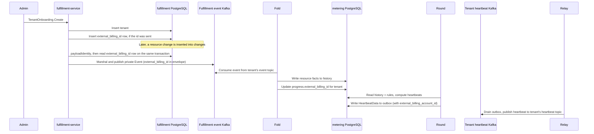

# Tenant External Billing Identity

## Summary

Store an optional external billing id as a named row in a tenant attribute table, and copy that id onto the private usage event when the `changes` publisher sends it. See [PRD](prd.md) for detailed requirements.

## Motivation

OSAC meters tenant consumption and reports it to an external billing system. That system accounts usage by its own account id. The OSAC tenant id is a different identifier. A Cloud Provider Admin needs to record the external account id for a tenant at onboarding, read it back, and have later usage for that tenant carry the same id.

Fulfillment stores these values in their own table, one row per tenant and attribute name. The billing id is the row named `external_billing_id`. A resource change is inserted into the `changes` table. The event publisher drains that table, using `changes` as both the default table name and the default notification channel, and writes a private `Event` to the fulfillment event Kafka. Before it serializes the event, it reads that named row for the event's tenant id and, when the row exists, sets the billing id on the event. The metering Fold reads that event from the tenant's event topic, extracts resource facts into the `history` table, and records the envelope's billing id in the `progress` table for that tenant. Each minute the Round reads `history` and billing rules, computes usage differences, and writes `HeartbeatData` to the outbox. The Relay drains the outbox and publishes those heartbeats to the tenant's heartbeat topic. The heartbeat carries `external_billing_account_id` from the `progress` row that was current when the Round ran.

### Goals

- Accept an optional external billing id on tenant onboarding and store the attribute row named `external_billing_id` when the caller sends one.
- Keep `Tenants.Create` on its current request, persistence, and `Tenant` response. Onboarding is the call that can also write that attribute row.
- After `payloadIdentity` succeeds, look up `(tenant id, external_billing_id)` on the publisher's transaction and set the id on the event before `proto.Marshal` when the row exists.
- Publish the event with `external_billing_id` unset when that attribute row is absent.
- Apply a replace or delete to `changes` rows processed after that write. Private events already in the fulfillment event Kafka stay as they were.
- On an attribute lookup error, return from `processChange` and leave the `changes` row to be retried.

### Non-Goals

- Console UI. A later `TenantCreatePage` calls `TenantOnboarding.Create` and sends the tenant and the optional billing id as sibling fields.
- More than one billing id per tenant.
- Checking that the id exists in the external billing system.
- Rewriting private events that were already published.

## Proposal

Tenant rows keep their current columns and JSON document. A new `tenant_attributes` table holds named values beside the tenant. Its primary key is `(tenant_id, name)`, so one tenant can have many rows and each name occurs once per tenant. This feature writes the name `external_billing_id`. The private `Event` gains an optional envelope field, `external_billing_id`, outside the resource payload.

Shared functions perform the tenant identity checks, break-glass preparation, and the tenant insert. `TenantOnboarding.Create` calls those functions and, when the caller sent a billing id, inserts the `external_billing_id` row in the same request transaction. `Tenants.Create` calls the same functions and returns.

`processChange` converts the `changes` row, resolves `payloadIdentity`, looks up the attribute row `(tenant id, external_billing_id)` on the transaction that call already holds, marshals the private `Event`, and sends it to the fulfillment event Kafka. A found row sets `external_billing_id` from `value`. A missing row leaves the field unset. Metering's Fold reads that envelope field from the event and stores it in `progress`; metering does not query `tenant_attributes` directly.



The billing id on the private event is the `external_billing_id` value present when that `changes` row is processed. A row that is still waiting can carry an id written after the resource change. The Fold updates `progress.external_billing_id` on every event, so the Round always uses the id from the most recently folded event for that tenant. Events already published to the fulfillment event Kafka stay as they were; heartbeats already sent to the tenant's heartbeat topic stay as they were.

### Workflow Description

A Cloud Provider Admin calls `TenantOnboarding.Create`. The request has two sibling fields: the `Tenant` to create, and an optional `external_billing_id`.

When the billing id is omitted, onboarding creates the tenant and does not write an `external_billing_id` row. When the id is present, it must be 1 to 256 characters and must contain a non-whitespace character. An empty string and a whitespace-only string are rejected with `InvalidArgument`, and nothing is written. The value is stored as sent. There is no other format check. `Replace` uses the same rules.

The server normalizes the tenant identity, prepares break-glass credentials, and persists the tenant. It then inserts the row `(tenant id, external_billing_id, value)` when the id is present. Both writes use the request transaction. If either write fails, the transaction rolls back. The response is the `Tenant` that `Tenants.Create` returns for the same tenant, including generated break-glass credentials. The billing id is read with `Get`.

`TenantExternalBillingIds.Replace` writes that named row for an existing tenant, including when the row does not exist yet. `TenantExternalBillingIds.Delete` removes that named row and leaves any other attribute rows in place. Concurrent replace and clear of the billing id are last-write-wins. The table has no version column. A `changes` row processed after the write carries the new id, or leaves the field unset after a delete.

`TenantExternalBillingIds.Get` takes `tenants.id` and returns the `value` of the `external_billing_id` row. When that row is absent, `Get` returns `NotFound`. Tenant Get and List return the `Tenant`. The billing id is read and written through these RPCs.

### API Extensions

This design adds the private RPCs below. `tenant_type.proto` and `Tenants.Create` stay as they are. The names and routes are choices for proto and API review. OSAC resource services commonly use Create, Get, Update, and Delete. `Replace` matches HTTP PUT, and `Update` matches that naming as well. Either name is acceptable when the proto review agrees. Implementation checks the chosen names and routes with proto lint and the gateway conventions.

`{tenant_id}` is `tenants.id`, the primary key of the tenant row. When create omits the id, that primary key is the name stored as the id.

| RPC | Method and route | Body |
|-----|------------------|------|
| `TenantOnboarding.Create` | `POST /api/private/v1/tenant-onboarding` | `Tenant tenant` and `optional string external_billing_id` |
| `TenantExternalBillingIds.Get` | `GET /api/private/v1/tenants/{tenant_id}/external-billing-id` | Response is the stored id |
| `TenantExternalBillingIds.Replace` | `PUT /api/private/v1/tenants/{tenant_id}/external-billing-id` | `external_billing_id` |
| `TenantExternalBillingIds.Delete` | `DELETE /api/private/v1/tenants/{tenant_id}/external-billing-id` | Deletes the row |

`Event.external_billing_id` is an optional string on the private event envelope, marked `(cleanapi.field).private = true`, and it sits outside the payload `oneof`. Add it at the end of `Event`, using the next compatible unused field number in the implementation checkout. Regenerate the private and public projections. The public Watch returns the generated public `Event`, which has no `external_billing_id`.

`HeartbeatData.external_billing_account_id` is an optional string field added to `schema/heartbeat.go`. The Round sets it from `progress.external_billing_id` when non-empty. The Relay publishes that heartbeat to the tenant's heartbeat topic. The m360 adapter copies the field to the M360 payload when present and omits it when absent; it does not apply `nullToSpace` to this field.

Committed `changes` rows remain in the table and are drained when the publisher resumes. A resource change attempted while fulfillment-service is unavailable is not inserted. Tenant deletion uses the existing delete path. When that path physically removes the tenant row, the foreign key removes its attribute rows.

## UX Alignment

No console change. A later `TenantCreatePage` calls `TenantOnboarding.Create`.

### Implementation Details/Notes/Constraints

Add `tenant_attributes` as the next numbered `*.up.sql` migration under `fulfillment-service/internal/database/migrations/`, and update `migrations.sha256` in the same change. The closest foreign-key pattern is `66_add_tenant_domains.up.sql`. The migration number is chosen at implementation time.

```sql
create table tenant_attributes (
  tenant_id text not null
    references tenants(id) on delete cascade,
  name text not null,
  value text not null,
  created_at timestamptz not null default now(),
  updated_at timestamptz not null default now(),
  primary key (tenant_id, name)
);
```

A tenant with no billing id has no row whose `name` is `external_billing_id`. `value` is not unique, so the same billing id may be stored for more than one tenant. The foreign key removes every attribute row for a tenant when that tenant row is physically deleted. Those rows remain while deletion is only marked and finalizers are still running.

The table is an internal association. It is written by its own DAO, on a transaction the caller supplies. Lookup by `(tenant_id, name)` returns `(value, found, error)`. `found == false` with a nil error means that name is absent. A non-nil error is a database failure. Upsert and delete use `(tenant_id, name)` on that same transaction. This feature uses the name `external_billing_id`. The row carries no `osac.openshift.io/tenant` or `osac.openshift.io/owner-reference` annotation.

Tenant creation is factored into functions that both handlers call.

- Normalize and validate tenant identity.
- Validate or generate break-glass credentials.
- Persist the tenant through the existing generic path, on the request transaction.
- Insert the `external_billing_id` attribute on that same transaction when the caller sent one.
- Return the `Tenant` from the shared persist path, including generated break-glass credentials.

`Tenants.Create` calls the first three and returns that `Tenant`. `TenantOnboarding.Create` calls all four and returns that same `Tenant`. The request transaction is the one already carried by fulfillment request handling.

In `processChange`, the order is `convertChange`, then `payloadIdentity`, then the lookup of `(tenant id, external_billing_id)` on `tx`, then `proto.Marshal`, then the send to the fulfillment event Kafka.

In metering, changes touch three files:

**`osac-metering/metering-service/internal/database/schema.go`** — add `external_billing_id TEXT` as a nullable column to the `progress` table in `schemaSQL`. One row per tenant; `NULL` means no billing id has been observed yet for that tenant.

**`osac-metering/metering-service/internal/fold/fold.go`** — in `RunTenant`'s fold transaction, after calling `extractor.Facts()`, read `event.GetExternalBillingId()` from the envelope and call a new store method `SetTenantBillingID(ctx, tx, tenant, value)` that upserts `progress.external_billing_id`. Every event updates the column — an empty value clears it (billing id deleted), a non-empty value sets it. This keeps `progress` current with the billing id that was in `tenant_attributes` when that event was published.

**`osac-metering/schema/heartbeat.go`** — add the field to `HeartbeatData`:

```go
ExternalBillingAccountID *string `json:"external_billing_account_id,omitempty"`
```

The Round reads `progress.external_billing_id` alongside the other per-tenant progress fields and passes it to the heartbeat builder (`heartbeat/event.go`). The builder sets `data.ExternalBillingAccountID` when the value is non-empty.

**`osac-metering/adapters/m360/translate.go`** — after the `HeartbeatDataFields()` loop, add a check: if `data["external_billing_account_id"]` is present and non-empty, copy it to `payload["external_billing_account_id"]`; otherwise skip it. This field is not passed through `nullToSpace`.

### Security Considerations

The new RPCs and the event field are private. `GrpcAuthzInterceptor` evaluates `internal/auth/policies/authz.rego` before the handler runs. A denied caller receives `PermissionDenied`, and the handler does not run. Each new RPC has a policy test for an allowed admin, a denied `tenant-admin`, and a denied non-admin client. A present billing id must be 1 to 256 characters and must contain a non-whitespace character.

### Failure Handling and Recovery

An empty string, a whitespace-only string, or a value longer than 256 characters is rejected with `InvalidArgument`, and neither a tenant nor an `external_billing_id` row is written. If the tenant insert or the attribute insert fails, the request transaction rolls back, and neither row remains.

A missing `external_billing_id` row is `(found == false, error == nil)`. The `changes` row is published with `external_billing_id` unset.

A lookup error returns a wrapped error from `processChange` and leaves the `changes` row in place. The drain retries it. Conversion, identity, and marshal errors stay on their current path: those rows are deleted as permanently unpublishable.

Replace and clear apply to `changes` rows processed after the write. The last committed replace or clear wins. Private events already in the fulfillment event Kafka stay as they were.

### RBAC / Tenancy

No new role. The new methods are allowed by the existing admin rule, `allow if is_admin`: an emergency service account, `service-account-osac-admin`, `service-account-osac-controller`, or a member of the `admins` group. The tenant-admin, tenant IdP manager, client, and CSI method lists stay as they are. Attribute rows are keyed by `tenants.id` and `name`.

### Observability and Monitoring

No new metric. Lookup failures increment the existing publisher error metric, because `processChange` already counts errors before it returns. The lookup log records that a lookup failed and that the row will be retried; it does not include the tenant id, billing id, or `changes` row id in the message. `Get` shows whether a tenant has a billing id.

### Risks and Mitigations

The publisher reads the `external_billing_id` row when it processes the `changes` row. A replace or delete that lands while the row is waiting is the id that event carries. The load run records publish latency and the unpublished backlog with that lookup enabled, which is how the cost of one primary-key read per event is judged.

### Drawbacks

Every processed `changes` row performs one primary-key lookup. Tenant creation is shared by two RPCs, and `Tenants.Create` must still return the `Tenant` it returns today, including generated break-glass credentials.

## Alternatives (Not Implemented)

| Decision | Alternative | Why it was rejected |
|----------|-------------|---------------------|
| Named attribute rows | A field on `Tenant` | The tenant message is the object for the tenant API and for tenant change events. A billing id on that message would be present on every use of it. |
| Named attribute row | A label or annotation on the tenant | Both are public metadata maps on the tenant, and one key cannot be made private. A label value is also limited to 63 characters and a restricted character set. A usage event for another resource does not carry the tenant's labels or annotations. |
| `(tenant_id, name)` rows | One column per attribute, or one JSON document per tenant | A new attribute is another row. A column or a document rewrite is not required, and two names can be written without merging a document. |
| Lookup in `processChange` | Metering calls Tenant Get for each usage event | That reads the whole tenant. The private event can carry the one string metering needs. |
| Value at publish time | Copy the id into the `changes` row when the resource change is inserted | The `changes` row is the resource. This design reads the attribute when that row is processed, so a waiting row uses the value current at that time. |
| Same billing id on many tenants | A unique constraint on `value` | One external account may be recorded for more than one tenant. The limit in this design is one `external_billing_id` row per tenant. |
| Fold updates progress per event | Round queries fulfillment API per tenant per tick | That requires metering to hold a live gRPC connection to fulfillment and adds a network call on every round. The private event already carries the billing id, so progress tracks it for free as the Fold consumes events. |
| Last-write-wins | An optimistic version on the attribute row | Concurrent provider updates are not required to fail. The last committed write stands. |

## Test Plan

Onboard a tenant with a billing id and without one. The response is the created `Tenant`, including generated break-glass credentials, and the billing id is read with `Get`. `Tenants.Create` writes a tenant and does not write an `external_billing_id` row. A supplied id inserts that named row in the same transaction as the tenant, and a failed insert leaves neither row. An empty string, a whitespace-only string, and a value longer than 256 characters are rejected. `Get` by `tenants.id` returns the stored `value`. No `external_billing_id` row returns `NotFound`. Replace and delete update or remove that named row, and two concurrent writes follow last-write-wins. Policy tests allow an `is_admin` caller and return `PermissionDenied` for a `tenant-admin` caller and a non-admin client.

Publish a resource event for a tenant with an `external_billing_id` row and confirm the private event carries it in the envelope and the Fold updates `progress.external_billing_id`. With no such row, the envelope field is unset and `progress.external_billing_id` is cleared. Confirm the Round sets `HeartbeatData.external_billing_account_id` from `progress` when non-empty and omits it when empty. A lookup error returns from `processChange` with the `changes` row still present, and a later retry publishes. A replace or delete applies to a `changes` row processed after that write; the Fold updates `progress` when it folds that event, and subsequent heartbeats carry the new id. A private event already in the fulfillment event Kafka stays as it was; heartbeats already sent to the tenant's heartbeat topic stay as they were. The attribute row remains while tenant deletion is waiting on finalizers, and it is removed when the tenant row is physically deleted. The m360 payload copies `external_billing_account_id` when present and non-empty, and omits it otherwise; it does not apply `nullToSpace` to this field. A load run records publish latency and the unpublished `changes` backlog with the lookup enabled.

## Graduation Criteria

Not targeted at a release yet.

## Upgrade / Downgrade Strategy

The change adds a table. The migration is the next numbered `*.up.sql` file, and `migrations.sha256` is updated with it. Upgrade does its work by adding the table. Tenant rows stay as they are. An older fulfillment-service leaves the table unread and publishes events with the field unset. The rows remain for a newer service. Downgrade leaves the table in place.

## Version Skew Strategy

If fulfillment is upgraded first, new private events carry the field and an older metering build ignores it — the Fold does not update `progress.external_billing_id` and heartbeats omit `external_billing_account_id` until metering is also upgraded. If metering is upgraded first, the envelope field is absent until fulfillment writes it, and those heartbeats omit `external_billing_account_id`. An older public client receives the public event projection, which has no `external_billing_id`.

## Support Procedures

If a heartbeat has no billing id, call `Get` with that tenant's `tenants.id`. `NotFound` means no `external_billing_id` row exists now, but it does not prove the event was published without one — the row may have been deleted after the event was sent. To confirm what a specific event carried, inspect the private event in the fulfillment event Kafka topic or the published heartbeat directly. A `changes` row that is still retrying means the attribute lookup failed and the event has not been published yet. The publisher log records that a retry is pending. Private events already in the fulfillment event Kafka stay there. While the tenant has no `external_billing_id` row, new usage is published with the field unset.

## Infrastructure Needed

None.

---

## Provenance

Authored: revise @ design 0.11.5 - a58bdf7, workspace main @ f0a8211
Phases: draft, revise, revise, revise, revise, draft, revise, revise, revise

<!-- ai-workflow-provenance:{"schema_version":1,"provenance_kind":"session","workflow":"design","workflow_version":"0.11.5","ai_workflows":"a58bdf7","source_repo":"f0a8211","source_repo_branch":"main","commits_behind_main":0,"commits_ahead_main":0,"main_ref":"main","phases":["draft","revise","revise","revise","revise","draft","revise","revise","revise"],"authoring_modes":["skill"],"context_changed":false,"origin_untracked":false} -->
