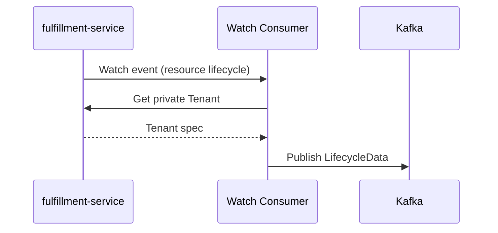

# Tenant External Billing Identity

## Summary

Add an optional, opaque `external_billing_id` to private `TenantSpec`, and copy it onto metering `LifecycleData` at publish time so Kafka events carry the external billing account identifier. See [PRD](prd.md) for requirements.

## Motivation

OSAC publishes tenant consumption to Kafka. Downstream billing adapters route those events using their own account identifiers, which are unrelated to OSAC tenant names. `TenantSpec` has no field for that identifier, and `LifecycleData` carries only the OSAC `tenant_id`.

This design stores the identifier on the private tenant and copies it onto each usage event when the event is published.

### Goals

- Add optional `external_billing_id` to private `TenantSpec`, set and read through the private Fulfillment API. [Locked: D2]
- Keep the field out of the generated public schema. [PRD: FR-2]
- Set `LifecycleData.external_billing_account_id` at publish time by reading the tenant on each event. [User]
- Apply billing-id changes to later events only. [PRD: FR-4]
- Store the field in the existing tenant JSONB document. No SQL migration.

### Non-Goals

- Console UI, Enclave Wizard, or CLI changes. The field rides the existing tenant manifest, including `osac create -f`. [Locked: D2, D4]
- More than one external billing account per tenant, or a uniqueness constraint.
- Checking that the identifier exists in the external billing system.
- Rewriting Kafka events published before the identifier was set or changed.

## Proposal

Two components change. The private Fulfillment API gains `TenantSpec.external_billing_id`. metering-service copies that value into every lifecycle event it publishes.

`[(cleanapi.field).private = true]` makes `protoc-gen-cleanapi` omit the field from the public proto. On each event it publishes, metering-service reads the tenant from the private API and copies `spec.external_billing_id` onto the payload. It does not cache the result. A lookup failure does not drop the event. [User]

### Workflow Description

A Cloud Provider Admin sets `spec.external_billing_id` on create or update of a tenant through the private API (`/api/private/v1/tenants`). The field is optional. When set, it is 1 to 256 characters and has no format check. An empty string is rejected. Clearing a stored value means omitting the field on update. Private Get and List return it when set. Public Get and List do not define it. [Locked: D2, D3]

After the value is stored, metering-service attaches it to later lifecycle events:



On each resource lifecycle event, the Watch Consumer calls private Tenant Get for that event's tenant, sets `external_billing_account_id` from `spec.external_billing_id`, and publishes. If the tenant has no billing id, the field is omitted. If the Get fails, the event is still published without the field, and the next event tries again. [User]

The Reconciler does the same Get when it emits a correction event. The correction carries the billing id stored at emission time. Kafka records already published are not rewritten. [PRD: FR-4]

### API Extensions

- **Private `TenantSpec.external_billing_id`.** Optional string on the existing tenant resource. Create, Update, Get, and List on `/api/private/v1/tenants` gain the field. The public tenant messages are unchanged because `proto/public/` is generated.
- **`LifecycleData.external_billing_account_id`.** Optional JSON field on the metering event payload. Present when the tenant has a billing id at publish time. Absent when it does not, or when the lookup failed.

## UX Alignment

No UI mapping. The field is private, and console UI is out of scope. [Locked: D2]

### Implementation Details/Notes/Constraints

Add field 3 on `TenantSpec` in `proto/private/osac/private/v1/tenant_type.proto`, after the existing public fields:

```protobuf
message TenantSpec {
  repeated string domains = 1;
  SecretLocalReference break_glass_credentials_secret = 2;

  // Opaque identifier for this tenant's account in the external billing
  // system. Optional. Provider-controlled. Omitted from the public API.
  optional string external_billing_id = 3
    [(cleanapi.field).private = true,
     (buf.validate.field).string.min_len = 1,
     (buf.validate.field).string.max_len = 256];
}
```

Regenerate with `make -C proto generate` and lint with `buf lint`. Do not edit `proto/public/`.

`PrivateTenantsServer` persists the proto as JSONB through `GenericServer` and `GenericDAO`. No server change and no SQL migration. The public `GenericMapper` copies fields by name; the generated public `TenantSpec` has no `external_billing_id`, so the value is never copied to a public response. The existing protovalidate interceptor enforces the 1 to 256 character limit on Create and Update.

In `osac-metering/schema/lifecycle.go`, add `ExternalBillingAccountID *string` with JSON `external_billing_account_id,omitempty`. Also add that name to `lifecycleDataFields`. The m360 translator copies only names from `LifecycleDataFields()`, so leaving it off that list would drop the id before it reaches the billing adapter. When the pointer is nil or the string is empty, the translator leaves `external_billing_account_id` out of the m360 payload. It does not run this field through `nullToSpace`, which would turn that absence into a single space.

The Watch Consumer and the Reconciler call `TenantsClient.Get` on the existing private-API connection for each event they publish. They set `ExternalBillingAccountID` from `spec.external_billing_id` and do not retain the result. [User] If the Get fails, log at `Warn` (`failed to look up tenant billing ID`, with `tenant` and `error`) and publish the event with the field unset.

### Security Considerations

The private annotation is the access boundary. Public clients have no field to send or receive. The value is an account reference with the same sensitivity as the tenant name, and the only new validation is a length of 1 to 256 characters. [PRD: FR-2]

### Failure Handling and Recovery

A value longer than 256 characters, or an empty string, is rejected on Create and Update. Omitting the field clears a stored value: events then omit `external_billing_account_id`. If the Tenant Get fails, the usage event is still published without the field and the next event tries again. A changed id is copied onto events published after the change. Events already in Kafka stay as they were. [PRD: FR-4]

### RBAC / Tenancy

No new RBAC. Cloud Provider Admins use the private Tenant API. The public schema omits the field.

### Observability and Monitoring

No new metrics or alerts. [Locked: D3] A failed tenant lookup is logged at `Warn` with the message `failed to look up tenant billing ID`.

### Risks and Mitigations

The new JSON key is omitted when unset, so existing adapters ignore it. m360 copies it only after the name is added to `LifecycleDataFields()`.

### Drawbacks

Every usage event calls the private Tenant API once. That extra RPC is accepted because these events are lifecycle changes, and the next event after a billing-id change carries the new id. [User]

## Alternatives (Not Implemented)

| Decision | Alternative | Why it was rejected |
|----------|-------------|---------------------|
| Enrich in metering-service | Each adapter calls the private Tenant API | Duplicates the lookup, gives every adapter a private-API credential, and leaves the Kafka event incomplete for replay. [Research: consumer-side enrichment] |
| Field on `LifecycleData` | CloudEvent extension attribute only | Receivers are not required to forward extension attributes, so a broker can strip the id. Adapters already read `LifecycleData`. |
| Private spec field | `metadata.labels` entry | Labels are on the public API and are caller-writable, which breaks FR-2. |
| Read the tenant on each event | In-process cache of the billing id | A cache needs invalidation on tenant update and can publish the previous id after a change. Lifecycle events are infrequent enough that the Get is the smaller design. [User] |

## Test Plan

Test the private field and the Kafka payload together. Create and update a tenant with and without `external_billing_id` on the private API, and confirm a public Get omits it. Publish a lifecycle event and confirm `external_billing_account_id` matches the tenant's current value, including the next event after an update, and is omitted when the tenant has none or the Tenant Get fails. An empty string and a value longer than 256 characters are rejected. Omitting the field on update makes the next event omit `external_billing_account_id`, including from the m360 payload.

## Graduation Criteria

Not targeted at a release yet.

## Upgrade / Downgrade Strategy

The field is optional, and an upgrade needs no migration. A downgrade hides it from the API and from new metering events. The stored value remains until an older fulfillment-service updates the tenant. That update rewrites the JSON document without `external_billing_id`. After the new service is restored, the admin sets the id again.

## Version Skew Strategy

An older fulfillment-service ignores the field on input and omits it on output. An older adapter ignores the new JSON key. If metering-service is upgraded first, Tenant Get returns no billing id until fulfillment-service is upgraded, and events published in that window omit the field.

## Support Procedures

If events for a tenant lack `external_billing_account_id`, read the tenant on the private API. A `failed to look up tenant billing ID` warning means that Get failed. The next successful lookup fills the id. Events already published are not replayed.

## Infrastructure Needed

None.

---

## Provenance

Authored: revise @ design 0.11.5 - a58bdf7, workspace main @ f0a8211
Phases: draft, revise, revise, revise, revise

<!-- ai-workflow-provenance:{"schema_version":1,"provenance_kind":"session","workflow":"design","workflow_version":"0.11.5","ai_workflows":"a58bdf7","source_repo":"f0a8211","source_repo_branch":"main","commits_behind_main":0,"commits_ahead_main":0,"main_ref":"main","phases":["draft","revise","revise","revise","revise"],"authoring_modes":["skill"],"context_changed":false,"origin_untracked":false} -->
