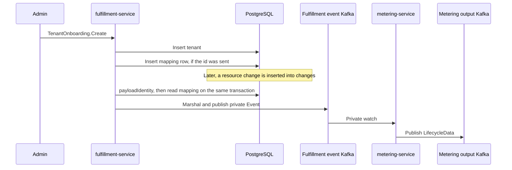

# Tenant External Billing Identity

## Summary

Store an optional external billing id in a mapping table keyed by tenant id, and copy that id onto the private usage event when the `changes` publisher sends it. See [PRD](prd.md) for detailed requirements.

## Motivation

OSAC meters tenant consumption and reports it to an external billing system. That system accounts usage by its own account id. The OSAC tenant id is a different identifier. A Cloud Provider Admin needs to record the external account id for a tenant at onboarding, read it back, and have later usage for that tenant carry the same id.

Fulfillment stores the association in its own table, one row per tenant. A resource change is inserted into the `changes` table. The event publisher drains that table, using `changes` as both the default table name and the default notification channel, and writes a private `Event` to the fulfillment event Kafka. Before it serializes the event, it reads the mapping row for the event's tenant id and, when a row exists, sets the billing id on the event. Metering receives that event on the private watch, copies the id onto `LifecycleData`, and its own publisher writes that usage record to the metering output Kafka. Those are two records on two topics.

### Goals

- Accept an optional external billing id on tenant onboarding and store one mapping row when the caller sends one.
- Keep `Tenants.Create` on its current request, persistence, and `Tenant` response. Onboarding is the call that can also write the mapping row.
- After `payloadIdentity` succeeds, look up the tenant id on the publisher's transaction and set the id on the event before `proto.Marshal` when a row exists.
- Publish the event with `external_billing_id` unset when the tenant has no mapping row.
- Apply a replace or delete to `changes` rows processed after that write. Private events already in the fulfillment event Kafka stay as they were.
- On a mapping lookup error, return from `processChange` and leave the `changes` row to be retried.

### Non-Goals

- Console UI. A later `TenantCreatePage` calls `TenantOnboarding.Create` and sends the tenant and the optional billing id as sibling fields.
- More than one billing id per tenant.
- Checking that the id exists in the external billing system.
- Rewriting private events that were already published.

## Proposal

Tenant rows keep their current columns and JSON document. A new `tenant_external_billing_ids` table holds the billing id, with `tenants.id` as its primary key. The private `Event` gains an optional envelope field, `external_billing_id`, outside the resource payload.

Shared functions perform the tenant identity checks, break-glass preparation, and the tenant insert. `TenantOnboarding.Create` calls those functions and, when the caller sent a billing id, inserts the mapping row in the same request transaction. `Tenants.Create` calls the same functions and returns.

`processChange` converts the `changes` row, resolves `payloadIdentity`, looks up the mapping on the transaction that call already holds, marshals the private `Event`, and sends it to the fulfillment event Kafka. A found row sets `external_billing_id`. A missing row leaves the field unset. Metering copies a present field onto `LifecycleData`. Metering reads the watch event and does not query the mapping table.



Fulfillment event Kafka carries the private `Event`. The private watch reads that topic. Metering publishes a separate `LifecycleData` record to metering output Kafka. The billing id on the private event is the mapping present when that `changes` row is processed. A row that is still waiting can carry an id written after the resource change. Events already published stay as they were.

### Workflow Description

A Cloud Provider Admin calls `TenantOnboarding.Create`. The request has two sibling fields: the `Tenant` to create, and an optional `external_billing_id`.

When the billing id is omitted, onboarding creates the tenant and leaves the mapping table without a row for it. When the id is present, it must be 1 to 256 characters and must contain a non-whitespace character. An empty string and a whitespace-only string are rejected with `InvalidArgument`, and nothing is written. The value is stored as sent. There is no other format check. `Replace` uses the same rules.

The server normalizes the tenant identity, prepares break-glass credentials, and persists the tenant. It then inserts the mapping row when the id is present. Both writes use the request transaction. If either write fails, the transaction rolls back. The response is the `Tenant` that `Tenants.Create` returns for the same tenant, including generated break-glass credentials. The billing id is read with `Get`.

`TenantExternalBillingIds.Replace` writes the row for an existing tenant, including when no row exists yet. `TenantExternalBillingIds.Delete` removes the row. Concurrent replace and clear are last-write-wins. The table has no version column. A `changes` row processed after the write carries the new id, or leaves the field unset after a delete.

`TenantExternalBillingIds.Get` takes `tenants.id` and returns the stored billing id. When the tenant has no mapping row, `Get` returns `NotFound`. Tenant Get and List return the `Tenant`. The billing id is on the mapping API.

### API Extensions

This design adds the private RPCs below. `tenant_type.proto` and `Tenants.Create` stay as they are. The names and routes are choices for proto and API review. OSAC resource services commonly use Create, Get, Update, and Delete. `Replace` matches HTTP PUT, and `Update` matches that naming as well. Either name is acceptable when the proto review agrees. Implementation checks the chosen names and routes with proto lint and the gateway conventions.

`{tenant_id}` is `tenants.id`, the primary key of the tenant row. When create omits the id, that primary key is the name stored as the id.

| RPC | Method and route | Body |
|-----|------------------|------|
| `TenantOnboarding.Create` | `POST /api/private/v1/tenant-onboarding` | `Tenant tenant` and `optional string external_billing_id` |
| `TenantExternalBillingIds.Get` | `GET /api/private/v1/tenants/{tenant_id}/external-billing-id` | Response is the stored id |
| `TenantExternalBillingIds.Replace` | `PUT /api/private/v1/tenants/{tenant_id}/external-billing-id` | `external_billing_id` |
| `TenantExternalBillingIds.Delete` | `DELETE /api/private/v1/tenants/{tenant_id}/external-billing-id` | Deletes the row |

`Event.external_billing_id` is an optional string on the private event envelope, marked `(cleanapi.field).private = true`, and it sits outside the payload `oneof`. Add it at the end of `Event`, using the next compatible unused field number in the implementation checkout. Regenerate the private and public projections. The public Watch returns the generated public `Event`, which has no `external_billing_id`.

`LifecycleData.external_billing_account_id` is set when the watched event carried the envelope field. Metering writes that record to metering output Kafka.

Committed `changes` rows remain in the table and are drained when the publisher resumes. A resource change attempted while fulfillment-service is unavailable is not inserted. Tenant deletion uses the existing delete path. When that path physically removes the tenant row, the foreign key removes the mapping row.

## UX Alignment

No console change. A later `TenantCreatePage` calls `TenantOnboarding.Create`.

### Implementation Details/Notes/Constraints

Add `tenant_external_billing_ids` as the next numbered `*.up.sql` migration under `fulfillment-service/internal/database/migrations/`, and update `migrations.sha256` in the same change. The closest foreign-key pattern is `66_add_tenant_domains.up.sql`. The migration number is chosen at implementation time.

```sql
create table tenant_external_billing_ids (
  tenant_id text primary key
    references tenants(id) on delete cascade,
  external_billing_id text not null,
  created_at timestamptz not null default now(),
  updated_at timestamptz not null default now()
);
```

A tenant with no billing id has no row in this table. The same external billing id may be stored for more than one tenant. The foreign key removes the mapping row when the tenant row is physically deleted. The row is still there while deletion is only marked and finalizers are still running.

The table is an internal association. It is written by its own DAO, on a transaction the caller supplies. Lookup returns `(value, found, error)`. `found == false` with a nil error means no row. A non-nil error is a database failure. Upsert and delete-by-tenant use that same transaction. The row is keyed only by `tenants.id`.

Tenant creation is factored into functions that both handlers call.

- Normalize and validate tenant identity.
- Validate or generate break-glass credentials.
- Persist the tenant through the existing generic path, on the request transaction.
- Insert the optional mapping on that same transaction.
- Return the `Tenant` from the shared persist path, including generated break-glass credentials.

`Tenants.Create` calls the first three and returns that `Tenant`. `TenantOnboarding.Create` calls all four and returns that same `Tenant`. The request transaction is the one already carried by fulfillment request handling.

In `processChange`, the order is `convertChange`, then `payloadIdentity`, then the mapping lookup on `tx`, then `proto.Marshal`, then the send to the fulfillment event Kafka. The private watch unmarshals that event and streams the private `Event`. Metering's publisher then writes `LifecycleData` to metering output Kafka.

Metering adds this field to `LifecycleData`, in struct-field order, and adds the same name to `lifecycleDataFields` at that position:

```go
ExternalBillingAccountID *string `json:"external_billing_account_id,omitempty"`
```

`BuildLifecycleData` copies the envelope field when it is present. When the pointer is nil, the m360 translator leaves the key out of its payload. The field bypasses normalization that turns a nil or empty value into a placeholder, including `nullToSpace`. Those symbols are in this workspace at `osac-metering/metering-service/internal/events/mapper.go` and `osac-metering/adapters/m360/translate.go`.

### Security Considerations

The new RPCs and the event field are private. `GrpcAuthzInterceptor` evaluates `internal/auth/policies/authz.rego` before the handler runs. A denied caller receives `PermissionDenied`, and the handler does not run. Each new RPC has a policy test for an allowed admin, a denied `tenant-admin`, and a denied non-admin client. A present billing id must be 1 to 256 characters and must contain a non-whitespace character.

### Failure Handling and Recovery

An empty string, a whitespace-only string, or a value longer than 256 characters is rejected with `InvalidArgument`, and neither a tenant nor a mapping row is written. If the tenant insert or the mapping insert fails, the request transaction rolls back, and neither row remains.

A missing mapping row is `(found == false, error == nil)`. The `changes` row is published with `external_billing_id` unset.

A lookup error returns a wrapped error from `processChange` and leaves the `changes` row in place. The drain retries it. Conversion, identity, and marshal errors stay on their current path: those rows are deleted as permanently unpublishable.

Replace and clear apply to `changes` rows processed after the write. The last committed replace or clear wins. Private events already in the fulfillment event Kafka stay as they were.

### RBAC / Tenancy

No new role. The new methods are allowed by the existing admin rule, `allow if is_admin`: an emergency service account, `service-account-osac-admin`, `service-account-osac-controller`, or a member of the `admins` group. The tenant-admin, tenant IdP manager, client, and CSI method lists stay as they are. The mapping row is keyed by `tenants.id` and carries no `osac.openshift.io/tenant` or `osac.openshift.io/owner-reference` annotation.

### Observability and Monitoring

No new metric. Lookup failures increment the existing publisher error metric, because `processChange` already counts errors before it returns. The lookup log includes the tenant id and the `changes` row id. `Get` shows whether a tenant has a billing id.

### Risks and Mitigations

The publisher reads the mapping when it processes the `changes` row. A replace or delete that lands while the row is waiting is the id that event carries. The load run records publish latency and the unpublished backlog with that lookup enabled, which is how the cost of one primary-key read per event is judged.

### Drawbacks

Every processed `changes` row performs one primary-key lookup. Tenant creation is shared by two RPCs, and `Tenants.Create` must still return the `Tenant` it returns today, including generated break-glass credentials.

## Alternatives (Not Implemented)

| Decision | Alternative | Why it was rejected |
|----------|-------------|---------------------|
| Mapping table | A field on `Tenant` | The tenant message is the object for the tenant API and for tenant change events. A billing id on that message would be present on every use of it. |
| Lookup in `processChange` | Metering calls Tenant Get for each usage event | That reads the whole tenant. The private event can carry the one string metering needs. |
| Value at publish time | Copy the id into the `changes` row when the resource change is inserted | The `changes` row is the resource. This design reads the mapping when that row is processed, so a waiting row uses the mapping current at that time. |
| Same external id on many tenants | A unique constraint on `external_billing_id` | One external account may be recorded for more than one tenant. The limit in this design is one id per tenant. |
| Read the mapping on each event | Cache the mapping in the publisher | A replace or delete has to be visible on the next processed row. A cache would need its own invalidation. |
| Last-write-wins | An optimistic version on the mapping row | Concurrent provider updates are not required to fail. The last committed write stands. |

## Test Plan

Onboard a tenant with a billing id and without one. The response is the created `Tenant`, including generated break-glass credentials, and the billing id is read with `Get`. `Tenants.Create` writes a tenant and leaves the mapping table empty for it. A supplied id inserts one row in the same transaction as the tenant, and a failed insert leaves neither row. An empty string, a whitespace-only string, and a value longer than 256 characters are rejected. `Get` by `tenants.id` returns the stored id. No row returns `NotFound`. Replace and delete update or remove that row, and two concurrent writes follow last-write-wins. Policy tests allow an `is_admin` caller and return `PermissionDenied` for a `tenant-admin` caller and a non-admin client.

Publish a resource event for a tenant with a mapping row, and confirm the private event and `LifecycleData.external_billing_account_id` carry it, including on the private watch. With no row, both leave it unset, and the public watch response has no `external_billing_id`. A lookup error returns from `processChange` with the `changes` row still present, and a later retry publishes. A replace or delete applies to a `changes` row processed after that write. A private event already in the fulfillment event Kafka stays as it was. The mapping row remains while tenant deletion is waiting on finalizers, and it is removed when the tenant row is physically deleted. The m360 payload omits `external_billing_account_id` when the pointer is nil or the string is empty, and that field skips `nullToSpace`. A load run records publish latency and the unpublished `changes` backlog with the lookup enabled.

## Graduation Criteria

Not targeted at a release yet.

## Upgrade / Downgrade Strategy

The change adds a table. The migration is the next numbered `*.up.sql` file, and `migrations.sha256` is updated with it. Upgrade does its work by adding the table. Tenant rows stay as they are. An older fulfillment-service leaves the table unread and publishes events with the field unset. The rows remain for a newer service. Downgrade leaves the table in place.

## Version Skew Strategy

If fulfillment is upgraded first, new private events carry the field and an older metering build ignores it. If metering is upgraded first, the envelope field is absent until fulfillment writes it, and those usage records omit `external_billing_account_id`. An older public client receives the public event projection, which has no `external_billing_id`.

## Support Procedures

If usage for a tenant has no billing id, call `Get` with that tenant's `tenants.id`. `NotFound` means the private event was published with the field unset. A `changes` row that is still retrying means the mapping lookup failed and the event was not published. The publisher log for that failure includes the tenant id and the `changes` row id. Private events already in the fulfillment event Kafka stay there. While the tenant has no mapping row, new usage is published with the field unset.

## Infrastructure Needed

None.

---

## Provenance

Authored: revise @ design 0.11.5 - a58bdf7, workspace main @ f0a8211
Phases: draft, revise, revise, revise, revise, draft, revise, revise, revise

<!-- ai-workflow-provenance:{"schema_version":1,"provenance_kind":"session","workflow":"design","workflow_version":"0.11.5","ai_workflows":"a58bdf7","source_repo":"f0a8211","source_repo_branch":"main","commits_behind_main":0,"commits_ahead_main":0,"main_ref":"main","phases":["draft","revise","revise","revise","revise","draft","revise","revise","revise"],"authoring_modes":["skill"],"context_changed":false,"origin_untracked":false} -->
