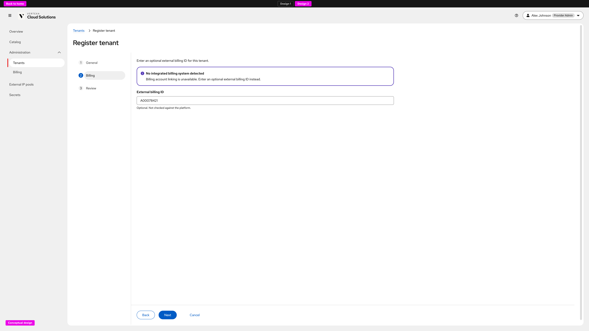
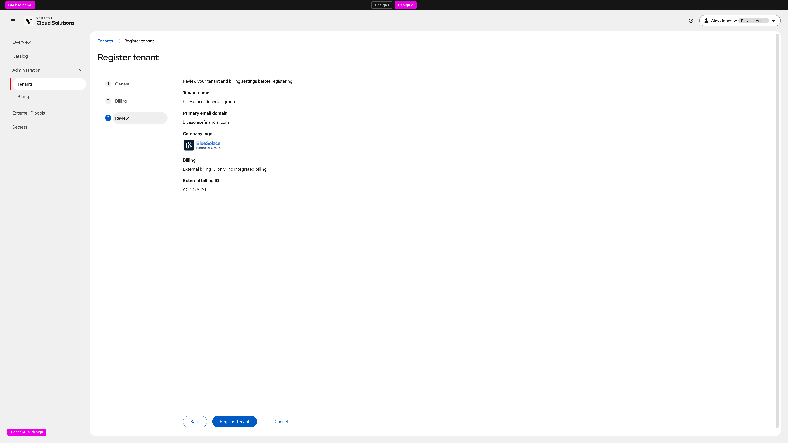
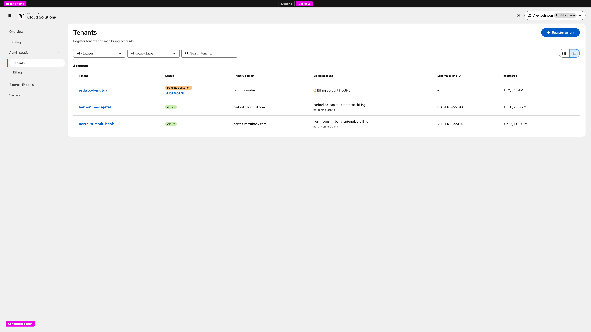
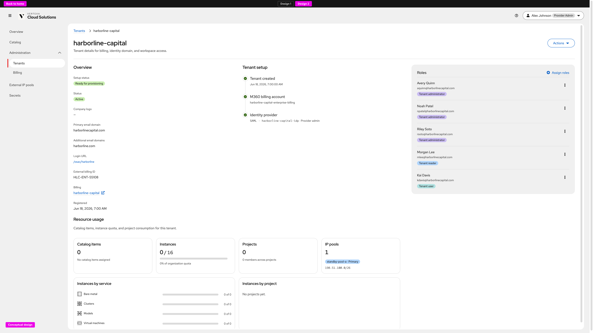

# Tenant external billing identity — UX Design (Design 2)

Conceptual UX for **associating an OSAC tenant with its identity in an
external billing system**
([OSAC-6161](https://redhat.atlassian.net/browse/OSAC-6161)), captured from
**Design Lab → External billing ID → Design 2**.

Design 2 is the **no integrated billing system** path (Option B): when the
cluster has no configured billing integration such as M360, Provider Admin
does not see Link now / Set up later account-linking cards. The Billing step
is a single optional **External billing ID** field (for example a Zuora
account ID for Telus-style deployments).

**Prototype (developers — Design Lab on `:5176`):**

- [Register tenant → Billing (Design 2)](http://127.0.0.1:5176/provider/workspace?nav=administration-organizations&hub=1&topic=external-billing-id&design=2&action=register-tenant)
- [Tenants list (Design 2)](http://127.0.0.1:5176/provider/workspace?nav=administration-organizations&hub=1&topic=external-billing-id&design=2)
- [Tenant detail — harborline-capital](http://127.0.0.1:5176/provider/workspace?nav=administration-organizations&hub=1&topic=external-billing-id&design=2&tenant=org-harborline-capital)

Requirements: [prd.md](prd.md). Backend / API design: [design.md](design.md).
Clarifications (D2 interface lock for the Feature MVP):
[clarifications.md](clarifications.md).

> **Scope note.** The locked Feature MVP stores and reads
> `external_billing_id` on the **private** Tenant API and stamps it into
> metering heartbeats ([design.md](design.md)). Console UI is a future
> increment in the PRD. This document records the **Design 2** console
> concept so Provider Admin association and observability stay aligned with
> that field when UI ships.

## Product decisions (this release / Design 2)

- **Adapt when no billing integration is configured.** Behind the scenes the
  UI checks whether an integrated billing system (for example M360) is
  configured on the cluster. If **not**, Design 2 hides Link now / Set up
  later and shows only **External billing ID (optional)** plus an inline
  info alert: **No integrated billing system detected**.
- **Opaque, optional identifier.** The value is the account ID in the
  operator’s external system (placeholder example `A00078421`). It is not
  validated against that system at onboarding ([prd.md](prd.md) Out of
  Scope). Helper copy: *Optional. Not checked against the platform.* Max
  length matches the private API (256).
- **Provider-only.** Capture and display live under Provider Admin →
  **Administration → Tenants**. Tenant Admins and Tenant Users never see
  the field ([prd.md](prd.md)).
- **Register and edit share the Billing step.** Create uses **General →
  Billing → Review**. Edit / resume billing reuse the same Billing step so
  the ID can be set or changed after registration (FR-4: changes apply
  going forward in metering).
- **Review names the mode.** Review shows Billing as *External billing ID
  only (no integrated billing)* and repeats the entered ID (or —).
- **List and detail make presence observable.** Tenants list includes an
  **External billing ID** column; tenant Overview shows the value in
  `<code>` when set, — when absent ([clarifications.md](clarifications.md)
  D3 field-presence observability).

---

## Journey overview

```text
Cloud Provider Admin opens Administration → Tenants
        │
        ▼
Register tenant (Design 2) — General → Billing → Review
        │
        ▼
Billing: no M360 / integrated billing
  • Alert: No integrated billing system detected
  • Optional External billing ID
        │
        ▼
Review → Register tenant
        │
        ▼
Tenants list / tenant detail show External billing ID when set
```

---

## 1. Register tenant — Billing (Design 2)

**What this screen is for.** Let a Cloud Provider Admin record an optional
external billing account identifier at tenant registration when the
deployment has no integrated billing platform to link against
([prd.md](prd.md) Cloud Provider Admin stories).

**Explanation.** On **Register tenant → Billing**, Design 2 leads with
*Enter an optional external billing ID for this tenant.* An info alert
states that no integrated billing system was detected and that account
linking is unavailable. Below it, a single **External billing ID** text
field (example placeholder `e.g. A00078421`) accepts the opaque ID. There
are no timing cards and no M360 account picker. **Next** advances to
Review; leaving the field empty is valid.



---

## 2. Register tenant — Review

**What this screen is for.** Confirm tenant identity and the external
billing association before the tenant is created.

**Explanation.** **Review** summarizes tenant name, primary email domain,
company logo, Billing mode (**External billing ID only (no integrated
billing)**), and the **External billing ID** value (or —). Primary action
is **Register tenant**.



---

## 3. Tenants list — External billing ID column

**What this screen is for.** Let Provider Admin scan which tenants already
carry an external billing identifier and spot gaps before or after
onboarding.

**Explanation.** **Administration → Tenants** list view includes
**External billing ID** beside Billing account. Set values render as
`<code>`; unset rows show —. Search can match the ID. Grid cards may
surface the same identifier where space allows; list view is the
canonical scan surface for Design 2 observability.



---

## 4. Tenant detail — Overview

**What this screen is for.** Confirm the stored external billing identity
on an existing tenant and support edit / resume flows that change it.

**Explanation.** Tenant Overview includes **External billing ID** in the
description list. Present = associated; absent = —. Actions → Edit (or
Billing setup) reopen the wizard Billing step under the same Design 2
rules so the opaque ID can be added or replaced without requiring an
integrated billing link.



---

## Notes vs Design 1 and the API design

| Topic | Design 2 (this UX) | Design 1 / other |
| --- | --- | --- |
| Integrated billing present? | Assumed **no** — hide Link now / Set up later | Design 1 keeps timing cards; external ID on Set up later |
| Field semantics | Optional opaque `external_billing_id` | Same field; [design.md](design.md) private API + heartbeat stamp |
| Console in Feature MVP | Conceptual / future UI | Locked MVP is private API (+ `osac create -f` via schema) per D2 |
| Tenant-facing UI | None | None |

Align shipping console copy with **External billing ID**, keep the ID
provider-only, and preserve optional empty as a first-class state so
tenants not billed through an external system are not blocked.
