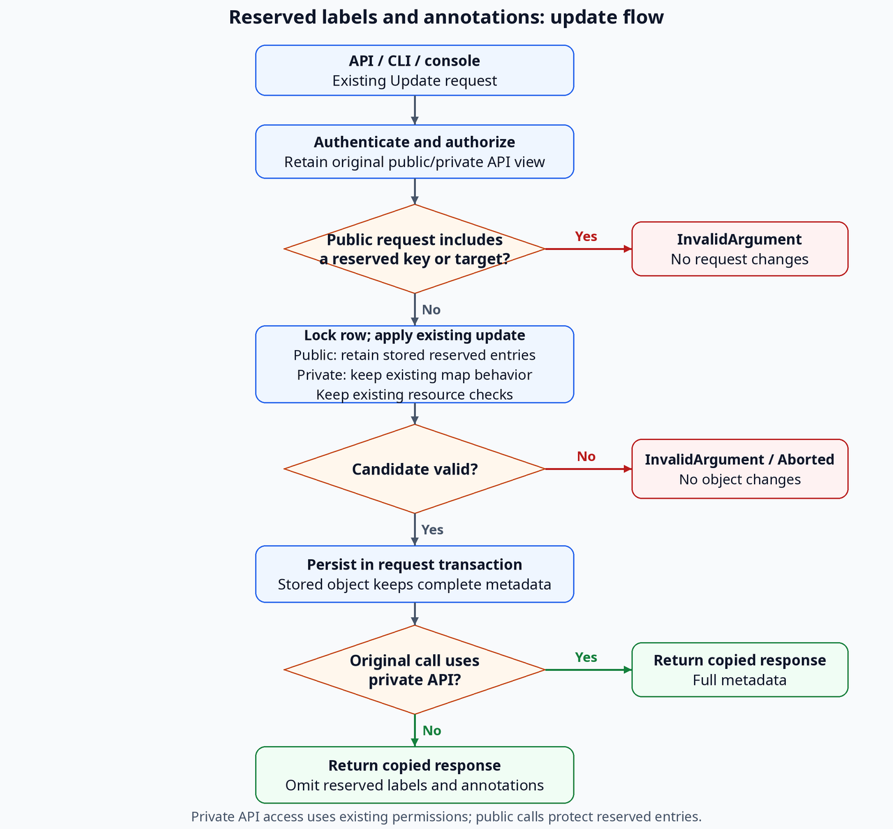

# Support Administrator-Only Labels and Annotations

## Summary

Reserve label and annotation keys under `admin.osac.openshift.io` and its subdomains. Hide these reserved labels and annotations in public responses and preserve them during public map updates. Private API behavior stays unchanged. See [PRD](prd.md) for requirements.

## Motivation

Public responses currently expose all labels and annotations, including reserved entries. Public map updates must preserve stored reserved labels and annotations.

### Goals

- Reuse metadata maps, storage, Update requests, versions, and transactions.
- Apply the same protection to requests, responses, events, and filters.
- Preserve ordinary metadata behavior across API, CLI, and console.

### Non-Goals

- Public networking Update methods or changes to ordinary metadata permissions.
- Typed resource fields, configurable prefixes, or separate metadata storage.
- In-place upgrades or new provisioning workflows.

## Proposal

Private API callers read and manage reserved labels and annotations under existing method and object permissions, directly or through CLI and console. Public API responses omit them for every caller. [Locked: D3, D5]

Enforce protection in the backend using existing updates: private API calls replace selected maps; public API updates retain the stored reserved portion. Reject supplied forbidden keys atomically in public requests. Omission preserves reserved entries without an error. [Locked: D4, D6, D7]

### Workflow Description

1. A user with existing private API access selects an object through private Get/List, `osac login --private`, or `/admin/metadata`.
2. The client reads its complete maps, then edits a copy while retaining untouched entries.
3. Submit the existing Update request with the object ID, edited maps, and an update mask when supplied.
4. The server validates and saves atomically, returning the private view.



The diagram shows backend validation, reserved-entry preservation, and public response filtering.

### API Extensions

IS-1 through IS-5 identify the PRD's five In Scope bullets. These interface IDs map to [the test plan](testplan.md).

| ID | Change | Requirements |
|---|---|---|
| IC-1 | Reserve the namespace and its subdomains; keep key/value validation | IS-1, IS-2, IS-3, IS-4, IS-5 |
| IC-2 | Cover all 35 private persistent types and supported metadata updates | IS-1, IS-2, IS-4 |
| IC-3 | Preserve tenant reserved entries during existing masked or unmasked updates | IS-1, IS-3, IS-4 |
| IC-4 | Reject forbidden input observable in public requests atomically | IS-3, IS-4 |
| IC-5 | Filter object responses, nested Metadata, and events | IS-2, IS-4 |
| IC-6 | Protect filters and matching counts | IS-2, IS-4 |
| IC-7 | Preserve existing authorization; apply protection by API view | IS-1, IS-2, IS-3 |
| IC-9 | Add the console editor and protect tenant display/search | IS-1, IS-2, IS-3, IS-4 |
| IC-10 | Document prefix, operations, errors, and examples | IS-5 |

### Implementation Details/Notes/Constraints

#### Reserved keys and resource scope

Add a shared predicate for `admin.osac.openshift.io` and its subdomains. Split valid keys at `/`; the DNS prefix must equal `admin.osac.openshift.io` or end with `.admin.osac.openshift.io`. Keep case-sensitive matching and existing key/value validation, including rejection of uppercase key-name segments and label values. [User: review alignment]

`admin.osac.openshift.io/tracking-id` and `child.admin.osac.openshift.io/tracking-id` are reserved, including deeper subdomains. `fakeadmin.osac.openshift.io/tracking-id`, `admin.osac.openshift.io.example/tracking-id`, `osac.openshift.io/tenant`, `osac.openshift.io/owner-reference`, `admin`, and `system` stay ordinary. Keys without a `/` have no reserved DNS prefix.

Cover all 35 persistent types:

| Area | Types |
|---|---|
| Clusters | Cluster, ClusterTemplate, ClusterCatalogItem, ClusterVersion |
| Compute | ComputeInstance, ComputeInstanceTemplate, ComputeInstanceCatalogItem, InstanceType, DiskImage |
| Bare metal | BareMetalInstance, BareMetalInstanceTemplate, BareMetalInstanceCatalogItem, BareMetalInstanceType |
| Add-ons | AddOnOperator |
| Networking | NetworkClass, VirtualNetwork, Subnet, SecurityGroup, ExternalIPPool, ExternalIP, ExternalIPAttachment, NATGateway, FabricDomain |
| Storage | StorageBackend, StorageTier, Volume |
| Administration | Hub, Tenant, User, IdentityProvider, Project, ProjectMembership, Role, RoleBinding, Secret |

Each has private Update; service enablement still applies. Only Hub, NetworkClass, and StorageBackend are private-only. Volume and FabricDomain have public CRUD, including Update; apply the public protection to those existing methods. Apply input/output protection to ephemeral SelfSubjectAccessReview without adding persistent CRUD.

#### Authorization and write validation

Keep existing method, object, tenant, and project authorization unchanged. No OPA, AuthzDecision, Subject, or administrator-flag changes are needed. Preserve the original public/private API view when public handlers delegate to private code.

The public API hides reserved labels and annotations and rejects their explicit use in Create/Update for every caller, including administrators. Reserved edits require the private API. Public whole-map updates preserve stored reserved entries.

| Original API view | Reserved metadata |
|---|---|
| Private, any caller with existing method/object permission | Complete maps; existing read/write behavior |
| Public, any caller, including administrators | Hidden; explicit writes rejected |

Keep shared reserved-key validation and map-preservation helpers with GenericServer. Public Create/Update handlers validate the original request before mapping or delegation, ahead of handler-level dependency creation or reference mutation. Reject every supplied reserved entry or accepted explicit reserved-key mask path with `InvalidArgument`, including unchanged values, absent targets, nested Metadata, and keys outside the mask. Preserve that error through the public handler; apply no ordinary subset. Private Create/Update retains existing behavior. [Locked: D4]

#### Whole-map Update

Use the existing Update request. An update mask can select `metadata.labels`, `metadata.annotations`, or both for complete map replacement. The table describes selected-map updates; existing unmasked requests remain supported where the service permits them.

| Selected-map input | Public API | Private API |
|---|---|---|
| Ordinary entries | Replace ordinary portion; retain stored reserved portion | Replace the map, deleting omitted entries |
| Reserved entry supplied | Reject the entire request, even outside the mask | Store the supplied entries |
| Empty or omitted map | Clear ordinary portion; retain reserved portion | Clear the map |
| Map not selected | Unchanged, subject to raw-input rejection above | Unchanged |

Empty strings are values. Existing parent-metadata, unmasked, and accepted per-key updates retain their semantics, with reserved-entry preservation on every tenant update. Identical maps and authorized absent-key removals are no-ops. [Locked: D6]

For unmasked updates, keep each handler's current map behavior. Private generic Update replaces the object; public wrappers such as ComputeInstance copy nonempty submitted maps into fetched maps, retaining omitted ordinary keys. Empty maps follow existing clearing rules. Restore reserved entries from the locked row in every public path. The unchanged CLI uses its existing unmasked request; this feature does not normalize ordinary map behavior. [Codebase: fulfillment-service/internal/servers/compute_instances_server.go; fulfillment-service/internal/servers/generic_mapper.go; fulfillment-service/internal/reflection/reflection_helper.go]

Change GenericServer's update path:

1. Read the stored object under the existing database row lock.
2. Apply the existing mask or unmasked replacement to a detached candidate.
3. For public requests, replace the candidate's reserved portion in both maps with the locked stored portion. Preserve ordinary replacement/deletion behavior. Private requests keep existing replacement semantics.
4. Run resource preparation/validation and save through the existing transaction, retaining identity and ownership checks. Restored stored entries are trusted data; validate caller input before merging it with stored data.

Existing optional-lock behavior is unchanged. Reserved labels and annotations remain protected with either setting.

REST keeps `body: "object"`, generated body-derived masks, and explicit map-level query masks:

```text
PATCH /api/private/v1/compute_instances/<id>?update_mask=metadata.labels
Body: {"metadata":{"labels":{"example.org/environment":"prod"}}}
```

This replaces labels under the map rules; an empty map clears the permitted portion. Native gRPC and Connect use the existing Update request with object ID, the same map, and `update_mask.paths = ["metadata.labels"]`. No Update field or custom gateway parser is added. [Codebase: proto/gen/osac/private/v1/compute_instances_service.pb.gw.go]

#### Response, event, and query privacy

Use GenericMapper's existing private-to-public path to omit reserved entries recursively from actual Metadata messages in Get/List, Create/Update responses, nested objects, and streams. Leave private responses, unrelated maps, and internal/stored objects intact. Public Events.Watch uses the same projection before evaluating predicates. SelfSubjectAccessReview uses shared input validation in its public handler and the same response mapping, without persistent CRUD. [Codebase: fulfillment-service/internal/servers/generic_mapper.go; fulfillment-service/internal/servers/events_server.go; fulfillment-service/internal/servers/self_subject_access_reviews_server.go]

For public queries, inspect parsed, type-checked CEL filters. Explicit reserved-key references, membership checks, and mixed predicates return `InvalidArgument` before item/count SQL, independent of key existence. Evaluate supported whole-map predicates against JSONB with reserved entries excluded; keep ordinary literal-key indexed SQL and existing unsupported-operator errors. Private queries keep existing access to complete maps. [Codebase: fulfillment-service/internal/database/dao/filter_translator.go]

#### Private networking Updates

Reuse private Update for NetworkClass, VirtualNetwork, Subnet, SecurityGroup, ExternalIPPool, ExternalIP, ExternalIPAttachment, and NATGateway; all eight current paths accept map-level metadata. ExternalIP, ExternalIPAttachment, and NATGateway require a nonempty existing mask. [Codebase: fulfillment-service/internal/servers/external_ip_lifecycle.go]

Retain supported ordinary/mixed edits, specification/status/ownership validation, system-default-label restrictions, and controller status operations. Clients retain untouched operational labels. Public Update stays absent for these eight services; the documentation conflict remains below. FabricDomain retains its existing public/private Update methods and validators. [Locked: D3, D5] [User]

#### CLI and console

- **CLI:** reuse existing `label`/`annotate`, `key=value`, `key-`, request construction, and error reporting. Backend responses provide the correct public/private view. Supplied reserved entries are rejected by the server; removals represented only by omission preserve the stored entry and may succeed. [Locked: D7]
- **Console:** add `/admin/metadata`, a type/object selector, and shared map editor for all 35 private services. Link existing detail pages and reuse existing administrator navigation. Forward the user's token; existing private method authorization controls access. Public pages use backend-filtered maps for display/search. Editors display server errors and retain unsaved changes. [Locked: D5, D7]

Refresh UI types for the existing API inventory and update API reference, CLI help, administrator/tenant guides, and component testing maps. Document the reserved namespace, subdomain matching, and server support requirement. Reuse metadata columns/indexes, versions, and events; no API field, database migration, CRD/controller/AAP change, or Helm setting is required.

### Security Considerations

Enforce public API protection on the server, independently of UI roles, headers, or reflection credentials. Keep existing private permissions: the Container Storage Interface (CSI) identity's allowed Volume Create/Get/Delete/List methods retain complete metadata; Update remains disallowed. No method allowlist or tenant scope is widened. [Codebase: fulfillment-service/internal/auth/policies/authz.rego]

### Failure Handling and Recovery

Reject reserved-key input in a public request with `InvalidArgument`: “Label or annotation is reserved for use by the system.” Apply no changes and disclose no stored values. Existing authorization, validation, concurrency, and infrastructure errors retain their behavior.

Public map omission preserves reserved entries and permits ordinary edits. If the client discarded a removal target, the server cannot infer that attempt and may return success. [Locked: D6, D7]

### RBAC / Tenancy

Reuse existing method/object, tenant/project, and trusted controller permissions. Reserved-key rules depend on the original public/private API view, with no additional role check. Retain tenant and owner-reference isolation annotations. No new roles or resources are added. [Locked: D5]

### Observability and Monitoring

Reuse existing RPC status metrics and logs. Feature-specific validation messages contain only methods and supplied key names. Existing optional debug body logging can include metadata values and retains its current redaction behavior.

### Risks and Mitigations

| Risk | Mitigation |
|---|---|
| Metadata leaks or a handler drops update controls | Cover all 35 types, nested/events, and every transport. |
| Replacement loses entries | Retain untouched client entries and restore public callers' reserved entries from the locked row. |
| Client discards a reserved removal target | Preserve the stored entry; document that omission may succeed with ordinary edits applied. |
| Whole-map queries add cost | Keep literal-key indexes and inspect query plans. |
| API view or networking behavior diverges | Preserve the original API view through delegation and retain existing networking validators. |

API/authentication, networking, and console maintainers review their respective boundaries.

### Drawbacks

Clients must retain untouched map entries and reload after conflicts. The console registry must track new resource types. A reserved removal represented only by map omission may report success while leaving the stored entry unchanged.

## Alternatives (Not Implemented)

| Alternative | Reason for rejection |
|---|---|
| Reserve all `osac.openshift.io/` | Reclassifies existing isolation/lifecycle keys. |
| Add a per-key mask | Adds request fields and forwarding across every service. |
| Qualified keys in FieldMask | Installed JSON codecs reject the paths. |
| JSON Merge Patch / JSON Patch | Adds another format/parser across transports. |
| Ignore forbidden input or reject every tenant replacement | Violates atomic denial or ordinary compatibility. |
| Frontend/admission-only filtering | Leaves direct API, events, and query/count leaks. |
| Separate maps/storage or configurable matching | Adds storage/policy work beyond the fixed namespace. |

## Open Questions

### 1. Networking metadata contract

How should the [networking design](../OSAC-1433-unified-networking/design.md#api-operation-constraint) reconcile metadata immutability for its eight listed types with existing private updates and reserved-key edits? Preserve their supported ordinary operations and absent public Update methods. FabricDomain retains its existing public/private methods. [User]

- **Owner:** Fulfillment Service API and networking maintainers.
- **Impact:** IC-2, IC-3, IC-9; TC-IS1-03 and TC-IS4-05 verify validators and lifecycle behavior.

## Test Plan

The [test plan](testplan.md) defines 26 cases covering five requirements and nine interfaces, with commands, dependencies, and execution gaps. Implementation tests have not run.

### Unit Tests

Prefix/validation; public raw-input rejection; map selection/preservation; version compatibility; public nested projection and filter privacy; unchanged authorization/private behavior; CLI/console compatibility and server-error handling.

### Integration Tests

All 35 types through deployed API, Keycloak, PostgreSQL, REST, and CLI under existing permissions. Include real database concurrency, Kafka events/filters, ordinary compatibility, and unchanged objects/versions/side effects after mixed forbidden requests.

### E2E Tests

Exercise private edits and public response privacy through the deployed console/proxy/API. Add maintained browser coverage (G-1) and complete resource/identity fixtures (G-2), including restricted CSI.

## Graduation Criteria

For 0.4 Tech Preview, resolve the networking contract, document the feature, pass required coverage, and close G-1/G-2 with maintained suites and execution evidence.

## Upgrade / Downgrade Strategy

No in-place upgrades. Check imported data for prefix collisions. Before reverting to an older server, remove reserved values from exposed state because privacy enforcement is lost; cleanup is manual.

## Version Skew Strategy

Privacy requires a server implementing this feature; older servers retain their existing metadata visibility rules. Existing clients work against the new server using unchanged Update requests. Reserved entries survive public map omission. Console/proxy schemas must match the API; Update requests and CRDs gain no fields.

## Support Procedures

Inspect RPC status/logs and authorized private Get without logging values. Correct permissions/input or reload stale maps before retrying. Use existing authorization controls to revoke an account's private method access; public privacy and running workloads remain active.

## Infrastructure Needed

Reuse Kind, PostgreSQL, Keycloak, and Kafka harnesses. Add the G-1 browser runner and G-2 resource/identity fixtures; owners and closure evidence are in the test plan. No new production infrastructure is needed.

---

## Provenance

Authored: revise @ design 0.11.5 - 1c6e8de, workspace main @ f0a8211
Phases: draft, revise, revise, revise, revise, revise, revise, revise, revise, revise, respond, respond, respond, respond, respond, respond, respond, respond, respond, respond, respond, respond, respond, revise

<!-- ai-workflow-provenance:{"schema_version":1,"provenance_kind":"session","workflow":"design","workflow_version":"0.11.5","ai_workflows":"1c6e8de","source_repo":"f0a8211","source_repo_branch":"main","commits_behind_main":0,"commits_ahead_main":0,"main_ref":"main","phases":["draft","revise","revise","revise","revise","revise","revise","revise","revise","revise","respond","respond","respond","respond","respond","respond","respond","respond","respond","respond","respond","respond","respond","revise"],"authoring_modes":["skill"],"context_changed":false,"origin_untracked":false} -->
