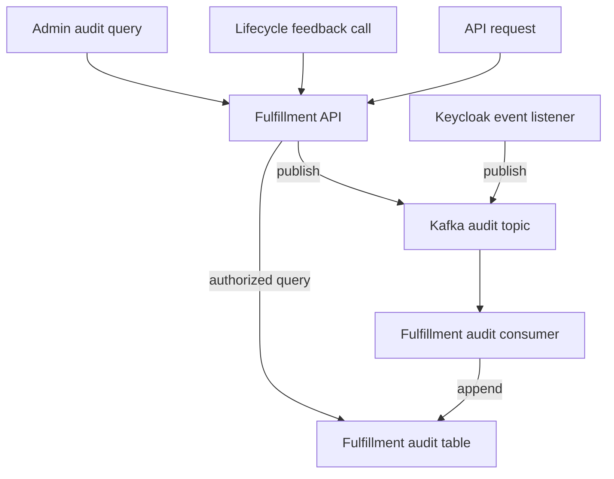

# Activity and Audit Log API

**Document metadata**

| Field | Value |
|---|---|
| Author(s) | Elkana Hendler |
| Jira | [OSAC-63](https://redhat.atlassian.net/browse/OSAC-63) |
| Milestone | 0.5 |
| Date | 2026-11-09 |

## 1. Overview

Operators use lifecycle feedback calls to report a resource's observed state
to Fulfillment. Operational Events describe resource changes but omit API
access to sensitive resources, denied requests, and failures without a change;
their payloads may also contain data unsuitable for audit. This design adds a
queryable audit trail for selected Fulfillment API calls, lifecycle feedback
calls, and Keycloak activity.
See the [PRD](prd.md).

## 2. Design

### 2.1 Architecture

Fulfillment and Keycloak publish minimized audit records to one Kafka topic.
A separate Fulfillment consumer validates both sources and appends records to
the audit table; authorized queries read from that table. Publication guarantees
and failure recovery are defined in [§2.8.1 Publication Policy](#281-publication-policy)
and [§2.8.2 Failure Cases and Recovery](#282-failure-cases-and-recovery).

**Audit capture-to-query flow**



### 2.2 Record Model

An audit record describes one occurrence, not the current state of an operation.
Its `source` identifies the publisher; `event_type` identifies one of four record
kinds: API request, API response, resource lifecycle, or authentication.
Each record carries an action, occurrence time, and outcome, with verified actor,
tenant, resource, and allowlisted metadata when available.

Every record has a publisher-assigned event UUID (`id`), reused on retries, and
a non-null operation UUID (`operation_id`) linking related records.

#### 2.2.1 API Call Records

For each in-scope API call, request and response records have distinct event
`id` values and share an `operation_id`. They describe the API call, not later
resource provisioning.
The request has `outcome="PENDING"` and is never updated. The response carries
the canonical gRPC status code name, such as `OK` or `PERMISSION_DENIED`. A
missing response does not establish whether the call failed or is still running.

#### 2.2.2 Lifecycle Feedback Records

For each accepted in-scope private feedback `Update` that commits:

- Emit a lifecycle record, including when the update repeats the current state.
- Rejected, failed, or rolled-back updates emit no lifecycle record; their API
  request and response records are still captured.
- The field marked `lifecycle.outcome` supplies `outcome` directly, with no
  success/failure mapping.
- A field marked `lifecycle.timestamp` supplies `occurred_at`; if none is
  marked, use receipt time.
- A source timestamp must be a valid protobuf timestamp and not be in the
  future. Missing or invalid source timestamps fall back to receipt time and
  are counted; this does not reject the resource update.
- Lifecycle records share the feedback call's `operation_id`.
- Publication is fail-open and does not change the successful API result.

The in-scope private lifecycle feedback `Update` RPCs are:

- `Clusters.Update`
- `ComputeInstances.Update`
- `ExternalIPAttachments.Update`
- `ExternalIPs.Update`
- `ExternalIPPools.Update`
- `FabricDomains.Update`
- `NATGateways.Update`
- `SecurityGroups.Update`
- `Subnets.Update`
- `VirtualNetworks.Update`
- `Volumes.Update`

Feedback cannot link to the initiating API call; `resource_id` alone does not
prove causation.

The shared field option is defined once in the shared proto module and applied
to resource status fields:

```protobuf
// audit_options.proto
syntax = "proto3";
package osac.audit.v1;

import "google/protobuf/descriptor.proto";

message LifecycleFieldOptions {
  bool outcome = 1;
  bool timestamp = 2;
}

extend google.protobuf.FieldOptions {
  LifecycleFieldOptions lifecycle = 51001;
}
```

For example, the reported state supplies the lifecycle outcome, with a separate
source timestamp. The accepted feedback update—not a state change—triggers the
lifecycle record:

```protobuf
ComputeInstanceState state = 1 [
  (osac.audit.v1.lifecycle).outcome = true
];
google.protobuf.Timestamp state_transition_time = 6 [
  (osac.audit.v1.lifecycle).timestamp = true
];
```

#### 2.2.3 Keycloak Records

The listener publishes selected login, token, and session events. Each
independent event receives a new `operation_id`.

For failed logins, set `tenant_id=NULL`. Set `actor` to the targeted account
when the Keycloak event includes the resolved account; otherwise leave `actor`
unset. Do not infer a tenant from the submitted login identifier.

### 2.3 Capture Behavior

#### 2.3.1 Capture Boundary

Capture unary and streaming RPCs at the gRPC server boundary:

- Resource mutations, administrative actions, lifecycle feedback, and sensitive
  reads (including credential access and audit queries), whether successful or
  failed. Include validation failures, recovered panics, and final RPC and
  transaction outcomes; never record credential contents.
- Authentication failures and authorization denials for all business RPCs,
  including otherwise excluded reads.

The audit interceptor uses each RPC's existing HTTP mapping to select calls:
`POST`, `PUT`, `PATCH`, and `DELETE` are treated as potentially mutating and audited.
`GET` calls are audited when sensitive or when authentication or authorization
fails; ordinary reads are excluded. Sensitive-read identification remains open
in [§7.1 Sensitive-read classification](#71-sensitive-read-classification).
RPCs without an HTTP mapping are audited by default. These rules also apply to
native gRPC calls.

HTTP+JSON calls routed through gRPC are captured once. Health, reflection,
transport probes, and failures before the gRPC boundary are excluded.

#### 2.3.2 Publication Sequence

1. At receipt, save the receipt timestamp and method classification in per-call
   audit state. Assign an `operation_id` when the call is selected for capture.
2. For methods selected by classification, after authentication, publish the
   **request record** before authorization or business work, using only verified
   attribution. Set `tenant_id` from the authenticated organization for Tenant
   Admins; leave it null for Cloud Provider Admins because their target is not
   yet authorized. If processing resolves the target tenant, include its
   verified `tenant_id` on the response record.
   If validation or authentication fails before request publication, publish the
   request record when the error returns with `occurred_at` set to receipt time,
   then publish the response record timestamped when the final error is known.
   For otherwise excluded reads, do the same if authentication fails or
   authorization denies access; otherwise publish neither record.
3. During processing, add verified tenant and resource details to the per-call
   state for the **response record only**; never revise the published request.
   The shared update path emits a lifecycle record after an in-scope private
   feedback update is accepted and committed, even when the reported state is
   unchanged. Field options map the outcome and timestamp as described in
   [§2.2.2 Lifecycle Feedback Records](#222-lifecycle-feedback-records).
4. For selected calls, when the final RPC and transaction result is known, publish
   the **response record**, timestamped at that point. Streaming calls produce one pair per RPC,
   not per message; their response record is created when the handler completes.

Publication attempts follow [§2.8.1 Publication Policy](#281-publication-policy).
This sequence assumes sensitivity is known before business processing. If
sensitivity is determined per call during processing, request-record timing must
be resolved in [§7.1 Sensitive-read classification](#71-sensitive-read-classification).

### 2.4 Attribution and Tenant Access

#### 2.4.1 Attribution and Classification

- **Action and resource:** The RPC method supplies `action` and, when applicable,
  `resource_type`. Common request and response fields supply `resource_id` only
  when verified. Lifecycle outcome and timestamp fields are identified by the
  resource's protobuf field options; outcomes retain their canonical source values.
- **Actor:** API request and response records use the authenticated caller,
  including authorization denials. Records emitted before authentication succeeds
  have no actor; never infer identity from an unverified token. A lifecycle
  record identifies the initiating user only when the source establishes that
  identity, not merely the operator making the feedback call.
- **Tenant:** For an authenticated Tenant Admin's request record, use the
  authenticated organization. A Cloud Provider Admin's request record has
  `tenant_id=NULL`, even when its method parameters name a tenant or target;
  those values are not authorized before request publication. If processing
  resolves and verifies the target tenant, include its `tenant_id` on the
  response record; the request remains unchanged. Failed authentication
  provides no verified tenant. Failed Keycloak logins follow the actor
  attribution rule in [§2.2.3 Keycloak Records](#223-keycloak-records).

#### 2.4.2 Query Visibility

**Audit query scopes by persona**

| Persona | Query scope |
|---|---|
| Cloud Provider Admin | All tenants, or one selected tenant. |
| Tenant Admin | Their authenticated organization only. |
| Others | Denied. |

Apply tenant scope before other filters, counting, and pagination. Tenant
Admins can query only records for their authenticated organization and cannot
set or change the `tenant_id` filter to access another tenant's records. Cloud
Provider Admins can query all tenants or select one; records with
`tenant_id=NULL`, including failed Keycloak logins, are visible only to them.
Scope applies to each record, not to all records sharing an `operation_id`: if a
Cloud Provider Admin's request has `tenant_id=NULL` and its response later has a
verified tenant, a Tenant Admin can see the response but not the request.

**Identity and authorization mapping**

Reuse Fulfillment's existing authorization:

- **Cloud Provider Admin:** identified by membership in the `admins` group.
- **Tenant Admin:** identified by the `tenant-admin` role; tenant scope comes
  from authenticated organization membership.

### 2.5 API Changes

#### 2.5.1 Query Behavior

- **Surface:** gRPC `AuditRecords.List` and HTTP+JSON
  `GET /api/audit/v1/records` provide read access. No public audit create,
  update, or delete API exists.
- **Filters:** Time range, actor, action, resource type and ID, outcome, and
  operation ID, plus tenant selection subject to [§2.4.2 Query Visibility](#242-query-visibility). Lifecycle records have
  distinct actions and use the same outcome filter. All filters are conjunctive;
  an unset filter does not restrict results. The time range
  is half-open: `from_time` is inclusive and `to_time` is exclusive.
- **Ordering and pages:** Results sort by `(occurred_at DESC, id DESC)` and
  use offset/limit pages. `total` counts visible records before pagination;
  `size` is the number returned on the current page. An omitted offset is zero
  and a negative offset is treated as zero. `limit` is required and must be
  positive; values above 1000 are capped at 1000.
- **Validation:** Invalid ranges and limits return `InvalidArgument` / HTTP
  400. An omitted or non-positive limit is invalid. The outcome filter is an
  exact string match; an unset filter includes all outcomes.
- **Audit-of-audit:** Each audit query attempts to publish request and response
  records, even when denied or invalid. Writing audit records to the table does
  not create more audit records. Results appear after consumer ingestion.

#### 2.5.2 Query Request and Enums

`AuditRecords.List` accepts `AuditRecordsListRequest` and returns
`AuditRecordsListResponse`, defined in the shared protobuf module. HTTP+JSON
transcodes the same method, mapping request fields to query parameters and
returning the same page shape.

`outcome` is a string whose canonical value depends on the event type: API
requests use `PENDING`, API responses use the gRPC status code name, lifecycle
records use the annotated source value, and authentication records use the
source's success or failure value.

**Audit classification enums**

```protobuf
enum AuditSource {
  AUDIT_SOURCE_UNSPECIFIED = 0;
  AUDIT_SOURCE_FULFILLMENT_API = 1;
  AUDIT_SOURCE_KEYCLOAK = 2;
}

enum AuditEventType {
  AUDIT_EVENT_TYPE_UNSPECIFIED = 0;
  AUDIT_EVENT_TYPE_API_REQUEST = 1;
  AUDIT_EVENT_TYPE_API_RESPONSE = 2;
  AUDIT_EVENT_TYPE_RESOURCE_LIFECYCLE = 3;
  AUDIT_EVENT_TYPE_AUTHENTICATION = 4;
}

```

**Audit query request DTO**

```protobuf
message AuditRecordsListRequest {
  google.protobuf.Timestamp from_time = 1; // inclusive; unset means no lower bound
  google.protobuf.Timestamp to_time = 2;   // exclusive; unset means no upper bound
  optional string actor = 3;
  optional string action = 4;
  optional string resource_type = 5;
  optional string resource_id = 6;
  optional string outcome = 7; // exact value; unset means no filter
  optional string operation_id = 8; // UUID
  optional string tenant_id = 9;    // Cloud Provider Admin only
  optional int32 offset = 10;       // defaults to 0; negative becomes 0
  optional int32 limit = 11;        // required, 1..1000 after capping
}
```

#### 2.5.3 Query Response and Record DTOs

**Audit query response, record, and metadata DTOs**

```protobuf
message AuditRecordsListResponse {
  int32 size = 1;
  int64 total = 2;
  repeated AuditRecord items = 3;
}

message AuditRecord {
  string id = 1;                         // unique event UUID
  string operation_id = 2;               // UUID shared by related records
  google.protobuf.Timestamp occurred_at = 3;
  AuditSource source = 4;
  AuditEventType event_type = 5;
  optional string tenant_id = 6;         // null means provider-only
  optional string actor = 7;
  string action = 8;                     // canonical action identifier
  optional string resource_type = 9;
  optional string resource_id = 10;
  string outcome = 11;                   // canonical value for the event type
  AuditMetadata metadata = 12;           // only allowlisted fields
}

message AuditMetadata {
  optional string error_code = 1; // allowlisted code, not a free-text message
  optional string reason_code = 2; // lifecycle records only
}
```

#### 2.5.4 Record Outcomes and Metadata

**Record-kind outcomes and permitted metadata**

| Record kind | `event_type` | `outcome` | `metadata` |
|---|---|---|---|
| API request | `AUDIT_EVENT_TYPE_API_REQUEST` | `PENDING` | None. |
| API response | `AUDIT_EVENT_TYPE_API_RESPONSE` | Canonical gRPC status code name, such as `OK` or `PERMISSION_DENIED` | `error_code` when known. |
| Resource lifecycle | `AUDIT_EVENT_TYPE_RESOURCE_LIFECYCLE` | Canonical value from the field marked `lifecycle.outcome` | `reason_code` when supplied by the source. |
| Authentication | `AUDIT_EVENT_TYPE_AUTHENTICATION` | Source success or failure value | Only allowlisted codes defined by the source; no raw event details. |

### 2.6 Data Model / Schema Changes

Audit records initially reside in Fulfillment's PostgreSQL database, pending the
logs storage solution in [OSAC-6982: Logs Collection and Aggregation](https://redhat.atlassian.net/browse/OSAC-6982).

#### 2.6.1 Kafka Wire Contract

Fulfillment and Keycloak publish the same versioned audit message as binary
protobuf, using the shared definitions in `proto/private/osac/private/v1/`.
The `AuditRecord` defined in [§2.5.3 Query Response and Record DTOs](#253-query-response-and-record-dtos) is shared by ingestion and query responses;
there is no second source-specific payload.

The Kafka DTO is an `AuditEnvelope` containing `schema_version` (currently `1`)
and one `AuditRecord`. Preserve protobuf field and enum compatibility;
incompatible contract changes increment `schema_version`. Deploy consumer
support before producers emit new versions. The consumer rejects unsupported
versions, unknown enum values in enum fields, missing required fields, and
outcome values that violate the event-type source contract. The envelope's
`schema_version` is not stored in each row.

**Kafka audit envelope**

```protobuf
message AuditEnvelope {
  int32 schema_version = 1; // current version: 1
  AuditRecord record = 2;
}
```

#### 2.6.2 Audit Table

The table's nullability defines required ingestion fields. Absent nullable
fields become SQL `NULL`; absent metadata fields remain absent from the metadata
object.

**PostgreSQL `audit_records` schema**

| Column | PostgreSQL definition | Storage mapping |
|---|---|---|
| `id` | `uuid PRIMARY KEY` | Event UUID; deduplicates delivery retries. |
| `operation_id` | `uuid NOT NULL` | Operation UUID; link rules in [§2.2 Record Model](#22-record-model). |
| `occurred_at` | `timestamptz NOT NULL` | UTC event time: request receipt, final RPC status, source-reported lifecycle update, or Keycloak event time. |
| `source` | `text NOT NULL` | `fulfillment_api` or `keycloak`. |
| `event_type` | `text NOT NULL` | `api_request`, `api_response`, `resource_lifecycle`, or `authentication`. |
| `tenant_id` | `text NULL` | [§2.4.1 Attribution and Classification](#241-attribution-and-classification); [§2.4.2 Query Visibility](#242-query-visibility). |
| `actor` | `text NULL` | — |
| `action` | `text NOT NULL` | Canonical identifier from the source mapping. |
| `resource_type` | `text NULL` | — |
| `resource_id` | `text NULL` | — |
| `outcome` | `text NOT NULL` | Canonical value for the event type; rules in [§2.5.4 Record Outcomes and Metadata](#254-record-outcomes-and-metadata). |
| `metadata` | `jsonb NULL` | Allowlisted metadata object from [§2.5.3 Query Response and Record DTOs](#253-query-response-and-record-dtos); applicability in [§2.5.4 Record Outcomes and Metadata](#254-record-outcomes-and-metadata). |

Index the audit table for tenant and time paging, and for operation, actor,
and resource lookups. Check other filters against representative data.

### 2.7 Security Considerations

#### 2.7.1 Access and Transport

The API uses Fulfillment authentication; query authorization is in
[§2.4.2 Query Visibility](#242-query-visibility).
Publishers allowlist fields before sending, excluding raw payloads, credential
values, and free-text errors. Outcome strings are canonical source values, not
user-provided messages. Bundled Kafka uses TLS and SCRAM-SHA-512, with
ACLs scoped to the audit topic and named consumer group. The Fulfillment API
uses a dedicated Kafka identity for audit publication, separate from the
existing EventPublisher identity.

**Kafka identity permissions**

| Kafka identity | Access modes |
|---|---|
| Fulfillment audit publisher (dedicated KafkaUser for the API) | Write, Describe, IdempotentWrite |
| Keycloak listener | Write, Describe, IdempotentWrite |
| Fulfillment audit consumer | Read, Describe |

External Kafka needs equivalent encrypted authentication and ACLs.

#### 2.7.2 Database Permissions

Use separate roles for schema changes and runtime access:

**Database role permissions**

| Database role | Audit-table access | Restrictions |
|---|---|---|
| `audit_consumer` | `INSERT` audit rows. | No `UPDATE` or `DELETE` on audit rows; cannot mutate resource tables or run migrations. |
| `audit_reader` | `SELECT` audit rows. | No `INSERT`, `UPDATE`, or `DELETE`; cannot run migrations. |
| `audit_migrator` | Owns the table; applies schema migrations. | Used only by the deployment/migration process. |

### 2.8 Failure Handling and Recovery

#### 2.8.1 Publication Policy

Both producers publish directly to Kafka and wait for acknowledgment, using
bounded retries and a timeout. Fulfillment has no application-level audit queue
in this phase; asynchronous publishing is planned for a later phase. Retry
counts and acknowledgment timeout defaults for both producers, along with
Keycloak handling of in-flight publishes during shutdown, are defined during
implementation.

#### 2.8.2 Failure Cases and Recovery

**Audit delivery failures and recovery**

| Failure | Audit effect | Recovery or visibility |
|---|---|---|
| Either producer cannot publish or receive acknowledgment within bounded retries and timeout | Fail-open: the affected record is dropped without preventing API processing or changing the API or authentication result. | Publish failures and drops are logged and counted; the call may be delayed until the timeout. |
| Fulfillment process crashes | A crash before a request record is acknowledged can leave no request record. A crash after the request record is acknowledged but before the response record is published can leave only the request record, even after a resource commit. | A crash may cause audit records to be lost without identifying which records are missing. |
| Database unavailable after Kafka accepts a record | Queries are unavailable; Kafka retains the record within topic retention. | Consumer retries inserts and commits its offset after database commit. Unique event ID deduplicates retries. |
| Invalid schema | Consumer skips the record so later records can proceed. | Invalid records are reported. |
| Outage exceeds topic retention | Accepted records can be lost before ingestion. | Consumer lag is observable, but lost records cannot be recovered from the topic. |

A committed resource write may therefore have no audit row.

### 2.9 Scalability and Performance

#### 2.9.1 Load and Latency

Each in-scope API call attempts two publications; ordinary reads excluded by
the capture policy attempt none. Each accepted in-scope lifecycle feedback
update adds one, including ordinary and repeated updates; selected identity
events add more. The synchronous delivery policy in
[§2.8.1 Publication Policy](#281-publication-policy)
adds Kafka latency to API calls and authentication; successive publication
attempts can each incur their timeout.
Inserts and scoped, paginated queries share Fulfillment's PostgreSQL capacity.

No throughput or latency SLO is set for 0.5.

#### 2.9.2 Retention and Capacity

Audit rows are retained indefinitely in 0.5. Configurable retention
is required but deferred; PostgreSQL and backup capacity must therefore be
planned for ongoing growth. Kafka transport retention is separate and bounds
recovery from database outages.

## 3. Interface Changes

The PRD has no formal FR/NFR IDs. These labels provide local traceability to
the [test plan](testplan.md). The IC labels identify changed boundaries;
the behavior and rationale are in [§2 Design](#2-design).

**Local requirement labels**

| Label | Requirement summarized |
|---|---|
| FR-1 | Capture Fulfillment mutations, administrative actions, sensitive reads, authentication failures, authorization denials, and selected identity activity. |
| FR-2 | Attribute user-initiated calls to the authenticated actor. |
| FR-3 | Record accepted requests and significant outcomes, with known links and reasons. |
| FR-4 | Capture tenant-attributed Keycloak authentication activity. |
| FR-5 | Provide filtered, paginated gRPC and HTTP+JSON queries. |
| FR-6 | Enforce Tenant Admin and Cloud Provider Admin query scopes. |
| FR-7 | Audit access to audit records. |
| FR-8 | Exclude credential values while recording credential access. |
| NFR-1 | Expose no API for updating or deleting records. |
| NFR-2 | Keep audit failures from blocking platform actions. |
| NFR-3 | Keep audit data within the deployment jurisdiction. |
| NFR-4 | Apply the audit-row retention policy in [§2.9.2 Retention and Capacity](#292-retention-and-capacity). |

**Changed interfaces**

| Interface | Change | Requirements | Detail |
|---|---|---|---|
| IC-1 | Public audit query | FR-5, FR-6, FR-7 | [§2.5.1 Query Behavior](#251-query-behavior), [§2.4.2 Query Visibility](#242-query-visibility) |
| IC-2 | Shared audit record and storage contract | FR-1, FR-2, FR-3, FR-4, FR-5, FR-8 | [§2.5.3 Query Response and Record DTOs](#253-query-response-and-record-dtos), [§2.5.4 Record Outcomes and Metadata](#254-record-outcomes-and-metadata), [§2.6.1 Kafka Wire Contract](#261-kafka-wire-contract), [§2.6.2 Audit Table](#262-audit-table) |
| IC-3 | Fulfillment request and response capture | FR-1, FR-2, FR-6, FR-7, FR-8, NFR-2 | [§2.3 Capture Behavior](#23-capture-behavior), [§2.4.1 Attribution and Classification](#241-attribution-and-classification), [§2.8.1 Publication Policy](#281-publication-policy) |
| IC-4 | Fulfillment lifecycle feedback capture | FR-1, FR-2, FR-3, FR-8, NFR-2 | [§2.2.2 Lifecycle Feedback Records](#222-lifecycle-feedback-records), [§2.4.1 Attribution and Classification](#241-attribution-and-classification) |
| IC-5 | Keycloak activity publication | FR-4, FR-8, NFR-2 | [§2.2.3 Keycloak Records](#223-keycloak-records), [§2.4.1 Attribution and Classification](#241-attribution-and-classification), [§2.8.1 Publication Policy](#281-publication-policy) |
| IC-6 | Consumer, append-only table, scoped query | FR-5, FR-6, FR-7, NFR-1, NFR-4 | [§2.4.2 Query Visibility](#242-query-visibility), [§2.5.1 Query Behavior](#251-query-behavior), [§2.6.2 Audit Table](#262-audit-table), [§2.8.2 Failure Cases and Recovery](#282-failure-cases-and-recovery), [§2.9.2 Retention and Capacity](#292-retention-and-capacity) |
| IC-7 | Topic, ACLs, credentials, roles, and deployments | FR-4, NFR-3, NFR-4 | [§2.7.1 Access and Transport](#271-access-and-transport), [§2.7.2 Database Permissions](#272-database-permissions), [§2.9.2 Retention and Capacity](#292-retention-and-capacity), [§6 Impact and Compatibility](#6-impact-and-compatibility) |

## 4. Alternatives Considered

**Rejected alternatives and trade-offs**

| Alternative | Reason not selected |
|---|---|
| Use `Events.Watch`, full resource Events, or EventPublisher as the audit source | Misses calls without a resource change and may retain sensitive resource payloads. |
| Write Fulfillment audit rows directly from the API | Couples requests to audit-table availability and creates a second ingestion path beside Keycloak. |
| Send Keycloak events to Fulfillment or poll saved events | Adds API availability dependence or loses event-time delivery and attribution. |
| Add an audit service or make the consumer call a write API | Adds a service or mutation hop although Fulfillment owns the table and query. |
| Add source topics and adapter consumers | Adds topics and consumers without expanding source coverage. |
| Use a bounded asynchronous in-memory queue | Avoids Kafka latency on API calls but can lose queued records on overflow or process crash. |
| Use a transactional audit outbox for mutations | Protects committed writes from process crashes but adds database writes and another path for reads and denials. |
| Forward audit records from stdout through a collector | OSAC does not deploy a collector; adding one still permits loss before collection. |

## 5. Observability and Monitoring

Track publication latency, acknowledgment timeouts, failures and dropped
records, consumer lag and invalid records, insert failures, query availability,
and missing or invalid lifecycle timestamps. Logs and metrics omit tenant,
actor, resource, and credential values. No numeric alert threshold is set for
0.5.

## 6. Impact and Compatibility

- The public API, table, and topic are additive.
- Existing `Events.Watch`, resource-event consumers, and CRDs remain unchanged.
- The migration adds audit storage to Fulfillment's backup/replication boundary;
  no earlier activity is backfilled.
- Rollback can disable capture and queries while keeping stored rows.
- Re-enabling can ingest Kafka-retained messages.

## 7. Open Questions

### 7.1 Sensitive-read classification

How should sensitive reads be identified: a hardcoded interceptor list, an RPC
declaration, or per-call classification? For methods that only sometimes expose
sensitive data, should all calls be audited or only sensitive invocations? If
classification happens during processing, request-record timing and failed-call
handling remain to be decided.

---

## Provenance

Authored: draft @ design 0.12.0 - 7b2b8de, workspace main @ d81c18823 (29 behind origin/main)
Final: respond @ design 0.14.0 - b369da0, workspace codex/OSAC-63-design-readability @ 28ec02f8d

> Context changed between draft and respond.

<!-- ai-workflow-provenance:{"schema_version":1,"provenance_kind":"session","workflow":"design","workflow_version":"0.14.0","ai_workflows":"b369da0","source_repo":"28ec02f8d","source_repo_branch":"codex/OSAC-63-design-readability","commits_behind_main":0,"commits_ahead_main":0,"main_ref":"main","phases":["draft","revise","revise","revise","revise","revise","revise","revise","revise","revise","revise","revise","revise","revise","revise","revise","revise","revise","revise","revise","revise","revise","revise","revise","revise","revise","revise","revise","revise","revise","revise","revise","revise","revise","revise","revise","revise","revise","revise","revise","revise","revise","revise","revise","revise","revise","revise","revise","revise","revise","revise","revise","revise","revise","revise","revise","revise","manual-edit","revise","revise","revise","revise","revise","revise","revise","revise","revise","revise","revise","revise","revise","manual-edit","manual-edit","revise","revise","revise","revise","revise","revise","revise","revise","revise","revise","respond","respond"],"authoring_modes":["manual","skill"],"context_changed":true,"origin_untracked":false} -->
