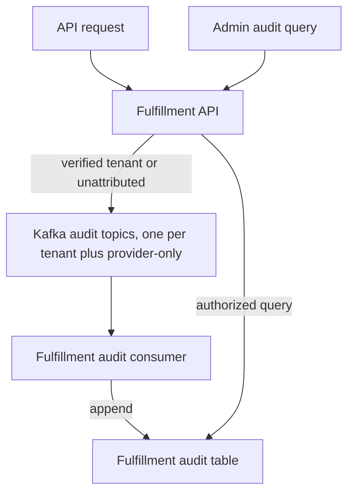

# Activity and Audit Log API

**Document metadata**

| Field | Value |
|---|---|
| Author(s) | Elkana Hendler |
| Jira | [OSAC-63](https://redhat.atlassian.net/browse/OSAC-63) |
| Milestone | 0.5 |
| Date | 2026-11-09 |

## 1. Overview

Operational Events describe resource changes. They do not record API access to
sensitive resources, denied requests, or failures that do not change a
resource. Their payloads can also contain data that is not suitable for audit.
This design adds a queryable audit trail for selected Fulfillment API calls.
Keycloak activity auditing and separate auditing for resource lifecycle events
are out of scope.

See the [PRD](prd.md).

## 2. Design

### 2.1 Architecture

Fulfillment publishes minimized audit records to tenant-scoped Kafka topics.
Records with a verified tenant use that tenant's topic. Records without a
verified tenant use a provider-only topic. A separate Fulfillment consumer
reads the topics, checks each record, and adds it to the audit table.
Authorized queries read records from that table.

Each tenant has a separate topic and offset. This prevents a backlog in one
tenant's topic from blocking another tenant's progress. It does not isolate
shared broker capacity, consumer capacity, or PostgreSQL capacity. See
[§2.8.1 Publication Policy](#281-publication-policy) and
[§2.8.2 Failure Cases and Recovery](#282-failure-cases-and-recovery) for
publication guarantees and recovery behavior.

**Audit capture-to-query flow**



### 2.2 Record Model

An audit record describes one event. It does not describe the current state of
an operation. The `source` field identifies the publisher. The `event_type`
field identifies an API request or response. Each record has an action, an
event time, and an outcome. It can also have verified actor, tenant, resource,
and allowlisted detail fields.

The publisher assigns each event a UUID in `id`. It reuses that UUID when it
retries publication. Each record also has a non-null operation UUID in
`operation_id`. Related records use the same operation UUID.

#### 2.2.1 API Call Records

For each in-scope API call, the request and response records have different
event `id` values and the same `operation_id`. They describe the API call, not
later resource provisioning.

The request record has `outcome="PENDING"`. The system never updates it. The
response record has the canonical gRPC status code name, such as `OK` or
`PERMISSION_DENIED`. If the response record is missing, the call may have
failed or may still be running.

### 2.3 Capture Behavior

#### 2.3.1 Capture Boundary

Capture unary and streaming RPCs at the gRPC server boundary:

- Capture resource mutations, administrative actions, and sensitive reads.
  This includes credential access and audit queries, whether the call succeeds
  or fails. Include validation failures, recovered panics, and final RPC and
  transaction outcomes. Never record credential contents.
- Capture authentication failures and authorization denials for all business
  RPCs. This includes reads that are otherwise out of scope.

#### 2.3.2 RPC Interceptor

**Call selection:** Capture RPCs at the gRPC boundary, not HTTP requests. Use
each RPC's HTTP mapping to classify the call. Audit `POST`, `PUT`, `PATCH`, and
`DELETE` methods. Audit sensitive `GET` methods. Audit other `GET` methods only
when authentication fails or authorization denies access. Exclude other `GET` methods.
Audit methods without an HTTP mapping by default. Exclude health, reflection,
and transport-probe RPCs. The interceptor does not capture requests that fail
before they reach the gRPC server.

Sensitive-read identification remains open. See
[§7.1 Sensitive-read classification](#71-sensitive-read-classification).

Register audit capture in Fulfillment's unary and stream interceptor chains.
For each call, the interceptor keeps the method, receipt time, and verified
attribution. It does not store the full RPC request or response. It records
only the allowlisted audit fields defined in the record model.

**Call flow**

1. At call entry, apply the call-selection rules. Assign an `operation_id` to
   each selected call. Assign one to an otherwise excluded `GET` only if
   authentication fails or authorization denies access.
2. For an audited call, write the request record after authentication and
   before authorization. If validation or authentication fails first, write
    the request record when Fulfillment detects the failure. Use the call's
    receipt time. Do not include an actor unless authentication succeeded. If
    authorization denies an otherwise unaudited read, write request and
    response records.
3. When the call finishes, write a response record with the final gRPC status.
   A streaming call gets one request and response pair for the whole call, not
   one pair per message.

**Record fields:** Map the full RPC method name to `action` and `object_type`.
Use the verified authentication context for `actor`. Include only the
allowlisted fields defined in the record model.

| Example | Audit result |
|---|---|
| Selected update succeeds | Write the request at receipt (`PENDING`). Write the response at completion (`OK`). Both records have a verified actor. |
| Authorization denies an ordinary `GET` | Write a request and a `PERMISSION_DENIED` response. Include the actor only if authentication succeeded. |
| Authentication fails | Write the request at receipt and an error response. Do not include an actor. |

The interceptor returns the original RPC result. Publication failures follow
the fail-open policy in [§2.8.1 Publication Policy](#281-publication-policy).

#### 2.3.3 Publication Sequence

1. At receipt, save the receipt timestamp and method classification in the
   per-call audit state. Assign an `operation_id` when the call meets the
   capture criteria.
2. For methods selected by the classification, publish the **request
   record** after authentication and before authorization or business work.
   Use verified attribution only. For Tenant Admins, set `tenant_id` to the
   authenticated organization. For Cloud Provider Admins, leave `tenant_id`
   null because the system has not authorized the target yet.

   If processing resolves the target tenant, include its verified `tenant_id`
   on the response record. Do not change the request record.

   If validation or authentication fails before the system publishes the
   request record, publish it when the error returns. Set its `event_timestamp`
   to the receipt time. Then publish the response record with a timestamp for
   when the system knows the final error.

   For otherwise excluded reads, publish both records if authentication fails
   or authorization denies access. Otherwise, publish neither record.
3. During processing, add verified tenant and resource details to the per-call
   state for the **response record only**. Never change the published request
   record.
4. For selected calls, publish the **response record** when the system knows
   the final RPC and transaction result. Set its timestamp to that time.
   Streaming calls produce one pair per RPC, not one pair per message. Create
   the response record when the handler completes.

Publication attempts follow [§2.8.1 Publication Policy](#281-publication-policy).
This sequence assumes the system knows whether a read is sensitive before
business processing. If the system determines sensitivity per call during
processing, resolve request-record timing in
[§7.1 Sensitive-read classification](#71-sensitive-read-classification).

### 2.4 Attribution and Tenant Access

#### 2.4.1 Attribution and Classification

- **Action and object:** The RPC method supplies `action` and, when applicable,
  `object_type`. Common request and response fields supply `object_id` only
  when verified.
- **Actor:** API request and response records use the authenticated caller.
  This includes authorization denials. Records created before authentication
  succeeds have no actor. Never infer identity from an unverified token.
- **Tenant:** For an authenticated Tenant Admin's request record, use the
  authenticated organization. A Cloud Provider Admin's request record has
  `tenant_id=NULL`, even when method parameters name a tenant or target. The
  system has not authorized those values before it publishes the request. If
  processing resolves and verifies the target tenant, include its `tenant_id`
  on the response record. Do not change the request record. Failed
  authentication provides no verified tenant.

#### 2.4.2 Query Visibility

**Audit query scopes by persona**

| Persona | Query scope |
|---|---|
| Cloud Provider Admin | All tenants, or one selected tenant. |
| Tenant Admin | Their authenticated organization only. |
| Others | Denied. |

Apply tenant scope before other filters, counting, and pagination. Tenant
Admins can query records only for their authenticated organization. They
cannot set or change the `tenant_id` filter to access another tenant's records.
Cloud Provider Admins can query all tenants or select one. Only Cloud Provider
Admins can see records with `tenant_id=NULL`.

Apply scope to each record, not to all records that share an `operation_id`.
For example, a Cloud Provider Admin's request record can have `tenant_id=NULL`
while its response record has a verified tenant. A Tenant Admin can see the
response record but not the request record.

**Identity and authorization mapping**

Reuse Fulfillment's existing authorization:

- **Cloud Provider Admin:** Membership in the `admins` group identifies this
  persona.
- **Tenant Admin:** The `tenant-admin` role identifies this persona. The
  authenticated organization membership supplies the tenant scope.

### 2.5 API Changes

#### 2.5.1 Query Behavior

- **Surface:** gRPC `AuditRecords.List` and HTTP+JSON `GET
  /api/audit/v1/records` provide read access. The API has no public audit
  create, update, or delete methods.
- **Filters:** The API supports time range, actor, action, object type and ID,
  outcome, and operation ID. It also supports tenant selection, subject to
  [§2.4.2 Query Visibility](#242-query-visibility). The API applies all set
  filters together. An unset filter does not restrict results. The time range
  is half-open. `from_time` is inclusive, and `to_time` is exclusive.
- **Ordering and pages:** Results sort by `(event_timestamp DESC, id DESC)`.
  The API uses offset and limit pages. `total` counts visible records before
  pagination. `size` is the number of records on the current page. If the
  request omits `offset`, use zero. Treat a negative offset as zero. The
  request must include a positive `limit`. Cap values above 1000 at 1000.
- **Validation:** Invalid ranges and limits return `InvalidArgument` and HTTP
  400. An omitted or non-positive limit is invalid. The API matches the
  outcome filter as an exact string. An unset outcome filter includes all
  outcomes.
- **Audit-of-audit:** Each audit query attempts to publish request and response
  records, including queries that authorization or validation rejects. Writing audit records
  to the table does not create more audit records. Query results include new
  records after consumer ingestion.

#### 2.5.2 Query Request and Enums

`AuditRecords.List` accepts `AuditRecordsListRequest` and returns
`AuditRecordsListResponse`. The shared protobuf module defines both messages.
HTTP+JSON transcodes the same method. It maps request fields to query
parameters and returns the same page shape.

`outcome` is a string. Its canonical value depends on the event type. API
requests use `PENDING`. API responses use the gRPC status code name.

**Audit classification enums**

```protobuf
enum AuditSource {
  AUDIT_SOURCE_UNSPECIFIED = 0;
  AUDIT_SOURCE_FULFILLMENT_API = 1;
}

enum AuditEventType {
  AUDIT_EVENT_TYPE_UNSPECIFIED = 0;
  AUDIT_EVENT_TYPE_API_REQUEST = 1;
  AUDIT_EVENT_TYPE_API_RESPONSE = 2;
}

```

**Audit query request DTO**

```protobuf
message AuditRecordsListRequest {
  google.protobuf.Timestamp from_time = 1; // inclusive; unset means no lower bound
  google.protobuf.Timestamp to_time = 2;   // exclusive; unset means no upper bound
  optional string actor = 3;
  optional string action = 4;
  optional string object_type = 5;
  optional string object_id = 6;
  optional string outcome = 7; // exact value; unset means no filter
  optional string operation_id = 8; // UUID
  optional string tenant_id = 9;    // Cloud Provider Admin only
  optional int32 offset = 10;       // defaults to 0; negative becomes 0
  optional int32 limit = 11;        // required, 1..1000 after capping
}
```

#### 2.5.3 Query Response and Record DTOs

**Audit query response, record, and details DTOs**

```protobuf
import "google/protobuf/timestamp.proto";
import "google/rpc/code.proto";

message AuditRecordsListResponse {
  int32 size = 1;
  int64 total = 2;
  repeated AuditRecord items = 3;
}

message AuditRecord {
  string id = 1;                         // unique event UUID
  string operation_id = 2;               // UUID shared by related records
  google.protobuf.Timestamp event_timestamp = 3;
  AuditSource source = 4;
  AuditEventType event_type = 5;
  optional string tenant_id = 6;         // null means provider-only
  optional string actor = 7;
  string action = 8;                     // canonical action identifier
  optional string object_type = 9;
  optional string object_id = 10;
  string outcome = 11;                   // canonical value for the event type
  AuditRecordDetails details = 12;       // only allowlisted fields
}

message AuditRecordDetails {
  optional google.rpc.Code status_code = 1; // API response gRPC status
}
```

#### 2.5.4 Record Outcomes and Details

**Record-kind outcomes and permitted details**

| Record kind | `event_type` | `outcome` | `details` |
|---|---|---|---|
| API request | `AUDIT_EVENT_TYPE_API_REQUEST` | `PENDING` | None. |
| API response | `AUDIT_EVENT_TYPE_API_RESPONSE` | Canonical gRPC status code name, such as `OK` or `PERMISSION_DENIED` | `status_code` when known. |

### 2.6 Data Model / Schema Changes

Audit records initially reside in Fulfillment's PostgreSQL database. This is
the plan until the logs storage solution in
[OSAC-6982: Logs Collection and Aggregation](https://redhat.atlassian.net/browse/OSAC-6982)
is available.

#### 2.6.1 Tenant-Scoped Topics and Kafka Wire Contract

Use `osac.audit.tenant.<tenant_id>` for each tenant. Use the exact topic
`osac.audit.unattributed` for records with a null `tenant_id`. The `tenant.`
namespace separates tenant IDs from the provider-only topic name. Fulfillment
creates a tenant's topic during tenant onboarding. Deployment creates the
provider-only topic.

Each topic has one partition at first. This follows OSAC's existing pattern for
per-tenant event topics. Apply the configured audit transport retention to
every audit topic.

Route each record by its verified `tenant_id`. Never derive the topic from an
unverified request field or actor. A Tenant Admin's request and response
records use the topic for the authenticated organization. A Cloud Provider
Admin's request record uses `osac.audit.unattributed`. If processing later
verifies a target tenant, the response record uses that tenant's topic. Records
without verified tenant attribution use `osac.audit.unattributed`.

Related records can be in different topics. `operation_id` links them, but it
does not guarantee ordering across topics. Topic selection does not change
record-level query visibility in
[§2.4.2 Query Visibility](#242-query-visibility).

The consumer subscribes to `osac.audit.tenant.*` and
`osac.audit.unattributed`. It tracks offsets independently for each topic
partition. A stalled tenant partition must not prevent ingestion or offset
advancement for healthy tenant topics.

This provides workload isolation at the topic and partition level only. All
topics share the Kafka deployment, consumer service, and PostgreSQL capacity.
This design does not provide hard resource isolation for brokers or the
database.

Before insertion, the consumer checks that the record's `tenant_id` matches
the tenant encoded in its topic. For `osac.audit.unattributed`, the consumer
also checks that `tenant_id` is null. It rejects and reports a mismatch. It
never reroutes the record.

Fulfillment publishes the versioned audit message as binary protobuf. It uses
the shared definitions in `proto/private/osac/private/v1/`. Ingestion and
query responses use the same `AuditRecord`, defined in
[§2.5.3 Query Response and Record DTOs](#253-query-response-and-record-dtos).
There is no second source-specific payload.

The Kafka DTO is an `AuditEnvelope`. It contains `schema_version` (currently
`1`) and one `AuditRecord`. Preserve protobuf field and enum compatibility.
Increment `schema_version` for incompatible contract changes. Deploy consumer
support before producers emit new versions.

The consumer rejects unsupported versions, unknown enum values in enum fields,
missing required fields, and outcomes that violate the event-type source
contract. The consumer does not store the envelope's `schema_version` in each
row.

**Kafka audit envelope**

```protobuf
message AuditEnvelope {
  int32 schema_version = 1; // current version: 1
  AuditRecord record = 2;
}
```

#### 2.6.2 Audit Table

The table's nullability defines the required ingestion fields. Map absent
nullable fields to SQL `NULL`. Keep absent details fields absent from the
details object.

**PostgreSQL `audit_records` schema**

| Column | PostgreSQL definition | Storage mapping |
|---|---|---|
| `id` | `uuid PRIMARY KEY` | Event UUID. It deduplicates delivery retries. |
| `operation_id` | `uuid NOT NULL` | Operation UUID. See link rules in [§2.2 Record Model](#22-record-model). |
| `event_timestamp` | `timestamptz NOT NULL` | UTC event time: request receipt or final RPC status. |
| `source` | `text NOT NULL` | `fulfillment_api`. |
| `event_type` | `text NOT NULL` | `api_request` or `api_response`. |
| `tenant_id` | `text NULL` | See [§2.4.1 Attribution and Classification](#241-attribution-and-classification) and [§2.4.2 Query Visibility](#242-query-visibility). |
| `actor` | `text NULL` | — |
| `action` | `text NOT NULL` | Canonical identifier from the source mapping. |
| `object_type` | `text NULL` | — |
| `object_id` | `text NULL` | — |
| `outcome` | `text NOT NULL` | Canonical value for the event type. See [§2.5.4 Record Outcomes and Details](#254-record-outcomes-and-details). |
| `details` | `jsonb NULL` | Allowlisted details object from [§2.5.3 Query Response and Record DTOs](#253-query-response-and-record-dtos). See [§2.5.4 Record Outcomes and Details](#254-record-outcomes-and-details) for applicability. |

Index the audit table for tenant and time paging, and for operation, actor, and
object lookups. Check other filters against representative data.

### 2.7 Security Considerations

#### 2.7.1 Access and Transport

The API uses Fulfillment authentication. See
[§2.4.2 Query Visibility](#242-query-visibility) for query authorization.

Fulfillment allowlists fields before publication. The allowlist excludes raw
payloads, credential values, and free-text errors. Outcome strings use
canonical source values, not user-provided messages.

Bundled Kafka uses TLS and SCRAM-SHA-512. Kafka ACLs scope access to the
tenant-topic namespace, provider-only topic, and named consumer group. The Fulfillment API
uses a dedicated Kafka identity for audit publication. This identity is
separate from the existing EventPublisher identity.

The Fulfillment publisher can write to audit topics but cannot read them. Only
the consumer can read them. Tenant workloads and callers do not get access to
tenant topics. API authorization remains the isolation boundary for audit
queries.

**Kafka identity permissions**

| Kafka identity | Access modes |
|---|---|
| Fulfillment audit publisher (dedicated KafkaUser for the API) | Create, Write, Describe, and IdempotentWrite on `osac.audit.tenant.` topics. Write, Describe, and IdempotentWrite on `osac.audit.unattributed`. |
| Fulfillment audit consumer | Read, Describe on both audit topic patterns and its named consumer group. |

External Kafka needs equivalent encrypted authentication and ACLs.

#### 2.7.2 Database Permissions

Use separate roles for schema changes and runtime access:

**Database role permissions**

| Database role | Audit-table access | Restrictions |
|---|---|---|
| `audit_consumer` | `INSERT` audit rows. | No `UPDATE` or `DELETE` on audit rows. Cannot change resource tables or run migrations. |
| `audit_reader` | `SELECT` audit rows. | No `INSERT`, `UPDATE`, or `DELETE`. Cannot run migrations. |
| `audit_migrator` | Owns the table and applies schema migrations. | Used only by the deployment or migration process. |

### 2.8 Failure Handling and Recovery

#### 2.8.1 Publication Policy

The producer publishes directly to Kafka and waits for acknowledgment. It uses
bounded retries and a timeout. Fulfillment has no application-level audit
queue in this phase. This design plans asynchronous publishing for a later phase.
Implementation will define retry counts and acknowledgment timeout defaults.

#### 2.8.2 Failure Cases and Recovery

**Audit delivery failures and recovery**

| Failure | Audit effect | Recovery or visibility |
|---|---|---|
| The producer cannot publish or receive acknowledgment within the retry and timeout limits | Fail-open. The system drops the affected record. API processing continues, and the API result does not change. | Log and count publication failures and dropped records. The timeout may delay the call. |
| Fulfillment process crashes | A crash before acknowledgment of a request record can leave no request record. A crash after request acknowledgment but before response publication can leave only the request record, even after a resource commit. | A crash can lose audit records without showing which records are missing. |
| The database is unavailable after Kafka accepts a record | Queries are unavailable. Kafka retains the record within topic retention. | The consumer retries inserts and commits its offset after the database commit. The unique event ID deduplicates retries. |
| The consumer finds an invalid schema or topic/tenant mismatch | The consumer skips the record so later records in that topic can proceed. | Report invalid records. Never reroute them to another tenant topic. |
| An outage exceeds topic retention | Kafka can lose accepted records before ingestion. | Consumer lag is observable, but the topic cannot recover lost records. |

A committed resource write can therefore have no audit row.

### 2.9 Scalability and Performance

#### 2.9.1 Load and Latency

Each in-scope API call attempts two publications. Ordinary reads that the
capture policy excludes attempt none. The synchronous delivery policy in
[§2.8.1 Publication Policy](#281-publication-policy) adds Kafka latency to API
calls. Successive publication attempts can each incur their own timeout.

Each tenant publishes to its own topic and uses its own consumer offset. A
backlog in one tenant's topic does not block progress for other topics. Kafka
broker resources, consumer compute, and PostgreSQL inserts and queries remain
shared. A sufficiently heavy tenant workload can still consume those shared
resources. This design does not claim hard resource isolation.

The design sets no throughput or latency SLO for 0.5.

#### 2.9.2 Retention and Capacity

Retain audit rows indefinitely in 0.5. The design requires configurable
retention but defers it. Plan PostgreSQL and backup capacity for ongoing growth. Kafka
transport retention is separate. It limits recovery from database outages.

## 3. Interface Changes

The PRD has no formal FR or NFR IDs. These labels provide local traceability to
the [test plan](testplan.md). The IC labels identify changed boundaries. See
[§2 Design](#2-design) for behavior and rationale.

**Local requirement labels**

| Label | Requirement summarized |
|---|---|
| FR-1 | Capture Fulfillment mutations, administrative actions, sensitive reads, authentication failures, and authorization denials. |
| FR-2 | Attribute each call that a user initiates to the authenticated actor. |
| FR-3 | Record accepted requests and significant outcomes, with known links. |
| FR-4 | Provide filtered, paginated gRPC and HTTP+JSON queries. |
| FR-5 | Enforce Tenant Admin and Cloud Provider Admin query scopes. |
| FR-6 | Audit access to audit records. |
| FR-7 | Exclude credential values while recording credential access. |
| NFR-1 | Provide no API for updating or deleting records. |
| NFR-2 | Keep audit failures from blocking platform actions. |
| NFR-3 | Keep audit data within the deployment jurisdiction. |
| NFR-4 | Apply the audit-row retention policy in [§2.9.2 Retention and Capacity](#292-retention-and-capacity). |

**Changed interfaces**

| Interface | Change | Requirements | Detail |
|---|---|---|---|
| IC-1 | Public audit query | FR-4, FR-5, FR-6 | [§2.5.1 Query Behavior](#251-query-behavior), [§2.4.2 Query Visibility](#242-query-visibility) |
| IC-2 | Shared audit record and storage contract | FR-1, FR-2, FR-3, FR-4, FR-7 | [§2.5.3 Query Response and Record DTOs](#253-query-response-and-record-dtos), [§2.5.4 Record Outcomes and Details](#254-record-outcomes-and-details), [§2.6.1 Tenant-Scoped Topics and Kafka Wire Contract](#261-tenant-scoped-topics-and-kafka-wire-contract), [§2.6.2 Audit Table](#262-audit-table) |
| IC-3 | Fulfillment request and response capture | FR-1, FR-2, FR-5, FR-6, FR-7, NFR-2 | [§2.3 Capture Behavior](#23-capture-behavior), [§2.4.1 Attribution and Classification](#241-attribution-and-classification), [§2.8.1 Publication Policy](#281-publication-policy) |
| IC-4 | Consumer, append-only table, scoped query | FR-4, FR-5, FR-6, NFR-1, NFR-4 | [§2.4.2 Query Visibility](#242-query-visibility), [§2.5.1 Query Behavior](#251-query-behavior), [§2.6.2 Audit Table](#262-audit-table), [§2.8.2 Failure Cases and Recovery](#282-failure-cases-and-recovery), [§2.9.2 Retention and Capacity](#292-retention-and-capacity) |
| IC-5 | Tenant topics, ACLs, credentials, roles, and deployments | NFR-3, NFR-4 | [§2.6.1 Tenant-Scoped Topics and Kafka Wire Contract](#261-tenant-scoped-topics-and-kafka-wire-contract), [§2.7.1 Access and Transport](#271-access-and-transport), [§2.7.2 Database Permissions](#272-database-permissions), [§2.9.2 Retention and Capacity](#292-retention-and-capacity), [§6 Impact and Compatibility](#6-impact-and-compatibility) |

## 4. Alternatives Considered

**Rejected alternatives and trade-offs**

| Alternative | Reason not selected |
|---|---|
| Use `Events.Watch`, full resource Events, or EventPublisher as the audit source | These sources miss calls without a resource change. They can also retain sensitive resource payloads. |
| Write Fulfillment audit rows directly from the API | This couples requests to audit-table availability and bypasses ingestion. |
| Add an audit service or make the consumer call a write API | This adds a service or mutation step, although Fulfillment owns the table and query. |
| Use a bounded asynchronous in-memory queue | This avoids Kafka latency on API calls but can lose queued records on overflow or process crash. |
| Use a transactional audit outbox for mutations | This protects committed writes from process crashes but adds database writes and another path for reads and denials. |
| Forward audit records from stdout through a collector | OSAC does not deploy a collector. Adding one still permits loss before collection. |

## 5. Observability and Monitoring

Track publication latency, acknowledgment timeouts, failures, and dropped
records. Track consumer lag and invalid records per topic, insert failures, and
query availability. Logs and metrics must omit tenant, actor, resource, and
credential values.

Per-topic monitoring makes tenant backlogs visible. It does not isolate broker,
consumer, or database resources. The design sets no numeric alert threshold for
0.5.

## 6. Impact and Compatibility

- The public API, table, and tenant-scoped audit topics are additive. Tenant
  onboarding provisions each tenant's audit topic. Deployment provisions the
  provider-only topic.
- Existing `Events.Watch`, resource-event consumers, and CRDs remain unchanged.
- The migration adds audit storage to Fulfillment's backup and replication
  boundary. It does not backfill earlier activity.
- Rollback can disable capture and queries while keeping stored rows.
- Re-enabling capture can ingest messages that Kafka retained.

## 7. Open Questions

### 7.1 Sensitive-read classification

How should the system identify sensitive reads: with a hardcoded interceptor
list, an RPC declaration, or per-call classification? For methods that expose
sensitive data only in some calls, should the system audit all calls or only
sensitive calls? If the system classifies sensitivity during processing, the
design still needs to define request-record timing and failed-call handling.

---

## Provenance

Authored: draft @ design 0.12.0 - 7b2b8de, workspace main @ d81c18823 (29 behind origin/main)
Final: revise @ design 0.15.0 - 87d14ea, workspace codex/OSAC-63-design-readability @ dd7c0c30c (dirty)

> Context changed between draft and revise.

<!-- ai-workflow-provenance:{"schema_version":1,"provenance_kind":"session","workflow":"design","workflow_version":"0.15.0","ai_workflows":"87d14ea","source_repo":"dd7c0c30c (dirty)","source_repo_branch":"codex/OSAC-63-design-readability","commits_behind_main":0,"commits_ahead_main":2,"main_ref":"main","phases":["draft","revise","revise","revise","revise","revise","revise","revise","revise","revise","revise","revise","revise","revise","revise","revise","revise","revise","revise","revise","revise","revise","revise","revise","revise","revise","revise","revise","revise","revise","revise","revise","revise","revise","revise","revise","revise","revise","revise","revise","revise","revise","revise","revise","revise","revise","revise","revise","revise","revise","revise","revise","revise","revise","revise","revise","revise","revise","revise","revise","revise","revise","revise","revise","revise","revise","revise","revise","revise","revise","revise","revise","revise","revise","revise","revise","respond","respond","respond","respond","revise","revise"],"authoring_modes":["manual","skill"],"context_changed":true,"origin_untracked":false} -->
