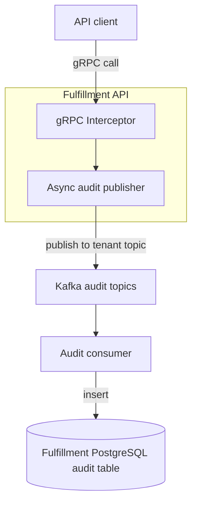
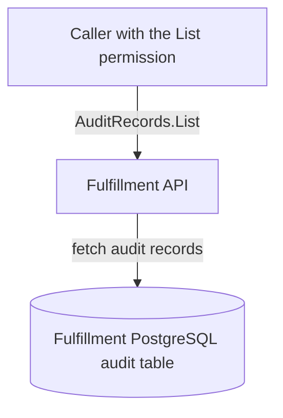

# Activity and Audit Log API

| Field | Value |
|---|---|
| Author(s) | Elkana Hendler |
| Jira | [OSAC-63](https://redhat.atlassian.net/browse/OSAC-63) |
| PRD | [prd.md](prd.md) |
| Milestone | 0.5 |
| Date | 2026-11-11 |

# 1. Overview

This milestone is a development preview focused on minimal, fail-open, best-effort auditing; it is not a complete or production-ready audit capability. Stronger guarantees are future work and may be policy-dependent per action or source rather than global.

The design records selected Fulfillment API calls in an append-only audit table and exposes them through a tenant-scoped query API. The API enqueues audit records for asynchronous publication to Kafka and does not wait for Kafka acknowledgment. Records can be dropped when the queue is full, the publisher fails, or the process shuts down. Each record contains only specified fields, not a full request or response body. A separate Kafka consumer within Fulfillment reads the audit messages and inserts the records into Fulfillment PostgreSQL using the standard DAO utility.

# 2. Goals and Non-Goals

## 2.1 Goals

- Capture Fulfillment API calls at the gRPC server boundary.
- Store attribution only from the authenticated identity and its tenant scope.
- Apply the authenticated persona's tenant scope before filters and pagination.
- Keep audit storage append-only through the public API and fail open when Kafka publication fails.

## 2.2 Non-Goals

- Capture Keycloak login, token, or session events.
- Capture asynchronous resource lifecycle completion or failure events.
- Store before-and-after state, request or response bodies, credentials, or free-text errors.
- Provide audit browsing through a UI, CLI, bulk export, or external SIEM.
- Provide cryptographic integrity verification or configurable record retention.

# 3. Motivation / Background

OSAC does not provide a queryable audit trail of platform activity. Cloud Provider Admins lack a way to investigate activity across tenants and produce platform-wide compliance reports, while Tenant Admins cannot review their organization's activity history without operator assistance. This design starts building that history by recording Fulfillment API calls. Each record includes caller information from the authenticated identity context and only fields explicitly approved for audit; it does not include the full request or response.

# 4. Design

## 4.1 Architecture

At the gRPC boundary, the RPC interceptor creates a request record for each captured call and a response record when the call completes. Each record has a distinct event ID; both share a request ID. The interceptor attempts to enqueue each record for asynchronous publication to the Kafka topic for its record-owning tenant. Use `osac.audit.<tenant-id>` for verified record ownership. A separate Kafka consumer inserts the records into the audit table.

**Audit event ingestion and persistence**



Each audit record captures:

- `metadata`: the standard OSAC object metadata, including its name (event UUID),
  owning tenant, and creation timestamp.
- `request_id`: correlates request and response records.
- `event_timestamp`: time the event occurred.
- `source`: system that originated the event.
- `action`: operation performed on the target.
- `actor`: user or service that performed the action.
- `outcome`: result of the activity.
- `target_object`: a typed reference to the targeted object, including its
  tenant, when known.

**Request and response capture**

At gRPC entry, the audit interceptor records receipt time, creates a request ID, and captures the attempt before authentication or validation can stop later interceptors from running. After authentication succeeds, it adds the verified actor and tenant when available; earlier failures have no actor. It enqueues the request record to the Fulfillment API's asynchronous publisher (`sarama.AsyncProducer`) before authorization or business handling. On authentication or validation failure, it still attempts to enqueue the request record and returns the gRPC error. When the call completes, it enqueues a response record with the same request ID, final gRPC status, and completion time. Enqueueing is non-blocking: if the bounded queue is full, the record is dropped and the failure is counted. The API result does not wait for Kafka. Each record identifies its owning tenant and, when applicable, its target object.

For a captured streaming RPC, create one request record when the stream starts and one response record when it completes. Do not create a record or request ID for each message in the stream.

The capture operates at the gRPC boundary. HTTP+JSON requests pass through the gRPC server and do not create a second pair. Failures before a request reaches the gRPC server are not captured.

**Asynchronous publishing and topic setup**

The asynchronous publisher sends queued records to Kafka and handles acknowledgments and bounded retries independently of the API call. Before publishing a record owner's first audit record, it checks whether the corresponding topic exists and creates it through Kafka's Admin API if needed. This follows Fulfillment's existing event-publisher pattern; topic setup does not delay API requests. A request and its response are separate records; their shared request ID provides correlation, but consumers must not rely on delivery order or on both records being delivered.

**RPC capture rules**

Capture RPCs mapped to HTTP `POST`, `PUT`, `PATCH`, or `DELETE`. Capture RPCs without an HTTP mapping by default. Capture sensitive `GET` RPCs on a hardcoded allowlist. Capture other `GET` RPCs only when authentication fails or authorization denies access. Exclude health, reflection, and transport-probe RPCs on a hardcoded blocklist.

**Tenant routing and attribution**

Set `actor` only when authentication succeeds and the principal can be represented by an existing user or service-account reference. Set `metadata.tenant` to the verified tenant of the authenticated actor, not the target object's tenant. If the actor's tenant is unknown or authentication fails, set `metadata.tenant` to `system`, which makes the record visible only to Cloud Provider Admins. When a target object is known, populate the matching typed field in the `target_object` oneof with its verified ID and tenant. Publish each record to `osac.audit.<metadata.tenant>`.

**Audit record fields**

Set `action` to the full RPC method name. When a target object is known, set the matching typed field in the `target_object` oneof, using verified information available to the request handler. Set `actor` from the authenticated identity context. Build records using only the specified fields. Do not store raw request or response messages.

## 4.2 Data Model / Schema Changes

Each record describes one event. `metadata` uses OSAC's standard `Metadata` message: its `name` is the event UUID, its `tenant` is the tenant that owns the audit record and determines visibility, and its `creation_timestamp` is when the record is created. `metadata.creator` identifies who created the audit record; `actor` identifies who performed the audited action. The Fulfillment API creates the event UUID before enqueueing and preserves it across publication retries; the consumer uses it to deduplicate Kafka redelivery. `request_id` links the request and response for one call. `event_timestamp` records when the API event occurred and may differ from `metadata.creation_timestamp`. `target_object` separately describes the affected object, including its tenant. The request record has `outcome="PENDING"` and is never updated. The response record has the canonical gRPC status code name, such as `OK` or `PERMISSION_DENIED` (`outcome` is a string, not `codes.Code`, so it can also represent outcomes from Keycloak or lifecycle events).

### Audit record protobuf schema

```protobuf
syntax = "proto3";

package osac.private.v1;

import "osac/public/v1/metadata_type.proto";
import "osac/public/v1/secret_type.proto";
import "osac/public/v1/cluster_template_type.proto";
import "osac/public/v1/user_type.proto";
import "osac/public/v1/service_account_type.proto";

enum AuditSource {
  AUDIT_SOURCE_UNSPECIFIED = 0;
  AUDIT_SOURCE_API = 1;
}

message AuditActor {
  oneof subject {
    osac.public.v1.UserReference user = 1;
    osac.public.v1.ServiceAccountReference service_account = 2;
  }
}

message AuditRecord {
  osac.public.v1.Metadata metadata = 1;
  string request_id = 2;
  google.protobuf.Timestamp event_timestamp = 3;
  AuditSource source = 4;
  string action = 5;
  optional AuditActor actor = 6;
  oneof target_object {
    osac.public.v1.SecretReference secret = 7;
    osac.public.v1.ClusterTemplateReference cluster_template = 8;
    // Add one field for each supported target resource, using its existing
    // reference message as the field type.
  }
  string outcome = 9;
}
```

Use a `target_object` oneof with a separate field for each resource kind that
audit capture supports. Each field's protobuf type is the existing reference
message for that resource. The example uses the existing
`SecretReference` and `ClusterTemplateReference` messages.

`AuditActor` is a separate audit-contract message. User references carry `id`,
`name`, `project`, `shared`, and `tenant`. The open
Fulfillment change [OSAC-6945](https://github.com/osac-project/osac/pull/2497)
adds `name`, `project`, and `tenant` to `ServiceAccountReference` while
preserving its `id` field. This design depends on
[OSAC-6945](https://github.com/osac-project/osac/pull/2497) to add the
`name`, `project`, and `tenant` fields and a migration to populate them. For
this milestone, audit events populate only the service account reference's
`id`; the other fields are reserved for future use.

Kafka record values use the binary Protobuf encoding of `AuditRecord`. Kafka
treats the value as opaque bytes, so the producer and consumer must use
compatible schemas. Schema evolution must preserve compatibility for records
that remain in Kafka.

### Fulfillment PostgreSQL storage

For this milestone, audit records reside in Fulfillment's PostgreSQL database as a temporary storage solution. This remains the plan until the log storage solution tracked by [OSAC-6982: Logs Collection and Aggregation](https://redhat.atlassian.net/browse/OSAC-6982) is available.

Use the existing Fulfillment [GenericDAO PostgreSQL table standard](../../../fulfillment-service/internal/database/dao/generic_dao.go#L51-L67). Store `metadata` using the standard object metadata columns, as for other Fulfillment objects. Store the remaining audit-record fields (`request_id`, `event_timestamp`, `source`, `action`, `actor`, the selected typed target reference, and `outcome`) in the serialized `data` column. Standard metadata fields that do not apply to audit records remain empty or use the DAO defaults.

The Kafka audit consumer runs as a separate process within Fulfillment and uses the standard DAO utility to insert audit rows; grant its database role permission to insert rows, but not to update or delete them. Grant the Fulfillment API permission to read audit rows, but not to insert, update, or delete them.

## 4.3 API Changes

Add public gRPC `AuditRecords.List` and its HTTP+JSON mapping at `GET /api/fulfillment/v1/audit_records`. The API has no public create, update, or delete methods for audit records.

**List audit records**



The request and response follow the standard OSAC List API shape. `offset` and `limit` control pagination, and `filter` uses the standard Fulfillment CEL expression:

```protobuf
message AuditRecordsListRequest {
  optional int32 offset = 1;
  optional int32 limit = 2;
  optional string filter = 3;
}

message AuditRecordsListResponse {
  int32 size = 1;
  int32 total = 2;
  repeated AuditRecord items = 3;
}
```

`filter` is a CEL expression evaluated against `AuditRecord` objects. Tenant visibility is applied before the caller's filter. Results use the ordering behavior provided by the standard Fulfillment List API.
Users can check the `target_object` oneof directly in CEL filters, for example
`has(this.secret)`. This matches the resource-payload oneof used by OSAC events.

Follow the standard Fulfillment List semantics for pagination: offset defaults to zero and negative offsets are treated as zero; omitted limits use the configured default, zero returns only the count, negative limits are rejected, and limits above the configured maximum are capped. Invalid CEL filters are rejected by the standard filter translator.

`size` is the number of items in the current page. `total` counts records visible to the caller before pagination.

The audit query API is itself audited: for each query, the RPC interceptor attempts to enqueue a request record and a response record. The query path stores only the defined audit fields, not the full filter payload. Because publication and ingestion are asynchronous, a query's audit records may appear in the results of a later query or may be absent if enqueueing or publication fails.

## 4.4 Scalability and Performance

For each captured API call, the interceptor attempts to add the request record and, when the call completes, the response record to the bounded in-memory queue for asynchronous publication to Kafka. API latency is not coupled to Kafka acknowledgment or retry time. The bounded queue limits memory use; if it is full, the publisher drops the record rather than delaying the API call. The asynchronous publisher retries transient publication failures a bounded number of times, then reports and drops records that remain undelivered. Queue capacity, retry limits, and backoff are implementation-defined defaults. The design sets no throughput, query-latency, or ingestion-lag SLO for this milestone.

Each record-owning tenant has a separate topic named `osac.audit.<tenant-id>` and a separate offset. A backlog in one topic does not block offset progress for other topics. Kafka broker capacity, Kafka consumer capacity, and PostgreSQL capacity remain shared.

For this milestone, do not delete audit rows from PostgreSQL. Kafka retains events for a limited time. If PostgreSQL is unavailable until Kafka deletes an event, that event cannot be replayed from Kafka. Define PostgreSQL retention in the next phase.

## 4.5 Security Considerations

Define one permission for `osac.public.v1.AuditRecords/List` with two scopes.

- **Tenant scope:** Return only records whose `metadata.tenant` matches the
  caller's authenticated tenant. Apply this restriction before filters and
  pagination.
- **Platform scope:** Return records across all tenants, including records
  owned by `system`. A CEL filter may limit results to one tenant.

Check that the caller has permission to use this method at the requested scope.
Do not expand visibility to every record that shares a request ID.
`target_object.tenant` is descriptive target metadata and does not grant
visibility to records owned by another tenant.

OSAC-63 defines this method permission and its scope checks. It does not add
built-in audit roles. OSAC-3058 will make method permissions composable into
named roles. An administrator can then grant this method alone to an auditor
or combine it with other method permissions.

The Fulfillment API's Kafka publisher includes only the specified fields. It excludes request and response bodies, credential values, raw payloads, and free-text errors.

Use TLS and SCRAM-SHA-512 for bundled Kafka. Give the Fulfillment API's Kafka publisher a dedicated identity with write access to audit topics. Give only the Kafka consumer read access to audit topic patterns and its consumer group. Do not grant tenant workloads or API clients Kafka access. External Kafka deployments need equivalent encrypted authentication and access controls.

The design provides API-level append-only behavior. It does not prevent direct database edits or privileged operator intervention. Cryptographic integrity verification is out of scope.

## 4.6 Failure Handling and Recovery

| Failure | Behavior | Recovery or limit |
|---|---|---|
| Kafka does not acknowledge a record within the asynchronous publisher's bounded retries | The publisher drops the affected record. The API call does not wait for the retries. | Log and count failed publication and dropped records. Implementation defines retry and backoff defaults. |
| The publisher queue is full when the interceptor enqueues a record | The publisher drops the affected record and continues the API call. | Track records dropped because the queue was full in metrics. |
| Fulfillment stops while records are queued or awaiting Kafka acknowledgment | Those records may be absent. A request record may exist without its response, even if the resource transaction committed. | During graceful shutdown, allow a bounded period to drain queued records. Records not acknowledged by the end of that period may be lost. |
| PostgreSQL is unavailable after Kafka accepts a record | Audit queries require PostgreSQL and may fail during an outage. Kafka retains accepted messages for retry. | The Kafka consumer retries insertion and commits the offset only after the insert or duplicate no-op succeeds. The event ID prevents duplicate rows. |
| The Kafka consumer receives an invalid record or topic/tenant mismatch | Reject and skip it; `metadata.tenant` must match the topic tenant. | Report the failure and continue with later records. |
| An outage exceeds Kafka retention | Kafka may expire records before ingestion. | Those records cannot be recovered from Kafka. |

Kafka retention bounds recovery from Kafka; it does not set the retention period for audit rows stored in PostgreSQL.

The API uses fail-open, asynchronous Kafka publication. A committed resource mutation can therefore have no audit row. The design does not guarantee complete capture during queue saturation, Kafka publisher failure, process crash, shutdown, or retention expiry. The consumer uses the event ID to make inserts idempotent, so redelivery does not create duplicate rows. The producer assigns the ID once and preserves it across publication retries.

## 4.7 RBAC / Tenancy

The `osac.public.v1.AuditRecords/List` permission has tenant and platform
scopes, as defined in [§4.5](#45-security-considerations). Tenant scope allows
listing records owned by the caller's authenticated tenant. Platform scope
allows listing records across tenants, including `system`-owned records. Do not
infer either scope from a persona.

Per-tenant Kafka topics named `osac.audit.<tenant-id>` separate offsets by
verified `metadata.tenant`. Records without a verified actor tenant belong to
`system` and use `osac.audit.system`. The target object's tenant is stored
separately and does not determine the topic. Topics do not isolate broker,
Kafka consumer, or PostgreSQL capacity. The API enforces the caller's authorized
scope when it returns stored records.

## 4.8 Extensibility / Future-Proofing

For this milestone, the Fulfillment API is the only audit-event source. Kafka serves as the shared ingestion point for Fulfillment and future audit-event sources. Later phases may add sources such as Keycloak; any new source can publish its records directly to the audit topics rather than routing them through the Fulfillment API. A source must use a contract supported by the Kafka consumer before it begins publishing. This design does not define a broader event plug-in or schema registry.

# 5. Interface Changes

The PRD has no formal FR or NFR IDs; these labels are local to this design and summarize its in-scope requirements. The companion test plan and coverage matrix currently use a different numbering scheme and broader scope, so they must be reconciled before their labels can serve as traceability to this design.

| Label | Requirement summary |
|---|---|
| FR-1 | Capture Fulfillment API calls according to [§4.1](#41-architecture), including authentication failures and authorization denials. |
| FR-2 | Attribute user-initiated calls to the authenticated user. |
| FR-3 | Record request and final API response outcomes with a shared request ID. |
| FR-4 | Provide filtered, paginated gRPC and HTTP+JSON queries. |
| FR-5 | Enforce the tenant or platform scope authorized for the List method. |
| FR-6 | Record access to audit data. |
| FR-7 | Exclude credential values while recording credential access. |
| NFR-1 | Expose no API for updating or deleting audit records. |
| NFR-2 | Keep audit delivery failures from changing platform API results. |
| NFR-3 | Keep audit data within the deployment jurisdiction. |
| NFR-4 | Retain audit rows indefinitely in this milestone. |

## IC-1: Public audit query API

**Requirements:** FR-4, FR-5, FR-6

Add `AuditRecords.List` and `GET /api/fulfillment/v1/audit_records`. The API follows the standard Fulfillment `List` request shape (`offset`, `limit`, and CEL `filter`); supported audit-field filtering, pagination, validation, and audit-of-audit behavior are described in [§4.3](#43-api-changes). Check authorization for the method and enforce its tenant or platform scope before query filters and pagination, as described in [§4.5](#45-security-considerations) and [§4.7](#47-rbac--tenancy).

## IC-2: Shared audit record and Kafka contract

**Requirements:** FR-1, FR-2, FR-3, FR-4, FR-7

Add the `AuditRecord`, typed target-reference messages, enums, and fields specified in [§4.2](#42-data-model--schema-changes). `AuditRecord` uses the standard `Metadata` message; the contract distinguishes `metadata.tenant`, which owns the audit record, from the tenant in the selected target reference, which owns the target object. The list method uses the standard Fulfillment `List` request fields and CEL filtering.

## IC-3: Fulfillment API request and response capture

**Requirements:** FR-1, FR-2, FR-3, FR-7, NFR-2

The RPC interceptor captures unary and streaming RPCs according to the policy in [§4.1](#41-architecture). It generates one UUID request ID at gRPC entry, stores it in request context for response capture and request-scoped logging, and uses it for both audit records. A streaming RPC produces one request/response pair and one request ID for the stream, not one pair per message. The records have distinct, stable event IDs. The asynchronous publisher handles Kafka acknowledgments and bounded retries; queue saturation or publication failure does not change the API result. See [§4.5](#45-security-considerations) and [§4.6](#46-failure-handling-and-recovery).

## IC-4: Kafka consumer, append-only table, and scoped query

**Requirements:** FR-4, FR-5, FR-6, NFR-1, NFR-4

Add the separate Kafka consumer and audit table. Validate records, deduplicate by event ID, and commit offsets only after an insert or duplicate no-op succeeds. Expose records through the scoped query API. See [§4.2](#42-data-model--schema-changes), [§4.3](#43-api-changes), [§4.5](#45-security-considerations), [§4.6](#46-failure-handling-and-recovery), and [§4.7](#47-rbac--tenancy).

## IC-5: Tenant topics, access controls, and deployment wiring

**Requirements:** NFR-3, NFR-4

Add per-tenant audit topics routed by record-owning `metadata.tenant`; the tenant in a selected target reference does not determine topic routing. Add dedicated runtime identities and database roles. Include the audit table in PostgreSQL backup and restore procedures, and keep backup and replica copies within the deployment jurisdiction. See [§4.1](#41-architecture), [§4.2](#42-data-model--schema-changes), [§4.5](#45-security-considerations), [§4.6](#46-failure-handling-and-recovery), and [§8](#8-impact-and-compatibility).

# 6. Alternatives Considered

| Alternative | Reason not selected |
|---|---|
| Write audit rows directly from the Fulfillment API | This would give Fulfillment a separate write path. Using Kafka as the common entry point lets Fulfillment and future sources, such as Keycloak, submit audit records through one pipeline. |
| Publish synchronously to Kafka from the API call | Kafka latency, retries, and timeouts would delay API responses, contrary to the fail-open latency goal. |
| Generate the event ID in PostgreSQL when the consumer inserts the record | A Kafka redelivery after an insert but before offset commit would receive a new database-generated ID and could create a duplicate row. Assigning the ID before publication lets the consumer recognize the same event on redelivery. |
| Add a separate audit service or write API | This adds a service or mutation hop while Fulfillment owns query and storage. |
| Use a durable queue | This could reduce loss of queued records, but adds persistence and recovery requirements and does not cover every read or failed authentication/authorization attempt. It is outside this milestone. |
| Use a transactional outbox for database changes | It reliably records committed changes, but does not capture reads or failed authentication and authorization attempts. |
| Use an optional/null record tenant and a dedicated null Kafka topic | This requires a special topic and null-handling path, and does not identify which tenant's users may see an event. A required `metadata.tenant` with `system` as the fallback gives unattributed events a clear visibility scope; target ownership is stored separately. |
| Forward standard output through a collector | OSAC does not deploy this collector, and records can be lost before collection. |

This design uses a bounded in-memory queue and asynchronous publisher. It accepts possible record loss during queue saturation, process failure, or shutdown in exchange for keeping Kafka latency and availability out of API responses.

# 7. Observability and Monitoring

Track how many records are waiting in the publisher queue and whether it is full, Kafka publication latency, acknowledgment timeouts, publication failures, dropped records, Kafka consumer lag per topic, invalid records, insert failures, and query availability. The design sets no numeric alert threshold or performance SLO for this milestone.

Logs and metric labels must not include tenant, actor, resource, or credential values. The design does not prescribe metric names or alert thresholds.

# 8. Impact and Compatibility

The query API adds `AuditRecords.List` and `GET /api/fulfillment/v1/audit_records` without changing existing API methods or routes. The database migration creates a new audit table without altering existing tables or data; existing migrations remain unchanged. Include the new table in PostgreSQL backup and restore procedures, and keep backups and replicas within the deployment jurisdiction. This design does not specify compatibility during mixed-version rollouts. The design does not backfill earlier activity.

The Kafka message format and protobuf compatibility rules are in [§4.2](#42-data-model--schema-changes) and [§4.8](#48-extensibility--future-proofing). The audit record schema and list API distinguish the record-owning `metadata.tenant` from the tenant in the selected target reference; consumers must use the former for visibility and the latter only to identify the affected object.

---

## Provenance

Authored: draft @ design 0.12.0 - 7b2b8de, workspace main @ d81c18823 (29 behind origin/main)
Final: revise @ design 0.15.0 - cd88680, workspace codex/OSAC-63-design-readability @ 5d508eca8 (dirty)

> Context changed between draft and revise.

<!-- ai-workflow-provenance:{"schema_version":1,"provenance_kind":"session","workflow":"design","workflow_version":"0.15.0","ai_workflows":"cd88680","source_repo":"5d508eca8 (dirty)","source_repo_branch":"codex/OSAC-63-design-readability","commits_behind_main":0,"commits_ahead_main":6,"main_ref":"main","phases":["draft","revise","revise","revise","revise","revise","revise","revise","revise","revise","revise","revise","revise","revise","revise","revise","revise","revise","revise","revise","revise","revise","revise","revise","revise","revise","revise","revise","revise","revise","revise","revise","revise","revise","revise","revise","revise","revise","revise","revise","revise","revise","revise","revise","revise","revise","revise","revise","revise","revise","revise","revise","revise","revise","revise","revise","revise","manual-edit","revise","revise","revise","revise","revise","revise","revise","revise","revise","revise","revise","revise","revise","manual-edit","manual-edit","revise","revise","revise","revise","revise","revise","revise","revise","revise","revise","respond","respond","respond","respond","revise","revise","manual-edit","manual-edit","manual-edit","respond","respond","respond","respond","revise","respond","manual-edit","respond","revise","revise","revise"],"authoring_modes":["manual","skill"],"context_changed":true,"origin_untracked":false} -->
