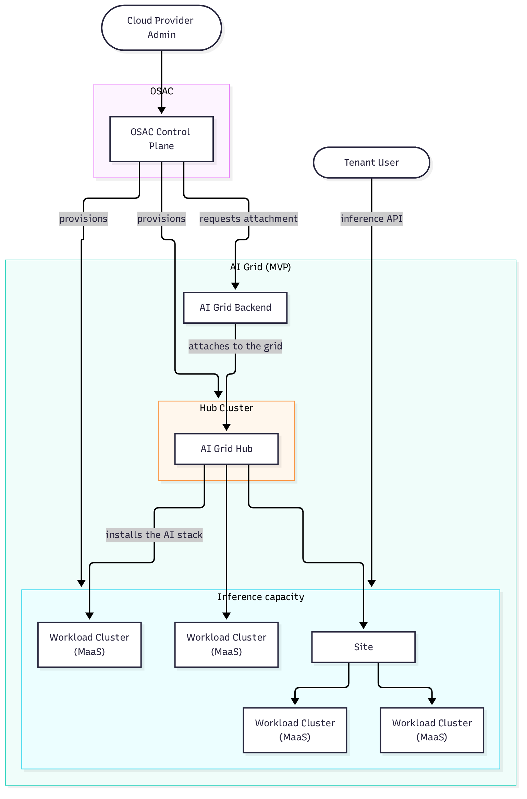

# OSAC Provisioning for Multi-Tenant AI Grid Infrastructure

| Field       | Value |
|-------------|-------|
| Author(s)   | Yuval Turgeman |
| Jira        | [OSAC-6435](https://redhat.atlassian.net/browse/OSAC-6435) |
| Date        | 2026-10-26 |

## Problem Statement

Today OSAC can provision a MaaS cluster from its existing template: model
serving on a single cluster, with per-tenant gateways and subscription
tiers. What it cannot do is provide an AI Grid — the multi-cluster
fabric that serves models to tenants for inference, built as a hub with
attached spoke clusters. The AI Grid MVP
exists outside OSAC and requires the Cloud Provider Admin to separately create
the hub, register clusters with ACM, install the AI Grid, and attach inference
capacity. None of it is represented in an OSAC provisioning workflow, so every
AI Grid deployment is a bespoke manual exercise and the provider cannot add
inference capacity on demand.

OSAC is the platform that provisions the clusters; the AI Grid MVP is deployed
on top of them and keeps everything it provides today, including its
tenant-facing experiences.

The Cloud Provider Admin provisions the hub and workload clusters through
OSAC, which asks the AI Grid Backend to attach them. The grid then installs
the AI stack on attached clusters, and tenants reach the inference API they
serve.

## In Scope

- Cloud Provider Admin provisioning of the AI Grid Hub — the single ACM/GitOps
  hub shared across tenants, running on an OSAC hub — installing ACM, GitOps,
  and the existing AI Grid MVP GitOps applications, ACM policies, backend, and
  frontend as one OSAC-initiated operation. Whether that hub is dedicated to
  the AI Grid or shared with other OSAC hub functions is a design decision,
  provided it states who owns the hub's lifecycle, what an AI Grid upgrade
  does to anything else running there, and how a hub failure is isolated.
  Provisioning the AI Grid Hub is what makes that OSAC hub an ACM hub; OSAC
  does not install ACM today.
- OSAC provisioning of spoke clusters — CaaS clusters with GPU-equipped worker
  nodes — attached to the hub automatically after provisioning, with no
  separate operator action.
- Cloud Provider Admin access to provisioning and status through both the OSAC
  UI and API/CLI. Hub and spoke provisioning, and their infrastructure status,
  are visible to Cloud Provider Admins only.
- ACM and GitOps install the AI software stack on attached spokes and keep it
  current, using the existing MVP components.
- OSAC lifecycle visibility: hub provisioned, spoke provisioned, spoke
  attached, and attachment failed. A spoke that fails to attach stays visible
  as provisioned with the failure reason, and OSAC retries automatically until
  it succeeds — no operator action and no reprovisioning. OSAC distinguishes
  failures it will keep retrying from those needing operator action, and backs
  off accordingly. A cluster that
  fails during provisioning never reaches these states; it is reported through
  the CaaS provisioning status OSAC already exposes.
- OSAC reports attachment, not inference readiness. No trustworthy AI Grid
  readiness signal is available today, so inference-readiness visibility is
  deferred rather than approximated from `spoke attached`.
- Spokes provisioned here and clusters imported through OSAC-6488 appear in
  one provider capacity inventory. How each is represented is a design
  decision; the provider sees a single view of AI capacity either way.

## Out of Scope

- Implementing or redesigning the existing AI Grid/MaaS product — tenant-facing
  model catalog, subscription, API key, inference, usage, and billing
  capabilities, or its policies, backend, and frontend. OSAC deploys these
  components unchanged.
- Adding imported clusters to the AI Grid through OSAC-6488, or redesigning the
  import flow.
- Routing tenants from OSAC into the AI Grid — redirects, proxies, deep links,
  or authentication handoff from the OSAC console. Ownership of that handoff
  is an API-surface question expected to be covered by OSAC-6432.
- Enforcing tenant isolation for model access, subscriptions, and usage; the
  AI Grid/MaaS components own that enforcement.
- Removing the existing `ocp_4_20_ai_maas` template as part of this work; it is
  slated for removal once the replacement path works.
- Dedicated per-tenant AI Grid hubs, tenant-specific inference clusters, or
  private inference capacity.
- Detailed OSAC UI/API surface design for these workflows; OSAC-6432 owns it.
- Replacing ACM and GitOps for in-grid configuration and day-2 operations.
  OSAC does not manage resources inside the grid after spokes are attached.
  Grouping attached spokes for placement and isolation is owned by the AI
  Grid/ACM layer.
- Deprovisioning: removing a spoke from the grid, or tearing the hub down.
  This increment covers standing capacity up; teardown is a later increment.
- Detailed bootstrap sequencing, policy values, and application configuration
  for the AI Grid Hub; those belong in the design phase.

## User Stories

### Cloud Provider Admin

- As a Cloud Provider Admin, I want to provision the AI Grid Hub through OSAC
  so that ACM, GitOps, and the AI Grid MVP components are installed for me
  instead of by hand.

- As a Cloud Provider Admin, I want to provision spoke clusters with
  GPU-equipped worker nodes and have them attached to the hub automatically so
  that I can grow inference capacity in one step.

- As a Cloud Provider Admin, I want to see the hub and spoke lifecycle states
  so that I know when a spoke has joined the grid, and when one was provisioned
  but failed to attach.

- As a Cloud Provider Admin, I want to provision the hub and spokes and check
  status through both the OSAC UI and API/CLI so that the workflow supports
  interactive and automated operation.

### Cloud Infrastructure Admin

- As a Cloud Infrastructure Admin, I want the prerequisites a spoke cluster
  must meet to be explicit, so that I can prepare storage, networking and GPU
  capacity before clusters are provisioned.

### Tenant Admin / Tenant User

These confirm that the AI Grid OSAC deploys serves tenants as the existing MVP
does. OSAC does not build these capabilities.

- As a Tenant Admin, I want to assign model subscriptions to my users on an
  OSAC-provisioned AI Grid so that my organization can consume shared
  inference capacity.

- As a Tenant User, I want to run inference against my organization's models
  on an OSAC-provisioned AI Grid so that I can use shared capacity without
  knowing which spoke serves me.

## Assumptions

- The AI Grid is shared cloud-provider infrastructure serving multiple
  tenants.
- ACM and GitOps are required in order to reuse the existing AI Grid MVP and
  its day-2 management model.
- The Cloud Infrastructure Admin supplies a spoke's storage, networking, and
  GPU prerequisites by choosing from OSAC's supported options when creating
  the grid. OSAC reports unmet prerequisites to the Cloud Provider Admin, who
  raises them with the infrastructure admin; OSAC does not provision them.

## Dependencies

- **Existing AI Grid MVP:** assumed to exist and be deployable — its GitOps
  applications, ACM policies, backend, and frontend. OSAC deploys it unchanged
  and does not own its development or release.
- **AI Grid backend:** registers a spoke with ACM and attaches it to the grid,
  on request. OSAC makes that request automatically once a spoke is
  provisioned; the same request is made when a cluster is imported. OSAC does
  not register clusters with ACM itself.
- **ACM and GitOps:** the multicluster management layer the hub depends on, and
  the owner of AI software installation on attached spokes.
- **OSAC-6488:** introduces the provider-level `WorkloadCluster` resource for
  clusters serving AI workloads, and anticipates CaaS-provisioned clusters
  using the same shape. Whether an attached spoke becomes a `WorkloadCluster`
  is a design decision shared with that Feature. Attaching imported clusters
  to the AI Grid is deferred to a follow-up; owner TBD.
- **OSAC-6432:** delivers the Cloud Provider Admin UI/API surfaces, including
  status reporting and the tenant endpoint and authentication handoff. The
  user stories here depend on it, so OSAC-6432 must land first or alongside;
  this work cannot be delivered to a Cloud Provider Admin without it.
- **GPU capacity:** a supported CaaS path supplying worker nodes with the
  required GPU hardware.

## Open Questions

None remain for this increment. Inference-readiness visibility and
deprovisioning are deferred and recorded in Out of Scope.

---

## Provenance

Authored: draft @ prd 0.11.5 - e2b0d87, workspace main @ f0a8211
Final: respond @ prd 0.11.5 - 7b2b8de, workspace main @ f0a8211

> Context changed between draft and respond.

<!-- ai-workflow-provenance:{"schema_version":1,"provenance_kind":"session","workflow":"prd","workflow_version":"0.11.5","ai_workflows":"7b2b8de","source_repo":"f0a8211","source_repo_branch":"main","commits_behind_main":0,"commits_ahead_main":0,"main_ref":"main","phases":["draft","revise","revise","revise","revise","revise","revise","revise","revise","revise","revise","revise","revise","revise","revise","revise","revise","revise","revise","revise","revise","revise","revise","revise","revise","revise","revise","revise","respond","respond"],"authoring_modes":["skill"],"context_changed":true,"origin_untracked":false} -->
