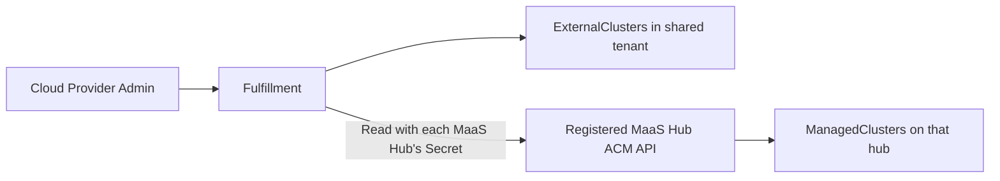

# Register MaaS Hubs and Spokes as External Clusters

Cloud Provider Admins register the Advanced Cluster Management (ACM) hubs
and spoke clusters, already managed by those hubs, they use for MaaS.
Fulfillment stores each `ExternalCluster` at tenant scope in the `shared`
tenant. This provides registration status and discovery for future
placement. See the [PRD](prd.md) and
[clarification log](clarifications.md).

## Registration flow

1. The admin registers an existing ACM hub as a MaaS Hub and sets its
   MaaS namespace and kubeconfig Secret. An OSAC Hub provides the
   registration context. It can have several MaaS Hubs registered under
   it and does not need ACM installed.
2. The admin registers a spoke, declares its AI Grid role, and can select
   its MaaS Hub now or link it later. Fulfillment looks up the spoke
   through the selected MaaS Hub with that hub's credentials.
3. Create persists the registration and returns a generated ID with
   `Unknown` conditions. Fulfillment verifies the registration
   asynchronously and reports the result through Get and List.
   Registration performs no provisioning, creates no operator or target
   cluster CRDs, and makes no changes to ACM registration or policies.

## User interfaces

`osac.private.v1.ExternalClusters` is a private Fulfillment service,
following OSAC Hub. REST uses `/api/private/v1/external_clusters` on the
internal gateway. The service and resource stay out of the public API.
Cloud Provider Admins manage registrations through the private API, CLI,
and admin UI. Fulfillment authorizes each call, and authenticated tenant
callers receive `PermissionDenied`. Tenant workloads use the capacity
through MaaS.

Private responses contain registration fields and observed status,
including the controller-owned `managed_cluster_uid` once recorded.
Credentials remain in the referenced Secret. For administrator requests,
Create ignores supplied status, a masked Update targeting status returns
`InvalidArgument`, and other Updates preserve observed status.

| Interface | Contract |
|---|---|
| IC-1 · Create | `ExternalClusters.Create` or `POST` to the collection. Accepts valid registrations during an ACM outage. Invalid input returns `InvalidArgument`, name or ACM identity conflicts return `AlreadyExists`, and a failed persistence operation returns `Internal` without creating a partial record. |
| IC-2 · Get and List | `ExternalClusters.Get` or `GET /{id}` returns one registration by ID. `ExternalClusters.List` or `GET` on the collection returns registrations in the `shared` tenant with CEL filtering and pagination. |
| IC-3 · Update | `ExternalClusters.Update` or `PATCH /{id}` changes labels, MaaS namespace, or AI Grid spoke role. An unlinked spoke can select a MaaS Hub once. First assignment checks ACM identity uniqueness and uses the resource version to prevent races. A conflicting write returns `Aborted`. |
| IC-4 · Delete | Disconnect is deferred. Fulfillment explicitly denies Delete, including for admins, with `PermissionDenied`. |
| IC-5 · CLI | With `osac login --private`, the `create`, `get`, `describe`, and `edit` commands for `external-cluster` call the private service. |
| IC-6 · Admin UI | Use the private service through the existing Connect proxy, forwarding the caller's identity as for External IP Pools. Offer type-specific fields and a MaaS Hub selector. Show `Available` in the list and both conditions with reasons and messages in details. |
| IC-7 · Placement data | List can filter by MaaS spoke type, selected MaaS Hub, AI Grid role, and `Available=True`. An inference query selects inference and combined roles. It excludes unlinked spokes and hub-only records. List returns observation timestamps for the consumer to evaluate freshness. |

### Registration fields

Local references accept an ID or a name. If both are present, they must
identify the same authorized record. Fulfillment resolves references to IDs
for uniqueness checks and observation.

| Field | Contract |
|---|---|
| `metadata.name` | Required immutable DNS label, unique across all ExternalClusters in `shared` regardless of types or hub assignment. Names stay reserved until archival completes. |
| `spec.source_hub` | Required immutable reference to an existing OSAC `Hub`. |
| `spec.cluster_types` | Immutable, nonempty set of distinct supported types. This increment accepts `CLUSTER_TYPE_MAAS_HUB` and `CLUSTER_TYPE_MAAS_SPOKE`, including both on one record. |
| `spec.secret` | Immutable reference to a typed kubeconfig Secret in the provider `system` scope. Required for any record with the MaaS Hub type. A spoke-only record can omit it, and observation uses the selected MaaS Hub's credential even if the spoke supplies its own. |
| `spec.maas_hub_config.namespace` | Required with the MaaS Hub type. Names the provider's MaaS namespace and follows Kubernetes namespace syntax. |
| `spec.maas_spoke_config.role` | Required with the MaaS spoke type. Valid values are `AI_GRID_ROLE_INFERENCE`, `AI_GRID_ROLE_INGRESS`, and `AI_GRID_ROLE_COMBINED`. |
| `spec.maas_spoke_config.maas_hub` | Optional reference to an ExternalCluster with the MaaS Hub type. It cannot reference the record itself, and an assigned reference cannot change or be cleared. |
| `spec.maas_spoke_config.managed_cluster_name` | Optional immutable ACM ManagedCluster name. If present it must be a nonempty valid Kubernetes name. If omitted, use `metadata.name`. |

Each type's configuration is accepted only when that type is declared.
An active linked spoke's effective ManagedCluster name must be unique
within its selected MaaS Hub. Spokes on different MaaS Hubs can use the
same ACM name with distinct ExternalCluster names. Fulfillment enforces
both uniqueness rules in durable storage, including concurrent requests.
[OSAC naming contract](https://github.com/osac-project/osac/blob/main/fulfillment-service/docs/API.md#uniqueness)

The admin UI needs an API baseline that includes the private service.

## Observation and registration status

Fulfillment keeps one read-only `ManagedCluster` watch per registered
MaaS Hub using `cluster.open-cluster-management.io/v1`. The Hub Secret
supplies `get`, `list`, and `watch` access. A watch is usable after an
authenticated list and cache sync. Create, first hub assignment, changes
on the selected hub, and reconnect trigger observation. An outage on one
hub affects only records that rely on that hub's watch. A hub's own
watch runs independently of any spoke role on the same record.

`HubReachable` becomes `True` when every applicable watch is usable.
For a hub role, `Available=True` requires a usable watch on that hub.
For a spoke role, it requires a usable watch on the selected hub and
an accepted and available ManagedCluster with a valid stable identity.
For dual-type records both roles must pass. An observed failure takes
precedence over a pending check. These conditions describe registration.
AI operator, GPU, and policy readiness are outside this increment.

| Reason | When the admin sees it |
|---|---|
| `ValidationSucceeded` | All applicable registration checks passed. |
| `MaasHubUnassigned` | The spoke has no selected hub and any applicable hub-role check passed. Both conditions stay `Unknown`. |
| `HubUnreachable` | An applicable hub registration, credential, or synchronized watch is unavailable. Both conditions are `False`, and a missing ManagedCluster is never inferred from this state. |
| `ManagedClusterNotFound` | The selected hub's synchronized watch has no matching ManagedCluster. `Available` is `False`. |
| `ManagedClusterNotAccepted` or `ManagedClusterUnavailable` | The matching ManagedCluster does not report `HubAcceptedManagedCluster=True` or `ManagedClusterConditionAvailable=True`, respectively. `Available` is `False`. |
| `ClusterIdentityMissing` or `ClusterIdentityMismatch` | The `id.k8s.io` identity claim is empty or missing, or differs from the stored claim. `Available` is `False`. |

Fulfillment stores the first `id.k8s.io` claim after successful spoke
verification and keeps it across failures. A ManagedCluster replaced at
the same name can recover availability only with the original identity.
Fulfillment resumes observation on startup, retries failed writes, and
rechecks the current binding on a stale write. It revalidates every five
minutes, including checking each Hub Secret for rotation. A changed
credential requires a fresh watch and successful sync. Conditions update
automatically as the checks pass again.

Each condition includes `type`, `status`, `reason`, `message`,
`last_transition_time` and `last_observed_time`. Transition time changes
when status or reason changes. Observation time refreshes on each
completed observation, even when the result is unchanged. The recommended
freshness bound for future placement consumers is 15 minutes. List applies
no age threshold.

## Operations and scope

- Report registration outcomes, condition transitions, and per-hub watch
  errors for troubleshooting. Logs use opaque registration IDs, declared
  types, condition state, and structured component, operation, and request
  context. Keep credentials, cluster and Secret names, tenant identities,
  endpoints, stack traces, and raw upstream errors out of logs and condition
  messages.
- The MaaS feature gate (`global.services.maas.enabled`) controls access.
  When disabled, RPCs return `Unavailable`. Re-enabling MaaS restores
  access to stored records. The new resource requires an additive migration
  with no backfill. Reverting that migration discards its registrations.
- With Delete deferred, an admin who chose a wrong ACM name can create a
  correctly named registration when its name and ACM identity are free.
  A platform operator must archive the old record if a reserved name or
  mismatched identity needs to be reused.
- This design supplies the registration and query contracts. Praxis
  placement and execution, consumer authorization and staleness
  enforcement, tenant-level placement isolation, hub discovery, site
  aggregation, and support for other workload types are follow-up work.

## Alternatives

Reusing the OSAC Hub as the ACM hub would bind observation to one hub and
require ACM on the OSAC Hub. Explicit MaaS Hub registration lets the
provider choose independently and costs one watch and credential lifecycle
per registered hub. A separate ExternalCluster resource keeps this
registration lifecycle outside the existing provisioning `Cluster` workflow.

## Verification

The [test plan](testplan.md) maps the interfaces to coverage. The live
registration check uses an OSAC Hub without ACM and a separate MaaS ACM
Hub. The two-hub check verifies that identical ACM names resolve on the
selected hub and that an interruption affects only its registrations.

---

## Provenance

Authored: revise @ design 0.15.0 - 760cf64, workspace main @ 1f6356803

> This document's phase history does not include an initial /draft — structure was not verified against the template from origin.

<!-- ai-workflow-provenance:{"schema_version":1,"provenance_kind":"session","workflow":"design","workflow_version":"0.15.0","ai_workflows":"760cf64","source_repo":"1f6356803","source_repo_branch":"main","commits_behind_main":0,"commits_ahead_main":0,"main_ref":"main","phases":["revise"],"authoring_modes":["skill"],"context_changed":false,"origin_untracked":true} -->
