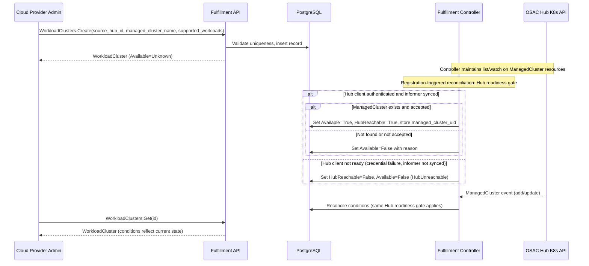

# Register Hub-Managed Clusters as Workload Clusters

| Field       | Value |
|-------------|-------|
| Author(s)   | Eran Cohen |
| Jira        | [OSAC-6488](https://redhat.atlassian.net/browse/OSAC-6488) |
| PRD         | [prd.md](prd.md) |
| Date        | 2026-10-21 |

# 1. Overview

This design introduces a provider-global `WorkloadCluster` resource in the
fulfillment-service that allows Cloud Provider Admins (CPAs) to register
ACM hub-managed clusters for use as OSAC workload targets. Each
WorkloadCluster is a canonical representation of one physical cluster
identified by a `(source_hub_id, managed_cluster_name)` pair with global
uniqueness. The WorkloadCluster is a provider-level resource visible and
manageable only by CPAs. All registered clusters provide shared provider
capacity; tenant-to-workload-cluster assignment and placement/isolation
policy are deferred to a future cross-workload design that collects use
cases across MaaS, VMaaS, and other workload types. See [PRD](prd.md)
for detailed requirements.

The design directly consumes OCM `ManagedCluster` CRDs on the Hub via
list/watch reconciliation, uses declarative conditions rather than an
imperative state machine, and defines an additive `supported_workloads`
capability list that starts with MaaS and accommodates future workload
types (e.g., VMaaS) without schema migration. The current supported
topology uses one OSAC Hub; `source_hub_id` references that existing Hub
resource and the controller reuses its connection credentials. The schema
includes an immutable `source_hub_id` for future multi-hub compatibility.

## 1.1 Terminology

| Term | Definition |
|------|------------|
| **WorkloadCluster** | The provider-global OSAC resource introduced by this design, representing one registered physical cluster. |
| **CPA** | Cloud Provider Admin — the OSAC role authorized to register and manage WorkloadClusters. |
| **Hub (OSAC Hub)** | An existing OSAC `Hub` resource representing an OpenShift cluster with ACM running on it. The OSAC Hub is the same entity as the ACM Hub in this design — it is not a separate management plane. `source_hub_id` references this resource, and the controller reuses its connection credentials to observe ManagedCluster CRDs. |
| **ManagedCluster** | An OCM custom resource on the Hub representing a cluster accepted into ACM management. |
| **OCM** | Open Cluster Management — the CNCF project providing the `cluster.open-cluster-management.io/v1` CRD API consumed by the controller. |
| **MaaS** | The OSAC managed AI workload placement service; the initial workload type for registered clusters. |

# 2. Goals and Non-Goals

## 2.1 Goals

- Define a provider-global canonical `WorkloadCluster` resource with
  global physical uniqueness enforced by `UNIQUE (source_hub_id,
  managed_cluster_name)` at the database layer, independent of the existing
  CaaS `Cluster` resource.
- Include an immutable `source_hub_id` field in the spec referencing an
  existing OSAC Hub resource, validated against the single configured Hub
  identity, with documented future multi-hub resolution path.
- Continuously reflect Hub cluster state by consuming OCM
  `ManagedCluster` CRDs directly via list/watch on the Hub's Kubernetes
  API, with explicit trust, RBAC, version, and availability contracts
  documented.
- Surface cluster readiness through declarative conditions (`Available`,
  `HubReachable`) that reflect current observed state, avoiding
  imperative state machines or polling.
- Allow clusters to declare workload capabilities via an additive
  `supported_workloads` list starting with `maas`, enabling future
  `vmaas` coexistence without schema migration.
- Model registration as explicit external-infrastructure registration
  while preserving a canonical day-2 WorkloadCluster shape that future
  CaaS automatic provisioning can create.
- Restrict all WorkloadCluster discovery and management to the CPA role;
  tenant workloads consume capacity indirectly through MaaS placement.

## 2.2 Non-Goals

- Disconnecting registered clusters from OSAC (deferred per PRD Out of
  Scope).
- Introducing an anti-corruption adapter between OSAC and OCM CRDs.
  Direct CRD consumption is the chosen approach; extraction triggers are
  documented in §4.8.
- Active multi-hub routing or dynamic Hub discovery. This increment uses
  one configured Hub.
- Site-level or multi-cluster datacenter aggregation. Each WorkloadCluster
  maps 1:1 to a ManagedCluster leaf. Parent aggregate resources require a
  future PRD.
- CaaS automatic cluster provisioning. This increment covers external
  registration only; future CaaS integration creates WorkloadClusters
  automatically through the same resource shape.
- Managing ACM/Praxis policies, cluster labels, or customer GitOps
  workflows for AI Grid configuration.

# 3. Motivation / Background

OSAC needs to track and interact with the clusters on which it places
tenant workloads. Cloud providers that manage AI Grid clusters through ACM
currently have no way to register those clusters in OSAC, so their
capacity cannot participate in MaaS AI workload placement. The
`WorkloadCluster` resource introduced by this design gives OSAC a
canonical representation of each registered cluster, enabling visibility,
condition monitoring, and future placement integration. See the
[PRD](prd.md) for the full requirements context.

**Background note:** OSAC's existing CaaS `Cluster` resource serves a
different purpose — it is coupled to HyperShift-based provisioning and
carries fields inapplicable to externally managed clusters. The
`WorkloadCluster` resource is distinct and new, providing clean separation
between provisioned and registered cluster lifecycles while sharing a
canonical shape that future provisioning modes can also target.

# 4. Design

## 4.1 Architecture

The `WorkloadCluster` resource lives entirely within the
fulfillment-service. No Kubernetes CRD is created on the OSAC operator
or on the target cluster as part of registration; decisions about CRDs
for deferred execution mechanisms (operator routing, AAP dispatch) belong
to the follow-up that designs those mechanisms. The fulfillment
controller validates and monitors the referenced `ManagedCluster`
directly on the Hub's Kubernetes API, connecting through the existing
OSAC Hub resource's credentials (see §4.5).

**Components:**

1. **WorkloadCluster gRPC service** — List, Get, Create, Update, Signal
   RPCs in the fulfillment-service, registered conditionally behind the
   `--enable-maas` flag per the OSAC-3046 pattern. Delete is deferred
   to a future increment aligned with disconnect scope (see IC-4).
2. **Fulfillment controller** — A reconciler in
   `fulfillment-service/internal/controllers/` that maintains a
   ManagedCluster watcher (list/watch) on
   `managedclusters.cluster.open-cluster-management.io/v1` on the Hub,
   using credentials resolved from the existing OSAC Hub resource (see
   §4.5). On ManagedCluster events, it reconciles the corresponding
   WorkloadCluster's conditions.
3. **PostgreSQL database** — Standard OSAC table with a global uniqueness
   constraint on `(source_hub_id, managed_cluster_name)`.

**Registration flow:**



The diagram shows the registration and reconciliation flow. The Create RPC
returns immediately after database insertion. The controller independently
watches ManagedCluster resources on the Hub and updates conditions as the
cluster's state changes. This is a declarative model: conditions always
reflect the current observed state of the ManagedCluster, not the history
of a one-time import operation. The CPA observes the outcome by reading
the resource at any time.

**Reconciliation triggers:** The Hub list/watch informer is the primary
reconciliation path for ongoing state changes. Three additional triggers
ensure timely initial reconciliation and resilience:

1. **Registration-triggered reconciliation.** After a successful Create
   RPC inserts the database record, the controller performs a **Hub
   readiness check** before consulting the informer cache:

   1. **Hub readiness gate.** The controller checks whether the Hub
      credential has been successfully resolved and the ManagedCluster
      watcher has completed its initial list-and-sync (i.e.,
      `HasSynced()` returns true). Authentication is established by a
      successful list/watch, not merely by constructing a client. If
      the Hub credential resolution fails, the list/watch has not
      authenticated, or the informer has not synced,
      the controller sets `HubReachable=False` and `Available=False`
      with reason `HubUnreachable` on the newly created record. It
      must **not** consult the informer cache in this state — an
      empty or unsynchronized cache would falsely report
      `ManagedClusterNotFound` for clusters that exist on the Hub but
      have not been cached. This gate applies identically to newly
      created and existing records during any reconciliation path.

   2. **Informer cache lookup (Hub ready only).** When the Hub
      credential is resolved, the watcher has authenticated via a
      successful list/watch, and the informer has synced, the controller
      looks up the referenced `managed_cluster_name` in the informer's
      current cache. If the ManagedCluster exists, the controller
      writes the appropriate conditions (`Available=True` or
      `Available=False` with reason). If the ManagedCluster is not in
      the cache, the controller sets `Available=False` with reason
      `ManagedClusterNotFound`.

   This two-step ordering ensures that `ManagedClusterNotFound` is
   reported only when the informer cache is authoritative (Hub client
   authenticated, informer synced), and that credential or connectivity
   failures are always surfaced as `HubUnreachable`. A registration
   for an already-synced upstream name transitions out of `Unknown`
   without waiting for a subsequent Hub event; a registration created
   during a credential outage reports `HubUnreachable` promptly rather
   than the misleading `ManagedClusterNotFound`.

2. **Startup reconciliation.** On controller startup, the controller
   reconciles all existing WorkloadCluster records in the database.
   The same Hub readiness gate applies: if Hub credential resolution
   fails during startup (missing Hub resource or invalid credential),
   all existing records receive `HubReachable=False` and
   `Available=False` with reason `HubUnreachable` before any informer
   cache lookup is attempted. When the credential is resolved and the
   ManagedCluster watcher completes its initial list and cache sync,
   the controller reconciles each record against the current informer
   cache. When the credential is later corrected (Hub resource updated)
   and the service restarted, startup reconciliation runs again with a
   healthy credential and synced informer, restoring accurate
   conditions for all records. This recovers conditions after
   controller restarts and corrects any stale condition state, including
   stale `HubUnreachable` conditions from a prior credential outage.

3. **Retry after failed status writes.** If a condition write to
   PostgreSQL fails (transient database error, connection timeout), the
   controller retries with exponential backoff. The pending update is
   re-enqueued; the controller does not silently drop the observation.
   The retry applies to all reconciliation paths (Hub events,
   registration-triggered, and startup).

**Direct OCM CRD consumption:** The fulfillment controller directly
consumes `ManagedCluster` CRDs from the Hub's Kubernetes API without an
intermediate anti-corruption adapter. This follows existing OSAC patterns
for external CRD consumption. The trust contract is:

| Dependency | Contract |
|---|---|
| API group | `cluster.open-cluster-management.io/v1` (GA, stable) |
| RBAC | Read-only: `get`, `list`, `watch` on `managedclusters` |
| Required conditions | `HubAcceptedManagedCluster`, `ManagedClusterConditionAvailable` |
| Required claims | `id.k8s.io` ClusterClaim for stable UID |
| Availability | Hub API must be reachable; transient failures are tolerated via watch reconnect |
| Version pinning | Client pins `cluster.open-cluster-management.io/v1`; version bumps require controller update |

**Extraction triggers** for introducing an adapter layer in the future:
- OCM deprecates the `v1` ManagedCluster API with a breaking successor
- A second Hub vendor with a different CRD schema must be supported
- The consumed CRD surface exceeds the current read-only contract (e.g.,
  write operations become necessary)

**1:1 ManagedCluster leaf mapping:** Each WorkloadCluster maps to exactly
one ManagedCluster on one Hub. Site-level or multi-cluster datacenter
aggregation (grouping multiple ManagedClusters under a parent resource)
is out of scope and requires a future parent aggregate PRD.

## 4.2 Data Model / Schema Changes

New migration creates the `workload_clusters` table. This is a
provider-level resource with no `tenant` column — all registered clusters
provide shared provider capacity.

```sql
CREATE TABLE workload_clusters (
  id TEXT PRIMARY KEY,
  name TEXT,
  creation_timestamp TIMESTAMP,
  deletion_timestamp TIMESTAMP,
  finalizers TEXT[],
  creator TEXT,
  labels JSONB,
  annotations JSONB,
  data JSONB,
  version INTEGER
);

CREATE TABLE archived_workload_clusters (
  LIKE workload_clusters INCLUDING ALL,
  archival_timestamp TIMESTAMP DEFAULT NOW()
);

CREATE INDEX idx_workload_clusters_name
  ON workload_clusters (name);
CREATE INDEX idx_workload_clusters_labels
  ON workload_clusters USING GIN (labels);

-- Global physical uniqueness: one canonical record per physical cluster.
-- Enforces that no two non-deleted WorkloadClusters reference the same
-- ManagedCluster on the same Hub.
CREATE UNIQUE INDEX uq_workload_clusters_hub_identity
  ON workload_clusters (
    (data->'spec'->>'source_hub_id'),
    (data->'spec'->>'managed_cluster_name')
  )
  WHERE deletion_timestamp IS NULL;
```

The `uq_workload_clusters_hub_identity` index is the authoritative
concurrency guard for physical uniqueness. The DAO translates a
constraint-violation error from this index into an `AlreadyExists` gRPC
status. The application-level lookup described in §4.3 is an early error
check that provides user-friendly messages but is not the concurrency
guard.

**Provider-global generic server adaptation:** The OSAC generic server
layer normally scopes resources by tenant (tenant column, tenant filter
in List/Get, `(tenant, project, resource_type, name)` uniqueness). Because
WorkloadCluster is a provider-level resource with no tenant column, the
following adaptations are required:

- **DAO:** The WorkloadCluster DAO must omit tenant filtering from List
  and Get queries. Name uniqueness is enforced globally per resource type,
  not per tenant/project.
- **OPA:** The WorkloadCluster authorization policy must evaluate CPA role
  membership without requiring a tenant context in the request. All four
  permissions (`workload_cluster:{list,get,create,update}`) are granted
  only to the CPA role. Delete is deferred (see IC-4).
- **Generic server registration:** The WorkloadCluster service must be
  registered as a provider-level resource so the generic server layer
  bypasses tenant scoping.

These adaptations match the approach used for other provider-level
resources (e.g., the Tenant resource itself is managed by admins, not
scoped to a tenant).

**Post-validation immutable UID:** A ManagedCluster is not considered
validated for availability until the controller finds a non-empty
`id.k8s.io` ClusterClaim. If the claim is missing or empty, the controller
sets `Available=False` with reason `ClusterIdentityMissing`; `HubReachable`
remains True because the Hub API responded. Before any UID has been recorded,
`managed_cluster_uid` remains unset. If a previously recorded claim later
becomes missing or empty, the controller retains the stored UID; it never
clears or replaces that identity. The controller retries on the next
ManagedCluster event or periodic re-validation. When a non-empty claim
appears, the controller records it if no UID was previously stored, or
compares it with the stored UID. A different UID for the same
`managed_cluster_name` sets `Available=False` with reason
`ClusterIdentityMismatch`, indicating the name now points to a different
physical cluster. A matching UID allows availability to be evaluated from
the current Hub conditions.

**Recovery from identity mismatch:** Because the UID is immutable and
Delete is deferred, self-service replacement is blocked in this
increment. The CPA cannot create a new WorkloadCluster with the same
`(source_hub_id, managed_cluster_name)` because the uniqueness constraint
rejects it while the existing non-deleted record holds the slot. The CPA
also cannot update `managed_cluster_uid` because it is a controller-managed
status field. The authorized recovery paths are:

1. **Platform operator database cleanup:** The platform operator
   soft-deletes the mismatched WorkloadCluster record (sets
   `deletion_timestamp` and archives the row), releasing the uniqueness
   slot. The CPA then creates a new registration with the same Hub
   identity, and the controller populates the new UID.
2. **Wait for disconnect:** When the disconnect increment is
   implemented, the CPA will be able to delete the mismatched
   registration through the API and re-register.

This is an honest limitation of deferring Delete — see §16 Drawbacks.

## 4.3 API Changes

### Proto Schema

**`proto/private/osac/private/v1/workload_cluster_type.proto`**

```protobuf
message WorkloadCluster {
  string id = 1;
  Metadata metadata = 2;
  WorkloadClusterSpec spec = 3;
  WorkloadClusterStatus status = 4;
}

message WorkloadClusterSpec {
  // Identifier of the OSAC Hub resource whose cluster hosts the
  // ManagedCluster CRD. Must reference an existing OSAC Hub. Immutable
  // after creation. Required. Validated against the single configured
  // Hub identity in this increment. The controller uses this Hub's
  // connection credentials to observe ManagedCluster state. Future
  // increments may support multiple Hubs; the schema supports this
  // without migration via the existing OSAC Hub resource model.
  string source_hub_id = 1;

  // Name of the ManagedCluster resource on the Hub.
  // Immutable after creation. Required.
  // Together with source_hub_id, forms the globally unique physical
  // identity of this cluster.
  string managed_cluster_name = 2;

  // Additive list of workload capabilities this cluster supports.
  // At least one value required. Known values: "maas".
  // Unknown values are rejected with InvalidArgument.
  // Future values (e.g., "vmaas") are added to the validation
  // allow-list without schema migration.
  repeated string supported_workloads = 3;
}

message WorkloadClusterStatus {
  // Conditions describing the current observed state.
  // No state enum — conditions are the canonical status representation.
  repeated WorkloadClusterCondition conditions = 1;

  // Stable cluster UUID from the ManagedCluster's id.k8s.io
  // ClusterClaim. Set by the controller after first successful
  // validation. Immutable after first write. Used for physical
  // identity verification.
  string managed_cluster_uid = 2
      [(cleanapi.field).private = true];
}

message WorkloadClusterCondition {
  // Condition type.
  string type = 1;
  // Condition status: "True", "False", or "Unknown".
  string status = 2;
  // Machine-readable reason code (CamelCase).
  string reason = 3;
  // Human-readable message.
  string message = 4;
  // Timestamp of last status/reason change. Updated only when status
  // or reason actually transitions to a different value.
  google.protobuf.Timestamp last_transition_time = 5;
  // Timestamp of last controller observation confirming this condition.
  // Updated on every re-validation cycle (every 5 minutes) and on
  // every reconciliation event, regardless of whether status changed.
  // Consumers use this for freshness checks (see §4.6).
  google.protobuf.Timestamp last_observed_time = 6;
}
```

**Condition types and semantics:**

These conditions report **registration and Hub state only**. They do not
assert workload-placement eligibility, AI operator readiness, or policy
compliance. Placement decisions are owned by Praxis (see §4.3 Placement
Filtering); AI-readiness checks (e.g., verifying that AI Grid operators
or inference policies are installed) are deferred to the integration
follow-up.

| Condition | True | False | Unknown |
|---|---|---|---|
| `Available` | ManagedCluster exists on Hub, is accepted, has a non-empty `id.k8s.io` identity claim, reports `ManagedClusterConditionAvailable=True`, and Hub is reachable. This is a Hub/registration availability signal; it does not establish that AI operators or workload policies are installed. | ManagedCluster not found, not accepted, missing the required identity claim, `ManagedClusterConditionAvailable` is not True, or identity mismatch. | Initial state after Create; controller has not yet reconciled. |
| `HubReachable` | Hub Kubernetes API is reachable and responding. | Hub API is unreachable. Transient condition; controller reconnects via watch. | Initial state or during controller restart. |

**`ManagedClusterConditionAvailable` mapping:** ACM's
`ManagedClusterConditionAvailable` indicates that the Hub can reach the
managed cluster's API server. The controller maps it as follows:
- `ManagedClusterConditionAvailable=True`: contributes to `Available=True`
  (along with existence, acceptance, and reachability).
- `ManagedClusterConditionAvailable=False` or absent: sets `Available=False`
  with reason `ManagedClusterUnavailable`. This is an ACM-level
  availability signal; it does not indicate whether AI inference
  infrastructure is installed or functional on the cluster.

The trust-contract table in §4.1 lists `ManagedClusterConditionAvailable`
as a required condition. AI-readiness verification (operator presence,
policy compliance, GPU availability) is explicitly deferred to the Praxis
integration follow-up.

**Condition reasons (predefined, allow-listed):**

| Reason | Condition | Meaning |
|---|---|---|
| `ValidationSucceeded` | Available=True | ManagedCluster validated and accepted |
| `ManagedClusterNotFound` | Available=False | No ManagedCluster with this name on the Hub |
| `ManagedClusterNotAccepted` | Available=False | ManagedCluster exists but `HubAcceptedManagedCluster` is not True |
| `HubUnreachable` | Available=False, HubReachable=False | Cannot reach Hub API |
| `ClusterIdentityMissing` | Available=False | ManagedCluster has no non-empty `id.k8s.io` ClusterClaim, so OSAC cannot establish a stable physical identity |
| `ClusterIdentityMismatch` | Available=False | `managed_cluster_uid` changed — name points to different physical cluster |
| `ManagedClusterUnavailable` | Available=False | ManagedCluster exists and is accepted but `ManagedClusterConditionAvailable` is not True |

Note: there is no `Failed` state or condition on the WorkloadCluster. A
registration lookup failure does not mean the cluster itself has failed —
it means the referenced ManagedCluster was not found or not accepted on
the Hub at the time of observation. The `Available` condition reflects the
current observed state and updates declaratively as the situation changes.

**Validation rules:**

| Field | Rule | Error |
|---|---|---|
| `source_hub_id` | Non-empty; must reference an existing OSAC Hub and match the single configured Hub identity | `InvalidArgument` |
| `managed_cluster_name` | Non-empty; DNS label format (RFC 1123) | `InvalidArgument` |
| `supported_workloads` | At least one value; all values in allow-list (`maas`) | `InvalidArgument` for empty or unknown values |
| `source_hub_id` | Immutable after creation | `InvalidArgument` on update |
| `managed_cluster_name` | Immutable after creation | `InvalidArgument` on update |

**Unknown `supported_workloads` value behavior:** The Create and Update
handlers reject any value not in the current allow-list with
`InvalidArgument` and a message listing accepted values. This prevents
clusters from being registered with capabilities the system cannot verify
or use. The allow-list is extended in code when new workload types are
implemented — no database migration is needed.

**`proto/private/osac/private/v1/workload_clusters_service.proto`**

Standard service following the OSAC pattern: List, Get, Create, Update,
Signal (private). Create is the public registration operation. Delete is
deferred (see IC-4).

HTTP route mapping: `option (cleanapi.file).http_route_prefix_map =
"private:fulfillment"` rewrites `/api/private/v1/workload-clusters` to
`/api/fulfillment/v1/workload-clusters` in the public API.

### Duplicate Detection

The Create handler performs one application-level check before insertion:

- Queries existing non-deleted WorkloadClusters for a matching
  `(source_hub_id, managed_cluster_name)` pair. Returns `AlreadyExists`
  with a generic message: "a workload cluster with the specified hub
  identity already exists." The message does not interpolate
  `managed_cluster_name` or `source_hub_id` — the CPA can identify the
  conflict from the request parameters.

This check is an early user-friendly error path. The database unique
index `uq_workload_clusters_hub_identity` is the authoritative
concurrency guard: two concurrent Create requests with the same
`(source_hub_id, managed_cluster_name)` but different OSAC names may both
pass the application check, but only one insert succeeds. The DAO
translates the constraint violation to `AlreadyExists`.

Name uniqueness within the resource type is enforced by the generic server
layer.

### Placement Query (Data Foundation)

This increment defines the **data foundation** for placement queries.
The WorkloadCluster schema and List RPC support filtering by
`supported_workloads` and `Available` condition status. These filters
enable a future trusted consumer to discover eligible clusters:

1. Filter by `supported_workloads` containing `"maas"`.
2. Filter by `Available=True` condition (with freshness check per §4.6).

This query uses the standard List RPC with CEL filter expressions. No
additional query endpoints are required for this increment.

**Praxis integration (deferred — follow-up required):** The detailed
Praxis placement integration — including trusted service authorization,
the placement API contract, and actual workload scheduling on registered
clusters — is deferred to a dedicated follow-up. This increment provides
the queryable resource and capacity metadata; it does not implement the
placement consumer. The following boundaries are preserved for the
follow-up:

- **Praxis owns placement** across registered clusters. The
  WorkloadCluster List RPC provides the discovery query; Praxis
  determines actual scheduling.
- **Human-facing management remains CPA-only.** No tenant role gains
  WorkloadCluster visibility through the placement integration.

**Tenant-to-cluster assignment and isolation (deferred):** This increment
does not model tenant-specific cluster assignment, dedicated tenant
infrastructure, or workload-level isolation policy. These concerns
span multiple workload types (MaaS, VMaaS, and future services) and
require use cases to be collected across those types before designing
a cross-workload tenant-to-cluster model. Specific deferred items
include:

- Tenant entitlement fields on WorkloadCluster (e.g., restricting
  clusters to specific tenants).
- Dedicated vs. shared tenant infrastructure and exclusive-placement
  guarantees.
- Workload-level isolation within a shared cluster.
- Trusted service access enforcement for placement consumers.

These are deferred to a future cross-workload design.

**Follow-up owner:** Praxis/MaaS team. Delivery dependency: FR-5 is
satisfied for this registration increment by providing shared provider
capacity metadata. The detailed Praxis placement, trusted service access,
tenant isolation, and dedicated infrastructure are not acceptance criteria
for this increment — they are tracked as follow-up work.
See [OSAC-6488 follow-up tracking](https://redhat.atlassian.net/browse/OSAC-6488)
(sub-tasks to be created by Feature owner).

## 4.4 Scalability and Performance

**CPU and memory:** The fulfillment controller maintains one
SharedInformer for ManagedCluster resources on the Hub. Memory usage
scales linearly with the number of ManagedClusters on the Hub
(typically tens to low hundreds). CPU usage is event-driven — the
controller processes only ManagedCluster add/update/delete events.

**Database load:** Registration is a low-frequency CPA operation (tens of
clusters, not thousands). Read load from MaaS placement queries scales
with placement frequency, not cluster count. The GIN index on labels and
the uniqueness index are sufficient for this scale.

**Storage:** Each WorkloadCluster record is a single JSONB row.
Negligible storage impact.

**Assumptions:** The deployment supports up to ~500 registered
WorkloadClusters per Hub. Beyond this, the SharedInformer's memory
footprint should be evaluated. The current design does not require
pagination or sharding for the ManagedCluster watch.

## 4.5 Security Considerations

The WorkloadCluster resource inherits the existing OSAC security model:
JWT authentication and OPA authorization.

**OPA permissions (CPA-only):**
- `workload_cluster:list` — Cloud Provider Admin
- `workload_cluster:get` — Cloud Provider Admin
- `workload_cluster:create` — Cloud Provider Admin
- `workload_cluster:update` — Cloud Provider Admin

Delete is deferred (see IC-4). The `workload_cluster:delete` permission
is intentionally absent from the OPA policy; all Delete requests receive
`PermissionDenied` at the authorization layer regardless of caller role.
No other role has any WorkloadCluster permission. Tenant workloads
consume capacity indirectly through MaaS placement.

**Input validation:**
- `managed_cluster_name` validated as DNS label (RFC 1123).
- `source_hub_id` validated against the configured Hub identity (must
  reference an existing OSAC Hub resource).
- `supported_workloads` validated against the allow-list.
- No user-supplied data is forwarded to the Hub API without validation.

**Credential ownership and lifecycle:** The fulfillment controller
connects to the Hub using credentials from the existing OSAC Hub
resource referenced by `source_hub_id`. The connection reuses the
fulfillment-service's existing Hub credential resolution path.

- **Existing infrastructure (current OSAC source):** The
  fulfillment-service already connects to Hubs for other resource
  controllers (Cluster, ComputeInstance, networking, etc.). Each OSAC
  Hub resource carries its credential as either inline kubeconfig bytes
  (`HubSpec.kubeconfig`) or a reference to an OSAC Secret
  (`HubSpec.kubeconfig_secret`). The existing `ResolveHubKubeconfig()`
  helper resolves either path to kubeconfig bytes. The existing
  `HubCache` provides a TTL-based (5-minute default) in-memory cache
  that fetches the Hub resource, calls `ResolveHubKubeconfig()`, parses
  the kubeconfig into a `rest.Config`, and returns a controller-runtime
  `Client` with a `Namespace`. This cache is shared by all
  fulfillment-service controllers.
- **Proposed extension for ManagedCluster observation:** The existing
  `HubCache` returns a controller-runtime `Client` and `Namespace`,
  which serves existing controllers that perform CRUD on individual
  OSAC CRDs. The WorkloadCluster controller additionally requires a
  typed list/watch informer for `ManagedCluster` resources, which needs
  a `rest.Config` rather than a pre-built `Client`. The proposed
  implementation calls `ResolveHubKubeconfig()` (existing helper) to
  obtain kubeconfig bytes, then uses `clientcmd.RESTConfigFromKubeConfig()`
  (the same client-go call `HubCache` uses internally) to build
  a `rest.Config`, from which it constructs the ManagedCluster
  informer. This shares the same Hub credentials used by all other
  fulfillment-service controllers — no separate credential source,
  Secret mount, or Helm configuration is introduced.
- **Scope of observation permissions:** The ManagedCluster watcher
  requires only read-only access (`get`, `list`, `watch`) to
  `managedclusters` on the Hub — no write operations are performed by
  this controller. The shared Hub credential itself is not globally
  read-only; other existing OSAC controllers use the same credential to
  write OSAC CRDs (ClusterOrders, ComputeInstances, etc.) to the Hub.
  The observation permission constraint is specific to this controller's
  usage, not a restriction on the Hub credential's overall scope. If
  the Hub credential does not have ManagedCluster read permissions, the
  RBAC configuration for the hub-access ServiceAccount on the Hub
  cluster must be extended to include the
  `managedclusters.cluster.open-cluster-management.io` resource.
- **Missing or invalid credential:** If the Hub resource referenced by
  `source_hub_id` does not exist, or its kubeconfig cannot be resolved
  (missing OSAC Secret, invalid kubeconfig bytes), or the resolved
  credential fails authentication (the initial list/watch returns
  Unauthorized/Forbidden), the controller logs a redacted error (no
  credential content in the log) and sets both `HubReachable=False`
  and `Available=False` (reason `HubUnreachable`) on all
  WorkloadClusters referencing that Hub. Stale `Available=True`
  conditions must not persist when the controller cannot verify Hub
  state. Authentication is established by a successful list/watch
  response, not by successfully constructing a client object.
- **Create during credential failure:** The Create RPC remains a local
  database registration operation — it succeeds whenever local
  validation and uniqueness checks pass, regardless of Hub credential
  state. Create does not gate on Hub reachability because registration
  is a persistence operation, not a Hub operation. However,
  registration-triggered reconciliation (§4.1) applies the Hub
  readiness gate: because the credential has not successfully
  authenticated and the informer has not synced, reconciliation sets
  `HubReachable=False` and `Available=False` with reason
  `HubUnreachable` on the newly created record. It must **not**
  consult the empty/unsynchronized informer cache — doing so would
  falsely report `ManagedClusterNotFound` for clusters that exist on
  the Hub but have not been cached. This ensures the CPA sees an
  honest `HubUnreachable` condition, not a misleading `NotFound`.
- **Recovery after credential fix:** When the Hub resource's credential
  is corrected (kubeconfig updated inline or the referenced OSAC Secret
  updated), the controller detects the change during its periodic
  re-validation cycle (§4.6) by re-resolving the Hub kubeconfig via
  `ResolveHubKubeconfig()`. If the resolved credential differs from
  the one the current watcher is using, the controller tears down the
  existing ManagedCluster watcher and constructs a new one with the
  fresh credential. On successful re-authentication (initial list/watch
  succeeds), startup-equivalent reconciliation refreshes all conditions
  — both pre-existing records and records created during the outage.
  Clusters whose ManagedClusters are healthy transition from
  `HubUnreachable` to `Available=True` automatically. Records whose
  `managed_cluster_name` does not match any ManagedCluster transition
  to `Available=False` with the accurate reason
  `ManagedClusterNotFound` (now trustworthy because the informer cache
  is synchronized). A service restart also triggers recovery via
  startup reconciliation (§4.1). The periodic re-resolution is proposed
  new controller behavior; the existing `HubCache` TTL-based refresh
  serves other controllers but does not automatically reconfigure an
  already-running informer.
- **Rotation:** Credential rotation is performed by updating the Hub
  resource's credential (either updating the inline kubeconfig or
  updating the referenced OSAC Secret's data). The controller's
  periodic re-validation cycle (§4.6) detects the changed credential
  within the re-validation interval and rebuilds the ManagedCluster
  watcher with the new credential. Alternatively, a
  fulfillment-service pod restart triggers immediate recovery via
  startup reconciliation. Operational documentation must include the
  rotation procedure. During the re-resolution window, if the old
  credential has already been revoked, the watcher loses its
  connection; both `HubReachable=False` and `Available=False` are set
  until the new credential re-establishes a successful list/watch.
- **Hub resource deletion:** If the OSAC Hub resource referenced by
  `source_hub_id` is deleted, credential resolution fails permanently
  (the Hub is not found). The controller sets `HubReachable=False` and
  `Available=False` (reason `HubUnreachable`) on all WorkloadClusters
  referencing that Hub. This is a permanent condition until the Hub
  resource is re-created with the same ID, which is not a standard
  operation. WorkloadCluster records referencing a deleted Hub remain
  in the database as inert registrations.
- **Zeroization:** The controller resolves the kubeconfig into memory
  to construct the ManagedCluster watcher's `rest.Config`. The
  in-memory credential is held for the watcher's lifetime and replaced
  when the watcher is rebuilt during credential re-resolution. On pod
  termination, the container's memory is reclaimed by the container
  runtime. No additional zeroization is performed beyond standard
  container lifecycle cleanup.
- **Post-quantum cryptography:** Post-quantum TLS or credential
  protection for the Hub connection is out of scope for this increment.
  The connection uses the standard TLS configuration of the Kubernetes
  client library.
- **No kubeconfig in WorkloadCluster records:** The WorkloadCluster
  database table does not store kubeconfigs or credentials. All Hub
  connection state is derived at runtime from the referenced OSAC Hub
  resource.

**Failure message exposure:** Condition `reason` and `message` fields
use only predefined reason codes and generic cause descriptions (see
§4.3 condition reasons table). Messages must not interpolate
`managed_cluster_name`, `ManagedCluster` names, Hub URLs, or any value
listed in the denied-fields set below. These fields are visible only to
CPAs. Condition messages are treated as potentially loggable — they must
comply with the redaction policy even though they are not log entries
themselves. The CPA uses the WorkloadCluster's own spec fields
(`source_hub_id`, `managed_cluster_name`) alongside the generic condition
message to identify the affected cluster.

**Logging redaction policy:** All structured log entries emitted by the
WorkloadCluster service and controller comply with the following policy:

- **Allowed fields:** opaque OSAC resource ID (`workload_cluster_id`),
  `supported_workloads` values, condition type and status, predefined
  reason code, Prometheus metric labels, request latency.
  **Required metadata fields** (always present in structured log
  entries): `component` (service name), `operation` (RPC or controller
  action name), `request_id` (opaque, non-sensitive correlation ID).
  These metadata fields are part of the allow-list.
- **Denied fields (must never appear in any log level):** tenant
  identifiers, ManagedCluster names, `managed_cluster_name` spec values,
  credentials, kubeconfig content, raw Hub API error bodies, stack
  traces, Hub URLs, internal network addresses, and bearer tokens.
- **Format:** JSON structured logging via the project's standard `slog`
  configuration.
- **Validation:** Unit tests assert that controller log output for each
  failure mode contains only allowed fields. Integration tests assert
  that no denied field appears in combined service log output for a
  complete registration cycle. See §10 Test Plan.

## 4.6 Failure Handling and Recovery

All controller operations are idempotent and declarative. Conditions
reflect current observed state, not operation history. Recovery is
automatic when the underlying situation resolves.

| Failure Mode | Condition Effect | Recovery | CPA Observes |
|---|---|---|---|
| ManagedCluster not found on Hub | `Available=False`, reason `ManagedClusterNotFound` | Automatic: when ManagedCluster is created on Hub, watch event or registration-triggered lookup updates conditions | Condition message: "Referenced managed cluster not found on the hub" |
| ManagedCluster not accepted by Hub | `Available=False`, reason `ManagedClusterNotAccepted` | Automatic: when Hub accepts the ManagedCluster, watch event triggers update | Condition message: "Referenced managed cluster exists but is not accepted by the hub" |
| ManagedCluster unavailable on Hub | `Available=False`, reason `ManagedClusterUnavailable` | Automatic: when `ManagedClusterConditionAvailable` becomes True, watch event triggers update | Condition message: "Referenced managed cluster is accepted but not available" |
| ManagedCluster has no non-empty `id.k8s.io` ClusterClaim | `Available=False`, reason `ClusterIdentityMissing`; `managed_cluster_uid` remains unset if never recorded, otherwise the existing UID is retained | Automatic: when a non-empty claim appears, the next watch event or periodic re-validation records it if no UID exists; otherwise it compares the claim with the retained UID and evaluates current Hub conditions only if they match | Condition message: "Managed cluster has no stable identity claim" |
| Hub API unreachable | `Available=False`, `HubReachable=False`, reason `HubUnreachable` | Automatic: watch reconnects when Hub recovers; credential re-resolution on periodic re-validation rebuilds watcher if credential changed; conditions update on reconnection | Condition message: "Cannot reach hub to validate cluster registration" |
| Create during Hub credential failure | Create RPC succeeds (local validation/uniqueness only). Registration-triggered reconciliation applies Hub readiness gate: `Available=False`, `HubReachable=False`, reason `HubUnreachable`. Informer cache is **not** consulted — `ManagedClusterNotFound` is never reported in this state. | After credential fix on the Hub resource, periodic re-validation detects the change, rebuilds the watcher, and restores accurate conditions. Restart also recovers via startup reconciliation. | Create returns WorkloadCluster with conditions `Unknown`; reconciliation quickly sets `HubUnreachable`. After recovery, conditions reflect actual ManagedCluster state. |
| Hub recovers after outage | `HubReachable=True`; `Available` updated based on ManagedCluster state | Automatic via watch reconnect | Conditions reflect current state |
| ManagedCluster removed from Hub after registration | `Available=False`, reason `ManagedClusterNotFound` | Automatic: when ManagedCluster is re-created on Hub, watch event triggers condition update to `Available=True` | Condition message: "Referenced managed cluster not found on the hub" |
| Cluster identity mismatch (UID changed) | `Available=False`, reason `ClusterIdentityMismatch` | Self-service replacement is blocked in this increment (uniqueness constraint + deferred Delete). Platform operator can soft-delete the record to release the uniqueness slot; CPA then re-registers. See §4.2 recovery path. | Condition message: "Cluster identity changed; administrative action required" |
| Database write failure during Create | Create RPC returns gRPC error | Standard gRPC retry by client | gRPC error (e.g., `Internal`) |
| Duplicate registration attempt | Create RPC returns `AlreadyExists` | No action needed — the existing record is canonical | `AlreadyExists` with descriptive message |

Note: there is no terminal `FAILED` state. The `Available=False` condition
is not a final judgment on the cluster — it describes the current observed
state. If a ManagedCluster that was not found is later created on the Hub,
the watch event or next startup reconciliation triggers condition update
and the condition transitions to `Available=True`. The CPA's only recovery
action is to correct the underlying situation (fix Hub connectivity,
correct the ManagedCluster name, accept the cluster on the Hub) — the
system reconciles automatically.

**Freshness expiry:** Conditions are persisted in PostgreSQL and survive
controller restarts. To prevent stale `Available=True` conditions from
persisting indefinitely when the controller stops observing the Hub, each
condition carries two timestamps: `last_transition_time` (updated only
when the condition's status or reason actually changes) and
`last_observed_time` (updated on every controller observation, including
periodic re-validation). The controller periodically (every 5 minutes)
re-validates all WorkloadCluster conditions against the informer cache
and updates `last_observed_time` on confirmation, whether or not the
status changed. This same periodic re-validation cycle drives Hub
credential re-resolution: the controller re-resolves the Hub kubeconfig
via `ResolveHubKubeconfig()` and rebuilds the ManagedCluster watcher if
the credential has changed (see §4.5 Recovery and Rotation). `last_transition_time` changes only on actual status or
reason transitions, preserving Kubernetes condition semantics. Consumers
that require freshness guarantees (e.g., placement queries) should
compare `last_observed_time` against a staleness threshold (recommended:
15 minutes). If the controller is down for longer than the threshold,
`last_observed_time` becomes stale and the cluster should not be selected
for new placements. Startup reconciliation (§4.1) refreshes all
conditions and `last_observed_time` on controller restart, restoring
freshness. The staleness threshold and re-validation interval are
configurable via controller flags.

## 4.7 RBAC / Tenancy

The WorkloadCluster is a **provider-level resource**, not scoped to any
tenant or project. This reflects that the physical cluster infrastructure
belongs to the cloud service provider, not to any individual tenant.

**CPA-only management:** All WorkloadCluster operations — discovery
(List), inspection (Get), registration (Create), and modification
(Update) — are restricted to the Cloud Provider Admin role. Delete is
deferred (see IC-4). Tenant Admins, Tenant Users, and all other roles
receive `PermissionDenied` for every WorkloadCluster RPC. They never
observe WorkloadCluster resources in any API, CLI, or UI surface.

**Shared provider capacity:** All registered WorkloadClusters provide
shared provider capacity available to all tenants through MaaS placement.
Tenant-specific cluster assignment (restricting specific clusters to
specific tenants, dedicated tenant infrastructure, exclusive-placement
guarantees) is deferred to a future cross-workload design that collects
use cases across MaaS, VMaaS, and other workload types. See §4.3
Placement Query for details.

**Tenant workload consumption:** Tenants access registered cluster
capacity indirectly through MaaS AI workload flows. MaaS placement
queries WorkloadClusters with `Available=True` and the appropriate
`supported_workloads` value. Tenants do not know which specific
WorkloadCluster serves their workload — they see only the MaaS workload
result.

**No owner-reference or tenant annotation:** Because WorkloadCluster is
a provider-level resource, it does not carry the standard
`osac.openshift.io/tenant` annotation or `osac.openshift.io/owner-reference`
annotation. The `creator` field in the generic server layer records the
CPA identity for audit purposes.

## 4.8 Extensibility / Future-Proofing

**Adding workload capabilities:** To support VMaaS workloads on
registered clusters, a future increment adds `"vmaas"` to the
`supported_workloads` validation allow-list. No database migration,
schema change, or proto field addition is required. A single cluster can
support both `["maas", "vmaas"]` simultaneously — capabilities are
additive, not exclusive.

**Multi-hub support:** The `source_hub_id` field in the spec references
an existing OSAC Hub resource. OSAC's Hub resource model already supports
multiple Hub resources, each with its own credential — the Hub table
naturally serves as a connection registry. In this increment, the
fulfillment controller validates `source_hub_id` against the single
configured Hub identity and constructs one ManagedCluster watcher. A
future multi-hub increment would:
1. Remove the single-Hub validation constraint, allowing `source_hub_id`
   to reference any existing OSAC Hub resource.
2. Construct per-Hub ManagedCluster watchers, routing controller
   reconciliation to the appropriate Hub connection based on
   `source_hub_id`.
3. No WorkloadCluster schema migration — `source_hub_id` is already
   part of the uniqueness constraint and references the same OSAC Hub
   resource model.

The design does not implement multi-Hub routing; it documents the schema
and identity readiness for it. The multi-hub increment would be a
separate design, not an automatic consequence of the existing Hubs API
supporting multiple records.

**CaaS automatic registration:** Future CaaS provisioning can create
WorkloadClusters automatically after cluster provisioning completes,
provided the provisioned cluster is registered as a ManagedCluster on
the OSAC Hub and observable via ACM. The WorkloadCluster shape is the
same regardless of whether registration is manual (CPA-driven) or
automatic (CaaS-driven). A CaaS integration would call
`WorkloadClusters.Create` internally after the provisioned cluster
satisfies the ManagedCluster registration prerequisite. This reuses the
Hub connection path; it does not by itself prove full CaaS end-to-end
compatibility or guarantee zero-migration convergence.

**OCM adapter extraction:** The direct OCM CRD consumption described in
§4.1 is the current approach. If an anti-corruption adapter becomes
necessary (see extraction triggers in §4.1), it would be introduced as an
internal layer between the controller and the Hub API without changing the
WorkloadCluster API or schema.

**Sites and cluster groups:** Aggregating multiple WorkloadClusters into
site-level or datacenter-level groups is out of scope. If needed, a future
parent aggregate resource would reference WorkloadClusters without
changing their schema.

# 5. Interface Changes

## IC-1: WorkloadCluster Create (Register) RPC

**Requirements:** FR-1

CPA registers a Hub-managed cluster by calling
`WorkloadClusters.Create` via gRPC or REST
(`POST /api/fulfillment/v1/workload-clusters`), providing
`source_hub_id`, `managed_cluster_name`, `supported_workloads`, and
optionally a display name. Returns the
WorkloadCluster with conditions in `Unknown` state. See §4.3 for the
request schema, validation rules, and duplicate detection.

## IC-2: WorkloadCluster Get/List RPCs

**Requirements:** FR-2, FR-3

CPA retrieves registration status and conditions via
`WorkloadClusters.Get` (by ID) or `WorkloadClusters.List` (with CEL
filter and pagination) through gRPC or REST
(`GET /api/fulfillment/v1/workload-clusters[/{id}]`). Conditions
(`Available`, `HubReachable`) convey the current state. Only CPAs may
call these RPCs. See §4.3 and §4.7.

## IC-3: WorkloadCluster Update RPC

**Requirements:** FR-1

CPA modifies mutable fields (`supported_workloads`, labels) via
`WorkloadClusters.Update`. Immutable fields
(`source_hub_id`, `managed_cluster_name`) are rejected on update. See §4.3
validation rules.

## IC-4: WorkloadCluster Delete RPC — Deferred

**Requirements:** — (Deferred: aligned with PRD disconnect scope)

The PRD explicitly defers disconnecting a registered cluster and removing
its OSAC representation. Exposing a Delete RPC in this registration-only
increment would implement the removal half of disconnect. Delete is
therefore deferred to the increment that defines the full disconnect
lifecycle, including handling of in-flight workloads and placement
dependencies.

**Authorization and dispatch:** The OPA policy does not include a
`workload_cluster:delete` permission. Because the OSAC generic server
runs OPA authorization before handler dispatch, all Delete requests —
from any role, including CPA — receive `PermissionDenied` at the
authorization layer. The Delete handler (`Unimplemented`) is never
reached in practice; it serves as defense-in-depth. This means tests
(U12, E7) expect `PermissionDenied`, not `Unimplemented`.

The proto definition includes the Delete RPC for schema completeness
(standard OSAC pattern). When the disconnect increment adds the full
Delete lifecycle, it adds `workload_cluster:delete` to the OPA policy
for the CPA role and replaces the `Unimplemented` handler with the
actual implementation.

**Cleanup of invalid registrations:** If a narrowly justified
invalid-registration cleanup is required before disconnect is designed
(e.g., correcting a typo in `managed_cluster_name`), the CPA can create a
new WorkloadCluster with the correct name — the old registration with
`Available=False` remains inert and does not affect placement. For
identity-mismatch scenarios where the same `managed_cluster_name` is
needed, see §4.2 recovery path.

## IC-5: CLI Commands

**Requirements:** FR-1, FR-2

- `osac workload-cluster create` — register a cluster.
- `osac workload-cluster list` — list registered clusters with state.
- `osac workload-cluster describe <id>` — show conditions, spec, and
  metadata.
- `osac workload-cluster update` — modify mutable fields.

CLI commands map to the gRPC service. Delete is deferred (see IC-4).
See §4.3 for the underlying API.

## IC-6: UI Registration and Status Views

**Requirements:** FR-1, FR-2, FR-3, FR-4

- Registration form submits `WorkloadClusters.Create` with Hub
  identity, cluster name, and capabilities.
- List view shows registered clusters with `Available` condition
  status.
- Detail view shows conditions with reasons and messages for
  registration issues.
- All views restricted to CPA role.

The UI is built from generated protobuf TypeScript types after the proto
is merged. No pre-existing UI mapping exists.

## IC-7: MaaS Placement Query (Data Foundation)

**Requirements:** FR-5 (registration provides shared provider capacity
metadata; detailed Praxis placement, trusted service access, tenant
isolation, and dedicated infrastructure are deferred)

This increment provides the queryable resource and capacity metadata
that a future MaaS placement consumer will use. The List RPC supports
CEL filters for `supported_workloads` containing `"maas"` and
`Available=True` (with freshness check). See §4.3 Placement Query.

FR-5 is satisfied for this registration increment by providing shared
provider capacity metadata through the WorkloadCluster resource. The
detailed Praxis placement integration, trusted service access, tenant
isolation, and dedicated infrastructure are not acceptance criteria for
this increment — they are tracked as follow-up work (see §4.3 Placement
Query, deferred section).

# 6. Alternatives Considered

## 6.1 Extend `Cluster` with an Origin Field

Add an `origin` enum (`PROVISIONED`, `IMPORTED`) to `ClusterSpec` and
make provisioning fields optional when origin is `IMPORTED`.

**Pros:** Single resource type for all clusters; fewer concepts.
**Cons:** Proto validation becomes conditional. Fulfillment controller
must branch on origin to avoid creating ClusterOrder CRDs. Every consumer
(operator, feedback controller, CLI, UI, metering) must handle both
origins, creating regression risk in the mature CaaS flow. Status fields
(MetalLB VIPs, HostedCluster references) are meaningless for registered
clusters.
**Rejection:** Provisioned and registered clusters have fundamentally
different lifecycles, state models, and operator integrations. A separate
resource provides cleaner separation with lower regression risk.

## 6.2 Operator CRD for Registered Clusters

Create a `WorkloadClusterOrder` CRD in the osac-operator, mirroring the
ClusterOrder pattern.

**Pros:** Consistent with existing Cluster → ClusterOrder pattern;
operator has direct Hub access.
**Cons:** Registration is not a provisioning operation — no AAP jobs,
HostedClusters, or NodePools are needed. A CRD for a database
registration adds unnecessary Kubernetes controller complexity. Signal
round-trip from operator to fulfillment-service adds latency.
**Rejection:** The fulfillment controller can validate the Hub cluster
directly. A CRD is warranted only when Kubernetes-level reconciliation
of child resources is needed.

## 6.3 Exclusive WorkloadRole Enum

Define a `WorkloadRole` enum with `MAAS_AI_INFERENCE` as the single
accepted value, extensible to `VMAAS` in the future.

**Pros:** Compile-time type safety; simple validation.
**Cons:** Exclusive enum forces a choice: a cluster supports one role or
requires multiple registrations. Adding VMaaS support would require
either allowing multiple values (breaking the enum semantics) or creating
duplicate WorkloadCluster records for the same physical cluster.
**Rejection:** An additive `supported_workloads` list naturally
represents clusters that support multiple workload types without schema
changes or duplicate records.

## 6.4 Anti-Corruption Adapter for OCM

Introduce an internal abstraction layer between the fulfillment
controller and OCM CRDs to isolate OSAC from OCM API changes.

**Pros:** Decouples OSAC from OCM API surface; easier to swap Hub
implementations.
**Cons:** Premature abstraction for a single, stable, GA API. Adds
indirection, testing surface, and maintenance cost without immediate
benefit. The `ManagedCluster` v1 API is GA and stable.
**Rejection:** Direct consumption follows existing OSAC patterns.
Extraction triggers are documented in §4.1 for when an adapter becomes
warranted.

## 6.5 Do Nothing

Rely on external tooling or manual database entries.

**Pros:** No OSAC changes.
**Cons:** No API visibility, no MaaS placement integration, no
observability.
**Rejection:** PRD requires API, CLI, and UI visibility for registered
clusters.

# 7. Observability and Monitoring

**Metrics (Prometheus):**

| Metric | Type | Labels | Description |
|---|---|---|---|
| `osac_workload_cluster_registrations_total` | Counter | `result` (success, already_exists, invalid) | Total registration attempts |
| `osac_workload_cluster_available` | Gauge | — | Count of WorkloadClusters with `Available=True` |
| `osac_workload_cluster_unavailable` | Gauge | — | Count of WorkloadClusters with `Available=False` |
| `osac_workload_cluster_hub_watch_errors_total` | Counter | `hub_id` | Hub watch connection errors |
| `osac_workload_cluster_condition_transitions_total` | Counter | `condition`, `from_status`, `to_status` | Condition state changes |

**Events:** The fulfillment controller emits Kubernetes-style events
through the OSAC eventing mechanism (not the osac-operator):

| Event | Type | Reason | When |
|---|---|---|---|
| Registration created | Normal | `Registered` | WorkloadCluster created |
| Cluster available | Normal | `Available` | `Available` condition → True |
| Cluster unavailable | Warning | `Unavailable` | `Available` condition → False |
| Hub watch reconnected | Normal | `HubReconnected` | Watch connection restored after failure |
| Identity mismatch | Warning | `IdentityMismatch` | `managed_cluster_uid` changed unexpectedly |

**Structured logging:** See §4.5 for the complete logging redaction
policy, allowed fields, denied fields, and required test coverage.

# 8. Impact and Compatibility

**Backward compatibility:** This is a new API resource with no existing
consumers. No breaking changes to existing resources or services.

**Database migration:** New numbered migration creates the
`workload_clusters` and `archived_workload_clusters` tables. Existing
tables and data are not affected. Migration is additive.

**Upgrade:** The new tables are created by the migration. No data
backfill.

**Downgrade:** Reverting the migration drops the `workload_clusters` and
`archived_workload_clusters` tables. Any existing WorkloadCluster records
are lost. Because Delete is deferred, operational cleanup before
downgrade requires direct database access by the platform operator. No
impact on existing `clusters` or `cluster_orders` resources.

**Version skew:** No cross-component version dependency. The
fulfillment-service hosts both the WorkloadCluster service and
controller. If MaaS components begin consuming the WorkloadCluster API,
version skew is handled via API versioning (the `v1` API is
additive-only).

**Service gate:** The WorkloadCluster gRPC service is registered
conditionally behind `--enable-maas` per the OSAC-3046 pattern. When
MaaS is disabled, all RPCs return `codes.Unavailable` with a descriptive
message. Existing records remain in the database but are not queryable.
Re-enabling MaaS restores access.

# 9. Baseline Resolutions and Remaining Deltas

This section documents where the baselined architectural decisions resolve
or supersede PRD open questions, and identifies remaining deltas between
the PRD and this design.

## 9.1 PRD Open Question 1: Tenant Allocation — RESOLVED

**PRD question:** "Are imported workload clusters shared provider
capacity available to multiple tenants, or assigned to one tenant?"

**Resolution (Baseline Decision 1):** WorkloadCluster is a
provider-level resource, not scoped to any tenant. All registered
clusters provide shared provider capacity available to all tenants.
Tenant-specific cluster assignment (restricting clusters to specific
tenants, dedicated tenant infrastructure, exclusive-placement guarantees)
is deferred to a future cross-workload design that collects use cases
across MaaS, VMaaS, and other workload types.

This replaces the previous design's tenant-scoped ownership model and
resolves the PRD open question for this registration increment.

## 9.2 PRD Scope Delta: VMaaS / Future Workloads

**PRD Out of Scope:** "Using imported clusters for VMaaS, CaaS, or BMaaS
workloads."

**Design position (Baseline Decision 4):** The `supported_workloads`
capability list enables future VMaaS coexistence without schema migration.
This increment validates only `"maas"` — VMaaS support requires a future
increment to add `"vmaas"` to the allow-list and implement VMaaS-specific
validation. The schema accommodates this; the functionality does not.
This is a deliberate design-for-extensibility, not a scope expansion.

## 9.3 PRD Scope Delta: Registration vs. Import Terminology

**PRD language:** "Import clusters" / "imported clusters."

**Design position (Baseline Decision 5):** This design uses "register"
semantics to reflect that the operation records an externally prepared
cluster rather than performing a provisioning or data-import action.
The API uses standard CRUD semantics (`Create`), consistent with
Kubernetes and OSAC patterns where creating a record does not imply
creating the thing it represents. Future CaaS automatic registration
uses the same `Create` RPC. This is a terminology clarification, not a
functional change.

## 9.4 Jira Definition of Done — Disconnect

The Jira OSAC-6488 Definition of Done includes a disconnect capability
removed from the PRD during review. Disconnect remains out of scope per
the merged PRD. The DoD should be updated to match. This is a Jira
hygiene action with no impact on this design.

- **Owner:** Eran Cohen (Feature owner)

# 10. Test Plan

The detailed test plan, including requirement and interface traceability,
test tiers, owners, execution boundaries, and known gaps, is maintained in
[testplan.md](testplan.md). It covers WorkloadCluster registration and
management. FR-5 is partially covered: tests verify capability and
availability filters and freshness timestamp exposure, but not consumer-side
stale-record exclusion, live AI workload routing, or tenant-isolation
enforcement. The merged design defers those contracts to a later MaaS
placement design.

# 11. Graduation Criteria

## Dev Preview → Tech Preview

- All unit, integration, and API tests pass in CI.
- E2E registration-and-verify scenario executes against a live ACM Hub.
- Documentation (API reference, CLI help, UI tooltips) published.
- At least one CPA has registered a cluster in staging and confirmed the
  workflow (register, view conditions, update).

## Tech Preview → GA

- Zero P1/P2 open bugs for two consecutive sprints.
- Hub watch reconnection validated in long-running soak test (>= 72 hours).
- Security review completed — OPA policies audited, logging redaction
  verified, no denied fields in collected logs.
- Service gate (`--enable-maas`) verified for enable and disable paths.

# 12. Upgrade / Downgrade Strategy

This is a new API with no upgrade impact on existing resources.

**Upgrade:** New numbered migration creates `workload_clusters` and
`archived_workload_clusters` tables. Existing tables and data are not
affected.

**Downgrade:** Reverting the migration drops the `workload_clusters` and
`archived_workload_clusters` tables. Records are lost. Because Delete is
deferred, cleanup before downgrade requires direct database access. No
impact on existing `clusters` or `cluster_orders` resources.

# 13. Version Skew Strategy

No version skew concerns. This is a new resource type. The
fulfillment-service hosts both the service and controller as a single
deployment unit.

If MaaS components begin consuming the WorkloadCluster API, version skew
is handled via API versioning (the `v1` API is additive-only).

# 14. Support Procedures

**Detecting issues:**

- Cluster stuck with `Available=Unknown`: fulfillment controller may not
  be running or Hub watch is not established. Check controller logs and
  `osac_workload_cluster_hub_watch_errors_total` metric.
- Clusters with `Available=False`: inspect the `Available` condition's
  `reason` and `message`. Common causes: `ManagedClusterNotFound` (wrong
  name — only reported when Hub client is authenticated and informer is
  synced), `HubUnreachable` (connectivity or credential failure),
  `ManagedClusterNotAccepted` (Hub-side acceptance).
- Clusters created during a credential outage show `HubUnreachable`:
  this is expected — the Hub readiness gate prevents misleading
  `ManagedClusterNotFound` when the informer cache is not synchronized.
  Fix the credential on the OSAC Hub resource (update inline kubeconfig
  or referenced OSAC Secret). The controller's periodic re-validation
  cycle detects the change, rebuilds the ManagedCluster watcher, and
  restores accurate conditions automatically. Alternatively, restart
  the fulfillment-service for immediate recovery via startup
  reconciliation.
- Hub watch errors increasing: check
  `osac_workload_cluster_hub_watch_errors_total`. May indicate Hub
  credential rotation needed or network issue.

**Disabling the feature:** Set `services.maas.enabled: false` in Helm
values and run `helm upgrade`. This unregisters the WorkloadCluster gRPC
service. Existing records remain but are not queryable. Re-enabling
restores access.

**Consequences of disabling:**
- MaaS placement cannot discover WorkloadCluster capacity.
- Existing placed workloads are not affected (placement is a separate
  concern).
- No impact on CaaS, VMaaS, or BMaaS services.

**Recovery:** The controller is stateless — all state is in the database.
Restarting the fulfillment-service resumes normal operation including
Hub watch re-establishment.

**Identity mismatch recovery:** When a WorkloadCluster reports
`ClusterIdentityMismatch` (the ManagedCluster's `id.k8s.io` UID changed
under the same name), self-service resolution is blocked in this
increment because the UID is immutable and Delete is deferred. The
platform operator can resolve this by:

1. Soft-deleting the mismatched record: set `deletion_timestamp` on the
   `workload_clusters` row and copy it to `archived_workload_clusters`.
2. Notify the CPA to create a new WorkloadCluster registration with the
   same Hub identity.

This requires direct database access and should be documented in
operational runbooks. See §4.2 recovery path for details.

**Invalid registration cleanup:** For registrations with incorrect
`managed_cluster_name` (typos), the CPA creates a new WorkloadCluster with
the correct name. The old registration remains as an inert record with
`Available=False` (reason `ManagedClusterNotFound`). It does not affect
placement or consume resources beyond database storage. Removing inert
records requires platform operator database access until Delete is
implemented (see IC-4).

# 15. Infrastructure Needed

- **E2E test environment:** A deployed OSAC stack and a live ACM Hub with at
  least one registered ManagedCluster. The project may need a dedicated test
  Hub or integration with an existing ACM test environment.
- No new repositories, subprojects, or CI infrastructure changes.

# 16. Drawbacks

- **Separate resource type increases surface area.** Introducing
  `WorkloadCluster` alongside the existing `Cluster` resource means two
  resource types represent clusters in OSAC. Consumers (UI, CLI, docs,
  metering) must handle both. The alternative (extending `Cluster`) was
  rejected in §6.1 due to higher regression risk, but the surface-area
  cost is real.

- **Direct OCM CRD coupling.** Consuming `ManagedCluster` CRDs without
  an adapter creates a compile-time dependency on the OCM API. A
  breaking OCM version change requires controller updates. Extraction
  triggers are documented in §4.1, but the coupling exists until an
  adapter is introduced.

- **No Delete in this increment.** Deferring Delete means invalid
  registrations (typos, wrong Hub) and identity-mismatched records
  accumulate as inert records. The CPA cannot self-service remove them.
  For name typos, the CPA creates a new registration with the correct
  name — the old record remains inert. For identity mismatches, where
  the same `managed_cluster_name` is needed, the uniqueness constraint
  blocks re-registration; platform operator database cleanup is required
  (see §4.2 recovery path). All Delete requests return
  `PermissionDenied` because no `workload_cluster:delete` OPA
  permission exists (see IC-4).

- **Freshness-based staleness adds operational complexity.** The
  freshness expiry mechanism requires placement consumers to check
  `last_observed_time` (a dedicated observation timestamp separate from
  `last_transition_time`), and operators must monitor controller health
  to ensure conditions stay fresh. The two-timestamp model preserves
  Kubernetes condition semantics (`last_transition_time` changes only on
  actual transitions) while providing a reliable freshness signal. A
  simpler time-unbounded design would be operationally simpler but risks
  stale placement.

- **Single Hub limits scale.** The single configured Hub validation
  limits this increment to one OSAC Hub's managed clusters. Multi-hub
  environments require a deferred multi-hub design increment.

# 17. Risks and Mitigations

| Risk | Mitigation |
|---|---|
| Hub cluster removed while OSAC workloads are active | `Available=False` with reason `ManagedClusterNotFound` signals MaaS placement to stop scheduling new workloads. Existing workload handling is a MaaS concern. |
| ACM API version changes break Hub watch | The `cluster.open-cluster-management.io/v1` ManagedCluster API is GA and stable. Client pins the API version. Extraction triggers documented in §4.1. |
| SharedInformer memory for large Hub | Scales linearly with ManagedCluster count. Acceptable for expected scale (~500 clusters). Monitor and evaluate if scale exceeds assumptions. |
| Hub credential rotation | Update the Hub resource's credential (inline kubeconfig or referenced OSAC Secret). The controller's periodic re-validation cycle (§4.6) detects the change and rebuilds the ManagedCluster watcher. If the old credential is revoked before the new one takes effect, both HubReachable=False and Available=False are set until re-resolution succeeds. Rotation procedure documented in §4.5. A pod restart provides immediate recovery as a fallback. |

---

## Provenance

Authored: commit @ design 0.11.3 - d9d66a5, workspace main @ a6d3626e5 (67 behind origin/main)
Final: respond @ design 0.11.3 - d9d66a5, workspace main @ e526ec64b

> Context changed between commit and respond.

> This document's phase history does not include an initial /draft — structure was not verified against the template from origin.

<!-- ai-workflow-provenance:{"schema_version":1,"provenance_kind":"session","workflow":"design","workflow_version":"0.11.3","ai_workflows":"d9d66a5","source_repo":"e526ec64b","source_repo_branch":"main","commits_behind_main":0,"commits_ahead_main":0,"main_ref":"main","phases":["commit","commit","respond","respond","respond","respond","respond","respond"],"authoring_modes":["skill"],"context_changed":true,"origin_untracked":true} -->
