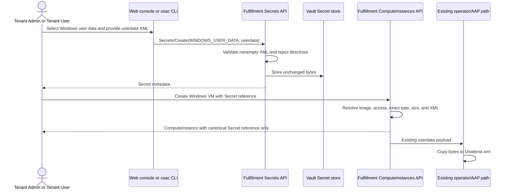

# Dedicated Secret Type for Windows User Data

## Summary

This design adds an append-only `WINDOWS_USER_DATA` Secret type, validates its
`userdata` value as safe, well-formed XML at creation, and requires it for new
Windows ComputeInstance Secret references. The CLI and web console expose the
type while the existing VM delivery path continues to pass the same bytes to
`Unattend.xml`. See [PRD](prd.md) for detailed requirements.

## Motivation

The Secret API currently classifies both Linux cloud-init and Windows answer
files as `USER_DATA`. Consequently, callers cannot distinguish their intended
use, and a Windows VM detects malformed XML only after the Secret has already
been created.

The existing fulfillment-service already has the required XML parser, Secret
reference access checks, Vault retrieval, and Windows delivery path. Extending
those boundaries avoids a second storage or provisioning mechanism and keeps
the type distinction at the API boundary where it can be enforced.

The target milestone is OSAC 0.5. The PRD is the canonical behavioral contract
for the dedicated Secret type; Jira OSAC-6781 additionally requires delivering
those behaviors through the Create Secret page and guest-OS-specific VM picker.
[Jira: OSAC-6781] [User]

### Goals

- Extend the existing Secret enum without changing the Secret or
  ComputeInstance object shapes.
- Validate Windows XML before Secret data is stored and keep validation errors
  free of submitted content.
- Enforce one exact Secret type for each consumer: Windows ComputeInstance,
  Linux ComputeInstance, and BareMetalInstance.
- Reuse the existing `userdata` storage key and Windows `Unattend.xml`
  delivery path.
- Keep the API, CLI, UI, and user documentation synchronized in one delivery.

### Non-Goals

- Migrate or retag existing `USER_DATA` Secrets.
- Validate Microsoft Unattend schemas, settings, passes, components, editions,
  credentials, product keys, or guest-customization success.
- Generate or edit Windows answer files.
- Change the operator CRD, AAP variables, KubeVirt Secret copy, or first-boot
  workflow.

## Proposal

Add `SECRET_TYPE_WINDOWS_USER_DATA` as enum value `8` in
`secret_type.proto`. It uses the existing `data["userdata"]` contract, but
Secret creation additionally requires safe, well-formed XML. Its data and type
are immutable. `SECRET_BACKEND_HUB` is rejected for this type before
persistence because Hub Secrets have no creation-time data to validate.
[User] [Codebase: proto/private/osac/private/v1/secret_type.proto]

For new ComputeInstances, fulfillment-service resolves the selected DiskImage
before validating a referenced user-data Secret. A Windows image requires
`WINDOWS_USER_DATA`; a Linux or unspecified image requires `USER_DATA`.
BareMetalInstance continues to require `USER_DATA`. Existing VM records are not
rescanned or changed. An existing VM that resubmits the same legacy
`USER_DATA` reference remains valid for masked updates, explicit unchanged
`user_data_source` updates, and full-object replacements. [User]

For traceability, this document assigns stable aliases to the requirements in
the PRD, Jira's UI delivery scope, and the feature-owner decisions. These
aliases label existing requirements and delivery commitments; they do not
introduce new product scope.

| ID | Requirement |
|---|---|
| FR-1 | Expose the dedicated type through the public API and CLI as required by the PRD, and through the web console as required by Jira OSAC-6781. |
| FR-2 | Require nonempty, well-formed XML at Secret creation; acceptance is format-only and does not imply a usable Windows answer file. |
| NFR-1 | Reject DTD/directive input, perform no external resource resolution, and return content-free validation errors. |
| FR-3 | New Windows VM references require the dedicated type while retaining image-OS compatibility checks. |
| NFR-2 | Preserve project and tenant access boundaries and never expose resolved Secret data in VM responses or diagnostics. |
| FR-4 | Preserve Linux `USER_DATA` and BareMetalInstance behavior. |
| FR-5 | Document creation, use, restrictions, and validation limits. |
| FR-6 | Do not migrate existing Secrets or damage existing VMs; reject legacy `USER_DATA` on new Windows VM requests. [User] |
| FR-7 | Make data for the new type immutable. [User] |
| FR-8 | Reject the new type for Hub-backed Secrets. [User] |

### Workflow Description



The diagram shows that XML validation occurs before storage and is repeated at
VM admission as defense in depth. Fulfillment returns only the canonical
Secret reference on the VM; the operator and AAP contracts do not gain a new
field or learn the Secret type.

Starting state: the tenant has a project, permission to create Secrets and
ComputeInstances in that project, and a Windows DiskImage.

1. The Tenant Admin or Tenant User creates a Secret through gRPC/REST, the
   `osac` CLI, or the Create Secret page, selecting Windows user data and
   supplying a nonempty `userdata` value.
2. `Secrets/Create` rejects missing or empty data, malformed XML, XML with more
   than one root, non-whitespace text outside the root, and any XML directive.
   Errors identify the violated rule but never echo bytes from the value.
3. The service stores the exact bytes in Vault and persists the Secret metadata
   through the existing transaction path.
4. In the VM wizard, selecting a Windows guest filters the Secret picker to
   `WINDOWS_USER_DATA`; Linux continues to filter to `USER_DATA`.
5. `ComputeInstances/Create` resolves the DiskImage, then resolves the Secret
   within the VM's tenant and project. It requires the exact OS-specific type,
   the `userdata` key, the existing 64 KiB limit, and well-formed XML for a
   Windows image.
6. The existing provisioning path sends the bytes to AAP, which copies them to
   `Unattend.xml`. No downstream contract changes.

### API Extensions

The existing `Secrets` and `ComputeInstances` services change behavior; no new
RPC, message, field, CRD, webhook, or finalizer is introduced.

```protobuf
enum SecretType {
  // Existing values 0-7 remain unchanged.
  // Windows first-boot user data. Requires nonempty, well-formed XML in
  // data["userdata"]. DTD declarations are not allowed.
  SECRET_TYPE_WINDOWS_USER_DATA = 8;
}
```

The private proto remains the source of truth. CleanAPI regenerates the public
proto and Buf regenerates the shared Go bindings. The UI consumes the published
enum after its pinned API baseline is advanced; generated TypeScript is not
edited manually. [Codebase: proto/AGENTS.md]

#### Interface Changes

##### IC-1: Secret API type and lifecycle

**Requirements:** FR-1, FR-2, NFR-1, FR-7, FR-8

`Secrets/Create` accepts enum value `WINDOWS_USER_DATA` only when
`data["userdata"]` is nonempty and passes the XML rules. It rejects
`WINDOWS_USER_DATA` with the private `HUB` backend using `InvalidArgument`
before database or Vault writes. `Secrets/Update` rejects updates to `data` for
the type using `InvalidArgument`, matching `USER_DATA` immutability.

##### IC-2: ComputeInstance user-data compatibility

**Requirements:** NFR-1, FR-3, NFR-2, FR-4, FR-6

`ComputeInstances/Create` requires `WINDOWS_USER_DATA` for a Windows image and
`USER_DATA` for Linux or unspecified images. A mismatch returns
`InvalidArgument` naming the reference field and expected type without Secret
content. Same-project, tenant-local, non-shared lookup and canonical reference
behavior remain unchanged. BareMetalInstance remains `USER_DATA`-only.

##### IC-3: CLI Secret type

**Requirements:** FR-1, FR-2

`osac create secret` accepts `--type=windows-user-data`. Help includes the
required-key example:

```shell
osac create secret --name windows-answer \
  --type=windows-user-data \
  --from-file=userdata=Unattend.xml
```

The server remains authoritative for XML validation; CLI errors wrap and
preserve the gRPC status without printing the file content.

##### IC-4: Create Secret UI

**Requirements:** FR-1, FR-2, NFR-1

The Create Secret page adds a "Windows user data" type card, initializes the
required immutable key as `userdata`, applies the existing nonempty and size
form checks, and displays sanitized server validation errors. Type labels,
list-filter query values, required-key mapping, and generated translations are
updated. The API remains the single authoritative XML/security validator.

##### IC-5: Guest-OS-specific VM Secret picker

**Requirements:** FR-3, FR-4

`UserDataField` receives an expected `SecretType`. `VmAccessStep` passes
`WINDOWS_USER_DATA` for Windows and `USER_DATA` for Linux or unspecified guest
families; `BareMetalAccessStep` passes `USER_DATA`. The CEL list filter uses
that exact value and the existing project filter. For Windows, the source card,
selection label, and placeholder explicitly say "Windows user data" rather
than generic `USER_DATA`. When the user changes between Windows and Linux, the
wizard clears an editable selected Secret before presenting choices for the new
type. It does not mutate a catalog-locked value; the server remains
authoritative for that policy-provided reference. [User]

##### IC-6: User documentation and API comments

**Requirements:** FR-2, NFR-1, FR-3, NFR-2, FR-4, FR-5, FR-6

The Secret and ComputeInstance guides document the CLI/API/UI workflows,
`userdata` key, XML and security checks, project and OS restrictions, legacy
behavior, and the fact that well-formed XML is not Microsoft schema validation.
The public proto comment records the required key and format contract.

## UX Alignment

There is no matching `osac-ux/libs/ui-components/src/api/v1/secret.ts`
temporary API file, so no temporary-to-proto field mapping is required. The
tracked `osac-ui` component uses the generated `SecretType` enum and changes
only type presentation, Create Secret defaults, and list filters; it adds no
UI-only API field or string-union contract.

### Implementation Details/Notes/Constraints

#### Secret validation and storage

`validateSecretData` adds a `WINDOWS_USER_DATA` branch using the existing
`userdata` key. After the nonempty check, it calls `isPureXMLNoDTD`. XML
validation returns a structured internal reason rather than requiring callers
to match error strings: `malformed_syntax`, `no_root`, `multiple_roots`,
`text_outside_root`, or `directive_prohibited`; the surrounding Secret
validation adds `missing_or_empty`. The public mapper groups these into fixed
messages for missing/empty value, malformed document, or prohibited directive.
Structured diagnostics may include only the safe reason code and resource
context, never the raw decoder error or XML input. Go's streaming
`encoding/xml.Decoder` performs no network or file lookup and the existing
validator rejects every `xml.Directive`, multiple roots, text outside the root,
and documents without a root. [User] [Codebase:
fulfillment-service/internal/servers/user_data_validation.go]

`validateSecretCreate` checks the prohibited
`WINDOWS_USER_DATA`/`SECRET_BACKEND_HUB` combination before
`validateHubSecretCreate`. This ordering produces one deterministic
`InvalidArgument` and prevents the Hub path from bypassing typed-data
validation. No behavior changes for `USER_DATA` Hub Secrets. [User]

`validateSecretUpdate` treats `WINDOWS_USER_DATA` like `USER_DATA` and rejects
every selected `data` update. The enum value is already covered by the existing
immutable `type` rule. Since validation runs before Vault storage and data is
immutable afterward, malformed content cannot enter through an update.

#### ComputeInstance validation order

`prepareCreate` moves Secret-reference validation to immediately after
`validateDiskImage`. The resolved DiskImage determines the expected type passed
to the shared Secret resolver. The resolver retains current reference lookup,
shared-tenant rejection, Vault fetch, `userdata` check, 64 KiB bound, and
canonicalization. BareMetalInstance passes `USER_DATA` explicitly so adding the
enum cannot broaden its accepted input. [Codebase:
fulfillment-service/internal/servers/user_data_secret_validation.go]

For a Windows image, `validateWindowsUserData` continues parsing the resolved
bytes before persistence of the ComputeInstance. This repeated parse protects
against invalid pre-existing or externally corrupted values and returns a
content-free `InvalidArgument`. For Linux and unspecified images, inline data
and `USER_DATA` behavior are unchanged.

Secret references on ComputeInstance are immutable. During update, if the
stored source is a Secret, the server compares the submitted reference with
the stored reference using `sameSecretReference` before resolution or type
validation. An unchanged reference is replaced with the stored canonical
reference and skips lookup, exact-type enforcement, size checking, and XML
revalidation even when the update mask is empty or explicitly selects
`spec.user_data_source`. A changed reference is rejected as immutable. An
inline-to-Secret migration is a genuinely new reference and receives the full
DiskImage-specific type, access, size, and XML validation. [User] [Codebase:
fulfillment-service/internal/servers/reference_helpers.go]

#### Persistence and downstream delivery

No database migration is required. The existing Secret record stores the enum
value and backend metadata, while Vault stores the same `userdata` bytes. No
new table, index, retention rule, CRD field, operator branch, AAP parameter, or
Kubernetes Secret key is introduced.

#### UI and release ordering

`SecretTypeField.tsx`, `values.ts`, `validation.ts`, and `Secret/utils.ts` add
the generated enum to the existing explicit mappings. `UserDataField` accepts
the expected type as a required prop so every caller declares its contract.
`DiskImageField` exposes the guest-family change to `VmConfigurationStep`,
which clears `spec.userData.value.secret` when the user-data field is editable;
changing the current filter alone is insufficient because Formik retains a
selected value that is no longer among the returned options. Windows-specific
copy is derived from the same expected type. [User] [Codebase:
osac-ui/libs/ui-components/src/components/ProvisioningWizard/fields/DiskImageField.tsx]
[Codebase:
osac-ui/libs/ui-components/src/components/ProvisioningWizard/fields/provisioningFieldValue.ts]
The public API enum must be published before advancing
`osac-ui/libs/types/.buf-api-version` and running `pnpm gen-types`.

#### Scalability and performance

XML is parsed once at Secret creation and once when a Windows VM references the
Secret. VM reference validation retains the existing 64 KiB limit, so parser
CPU and memory are bounded per request. There are no additional database
queries beyond reordering the existing DiskImage and Secret lookups, no new
background work, and no data-retention change.

### Security Considerations

The parser uses only Go's standard streaming XML decoder; it does not resolve
external entities, network URLs, or local files. Rejecting directives prevents
DTD/entity declarations from entering this Secret type. Validation messages
and structured logs contain the Secret reference and rule category but never
the XML bytes, parser token text, credentials, or product keys.

Authentication and authorization do not change. The public Secret and
ComputeInstance servers retain existing tenant attribution and OPA policy
enforcement. Reference resolution remains same-tenant and same-project and
rejects the shared tenant. VM responses contain only the canonical Secret
reference, not resolved data.

### Failure Handling and Recovery

- Missing, empty, malformed, multi-root, out-of-root text, or directive-bearing
  XML returns `InvalidArgument` before Vault or database writes. The caller
  corrects the file and retries; retries are safe because no object was created.
- `WINDOWS_USER_DATA` with Hub coordinates returns `InvalidArgument` before
  persistence. The caller must use the ordinary Vault-backed path; there is no
  fallback that skips validation.
- A Windows/Linux/BareMetal type mismatch returns `InvalidArgument` before the
  workload object is stored. The caller selects or creates a Secret of the
  required type and retries.
- Secret lookup, Vault fetch, or database failures retain the existing sanitized
  `Internal` behavior and transaction rollback. Retrying the create request is
  safe under the existing name/idempotency behavior.
- Operator, AAP, or guest failures occur after admission and are unchanged by
  this proposal. Existing reconciliation and recovery procedures apply because
  the downstream payload and contracts are unchanged.

### RBAC / Tenancy

No RBAC or tenancy changes are required. This proposal creates no new object
kind or permission and reuses the existing Secret and ComputeInstance policies.
The resolver continues to require the Secret in the ComputeInstance project,
rejects shared-tenant references, and does not expose values through workload
responses.

### Observability and Monitoring

No new observability changes. Existing monitoring mechanisms apply. Expected
validation failures are returned as sanitized `InvalidArgument` responses;
unexpected storage and lookup failures continue through existing structured
logs and request metrics without logging Secret content.

### Risks and Mitigations

| Risk | Mitigation |
|---|---|
| CLI or UI ships before the server understands enum value 8. | Publish and deploy the API/fulfillment-service first, then advance UI bindings and release CLI/UI consumers. |
| Accepting both types in the shared resolver accidentally enables Windows data for bare metal or Linux. | Pass one explicit expected type from each caller and test the full Linux/Windows/BareMetal matrix. |
| Parser errors expose XML fragments. | Return typed safe reason codes, map them to fixed public categories without string matching, and include sentinel secret text in redaction tests for API errors and captured logs. |
| Reordering VM validation changes which invalid field is reported first. | Move only user-data reference validation, retain all checks before persistence, and assert no rejected request persists a ComputeInstance. |
| Changing guest OS leaves a previously selected Secret in Formik even though the picker filter changes. | Clear editable Secret selections on Linux/Windows transitions and test both the stored form value and the new exact-type query. |
| Downgrade cannot interpret newly created enum values. | Require API-first rollout; before rollback, remove unreferenced Windows-type Secrets and avoid creating new Windows VMs during skew. Existing provisioned VMs do not depend on the enum downstream. |

### Drawbacks

The dedicated enum increases API, CLI, UI, documentation, and compatibility
matrix surface for content that still uses the same storage key and delivery
path. It also requires users with legacy XML Secrets to create a new Secret for
new Windows VMs. That cost is justified because accepting generic `USER_DATA`
would preserve the ambiguity and allow new Windows requests to bypass the
creation-time XML contract.

## Alternatives (Not Implemented)

### Keep `USER_DATA` and infer Windows content from the selected image

This avoids a new enum and migration concern, but a Secret has no image context
at creation, so it cannot enforce XML then or distinguish Linux content in
lists. It is rejected because it does not meet the dedicated-type requirement.

### Accept both `USER_DATA` and `WINDOWS_USER_DATA` for Windows VMs

This is more backward-compatible for new requests, but preserves an unvalidated
path indefinitely. It is rejected: existing VM records remain supported, while
new requests must satisfy the new type contract. [User]

### Permit Hub-backed Windows user-data Secrets

The service could defer validation until VM creation after fetching Hub data.
This weakens the creation-time guarantee and makes Secret validity dependent on
later Hub availability. It is rejected because Hub creation requires empty
data and therefore contradicts this type's contract. [User]

### Make Windows Secret data mutable and validate every update

This offers rotation in place, but differs from existing `USER_DATA` semantics
and allows a referenced answer file to change after VM admission. It is
rejected in favor of matching current user-data immutability. [User]

### Add a new field or downstream payload for Windows XML

A separate ComputeInstance field, CRD field, or AAP variable would make the
distinction visible downstream, but no downstream component needs it: the
existing path already copies `userdata` to `Unattend.xml`. It is rejected to
avoid redundant contracts.

## Test Plan

The companion [testplan](04-testplan.md) defines requirement- and
interface-anchored cases. Unit and component-integration coverage belongs to
the owning `[DEV]` work; no new provider-backed QE journey is required because
the operator/AAP boundary and delivered bytes do not change.

### Unit Tests

- Proto generation/lint confirms the append-only enum appears in private,
  public, Go, and deliberately advanced TypeScript bindings.
- Fulfillment server tests cover required data, valid and invalid XML classes,
  directive rejection, content-safe errors, Hub rejection, immutability, and
  the Linux/Windows/BareMetal exact-type matrix.
- Existing PostgreSQL-backed server suites cover project/shared-tenant denial,
  canonical references, no-persistence on rejection, and legacy VM updates
  using a narrow mask, an explicitly unchanged reference, and full-object
  replacement.
- CLI Ginkgo tests cover `windows-user-data`, help text, and the required-key
  example.
- UI Vitest/React Testing Library tests cover the type card, `userdata`
  defaults, Windows-specific copy, labels/filter query values,
  guest-OS-specific picker filters, and clearing an editable stale Secret when
  the guest family changes.

### Integration Tests

- Extend the deployed Fulfillment `it/` suite to create and retrieve a valid
  Windows-type Secret through the public API and CLI; reject malformed XML;
  create a Windows ComputeInstance using the reference; reject legacy,
  cross-project, and shared references; and prove rejected creates do not
  persist.
- The suite runs real public/private Fulfillment APIs, authentication,
  PostgreSQL, and Vault in Kind. DiskImage and VM dependencies use existing
  Fulfillment fixtures; operator, AAP, KubeVirt, and a Windows guest are omitted
  because their input contract is unchanged.

### E2E Tests

No new deployed provider E2E is required. Existing Windows provisioning tests
already own the unchanged `userdata`-to-`Unattend.xml` boundary; this proposal
changes admission before that boundary. A manual browser check may confirm the
UI workflow on a live development cluster, but it is not persisted regression
coverage.

### Planning Evidence Matrix

| Component / behavior | Requirements / ICs | Tier and boundary | Planned suite or file | Command and working directory | Real / simulated boundary |
|---|---|---|---|---|---|
| Proto enum and generated public/Go contract | FR-1 / IC-1 | Static contract validation | `proto/private/osac/private/v1/secret_type.proto` plus generated outputs | `make generate && make lint` from `proto/` | Real CleanAPI and Buf generators; no service runtime |
| Secret XML, Hub, and immutability rules | FR-2, NFR-1, FR-7, FR-8 / IC-1 | Unit/server integration | `internal/servers/secret_validation_test.go`, `private_secrets_server_test.go`, `user_data_validation_test.go` | `ginkgo run --timeout 10m internal/servers` from `fulfillment-service/` | In-process servers and real test PostgreSQL where suite fixtures apply; Vault controlled |
| OS/type/access compatibility and legacy records | FR-3, NFR-2, FR-4, FR-6 / IC-2 | Unit/server integration | `internal/servers/user_data_secret_validation_test.go`, `private_compute_instances_server_test.go`, `private_baremetal_instances_server_test.go` | `ginkgo run --timeout 10m internal/servers` from `fulfillment-service/` | In-process servers, real test PostgreSQL, controlled tenancy/Vault; no operator/AAP |
| CLI parser and help | FR-1, FR-2 / IC-3 | Unit | `internal/cmd/cli/create/secret/create_secret_cmd_test.go` | `go test ./internal/cmd/cli/create/secret` from `fulfillment-service/` | Real Cobra command/parser; API client controlled or omitted by case |
| Public API/CLI workflow | FR-1, FR-2, FR-3, NFR-2, FR-6 / IC-1, IC-2, IC-3 | Component integration | Proposed `it/it_windows_user_data_secret_test.go` | `make -C osac-installer test PLATFORM=kind PROFILE=dev NS=osac SUITE=fulfillment` from repository root | Deployed Fulfillment, auth, PostgreSQL, Vault; fixture DiskImages; operator/AAP/provider omitted |
| Create Secret UI and VM picker | FR-1, FR-2, FR-3, FR-4 / IC-4, IC-5 | Unit | Existing colocated `validation.test.ts`, `values`/type-field tests, and `Form/UserDataField.test.tsx` | `pnpm run typecheck && pnpm lint && pnpm test` from `osac-ui/` | jsdom UI with mocked Connect transport; no deployed service/browser |
| Documentation | FR-5 / IC-6 | Documentation review | `docs/guides/secrets-guide.md`, `docs/guides/developer/computeinstance-guide.md`, proto comments | Pre-commit and reviewer inspection | No behavioral runtime boundary |

## Graduation Criteria

Graduation criteria will be defined when targeting a release. Expected stages:
Dev Preview -> Tech Preview -> GA based on production deployment feedback. GA
requires published API/CLI/UI documentation and passing validation,
compatibility, tenant-isolation, and deployed Fulfillment tests.

## Upgrade / Downgrade Strategy

Upgrade is additive: deploy the generated API and fulfillment-service support
before CLI/UI consumers send enum value `8`. Existing Secrets and VMs require
no migration and retain their stored type and references.

Before downgrading to a version that does not know the enum, stop new Windows
Secret/VM creation and remove unreferenced `WINDOWS_USER_DATA` Secrets. VMs
already provisioned remain operational because the type is not sent to the
operator or AAP, but an old fulfillment-service cannot admit new requests using
the new enum. OSAC does not otherwise guarantee in-place downgrade.

## Version Skew Strategy

A new server accepts old clients and preserves all existing `USER_DATA`
behavior. A new CLI or UI against an old server receives `InvalidArgument` for
the unknown enum, so API/server rollout must precede consumers. No skew exists
with osac-operator or AAP because neither contract changes and both receive the
same `userdata` bytes as before.

## Support Procedures

- Detect validation failures from the client's sanitized `InvalidArgument`
  message and existing fulfillment-service request logs; inspect the Secret
  type, backend, project, and reference, never its value.
- Confirm rollout order if CLI/UI can select the type but the server reports an
  unknown enum.
- Confirm the referenced Secret is tenant-local, in the VM project, of the
  OS-specific type, contains `userdata`, and is within 64 KiB when VM creation
  fails.
- There is no runtime feature flag. Disabling requires rolling back the CLI/UI
  exposure and server support in the order described above. Existing running
  VMs remain healthy; new Windows VM requests using the type become unavailable.
- Re-enable by deploying the API/server first and then CLI/UI consumers. No
  reconciliation or data repair is needed for valid retained Secrets.

## Infrastructure Needed

None. Existing proto generation, Fulfillment Kind integration, UI Vitest, and
documentation validation infrastructure are sufficient.

---

## Provenance

Authored: revise @ design 0.14.0 - 70405a6, workspace ibengal/secret-type-for-Windows-user-data @ d902bd8a1
Phases: draft, draft, revise, revise, revise, revise, revise

<!-- ai-workflow-provenance:{"schema_version":1,"provenance_kind":"session","workflow":"design","workflow_version":"0.14.0","ai_workflows":"70405a6","source_repo":"d902bd8a1","source_repo_branch":"ibengal/secret-type-for-Windows-user-data","commits_behind_main":0,"commits_ahead_main":0,"main_ref":"main","phases":["draft","draft","revise","revise","revise","revise","revise"],"authoring_modes":["skill"],"context_changed":false,"origin_untracked":false} -->
