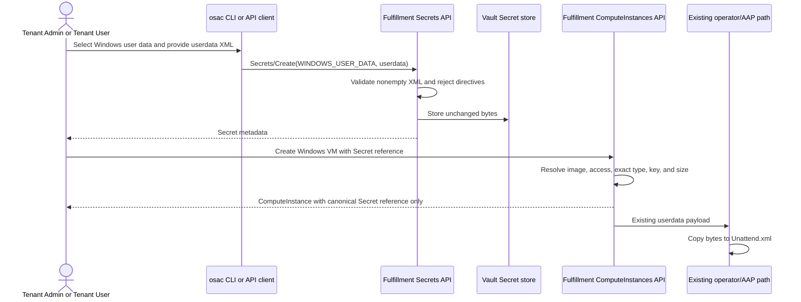

# Dedicated Secret Type for Windows User Data

## Summary

This design adds a `WINDOWS_USER_DATA` Secret type, validates its
`userdata` value as safe, well-formed XML at creation, and requires it for new
Windows ComputeInstance Secret references. The CLI exposes the type while the
existing VM delivery path continues to pass the same bytes to
`Unattend.xml`. See [PRD](prd.md) for detailed requirements.

## Motivation

The Secret API currently classifies both Linux cloud-init and Windows answer
files as `USER_DATA`. Consequently, callers cannot distinguish their intended
use, and a Windows VM detects malformed XML only after the Secret has already
been created.

The existing fulfillment-service already has the required XML parser, Secret
reference access checks, Vault retrieval, and Windows delivery path. Extending
those boundaries avoids a second storage or provisioning mechanism and keeps
the type distinction at the API boundary where it can be enforced.

The target milestone is OSAC 0.5. The PRD is the canonical behavioral contract
for the dedicated Secret type.

### Goals

- Extend the existing Secret enum without changing the Secret or
  ComputeInstance object shapes.
- Validate Windows XML before Secret data is stored and keep validation errors
  free of submitted content.
- Enforce `WINDOWS_USER_DATA` for Windows ComputeInstances while retaining
  `USER_DATA` for Linux ComputeInstances and BareMetalInstances.
- Reuse the existing `userdata` storage key and Windows `Unattend.xml`
  delivery path.
- Keep the API, CLI, and user documentation synchronized in one delivery.

### Non-Goals

- Migrate or retag existing `USER_DATA` Secrets.
- Validate Microsoft Unattend schemas, settings, passes, components, editions,
  credentials, product keys, or guest-customization success.
- Generate or edit Windows answer files.
- Change the operator CRD, AAP variables, KubeVirt Secret copy, or first-boot
  workflow.

## Proposal

Add `SECRET_TYPE_WINDOWS_USER_DATA` to `secret_type.proto`. It uses the
existing `data["userdata"]` contract, but
Secret creation additionally requires safe, well-formed XML. Its data and type
are immutable. `SECRET_BACKEND_HUB` is rejected for this type before
persistence because Hub Secrets have no creation-time data to validate.
[User] [Codebase: proto/private/osac/private/v1/secret_type.proto]

For new ComputeInstances, fulfillment-service resolves the selected DiskImage
before validating a referenced user-data Secret. A Windows image requires
`WINDOWS_USER_DATA`; a Linux or unspecified image requires `USER_DATA`.
BareMetalInstance continues to require `USER_DATA`. Existing VM records are not
rescanned or changed. An existing VM that resubmits the same legacy
`USER_DATA` reference remains valid for masked updates, explicit unchanged
`user_data_source` updates, and full-object replacements. [User]

For traceability, this document assigns stable aliases to the requirements in
the PRD and the feature-owner decisions. These aliases label existing
requirements and delivery commitments; they do not introduce new product
scope.

| ID | Requirement |
|---|---|
| FR-1 | Expose the dedicated type through the public API and CLI. |
| FR-2 | Require a nonempty, well-formed XML 1.0 document at Secret creation, including Namespaces in XML 1.0 well-formedness constraints; acceptance is format-only and does not imply a usable Windows answer file. |
| NFR-1 | Reject DTD/directive input, perform no external resource resolution, and return content-free validation errors. |
| FR-3 | New Windows VM references require the dedicated type while retaining image-OS compatibility checks. |
| NFR-2 | Preserve project and tenant access boundaries and never expose resolved Secret data in VM responses or diagnostics. |
| FR-4 | Preserve Linux `USER_DATA` and BareMetalInstance behavior. |
| FR-5 | Document creation, use, restrictions, and validation limits. |
| FR-6 | Do not migrate existing Secrets or damage existing VMs; reject legacy `USER_DATA` on new Windows VM requests. [User] |
| FR-7 | Make data for the new type immutable. [User] |
| FR-8 | Reject the new type for Hub-backed Secrets. [User] |

### Workflow Description



The diagram shows that XML validation occurs before storage. VM admission
relies on the immutable type and data established at Secret creation while
enforcing access, OS/type compatibility, the required key, and size.
Fulfillment returns only the canonical Secret reference on the VM; the
operator and AAP contracts do not gain a new field or learn the Secret type.

Starting state: the tenant has a project, permission to create Secrets and
ComputeInstances in that project, and a Windows DiskImage.

1. The Tenant Admin or Tenant User creates a Secret through gRPC/REST or the
   `osac` CLI, selecting Windows user data and supplying a nonempty `userdata`
   value.
2. `Secrets/Create` rejects missing or empty data, `userdata` larger than
   64 KiB, malformed XML (including duplicate attributes), XML with more than
   one root, non-whitespace text outside the root, and any XML directive.
   Errors identify the violated rule but never echo bytes from the value.
3. The service stores the exact bytes in Vault and persists the Secret metadata
   through the existing transaction path.
4. `ComputeInstances/Create` resolves the DiskImage, then resolves the Secret
   within the VM's tenant and project. It requires the exact OS-specific type,
   the `userdata` key and the existing 64 KiB limit.
5. The existing provisioning path sends the bytes to AAP, which copies them to
   `Unattend.xml`. No downstream contract changes.

### API Extensions

The existing `Secrets` and `ComputeInstances` services change behavior; no new
RPC, message, field, CRD, webhook, or finalizer is introduced.

```protobuf
enum SecretType {
  // Existing values 0-7 remain unchanged.
  // Windows first-boot user data. Requires nonempty, well-formed XML in
  // data["userdata"]. DTD declarations are not allowed.
  SECRET_TYPE_WINDOWS_USER_DATA = 8;
}
```

The private proto remains the source of truth. CleanAPI regenerates the public
proto and Buf regenerates the shared Go bindings. Generated files are not
edited manually. [Codebase: proto/AGENTS.md]

#### Interface Changes

##### IC-1: Secret API type and lifecycle

**Requirements:** FR-1, FR-2, NFR-1, FR-7, FR-8

`Secrets/Create` accepts enum value `WINDOWS_USER_DATA` only when
`data["userdata"]` is nonempty, at most 64 KiB, and is a well-formed XML 1.0
document, including Namespaces in XML 1.0 well-formedness constraints. It
rejects `WINDOWS_USER_DATA` with the private `HUB` backend using
`InvalidArgument` before database or Vault writes. `Secrets/Update` rejects
updates to `data` for the type using `InvalidArgument`, matching `USER_DATA`
immutability.

##### IC-2: ComputeInstance user-data compatibility

**Requirements:** NFR-1, FR-3, NFR-2, FR-4, FR-6

`ComputeInstances/Create` requires `WINDOWS_USER_DATA` for a Windows image and
`USER_DATA` for Linux or unspecified images. A mismatch returns
`InvalidArgument` naming the reference field and expected type without Secret
content. Same-project, tenant-local, non-shared lookup and canonical reference
behavior remain unchanged. BareMetalInstance remains `USER_DATA`-only.

##### IC-3: CLI Secret type

**Requirements:** FR-1, FR-2

`osac create secret` accepts `--type=windows-user-data`. Help includes the
required-key example:

```shell
osac create secret --name windows-answer \
  --type=windows-user-data \
  --from-file=userdata=Unattend.xml
```

The server remains authoritative for XML validation; CLI errors wrap and
preserve the gRPC status without printing the file content.

##### IC-4: User documentation and API comments

**Requirements:** FR-2, NFR-1, FR-3, NFR-2, FR-4, FR-5, FR-6

The Secret and ComputeInstance guides document the CLI/API workflows,
`userdata` key, the 64 KiB creation limit, XML and security checks, project and
OS restrictions, legacy behavior, and the fact that well-formed XML is not
Microsoft schema validation.
The public proto comment records the required key and format contract.

### Implementation Details/Notes/Constraints

#### Secret validation and storage

`validateSecretData` adds a `WINDOWS_USER_DATA` branch using the existing
`userdata` key. After the nonempty check, it rejects values larger than
65,536 bytes before calling `isPureXMLNoDTD`. It uses the same maximum as the
existing user-data Secret reference check. This creation check applies only to
the new type; generic `USER_DATA` creation is unchanged. [User]

The validator enforces all XML 1.0 and Namespaces in XML 1.0 well-formedness
constraints, including constraints that Go's `encoding/xml.Decoder` does not
enforce by itself. This is document-syntax validation only. It does not
validate Microsoft Unattend schemas, elements, attributes, settings, or any
other Windows-specific semantics. DTDs and other directives are rejected as
an additional security restriction even when the document would otherwise be
well formed.

XML validation returns a structured internal reason rather than requiring
callers to match error strings: `malformed_syntax`, `duplicate_attribute`,
`no_root`, `multiple_roots`, `text_outside_root`, or `directive_prohibited`;
the surrounding Secret validation adds `missing_or_empty` and `size_exceeded`.
The public mapper groups these into fixed messages for missing/empty value,
the 64 KiB size limit, malformed document, or prohibited directive.
For each `xml.StartElement`, the validator rejects duplicate expanded
attribute names (namespace URI and local name), including attributes written
with different prefixes bound to the same namespace. It maps
`duplicate_attribute` to the fixed malformed-document public error.
Examples of supplementary checks include requiring whitespace between
attributes, rejecting duplicate expanded attribute names, and requiring a
processing-instruction target to follow XML Name syntax. Valid processing
instructions and a valid XML declaration remain accepted.
Structured diagnostics may include only the safe reason code and resource
context, never the raw decoder error or XML input. Go's streaming
`encoding/xml.Decoder` performs no network or file lookup and the existing
validator rejects every `xml.Directive`, multiple roots, text outside the root,
and documents without a root. [User] [Codebase:
fulfillment-service/internal/servers/user_data_validation.go]

`validateSecretCreate` checks the prohibited
`WINDOWS_USER_DATA`/`SECRET_BACKEND_HUB` combination before
`validateHubSecretCreate`. This ordering produces one deterministic
`InvalidArgument` and prevents the Hub path from bypassing typed-data
validation. No behavior changes for `USER_DATA` Hub Secrets. [User]

`validateSecretUpdate` treats `WINDOWS_USER_DATA` like `USER_DATA` and rejects
every selected `data` update. The enum value is already covered by the existing
immutable `type` rule. Since validation runs before Vault storage and data is
immutable afterward, malformed content cannot enter through an update.

#### ComputeInstance validation order

`prepareCreate` moves Secret-reference validation to immediately after
`validateDiskImage`. The resolved DiskImage determines the expected type passed
to the shared Secret resolver. The resolver retains current reference lookup,
shared-tenant rejection, Vault fetch, `userdata` check, 64 KiB bound, and
canonicalization. BareMetalInstance passes `USER_DATA` explicitly so adding the
enum cannot broaden its accepted input. [Codebase:
fulfillment-service/internal/servers/user_data_secret_validation.go]

`validateWindowsUserData` continues parsing inline Windows user data at
ComputeInstance admission because inline data has no Secret-creation
validation boundary. A referenced `WINDOWS_USER_DATA` value is not parsed
again: its content was validated before storage, and both its type and data are
immutable through the API. For Linux and unspecified images, inline data and
`USER_DATA` behavior are unchanged.

Secret references on ComputeInstance are immutable. During update, if the
stored source is a Secret, the server compares the submitted reference with
the stored reference using `sameSecretReference` before resolution or type
validation. An unchanged reference is replaced with the stored canonical
reference and skips lookup, exact-type enforcement, and size checking even
when the update mask is empty or explicitly selects
`spec.user_data_source`. A changed reference is rejected as immutable. An
inline-to-Secret migration is a genuinely new reference and receives the full
DiskImage-specific type, access, key, and size validation. [User] [Codebase:
fulfillment-service/internal/servers/reference_helpers.go]

#### Persistence and downstream delivery

No database migration is required. The existing Secret record stores the enum
value and backend metadata, while Vault stores the same `userdata` bytes. No
new table, index, retention rule, CRD field, operator branch, AAP parameter, or
Kubernetes Secret key is introduced.

#### Scalability and performance

Secret XML is parsed once at Secret creation, after a 64 KiB size check bounds
that parser's work. Inline Windows user data remains parsed at ComputeInstance
admission under its existing behavior. There are no additional database queries
beyond reordering the existing DiskImage and Secret lookups, no new background
work, and no data-retention change.

### Security Considerations

The parser uses only Go's standard streaming XML decoder; it does not resolve
external entities, network URLs, or local files. Rejecting directives prevents
DTD/entity declarations from entering this Secret type. Validation messages
and structured logs contain the Secret reference and rule category but never
the XML bytes, parser token text, credentials, or product keys.

Authentication and authorization do not change. The public Secret and
ComputeInstance servers retain existing tenant attribution and OPA policy
enforcement. Reference resolution remains same-tenant and same-project and
rejects the shared tenant. VM responses contain only the canonical Secret
reference, not resolved data.

### Failure Handling and Recovery

- Missing, empty, malformed (including duplicate attributes), multi-root,
  out-of-root text, or directive-bearing XML returns `InvalidArgument` before
  Vault or database writes. The caller corrects the file and retries; retries
  are safe because no object was created.
- A `WINDOWS_USER_DATA` value over 65,536 bytes returns a fixed, content-free
  `InvalidArgument` before XML parsing or persistence. The caller reduces the
  file size and retries.
- `WINDOWS_USER_DATA` with Hub coordinates returns `InvalidArgument` before
  persistence. The caller must use the ordinary Vault-backed path; there is no
  fallback that skips validation.
- A Windows/Linux/BareMetal type mismatch returns `InvalidArgument` before the
  workload object is stored. The caller selects or creates a Secret of the
  required type and retries.
- Secret lookup, Vault fetch, or database failures retain the existing sanitized
  `Internal` behavior and transaction rollback. Retrying the create request is
  safe under the existing name/idempotency behavior.
- Operator, AAP, or guest failures occur after admission and are unchanged by
  this proposal. Existing reconciliation and recovery procedures apply because
  the downstream payload and contracts are unchanged.

### RBAC / Tenancy

No RBAC or tenancy changes are required. This proposal creates no new object
kind or permission and reuses the existing Secret and ComputeInstance policies.
The resolver continues to require the Secret in the ComputeInstance project,
rejects shared-tenant references, and does not expose values through workload
responses.

### Observability and Monitoring

No new observability changes. Existing monitoring mechanisms apply. Expected
validation failures are returned as sanitized `InvalidArgument` responses;
unexpected storage and lookup failures continue through existing structured
logs and request metrics without logging Secret content.

### Risks and Mitigations

| Risk | Mitigation |
|---|---|
| A user submits a new Windows VM request from an older client that still uses `USER_DATA`. | Client/server version skew is unsupported; the request is rejected by the exact-type check and the user must update the client. |
| Accepting both types in the shared resolver accidentally enables Windows data for bare metal or Linux. | Pass one explicit expected type from each caller and test the full Linux/Windows/BareMetal matrix. |
| Parser errors expose XML fragments. | Return typed safe reason codes, map them to fixed public categories without string matching, and include sentinel secret text in redaction tests for API errors and captured logs. |
| Reordering VM validation changes which invalid field is reported first. | Move only user-data reference validation, retain all checks before persistence, and assert no rejected request persists a ComputeInstance. |

### Drawbacks

The dedicated enum increases API, CLI, documentation, and compatibility
matrix surface for content that still uses the same storage key and delivery
path. It also requires users with legacy XML Secrets to create a new Secret for
new Windows VMs. That cost is justified because accepting generic `USER_DATA`
would preserve the ambiguity and allow new Windows requests to bypass the
creation-time XML contract.

## Alternatives (Not Implemented)

### Keep `USER_DATA` and infer Windows content from the selected image

This avoids a new enum and migration concern, but a Secret has no image context
at creation, so it cannot enforce XML then or distinguish Linux content in
lists. It is rejected because it does not meet the dedicated-type requirement.

### Accept both `USER_DATA` and `WINDOWS_USER_DATA` for Windows VMs

This is more backward-compatible for new requests, but preserves an unvalidated
path indefinitely. It is rejected: existing VM records remain supported, while
new requests must satisfy the new type contract. [User]

### Permit Hub-backed Windows user-data Secrets

The service could defer validation until VM creation after fetching Hub data.
This weakens the creation-time guarantee and makes Secret validity dependent on
later Hub availability. It is rejected because Hub creation requires empty
data and therefore contradicts this type's contract. [User]

### Make Windows Secret data mutable and validate every update

This offers rotation in place, but differs from existing `USER_DATA` semantics
and allows a referenced answer file to change after VM admission. It is
rejected in favor of matching current user-data immutability. [User]

### Add a new field or downstream payload for Windows XML

A separate ComputeInstance field, CRD field, or AAP variable would make the
distinction visible downstream, but no downstream component needs it: the
existing path already copies `userdata` to `Unattend.xml`. It is rejected to
avoid redundant contracts.

## Test Plan

The companion [testplan](testplan.md) defines requirement- and
interface-anchored cases. Unit and component-integration coverage belongs to
the owning `[DEV]` work; no new provider-backed QE journey is required because
the operator/AAP boundary and delivered bytes do not change.

### Unit Tests

- Proto generation/lint confirms the enum appears in private, public, and Go
  bindings without changing existing values.
- Fulfillment server tests cover required data, the 64 KiB acceptance boundary
  and over-limit rejection before XML parsing, valid and invalid XML classes,
  malformed processing-instruction target rejection, acceptance of valid
  processing instructions and XML declarations, directive rejection,
  content-safe errors, Hub rejection, immutability, and the
  Linux/Windows/BareMetal exact-type matrix.
- Existing PostgreSQL-backed server suites cover project/shared-tenant denial,
  canonical references, no-persistence on rejection, and legacy VM updates
  using a narrow mask, an explicitly unchanged reference, and full-object
  replacement.
- CLI Ginkgo tests cover `windows-user-data`, help text, and the required-key
  example.

### Integration Tests

- Extend the deployed Fulfillment `it/` suite to create and retrieve a valid
  Windows-type Secret through the public API and CLI; accept a 64 KiB XML value
  and reject an oversized value and malformed XML;
  create a Windows ComputeInstance using the reference; reject legacy,
  cross-project, and shared references; and prove rejected creates do not
  persist.
- The suite runs real public/private Fulfillment APIs, authentication,
  PostgreSQL, and Vault in Kind. DiskImage and VM dependencies use existing
  Fulfillment fixtures; operator, AAP, KubeVirt, and a Windows guest are omitted
  because their input contract is unchanged.

### E2E Tests

No new deployed provider E2E is required. Existing Windows provisioning tests
already own the unchanged `userdata`-to-`Unattend.xml` boundary; this proposal
changes admission before that boundary.

### Planning Evidence Matrix

| Component / behavior | Requirements / ICs | Tier and boundary | Planned suite or file | Command and working directory | Real / simulated boundary |
|---|---|---|---|---|---|
| Proto enum and generated public/Go contract | FR-1 / IC-1 | Static contract validation | `proto/private/osac/private/v1/secret_type.proto` plus generated outputs | `make generate && make lint` from `proto/` | Real CleanAPI and Buf generators; no service runtime |
| Secret XML, Hub, and immutability rules | FR-2, NFR-1, FR-7, FR-8 / IC-1 | Unit/server integration | `internal/servers/secret_validation_test.go`, `private_secrets_server_test.go`, `user_data_validation_test.go` | `ginkgo run --timeout 10m internal/servers` from `fulfillment-service/` | In-process servers and real test PostgreSQL where suite fixtures apply; Vault controlled |
| OS/type/access compatibility and legacy records | FR-3, NFR-2, FR-4, FR-6 / IC-2 | Unit/server integration | `internal/servers/user_data_secret_validation_test.go`, `private_compute_instances_server_test.go`, `private_baremetal_instances_server_test.go` | `ginkgo run --timeout 10m internal/servers` from `fulfillment-service/` | In-process servers, real test PostgreSQL, controlled tenancy/Vault; no operator/AAP |
| CLI parser and help | FR-1, FR-2 / IC-3 | Unit | `internal/cmd/cli/create/secret/create_secret_cmd_test.go` | `go test ./internal/cmd/cli/create/secret` from `fulfillment-service/` | Real Cobra command/parser; API client controlled or omitted by case |
| Public API/CLI workflow | FR-1, FR-2, FR-3, NFR-2, FR-6 / IC-1, IC-2, IC-3 | Component integration | Proposed `it/it_windows_user_data_secret_test.go` | `make -C osac-installer test PLATFORM=kind PROFILE=dev NS=osac SUITE=fulfillment` from repository root | Deployed Fulfillment, auth, PostgreSQL, Vault; fixture DiskImages; operator/AAP/provider omitted |
| Documentation | FR-5 / IC-4 | Documentation review | `docs/guides/secrets-guide.md`, `docs/guides/developer/computeinstance-guide.md`, proto comments | Pre-commit and reviewer inspection | No behavioral runtime boundary |

## Graduation Criteria

Not applicable. This feature has no staged maturity or graduation process. It
is delivered as part of OSAC 0.5 after its implementation, documentation, and
planned validation are complete.

## Upgrade / Downgrade Strategy

Upgrade is additive at the stored-resource level. Deploy the generated API,
fulfillment-service support, and clients that understand `WINDOWS_USER_DATA`.
Existing Secrets and VMs require no migration and retain their stored type and
references.

Downgrade is not supported.

## Version Skew Strategy

Client/server version skew is unsupported for this feature. After the server
enforces the dedicated type, an older client that submits `USER_DATA` for a
new Windows VM receives the intentional type-mismatch `InvalidArgument`; the
user must update the client. Conversely, a new CLI against an older server may
receive `InvalidArgument` for the unknown enum. Existing VMs with an unchanged
legacy reference remain manageable. No skew exists with osac-operator or AAP
because neither contract changes and both receive the same `userdata` bytes as
before.

## Support Procedures

- Detect validation failures from the client's sanitized `InvalidArgument`
  message and existing fulfillment-service request logs; inspect the Secret
  type, backend, project, and reference, never its value.
- If a client submits `USER_DATA` for a new Windows VM or the server reports an
  unknown enum, update the client or server so both support the dedicated type.
- Confirm the referenced Secret is tenant-local, in the VM project, of the
  OS-specific type, contains `userdata`, and is within 64 KiB when VM creation
  fails.

## Infrastructure Needed

None. Existing proto generation, Fulfillment Kind integration, and
documentation validation infrastructure are sufficient.

---

## Provenance

Authored: draft @ design 0.14.0 - 70405a6, workspace ibengal/secret-type-for-Windows-user-data @ d902bd8a1
Final: respond @ design 0.15.0 - 87d14ea, workspace ibengal/secret-type-for-Windows-user-data @ d902bd8a1

> Context changed between draft and respond.

<!-- ai-workflow-provenance:{"schema_version":1,"provenance_kind":"session","workflow":"design","workflow_version":"0.15.0","ai_workflows":"87d14ea","source_repo":"d902bd8a1","source_repo_branch":"ibengal/secret-type-for-Windows-user-data","commits_behind_main":0,"commits_ahead_main":0,"main_ref":"main","phases":["draft","draft","revise","revise","revise","revise","revise","respond","respond","respond","respond"],"authoring_modes":["skill"],"context_changed":true,"origin_untracked":false} -->
