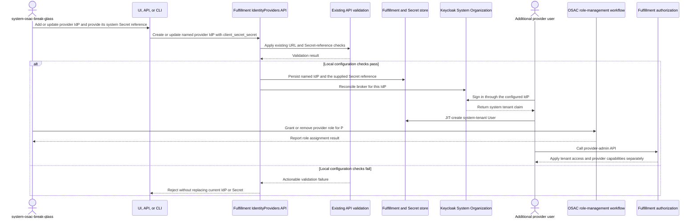

# Configure an IdP for Cloud Provider Admins

## Terminology

- **Provider user:** A person with the Cloud Provider Admin persona who
  authenticates through a configured provider IdP. Regular provider IdP
  sign-ins create an OSAC User record in the `system` tenant. This describes
  the intended persona; it does not mean the user already has the
  `cloud-provider-admin` role. Provider capabilities require explicit
  provider-role assignment.
- **Break-glass account:** The local `system-osac-break-glass` account used for
  provider IdP setup and recovery. After bootstrap, it can grant and remove
  provider roles.
- **System tenant:** The internal OSAC tenant identified by
  `metadata.tenant: system`. Provider users receive access to this tenant;
  tenant membership alone does not grant provider capabilities.
- **Provider role assignment:** An explicit assignment of
  `cloud-provider-admin` or `cloud-provider-reader` to an OSAC User. Users in
  both the `system` tenant and other tenants can receive provider roles.

# 1. Overview

This design enables additional Cloud Provider Admins by allowing provider
users to register through IdPs configured in the OSAC `system` tenant and
receive the `cloud-provider-admin` capability through explicit role
assignment. IdP authentication alone grants no provider role. See
[PRD](prd.md) for requirements. [Locked: D9-D11, D19, D28]

# 2. Goals and Non-Goals

## 2.1 Goals

- Support multiple named OIDC IdP resources in the OSAC `system` tenant so
  additional provider users can register and authenticate. [User]
- Reuse existing IdentityProvider, User, and Secret resources. Provider-role
  assignment and authorization follow the OSAC-3058 role-management contract.

## 2.2 Non-Goals

- Changing tenant-specific IdP configuration or tenant authentication flows.
- Adding protocols other than OIDC or a provider IdP enable/disable lifecycle.
- Performing external IdP discovery or health checks; related work is tracked
  by [OSAC-7325](https://redhat.atlassian.net/browse/OSAC-7325) and
  [OSAC-5406](https://redhat.atlassian.net/browse/OSAC-5406).
- Adding or redesigning required-field, URL syntax, or client-secret
  reference validation. Existing IdentityProvider validation remains in force.
- Adding provider-user deprovisioning, account-removal recovery, or token
  re-evaluation behavior assigned to OSAC-7352 and the separate identity
  lifecycle work.
- Changing the shared JIT identity-matching behavior for OSAC Users across
  tenants; this is deferred to
  [OSAC-7741](https://redhat.atlassian.net/browse/OSAC-7741).
- Revoking existing user sessions, tokens, OSAC User records, or provider-role
  assignments when a provider IdP is deleted.

# 3. Motivation / Background

The goal is to enable additional Cloud Provider Admins: provider users need to
register through configured IdPs and receive the `cloud-provider-admin`
capability through explicit role assignment. OSAC already has IdentityProvider
resources, UI/API/CLI surfaces, and Keycloak reconciliation, but the current
flow is tenant-specific and does not support provider IdPs in the `system`
tenant. This design extends those paths for multiple provider IdPs. Under the
PRD, the break-glass account handles IdP setup and recovery and can grant or
remove provider roles after bootstrap. [Locked: D4, D11, D28]
[Codebase: fulfillment-service/internal/servers/private_identity_providers_server.go; fulfillment-service/internal/controllers/identityprovider/identity_provider_reconciler_function.go]

# 4. Design

## 4.1 Architecture

Each IdentityProvider is stored as a separately named resource in the OSAC
`system` tenant, with its client Secret referenced by the existing
`SecretLocalReference`. The IdentityProvider controller reconciles each
resource to a distinct broker in Keycloak's System Organization. Provider
users authenticate through a configured broker and are JIT-created as Users in
the `system` tenant. [Codebase: fulfillment-service/internal/servers/private_identity_providers_server.go; fulfillment-service/internal/controllers/identityprovider/identity_provider_reconciler_function.go]

## 4.2 Data Model / Schema Changes

- Use the existing IdentityProvider, User, and Secret resources. Role
  assignment management follows OSAC-3058. [Jira: OSAC-3058]
- Store each provider IdentityProvider with `metadata.tenant: system` and a
  distinct `metadata.name`. The existing tenant/name uniqueness and
  tenant-prefixed Keycloak alias pattern allow multiple provider IdPs.
- Use the existing `client_secret_secret` reference to point to a value Secret
  in the `system` tenant. The Secret resource holds the secret bytes; the
  IdentityProvider API stores and returns only its reference. No protobuf field
  or database schema change is required for client-secret storage. A value
  Secret must exist before the reference is submitted; its data remains under
  the existing Secret API authorization.
- Store the current operation ID, its phase, and an increasing owner number
  with the break-glass username and password in the existing Secret. Use an
  atomic update to choose one owner. Only that owner may update the Secret or
  change the Keycloak password. No new resource or public API field is needed.
- Keep the pre-existing `cloud-provider-admin` user as the initial provider
  user. JIT-create additional regular provider users as OSAC User records in
  the `system` tenant.
  Keep `system-osac-break-glass` out of regular JIT provisioning. Update JIT
  provisioning to admit regular users in the `system` tenant while preserving
  that exclusion; the existing interceptor skips all `system` subjects.

## 4.3 API Changes

- Use the existing IdentityProviders API and `client_secret_secret` field on
  Create and Update. Get, List, and mutation responses expose the reference,
  not Secret data. Omitting the reference on Update preserves it. Configure
  the existing reference through the generic CLI resource commands; do not add
  a second configuration API. [PRD: In Scope — configure through UI, API, or
  CLI; PRD: In Scope — client-secret handling]
- Use the existing API and CLI Delete operation for provider IdPs. Deletion
  runs the IdentityProvider controller finalizer, which removes the
  organization-scoped Keycloak broker and its federated-identity links before
  the OSAC resource is finalized. Keycloak user accounts remain.
  A transient Keycloak deletion error keeps the finalizer for retry; a broker
  that is already absent is treated as deleted. This does not delete the
  Keycloak user account, its OSAC User record, or RoleBindings, and does not
  explicitly revoke active Keycloak sessions or issued OSAC tokens. Existing
  tokens follow their current expiration and revocation policy. [Codebase:
  fulfillment-service/internal/controllers/identityprovider/identity_provider_reconciler_function.go]
- Add the `system` tenant to the IdentityProvider server's allowed-tenant set
  for this resource only. Retain `system-osac-break-glass` for setup and
  recovery, using the existing authorization policy. [Codebase: fulfillment-service/internal/servers/private_identity_providers_server.go]
- Reuse existing field and Secret-reference validation. On validation failure,
  preserve the current D27 behavior: do not save an invalid initial IdP and do
  not replace an existing IdP or its Secret reference after a failed update.
  Never include client-secret bytes in status, errors, or logs.
- Map authorization outcomes consistently: unauthenticated requests return
  `UNAUTHENTICATED`, and authenticated callers without the required provider
  capability return `PERMISSION_DENIED`. Duplicate resource names return
  `ALREADY_EXISTS`.
- The UI uses the same public IdentityProviders APIs and exposes configuration
  controls only to `system-osac-break-glass`. The UI configures the existing
  Secret reference without reading or displaying Secret data. The UI does not
  add a Delete workflow. The CLI continues to use typed resource CRUD; its
  output must not display Secret data.

## 4.4 Scalability and Performance

Multiple provider IdPs add configuration resources and Secret references, with
no additional calls to an external IdP during ordinary API requests. JIT
provisioning adds system-tenant User records for regular provider users.

## 4.5 Security Considerations

- Keep client-secret bytes in the referenced Secret resource. IdentityProvider
  API responses, UI, and CLI expose the reference only; Secret data access
  continues to follow the existing Secret API authorization. Never include
  Secret bytes in structured logs, errors, URLs, or validation diagnostics.
  [Locked: D14]
- System-tenant membership grants tenant access and the existing client API
  permissions only. It does not satisfy checks for `cloud-provider-admin`,
  `cloud-provider-reader`, or `tenant-idp-manager`. Server-specific
  `allowedTenants` checks continue to prevent writes to `system` for resources
  that are not explicitly enabled there. [User] [Codebase: fulfillment-service/internal/auth/tenancy_logic.go]
- Provider capabilities require explicit OSAC role assignments. External
  identity attributes and system-tenant membership do not independently grant
  provider roles. [Locked: D19]
- For provider users in the `system` tenant, the generic `admins` group rule
  must not replace explicit provider-role checks.
- Preserve tenant isolation on all resources. Provider IdentityProvider, User,
  and Secret records set the `metadata.tenant` field to `system`. Provider
  roles do not grant universal `*` tenant access or access to other tenant
  resources. Role assignment scope follows OSAC-3058.
- Keep the System Organization break-glass account's initial credential in a
  Secret in the `system` tenant and require password change at first login.
  Do not add the account password to tenant-create responses or logs.
  [Locked: D22]

## 4.6 Failure Handling and Recovery

| Failure | Behavior and recovery |
|---------|----------------------|
| Provider role assignment fails | Report the failure through the supported OSAC role-management workflow and do not grant the requested capability. |
| Keycloak broker creation or update fails | The controller records `ERROR` and a sanitized status message. The persisted candidate is not considered ready for sign-in. A corrected configuration update resets reconciliation and retries; do not claim the broker is usable until status is `READY`. |
| JIT User creation fails | The authentication interceptor returns an error before the Fulfillment request handler runs, so the request does not gain access. A later authenticated request retries provisioning. If User reconciliation cannot resolve its Keycloak user ID, the controller retries and role assignment waits until that ID is available. |
| Two IdP updates use the same resource version | The API returns `ABORTED` for a stale locked update. The client re-reads the latest resource, reapplies the intended fields, and retries with the current `metadata.version`; do not silently overwrite the other update. |
| A new or changed IdP references a missing or deleted Secret | Create or Update rejects the candidate and preserves the saved configuration. If a referenced Secret is deleted after a successful reconciliation, the broker keeps its last applied configuration; a later IdP reconciliation that cannot resolve the reference sets status to `ERROR` and leaves the broker unchanged. Restore the Secret or submit a valid reference to recover. |
| Provider IdP deletion fails in Keycloak | Keep the IdentityProvider finalizer and retry deletion. Treat Keycloak `404` as already deleted and remove the finalizer. Do not remove users, role assignments, sessions, or tokens as part of this cleanup. |
| Break-glass bootstrap or Secret persistence is interrupted | Persist the candidate credential and operation ID with phase `PENDING` before creating or enabling the Keycloak account. Create a new account disabled, or keep an existing account disabled, until the Secret is durable and Keycloak confirms that the password was applied. Then persist `CREDENTIAL_APPLIED`, enable the account, and persist `COMPLETE`. A restart in `PENDING` reapplies the same stored credential; `CREDENTIAL_APPLIED` resumes only enablement and completion; `COMPLETE` is a no-op and never reapplies the password. If an account exists without a Secret, disable local sign-in and persist a new `PENDING` operation before applying a replacement. Never log or return the password through another interface. |
| Break-glass password reset is interrupted | Start a reset only when no operation is active. Save its new operation ID, credential, and `PENDING` phase before changing the Keycloak password. Keep local sign-in disabled while applying it. After Keycloak confirms the password, save `CREDENTIAL_APPLIED`, re-enable the account, and save `COMPLETE`. Recovery follows the same one-at-a-time rule and resumes the same operation. After completion, restart never reapplies the password, even after the account holder changes it. This feature defines no periodic rotation interval. [PRD: In Scope — break-glass credential recovery] |

Only one bootstrap, reset, or recovery may run at once. The Secret records which
operation controls the credentials, and it keeps control until `COMPLETE` is
saved. This also applies to password changes through the Keycloak Admin
Console or API. A new operation waits for the active one to finish. Recovery
continues the same operation with the same credential; it does not start a
replacement. Before handing control over, make sure the previous worker cannot
send another Keycloak password request and any request it already sent has
finished. A timeout alone does not prove this. If it cannot be confirmed, leave
a new account uncreated or keep the existing account disabled, and block new
operations. [User]

## 4.7 RBAC / Tenancy

| Identity | Tenant access | Provider capabilities |
|----------|--------------|-----------------------|
| Provider IdP user with no provider-role assignment | `system` is assignable, visible, and the default tenant; server allowlists still apply. | Existing authenticated-client methods only; no provider-admin, provider-reader, IdP-management, or global-admin grant from tenant membership. |
| Any OSAC User assigned `cloud-provider-reader` | Existing tenant access is unchanged; role assignment does not grant `system` membership. | Read-only provider-resource capabilities. |
| Any OSAC User assigned `cloud-provider-admin` | Existing tenant access is unchanged; role assignment does not grant `system` membership. | Provider-administration capabilities. |
| `system-osac-break-glass` with `tenant-idp-manager` | OSAC `system` tenant | Provider IdP setup and recovery; can grant and remove provider roles after bootstrap. |
| Platform administrator | Existing platform access | Existing global administration remains separate. The `admins` group does not satisfy provider-role checks for provider identities. |

Fulfillment authorization must evaluate system-tenant membership and provider
role assignments independently, and the legacy `admins` group must not bypass
provider-role requirements. Each resource server still enforces its own
system-tenant allowlist. Role storage, assignment, and authorization mechanics
follow the platform role-management design in OSAC-3058; this design specifies
the required provider access outcomes only. [User] [Jira: OSAC-3058]

## 4.8 Extensibility / Future-Proofing

Use the existing IdentityProvider model for provider connections and the
OSAC-3058 role-management model for provider capabilities. Other protocols or
provider capabilities require separate requirements and authorization design.

# 5. Interface Changes

## IC-1: Provider IdentityProvider API and CLI

**Requirements:** PRD In Scope — configure through the API or CLI and protect
client secrets. **Design scope:** multiple IdPs [User].

Extend the IdentityProviders API and generic CLI to manage named provider
IdPs in `system` using the existing `client_secret_secret` reference. The
referenced Secret already contains the client-secret bytes; the IdentityProvider
API does not accept or return those bytes.

The existing Delete operation removes a provider IdP and its Keycloak broker
through the controller finalizer. Delete is available through API and CLI
resource CRUD; the UI does not add a Delete workflow. JIT-created Users and
their provider-role assignments remain after broker deletion.

## IC-2: Provider IdP configuration UI

**Requirements:** PRD In Scope — configure through the UI; validation feedback;
client-secret handling.

Add a provider configuration view using the public API's authorization. It
lists configured IdPs, supports creating and updating each one, reuses existing
field validation, accepts the existing Secret reference, and never reads or
displays Secret data. Only `system-osac-break-glass` receives configuration
controls. A referenced system Secret must be provisioned through the existing
authorized Secret-management path.

## IC-3: Provider OIDC sign-in and system tenancy

**Requirements:** PRD In Scope — provider sign-in; provider identity and
system-tenant access. [User]

Keycloak brokers regular provider users through one of the configured OIDC
IdPs, and their OSAC identity uses the `system` tenant. JIT creates an OSAC
User record in that tenant. A user without an explicit provider-role assignment
receives no provider-admin or provider-reader capability.

## IC-4: Provider role assignments

**Requirements:** PRD In Scope — explicit provider-role assignments,
assignment/removal, and denial of group-only grants.

The break-glass account can grant or remove provider roles for OSAC Users in
the `system` tenant or another tenant. Role assignment does not change the
User's tenant membership. Role assignment and authorization follow OSAC-3058.
See §4.7 for the access outcomes.

## IC-5: System break-glass credential Secret

**Requirements:** PRD In Scope — persist and retrieve the initial
`system-osac-break-glass` credential through the existing Secret path in the
`system` tenant, require first-login password change, and document its reset
path.

System bootstrap and each authorized password reset persist the candidate
username and password with a new operation ID and `PENDING` phase in the
existing Secret before applying the credential in Keycloak. Create a new
account disabled, or keep an existing account disabled, while the operation is
pending. Bootstrap, reset, and recovery follow the one-at-a-time rule in §4.6;
recovery resumes the active operation and cannot replace its credential.
Advance to `CREDENTIAL_APPLIED` only after Keycloak confirms the
password; enable the account and mark the operation `COMPLETE` afterward. A
restart retries the stored credential only while its operation is `PENDING`.
At `CREDENTIAL_APPLIED`, recovery resumes enablement and completion without
reapplying the password. A completed operation never reapplies its credential,
even after the account holder changes it at first login. If bootstrap finds an
account without a Secret, it disables local sign-in and starts a new operation
with a replacement credential. Secret retrieval keeps the existing
platform/controller authorization; no tenant-create response contains the
credential. [PRD: In Scope — break-glass credential recovery]

# 6. Alternatives Considered

| Alternative | Advantages | Disadvantages | Decision |
|-------------|------------|---------------|----------|
| Add provider users to the global `admins` group | Reuses the existing global-admin mechanism. | Grants broad access and bypasses the explicit provider-role distinction. | Rejected. Use explicit provider-role assignments. |
| Treat system-tenant membership as cloud-provider-admin | Minimal role-policy work. | Confuses tenancy with privilege and grants broad global behavior; contradicts the clarified access/role distinction. | Rejected. Membership supplies tenant scope only. |
| Put users and provider resources in a new `users` or `cloud-provider` tenant | Uses ordinary tenant isolation and avoids the reserved-system exception. | Moves the provider identity/resource boundary away from the requested `system` tenant and requires a different Keycloak Organization mapping. | Rejected for this design. |
| Infer provider capabilities from external identity attributes | Can reuse IdP-provided user metadata. | Couples provider authorization to identity-provider configuration instead of OSAC role assignments. | Rejected. Provider capabilities require explicit OSAC role assignments. |
| Add a separate client-secret input field to IdentityProvider | Could send secret bytes in the IdP request. | Duplicates the existing Secret resource and reference contract. | Rejected. Use `client_secret_secret` to reference the value Secret. |

# 7. Observability and Monitoring

No new Prometheus metrics are required. Return actionable configuration
errors, and do not log client-secret bytes, the generated break-glass password,
or full sensitive request payloads.

# 8. Impact and Compatibility

- No IdentityProvider protobuf field or generated type change is required for
  client-secret handling; use the existing Secret reference. The system-tenant
  allowlist and provider authorization behavior are implemented in the
  existing service paths.
- Credential operation ID, phase, and owner number are stored in the
  existing system break-glass Secret data, so no new credential resource or
  public field is added.
- IdentityProvider, User, and Secret persistence use existing resources. Role
  and assignment persistence follows OSAC-3058. [Jira: OSAC-3058]
- Existing tenant IdentityProvider behavior remains unchanged. Provider
  IdentityProvider resources opt in to `system` through the dedicated server
  path. Role management and authorization follow OSAC-3058.
- System-tenant membership becomes an explicit provider-user tenancy behavior.
  Update `fulfillment-service/docs/AUTH.md` and the tenant identity guide so
  they no longer imply that every system-claim subject is an internal
  platform administrator. Access remains subject to per-method authorization and
  per-resource tenant allowlists. [User]
- The UI presents provider-admin, provider-reader, break-glass IdP-manager, and
  baseline system-tenant access according to the supported OSAC authorization
  state. Existing platform `admins` behavior remains for non-provider
  identities.
- JIT provisioning adds Users in the `system` tenant for regular provider
  identities while continuing to exclude `system-osac-break-glass`, ordinary
  tenant users, and managed service accounts under their existing rules.
- Provider IdP deletion removes the broker and its federated-identity links
  through its existing finalizer, while leaving Keycloak accounts, OSAC Users,
  and role assignments intact. Existing sessions and tokens follow their current
  expiration and revocation policy.

# 9. Risks and Mitigations

| Risk | Mitigation and contingency |
|------|----------------------------|
| OSAC-3058's role-management contract or delivery timing changes the integration surface. | Treat OSAC-3058 as a prerequisite for provider-role assignment and authorization. If its contract is not ready, defer that integration; do not introduce a parallel assignment model. |
| Regular provider users increase the population of the reserved `system` tenant. | Set `metadata.tenant: system` on provider IdentityProvider, User, and Secret records, and enforce each resource server's system-tenant allowlist. Keep tenant access separate from provider-role checks and include cross-tenant and roleless authorization cases in integration coverage. |
| Concurrent bootstrap, reset, or recovery can apply an older password after a newer one. | Allow one active operation at a time. Before another operation takes over, stop the previous worker and wait for its Keycloak password request to finish; a timeout alone is not enough. Recovery resumes the same operation. If a safe handoff cannot be confirmed, leave a new account uncreated or keep the existing account disabled, and block new operations. |
| Deleting an IdP removes its broker but leaves users, role assignments, and unexpired tokens. | Document deletion as broker removal only. Use the established user/role lifecycle and token revocation policy when access must be withdrawn immediately. |

# 10. Drawbacks

- Provider users and provider resources share the reserved `system` tenant
  with platform resources. This expands its identity population and requires
  strict per-resource allowlists to preserve isolation.
- Deleting a provider IdP does not deprovision its users, remove their role
  assignments, or revoke their active tokens. Operators need the separate
  user/role lifecycle and token-revocation paths for those actions.
- The role assignment portion depends on OSAC-3058, so feature delivery and
  acceptance must be sequenced with that contract.

---

## Provenance

Authored: revise @ design 0.15.0 - cd88680, workspace fix/omit-break-glass-password @ e2f2bbe78
Phases: draft, revise, revise, revise, revise, revise, revise, revise, revise, revise, revise, revise, revise, revise, revise, revise, revise, revise, revise, revise, revise, revise, revise, revise, revise, revise, revise, revise, revise, revise, revise, revise, revise, revise, revise, revise, revise, revise, revise, revise

<!-- ai-workflow-provenance:{"schema_version":1,"provenance_kind":"session","workflow":"design","workflow_version":"0.15.0","ai_workflows":"cd88680","source_repo":"e2f2bbe78","source_repo_branch":"fix/omit-break-glass-password","commits_behind_main":0,"commits_ahead_main":1,"main_ref":"main","phases":["draft","revise","revise","revise","revise","revise","revise","revise","revise","revise","revise","revise","revise","revise","revise","revise","revise","revise","revise","revise","revise","revise","revise","revise","revise","revise","revise","revise","revise","revise","revise","revise","revise","revise","revise","revise","revise","revise","revise","revise"],"authoring_modes":["skill"],"context_changed":false,"origin_untracked":false} -->
