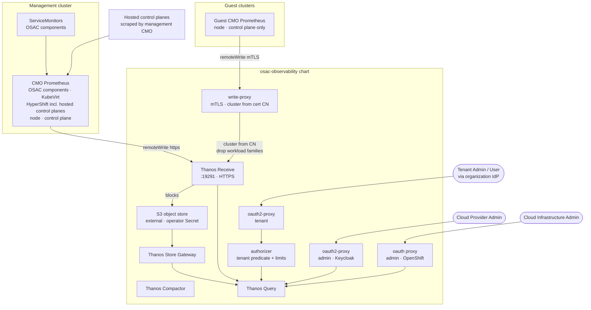

# Metrics Collection, Storage and Querying

## Summary

This design deploys a long-term, tenant-aware metrics store for OSAC: the platform Prometheus on every covered cluster remote-writes into a shared Thanos deployment through CMO, with the management cluster writing directly and OSAC-provisioned and OSAC-6488-imported clusters writing through an mTLS write proxy that stamps each series with the writer's cluster identity and drops workload families. Tenants query through an authorizer that resolves each series to an organization and a project from the fulfillment inventory: a Tenant Admin sees the whole organization, and a Tenant User sees the default project plus the projects their `ProjectMembership` records name, including descendants. Cloud Provider Admins and Cloud Infrastructure Admins query two unfiltered Routes onto the same Thanos Query, and every role shares one retention duration configured per environment. Tenant-workload pod, container, namespace, and model-serving series are never ingested for any role; the platform's own pod and container series are visible to the two admin roles only. See [PRD](prd.md).

## Motivation

OSAC's fulfillment service, operators, and metering service already emit Prometheus-format metrics at their endpoints, and KubeVirt and HyperShift metrics are already collected inside each cluster's platform monitoring stack. None of these signals reach a unified, long-term store, and each cluster retains its own metrics independently. The repository ships one opt-in ServiceMonitor, for `osac-metering`; the fulfillment services and both operators expose metrics through per-Service `prometheus.io` annotations or HTTPS endpoints that no Prometheus instance selects. OSAC-provisioned clusters and clusters imported through OSAC-6488 are monitored independently, so neither Cloud Provider Admins nor Cloud Infrastructure Admins have a cross-cluster PromQL query surface, and tenants have no way to query metrics scoped to their organization.

This design provides the foundational data source that every downstream OSAC observability feature depends on. Without it, alerting (OSAC-6984), health monitoring (OSAC-6986), tenant-label correlation (OSAC-6988), and observability-of-observability (OSAC-6990) have no metrics to work with.

The implementation reuses OpenShift's existing CMO Prometheus as the collection tier on every covered cluster, adds Thanos for long-term retention and federation, and adds two small OSAC-owned services — a write proxy for guest clusters and an authorizer for tenant queries — all deployed through a new `osac-observability` Helm sub-chart and a new `osac-observability` Go component in the OSAC installer. Thanos object storage is backed by an S3-compatible endpoint configured at install time; object storage deployment is not part of this design.

### Goals

- Deliver all ServiceMonitors and RBAC prerequisites for every OSAC component so that metrics are collected without manual post-install steps. [Locked: D5]
- Use CMO remote-write as the exclusive aggregation path on every covered cluster; never enable user-workload monitoring, so tenant workload series have no ingest path; do not modify CMO internals or attempt Thanos Sidecar injection. [Research: §Architecture Patterns, Locked: D14]
- Accept guest cluster writes only through an mTLS write proxy that overwrites the `cluster` label from the client certificate, so a guest-asserted label can never name another cluster. [Locked: D8]
- Serve tenant queries only through an authorizer that injects a match expression derived from the fulfillment inventory — the caller's `organization`, and for a Tenant User the projects their membership records name plus the tenant's default project; serve both admin roles through unfiltered Routes onto the same Thanos Query deployment. [Locked: D8, D12]
- Answer a query the caller may not see, and a query whose owner cannot be resolved, with a successful empty result that is indistinguishable from a query for a series that does not exist; return an authentication error only to an unauthenticated caller or one presenting a token from an organization with no registered identity provider. [PRD: NFR-1, NFR-2]
- Reference object storage credentials by Kubernetes `Secret` name; Helm values and `helm get values` never contain key material. [Codebase: osac-installer/AGENTS.md]
- Express all new configuration through the OSAC installer values schema; every new `values.yaml` key has a matching `values.schema.json` entry. [Codebase: osac-installer/AGENTS.md]
- Pin every container image tag through installer values, including the Thanos, `oauth2-proxy`, OpenShift `oauth-proxy`, and OSAC service images, so a release can be updated without a chart change. [Locked: D4]
- Authenticate Cloud Provider Admins through OSAC's existing Keycloak and Cloud Infrastructure Admins through OpenShift OAuth, consistent with OSAC-1030; deploy no additional identity provider and create no per-organization identity-provider registration. [Locked: D4]

### Non-Goals

- Tenant workload metrics — pod, container, namespace, application, and model-serving series. Not collected for any role, including Cloud Provider Admins; tenants observe their workloads through their own cluster's OpenShift monitoring. [Locked: D14]
- Tenant labels at collect time, including a `namespace` external label on guest series. Tenant attribution is a query-time join over `cluster`; stamping a tenant label at ingest is OSAC-6988's deliverable and [OSAC-6978 §4.3](https://github.com/osac-project/osac/blob/main/docs/architecture/observability/README.md) forbids it.
- Creating or changing tenant identity-provider registrations and mappers. Tenant onboarding already owns that; this design consumes the existing `organization` claim. Removing a registration is out of scope too, and the design's observable behavior when one is removed is in *Failure Handling and Recovery*, verified by TC-R7-07.
- Deploying object storage. The operator supplies an S3-compatible endpoint and a `Secret`.
- Enabling user-workload monitoring, or remote-writing from an existing UWM Prometheus. A cluster that already has `enableUserWorkload: true` keeps that local stack and it is not connected to Thanos.
- Trusting a guest-asserted `cluster`, `managed_by`, or `namespace` label as an identity or authorization input.
- Alerting rules, recording rules, dashboards, and canonical metric names — OSAC-6984 and OSAC-6978.
- Log collection and aggregation — OSAC-6982.
- BMC/IPMI hardware health metrics — OSAC-6986.
- Deep observability-of-observability (collector throughput, pipeline latency) — OSAC-6990.
- GPU metrics — utilization, temperature, power draw, and error counts, including DCGM Exporter collection. Deferred to OSAC-7246. [PRD: Out of Scope]
- Metrics that require a guest agent inside a VM, and metrics from clusters OSAC neither provisions nor imports. [PRD: Out of Scope]

## Proposal

### Terminology

These terms are used with exactly one meaning each throughout this document.

| Term | Definition |
|---|---|
| tenant namespace | The `ClusterOrder` namespace. It is namespace-scoped, and its name equals the Keycloak `organization` claim (see [OSAC-6978 §5](https://github.com/osac-project/osac/blob/main/docs/architecture/observability/README.md)). It is the organization's boundary, not a project boundary: every project in the organization shares the namespace. |
| organization scope | The set of series a Tenant Admin may see: everything attributed to the caller's organization. |
| project | The dot-separated nested project name carried in `metadata.project` on every tenant resource. A resource with an empty project belongs to the tenant's default project. |
| default project | The empty project name `""`. It is always visible to every user in the tenant, with no `ProjectMembership` row, and grants nothing in any other project. |
| project scope | The set of series a Tenant User may see: the default project plus the projects their `ProjectMembership` records name, including each named project's descendants. A descendant is a project whose name starts with the named project followed by `.`, so a membership on `team-a` includes `team-a` and `team-a.frontend` but not `team-ab`. |
| attributable family | A metric family whose series can be tied to one of the caller's resources by a label the authorizer knows: the KubeVirt VM families, the claim families, and the claim-mount family. Project scope uses it to narrow the tenant namespace to the caller's own resources. |
| working namespace | `ClusterOrder.status.clusterReference.namespace` — the namespace created by the order where the `HostedCluster` object lives, labeled `osac.openshift.io/clusterorder=<order name>`. |
| HCP namespace | The namespace where HyperShift runs that cluster's control-plane pods. For the HyperShift version this installer deploys it is `<working namespace>-<hostedClusterName>`, the same namespace that holds the `HostedControlPlane` object named `<hostedClusterName>` (confirmed in-repo: `tests/e2e/core/fulfillment_trust.py`). |
| `cluster` | The series label defined in [OSAC-6978 §4.1](https://github.com/osac-project/osac/blob/main/docs/architecture/observability/README.md). Its value is `management` or `ClusterOrder.status.clusterReference.hostedClusterName`, or the imported resource name for OSAC-6488 clusters. |
| covered cluster | The management cluster, an OSAC-provisioned cluster, or a cluster imported through OSAC-6488. |
| workload series | The metric families the `kube_` allowlist and the auxiliary drops in *Collection* exclude from storage. |

### Components

The design introduces a new `osac-observability` Helm sub-chart, a dependency of the OSAC umbrella chart, and a new Go component `osac-observability/` that builds one binary, `metrics-auth`, with two subcommands:

- **`authorizer`** — the tenant query gateway. It authenticates through `oauth2-proxy`, resolves the caller's organization scope or project scope from the fulfillment inventory, rewrites the query expression as described under *Tenant authorization*, enforces per-organization fair-use limits, and forwards to Thanos Query. It replaces prom-label-proxy and the separate fair-use limiter entirely.
- **`write-proxy`** — the guest remote-write front door. It terminates mTLS, verifies the client certificate against the `osac-metrics-write-ca` CA bundle, drops non-infrastructure families, and sets the `cluster` label from the certificate's common name.

The chart also deploys four Thanos components (Receive, Store Gateway, Compactor, Query), the two admin authentication proxies, and the tenant `oauth2-proxy`. Thanos is configured at install time with an S3-compatible object store; object storage deployment is not in scope.

Alongside the new chart, this design enables the existing opt-in `osac-metering` ServiceMonitor and adds ServiceMonitor resources and their RBAC prerequisites for the remaining OSAC metric-emitting components.

**Platform scope.** Thanos, the authorizer, and the write proxy are platform components. They do not carry `osac.openshift.io/tenant` or `osac.openshift.io/owner-reference` annotations. No new OSAC CRD, gRPC service, or fulfillment proto is introduced, so the `spec`/`status`, conditions, and CRD-map rules do not apply. The Kubernetes APIs this design reads are `ClusterOrder`, `ComputeInstance`, and `Volume` (read-only inventory) and `Certificate` (create/delete), and it creates one `Issuer`; the only fulfillment API it calls is `ProjectMemberships/List`, on the caller's behalf.

### Collection

Metric flow has one ingestion path per cluster, and every path terminates in the same Thanos Receive:

- **Management cluster.** The platform Prometheus managed by CMO scrapes the OSAC component ServiceMonitors — in namespaces labeled `openshift.io/cluster-monitoring: "true"` — together with the signals it already collects (KubeVirt, HyperShift including hosted control planes, node, and control-plane metrics), and remote-writes them to Thanos Receive over HTTPS with `cluster=management` and `managed_by=osac` external labels.
- **OSAC-provisioned and OSAC-6488-imported clusters.** Their CMO remote-writes node and control-plane series to the mTLS write-proxy Route. The proxy is the only writer that can set those clusters' `cluster` label.

Neither tier is a Prometheus owned by OSAC. CMO's platform Prometheus is the scraper, and Thanos is the store and query tier: Receive terminates the remote write and keeps a WAL it persists to S3, Store Gateway serves the historical blocks, Query federates the two, and Compactor downsamples them. A Prometheus of OSAC's own would have no role left to fill — it would re-scrape the targets the platform Prometheus already scrapes, add a second TSDB hop in the write path without adding retention or query capability, and on guests require installing and reaching a collector that push-only collection does not need. What this design owns is the ingestion contract, not the collector: IC-1 and IC-10 set the scrape interval, the external labels, and the remote-write relabel rules, while the platform Prometheus's resource sizing and local retention stay with the platform-monitoring stack. Management-cluster series are therefore stored in `prometheusK8s` before they reach Receive, which puts that sizing in the capacity plan as a platform-monitoring concern (*Drawbacks*). The Prometheus-only endpoints — `/targets`, `/rules`, `/alerts`, and `/status` — are outside the supported subset and return 501 on every Route, and no recording rules or alerting are in scope, so nothing this design promises needs a Prometheus front end.

User-workload monitoring (UWM) is deliberately not enabled anywhere this design configures: its purpose is to carry series from user namespaces, which is exactly the workload class the PRD excludes, so enabling it would create the only ingest path for data no role may query.

The drop is stated as an **allowlist over the `kube_` prefix** rather than as a list of dropped families. kube-state-metrics adds families with each release, and a list of drops makes every unlisted addition a series that is stored by default; an allowlist fails closed. Both remote-write paths therefore drop every series whose name starts with `kube_` except:

- `kube_node_*` and `kube_persistentvolume_*` — node and volume inventory, kept on both paths.
- `kube_persistentvolumeclaim_*` — the PRD's *Volume object* class: the claim phase and its capacity request. Kept on the management path only. Inside a guest cluster a PVC belongs to that cluster's workload, which is why the guest path drops it.
- `kube_pod_spec_volumes_persistentvolumeclaims_info` — the in-use signal of the *Volume object* class: it names the claim a pod mounts, so a claim that is bound but mounted by no pod has no series. Kept on the management path, including the tenant namespaces.
- every other `kube_pod_*` family — kept only inside `observability.collection.platformNamespaces`, as part of the *Platform pod and container* class.

`kube_` is a prefix and nothing more: `kubevirt_*` and OSAC's own component families never match it, so they are never affected by the allowlist. `container_*` outside `observability.collection.platformNamespaces`, `kserve_*`, `vllm_*`, and `dcgm_*` are dropped on both paths. The guest path keeps only `kube_node_*` and `kube_persistentvolume_*`, so every other `kube_` family — claims, the claim-mount series, and pod state — is dropped there.

The relabel mechanics are the same on both paths and are carried by IC-1 and IC-10: a `replace` rule stamps a temporary label on a series the allowlist keeps, and an `action: drop` removes every `kube_` series that lacks the stamp. Because the allowlist is expressed as a prefix plus a stamped exception, a new kube-state-metrics family is dropped until someone adds it to the list deliberately. The guest copy of the drop exists to save bandwidth and is authoritative only because the write proxy applies the same rule again.

The drop list is a **scope** boundary, not a capacity mechanism: the families it names have no ingest path at all, so no role can query them. It is never used to keep the store under its ceiling — NFR-6 forbids dropping or downsampling series to stay within capacity, and the ceiling is sized to the in-scope fleet instead (*Supported scale*).

### Tenant authorization

The authorizer resolves two things before it can rewrite anything: **which organization** the caller belongs to, and **which projects** in that organization the caller may see. The first comes from the token, the second from the fulfillment inventory. There is no tenant or project label on any stored series, so attribution is a join performed at query time.

**Who the caller is.** `oauth2-proxy` validates the token and the authorizer reads two claims from it:

- `organization` → the tenant. Its value is the tenant namespace. A token without the claim is HTTP 401, the same status as no token: it proves no organization the authorizer can authorize.
- the `tenant-admin` Keycloak realm role → organization scope. This is the same realm role `fulfillment-service/internal/auth/policies/authz.rego` uses for `is_tenant_admin`; OSAC's Keycloak assigns it, so an organization's own identity provider does not have to model it. Without the role the caller has project scope.

Organization scope covers every series attributed to the organization. Project scope covers the **default project** `""` plus every project the caller's `ProjectMembership` records name, including descendants. The default project needs no membership row and is never looked up as one; membership in the tenant is what admits a caller to it, so an unannotated resource is in every user's scope. An annotation naming a project the caller does not belong to is what removes a resource from that caller's view.

**Same project, same data.** The authorizer never drops or rewrites one of the caller's matchers and adds no project parameter, so a selector that names only project P's VMs, volumes, and clusters returns the same series, labels, timestamps, and values to the Tenant Admin of the organization and to a Tenant User who can see P. The Tenant Admin's selector with no resource matcher is a superset: it also returns the organization's other projects, because organization scope is the tenant namespace and does not filter on the annotation. Collapsing organization scope to one project, or adding a `project` query parameter, would break the first property.

**Where the project lives.** `ProjectMembership` is a fulfillment resource, not a CRD. The authorizer reads it through the fulfillment public API **with the caller's own bearer token**, not with a service account: the tenant Route forwards the Keycloak access token, the `thanos-tenant` client includes the `organization` scope so the token carries the claim fulfillment already accepts, `ProjectMemberships/List` is already allowed for that caller, and fulfillment's tenancy limits the rows to the caller's organization. The authorizer keeps only the rows whose `spec.users` names the caller — the user reference's `name` compared with the token username — and takes the project from `metadata.project`. The membership type has no `spec.user` field, so the filter is applied to the returned rows rather than in the request. An empty result leaves the default project as the whole scope. Organization scope does not call `List` at all, and a failed lookup keeps the rule in the failure table: a warm cache is reused, and a cold cache is the default project only. The per-subject result is cached for the same 30 seconds as the inventory. The resource side is Kubernetes-resident:

| Series | Identity on the series | Resource | Project source |
|---|---|---|---|
| Per-VM utilization | `namespace`, `name` (or `vmi` on some families) | `ComputeInstance` | `osac.openshift.io/project` annotation |
| Volume object state | `namespace`, `persistentvolumeclaim` | `Volume` | `osac.openshift.io/project` annotation |
| Hosted control plane | `namespace` = HCP or working namespace | `ClusterOrder` | `osac.openshift.io/project` annotation |
| Guest cluster | `cluster` = `hostedClusterName` | `ClusterOrder` | `osac.openshift.io/project` annotation |

The `Volume` reconciler already stamps `osac.openshift.io/project` on create and on update ([`kubernetes_annotations.go`](../../fulfillment-service/internal/kubernetes/annotations/kubernetes_annotations.go)). The cluster and compute-instance reconcilers stamp the tenant annotation but write their annotation map only on create. This design adds the same project annotation to `ClusterOrder` and `ComputeInstance` on create **and on update**, copying the volume reconciler's update path and reusing the existing constant, so the next reconcile backfills objects that already exist rather than waiting for them to be recreated. The authorizer therefore needs no fulfillment read for resources, only for memberships. Not reading the project from the `ClusterOrder` `spec` or `status` is deliberate: the `ClusterOrder` type defines no project field and the fulfillment `Cluster` object is the source of truth.

An annotation that is absent or empty puts the resource in the default project, so its series are in **both** scopes: every user of the organization sees them, including a Tenant User with no membership rows. A resource that names a project the caller cannot see is absent from that Tenant User's result and still present for the Tenant Admin of the organization, because organization scope does not filter on the annotation. Neither is an error: both answer HTTP 200, the second with an empty result.

**What the caller's scope contains.** Both scopes reduce to a set per selector shape; what differs is their extent, and, on the tenant-namespace branch, whether the scope needs a resource matcher at all.

| Set | Organization scope | Project scope |
|---|---|---|
| Cluster-scoped namespaces (HCP and working) | every order of the organization | orders whose project is visible to the caller |
| Guest `cluster` values | every `hostedClusterName` of the organization | those of the caller's visible projects |
| Families in the tenant namespace | every family — the whole namespace matches | only attributable families; a family outside the list is omitted from this branch |
| VM names, per tenant namespace | not needed — the whole namespace matches | the caller's visible projects' `ComputeInstance` names |
| Volume claim names, per tenant namespace | not needed — the whole namespace matches | the caller's visible projects' `Volume` names |

Organization scope and project scope differ in extent **and** in kind: organization scope is a namespace match on every family, while project scope must narrow the shared tenant namespace to the caller's own resources, and can only do so for a family it can attribute. That asymmetry is what makes organization scope a superset of project scope.

**The predicate.** A `VectorSelector` cannot contain `or`, and a `MatrixSelector` — the argument of `rate`, `irate`, `increase`, and every `*_over_time` function — holds exactly one `VectorSelector`. The authorizer therefore parses the query with the Prometheus PromQL parser and rewrites the expression tree:

1. Parse the `query` parameter of `/api/v1/query` and `/api/v1/query_range`. A parse error is HTTP 400 and is not forwarded. An expression with no series selector is forwarded unchanged, because nothing in PromQL reads stored series without one.
2. Build the authorization branches from every selector the caller wrote. Every branch keeps all of the caller's matchers and ANDs one authorization branch:
   - **Organization scope — two branches.** management: `cluster="management"` and `namespace=~"<quoted namespaces>"`. Guest: `cluster=~"<quoted hostedClusterNames>"`. There is no resource matcher: the namespace itself is the organization's boundary, because only that organization's resources live in its namespace.
   - **Project scope — three branches.** Tenant namespace: `cluster="management"`, `namespace=~"<the tenant namespace>"`, and the family's resource matcher, for attributable families only. Hosted control plane and working namespaces: `cluster="management"` and `namespace=~"<quoted order namespaces>"`, for every family. Guest: `cluster=~"<quoted hostedClusterNames>"`, for every family.

   The caller's matchers are never dropped, so a selector that already restricts a label can only narrow further; two matchers on the same label are valid PromQL and AND together.
3. The namespace list is built per branch. Organization scope passes the tenant namespace plus every cluster-scoped namespace of the organization on the management branch. Project scope passes the tenant namespace alone on the tenant-namespace branch and only the in-scope orders' namespaces on the hosted-control-plane branch. Empty strings are dropped before joining. The tenant namespace is present whenever the `organization` claim exists, so the management branch's namespace list is never empty for an authenticated tenant.
4. Under project scope the tenant-namespace branch carries a resource matcher chosen by the selector's metric family, from a table keyed by family prefix:

   | Family | Matcher label | Allowed names |
   |---|---|---|
   | `kubevirt_vmi_*`, `kubevirt_vm_*` | `name`, or `vmi` for the families that identify the VM that way | the caller's projects' `ComputeInstance` names |
   | `kube_persistentvolumeclaim_*`, `kube_pod_spec_volumes_persistentvolumeclaims_info` | `persistentvolumeclaim` | the caller's projects' `Volume` claim names |

   A family outside the table is **omitted from the tenant-namespace branch**, not forwarded unfiltered; the guest and hosted-control-plane branches are still emitted for it. So `{__name__=~".+"}` under project scope returns the caller's VMs, volumes, and clusters and no other project's series, and a query for a family the authorizer cannot attribute is empty as far as the tenant namespace is concerned: `kube_service_info` has no ingest path at all, and the management cluster's `kube_node_status_capacity` is stored but cluster-scoped, carrying no tenant namespace, so neither scope reaches it. A guest cluster's node families still come through the guest branch. A selector that sets no `__name__` matcher cannot be classified, so the authorizer expands it once per attributable family in its cached family catalogue; if that catalogue has not loaded, the selector returns an empty result rather than an unfiltered one.

   `kube_persistentvolume_*` is deliberately absent. The `Volume` resource records a vendor volume identifier but no persistent-volume name, so there is nothing to match on without a `claimRef` join against a cluster-scoped inventory the authorizer does not watch; and PV-level series are cluster-scoped, carrying no tenant namespace, so the tenant tier does not reach them under either scope anyway. Claim phase, claim capacity, and the mount family answer the same questions about the same object. PV series a guest scrapes remain visible to that cluster's owner on the guest branch.
5. The guest list is each in-scope order's `hostedClusterName`. When it is empty the guest branch is omitted entirely: the authorizer does not emit `=~""` and does not leave a trailing `|`, because either widens the matcher instead of removing it.
6. Every interpolated value is quoted with the equivalent of `regexp.QuoteMeta` before joining on `|`, so an imported cluster named `edge.prod` cannot match `edgeXprod`.
7. A `hostedClusterName` equal to `management`, and a `hostedClusterName` that appears in two organizations, are **removed from every caller's scope** rather than merged or refused — see risk R9. The value never enters a guest regex, so the guest branch cannot select management-cluster series, and no caller learns from a status code that the collision exists. Affected organizations get the empty result NFR-2 requires, and the collision is logged with both orders for the provider to resolve.
8. Branches are applied by parent node, because where an `or` may legally sit depends on what consumes the selector:
   - **Instant-vector parent** — an aggregation, `topk`, `bottomk`, a function such as `abs`, a parenthesized expression, or either side of a binary operator: replace the selector with one selector per live branch, joined by `or`, emitted alone when only one branch is live, and leave the parent outside. `count by (node) (kubevirt_vmi_info)` becomes `count by (node) (kubevirt_vmi_info{management} or kubevirt_vmi_info{guest})`. The list is illustrative; the rule is any node that consumes an instant vector.
   - **`MatrixSelector` under a call** — copy the call once per live branch and `or` the copies. `rate(node_cpu_seconds_total[5m])` becomes `rate(node_cpu_seconds_total{management}[5m]) or rate(node_cpu_seconds_total{guest}[5m])`. A tenant with no guest clusters gets only the management copy.
   - **`histogram_quantile`** keeps its outer call and lifts only the inner `rate`, producing:

     ```promql
     histogram_quantile(0.99,
       sum by (le) (
         rate(apiserver_request_duration_seconds_bucket{management}[5m])
         or
         rate(apiserver_request_duration_seconds_bucket{guest}[5m])
       )
     )
     ```

   - **Subquery** keeps its range and step; its inner expression is rewritten by these same rules.
   - **Binary operator** (`/`, `and`, `unless`) rewrites each side independently.
9. The branches are disjoint by construction — the guest branch excludes `cluster="management"`, and the two management branches match different namespace patterns — so the left-side-wins semantics of `or` never drops a series the caller is entitled to, and a series cannot be returned twice by matching more than one branch.
10. Enumeration applies the same selectors rather than one rewritten expression: `/api/v1/series`, `/api/v1/labels`, and `/api/v1/label/*/values` send them as `match[]` parameters, which Prometheus ORs for them. No request reaches Thanos with the caller's expression unmodified.
11. If the expression cannot be rewritten — an unknown node type, or every branch omitted — the authorizer returns HTTP 200 with an empty result set. It never forwards the original query as a fallback.

A series with no allowed namespace and no allowed cluster value matches neither branch: OSAC control-plane series and the management cluster's own node and control-plane series carry `cluster="management"` and no tenant namespace, and imported clusters carry a `cluster` value no tenant owns. Nothing needs to enumerate them, and no allowlist exists to maintain.

The three enumeration endpoints are the one place the disjunction is expressible directly — `match[]` accepts a list of selectors — which is why step 10 above routes them through it instead of through the expression tree.

**Failure behavior, classified against NFR-2.** The authorizer keeps a cluster-wide list of `ClusterOrder`, `ComputeInstance`, and `Volume` objects refreshed every 30 seconds, caches project memberships per subject for the same period, and serves the last good list while a watch is in trouble. That grace period is one refresh interval: after 30 seconds without a successful list, the view is no longer served. Each failure mode is classified so that only a caller-invariant availability failure is an error:

| Failure | Response | Why |
|---|---|---|
| The inventory has never completed a successful list, or its last successful list is more than 30 seconds old | HTTP 503 for every caller until a list succeeds again | Identical for every caller and reveals nothing about any particular series; it is the availability signal NFR-3 allows. Serving an arbitrarily stale list would silently widen or narrow every caller's scope. |
| Project-membership lookup fails for this caller | HTTP 200; a warm cache serves the cached membership set, and with no cached set project scope falls back to the default project and returns its series, empty only when the query matches nothing there | Fail closed for that caller, not for the route; never a 5xx. |
| A resource's project annotation is absent or empty | HTTP 200 with that resource's series, for every user of the organization | It is in the default project, which every user in the tenant can see. |
| A resource names a project the caller cannot see | HTTP 200, empty result for that Tenant User; the series is present for the Tenant Admin | Organization scope is the namespace and does not read the annotation; project scope is an allowlist. |
| A `hostedClusterName` collides across organizations, or equals `management` | HTTP 200, empty result for the affected organizations | The value is removed from every scope (step 7). A 503 here would tell one organization that another exists, which NFR-1 forbids. |
| The family catalogue has not loaded, so an unnamed selector cannot be classified | HTTP 200, empty result | Never send an unclassified selector unfiltered. |
| Thanos Query is unavailable | HTTP 503 | Availability, identical for every caller. |

The authorizer needs exactly one fulfillment read — `ProjectMembership` for the calling subject. Everything else is a Kubernetes watch, and there is no per-tenant custom resource.

### Cross-component work and order

The work spans the following components and must land in this order, because each step depends on the previous one:

1. **Operator prerequisite.** The operator provisions the S3 bucket and its credential `Secret` (F1). Nothing deploys before it exists.
2. **`osac-installer`, `fulfillment-service`, `osac-operator`, `bare-metal-fulfillment-operator`, `osac-metering`.** The charts gain their ServiceMonitors and namespace RBAC (IC-2), and the two operator charts gain the unconditional 8443 bind and service-CA serving certificate. `osac-installer` renders the new `osac-observability` sub-chart (Receive, Store Gateway, Compactor, Query, authorizer, write proxy).
3. **`fulfillment-service` project attribution.** The cluster and compute-instance reconcilers stamp `osac.openshift.io/project` on the `ClusterOrder` and `ComputeInstance` objects they create and update, as the volume reconciler already does. Without this step every cluster and VM falls into the default project: still visible to every user in the tenant, but never to the named project that owns it.
4. **`osac-installer` post-install Job.** It updates the management cluster's `cluster-monitoring-config` (IC-1, F3). Until this runs, nothing writes.
5. **`osac-observability`.** The authorizer starts its inventory watch and begins serving, or returns 503 until the first list succeeds.
6. **`ClusterOrderReconciler` (`osac-operator`).** Once a guest's kubeconfig exists it issues that guest's client `Certificate` and applies the guest CMO configuration (IC-10), and revokes both on the finalizer.
7. **OSAC-6488 import (cross-repo).** The import policy applies the same guest configuration and issues a certificate with the imported resource name, with no `ClusterOrder` behind it. This design specifies the policy body; OSAC-6488 implements the import.

`osac-test-infra` is needed only for the deployed end-to-end journeys, not for this ordering. No fulfillment proto, API, or CRD change is part of any step: the project annotation already exists and is carried in annotations, not in a schema.

### Breaking change

This design writes a named `remoteWrite` entry and two external labels into the cluster-scoped `cluster-monitoring-config` ConfigMap of the management cluster and of every covered cluster. It does not change the fulfillment API, any CRD, or any proto. The entry name `osac` is what makes the write reversible: disable removes only that entry and the two labels it owns.

### Workflow Description

**Actor:** Cloud Infrastructure Admin (installer operator at deploy time); Cloud Provider Admin, Cloud Infrastructure Admin, and Tenant Admin/User at query time.

**Starting state:** OSAC is installed on an OpenShift cluster. CMO is operational. The only ServiceMonitor in the repository is the `osac-metering` chart's, and it is disabled by default; no long-term store or query interface exists.

**Installation workflow:**

1. The Cloud Infrastructure Admin pre-creates an S3-compatible bucket and a Kubernetes `Secret` holding its credentials, then sets `observability.enabled: true` and the `observability.objectStorage` block (Secret name, endpoint, bucket, region, insecure).
2. A pre-install hook validates that the Secret exists, that the endpoint resolves, and that cert-manager is installed with its `cert-manager.io/v1` API served, because the chart creates `Issuer/osac-metrics-write-ca` and the guest client certificates depend on it. The hook cannot check that issuer itself — the chart creates it — so a post-install gate waits for the `Issuer` to report `Ready` before the guest write path is advertised. If a pre-install check fails, the hook exits non-zero and no observability resource is created.
3. The chart deploys Thanos Receive + Store Gateway + Compactor + Query, the `authorizer`, the `write-proxy`, the three query Routes, the write Route, and the ServiceMonitors for the OSAC components.
4. A post-install Job parses `openshift-monitoring/cluster-monitoring-config` and upserts only `prometheusK8s.externalLabels.cluster`, `prometheusK8s.externalLabels.managed_by`, and the `prometheusK8s.remoteWrite` entry named `osac` (HTTPS, CA-verified, drop rule). Every other key is preserved. The Job aborts with a fixed error string if a differently named `remoteWrite` entry already targets the Thanos Receive URL.
5. The CMO Prometheus reloads with remote-write configured; series reach Thanos Receive within one scrape interval.
6. The `authorizer` starts its `ClusterOrder` watch. Until its first successful list it returns 503.

**Admin query workflow:**

1. A Cloud Provider Admin authenticates to `Route/thanos-query-admin`, an `oauth2-proxy` against OSAC Keycloak whose client is created by the installer; the token must carry the `cloud-provider-admin` realm role.
2. A Cloud Infrastructure Admin authenticates to `Route/thanos-query-admin-openshift`, an OpenShift `oauth-proxy` requiring membership in the group configured by `observability.admin.openshiftGroup`; OSAC does not create the group.
3. Neither Route filters. Both proxy to the same Thanos Query service, so either role reaches every stored series.

**Tenant query workflow:**

1. A Tenant Admin authenticates through the identity provider registered for their organization; OSAC's Keycloak brokers it and issues a token carrying the `organization` claim. This design creates no registration or mapper.
2. `Route/thanos-query-tenant` runs `oauth2-proxy` and then the `authorizer`. The authorizer rejects a token without an `organization` claim with HTTP 401.
3. The authorizer resolves the caller's namespaces, cluster names, and—for a Tenant User—project membership and resource names, rewrites the query to the authorization predicate, applies fair-use limits, and forwards to Thanos Query.

**Guest cluster create (OSAC-provisioned):**

1. The `ClusterOrderReconciler` creates a cert-manager `Certificate` in `osac-observability` with `commonName: <status.clusterReference.hostedClusterName>` and `issuerRef: Issuer/osac-metrics-write-ca`.
2. Once the guest kubeconfig exists, the reconciler copies the issued client certificate, its key, and the CA bundle into `openshift-monitoring` on the guest and applies the guest `cluster-monitoring-config` (IC-10). AAP's `hosted_cluster` role does not write that ConfigMap.
3. The guest's CMO begins remote-writing to the write-Proxy Route; the proxy stamps `cluster=<hostedClusterName>`.

**Guest cluster import (OSAC-6488):** the import path applies the same guest configuration and a client certificate from the same `Issuer/osac-metrics-write-ca`, whose common name is the imported resource name, delivered as an ACM policy. No `ClusterOrder` exists, so no tenant's authorized set includes that name. The import contract refuses two names before it issues a certificate: the literal `management`, and any name equal to a live `hostedClusterName`. An imported cluster has no `ClusterOrder` and therefore no authorizer inventory to fail closed against, so the refusal happens here — no certificate is issued for either name.

**Guest cluster import removal:** the `ClusterOrder` finalizer does not run for an import, so the import removal path runs the same revocation steps in the same order — read the serial from the issued `Secret`, append it to `ConfigMap/osac-metrics-write-revocation`, delete the `Certificate`, then remove the guest `osac` remote-write entry. This design specifies those steps; OSAC-6488 performs them.

**Guest cluster delete:** the order's owner deletes the `ClusterOrder`. Its finalizer then runs the revocation steps in order — read the certificate serial from the issued `Secret`, append it to `ConfigMap/osac-metrics-write-revocation`, delete the `Certificate`, and remove the guest `osac` remote-write entry — so the authorizer's next list drops the cluster name and a certificate already copied to the guest stops writing on its next request.

**Disable:** setting `observability.enabled: false` runs the same ConfigMap Job in reverse — it removes only the `osac` remote-write entry and the two external labels — then uninstalls the chart. On guests, the reconciler removes the same keys; for imported clusters the ACM policy removal does. Helm upgrade never touches the S3 bucket.

The following diagram shows the full data flow from collection through storage to query.



Thanos Receive persists metric blocks to the configured S3 object store. Store Gateway reads those blocks for long-term query; Query federates Receive and Store Gateway. Both admin Routes reach Query directly and unfiltered. The tenant Route reaches Query only through the authorizer, which applies the calling organization's predicate; Query has no other tenant-facing path.

### API Extensions

**IC-1 — `cluster-monitoring-config` ConfigMap** (`openshift-monitoring` namespace, management cluster)

Configures the management cluster's scrape interval, external labels, and CMO remote-write. Applied by a post-install Job that parses `data.config.yaml` and upserts only the keys shown, preserving every other key — including a pre-existing `enableUserWorkload: true`. `enableUserWorkload` and the `userWorkloadMonitoring` block are never written by OSAC. `scrapeInterval` is the *infrastructure* collection interval from `observability.collection`: it sets the freshness of every series CMO collects on the management cluster, and it is written here rather than left to the cluster administrator so that the freshness requirement has an owner. Guest clusters receive their own `scrapeInterval` in IC-10 from the same value.

```yaml
prometheusK8s:
  scrapeInterval: 30s
  externalLabels:
    cluster: management
    managed_by: osac
  remoteWrite:
    - name: osac
      url: https://thanos-receive.osac-observability.svc.cluster.local:19291/api/v1/receive
      tlsConfig:
        caFile: /etc/prometheus/configmaps/service-ca-bundle/service-ca.crt
      writeRelabelConfigs:
        - action: labeldrop
          regex: prometheus_replica
        # kube_ series are allowlisted: a rule below must stamp __tmp_keep,
        # or the series is dropped. kube_ is a prefix and nothing more, so
        # no kubevirt_ or osac_ family is affected.
        - action: replace
          sourceLabels: [__name__]
          targetLabel: __tmp_keep
          regex: 'kube_(node|persistentvolume)_.*|kube_persistentvolumeclaim_.*|kube_pod_spec_volumes_persistentvolumeclaims_info'
          replacement: keep
        # Other kube_pod_ families describe workloads; they are in scope only
        # inside the namespaces this installer deploys OSAC components into.
        - action: replace
          sourceLabels: [__name__, namespace]
          separator: ';'
          targetLabel: __tmp_keep
          regex: 'kube_pod_.*;(osac|osac-csi|osac-observability)'
          replacement: keep
        - action: drop
          sourceLabels: [__name__, __tmp_keep]
          separator: ';'
          regex: 'kube_.*;'
        - action: labeldrop
          regex: __tmp_keep
        # container_ families follow the same rule as kube_pod_.
        - action: replace
          sourceLabels: [__name__, namespace]
          separator: ';'
          targetLabel: __tmp_keep
          regex: 'container_.*;(osac|osac-csi|osac-observability)'
          replacement: keep
        - action: drop
          sourceLabels: [__name__, __tmp_keep]
          separator: ';'
          regex: 'container_.*;'
        - action: labeldrop
          regex: __tmp_keep
        - action: drop
          sourceLabels: [__name__]
          regex: kserve_.*|vllm_.*|dcgm_.*
```

The `kube_` rules are an allowlist, not a denylist, because the denylist enumerates families and `kube-state-metrics` keeps adding them. A `replace` rule stamps `__tmp_keep=keep` on an allowed family — `kube_node_*`, `kube_persistentvolume_*`, `kube_persistentvolumeclaim_*`, and `kube_pod_spec_volumes_persistentvolumeclaims_info` unconditionally, and any other `kube_pod_*` only whose `namespace` is one of `observability.collection.platformNamespaces`; the `drop` then removes every `kube_` series that lacks the stamp, and `labeldrop` removes the temporary label. `container_*` follows the same stamp-and-drop pattern with the namespace condition alone. The namespace list is rendered from the installer's values, so a deployment that installs OSAC into other namespaces changes the list rather than the rule. `__tmp_keep` is a relabeling-scoped label and is never stored or sent.

`kube_` here is a prefix and nothing more: it does not match `kubevirt_vmi_*` or `kubevirt_vm_*`, which the KubeVirt class depends on, and it does not match any `osac_*` family. A family the allowlist has never heard of is dropped by default, which is the behavior the workload class needs.

The Receive `Service` carries `service.beta.openshift.io/serving-cert-secret-name`, so its in-cluster certificate is issued by the service CA that CMO already trusts at the path above. There is no plaintext remote-write URL and no `insecureSkipVerify` anywhere in this design.

What the allowlist keeps and why:

- `kube_node_*` and `kube_persistentvolume_*`, because node and PV inventory is infrastructure state, on both remote-write paths.
- `kube_persistentvolumeclaim_*` on the management path only, because it is the **Volume object** class for platform-provisioned volumes and carries no workload data. Guest claims are workload: on a guest, every claim belongs to a tenant's own application, so the guest path drops them.
- `kube_pod_spec_volumes_persistentvolumeclaims_info` on the management path, including the tenant namespace, because it is the only series that says a claim is mounted by a running pod — the **in-use** state of a `Volume`.
- `kube_pod_*` and `container_*` inside `platformNamespaces`, because the PRD's **Platform pod and container** class — pods and containers of OSAC's own control plane on the management cluster — is in scope as control-plane telemetry. It is granted to the two admin roles and to no tenant, and the tenant branch never selects those namespaces.

Everything else CMO collects that describes workloads rather than infrastructure is dropped: other `kube_` families, pod and container series outside OSAC's own namespaces, model-serving families, and GPU exporters.

With no UWM stack anywhere, this is what makes the PRD's *Tenant workload* class true by construction: outside OSAC's own namespaces the families have no ingest path, so no role — including Cloud Provider Admins — can query them; inside those namespaces the series describe the platform, not a tenant's workload. The guest path (IC-10) drops the claim, mount, pod, and container families entirely, because on a guest every one of them is tenant workload. The drop is recorded here because a silently dropped series is indistinguishable from a source that stopped reporting ([OSAC-6978 §6](https://github.com/osac-project/osac/blob/main/docs/architecture/observability/README.md)).

**IC-2 — ServiceMonitors for all OSAC metric-emitting components**

The `osac-metering` chart already ships a ServiceMonitor template covering the metering service and both adapters, gated by `serviceMonitor.enabled` (default `false`); the installer sets it to `true`. ServiceMonitors for the five fulfillment binaries and both operators are added to their per-component Helm charts. Each is accompanied by the namespace RBAC prerequisites required for the platform Prometheus to discover and scrape targets.

Namespace prerequisites (applied once per OSAC namespace):
- Label `openshift.io/cluster-monitoring: "true"` on the namespace.
- `Role` + `RoleBinding` granting `prometheus-k8s` service account `get,list,watch` on `services,endpoints,pods`.

Per-component ServiceMonitors:

| Component | Port | Scheme | Auth |
|-----------|------|--------|------|
| fulfillment-grpc-server | 8002 | HTTP | None |
| fulfillment-rest-gateway | 8002 | HTTP | None |
| fulfillment-controller | 8002 | HTTP | None |
| fulfillment-event-publisher | 8002 | HTTP | None |
| fulfillment-console-proxy | 8002 | HTTP | None |
| osac-operator | 8443 | HTTPS | bearerTokenFile + caFile |
| bmf-operator | 8443 | HTTPS | bearerTokenFile + caFile |
| osac-metering | 8080 | HTTP | None |
| echo-adapter | 2112 | HTTP | None |
| m360-adapter | 2112 | HTTP | None |

For the two OSAC operators this is a code and chart change, not only a manifest addition: their metrics Service gains `service.beta.openshift.io/serving-cert-secret-name`, their `Service` is annotated the same way, `--metrics-bind-address=:8443` becomes unconditional instead of being gated on `global.fulfillmentTrust.enabled`, and controller-runtime is pointed at the service-CA secret directory so the endpoint presents a CA-verifiable certificate instead of the self-signed one it generates today. The ServiceMonitor then verifies with `caFile: /etc/prometheus/configmaps/service-ca-bundle/service-ca.crt`; `insecureSkipVerify` is not used. A `ClusterRoleBinding` binds the existing `<operator>-metrics-reader` ClusterRole to the `prometheus-k8s` service account.

The scrape is never made to work by disabling TLS verification: where a component's endpoint is HTTPS the ServiceMonitor verifies with `caFile`, and where it is plain HTTP the ServiceMonitor declares `http` with no credentials rather than setting `insecureSkipVerify`. The ten targets above are the complete set. No ServiceMonitor is created in a tenant namespace, no ServiceMonitor selects a model-serving pod or any other workload, and no product outside OSAC's own component set is scraped. [Codebase: osac-operator/charts/operator/templates/metrics-service.yaml, osac-operator/cmd/main.go, osac-metering/charts/osac-metering/templates/servicemonitor.yaml]

**IC-3 — Thanos Receive internal endpoint** (`osac-observability` namespace)

`Service/thanos-receive`, port 19291, HTTPS with a service-CA certificate. Cluster-internal only; guest clusters reach Receive through IC-9.

**IC-4 — Thanos Query admin endpoints** (`osac-observability` namespace)

`Route/thanos-query-admin` and `Route/thanos-query-admin-openshift`, both exposing the Thanos HTTP query API on port 9090 and both proxying to the same Thanos Query service. The admin tier has two front doors because its two roles use different identity systems:

- **Cloud Provider Admin — Keycloak.** `thanos-query-admin` runs `quay.io/oauth2-proxy/oauth2-proxy` against OSAC Keycloak. The client (`thanos-admin`) is created by the installer's existing Keycloak client provisioning; the token must carry the `cloud-provider-admin` realm role.
- **Cloud Infrastructure Admin — OpenShift OAuth.** `thanos-query-admin-openshift` runs `registry.redhat.io/openshift4/ose-oauth-proxy` against OpenShift OAuth, consistent with OSAC-1030. Access requires membership in the group configured by `observability.admin.openshiftGroup`; OSAC does not create the group.

Neither Route performs label enforcement, authentication tokens are not interchangeable between them, and both grant any-namespace visibility. That is what the PRD authorization table grants. Both render the five-endpoint allowlist from IC-5 and return 501 for anything else, so the API subset is identical on every Route. [Locked: D12]

**IC-5 — Tenant query Route and authorizer** (`osac-observability` namespace)

`Route/thanos-query-tenant` exposes an `oauth2-proxy` (client `thanos-tenant`, created by the installer) in front of the `authorizer` on port 8080, which proxies to Thanos Query. Enforcement is the scope predicate described under *Tenant authorization*.

The tenant Route exposes exactly the five endpoints the PRD's compatibility requirement names, and nothing else:

| Endpoint | Authorizer handling |
|---|---|
| `/api/v1/query` | Expression rewritten to the caller's scope |
| `/api/v1/query_range` | Expression rewritten to the caller's scope |
| `/api/v1/labels` | Every scope selector sent as `match[]` |
| `/api/v1/label/<name>/values` | Every scope selector sent as `match[]` |
| `/api/v1/series` | Every scope selector sent as `match[]` |

Any other path — including `/api/v1/metadata`, `/api/v1/targets`, `/api/v1/rules`, `/api/v1/alerts`, `/api/v1/status/*`, `/api/v1/admin/*`, and Thanos's own `/api/v1/stores` — returns HTTP 501 with a Prometheus-format error body naming the endpoint as unsupported. The same five-endpoint allowlist is enforced on the two admin Routes, rendered into their proxy configuration, so all three front doors reject the same set: a caller never receives a partial answer from an unsupported endpoint on any Route, and an admin cannot use `/targets` or `/status` as a side channel the tenant Route forbids. [PRD: NFR-5]

The authorizer also enforces `observability.tenant.limits` per organization: `maxConcurrentQueries`, `maxQueryRange`, and `queryTimeout`. Each maps to one row of the HTTP table under *Security Considerations*, which is the single place these status codes are defined.

**IC-6 — External S3-compatible object store** (operator-provided prerequisite)

Thanos object storage is not deployed by OSAC. The operator provisions an S3-compatible bucket and a `Secret` holding its credentials before installing. The operator's `Secret` may use any key names the `observability.objectStorage.secretName` contract defines; the chart mounts it read-only into Receive, Store Gateway, and Compactor. The values block contains no access key or secret key.

**IC-7 — OSAC installer `values.yaml` — new `observability` section**

```yaml
observability:
  enabled: false            # set to true to deploy the observability stack
  thanos:
    image:
      registry: registry.redhat.io
      repository: openshift4/ose-thanos-rhel8
      tag: ""               # empty = the hub cluster's OpenShift minor
    retention: 365d         # the query window; one duration, identical for
                            # every role. Past it a query returns nothing.
    resolution:             # INTERNAL, not a product tier: the age at which
      raw: 365d             #   each resolution is retired. All three equal
      5m: 365d              #   `retention`, so the whole window answers at raw
      1h: 365d              #   resolution. 0d means "keep forever" and is
                            #   rejected by the schema.
    storageClass: ""        # "" = cluster default
    receive:
      replicas: 2
      replicationFactor: 2
      resources:
        requests: {cpu: 500m, memory: 4Gi}
        limits: {cpu: "2", memory: 8Gi}
      pvcSize: 20Gi
    store:
      replicas: 2
      resources:
        requests: {cpu: 100m, memory: 256Mi}
        limits: {cpu: 500m, memory: 1Gi}
    query:
      replicas: 2
      resources:
        requests: {cpu: 500m, memory: 1Gi}
        limits: {cpu: "2", memory: 4Gi}
    compactor:
      resources:
        requests: {cpu: 500m, memory: 2Gi}
        limits: {cpu: "2", memory: 4Gi}
      pvcSize: 100Gi
    deduplication:
      replicaLabel: replica   # --query.replica-label and --deduplication.replica-label
  services:
    metricsAuth:
      repository: ghcr.io/osac-project/osac-observability
      tag: ""
    oauth2Proxy:
      repository: quay.io/oauth2-proxy/oauth2-proxy
      tag: ""
    openshiftOauthProxy:
      repository: registry.redhat.io/openshift4/ose-oauth-proxy
      tag: ""
  clusterRemoteWrite:
    enabled: true             # deploy the guest mTLS remote-write Route
    certificateDuration: 90d  # cert-manager Certificate duration for guest clients
    renewBefore: 30d
  tenant:
    limits:
      maxConcurrentQueries: 10  # per organization
      maxQueryRange: 24h        # longest single query range; unrelated to retention
      queryTimeout: 2m          # server-side timeout
  collection:
    # Two intervals, not one per class: CMO exposes a single scrapeInterval,
    # so an independent interval per metric class is not delivered. Freshness
    # for a class is one interval of the key that covers it (NFR-4).
    osacControlPlane: 30s       # ServiceMonitor interval for OSAC components
    infrastructure: 30s         # CMO's scrape interval on covered clusters;
                                # covers node, VM, volume, cluster, HCP, and
                                # platform pod series
    # Namespaces whose pod and container series are the Platform pod and
    # container class. Everywhere else they are dropped at remote write.
    platformNamespaces: [osac, osac-csi, osac-observability]
  objectStorage:
    # Required. Must reference an existing Secret before observability.enabled: true.
    secretName: ""          # Secret with S3 credentials; never contains key material
    endpoint: ""            # e.g. https://s3.example.com
    bucket: ""              # bucket name for Thanos blocks
    region: ""              # optional; leave empty if not applicable
    insecure: false         # set true only for development endpoints without TLS
  admin:
    openshiftGroup: osac-cloud-infrastructure-admins
                            # OpenShift group whose members are Cloud
                            # Infrastructure Admins (OpenShift OAuth route)
  keycloak:
    realm: osac
    keycloakAdminRole: cloud-provider-admin
                            # Keycloak realm role required on the
                            # Cloud Provider Admin route
    adminClientId: thanos-admin
    tenantClientId: thanos-tenant
    issuerUrl: ""           # derived from global.clusterDomain if empty
```

Every key has a matching `values.schema.json` entry with type, default, and description; the Enclave Wizard renders those entries and needs no custom page. No secret material is a schema field. `observability.thanos.retention` is the one product-facing duration: it is the window a query can reach, it is the same for every role, and changing it changes nothing about who may query what. `observability.thanos.resolution` is internal — it controls how finely an old block is stored — and its three keys must equal `retention`; the chart fails rendering if any differs, in either direction, because a resolution retired before the window ends would make an in-window query answer at coarser fidelity than the caller stored, and one retained longer would leave samples past the window and break the "past the window is empty" guarantee. The schema also rejects `0d`, Thanos's keep-forever, for the same reason. The pre-install hook aborts if `observability.enabled: true` and `objectStorage.secretName` is empty or the `Secret` does not exist. [Codebase: osac-installer/AGENTS.md — installer invariant]

**IC-9 — Guest remote-write Route** (`osac-observability` namespace)

`Route/thanos-receive-managed` terminates TLS for `write-proxy` and requires a client certificate. Client certificates are issued by cert-manager from a **namespaced `Issuer/osac-metrics-write-ca`** in `osac-observability`, which the chart creates with its own CA key pair in a `Secret` it owns, with `commonName` equal to the cluster's `hostedClusterName` (provisioned) or imported resource name (OSAC-6488), `usages: [client auth]`, and the `certificateDuration`/`renewBefore` values.

A dedicated CA rather than the platform `ClusterIssuer/default-ca` is what makes the write path's trust explicit. The proxy trusts `osac-metrics-write-ca` and no other issuer, so a certificate minted by the platform CA — which many other controllers can request — does not authenticate a guest, and rotating or revoking the guest CA touches no platform certificate. `ClusterOrderReconciler` and the OSAC-6488 import path are the only writers of `Certificate` objects that reference this issuer.

For every series the proxy deletes any incoming `cluster` and `managed_by`, sets `cluster` from the certificate common name, sets `managed_by=osac`, applies the drop rule, and leaves `namespace` exactly as scraped. The Route accepts writes only; it does not proxy queries.

Revocation is a shared Kubernetes object rather than process state, because both replicas must reject the same certificate and a restart must not resurrect a deleted cluster's write:

- `ConfigMap/osac-metrics-write-revocation` in `osac-observability`. The chart creates it empty. It has one data key, `revoked`, holding one certificate serial number per line.
- Both write-proxy replicas watch that ConfigMap. If the watch has not succeeded since process start, the proxy answers every guest write with HTTP 401 — an unreadable denylist is treated as a closed one.
- The `ClusterOrderReconciler` finalizer reads the serial from the issued `Secret`'s `tls.crt`, appends it to `revoked`, deletes the `Certificate`, and only then removes the guest `osac` remote-write entry. If that `Secret` is already gone, it appends nothing and the backstop in R5 applies.
- Deleting a cert-manager `Certificate` does not invalidate a certificate already copied to the guest. The serial denylist is what stops it.
- A later order that reuses the same `hostedClusterName` gets a new serial and can write; the old serial stays rejected.

The proxy accepts a write only when the presented certificate chains to `Issuer/osac-metrics-write-ca`, has not expired, its serial is absent from `ConfigMap/osac-metrics-write-revocation` key `revoked`, and its common name is not `management`. Every other case is HTTP 401 and its samples are discarded. The proxy does not look the common name up in an inventory and does not watch `ClusterOrder`: the stamp it writes is the identity the certificate proves, and tenancy is decided on the read path by the authorizer's list, so a certificate for a cluster no tenant owns is accepted and harmless — no tenant predicate includes its `cluster` value. The `management` refusal holds even for an otherwise valid certificate: `management` is exactly the management branch of the tenant predicate, so a guest write stamped with it would enter that branch, and a forged `namespace` on the write would surface it to whichever tenant owns that namespace.

**IC-10 — Guest cluster remote-write configuration** (per covered guest cluster)

Each OSAC-provisioned and OSAC-6488-imported cluster is configured to remote-write its node and control-plane series to IC-9. The configuration is applied by `ClusterOrderReconciler` once the guest kubeconfig exists (provisioned) or by the ACM policy (imported), and consists of three objects in `openshift-monitoring` on the guest — the client certificate, its key, the CA bundle — plus this ConfigMap:

```yaml
prometheusK8s:
  scrapeInterval: <observability.collection.infrastructure>
  externalLabels:
    cluster: <hostedClusterName>   # hint only; the write proxy overwrites it
    managed_by: osac               # hint only; the write proxy overwrites it
  remoteWrite:
    - name: osac
      url: https://thanos-receive-managed.apps.<management-domain>/api/v1/receive
      tlsConfig:
        ca:
          secret:
            name: osac-remote-write-ca
            key: ca.crt
        cert:
          secret:
            name: osac-remote-write-client
            key: tls.crt
        keySecret:
          name: osac-remote-write-client
          key: tls.key
      writeRelabelConfigs:
        # The mirror image of IC-1: only node and PV families survive the
        # kube_ allowlist, because on a guest every other kube_ series, every
        # claim, and every mount belongs to a tenant workload.
        - action: replace
          sourceLabels: [__name__]
          targetLabel: __tmp_keep
          regex: 'kube_(node|persistentvolume)_.*'
          replacement: keep
        - action: drop
          sourceLabels: [__name__, __tmp_keep]
          separator: ';'
          regex: 'kube_.*;'
        - action: labeldrop
          regex: __tmp_keep
        - action: drop
          sourceLabels: [__name__]
          regex: container_.*|kserve_.*|vllm_.*|dcgm_.*
```

`enableUserWorkload` is not written, and no `userWorkload` remote-write is created. A guest cluster that already has `enableUserWorkload: true` keeps that local stack; it is not connected to Thanos. Guest external labels are advisory only: a guest `metric_relabel` that injects another organization's `namespace` still stores under its own certificate's `cluster` value, so no other organization's predicate returns it.

The `tlsConfig` block is CMO's client `TLSConfig` as CMO consumes it: `ca` and `cert` are `SecretOrConfigMap` references, and the private key is `keySecret` rather than `key`. The distinction is load-bearing — `keySecret` is the field CMO reads, so a `key` block would be silently ignored and the guest would present no client certificate, which the write proxy rejects with HTTP 401.

### UX Alignment

This enhancement deploys infrastructure components only. No gRPC services, OSAC CRDs, or `osac-ui` surfaces are introduced. The install-time UX is the Enclave Wizard rendering the new `values.schema.json` entries; no custom wizard page is added. The UX Alignment section does not otherwise apply.

### Implementation Details/Notes/Constraints

**Supported scale — arithmetic, not a round number:**

| Source | Series per unit | Units (planning assumption) | Series |
|---|---|---|---|
| Management-cluster nodes | 1,200 † | 12 | 14,400 |
| Management-cluster VMs (KubeVirt) | 120 | 100 | 12,000 |
| Hosted control planes on the management cluster | 15,000 † | 10 | 150,000 |
| Guest cluster nodes (provisioned and imported) | 1,200 † | 15 clusters × 9 nodes | 162,000 |
| OSAC components (ten scrape targets) | 300 | 10 | 3,000 |
| Platform pods and containers (OSAC namespaces) | 70 | 35 pods | 2,450 |
| Volume objects backing tenant VMs | 15 † | 100 VMs × 2 (one PVC and one PV) | 3,000 |
| **Total** | | | **346,850** |
| Headroom for churn and additional clusters (+45%) | | | 156,150 |
| **Supported ceiling (design-set; NFR-6)** | | | **503,000** |

The assumptions are planning numbers and are expected to change per deployment; the ceiling is this table's sum plus headroom, so it moves when either a per-unit figure or a unit count moves. Above the ceiling, Receive ingestion and Query latency degrade and this sizing table no longer applies. The synthetic-load test (TC-SCALE-01) exercises the pipeline at this load, but the table is a planning guess and **no test, graduation line, or resource request treats any figure in it as a pass/fail gate**; the resource requests in IC-7 are initial defaults taken from it. Reaching the ceiling is a **reported** condition, not a silent one: the series-count signal in *Observability and Monitoring* is the admin-visible indicator, and no series is dropped or downsampled to stay under it (NFR-6).

† The 1,200 series per node, 15,000 series per hosted control plane, and 15 series per volume object are planning guesses with no scrape behind them: they are typical family counts, not measurements from a deployment of this size. The volume figure covers the phase series across its values, the claim-mount in-use series, and the capacity request, for one PVC and one PV. The first deployment captures real per-unit counts and replaces these figures and the derived totals; that measurement is a tracked follow-up in the Test Plan's gaps section, not a prerequisite for this design.

Resource requests in IC-7 are sized against this ceiling: Receive at 4Gi per replica for a 503,000-series head with a 20Gi WAL PVC, Query at 1Gi per replica for a 24-hour scan, and Compactor at 2Gi/100Gi scratch to downsample 30 days of raw blocks.

| Component | Replicas | CPU request | CPU limit | Memory request | Memory limit | Storage |
|-----------|----------|-------------|-----------|----------------|--------------|---------|
| Thanos Receive | 2 | 500m | 2 | 4Gi | 8Gi | 20Gi PVC (WAL) |
| Thanos Store GW | 2 | 100m | 500m | 256Mi | 1Gi | — (reads S3) |
| Thanos Compactor | 1 | 500m | 2 | 2Gi | 4Gi | 100Gi PVC (scratch) |
| Thanos Query | 2 | 500m | 2 | 1Gi | 4Gi | — |
| authorizer | 2 | 100m | 500m | 128Mi | 512Mi | — |
| write-proxy | 2 | 100m | 500m | 128Mi | 512Mi | — |
| oauth2-proxy (tenant) | 2 | 50m | 200m | 64Mi | 256Mi | — |
| oauth2-proxy (admin) | 2 | 50m | 200m | 64Mi | 256Mi | — |
| oauth-proxy (admin) | 2 | 50m | 200m | 64Mi | 256Mi | — |

Every stateful and stateless component runs two replicas with a `PodDisruptionBudget` (`minAvailable: 1`) and required pod anti-affinity across nodes, except the singleton Compactor. Thanos uses `registry.redhat.io/openshift4/ose-thanos-rhel8` deployed through the Bitnami Thanos chart (`global.compatibility.openshift.adaptSecurityContext: auto`); `tag` defaults to the hub cluster's OpenShift minor and is set explicitly only when an OSAC release pins a minor. All PVCs use `observability.thanos.storageClass`. [Research: §Thanos Deployment Options]

**Availability (NFR-3):**

NFR-3 requires the interface to stay available when an individual covered cluster stops reporting, and requires that no single tenant's query load makes the interface unavailable to another tenant. Both are design properties, and this design states no availability percentage — the PRD fixes none, and a numeric target would be a promise the pipeline's dependencies (S3, Keycloak, the platform Prometheus) do not let it keep alone:

- **Per-cluster failure is absorbed** because collection is push-only and per-cluster: a cluster that stops writing removes only its own series from the store. Receive does not wait on it, Query does not fail on its absence, and every other cluster's data stays queryable. The stopped cluster is *detected*, not silently missing — see *Observability and Monitoring* and the fault-injection acceptance criterion.
- **Cross-tenant load is bounded** by the fair-use limits, which is why they are in this increment rather than deferred (see *Per-tenant fair use*).
- **Pod loss is absorbed** by two replicas each for Receive, Query, and the authorizer, `replicationFactor: 2`, a `PodDisruptionBudget` with `minAvailable: 1`, and required anti-affinity, so a single pod restart does not fail requests. [PRD: NFR-3]

**Retention:**

One duration, `observability.thanos.retention`, set per environment by a Cloud Infrastructure Admin, identical for every role. Two guarantees follow, and they are the whole of the product promise:

- A query whose range lies inside the window returns the stored samples at raw resolution, because every resolution is retained for the whole window.
- A query whose range lies wholly past the window returns an empty successful response — not an error, because a past-the-window range is also what a caller would see for data they may not have.

How blocks are partitioned by age is an implementation choice, not a tier the product exposes. Thanos Compactor implements it with `--retention.resolution-raw`, `--retention.resolution-5m`, and `--retention.resolution-1h`, all mapped from the one `retention` value: the 5m and 1h copies exist to make long-range queries cheap, not to shorten what is kept, and no resolution is retired before the window ends. A `0d` value — Thanos's "keep forever" — would leave samples past the window, so the schema rejects it: the window is what the product promises, in both directions. [Locked: D1]

**Freshness (NFR-4):**

Two collection intervals from `observability.collection.*`, set by a Cloud Infrastructure Admin — not one per metric class, because CMO exposes a single `scrapeInterval` and an independent interval per class is therefore deferred rather than delivered. `observability.collection.osacControlPlane` is the ServiceMonitor `interval` for the **OSAC control-plane** class — the five fulfillment binaries, both operators, the metering service, and both adapters — 30 s by default. `observability.collection.infrastructure` is CMO's `scrapeInterval` on every covered cluster, 30 s by default and written by IC-1 on the management cluster and IC-10 on guests, and it is the interval for every class that shares it: node, hypervisor, and per-VM utilization; volume objects; cluster node and control-plane series, including hosted control planes; and platform pods and containers. A metric emitted by a running resource is therefore queryable within one interval of its class, plus the remote-write hop, which is milliseconds inside the management cluster and one scrape interval on the remote-write queue. The interval is an operational tuning knob: raising it reduces ingest and store load and slows freshness by exactly the same amount. [PRD: NFR-4]

**Capacity (NFR-6):**

The 503,000-series ceiling above is sized to the covered fleet, and reaching it is reported rather than absorbed. Two signals carry it to the admin Routes: the series count (`prometheus_tsdb_head_series{cluster="management"}`) against the documented ceiling, and the Receive write-queue length, which rises when ingest outruns storage. No series is dropped or downsampled to stay within capacity — the only thing removed at ingest is the tenant-workload class outside OSAC's own namespaces, which is a scope decision with no ingest path at all (D14), not a capacity mechanism. When the ceiling is crossed the operator resizes (a follow-up sizing exercise, R7); the pipeline does not hide it. [PRD: NFR-6]

**Out-of-scope products.** OpenShift AI platform and operator metrics, and the model-serving workloads that back OSAC MaaS, are deferred to a later Feature and this pipeline collects neither. No ServiceMonitor targets `rhods-operator` or a model-serving workload, no UWM stack exists, and the drop list removes `kserve_.*`, `vllm_.*`, and DCGM families even if a future ServiceMonitor selects them. A tenant therefore has no route to inference-server metrics (token counts, TTFT, queue depth) through OSAC; they remain available in the tenant's own cluster monitoring. GPU collection stays with OSAC-7246. [PRD: Out of Scope, Locked: D14]

**BMaaS coverage:**

Bare-metal coverage is the bare-metal fulfillment operator's metrics endpoint, including `osac_bcm_*` when the BCM inventory backend is enabled. metal3 and AAP expose no fleet telemetry, and a bare-metal instance has no platform join until it is provisioned into a cluster. A BMaaS-only tenant therefore has no infrastructure series of its own: its order and lifecycle state are visible through the fulfillment API and AAP job output, not through metrics.

**Naming and label normalization:**

KubeVirt, HyperShift, and CMO metrics keep their product-native names and labels; this design stores them as emitted and does not relabel them. Canonical metric and label names are OSAC-6978's scope, not this Feature's, and nothing here depends on that work: collection, storage, and tenant isolation ship on product-native names. [Locked: D15]

**Cross-cluster aggregation:**

Guest clusters remote-write through IC-9 to the same Thanos Receive as the management cluster. Because the write proxy sets `cluster` from the certificate, the same metric name resolves across clusters without a name change, and no cluster can name itself. Queries that should not mix clusters filter on `cluster`. Remote-write is push-only, so no inbound connection from the management cluster to a guest cluster's Prometheus is required.

**`cluster-monitoring-config` management:**

`data.config.yaml` is a string, not structured YAML. The Job parses it, upserts only the keys listed in IC-1, and writes it back. A strategic-merge patch is insufficient for this and is not used. The Job aborts with a fixed error string when a differently named `remoteWrite` entry already targets the Thanos Receive URL, so the operator can resolve the conflict deliberately. `ClusterOrderReconciler` performs the same upsert on guests and is the only writer there; AAP does not write this ConfigMap. Disable is the reverse operation on both paths.

**Metrics port exposure:**

All five fulfillment binaries already declare a named `metrics` Service port on 8002 in `fulfillment-service/charts/service/templates/`, with a matching `containerPort: 8002` in their deployment templates. The two OSAC operators already ship `metrics-service.yaml` and the aggregate metrics-reader roles, but their metrics server is currently bound only when `global.fulfillmentTrust.enabled` is true and presents a self-signed certificate; IC-2 changes both. The ingress proxy (Envoy) exposes a metrics port but is not an OSAC application component and is not in the component set. The `mcp-server` and `admin` services expose no metrics endpoint. [Codebase: fulfillment-service/charts/service/templates/{console-proxy,controller,event-publisher,grpc-server,rest-gateway}/service.yaml, osac-operator/charts/operator/templates/metrics-service.yaml, bare-metal-fulfillment-operator/charts/operator/templates/metrics-service.yaml]

**Cross-cutting dimensions:**

- **Tenant onboarding:** consumed, not extended. The design reads the existing `organization` claim and the tenant-namespace convention; it creates no identity-provider registration or mapper. The only identity objects it adds are the two query Route clients (`thanos-admin`, `thanos-tenant`) through the installer's existing Keycloak client provisioning.
- **Inventory:** bare-metal telemetry is the BMaaS paragraph above; no inventory API is added.
- **Provisioning:** `ClusterOrderReconciler` issues the client certificate, applies the guest configuration, and revokes both on finalizer. OSAC-6488's import path applies the same configuration without a `ClusterOrder`. AAP does not write the guest ConfigMap.
- **Storage:** S3 credentials are an operator `Secret` (IC-6) with the throughput requirement in *Infrastructure Needed*; WAL and Compactor PVCs use the sizes and storage class in IC-7.
- **Installation:** every new values key has a `values.schema.json` entry; the Enclave Wizard renders it, and decomposition must include the installer task, the Enclave plugin task, and the Enclave UI verification task.
- **Documentation:** the three query Routes, the write Route, the match expression, and the values are documented under `docs/architecture/observability`. The same change updates the exposure model there so it matches this design: section 7 of `README.md` and section 1 of `metric-catalog.md` gain the volume row and split Tenant Admin from Tenant User, and both drop the sentence that the two roles see the same series. Dashboards stay deferred to OSAC-6984.
- **UI:** no `osac-ui` change.
- **E2E:** the deployed journeys in the Workflow section are `[QE]` end-to-end tests; chart rendering, the authorizer predicate, and the write-proxy relabel are `[DEV]` unit and integration tests, as recorded in the Test Plan.
- **Upgrades:** OSAC has no in-place platform upgrade. A Helm upgrade of this chart rewrites no stored block: new image versions read the same blocks, and the named `osac` remote-write entry is the compatibility handle across releases.

### Security Considerations

**Authentication:** Every query endpoint requires authentication; unauthenticated requests return HTTP 401. Cloud Provider Admins authenticate through OSAC's existing Keycloak with a token carrying the `cloud-provider-admin` realm role. Cloud Infrastructure Admins authenticate through OpenShift OAuth and are authorized by membership in the configured OpenShift group; no Keycloak role path exists for this role. Tenant Admins and Tenant Users authenticate against the identity provider their organization registered, which Keycloak brokers; a token from an unregistered provider carries no `organization` claim and is rejected. Tokens are not interchangeable between the three Routes. [Locked: D4, PRD: R2]

**The write proxy is the only trusted writer for guest clusters.** Because a guest cluster is tenant-administered, its Prometheus configuration and every label it sends are untrusted. The proxy therefore deletes incoming `cluster` and `managed_by`, sets `cluster` from the client certificate's common name, and keeps `namespace` as scraped. A guest that labels its series with another organization's `namespace` does not gain anything: guest series are authorized by `cluster`, and the victim organization's predicate only names its own cluster values. A guest cannot write into another organization's cluster because it cannot obtain that cluster's certificate. [Locked: D8, PRD: R1]

**Authorization per metric class:** Exposure follows the PRD's role-by-class table, not collection. Collection does not imply exposure.

| Metric class | Cloud Provider Admin | Cloud Infrastructure Admin | Tenant Admin | Tenant User |
|---|---|---|---|---|
| OSAC control-plane — fulfillment, operators, metering, adapters | any | any | none | none |
| Platform pod and container — OSAC's own control plane on the management cluster | any | any | none | none |
| Node, hypervisor, and per-VM utilization | any tenant | any tenant | own organization | projects they belong to |
| Volume object — claim phase, capacity, and in-use state for volumes backing tenant VMs | any tenant | any tenant | own organization | projects they belong to |
| Cluster node and control-plane | any covered cluster | any covered cluster | own organization's covered clusters | covered clusters owned by their projects |
| Tenant workload — pod, container, namespace, application, model-serving | not collected | not collected | not collected | not collected |

A *covered cluster* is the management cluster, an OSAC-provisioned cluster, or a cluster imported through OSAC-6488. The first five rows are enforced at the query layer: the admin Routes perform no filtering and grant any covered cluster, and the tenant Route applies the scope predicate described under *Tenant authorization* — organization scope for a Tenant Admin, project scope for a Tenant User. The last row is enforced at collection: the drop list runs at every remote write, no user-workload monitoring stack is exposed, and no ServiceMonitor targets a model-serving workload. The *Volume object* row is in the management-cluster branch because the volumes that back tenant VMs are platform-provisioned PVCs in the tenant namespace, which is why IC-1 keeps `kube_persistentvolumeclaim_*` on the management path and drops it on guests. [Locked: D12, PRD: R1]

**What makes each catalog query true.** Every entry in the persona catalog resolves through a label that already exists; none requires a new one.

- **Tenant VMs.** `kubevirt_vmi_*` and `kubevirt_vm_*` carry their existing `namespace`, equal to the tenant namespace, so the management branch matches them at organization scope. At project scope the same branch also applies the family matcher — the VM's `name` or `vmi` value must be one of the authorized project's VMs. The catalog's utilization queries are `kubevirt_vmi_cpu_usage_seconds_total`, `kubevirt_vmi_memory_available_bytes`, `kubevirt_vmi_memory_usable_bytes`, `kubevirt_vmi_network_transmit_bytes_total`, and `kubevirt_vmi_storage_write_traffic_bytes_total`. Group per node with the `node` label when the series carries one; when it does not, join `kubevirt_vmi_info` on `namespace` and `name`. Some families identify the VM with `vmi` instead of `name`; the project-scope matcher accepts either label, so both forms are covered.
- **Tenant volumes.** `kube_persistentvolumeclaim_status_phase` is the claim phase for every phase value; `kube_persistentvolumeclaim_resource_requests_storage_bytes` is the provisioned capacity; and a claim is **in use** when `kube_pod_spec_volumes_persistentvolumeclaims_info` exists for it in the same namespace. A bound claim with no such series is provisioned but not mounted, and the design does not call that in use. All three are management-cluster series in the tenant namespace, so organization scope matches them by namespace and project scope matches them by claim name. No new metric name is added.
- **Tenant hosted control planes.** `up{job=~"kube-apiserver|kube-controller-manager|openshift-apiserver"}` and `apiserver_request_total` are scraped by the management cluster inside that order's HCP namespace, so the management branch matches them. At project scope the namespace is selected only when the owning `ClusterOrder` carries an authorized project annotation.
- **Tenant guest nodes.** `node_*` and `kube_node_*` from a guest cluster are selected by the enforced `cluster` label, not by any namespace. At project scope only cluster values whose `ClusterOrder` carries an authorized project annotation are selected.
- **HyperShift fleet families.** `hypershift_hostedclusters`, `hypershift_nodepools`, and `hypershift_hostedclusters_failure_conditions` are management-cluster series. A series that carries the working namespace or the HostedCluster name is already covered by the predicate. A fleet-aggregate series with no per-cluster label is excluded from the tenant tier rather than labelled: the tenant control-plane view is the HCP `up` and `apiserver_*` series above, and the fleet stays visible on the admin Routes.
- **Management-cluster node and control-plane series, and OSAC control-plane series.** They carry `cluster="management"` and no tenant namespace, so the predicate excludes them from every tenant.

**HTTP behavior, stated once:**

| Condition | Response |
|---|---|
| No token, or a client certificate that fails verification | 401 |
| Token without an `organization` claim on the tenant Route | 401 |
| Query selecting another organization's series, a named project the caller does not belong to, an expression the authorizer cannot rewrite, a cluster identity that cannot be resolved (a collision or `management`), or a cold family catalogue | 200 with an empty result |
| Malformed PromQL | 400, not forwarded |
| Endpoint outside the five supported Prometheus endpoints | 501, with an explicit not-supported error body; never partial data |
| `maxConcurrentQueries` exceeded | 429 with `Retry-After` |
| `maxQueryRange` exceeded | 422 — the limit is deterministic, so `Retry-After` would promise a retry that can never succeed; this matches the `422` that Mimir, Cortex, and Loki return for a range limit, which Prometheus-compatible clients already handle |
| `queryTimeout` exceeded | 504 |
| Thanos Query down, or the resource inventory has not listed successfully within the last 30 seconds | 503 |

Every 5xx in this table is caller-invariant: it depends on the system, not on which series the caller asked for. Anything that depends on one organization's data — another organization's series, a project the caller may not see, a name collision — is an empty 200, per [PRD: NFR-2]. An absent or empty project annotation is not one of these: that resource is in the default project and is returned to every user of the organization.

**Per-tenant fair use:** The authorizer caps concurrent queries, maximum range, and server-side timeout per organization, so one tenant cannot degrade the shared Query tier. These limits are what NFR-3's second clause — no single tenant's query load makes the interface unavailable to another tenant — depends on, which is why they ship in this increment rather than being deferred. The limits apply to Tenant Admin and Tenant User; the admin Routes are not subject to them. [PRD: NFR-3]

**Secret management:** Object storage credentials live in an operator-created `Secret` referenced by name ([IC-6](#api-extensions)); they never appear in `values.yaml`, the rendered templates, or `helm get values`. Guest client certificates are issued by cert-manager from `Issuer/osac-metrics-write-ca`, whose CA private key stays in the CA `Secret` the chart owns in `osac-observability` and is never rendered; `ClusterOrderReconciler` and the import path only create `Certificate` objects, and the write proxy mounts only the CA bundle. The certificate and key are copied to the guest's `openshift-monitoring` namespace and are not readable by tenant service accounts on the management cluster.

**Trust boundaries:** The management path is in-cluster and CA-verified. The guest path is authenticated by client certificate and authorized by certificate common name. The tenant path is authenticated by Keycloak and authorized by the injected predicate. No path trusts a label asserted by a lower-trust party as an identity.

### Failure Handling and Recovery

**CMO remote-write failure (management cluster):** Prometheus buffers in its remote-write queue with exponential backoff (up to 2 hours of samples in memory). If Receive is unavailable longer than the guest's local retention, the gap is permanent for that window. Metric collection from OSAC components continues unaffected; only long-term storage is impacted.

**Total guest remote-write outage:** the cluster stops appearing in the store. Detection is by sample age, not by an inventory comparison: `time() - max by (cluster) (timestamp(last_over_time(up{managed_by="osac"}[1h]))) > <infrastructure interval in seconds>` names every cluster whose newest sample in the last hour is older than one collection interval. A cluster with no sample in the hour does not appear — it has never written, or it has been silent for longer than an hour — which is why the window is stated in the query rather than left implicit. An instant `timestamp(up)` is not used: Prometheus drops a series after its lookback period, so an instant query silently omits exactly the listeners that have stopped. `prometheus_remote_storage_failed_samples_total` covers partial failure only and cannot report a writer that cannot write at all. The guest keeps collecting locally and buffers for the remote-write queue window (2 hours); re-applying IC-10 or restoring the Route resumes the stream.

**Write proxy down:** guest clusters buffer for the same 2-hour window and resume on recovery. The management write path is unaffected, because it does not use the proxy.

**Certificate revoked or expired:** the next write is rejected with HTTP 401 and the samples are discarded. Stored data remains queryable until retention expires; no backfill occurs.

**Authorizer inventory outage:** if the authorizer cannot list `ClusterOrder`, `ComputeInstance`, and `Volume` resources and has no previous good list, the tenant Route returns HTTP 503 — this is caller-invariant, because it applies identically to every caller and every query. If it has a previous good list it serves it while the watch recovers, for at most 30 seconds. After that, a failed watch is the same failure as a watch that never succeeded: the tenant Route returns HTTP 503 for every caller until a list succeeds again. Serving an unboundedly stale list is not an option — it would silently authorize a scope the inventory no longer supports, or omit resources that now exist, and an empty 200 would be indistinguishable from a denied query. A cold family catalogue remains an empty 200, because that is a per-series answer and not an availability failure. The admin Routes are unaffected.

**Project membership lookup failure:** a Tenant User's `ProjectMembership` rows come from the fulfillment public API with a 30-second cache. If the lookup fails and a cached set exists, the cached set is used. If it fails and no cached set exists, the caller's project scope falls back to the default project, so the query returns the default project's series and is empty only when the request matches nothing there. It never returns a 5xx, because the failure is specific to that caller's membership rows, not to the system.

**A resource with no project annotation, or one naming a project the caller does not belong to:** an absent or empty annotation puts the resource in the default project, so its series are returned to every user of the organization, including a Tenant User with no membership rows — an unstamped resource is not invisible. A resource whose annotation names a project the caller does not belong to is absent from that Tenant User's result and present for the Tenant Admin, whose namespace scope does not read the annotation. The reconciler stamps the annotation to place the resource in its named project; until then it is in the default project. Both outcomes are HTTP 200 and neither is an error.

**Thanos Receive crash:** Receive is stateful (WAL on a PVC) with `replicationFactor` equal to the replica count, so one replica restarting neither loses series nor breaks recent-data queries.

**S3 object store unavailability:** Receive buffers blocks in its WAL PVC and Compactor skips compaction. Blocks already uploaded remain readable through Store Gateway, and recent-data queries are served from Receive. Historical queries that touch only missing blocks fail open as gaps rather than as errors.

**Thanos Query failure:** both admin Routes and the tenant Route return HTTP 503 if both Query replicas are unavailable. Collection is unaffected.

**Authorizer or authentication proxy failure:** the tenant Route is unavailable; the admin Routes are unaffected. The authorizer is stateless apart from its cached inventory and restarts cleanly.

**Identity provider unavailable or deregistered:** broker failure means the caller cannot authenticate, so the tenant Route returns 401 until the provider recovers or the registration is fixed. A provider whose registration is removed no longer issues a token with the organization claim, so later tokens from it are rejected with 401, and a token already issued stops being accepted when it expires. There is no token denylist: expiry is the revocation mechanism, and adding one would make the authorizer's availability a dependency of every tenant query. This is an authentication error, not an empty result — the caller never established an authorized identity, which is the distinction NFR-2 draws. Stored metrics are unaffected and remain visible to admins.

**Fair-use limiter:** enforcement is inside the authorizer and fails closed per organization — new queries are rejected with 429 while in-flight queries complete. The admin Routes and other organizations are unaffected.

### RBAC / Tenancy

This design deploys platform components. It introduces no OSAC CRD and no tenant-scoped resource, and tenant isolation is not a Kubernetes RBAC boundary for the caller: the caller's identity is never a Kubernetes identity, and the enforced predicate comes from the Keycloak-issued `organization` claim plus that caller's project scope. The authorizer does hold Kubernetes read RBAC, but only as a platform component reading inventory — a tenant cannot influence it by holding or lacking a Kubernetes role.

| Resource | Kind | Purpose |
|----------|------|---------|
| `prometheus-k8s` Role+RoleBinding in `osac` ns | Role/RoleBinding | Allows the platform Prometheus to discover ServiceMonitor targets |
| `osac-operator-metrics-reader` ClusterRoleBinding | ClusterRoleBinding | Allows prometheus-k8s SA to scrape osac-operator HTTPS endpoint |
| `bmf-operator-metrics-reader` ClusterRoleBinding | ClusterRoleBinding | Allows prometheus-k8s SA to scrape bmf-operator HTTPS endpoint |
| Thanos and `metrics-auth` ServiceAccounts | ServiceAccount | SCC-compliant identities for each pod |
| `authorizer` ClusterRole | ClusterRole | Read-only `get,list,watch` on `clusterorders.osac.openshift.io`, `computeinstances.osac.openshift.io`, and `volumes.osac.openshift.io`, cluster-wide, to build the resource-to-tenant and resource-to-project map |
| `authorizer` fulfillment client | Caller's bearer token, no dedicated credential | `ProjectMemberships/List` through the fulfillment public API, called with the caller's own token; used only for Tenant User project scope, cached 30 s per subject. Fulfillment tenancy limits the rows to the caller's organization. |
| `write-proxy` RBAC | ClusterRole | Read the CA bundle `ConfigMap` and the revocation `ConfigMap` in `osac-observability` |
| `ClusterOrderReconciler` RBAC | ClusterRole addition | `create,delete` on `certificates.cert-manager.io` in `osac-observability`, and copy of the issued Secret to guest clusters |
| Keycloak realm role `cloud-provider-admin` | Keycloak role | Gates the Cloud Provider Admin query Route; grants unrestricted namespace visibility |
| Keycloak realm role `tenant-admin` | Keycloak role | Selects organization scope on the tenant Route; without it the caller gets project scope |
| Keycloak clients `thanos-admin`, `thanos-tenant` | Keycloak client | Query Route clients, created by the installer's existing client provisioning |
| OpenShift group configured as `observability.admin.openshiftGroup` | OpenShift group membership | Gates the Cloud Infrastructure Admin query Route. OSAC does not create the group |

The authorizer depends on the `osac.openshift.io/tenant` and `osac.openshift.io/project` annotations on `ClusterOrder`, `ComputeInstance`, and `Volume`. Both constants already exist and the volume reconciler stamps both on create and on update; the cluster and compute-instance reconcilers stamp only the tenant annotation today, so this design adds the project stamp to them on create and on update, copying the volume reconciler's update path (see *Cross-component work and order*, step 3). Objects that already exist are backfilled by their next reconcile. `ProjectMembership` is not a CRD, which is why it is read through the fulfillment API — with the caller's token — rather than through Kubernetes RBAC.

Tenant Administrators cannot grant themselves access to another organization's or another project's metrics through Kubernetes RBAC, because the caller never holds one. Tightening or revoking a tenant's visibility is done by deleting the `ClusterOrder`, changing the project annotation on the resource, changing project membership in fulfillment, or changing the identity-provider registration in Keycloak — this design owns none of those records; it reads them.

No `osac.openshift.io/tenant` or `osac.openshift.io/owner-reference` annotations apply to these infrastructure components; the observability namespace is platform-scoped, not tenant-scoped.

### Observability and Monitoring

The pipeline's own health is observable through these signals on the admin Routes. Every query below can fire; none depends on a writer that is itself down.

The PRD asks two questions of pipeline health, and both are answerable here, by Cloud Provider Admins and Cloud Infrastructure Admins, through the same query interface they use for every other series:

- **Which clusters have stopped reporting?** One query on the admin Route:

  ```promql
  time() - max by (cluster) (timestamp(last_over_time(up{managed_by="osac"}[1h]))) > <infrastructure interval in seconds>
  ```

  A cluster in the result has stopped: its newest sample inside the hour is older than one infrastructure interval. A cluster whose newest sample is newer than one interval is reporting. A cluster with no sample in the hour does not appear, because it has never written or has been silent longer than the hour — neither of which this query can distinguish, and both of which the operator handles by checking the guest directly. The `last_over_time(...[1h])` form is load-bearing: after Prometheus's lookback period an instant query drops the series entirely, so `timestamp(up{...})` returns nothing at all for the cluster that stopped, which is the opposite of what the operator asked.
- **Does a query for recent data return data?** `up{managed_by="osac"} == 0` names a down target on a cluster that is otherwise still writing; that is a narrower question than the stopped-cluster query above. Both are live signals on a store the query path already serves, not counters a broken writer must increment.

| Question | Query |
|---|---|
| Admin collection success rate per component | `sum by (job) (up{managed_by="osac"}) / count by (job) (up{managed_by="osac"})` |
| Which target is down | `up{managed_by="osac"} == 0` |
| Which clusters have stopped reporting | `time() - max by (cluster) (timestamp(last_over_time(up{managed_by="osac"}[1h]))) > <infrastructure interval in seconds>` |
| Receive backlog | `thanos_receive_write_queue_length > 1000` |
| Compaction failures | `rate(thanos_compact_iterations_total{result="failure"}[5m]) > 0` |
| Store Gateway errors | `rate(thanos_store_grpc_requests_total{grpc_code!="OK"}[5m]) > 0` |
| Series count approaching the ceiling | `prometheus_tsdb_head_series{cluster="management"}`, compared with the design-set ceiling |

The series count is the capacity signal [PRD: NFR-6] requires: crossing the ceiling is reported here, and nothing in the pipeline drops or downsamples a series to stay under it. That signal, and the stopped-cluster signal, are the two operational questions the PRD names; deep observability of the pipeline itself — collector throughput, pipeline latency, alert delivery health — stays with OSAC-6990. [PRD: R8, NFR-6, Locked: D6]

### Risks and Mitigations

**R1 — `cluster-monitoring-config` conflict.** The management cluster may already carry a `remoteWrite` entry for another consumer. Mitigation: the Job parses the ConfigMap, upserts only the keys it owns, and aborts with a fixed error string when a differently named entry already targets the Thanos Receive URL, so the operator resolves the conflict rather than losing a configuration silently.

**R2 — Bitnami Thanos chart is community-supported; COO may replace it.** No Red Hat commercial support covers the chart itself (only the images). Mitigation: OSAC pins the chart in `Chart.lock` and ships the Red Hat-built binary. If Red Hat adds Receive, Store Gateway, and Compactor to the Cluster Observability Operator — which today provides only Thanos Querier — OSAC should migrate to COO; that is revisited at each OpenShift minor release and is not a blocker for this design.

**R3 — S3 write throughput.** At the 503,000-series ceiling the required sustained write rate is 16,767 samples/s ≈ 25 kB/s compressed (see *Infrastructure Needed*). An under-provisioned backend backs up in Receive's WAL. Mitigation: the install guide states the required rate and bucket size, and `thanos_receive_write_queue_length` is the alerting signal.

**R4 — A tenant-visible series that carries neither an allowed namespace nor an allowed cluster value.** The predicate is an allowlist by construction, so a new metric family cannot be exposed accidentally: to be tenant-visible it must land on `cluster="management"` inside an authorized namespace, or on an authorized guest cluster. The inverse risk is a management-cluster family that happens to live in a tenant namespace and carries more than that tenant should see. The mitigation is structural rather than a promise about metric names: the management branch of the tenant predicate selects only the organization's namespaces, and the platform pod and container families are retained only inside `platformNamespaces`, which no tenant predicate selects (*Collection*), so a platform family is tenant-visible only when it is emitted into a tenant namespace. The OSAC label taxonomy reserves `namespace` as the tenant boundary and forbids a tenant label on platform metrics ([observability conventions](https://github.com/osac-project/osac/blob/main/docs/architecture/observability/README.md)); this design follows those rules but does not depend on that document for enforcement.

**R5 — Guest cluster writes.** The write Route is reachable from outside the management cluster. A compromised guest can write arbitrary series, but only under its own certificate's `cluster` value, because the proxy overwrites the label. It can therefore pollute only its own organization's view. Revocation is immediate: the finalizer appends the certificate serial to `ConfigMap/osac-metrics-write-revocation`, both proxy replicas watch it, and a proxy that has not completed the watch rejects every guest write. The backstop for the case where the issued `Secret` is already gone when the finalizer runs — so no serial can be read — is the copied certificate's expiry at `certificateDuration` (90 days). Deleting the cert-manager `Certificate` alone does not invalidate a copy already on the guest, which is why the serial denylist exists rather than relying on deletion.

**R6 — Canonical metric names are not part of this Feature.** A later naming and label convention (OSAC-6978) would change what dashboards query. Mitigation: this design does not relabel, so OSAC-6978 is not required for collection, storage, or tenant isolation, and its eventual arrival is additive rather than a migration this pipeline must absorb. [Locked: D15]

**R7 — Supported scale is a validated ceiling, not a capacity plan.** The 346,850-series estimate plus headroom is a planning number; a deployment with more clusters exceeds it without a configuration change. Mitigation: expose ingestion rate and series count on the admin Routes, document the arithmetic in the install guide, and treat exceeding it as a sizing follow-up rather than a silent degradation. [PRD: NFR-6]

**R8 — Workload family aliasing.** A guest cluster is tenant-administered and can rename a workload series into an allowed name (for example, publish `container_cpu_usage_seconds_total` under `node_cpu_seconds_total`). The drop list closes the known families, not the technique. Mitigation: such a series is stored under the guest's own certificate-bound `cluster` value and is therefore returned only to that organization — the residual is data fidelity for that tenant, not a cross-tenant disclosure. A forged `namespace` cannot redirect it, because guest series are authorized by `cluster`.

**R9 — Cross-tenant `cluster` identifier collision.** The `cluster` label for a provisioned cluster is `hostedClusterName`, which today equals the API-generated `ClusterOrder` name (`order-` plus a generated suffix). Two organizations could in principle receive the same generated name in different namespaces; the authorizer's guest branch would then return both clusters' series to each organization. Mitigation: the authorizer lists `ClusterOrder` resources cluster-wide, detects a duplicate `hostedClusterName`, and removes that value from **every** scope rather than merging — neither organization sees either cluster's series until the collision is resolved, and the collision is logged with both order namespaces. That is an empty result, not an error, because it is a property of those two organizations' data; returning 503 for both would make one organization's condition deny a caller their own unrelated query. The same removal applies to a `hostedClusterName` equal to `management`: the value never enters the guest branch, because a guest branch that could match `management` would hand one tenant the management cluster's own node and control-plane series. The import path must additionally refuse an imported cluster name that equals a live `hostedClusterName` and the literal `management`, because an imported cluster has no `ClusterOrder` and therefore no authorizer entry to remove; the refusal is that no certificate is issued for either name. If OSAC later allows user-chosen order names, the `cluster` value must become namespace-qualified; that is a design change, not a configuration change. [PRD: NFR-2]

**R10 — The authorizer is new security-critical code owned by OSAC.** prom-label-proxy was off-the-shelf; the predicate is not expressible with any single-label proxy, so OSAC owns this path. Mitigation: the parsing and AST handling is not written from scratch — the authorizer uses the PromQL parser from `prometheus/prometheus`, the same library the project already depends on transitively, and its predicate is covered by unit tests that assert every branch, positive and negative, for every metric class, plus a table of cross-tenant selectors that must return empty.

**R11 — Project scope depends on data other components stamp.** Tenant User scope needs two things this design does not own: the `osac.openshift.io/project` annotation on `ClusterOrder` and `ComputeInstance`, and the `ProjectMembership` rows in fulfillment. The failure is asymmetric. A missing or empty annotation puts the resource in the default project, which every user in the tenant sees, so nothing is hidden — but the resource is not attributed to the named project that owns it. A wrong or missing membership hides only a named project's resources from that user; the Tenant Admin still sees them. Because the project predicate is an allowlist, neither case reveals another tenant's data: this is a fidelity bug, not a disclosure. Mitigation: the annotation is added in the same increment as cross-component step 3, its unit test asserts it is stamped on create and on update from `metadata.project`, and the authorizer's project-scope unit tests cover an absent annotation (present for every user), a named project the caller does not belong to (absent for that user, present for the Tenant Admin), and a missing membership (default project only). A missing membership, or a named project outside the caller's scope, is logged at the authorizer at most once per subject per cache window, so the operator can diagnose "I cannot see my VM" without the query path exceeding its normal logging. [PRD: NFR-1, NFR-2]

### Drawbacks

Configuring `cluster-monitoring-config` is a cluster-level change on every covered cluster. Because user-workload monitoring stays disabled, the change touches only CMO's own external labels and remote write, but it still modifies a cluster-scoped resource owned by the platform, and in shared-cluster deployments OSAC's entry must be coordinated with the cluster administrator. That is the price of reusing CMO rather than running a second collector. It also puts OSAC's management-cluster cardinality in `prometheusK8s` before it reaches Receive, so the platform Prometheus's resource sizing and local retention must accommodate it — a coordinated change inside the platform-monitoring stack rather than an OSAC-owned collector.

OSAC now owns an authorizer that must see `ClusterOrder`, `ComputeInstance`, and `Volume` inventory and the fulfillment `ProjectMembership` records, keep a 30-second view of them, and treat a cold view as an empty scope rather than an error. That is a new component on the request path of every tenant query, with its own failure modes, its own dependency on annotations other reconcilers must stamp, and its own unit and integration tests.

Every covered guest cluster needs a client certificate and a CA bundle delivered to it, renewed before expiry, and revoked on delete. That is certificate lifecycle work a management-cluster-only design would not have, and it spans the operator, the import path, and the guest cluster.

Dropping `container_*` and `kube_pod_*` outside `platformNamespaces` costs the provider container-level telemetry for pods in any other namespace, and on guests for every pod. Inside OSAC's own namespaces the class is retained because the PRD grants it to the two admin roles. This is the price of making the workload exclusion structural rather than a query-time filter, and it is revisitable only by changing the PRD's boundary.

The drop list is name-based, so it is a closed set that must be extended when a product adds a workload family under a new prefix (R8). A future collector that emits workload data under an infrastructure-sounding name would not be caught by it.

### Alternatives (Not Implemented)

**Thanos Sidecar on CMO Prometheus.** Would let Thanos read CMO's TSDB blocks directly. Not viable on OpenShift — CMO manages its Prometheus pods and prevents sidecar injection. [Research: §CMO Integration Patterns]

**A dedicated OSAC-owned Prometheus as the collection tier.** Would isolate OSAC's cardinality from the platform Prometheus and give this design its own scrape configuration. Not adopted: it re-scrapes the KubeVirt, HyperShift, node, and control-plane targets the platform Prometheus already scrapes, doubling load on those targets and on the API server, and it requires copying the platform discovery configuration that CMO owns and re-validates on every OpenShift upgrade. It also adds a second TSDB in the write path without adding retention or query capability. The isolation it buys is a `prometheusK8s` sizing change inside the platform-monitoring stack, which the operator can make without a second collector.

**User-workload monitoring (UWM) as the collection tier.** UWM could scrape the OSAC component ServiceMonitors and, on guests, everything else. Not adopted because UWM exists to scrape user namespaces: enabling it would collect the tenant workload series the PRD excludes and make the exclusion a property of the query path rather than of the pipeline. Scraping through the platform Prometheus, with no UWM stack anywhere, keeps the workload class out of the store by construction. UWM also costs an additional Prometheus per cluster for no in-scope signal.

**prom-label-proxy with a single equality matcher.** The previous design's mechanism. It cannot express this boundary: the authorized set is the union of a namespace-set on the management cluster and a cluster-set on guests, and prom-label-proxy enforces exactly one label with one value, so it can expose either the tenant's VMs or its clusters but not both. Worse, making it work would require stamping `namespace` on guest node series, which turns a forged label into the security boundary. Replaced by the authorizer.

**A `namespace` external label on guest clusters.** Stamping the owning tenant namespace on every guest series would let a single-label proxy work. Not adopted: Prometheus does not overwrite a label that already exists on a series, so the stamp would be authoritative only for series that lack `namespace` — exactly the guest node families — and it is a collect-time tenant label, which [OSAC-6978 §4.3](https://github.com/osac-project/osac/blob/main/docs/architecture/observability/README.md) forbids. Hosted control-plane series are not on the guest at all, so the stamp would not cover them either.

**Trusting guest-asserted external labels.** The obvious alternative — let each guest set its own `cluster` and `managed_by` — is rejected because the guest is tenant-administered. Any tenant could then claim another cluster's identity and read its series through the tenant Route.

**RHACM Multicluster Observability for the Thanos backend.** RHACM MCO includes a full Red Hat-supported Thanos stack and would collect from ACM HUB-registered clusters. Not adopted because RHACM is not guaranteed to be present in every OSAC deployment, MCO covers only ACM-registered clusters and not OSAC-provisioned clusters that ACM does not manage, and coupling OSAC's observability to an optional RHACM feature creates an unacceptable hard dependency. CMO remote-write through the IC-9 Route covers both cluster sources with one mechanism. [Research: §RHACM MCO]

**Keycloak Permissions Operator + Prometheus-Keycloak-Proxy + Observatorium API.** A proven integration pattern. Not adopted because it adds three community components to OSAC's operational surface, and it does not solve the disjunctive predicate either — its filtering is also name- and label-based.

**Thanos native multi-tenancy (`--querier.tenancy`).** The query-path tenancy proposal is accepted but the implementation is experimental as of 2025–2026. Not used for a production security boundary. [Research: §Thanos Native Multi-Tenancy]

**Observability-stack-owned object storage.** The observability stack could deploy and manage its own object store rather than requiring an externally provided S3 endpoint. Evaluated candidates: a lightweight S3-compatible service reusing existing LVMS PVCs (Red Hat-supported, low overhead), MinIO (open-source distribution discontinued; only commercial variant available), and ODF Full Stack / Ceph (minimum ~48 CPU / 192 GB — excessive at pilot scale). None of these options is appropriate as a universal default across OSAC deployment profiles. Because OSAC is designed to provide storage interfaces (block, object, and others) as part of the broader platform, the observability stack is better served by consuming a provided S3 endpoint than by deploying an independent storage layer. [Research: §Object Storage Options]

## Test Plan

See [04-testplan.md](04-testplan.md) for the full behavioral testplan.

Unit and integration tests follow OSAC conventions: Ginkgo for Go unit and integration tests, Helm `helm template` + `yamllint` + schema validation for chart tests.

**Unit (`[DEV]`):**
- Helm chart rendering tests for `osac-observability`: `observability.enabled: false` produces no observability resources; `observability.enabled: true` produces all expected resources with correct SCC annotations and security context.
- ServiceMonitor rendering tests for each component: port, scheme, TLS verification fields, and that `insecureSkipVerify` appears in none of them; the `osac-metering` chart's `serviceMonitor.enabled` toggle renders its three targets when enabled.
- `cluster-monitoring-config` Job logic: parse and re-render a `config.yaml` with unrelated keys, including a pre-existing `enableUserWorkload: true`; assert they survive; assert no user-workload remote write is ever added; assert the fixed abort when a differently named entry targets the Receive URL.
- IC-10 rendering: `cluster`, `managed_by`, and client-certificate references for both the provisioned and imported paths; assert no `namespace` external label is rendered; assert UWM is not enabled.
- Authorizer rewrite, one case per rewrite shape: `rate(node_cpu_seconds_total[5m])` returns only the caller's guest clusters; `count by (node) (kubevirt_vmi_info)` returns only the caller's VMs; the `histogram_quantile(0.99, sum by (le) (rate(...)))` form returns only the caller's HCP series; a selector that already sets `cluster` to another organization's name returns empty; an organization with no `ClusterOrder` does not match series whose `namespace` label is empty; a `hostedClusterName` of `management` is removed from every scope and returns an empty 200; a duplicate `hostedClusterName` across namespaces is removed from every scope and returns an empty 200; a binary operator and a subquery where each side is rewritten independently; a parse error is HTTP 400 and is not forwarded; an unrewritable expression returns 200 with an empty result and the original query is never forwarded.
- Authorizer scope selection: a `tenant-admin` caller gets organization scope, a caller without that role gets project scope, and the scope sets differ for a resource in a project the caller does not belong to. Project scope covers the default project (`""`) with no membership row, a named project, and a descendant project via the dot-separated hierarchy. An absent or empty `osac.openshift.io/project` annotation is in the result for every user of that organization; a named project the Tenant User does not belong to is absent for that user and present for the Tenant Admin; another organization's namespace is absent for both. A `ProjectMembership` lookup failure with a warm cache uses the cached set; with a cold cache it falls back to the default project and returns its series; neither returns 5xx. The membership read carries the caller's own bearer token, keeps only rows whose `spec.users` names the caller, and is not made at all under organization scope.
- Project-restricted equality: a selector naming only project P's VMs, volumes, and clusters returns the same series, labels, timestamps, and values to the Tenant Admin and to a Tenant User who can see P, and the Tenant Admin's unrestricted selector is a superset of it.
- Authorizer predicate and enumeration: for every metric class, a positive and a negative case; a selector with no matcher, expanded once per attributable family and never sent unfiltered; `{__name__=~".+"}` under project scope returning the caller's VMs, volumes, and clusters and no other project's series; an unattributable family omitted from the tenant-namespace branch while the guest and hosted-control-plane branches are still forwarded; a query with no `organization` claim; empty inventory; a cold family catalogue returning an empty 200; enumeration through `match[]` returning only authorized names; and each of `/api/v1/metadata`, `/targets`, `/rules`, `/alerts`, `/status/*`, and `/admin/*` returning 501 with a not-supported error rather than partial data.
- Write proxy: `cluster` set from the certificate common name and incoming values deleted; the drop rule applied even when the request carried no relabel; a certificate not signed by the issuer, expired, or with a revoked serial rejected with 401; a certificate that is otherwise valid but carries the common name `management` rejected with 401 and nothing stored; after a finalizer appends a serial, a write with the old serial is 401 while a new certificate for the same name is accepted; a proxy that has not completed the revocation watch rejects every write.
- Admin identity: the Keycloak Route renders the `cloud-provider-admin` role check and the OpenShift OAuth Route renders the configured group check, using separate clients.
- Fair-use limiter: concurrency, maximum range, and timeout, each returning the status from the HTTP table — `429` with `Retry-After`, `422`, and `504` respectively.

**Integration:**
- ServiceMonitor scrape verification on a Kind cluster: all ten targets appear as `UP` within 60 seconds, with service-CA verification enabled for the HTTPS targets.
- Thanos Receive ingestion over HTTPS: send synthetic remote-write data with the service-CA trust bundle and verify it appears in Thanos Query.
- Authorizer enforcement against a real Thanos holding two organizations' series: assert the disjunctive predicate returns exactly the caller's VMs, its HCP namespace series, and its guest cluster series, and nothing else.
- Write proxy end to end: a client certificate for cluster A writing a series labelled `cluster=B` is stored as `cluster=A`; a certificate not signed by the CA is rejected.
- Workload-class exclusion: stand up a Prometheus with the rendered `cluster-monitoring-config` remote-write block, feed synthetic `container_cpu_usage_seconds_total`, `kube_pod_info`, `kube_pod_spec_volumes_persistentvolumeclaims_info`, `kube_deployment_spec_replicas`, `kube_service_info`, `kserve_request_duration_seconds`, `kube_persistentvolumeclaim_status_phase`, and `node_cpu_seconds_total` in an OSAC platform namespace and again in a tenant namespace. Assert that in the platform namespace the container, pod, claim, claim-mount, and node families arrive and the workload-controller, service, and model-serving families do not; in the tenant namespace the node, claim, and claim-mount families arrive and the container, pod, service, and workload-controller families do not. Run the same input through the rendered IC-10 block and assert the claim, claim-mount, pod, and container families are dropped while node and PV families pass.
- Certificate lifecycle: a guest writing through IC-9 has its certificate-derived `cluster` on the stored series, and revoking the certificate stops the write on the next request with no restart.
- Compute: see [osac-test-infra](https://github.com/osac-project/osac-test-infra) for cluster-level E2E patterns.

**E2E (`[QE]`, deployed):** Deployed-cluster journeys are enumerated in [04-testplan.md](04-testplan.md): cross-cluster aggregation, both admin identities, tenant isolation across enumeration endpoints, unregistered identity-provider rejection, organization-scope and project-scope visibility of an owned cluster's node and control-plane series, the default project, a forged `cluster` and a forged `namespace` from a guest, a write presenting a valid certificate whose common name is `management`, platform pod and container series for the two admin roles and for no tenant, absence of tenant-workload series for every role, the not-supported endpoint error, and the synthetic-load ceiling check (TC-SCALE-01).

**Cross-feature contract (owned with OSAC-6488):** the import policy does not issue a certificate for the name `management` or for a name equal to a live `hostedClusterName`. This design specifies the contract and OSAC-6488 owns the case; no import controller is implemented here, and the write proxy deliberately has no `ClusterOrder` watch to enforce it a second time.

## Graduation Criteria

**Dev Preview:**
- All ServiceMonitors deployed and all ten targets show `UP`, with CA-verified HTTPS for the operator endpoints.
- Thanos Receive accepts HTTPS remote-write from the management Prometheus.
- Both admin Routes return OSAC component metrics via PromQL.
- The tenant Route returns a tenant's VM series and its own cluster's series, and nothing else.
- Metric blocks are persisted to and retrieved from the configured S3 bucket.

**Tech Preview:**
- The authorizer's predicate is verified by automated test for every metric class, including cross-tenant selectors returning empty and enumeration endpoints leaking nothing.
- A guest cluster's write is accepted only with a valid client certificate, and a certificate for cluster A cannot write as cluster B.
- The configured retention duration is verified by two queries: one wholly inside the window returns data, and one wholly past it returns an empty successful result. The window is identical for every role; the internal resolution ladder is not exposed as a tier.
- At least one OSAC-provisioned and one imported cluster remote-write through IC-9 and are distinguishable by `cluster`.
- The `kube_` allowlist holds: `kube_node_*` and `kube_persistentvolume_*` are stored; `kube_service_info`, `kube_namespace_*`, `kube_deployment_*`, `kserve_*`, and `vllm_*` are absent everywhere; `container_*` and the other `kube_pod_*` families are present only for `platformNamespaces`; `kube_pod_spec_volumes_persistentvolumeclaims_info` is present on the management path including the tenant namespace and absent for every guest cluster; and no UWM stack writes to Thanos.
- Pipeline health queries in *Observability and Monitoring* return data.
- Fair-use limits enforced per organization.

**GA:**
- All Tech Preview criteria met.
- A forged-label test passes: a guest writing another organization's `namespace` and another organization's `cluster` returns no series to that organization.
- A tenant's hosted-control-plane and guest-node series are queryable by that organization and by no other.
- The S3 minimum write rate and bucket size are documented and validated at the supported ceiling.
- The synthetic-load test at the ceiling (TC-SCALE-01) runs the pipeline to completion without error and records the observed series count and write-queue behaviour. It is a load exercise, not a latency gate: no response-time threshold is a graduation criterion.
- The five supported Prometheus endpoints answer a stock Prometheus client, and an endpoint outside the set returns 501, not partial data [PRD: NFR-5].
- OSAC installer values schema fully documented.

## Upgrade / Downgrade Strategy

This is a new infrastructure deployment with no migration from a previous state.

**Upgrade:** The `osac-observability` chart upgrade path follows standard Helm upgrade semantics. Thanos supports rolling upgrades across minor versions; the Bitnami chart's upgrade notes must be reviewed for each chart version bump. Stored blocks are never rewritten by an upgrade — a new image version reads the same blocks — and the named `osac` remote-write entry is the compatibility handle between releases. The S3 bucket and its data are unaffected. A management-cluster upgrade that changes the client CA must accept the previous CA until every covered cluster has renewed its certificate; that overlap window is one `renewBefore` period (30 days by default), after which the old CA can be retired.

**Downgrade:** Setting `observability.enabled: false` runs the ConfigMap Job in reverse — removing only the `osac` remote-write entry and the two external labels it owns — then uninstalls the chart. On guests, `ClusterOrderReconciler` removes the same keys and deletes the client `Certificate`; for imported clusters the ACM policy removal does. A guest that keeps retrying remote-write because its configuration was not removed will not lose data, but its Prometheus log will fill with failures, so the removal is part of the downgrade procedure rather than optional cleanup. Metric data in the external S3 bucket is not deleted — the operator manages the bucket lifecycle independently of OSAC.

## Version Skew Strategy

`osac-observability` components are stateless (Query, authorizer, write proxy) or self-managing (Receive, Store Gateway, Compactor via the Bitnami chart). The chart does interact with cluster provisioning: `ClusterOrderReconciler` creates `Certificate` objects and applies the guest configuration, so the operator and the chart are deployed together and their API surface — the Route URL, the certificate contract, and the ConfigMap shape — is versioned as one unit. The remote-write protocol itself is version-stable across the Thanos and Prometheus versions in scope, and IC-10 carries no version-specific fields, so a guest cluster on an older OpenShift minor keeps writing to a newer management cluster, and the reverse also holds.

`cluster-monitoring-config` is a cluster-level resource governed by CMO and is version-stable across OpenShift minor versions.

The one skew that needs attention is a management-cluster upgrade that changes the CA used to sign guest client certificates. It must accept both the previous and the new CA for one `renewBefore` window (30 days by default), so that every covered cluster renews before the old CA is retired. A management upgrade that changes the write Route's hostname or path requires the same treatment: the old Route stays until every guest has the new configuration.

## Support Procedures

**Failure detection:**
- A guest cluster that has stopped reporting: `time() - max by (cluster) (timestamp(last_over_time(up{managed_by="osac"}[1h]))) > <infrastructure interval in seconds>`. A cluster with no sample in the hour is absent from the result; check that guest directly rather than inferring from the store.
- A component scrape failure: `up{managed_by="osac"} == 0`.
- Admin collection success rate: `sum by (job) (up{managed_by="osac"}) / count by (job) (up{managed_by="osac"})`.
- Receive backlog: `thanos_receive_write_queue_length > 1000`.
- Compaction failure: `rate(thanos_compact_iterations_total{result="failure"}[5m]) > 0`.
- Tenant query failures: authorizer logs report `400` (unparseable), `401` (missing claim), `422` (range limit), `429` (concurrency), `501` (unsupported endpoint), `503` (inventory), and `504` (timeout) with the organization name; Keycloak brokering events report rejected identity providers.
- "A Tenant User cannot see a resource they should see": compare the resource's `osac.openshift.io/project` annotation with the caller's project scope, and the caller's `ProjectMembership` rows with the project. An annotation naming a project the caller does not belong to is the usual cause — an absent annotation is not, because that resource is in the default project and visible to the whole tenant. The authorizer logs a named project outside the caller's scope once per subject per cache window, and the resource's reconciler re-stamps the annotation on the next reconcile.

**Disabling:**
Set `observability.enabled: false` and run `helm upgrade`. The Job removes the `osac` remote-write entry and the two external labels, then the sub-chart is removed. Existing OSAC workloads are unaffected — only metrics collection and the query endpoints stop.

**Recovery:**
Re-enable by setting `observability.enabled: true`. Receive resumes accepting remote-write; Prometheus remote-write queues drain within one scrape interval. A guest whose certificate was deleted needs its `ClusterOrder` reconciled (or, for an imported cluster, the ACM policy re-applied) before it writes again.

## Infrastructure Needed

An S3-compatible object store endpoint and bucket must be provisioned by the operator before the observability stack is enabled, with credentials in a `Secret`. The minimum requirement is stated as a rate, not a tier:

```text
samples/s        = 503,000 series / 30 s scrape interval      = 16,767 samples/s
compressed bytes = 16,767 samples/s × 1.5 bytes/sample        = 25 kB/s sustained
daily volume     = 25 kB/s × 86,400 s                         = 2.2 GB/day
bucket size      = 365 d raw (803 GB) + 365 d at 5m (1/10, 80 GB)
                 + 365 d at 1h (1/120, 7 GB)                   ≈ 890 GB, planning figure
```

The bucket must sustain **25 kB/s of compressed writes with 3× burst headroom** (75 kB/s) and accept multipart uploads of Thanos blocks. Validation at this rate is the synthetic-load test (TC-SCALE-01), not a later design question. The raw term is the whole window, not a shorter raw period, because every resolution is retained for the whole window; the 5m and 1h copies are cheap long-range read paths, not substitutes for raw data. The ≈890 GB total is a planning figure derived from the 503,000-series assumption, not a measured minimum. Bucket sizing follows `retention`: all three resolutions equal it, so a shorter window shrinks every term and a longer one grows them together. Compactor scratch (the 100Gi PVC in IC-7) is a per-block working set and does not scale with the retention ratio.

`cert-manager` must be installed and serving its `cert-manager.io/v1` API so the chart can create `Issuer/osac-metrics-write-ca` in `osac-observability` with its own CA secret; the pre-install hook fails otherwise. The platform `ClusterIssuer/default-ca` is not required by this design. No new cluster-level operators are added by this design — the Bitnami Thanos chart, `metrics-auth`, the two authentication proxies, and the fair-use enforcement (inside the authorizer) deploy as standard Kubernetes workloads through the OSAC installer.

Covered guest clusters need outbound network access to the IC-9 Route. Provisioned clusters receive the certificate and configuration from `ClusterOrderReconciler`; imported clusters receive them from the ACM policy. No inbound access from the management cluster into guest clusters is required.

---

## Provenance

Authored: draft @ design 0.12.0 - 7b2b8de, workspace main @ af6b5a4ea
Final: revise @ design 0.15.0 - 87d14ea, workspace main @ af6b5a4ea (dirty)

> Context changed between draft and revise.

<!-- ai-workflow-provenance:{"schema_version":1,"provenance_kind":"session","workflow":"design","workflow_version":"0.15.0","ai_workflows":"87d14ea","source_repo":"af6b5a4ea (dirty)","source_repo_branch":"main","commits_behind_main":0,"commits_ahead_main":1,"main_ref":"main","phases":["draft","revise","revise","revise","revise","revise","revise","revise","revise","revise","revise","revise","revise","revise"],"authoring_modes":["skill"],"context_changed":true,"origin_untracked":false} -->
