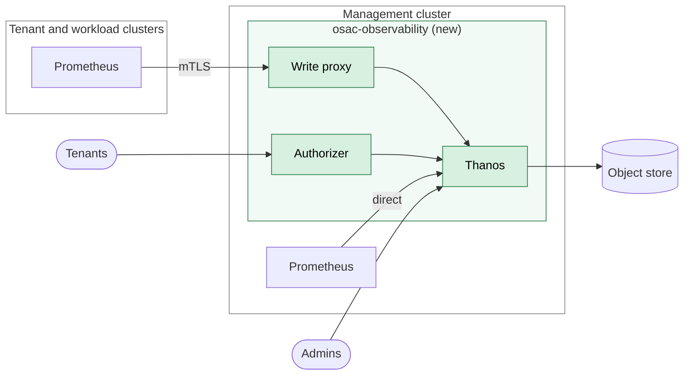
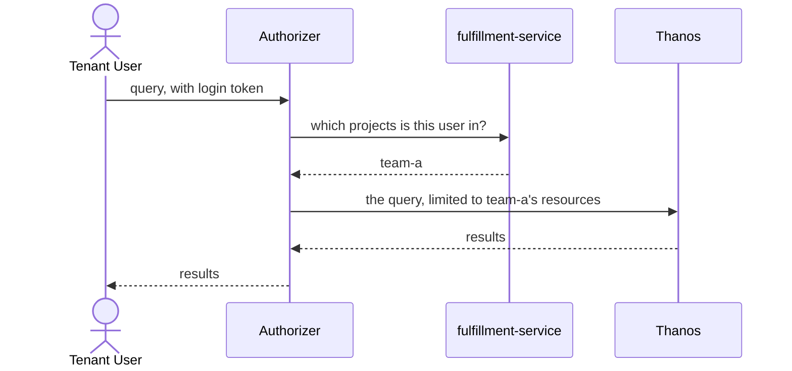

# Metrics store

Every OSAC cluster will send its metrics to one store on the management cluster, which keeps them for 365 days. The management cluster's Prometheus writes to the store directly. Tenant clusters and workload clusters write through a new write proxy, which checks each cluster's certificate and labels the data with that cluster's name. Admins can query everything. Tenants query through a new authorizer, which limits each query to the tenant's own VMs, volumes and clusters.

Design for metrics collection, storage and querying (OSAC-6980), from [PR 498](https://github.com/osac-project/enhancement-proposals/pull/498).

## Today and with this design

| | Today | With this design |
|---|---|---|
| Where metrics are kept | On each cluster, for 15 days | Also in one store, for 365 days |
| OSAC's own services | Not collected | Collected every 30 seconds |
| Admins | Query one cluster at a time | Query all clusters at once |
| Tenants | Can't query metrics | Query their own VMs, volumes and tenant clusters. Bare-metal instances have no metrics yet. |
| Metrics from tenant applications | Kept only on each cluster's own Prometheus | Still kept only there |

## How it works

- **Collect.** Each cluster's Prometheus collects as it does today and drops metrics about tenant applications.
- **Write.** The management cluster writes to Thanos directly. Other clusters write through the write proxy.
- **Keep.** Thanos keeps everything for 365 days in an object store bucket.
- **Query.** Admins query Thanos directly. Tenants query through the authorizer.

Each step has its own section below.

## Definitions

- **Prometheus**: here, the Prometheus that OpenShift runs in every cluster to collect that cluster's metrics.
- **Remote-write**: Prometheus sending a copy of each sample to another server as it collects it.
- **Thanos**: an open-source store that keeps Prometheus metrics for a long time, in an object store bucket.
- **Object store bucket**: a bucket in any store with the S3 API. The Cloud Infrastructure Admin creates it.
- **mTLS**: TLS in which the client also shows a certificate, so the server knows which client is calling.
- **Workload cluster**: a cluster the provider registers for AI workloads, from the cluster import design (OSAC-6488).

## Collect

1. **Each cluster's Prometheus keeps collecting what it collects today, at the same intervals.** On the management cluster that includes VMs and the control planes of tenant clusters, which run there. Tenant clusters and workload clusters send only node and control-plane metrics.
2. **OSAC's own services are collected too, every 30 seconds by default.** Each one has a ServiceMonitor, the object that tells Prometheus what to collect and how often.
3. **Metrics about tenant applications are dropped before sending.** These are pods and containers outside OSAC's namespaces, and model-serving and GPU metrics (`kserve_`, `vllm_`, `dcgm_`). Of the metrics about Kubernetes objects (`kube_`), each Prometheus sends only those on an allowlist, such as nodes and volumes, so a new one is dropped until someone adds it. No role can query what is dropped.

## Write

4. **The management cluster writes to Thanos directly.** OSAC adds one remote-write entry to its Prometheus settings, in the `cluster-monitoring-config` ConfigMap, with the label `cluster=management`.
5. **Other clusters write through the write proxy, over mTLS.** Each tenant cluster and workload cluster has a client certificate with its name in it. The proxy checks the certificate and sets the `cluster` label to that name, so no cluster can write as another. It also drops metrics about tenant applications again, because a tenant controls its own tenant cluster's Prometheus.
6. **If the store is down, each Prometheus keeps about 2 hours of samples and resends them.** A longer outage leaves a gap.

## Keep

7. **Thanos keeps every sample for 365 days by default, in the object store bucket.** The same retention applies to every role.

## Query

8. **Admins query everything.** Their Routes check the login and filter nothing. Cloud Provider Admins sign in with OSAC's Keycloak, and Cloud Infrastructure Admins with their OpenShift login. They can also see which clusters stopped reporting, from the age of each cluster's newest sample.
9. **A Tenant Admin sees their whole tenant.** The authorizer reads the tenant and the role from the login token. It rejects a token that names more than one tenant with HTTP 403.
10. **A Tenant User sees the default project and the projects they belong to.** The authorizer asks fulfillment-service for the user's projects, with the user's own token.
11. **The authorizer adds the caller's resources to every query.** A query for `kubevirt_vmi_cpu_usage_seconds_total` from tenant `acme` returns only `acme`'s VMs. The authorizer gets each VM's namespace and name from its ComputeInstance's `status.virtualMachineReference`, since each VM runs in its VirtualNetwork's namespace. A query it can't narrow returns an empty result, never an unfiltered one.
12. **The authorizer reads each cluster's, VM's and volume's project from its `osac.openshift.io/project` annotation.** fulfillment-service writes this annotation on volumes today. This design makes it write it on clusters and VMs too.
13. **By default, each tenant gets at most 10 queries at once, 24 hours of range per query, and 2 minutes per query.** Admins have no limits.

## Security

14. **osac-operator gives each tenant cluster its certificate when it creates the cluster, and revokes it when the cluster is deleted.** Certificates last 90 days, and osac-operator copies each renewed certificate to its cluster. The cluster import does the same for workload clusters.
15. **NetworkPolicies let Thanos accept connections only from the write proxy, the authorizer, the admin Routes and the management cluster's Prometheus.** They let the authorizer accept connections only from the tenant Route. Thanos and the authorizer check no logins themselves, so these rules stop any other pod from reaching them.

## Where the code goes

- **New:** the `osac-observability` Helm sub-chart in osac-installer. It deploys Thanos, the login proxies, and one new OSAC binary, `metrics-auth`, that runs as the write proxy and as the authorizer.
- **Changed:** osac-operator issues certificates and sets each tenant cluster's remote-write entry. fulfillment-service writes the project annotation on clusters and VMs. Every OSAC service's chart has a ServiceMonitor, turned on, and both operators always serve their metrics.
- **Unchanged:** no OSAC API, CRD or proto.

## API

| Route, on the management cluster | Who uses it | Sign-in |
|---|---|---|
| `thanos-query-admin` | Cloud Provider Admins | OSAC's Keycloak, role `cloud-provider-admin` |
| `thanos-query-admin-openshift` | Cloud Infrastructure Admins | OpenShift login, group `osac-cloud-infrastructure-admins` |
| `thanos-query-tenant` | Tenant Admins and Tenant Users | OSAC's Keycloak |
| `thanos-receive-managed` | Prometheus on tenant and workload clusters | Client certificate |

- The query Routes serve only five endpoints of the Prometheus HTTP API: `query`, `query_range`, `series`, `labels` and `label/<name>/values`.
- A query for data the caller may not see returns HTTP 200 with an empty result.
- A range over 24 hours returns HTTP 422, more than 10 queries at once returns 429, and a query over 2 minutes returns 504.
- The store is off until `observability.enabled` is set in osac-installer. The bucket, its credentials Secret and cert-manager must exist first. The Cloud Infrastructure Admin sets the retention, the interval for OSAC's services and the tenant limits in osac-installer too.

## Alternatives

- **ACM's multicluster observability.** Not every OSAC deployment has ACM.
- **A separate OSAC Prometheus.** It would collect everything a second time.
- **Letting each cluster set its own `cluster` label.** A tenant could then pose as another cluster.

## Not in this design

Bare-metal instance metrics and hardware health (OSAC-6986), GPU metrics (OSAC-7246), logs (OSAC-6982), alerts and dashboards (OSAC-6984), canonical metric names (OSAC-6978), VMs on a dedicated VM cluster, and deploying the object store.
