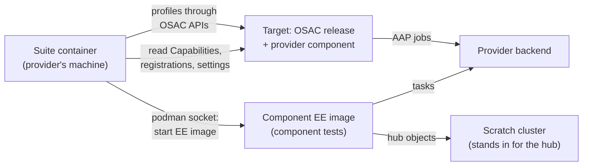
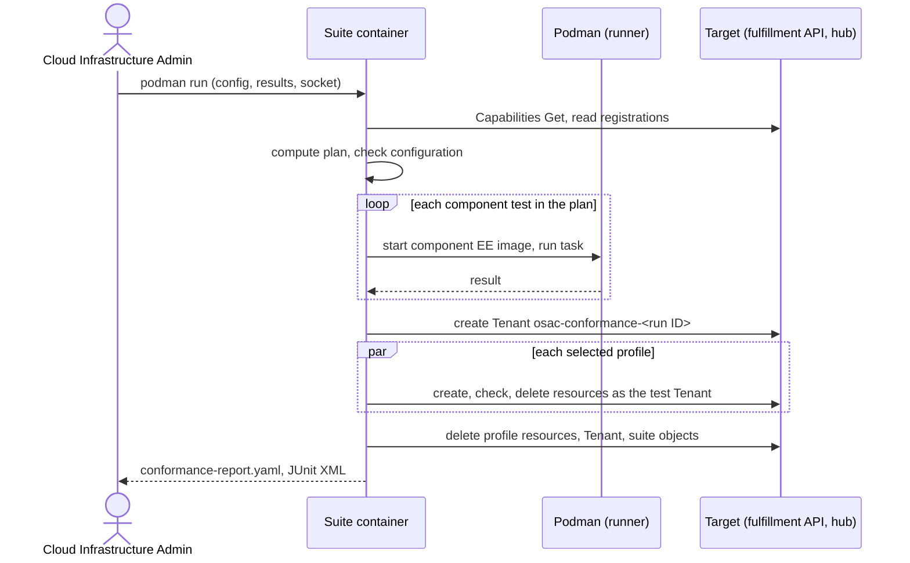

# OSAC Conformance Suite

## Summary

OSAC publishes one conformance suite image per release, `ghcr.io/osac-project/osac-conformance:<release>`, that proves a provider's component works with that release: component tests run the component exactly as OSAC runs it against the provider's backend, and end-to-end tests run through OSAC's APIs against a target installation. Conformance tests are hand-selected: each carries labels naming the selectors it belongs to. A profile is a named bundle of selectors, and the run configuration selects profiles. The plan is the union of their selectors, with `generic` always applied. The suite has two phases: `list` computes that set, writes it as a plan and prints it, and `run` executes a plan, computing one first if none is given. The image also holds a small runner that invokes the test tree's own runner and reads its results; it is a utility, not a product. See [PRD](prd.md) for detailed requirements.

This design defines a goal before implementation: the suite source, its CI job, the E2E lab runs, and their owner do not exist yet ([test plan gaps](testplan.md#execution-gaps)).

## Motivation

Providers plug their own components into OSAC. The first is the network Fabric Manager, an Ansible role that OSAC runs as AAP jobs. The suite that proves a Fabric Manager works was first defined inside the [Network Manager Integration Contract](/enhancements/OSAC-1433-network-manager-integration-contract-networking/design.md) as the networking-only image `osac-network-conformance`, which no release published; the merged contract (§4.11) now defines networking as a domain of this suite. Its runner, configuration, test Tenant, cleanup, and report rules are not networking rules; they apply to any component OSAC runs on a provider's behalf.

Keeping them inside networking means the next domain that accepts provider components would copy them into a second suite, with a second image, configuration file, and report format. This proposal holds the generic rules in one OSAC-wide suite. The networking contract keeps only what is networking-specific and links here. [User]

### Goals

- One runner, one configuration file, and one report format for every domain; a new domain adds tests and selectors, not a new tool.
- Run a component exactly as OSAC runs it, so a passing component test means the same invocation works inside OSAC.
- Work in a shared target installation: the suite changes only what it creates and lists what it could not delete.
- Which tests a target installation runs is declared, reviewable, and repeatable: the plan names them, and the same plan reruns the same tests.
- Never ask the provider for a value the suite can read from the target installation's hub, except the profiles and selectors: they say what a run is meant to prove, so the provider declares them.
- Move networking's generic rules without changing their behavior; only the image name, the report's component and layer keys, and the place of the networking keys in the configuration change.

### Non-Goals

- Defining any domain's tests, selectors, configuration keys, configuration errors, component identity, or support condition; each domain defines them in its own design. Profiles are a suite-level catalog, not a domain definition.
- A selector that discovers applicable tests without labels; the selector interface allows one later, but this release ships label selectors only.
- Verifying reports independently, or enforcing a domain's support condition.
- Changing any OSAC API, CRD, or controller; the suite only uses existing APIs.
- Starting the suite or showing its report from the OSAC console, API, or CLI.
- Upgrade and air-gapped modes; both come in later features.
- A test framework, a scheduling service, or anything with its own lifecycle: the runner executes the existing tests and collects their results.

## Proposal

The image holds the tests and a small runner. The runner reads the configuration and the target installation, computes the plan, checks the configuration, runs the plan, cleans up, and writes the report. It does not run tests itself, does not reimplement or instrument the test tree, keeps no state between runs, and has no API, service, database, or controller. It is a few hundred lines, unit-tested for configuration, plan computation and the result rules, shipped in the osac repository next to the tests it drives and maintained with them.

A domain declares what its design defines (see [Domain plug-in contract](#domain-plug-in-contract)): its tests, selectors, configuration keys, named checks, and the labels its tests carry. Profiles are a suite-level catalog. Networking is the first domain; its tests are the Fabric Manager task tests and profiles from the networking contract, and the profile tests live in `tests/e2e/`. Declarations are data the runner reads, not software with its own lifecycle.

Terms used in this document:

- **Component:** a piece a provider writes that OSAC runs, such as the Fabric Manager.
- **Domain:** an OSAC domain that defines a component kind and plugs into the suite, such as networking.
- **Target:** an OSAC installation of the release under test, with the provider's components registered and the provider's services enabled.
- **Run:** one execution of a test. A test may have several runs; the networking task tests run once per task.
- **Plan:** the tests a run executes, computed from the selected profiles' selectors and the tests' labels, written to a file before they run.
- **Profile:** a named bundle of selectors. A selector can belong to more than one profile, and a profile can contain selectors from more than one domain. The suite ships the profile catalog; the run configuration selects profiles. `generic` always applies.
- **Applies / selected:** a test applies to a run when the run's plan selects it. A test counts toward every selected profile whose selectors it carries. A profile is **selected** only when the plan names at least one profile-layer test that carries one of its selectors; retained selector provenance alone does not select it. A component test can count toward a selected profile's result but does not select the profile. A **selected run** is a test in the plan. Only selected runs count toward conformance. Enabled services are reported, not used to select tests or profiles.
- **Classification:** whether a test is `blocking` or `informing`. A failing blocking test can fail a check; a failing informing test is reported and never fails one.
- **Check:** a named rule in the installation verdict, with the rule it applies and its remedy. The installation passes when no check fails.

The diagram shows the two layers and what each touches.



Component tests never go through OSAC, AAP, or the target installation: the suite starts the component's execution environment (EE) image itself, against the provider's backend and a scratch cluster. The suite reads the target installation only to check the release and to identify the component. Profiles go through OSAC's normal APIs in the target installation, so OSAC runs the component there as in production.

### Workflow Description

**Actors.** The Cloud Infrastructure Admin, who owns and operates the target installation, runs the suite for the provider, and reviews the report before onboarding or support ([Policy](#policy)). The target installation runs the release, the provider's components, the enabled services, and the fabric. It may be a pre-production environment or production during an upgrade; the suite changes only what it creates. OSAC CI and the OSAC E2E lab run the same suite for each release.

**Starting state.** A target installation runs the OSAC release under test with the provider's component installed and registered and the provider's services enabled. The Cloud Infrastructure Admin has a scratch cluster with a writable namespace, a runner machine with podman and a running podman socket, and network access from the runner to the target installation's fulfillment API and hub, to the component's backend at the address in the target installation's settings (the component tests run the component on the runner), and to whatever each domain's tests reach (networking: the workloads' external addresses).

1. The Cloud Infrastructure Admin writes `conformance.yaml` into a configuration directory, with the files it names (the target installation's hub kubeconfig, admin token, API CA, and the domain's files), and creates a new, empty results directory for this run, for example `results/<date>-full/`.
2. They run the image whose tag equals the target installation's release:

   ```sh
   podman run --rm --userns=host --security-opt label=disable \
     -v "$PWD/conformance:/config:ro" -v "$PWD/results/<date>-full:/results" \
     -v "$XDG_RUNTIME_DIR/podman/podman.sock:/run/podman/podman.sock" \
     ghcr.io/osac-project/osac-conformance:<release>
   ```

3. The runner reads `/config/conformance.yaml`, then reads from the target installation the enabled services (Capabilities `enabled_services`) and each domain's registered components.
4. It expands the selected profiles into selectors, applies them to the labeled tests, writes the plan, and checks the configuration. If a selected run cannot run, it stops with a configuration error.
5. It runs the plan: the component tests first, starting each component's EE image through the podman socket.
6. If a profile runs, it creates the test Tenant `osac-conformance-<run ID>` and runs the profiles in parallel in it.
7. It cleans up: what the component tests left in the backend, the profiles' resources, the test Tenant, and any provider-scoped object it created. It lists what it could not delete in `leftovers[]`.
8. It evaluates the named checks and writes `conformance-report.yaml` and JUnit XML to `/results`. The Cloud Infrastructure Admin deletes any leftovers by hand and attaches the report to the component's design.



The sequence shows the fixed order: plan and checks first, component tests next, profiles in parallel last, then cleanup, which runs even when a step failed.

**Alternative paths.**

- **Configuration error.** The suite names each failing check and runs no test.
- **A blocking component test fails.** The test reports `fail` with a message; the suite continues with the other runs and the profiles. Profiles run even when a component test failed, so one run reports both layers.
- **An informing test fails.** The test reports `fail` with its classification shown; no check fails and the overall result is unaffected.
- **A profile fails or times out.** The test reports `fail`; cleanup still runs.
- **Cleanup fails.** Each object not deleted is listed in `leftovers[]`; the run is `in progress`, and the Cloud Infrastructure Admin deletes the object by hand.
- **The run is interrupted.** On the first SIGINT or SIGTERM the runner starts no new test, stops and awaits any running component job before the delete tasks run, stops the profile tests, and waits a bounded time for in-flight profile creates. It reconciles by listing the test Tenant and the objects named `osac-conformance-<run ID>*`; that listing is final only after every dispatched create is confirmed complete and no new create can start. If the bound expires with an unresolved create, the runner records it durably, performs only bounded best-effort recovery, and reports incomplete cleanup, not a final listing or a clean run ([Profiles](#profiles)). It writes the report and exits with code 130 in either branch; a second signal stops it at once, with no cleanup and no report.
- **OSAC CI.** For each release, CI runs the component tests against each domain's reference components. The E2E lab runs the component tests and the profiles with real components.

### API Extensions

No new or changed gRPC service, REST resource, CRD, webhook, or finalizer. The suite uses existing interfaces: the Capabilities `Get` method (`GET /api/fulfillment/v1/capabilities`) for enabled services [Codebase: proto/public/osac/public/v1/capabilities_service.proto], the fulfillment private API with an admin token to create and delete the test Tenant and the profiles' resources (each with `metadata.tenant` set to the test Tenant), and the target installation's hub kubeconfig to read the installed release, component registrations, and what each domain reads. It modifies no resource owned by another team.

The suite adds these new surfaces:

| ID | Surface | Change | Requirements |
|---|---|---|---|
| IC-1 | Suite image and its `podman run` invocation | New image `ghcr.io/osac-project/osac-conformance:<release>`, one per release, with three mounts (configuration, results, podman socket); replaces `osac-network-conformance`. | FR-1, FR-8 |
| IC-2 | `conformance.yaml` | New configuration file: common keys, the selected profiles, and one top-level section per domain with the settings the plan's tests read; configuration errors. | FR-3, FR-5 |
| IC-3 | `conformance-report.yaml` and JUnit XML | New report with the common keys, the named checks and the result rules. | FR-4, FR-6, FR-9, FR-11 |
| IC-4 | Domain plug-in contract | What each domain's design defines and the declarations it adds. | FR-2, FR-4, FR-7 |
| IC-5 | Test Tenant in the target installation | The suite creates and deletes `osac-conformance-<run ID>` and the profiles' resources through OSAC's APIs. | FR-2, FR-3 |
| IC-6 | `osac-conformance` commands, the plan, live output, and evidence | New entry point commands (`list`, `run`, `run --plan`, `--keep`), the plan file, the timestamped live log, and the per-test evidence. | FR-4, FR-10, FR-11 |
| IC-7 | Conformance labels in `tests/e2e/` | End-to-end tests in `tests/e2e/`, including the domain's new profile tests, carry one or more `conformance/<selector>` labels plus `sig/<domain>` and `conformance/blocking` or `conformance/informing`; the suite selects by them and never rewrites them. | FR-4 |

FR-N refers to the Nth In Scope item of the [PRD](prd.md).

## UX Alignment

Not applicable. The suite adds no API resource, so there is no `osac-ux/libs/ui-components/src/api/v1/<resource>.ts` file to align with.

### Implementation Details/Notes/Constraints

#### Code location

The runner and the domain declarations live in the osac repository under `tests/conformance/`, next to `tests/e2e/`. The profile tests are end-to-end tests in `tests/e2e/`, written to each domain's profile setup and labeled for their selectors; the declarations say which tests exist and what each domain adds, and the tests stay where they are. The OSAC QE team is proposed to own the runner, its CI job, and the E2E lab runs; each domain's team is proposed to own its declarations (networking: the networking team). [User] None of these exist yet.

#### Suite image and release

- One image per OSAC release: `ghcr.io/osac-project/osac-conformance:<release>`, tagged with the release. It replaces the networking-only `osac-network-conformance`. [User] No release publishes the networking-only image, so no release ships both.
- The image contains the runner and every domain's declarations. The release pipeline (`.github/workflows/osac-release.yaml`) builds and publishes it with the other release images.
- The suite reads its own image digest through the podman socket, by inspecting its own container, and reports it as `suiteImageDigest`.

#### Running the suite

| Mount | In the container | Purpose |
|---|---|---|
| Configuration directory | `/config`, read-only | `conformance.yaml` and the files it names. Paths in `conformance.yaml` are paths in the container. |
| Results directory | `/results` | The report, JUnit XML, live log, and evidence. It must be empty: use a new directory for each run. |
| Podman socket | `/run/podman/podman.sock` | The suite starts each component's EE image through it. The runner's podman must be logged in to the registry that holds the image. |

The suite runs as UID 0 in its container. Rootless podman maps that UID to the runner user, so the suite can open the user's podman socket and write `/results`. `--userns=host` pins that mapping so `PODMAN_USERNS` or `containers.conf` cannot replace it with `auto`, `nomap`, or another mode. `--security-opt label=disable` lets it open the socket on a host with SELinux enforcing.

The suite runs in this order:

1. Read `/config/conformance.yaml`.
2. Read the target installation: `enabled_services` from Capabilities through `target.apiURL` with `target.tokenFile` and `target.caFile`, and each domain's registered components through `target.kubeconfig`.
3. Expand the selected profiles into selectors and compute the plan from the labeled tests ([Profiles and the plan](#profiles-and-the-plan)).
4. Check the configuration ([Configuration errors](#configuration-errors)); stop on an error.
5. Run the plan.
6. Run the profiles the plan selects in parallel in the test Tenant.
7. Clean up.
8. Write the report.

#### Component tests

A component test runs the provider's component exactly as OSAC runs it, against the provider's backend, without OSAC. The domain's declarations name each component test, the selectors it belongs to, and its classification (`blocking` or `informing`); a component test runs when one of the selected profiles' selectors names it, and only a blocking test counts toward the component's result. For an Ansible-role component the suite:

- starts the component's EE image through the podman socket; the domain reads which image the target installation runs from its hub and resolves it to a digest, so the tests use the image the target installation uses;
- runs OSAC's generic playbook for the domain, which calls the role with `include_role` and `tasks_from: <task>`;
- passes the one input variable the domain defines (networking: `osac_job_vars`), with inputs it generates and fresh API IDs on every run;
- sets the component's settings and secrets as environment variables, read from where the target installation keeps them (networking: the ConfigMap and Secret `network-fulfillment-ig` on its hub), so the tests use the values the target installation uses;
- points the job at a scratch cluster that stands in for the hub (networking: `K8S_AUTH_KUBECONFIG` set to the scratch kubeconfig, whose namespace holds the hub objects the tasks create);
- copies the job input, the scratch kubeconfig, and the playbook into the EE container through the podman API, never by a bind mount from `/config`, and attaches the container to a run-scoped podman network, never the host network. It reaches the provider's backend through the network's egress. For the scratch cluster it rewrites only a loopback server address (`127.0.0.1`, `localhost`, or `::1`) to the host gateway address and leaves any other address as it is; when it rewrites, it keeps the original host as the certificate name, so the API server's certificate still verifies. Kind publishes its API server on `127.0.0.1` only by default, so the CI job and the provider guide create it with `networking.apiServerAddress` set to an address the podman network can reach. The runner probes the endpoint from the EE container before the first component test and reports a configuration error if it is unreachable;
- stops a job that runs longer than the domain's component job timeout and fails the test with `job timed out after <timeout>`;
- names every container it starts `osac-conformance-<run ID>-<n>` and records it, so a killed run's containers can be found; on an interrupt it stops the running job, waits for the container to exit (bounded, then forces its removal), and only then runs the delete tasks, so cleanup never races a live job. A job stopped this way fails with `interrupted` and keeps its evidence;
- records each generated `<task>/<API ID>` in `/results/created-api-ids.yaml` as `pending` before the create job starts and marks it `created` when the job returns, so a killed run's pending and created backend objects can both be found from the results directory; a pending entry is treated as possibly created during recovery;
- after the component tests, runs the matching delete task once for each API ID whose create ran and was not deleted, in reverse order of the creates, and lists each delete that fails in `leftovers[]` as `<task>/<API ID>`. It leaves the scratch namespace as is.

Component tests do not call the target installation's fulfillment API or AAP. An Ansible role in an EE image is the only component kind the suite runs in this release; another kind needs a change to this design.

A component test can count toward every selected profile whose selectors it carries; networking counts its host runs toward `baremetal` because they carry `bmaas`.

#### Profiles

- The profiles the plan selects run after all component tests, in parallel, in the test Tenant `osac-conformance-<run ID>`. The suite creates the Tenant through the private API, and creates each profile's resources through the private API with `metadata.tenant` set to that Tenant. The run ID is a random 8-character lowercase alphanumeric string generated when the suite starts and printed in the first line of the live log.
- Every OSAC object the suite or its tests create is named `osac-conformance-<run ID>` or `osac-conformance-<run ID>-<suffix>`, so a killed run's objects can be found.
- A domain may create provider-scoped objects for the run (networking: its ExternalIPPool) and deletes them at the end.
- Cleanup runs also after a failure or a timeout, as best effort, in this order: the profiles' resources, then the Tenant with what OSAC created with it, then the provider-scoped objects the suite created. For an interrupted run, the unresolved-create handling below takes precedence: dependencies of an unresolved create are retained. The suite lists each object it could not delete in `leftovers[]`.
- The target installation does not need to be dedicated: other Tenants may exist. The suite changes and deletes only what it created; a domain documents any side effect OSAC itself makes (networking: deleting the test Tenant releases its default NAT address).
- Every wait has a timeout; a timeout, including on delete, fails the test. Each domain defines its timeout keys and defaults, and `timeouts` in the configuration overrides them.
- The shared profile API client has the runner durably record each create as `pending` in `/results/profile-creates.yaml` before dispatch, including creation of the test Tenant and provider-scoped objects. Each entry holds the run ID, test ID (or run setup), a run-local operation ID, resource kind, requested name, and scope (test Tenant or provider). On a confirmed create response the runner adds the returned OSAC API ID and marks it `created`; a confirmed rejection that created nothing marks it `not-created`. The operation ID is a journal correlation key, not an OSAC API ID or a component's backend task/API ID. A lost response, client timeout, or cancellation leaves the entry `pending` unless the API confirms the create's outcome; canceling a client does not prove server-side cancellation. This journal is separate from the component-job `created-api-ids.yaml` journal. Test bodies use the shared client and fixtures, not a per-test SDK or journal-writing API.
- On an interrupt the runner stops new profile requests and waits a bounded time for dispatched creates. Only confirmed quiescence (every dispatched create has a known outcome and no new create can start) permits a final reconciliation listing and normal cleanup. It records any API IDs found by matching the journal's kind, requested name, and scope; an empty listing alone never resolves a pending create that may still land.
- If the interrupt wait expires, the runner persists each unresolved operation as `pending` and makes one bounded reconciliation and best-effort cleanup pass. Each unresolved operation remains in `leftovers[]` as `pending-profile-create/<operation ID>`; an interrupted test's `message` names that operation ID, the journal path, and the uncertainty. For a run-setup create with no running test, CHECK-3's remedy and the log carry that reference; tests not yet started remain `skip`. Discovered objects that could not be deleted are also listed by API ID. It retains the test Tenant and provider-scoped dependencies that an unresolved create may still use, listing their known API IDs as leftovers, while cleaning unrelated resources where safe. The report says `in progress`, CHECK-3 fails, any running interrupted test fails, and the exit is 130 without an unbounded wait. Recovery never resubmits a create whose outcome is unknown; it uses the durable journal to confirm each create's terminal outcome, obtain any API ID, repeat the run-name listing only after quiescence, and delete late objects before their dependencies, all with bounded waits. If the API cannot establish quiescence within those bounds, the Cloud Infrastructure Admin must resolve the outstanding operation and repeat that cleanup; neither the interrupted run nor a single empty listing claims successful cleanup or conformance. SIGKILL or a second interrupt stops the runner without further cleanup or a report; the pre-dispatch journal remains available for manual recovery.
- A profile test reads its settings, including every value it takes from an `OSAC_*` environment variable today, from the conformance configuration: the common keys and the test's domain section. It assumes no CI-only input, no fixed test user, and no target-only path. Adapting the profile tests to read their settings this way is part of this work, not a property of `tests/e2e/` today, which takes about 44 `OSAC_*` environment variables, a fixed test user, and target-only SSH paths (see [Execution gaps](testplan.md#execution-gaps)).

#### Profiles and the plan

Which tests a run executes is declared, not inferred. The suite ships a profile catalog: each profile is a named bundle of selectors, and a selector can belong to more than one profile or to selectors from more than one domain. The run configuration selects profiles; `generic` always applies and the runner adds it when the operator omits it. A profile the run does not select is reported `required: false` and `skip`.

The plan is the union of the selectors in the selected profiles, deduplicated. The runner computes it in two steps and never reads the test sources: it asks the test tree to collect the tests by their conformance labels and report each test's name and labels, then selects from that list with the expanded selectors. `list` computes the plan, writes it to a file and prints it; `run` executes a plan, computing one first when none is given. The plan records the selected profiles and the selectors they expanded to, so a report says why a test was in it, and the same plan reruns the same tests. A narrower plan reruns a subset, a wider one reruns more.

A test can carry several selector labels and therefore count toward several selected profiles. A test that no selected profile's selector selects is not in the plan and does not affect conformance. A blocking test in the plan that reports `skip` (for example because an optional input is missing) is never a pass, and every profile it counts toward does not pass; an informing test that reports `skip` is reported in `tests[]` and does not fail a profile or a check.

The plan is self-contained: a test does not rely on state another test created, including another test in the same plan. If a test needs shared setup, it creates that setup itself or invokes a fixture that does. Running the same test twice is safe because it uses fresh IDs.

An execution plan that holds no tests is an error: `run` stops before running anything and exits 2. `list` may print an empty plan with the reason every test was excluded.

A profile is selected only if the plan names at least one test with `layer: profile` whose labels match one of the profile's selectors. Recorded selectors explain provenance; retaining a selector in a narrowed plan does not select a profile whose profile-layer tests were removed. A component test that carries a profile selector can count toward a selected profile's result, but does not itself select the profile or add tests to the plan.

The selector interface is generic: a selector is given the target installation facts and returns the tests that apply to it. Every selector this release ships is a label selector, and a test joins the suite by being labeled. A later selector could instead read the installation's enabled services from the Capabilities API, its configuration and its registered components, and derive the set itself; the interface allows that and this release does not ship one. This release ships label selectors only: it does not derive the plan from enabled services or registrations.

A test's classification is declared metadata; changing it is a human decision outside the suite ([Policy](#policy)).

#### Configuration

`conformance.yaml` has the common keys at the top level and one top-level section per domain, named after the domain, holding that domain's keys [User]:

```yaml
osacRelease: <release>                 # equal to the suite image tag
profiles: [vm, cluster, netris]       # generic always applies; these are selected
target:
  namespace: osac                      # defaults to osac when omitted
  kubeconfig: /config/hub.kubeconfig
  apiURL: https://<fulfillment internal API host>
  tokenFile: /config/admin-token
  caFile: /config/api-ca.pem
  aap:                                 # optional; for the target installation's job output on a profile failure
    url: https://<AAP controller host>
    tokenFile: /config/aap-token
timeouts:                              # optional; overrides a domain's defaults
  delete: 30m
networking:                            # keys defined by the networking domain
  # see the Network Manager Integration Contract
```

| Key | Meaning |
|---|---|
| `osacRelease` | The OSAC release under test; equal to the image tag. |
| `profiles` | The profiles the run selects. The suite catalog expands each profile to its selectors; `generic` always applies. |
| `target.namespace` | The namespace that holds the OSAC installation. Defaults to `osac`. |
| `target.kubeconfig` | The target installation's hub. |
| `target.apiURL` | The target installation's internal fulfillment API (the `fulfillment-internal-api` route), which serves the public and private APIs. |
| `target.tokenFile` | An admin token for the fulfillment API. |
| `target.caFile` | The CA that signed the API certificate. |
| `target.aap` | Optional: the target installation's AAP controller URL and a read-only token file. With it, the suite saves the target installation's AAP job output when a profile fails; without it, the evidence names the jobs only. The AAP certificate must be signed by `target.caFile`. |
| `timeouts` | Overrides of the domains' timeout defaults. One flat map of duration strings such as `15m`; each domain names its keys and defaults (networking: `networkReady`, `vmReady`, `bareMetalReady`, `clusterReady`, `delete`). |
| `<domain>` | That domain's keys, as its design defines them (networking: `networking:`). |

The configuration never restates what the suite can read from the target installation's hub, such as a component's identity, its image, or the enabled services. `osacRelease` is also the schema version: each release defines one configuration schema, the release check rejects a target installation on another release, and a key this release does not define is an error (the error names its replacement when a previous release defined it).

##### Configuration errors

The suite stops with a configuration error only when a selected run cannot run, before running any test, and names each failing check. Common checks:

- `/results` is missing, not writable, or holds anything other than the plan `list` wrote;
- the target installation's fulfillment API or hub cannot be reached, or rejects the token, CA, or kubeconfig (every run needs them for the plan); `target.aap`, when set, cannot be reached or rejects its token;
- the target installation runs a different OSAC release than `osacRelease` (read from the installed OSAC chart on its hub); the suite and the target installation must run the same release [User];
- the podman socket is missing, or a component's EE image cannot be pulled, while a component test in the plan needs it;
- a key this release does not define (the error names it, and for a key a previous release defined, says what replaced it);
- the run names a profile the image does not ship, or a plan names a test the image does not contain or a test none of the selected profiles' selectors selects;
- for `run`, the execution plan holds no tests ([Profiles and the plan](#profiles-and-the-plan));
- each configuration error the domain of a selected run defines.

A missing key that only a test outside the plan needs is not an error. A domain may instead report a test in the plan as `skip` when an optional input is missing (networking: the host runs without `taskTests.hosts`). On a configuration error the suite writes only to standard output, writes no report, and exits with code 2.

#### Report

The suite writes JUnit XML and `conformance-report.yaml` to `/results`. The report has exactly these keys:

| Key | Value |
|---|---|
| `osacRelease` | The OSAC release. |
| `suiteImageDigest` | The digest of the suite image that ran. |
| `selectors` | The expanded selectors, in order, starting with `generic`. |
| `components[]` | Each component found in the target installation: `domain`, the identity fields its domain defines (networking: the manager identity fields), and its own `result` (`conformant` or `in progress`). |
| `enabledServices` | The services enabled in the target installation. |
| `profiles[]` | Each profile in the catalog: `name`, `selectors`, `required` (`true` when the run selects it), `result` (`pass`, `fail`, or `skip`; a profile the run does not select is `skip`). |
| `tests[]` | Each test run: `id` (the domain's case ID, with the run for a per-run test, for example `TC-CONTRACT-01/query_dhcp_lease`; unique in the report), `name` (the test name, [Output and debugging](#output-and-debugging)), `layer` (`component` or `profile`), `profiles` (the selected profiles it counts toward, or empty), `classification` (`blocking` or `informing`), `result` (`pass`, `fail`, or `skip`), `durationSeconds`, `message`. |
| `checks[]` | Each named check in the installation verdict: `id`, `name`, `rule`, `remedy`, `result` (`pass` or `fail`). The runner's checks come first, then each domain's checks. |
| `leftovers[]` | Each object the suite could not delete, retained for an unresolved create, or kept with `--keep`: an OSAC object as `<kind>/<API ID>`, a backend object of a component test as `<task>/<API ID>`. An unresolved profile create is `pending-profile-create/<operation ID>`, referring to the profile journal, not an API ID. Empty only when cleanup succeeded and no create remains unresolved. |
| `complete` | `true` when the plan held every test the selected profiles' selectors select; `false` for a focused run. |
| `result` | The overall result, `conformant` or `in progress`. |

Result rules:

- A profile passes only when every blocking test that counts toward it passes. An informing test that fails is reported in `tests[]` but does not fail the profile. A selected profile that has no blocking test is never a pass.
- A component is `conformant` for a release when every blocking component test in the plan passes and every selected profile that contains at least one selector from the component's domain passes. Otherwise it is `in progress`. A test outside the plan and an informing test do not count.
- The installation verdict is `checks[]`. The runner defines four checks: CHECK-1, every blocking test in the plan has result `pass`; CHECK-2, at least one component is registered and every component is `conformant`; CHECK-3, nothing was left behind; CHECK-4, the plan was complete. Each domain may add its own named checks ([Domain plug-in contract](#domain-plug-in-contract)). Each check states its rule and its remedy. The installation passes when no check fails.
- The overall `result` is `conformant` only when every check passes, which requires every component to be `conformant`, `leftovers[]` to be empty, and `complete` to be `true`.
- The JUnit XML, `/results/junit.xml`, has one `testcase` per `tests[]` entry: `name` is the test name, `classname` is `<domain>.<layer>`, and `time` is `durationSeconds`. A failure has a `failure` element whose `message` is the test's `message` and whose body is its `test.log`; a skip has a `skipped` element with the reason.
- Exit codes: 0 when the overall result is `conformant`, or, in a focused run, when every selected blocking test passed and `leftovers[]` is empty (an informing failure does not change the exit code; the report still says `in progress`); 1 otherwise; 2 on a configuration error or a command-line error, with no report; 130 after an interrupt. CI gates on 0 from a complete run.

Example for a VMaaS-only target installation (abbreviated: `tests[]` shows one entry; a complete report lists every selected test):

```yaml
osacRelease: <release>
suiteImageDigest: sha256:<digest>
selectors: [generic, vmaas]
components:
  - {domain: networking, <networking identity fields>, result: conformant}
enabledServices: [vmaas]
profiles:
  - {name: generic, selectors: [generic], required: true, result: pass}
  - {name: vm, selectors: [vmaas], required: true, result: pass}
  - {name: baremetal, selectors: [bmaas], required: false, result: skip}
  - {name: cluster, selectors: [caas], required: false, result: skip}
  - {name: netris, selectors: [netris], required: false, result: skip}
checks:
  - {id: CHECK-1, name: "every selected blocking test passed", rule: "every blocking test in the plan has result pass", remedy: "see the failed tests and their evidence", result: pass}
  - {id: CHECK-2, name: "every component is conformant", rule: "at least one component is registered and every component has result conformant", remedy: "see the component's failed tests", result: pass}
  - {id: CHECK-3, name: "nothing was left behind", rule: "leftovers is empty", remedy: "resolve pending creates and delete remaining objects", result: pass}
  - {id: CHECK-4, name: "the plan was complete", rule: "complete is true", remedy: "run the plan a full list computes", result: pass}
tests:
  - {id: TC-CONTRACT-01/create_subnet, name: "[networking][component] TC-CONTRACT-01/create_subnet: succeeds with valid input and returns exactly its typed output", layer: component, profiles: [], classification: blocking, result: pass, durationSeconds: 41, message: ""}
leftovers: []
complete: true
result: conformant
```

#### Output and debugging

The output follows the OpenShift conformance tests (`openshift-tests`): readable test names, every step shown as it happens, failures with evidence, and focused reruns [User].

**Test names.** Every test has a stable name, `[<domain>][<layer>][<profiles>] <case ID>: <title>`, where `<profiles>` is a comma-separated list, for example `[networking][component] TC-RETRY-01/create_subnet: returns the same result when run again with the same input` or `[networking][profile][vm] TC-VM-01: two VMs on one Subnet are reachable through their ExternalIPs and reach the outside`. The domain's test plan gives each title; `[<profiles>]` is left out for a component test.

**Commands.** The image's entry point is `osac-conformance`:

| Command | What it does |
|---|---|
| `list` | Computes the plan, writes it to `/results/conformance-plan.yaml` and prints it: each test with the selector that selected it, then each test no selector selected, with the reason. It checks the configuration, creates nothing in the target installation, and exits 0, or 2 on a configuration error. |
| `run` (the default) | Computes the plan, writes it, and runs it; stops with exit code 2 if the plan holds no tests. |
| `run --plan <file>` | Runs the tests a plan names, after checking that the plan is not empty, each test exists, and a selector of the run selects it. It writes the plan it ran to the results directory. |
| `run [--plan <file>] --keep` | When a blocking test fails, leaves the test Tenant, its resources and the provider-scoped objects the suite created (networking: the ExternalIPPool) in place for debugging instead of deleting them; the pool is kept because its ExternalIPs are still in use. The report lists them in `leftovers[]`, so the result is `in progress`. When every selected test passes, or only informing tests fail, cleanup runs as usual and the result is unchanged. Component test backend objects are still deleted. |

A plan is a list of test names, so a sublist is a plan with fewer names and a superlist one with more. A run of a plan that holds fewer tests than the selected profiles' selectors select reports `complete: false` and is never a conformance verdict. A plan that holds no tests is an error: `run` stops before running anything and exits 2. A plan naming a test the image does not contain, or one no selected profile's selector selects, is a configuration error. An unknown command or flag exits with code 2 before the runner reads the target installation.

**Live output.** The suite writes every line to standard output and to `/results/conformance.log`, each with a UTC timestamp:

- a header: the run ID and test Tenant name, the suite image digest, `osacRelease`, the selectors, the enabled services, and each component found with its identity and image digest;
- the plan: what runs, and every test no selector selected, with the reason;
- for each test: `STARTED (<n>/<total>) <name>`, where `<total>` counts the tests in the plan; then `PASSED`, `FAILED`, or `SKIPPED` with the duration. What a running test reports is the test tree's own log, captured and redacted by the runner: a component job, an API request and a wait appear as the test reports them, not as the runner observes them. Profiles run in parallel, so each of their lines starts with the test's `id`;
- for a failure: what the test expected, what it observed, the resource's last state (its state, message, conditions, and job entries), and the paths of the evidence files;
- a summary: counts of passed, failed, and skipped tests per layer and per profile, split by classification, each failed test with its first failure line, the path of the plan, which can be narrowed to the failed tests and rerun, the named checks, the leftovers, the overall result, and the exit code.

**Test-framework adapter.** The runner treats the test tree as a black box. It passes the run ID, test Tenant, configuration path, results directory, and each test's ID to the test process through the environment; the tree's fixtures read them. For every test the runner captures standard output and standard error, the tree's result (for pytest, JUnit XML), and any files the test wrote under its per-test results directory. The tree's shared API client and fixtures supply the mandatory evidence declared below: allowlisted profile API exchanges, failure resource snapshots, and the domain's declared failure objects. These are not optional adapter extras, and test bodies need no evidence-emission calls or per-test SDK. Files beyond that declared evidence are optional extras, collected when present. Parallel lines are attributed by test ID, and the runner prefixes them. The test tree writes only to its own standard output, standard error, and per-test directory; the runner is the only writer to `/results`, after redaction.

**Evidence.** Each test run gets its own evidence: its log, and on a failure the resources and the domain's declared objects. The results directory also holds the durable component backend-ID and profile-create journals, written before creates are dispatched, so a killed run's known and possibly created objects can still be found. The table's content is mandatory when its stated condition applies; names and layout are examples, not an adapter protocol. The shared collectors attempt each declared failure object and record its identity and the collection error if it is absent or unreadable, rather than silently omitting it. Failure to supply required evidence is reported as a test failure with the missing content named, not excused as an optional artifact.

| File | Content |
|---|---|
| `created-api-ids.yaml` | Before each component create job: its generated task/API ID and pending state; updated on the job's return. Durable recovery data, not a profile-operation journal. |
| `profile-creates.yaml` | Before each profile/setup create dispatch: its run/test IDs, operation ID, kind, requested name, scope and pending state; updated with the confirmed outcome and returned OSAC API ID when known. Kept even when the runner is killed before a report. |
| `test.log` | The test's own lines from the live output. |
| `jobs/<n>-<task>/` | For each component job: `job_vars.yaml` (the input), `env.yaml` (the environment variables, secrets `<redacted>`), `ansible.log` (the job's output at verbosity `-v`), `result.yaml` (the published `osac_result` or `osac_error`), `playbook.yml` (the generic playbook), `rerun.sh` (the exact `podman run` of the EE image digest and `ansible-playbook` command; it mounts `job_vars.yaml` and `playbook.yml` from its directory and takes each secret and the scratch kubeconfig path from environment variables it names), and on a failure `hub-objects.yaml` (the objects in the scratch namespace). |
| `api.log` | For a profile: each API request and its response, limited to an allowlist of fields: the request (RPC method or HTTP path), kind, API ID, status, and the returned state, message, conditions, and job entries. Headers, tokens, and other fields are never logged. |
| `resources/<kind>-<API ID>.yaml` | On a failure: each of the test's OSAC resources as the API and the hub return it, with its status and job entries. |
| `target-jobs/<job ID>.log` | On a profile failure, with `target.aap` set: the target installation's AAP job output of each job entry of the test's resources. |
| `domain/` | On a profile failure: the domain's declared objects, supplied by shared fixtures (networking: the VirtualMachine, VirtualMachineInstance, the launcher pod's events and log, the guest serial console, the Subnet's ClusterUserDefinedNetwork). Additional undeclared artifacts are optional. |
| `diagnostics/` | The runner's own bundle: the installed release name and version, the OSAC namespace's control-plane state and logs, and the test Tenant's resources. It is not tenant-scoped; the secret values the suite reads are redacted and the Helm values are never included. |

**Diagnostics bundle.** Every run that runs a test also writes `/results/diagnostics/`, collected by the runner through the kubeconfig and token it already uses. It holds the installed release name and version, the OSAC namespace's control-plane state and pod logs, and the test Tenant's resources as the fulfillment API returns them. It is not tenant-scoped: the control plane serves every Tenant, so its state and logs can name resources that belong to others, and that is accepted. The report and the bundle have different sharing rules: the report is self-reported and may be attached to the component's design, while the bundle is operator data and is not automatically shareable. The bundle's content constraint is that the secret values the suite reads never appear in it; it does not claim to detect secrets it does not read in arbitrary control-plane logs. It does not list every namespace, collect node or hypervisor state, or include the Helm values, which can carry secrets. It passes through the same redaction filter as the rest of the evidence. A configuration error stops before any test and writes no bundle.

The suite replaces every secret value it knows (the component's secrets it read from the target installation, the admin token, the AAP token, kubeconfig credentials) and the internal hostnames it reads (the target installation's API host and each kubeconfig server address) with `<redacted>` in all output and evidence, and never copies a file from `/config` as is. Redaction is one boundary: every byte from a child process (the EE container, Ansible, podman) and from an API client passes through the same redaction filter before it reaches standard output, `conformance.log`, an evidence file, a test `message`, the JUnit XML, or the report; nothing writes to them around it.

#### Domain plug-in contract

Each domain defines, in its own design:

| A domain defines | Networking (first domain) |
|---|---|
| Its component tests and their pass conditions | The Fabric Manager task tests |
| Its section of the configuration | `networking:` |
| Its component identity in the report | The manager identity fields |
| Its configuration errors | The networking configuration errors |
| Its support condition | The networking support condition |
| How the suite finds its registered components | The Fabric registration ConfigMap |
| A title for each test, used in the test name | The `Title` column of its test plan |
| Its selectors, and which tests each selects | `generic` (the task tests every installation runs), `vmaas`, `bmaas`, `caas` (the runs and profiles each service needs), `netris` (implementation-specific tests); the Fabric task and profile tests are `blocking`, and the Netris settings check is `informing` |
| Its informing settings check | `netris`: reads the `network-fulfillment-ig` ConfigMap on the target installation's hub and passes when `NETRIS_CONTROLLER_URL` is set |
| Its named checks in the installation verdict | For example, every selected profile that contains a networking selector passes |
| Its timeout keys and defaults | `networkReady` 15m, `vmReady` 15m, `bareMetalReady` 60m, `clusterReady` 90m, `delete` 30m |
| Its component job timeout | 60 minutes |
| Where the suite reads the component's settings and secrets | The ConfigMap and Secret `network-fulfillment-ig` |
| What it reads on the target installation's hub, and its extra evidence on a profile failure | The NetworkClass, the bare-metal inventory; the VM objects and the Subnet's ClusterUserDefinedNetwork |
| Its reference components for OSAC CI | The no-op and mock managers |

The networking domain also ships one informing settings check, selected by `netris`: it reads the `network-fulfillment-ig` ConfigMap on the target installation's hub and passes when `NETRIS_CONTROLLER_URL` is set. A failure is reported in `tests[]` and never fails CHECK-1.

The networking definitions live in the [Network Manager Integration Contract](/enhancements/OSAC-1433-network-manager-integration-contract-networking/design.md), which links here for the generic rules.

The contract is versioned with the suite release. Domain declarations ship inside the suite image, so the runner and the declarations always share a release. A change to this contract is reviewed as a change to this section, recorded in the release notes, and must update every domain's declarations in the same release; a breaking change is not carried across releases.

#### OSAC CI and E2E lab

- For each release, OSAC CI runs the component tests against each domain's reference components. A reference no-op component passes every component test it supports.
- CI runs the suite with the same profiles as a field run: profile tests by their conformance labels, component tests by each domain's declarations. A component test may start informing and is promoted to blocking after it has been stable in CI; a domain may declare its tests blocking from the start, as networking does. Profile tests are proven in the E2E lab and promoted after stability there. An informing test is reported without gating.
- The E2E lab runs the component tests and the profiles with real components (networking: a real EVPN Fabric Manager and `cudn_evpn`).

#### Policy

- The report is self-reported, not independently verified. The Cloud Infrastructure Admin attaches it to the component's design.
- Before onboarding or support, the Cloud Infrastructure Admin reviews the report: `result` is `conformant`; `osacRelease` is the release to run; `suiteImageDigest` is the digest published for that release; each component's identity and EE image digest match what the target installation runs. A mismatch means the report does not cover the change.
- Each domain states its own support condition; OSAC does not enforce it.
- Blocking or informing is declared metadata. A human owner promotes a test from informing to blocking after it has been stable in OSAC CI for a component test or in the E2E lab for a profile test; the suite never promotes or demotes a test. A domain may declare its tests blocking from the start, as networking does.
- Networking declares every task test and every test selected by `vmaas`, `bmaas` or `caas` `blocking` (OSAC-1433 section 4.11), so a selected networking profile always has blocking tests and the contract's pass rule is unchanged; other domains may use informing tests.
- Reruns: the component tests run for every new version of the component or its EE image; a passing report covers one OSAC release and one component version.

### Security Considerations

- **Podman socket.** It lets the suite start containers on the runner. The suite only pulls and starts component EE images and inspects its own container. The provider guide uses the rootless user socket (`$XDG_RUNTIME_DIR/podman/podman.sock`), which limits the suite to the runner user's rights; `--security-opt label=disable` turns off SELinux separation for the suite container only. The component container joins a run-scoped podman network, not the host network: it reaches the provider's backend through the network's egress, and the scratch cluster only through a loopback address rewritten to the host gateway, with the certificate name kept at the original host. The suite starts only the EE image resolved from the target installation, never an arbitrary image, and removes the container after the job; a container that cannot reach both is a configuration error.
- **Logged identifiers.** The live log and evidence record the run ID, the release, the selectors, the enabled services, and component identities; they record no internal hostnames or session identifiers. The diagnostics bundle is not tenant-scoped and can name other Tenants' resources, because it holds the control plane's state and logs. The secret values the suite reads are redacted everywhere; the suite does not claim to detect secrets it does not read in arbitrary control-plane logs. The target installation's API host and each kubeconfig server address are used only to connect and are redacted like secrets.
- **Credentials.** The configuration directory holds an admin token, the API CA, and kubeconfigs, and the suite reads the component's secrets from the target installation's hub; the directory is mounted read-only. The provider guide uses a time-limited token (`kubectl create token ... --duration 12h`, long enough for a full run) and tells the Cloud Infrastructure Admin to delete the token files after the run. The suite never copies a file from `/config` into its results and never copies the Helm release values; only the release name and version are kept. All output of child processes (the EE container, Ansible, podman) and API clients passes through one redaction filter that replaces every secret value the suite knows with `<redacted>` before it reaches standard output, the live log, evidence, test messages, the JUnit XML, or the report; `api.log` keeps only allowlisted fields ([Output and debugging](#output-and-debugging)). The claim is limited to the secret values the suite reads; it does not claim to detect secrets it does not read in arbitrary control-plane logs. TC-FR11-01 checks that each credential marker reaches none of them.
- **Report.** It is self-reported and can be edited; `suiteImageDigest` lets a reader rerun the same suite. Domains state that their support condition rests on a self-reported report. The report may be shared; the diagnostics bundle is operator data and is not automatically shareable because it can name other Tenants' resources.
- **Tenant isolation.** The test Tenant is an ordinary Tenant; the suite creates resources through OSAC's APIs, so they carry the normal `osac.openshift.io/tenant` metadata and OPA rules apply. The suite never acts on other Tenants' resources.

### Failure Handling and Recovery

| Failure | What happens | What the user sees |
|---|---|---|
| A selected run cannot run | The suite stops before any test. | Each failing check, by name. |
| A plan names a test the image lacks, or one no selector selects | The suite stops before any test. | The test name and the plan that named it. |
| A blocking component test fails | It reports `fail`; other runs and the profiles continue. | `fail` with the message; the component is `in progress`. |
| An informing test fails | It reports `fail`; no check fails. | `fail` with the message; the overall result is unaffected. |
| A component job hangs | The suite stops it at the domain's component job timeout; the test fails. | `job timed out after <timeout>`. |
| A resource never becomes ready, or a delete never finishes | The wait hits its timeout; the test fails; cleanup continues. | `fail` with a timeout message; an undeleted resource in `leftovers[]`. |
| Cleanup cannot delete an object | Best-effort cleanup continues with the next object. | `<kind>/<API ID>` in `leftovers[]`. |
| The suite is interrupted | On the first SIGINT or SIGTERM: stop and await a running component job, stop new profile requests, then use the bounded wait and reconciliation in [Profiles](#profiles). A final listing requires confirmed quiescence; unresolved creates stay pending for bounded recovery or manual remediation. Write a report and exit 130. | The interrupted test is `fail`; tests that did not run are `skip`. On wait expiry, the journal and `leftovers[]` identify unresolved operations and retained dependencies; CHECK-3 fails and the overall result is `in progress`. |
| The suite is killed mid-run, or receives a second interrupt | No further cleanup and no report. | The run ID is in the first line of `conformance.log`; the durable journals identify known and possibly created objects. The Cloud Infrastructure Admin follows [Support Procedures](#support-procedures): stop abandoned containers before backend deletes, establish profile-create quiescence, then delete late resources before their dependencies. Until then, a leftover provider-scoped object can make the next run fail its configuration checks (networking: an overlapping ExternalIPPool). |

The suite is not resumable; a new run starts from the beginning.

### RBAC / Tenancy

No RBAC or tenancy changes. The suite uses an admin token for the fulfillment API; read access on the target installation's hub to the OSAC namespace (the registration ConfigMaps, the domain's settings and Secrets, the Helm release Secret (selected by the Helm labels `owner=helm` and `name=<release>`), from which it reads the installed release and image and keeps only the release name and version, and the namespace's pods, deployments, events and pod logs for the diagnostics bundle) and to what each domain reads; an optional read-only AAP token; and write access to one namespace of the scratch cluster. The test Tenant and its resources follow the existing tenant model.

### Observability and Monitoring

No monitoring changes for the target installation. The suite's own output is its observability: the timestamped live log, the per-test evidence, and the summary ([Output and debugging](#output-and-debugging)).

### Risks and Mitigations

| Risk | Mitigation |
|---|---|
| Domains drift from the common rules. | Each domain's design states its declarations; the runner alone writes the report, computes the plan, and cleans up. |
| A shared target installation lacks capacity another Tenant uses, so a profile fails. | Domains define configuration errors for missing capacity (networking counts free hosts). |
| The suite image is not ready when a release ships. | It is built with the release images, and OSAC CI runs it against reference components for each release. |
| Renaming the image and report keys breaks the networking provider guide. | The networking contract and provider guide change in the same release. |
| A report is edited before it is attached. | The report is documented as self-reported; `suiteImageDigest` allows a rerun. |
| Informing tests stay informing, so a regression never gates a release. | Each domain's owner reviews the CI record and promotes a stable test to blocking by changing its label; the promotion is recorded in the domain's design. |

### Drawbacks

- One image carries every domain's test code and dependencies; a provider of one domain pulls all of it.
- A domain's test change needs a new suite image, tied to OSAC's release cadence.
- One runner constrains domains: a domain that needs a different run order or report shape must change this design.

The cost is accepted because providers learn one tool and OSAC maintains one runner, report, and cleanup.

## Alternatives (Not Implemented)

- **Keep one suite per domain (`osac-network-conformance` and later others).** Each domain copies the runner, configuration, Tenant handling, cleanup, and report. Rejected: duplicated code and a different tool per domain for providers.
- **Run component tests through the target installation's AAP.** Needs no podman socket. Rejected: it needs OSAC installed for component tests and mixes OSAC failures into component results.
- **Require a dedicated target installation.** Simpler cleanup. Rejected: providers rarely have spare installations; a test Tenant isolates the run.
- **Run the profiles directly from the `tests/e2e` tree without a conformance runner.** Reuses OSAC's E2E code and avoids a new tool. Rejected: the profiles need the shared plan, test tenant, cleanup, report and evidence contract; the runner wraps the labeled end-to-end tests and ships them in the versioned image.
- **An OSAC service that verifies and stores reports.** Gives verified results. Rejected for now: needs signing and hosted infrastructure; out of scope in the PRD.

## Test Plan

The requirement-anchored [testplan](testplan.md) lists every case. Summary:

### Unit Tests

- Configuration parsing: common keys, per-domain sections, timeout overrides.
- Plan computation: the union of the selected profiles' selectors, deduplication, and `generic` always applying; `skip` for a planned run that reports it.
- Classification: an informing failure never fails a check or the overall result.
- Result rules: profile pass, component `conformant` and `in progress`, overall result, a selected blocking test that reports `skip` is never a pass.
- Named checks: ids, rules, remedies, and the rule that the installation passes when no check fails.
- Plans: a plan that is not the full set is incomplete, and a plan naming an unknown test is a configuration error.
- Report and JUnit XML have exactly the defined keys and matching outcomes.

### Integration Tests

- In OSAC CI, the suite runs the component tests against each domain's reference components (no-op and mock), with a Kind scratch cluster and podman; no OSAC services beyond the Capabilities and registration reads the plan needs.

### E2E Tests

- In the E2E lab, the suite runs the component tests and every selected profile with real components: all passing, one failing, one informing failure that leaves the result `conformant`, a killed delete, a VMaaS-only target installation, and a target installation shared with another Tenant.

Tricky domains: parallel profiles and best-effort cleanup, delete timeouts, and proving that other Tenants stay untouched.

## Graduation Criteria

The suite ships in the same release as its first domain, networking.

- **Dev Preview:** the suite source has an owner and the CI job exists; the image is published for the release; CI runs the component tests against the networking reference components (no-op and mock) and passes.
- **Tech Preview:** the E2E lab runs the full suite with a real EVPN Fabric Manager and passes for two consecutive releases; one provider has attached a `conformant` report to its manager design.
- **GA:** the suite gates every release in CI and the E2E lab, and the reports of every supported provider component for that release are `conformant`.

## Upgrade / Downgrade Strategy

Upgrade and air-gapped modes are out of scope for this release. The suite is not installed in OSAC and has no upgrade impact on a target installation; each release has its own image, and a report covers one release only. Running a release's suite after that release is installed is ordinary operation and needs no upgrade mode.

## Version Skew Strategy

The suite and the target installation must run the same OSAC release; the suite stops with a configuration error on a mismatch ([Configuration errors](#configuration-errors)). Skew between the suite and a component version is what the suite tests; each domain defines which component versions a release accepts.

## Support Procedures

- **Detect:** the report's `result`, each failing `tests[]` entry's `message`, the JUnit XML, the live log, and each failed test's evidence directory.
- **Clean up:** resolve each `leftovers[]` entry by hand. After a killed run, read the run ID from the first line of `conformance.log` and both durable journals in the results directory: `created-api-ids.yaml` for component backend objects, and `profile-creates.yaml` for profile creates. Stop the run's containers before deleting their backend objects, treating pending component entries as possibly created. For profile entries, follow [Profiles](#profiles): establish the outcome of pending operations with bounded waits, then reconcile the run's names and delete late resources before the test Tenant and provider-scoped dependencies. An unresolved operation ID is not an API ID to delete; retain its journal entry and dependencies for manual remediation until quiescence is confirmed. An empty listing before then is not successful cleanup.
- **Disable:** stopping the suite stops new tests; on a graceful interrupt it also stops and awaits its containers before backend cleanup. A SIGKILL or second interrupt can leave containers, backend objects and unresolved profile creates behind; use the journals and cleanup procedure above, not an immediate empty listing, to resolve them. Other Tenants and workloads are not affected.

## Infrastructure Needed

- A new image repository, `ghcr.io/osac-project/osac-conformance`, published with each release.
- A CI job with podman and a Kind scratch cluster whose API server is reachable from a podman network (created with `networking.apiServerAddress`), to run the component tests against reference components.
- Time in the E2E lab, with real components, for each release.
- The suite source under `tests/conformance/` in the osac repository, and an owner for it (proposed: the OSAC QE team; not assigned yet).
- The conformance labels registered in the test tree (pytest markers in `pyproject.toml` for the current tree), and the collection step that reports each test's labels for `list`.
- The profile tests adapted to read their settings from the conformance configuration instead of about 44 `OSAC_*` variables, a fixed test user, and target-only paths.
- The adapter the runner needs to collect the test tree's labeled tests and read their results (for pytest, a collection pass and JUnit XML).
- Documentation: the installation guide ends with running the suite, and the Fabric Manager guide and its go-live checklist point to it.

---

## Provenance

Authored: draft @ design 0.11.5 - e2b0d87, workspace provider-networking-docs @ d3d48c727
Final: revise [manual] @ design 0.11.5 - e2b0d87, workspace provider-networking-docs @ 28ffb6868

> Context changed between draft and revise.

<!-- ai-workflow-provenance:{"schema_version":1,"provenance_kind":"session","workflow":"design","workflow_version":"0.11.5","ai_workflows":"e2b0d87","source_repo":"28ffb6868","source_repo_branch":"provider-networking-docs","commits_behind_main":0,"commits_ahead_main":1,"main_ref":"main","phases":["draft","revise","revise"],"authoring_modes":["manual","skill"],"context_changed":true,"origin_untracked":false} -->
