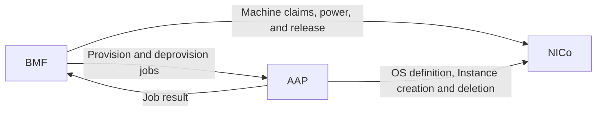

# NICo Backend Integration for BMaaS

| Field | Value |
|-------|-------|
| Author(s) | Nick Carboni |
| Jira | [OSAC-7195](https://redhat.atlassian.net/browse/OSAC-7195) |
| Design task | [OSAC-7895](https://redhat.atlassian.net/browse/OSAC-7895) |
| PRD | [prd.md](prd.md) |
| Date | 2026-11-20 |
| Target milestone | 0.6 |

# 1. Overview

This design adds NICo support for BMaaS. BMF selects and claims Machines, and
AAP runs provisioning and deprovisioning jobs.

# 2. Goals and Non-Goals

## 2.1 Goals

- Provision Machines from an administrator-assigned pool.
- Install the selected DiskImage on matching hardware.
- Keep provider configuration and credentials under administrator control.
- Keep host claims separate from OS provisioning.

## 2.2 Non-Goals

- NICo hardware ingestion or firmware/BIOS management.
- OSAC-managed NICo networking (OSAC-7351).
- New tenant lifecycle APIs or direct CaaS worker integration.
- New tenant web-console workflows.

# 3. Motivation / Background

Most existing behavior and integration between services remains unchanged.
Fulfillment checks tenant access to catalog offerings, images, and hardware
types, then resolves the selected references into a BareMetalInstance (BMI) CR. The
bare-metal fulfillment operator (BMF) uses inventory and management clients to
claim hosts and control power, and invokes AAP for provisioning and
deprovisioning. Job references, conditions, and finalizers track progress and
cleanup. Tenant-scoped resources carry `osac.openshift.io/tenant` and, where
applicable, `osac.openshift.io/owner-reference` annotations.

Administrators define hardware selectors in BareMetalInstanceTypes.
Fulfillment copies the selected type's `match_labels` to the BMI's
`spec.selector.hostSelector` for BMF.
DiskImage currently references images in OCI registries. The installer supplies
backend configuration and credentials.

NICo represents physical hosts as Machines, tenant allocations as Instances, and
boot definitions as Operating Systems. Creating an Instance starts provisioning,
so the integration will implement a separate way to claim a Machine before
installation similar to existing backend implementations.

# 4. Design

## 4.1 Architecture



BareMetalFulfillment Operator will label machines when claiming them before provisioning.
This separates BMF's ownership claim from the Instance creation that starts installation
which is in line with the pattern developed for other backend implementations. If this
strategy must co-exist with other consumers of NICo (outside of OSAC) then BMF must be the
sole component selecting Machines from its dedicated pool; its claim labels coordinate BMF
rather than excluding unrelated NICo consumers.

1. `FindFreeHost` selects an available, unclaimed Machine based on the selected
   type (details in §4.1.2).
2. `AssignHost` rechecks ownership and writes the BMI UID to the Machine's claim
   label. BMF serializes claim updates across its active reconciliation workers
   and saves the Machine ID in `spec.externalHostID` before launching AAP.
3. AAP verifies the claim and prepares the NICo Operating System based on the
   selected DiskImage content (details in §4.1.3). It creates the Instance on
   the claimed Machine with the BMI UID label, SSH keys, and user data, and
   returns the installation result.
4. Subsequent power-state reads, on/off changes, and restart requests use BMF's
   direct NICo management client. The supported operations are open in §8.3.
5. On deletion, BMF runs the AAP deprovisioning job. AAP deletes the owned
   Instance and waits for NICo to finish sanitizing the Machine and make it
   available.
6. After the job succeeds, `UnassignHost` clears the BMI's claim on the Machine.

For power operations and deprovisioning that need an Instance ID, BMF and AAP
read the Machine's `instanceId` and verify the Instance's BMI UID.

OSAC reports `RUNNING` after installation and boot completion. The supported
NICo release's completion signal needs confirmation as described in §8.1.

### 4.1.1 Networking with OSAC provisioning disabled

Install OSAC with `global.networking.provisioningEnabled=false`. At each site
used by the Machine pool, the administrator prepares a `FLAT` VPC named
`osac-provisioning` in OSAC's NICo tenant and sets up HostInband networking.
The pool contains only Machines without DPUs or with DPUs in NIC mode.
The NICo boot environment must be able to reach the image URL.

AAP finds the VPC by exact name in the claimed Machine's site and OSAC's
NICo tenant. It requires `networkVirtualizationType=FLAT` and fails provisioning
before creating an Instance if the mode check fails. AAP uses the resolved
`vpcId`, `autoNetwork=true`, and an empty `interfaces` list when creating the
instance. NICo discovers the Machine's interfaces and assigns addresses. Hosts
at the same site share the VPC, which stays in place after BMI deletion. The
lookup requires no NICo networking settings in the installer or tenant request.

The host stays on the Flat VPC for the life of the Instance, following the
existing BMaaS behavior when provider networking is disabled.

### 4.1.2 Mapping BareMetalInstanceTypes to NICo Instance Types

NICo Instance Types group Machines with compatible hardware at a site. The
administrator associates Machines with the Instance Type in NICo and sets the
`instanceTypeId` key in the OSAC BareMetalInstanceType's private
`spec.host_label_selector.match_labels` to that NICo type's UUID.

During free host selection BMF uses the UUID as the `instanceTypeId` filter on
NICo's Machine list. From those results it selects a Ready, unassigned Machine
that matches the installation pool labels and has no BMF claim.

AAP uses the reads the `machineId` from the BareMetalInstance
`spec.externalHostID` for Instance creation.

### 4.1.3 Mapping DiskImages to NICo Operating Systems

NICo installs QCOW2 images using the built-in `qcow-image` template at the
claimed Machine's site.
AAP lists templates through `GET /v2/org/{org}/nico/ipxe-template?siteId=<siteId>`
using the Machine's site ID and finds the exact name `qcow-image`. If the
template is missing, the job fails before creating the Instance.

AAP creates one Operating System definition per BMI in OSAC's NICo tenant
using `POST /v2/org/{org}/nico/operating-system`. Retries look up the
definition by name and reuse it.

| Field | Value |
|-------|-------|
| `name` | Name derived from the BMI UID. |
| `siteIds` | A list containing only the Machine's site ID. |
| `ipxeTemplateId` | The UUID returned by the template lookup. |
| `ipxeTemplateParameters` | Name-value entries for `image_url` from `DiskImage.spec.source_ref`, `image_sha` from the SHA-256 digest as 64 hex characters, and `ds` set to `nocloud-net;s=${tenant-cloudinit-url}`. |
| `allowOverride` | `true` so each Instance can supply its own `userData`. |

AAP waits for the definition's site association to report `Synced`, then uses
its UUID as `operatingSystemId` in the Instance create request.

At boot, NICo expands `${tenant-cloudinit-url}` to the site's PXE cloud-init
endpoint. The imager downloads and verifies the image, writes it to disk, and
saves the Instance's cloud-init data for first boot. This request uses the
imager's defaults for target disk and root filesystem selection.

After the NICo Instance is gone, the AAP deprovisioning job looks up the
Operating System record by name and deletes it by UUID. The job also removes the
definition if provisioning stopped before creating the Instance.

## 4.2 Install-time configuration

This example enables NICo for BMaaS using OAuth client credentials.

```yaml
global:
  services:
    bmaas:
      enabled: true
  networking:
    provisioningEnabled: false

bmf:
  nico:
    enabled: true
    url: https://nico.example.com
    org: osac
    credentials:
      tokenUrl: https://idp.example.com/realms/nico/protocol/openid-connect/token
      clientId: osac-nico
      clientSecret: "<client-secret>"
    machinePoolSelector:
      pool: osac
```

The `org` value selects the NICo tenant. The `osac` chart creates the credential
Secret from the install values.

## 4.3 API Changes

- Add `SOURCE_TYPE_HTTP_URL` to `DiskImage.spec.source_type` (`http-url` in the
  CLI) and an immutable SHA-256 digest field. On DiskImage creation with this
  source type, Fulfillment requires a valid HTTP(S) URL in `source_ref` and a
  digest of 64 hex characters.
- Fulfillment checks source compatibility when creating an instance. A
  NICo-backed BareMetalInstance requires a `SOURCE_TYPE_HTTP_URL` DiskImage.
- When an `http-url` DiskImage is used for provisioning a BareMetalInstance,
  Fulfillment Service sets `imageURL` from `DiskImage.spec.source_ref` and
  `imageChecksum` from the SHA-256 digest in the BareMetalInstance's
  `spec.templateParameters`.

## 4.4 Scalability and Performance

Load comes from inventory reads and per-Instance provisioning polls. Each BMI
adds one Operating System definition whose metadata syncs to the Machine's
site. Hardware capacity and installation time remain NICo constraints.

## 4.5 Security Considerations

BMF reads the Helm-managed Secret. The installer supplies the same credentials
through AAP's protected credential configuration. Credentials stay out of
tenant requests, public responses, CR status, and logs. BMF rejects changes to
another BMI's claim or allocation. Tenant inputs cannot override the
installation pool selector or resolved image URL and digest.

This NICo integration defers the network isolation to a later effort. The NICo
backend for bare metal provisioning should not be considered production-ready until
network isolation is implemented.

## 4.6 Failure Handling and Recovery

Retries use the saved Machine ID and claim to resume work on an existing
Instance, even after a pool selector change. BMF retains ownership after an
installation failure so deletion can release the host even if provisioning never
completes. The deletion finalizer remains until release is observed.

## 4.7 RBAC / Tenancy

The Cloud Infrastructure Admin allocates one NICo tenant to OSAC. BMF and AAP
share an identity with the `TENANT_ADMIN` role in that NICo organization. The
identity provider assigns the role. OSAC enforces access for its tenants.

`TENANT_ADMIN` lets AAP read the tenant's VPC and published iPXE templates,
create, read, and delete tenant-owned Operating System definitions, and read
and delete the tenant's Instances. BMF can read and reboot those Instances.

A NICo `PROVIDER_ADMIN` grants `targetedInstanceCreation` on OSAC's tenant
account for each site in the Machine pool. BMF uses the grant to list Machines
and write or clear claim labels. BMF and AAP use it to read Machines, and AAP
uses it to create Instances by `machineId`. BMF applies the pool selector within
the authorized sites.

NICo's Machine power endpoint requires the owning provider's `PROVIDER_ADMIN`
role for power on and off. The choice of APIs for those operations and
power-state reads is open in §8.3.

## 4.8 Extensibility / Future-Proofing

Other backends can consume HTTP URL sources using the same DiskImage fields.
The NICo provisioning path uses a resolved VPC ID. A future networking
integration can supply that ID directly.

# 5. Alternatives Considered

| Alternative | Trade-off |
|-------------|-----------|
| Fully stub BMF inventory APIs and allocate through AAP | Fits a NICo pool shared with other consumers: NICo allocates hosts for OSAC through its normal flow, without a dedicated OSAC pool. It bypasses BMF's claim lifecycle and moves selection and identity recovery into provisioning. |
| Allocate with an iPXE holding script before final OS provisioning | Separates NICo allocation from final installation, but adds a maintained boot script and another boot. The complete staged flow also needs provider validation. |
| Provision from BMF and use AAP only to monitor | Gives BMF control of NICo Instance creation, but requires image and boot inputs in the inventory request and moves installation initiation out of the AAP job. |
| Require prepared NICo OS definitions and deployment image mappings | Avoids creating image resources during provisioning, but adds administrator setup for every image and requires each mapping to agree with the DiskImage artifact. |

# 6. Observability and Monitoring

Use the saved Machine ID to correlate BMF diagnostics, AAP job
results, and NICo records. No new metrics are proposed.

# 7. Impact and Compatibility

The DiskImage source extension is additive. Fulfillment, BMF, and AAP must
support the added image inputs before NICo offerings are enabled.

Installer values and schema expose the settings in §4.2. The consuming Enclave
plugin and Wizard must pick up, render, and validate those settings.

Administrator guides cover NICo permissions (§4.7), network setup (§4.1.1),
image sources, boot prerequisites, and recovery.
The test plan separates component checks from real-provider evidence.

# 8. Open Questions

## 8.1 Which NICo signal proves installed-OS boot completion?

- **Owner:** NICo and BMaaS maintainers.
- **Impact:** fixes the provider observation gate for public `RUNNING`; allocation
  readiness alone is insufficient.

## 8.3 Which NICo APIs implement BMF power controls?

- **Owner:** NICo and BMaaS maintainers.
- **Impact:** confirms power-state reads, power on/off, and restart completion
  for the supported NICo release. These provider capabilities need verification
  before support is claimed.

# 9. References

- [NICo infra-controller repository](https://github.com/dsx-ai-factory/infra-controller)
- [BMaaS behavior when provider networking is disabled](https://github.com/osac-project/enhancement-proposals/blob/main/enhancements/OSAC-1437-bmaas-networking/design.md#provider-networking-disabled)
- [OSAC-managed NICo networking (OSAC-7351)](https://redhat.atlassian.net/browse/OSAC-7351)
