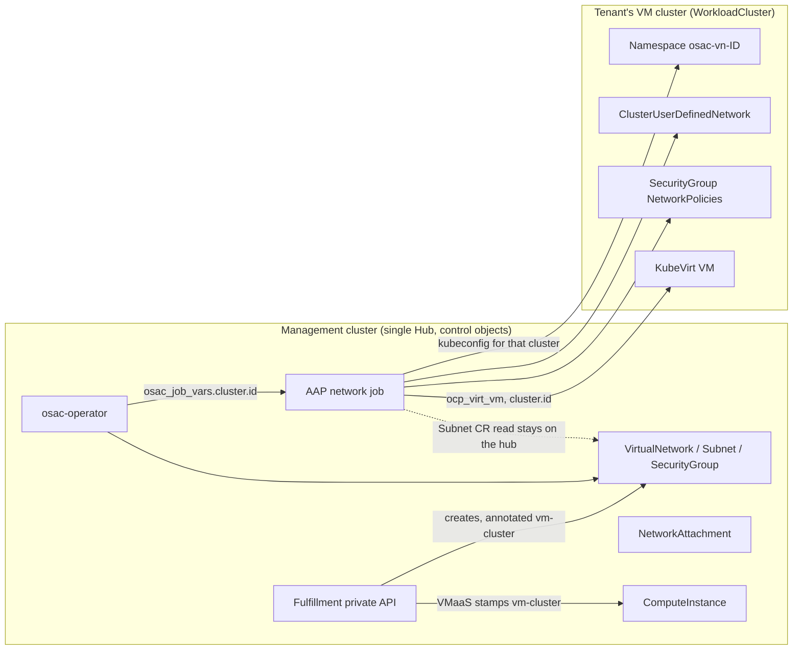

# Tenant Networking on Per-Tenant VM Clusters

| Field       | Value                                                                    |
|-------------|--------------------------------------------------------------------------|
| Author(s)   | Yoni Bettan (yonibettan@gmail.com)                                       |
| Jira        | [OSAC-7305](https://redhat.atlassian.net/browse/OSAC-7305)               |
| Task        | [OSAC-7308](https://redhat.atlassian.net/browse/OSAC-7308)               |
| PRD         | [prd.md](prd.md)                                                         |
| Date        | 2026-11-16                                                               |
| Last updated | 2026-11-22                                                              |

Requirement identifiers `R-1`–`R-12`, `US-1`–`US-8`, `DS-1`–`DS-3`, and
`NG-1`–`NG-8` are the traceability keys derived from the PRD in
[`prd.md`](prd.md); the PRD states requirements as prose.

# 1. Overview

OSAC runs on one management cluster. The current operator supports one
deployment-wide remote VM cluster, but does not support provider networking in
that configuration. This design lets tenant networking follow the cluster that
hosts the tenant's VMs while keeping all OSAC control objects on the management
cluster.

Two records stay distinct:

- **`Hub` is the management cluster.** OSAC runs there, and every OSAC control
  object — `Tenant`, `VirtualNetwork`, `Subnet`, `SecurityGroup`,
  `NetworkAttachment`, `ComputeInstance`, `Volume` — is created there. Being a
  `Hub` does not itself make the cluster a VM target.
- **`WorkloadCluster` identifies a VM host** when registered with the `vmaas`
  capability. It builds on the registry designed in
  [OSAC-6488](https://github.com/osac-project/enhancement-proposals/blob/main/enhancements/OSAC-6488-import-hub-registered-clusters-for-ai-workloads/design.md).
  OSAC-7828 adds direct VMaaS registration and a protected credential reference,
  without requiring ACM. This design depends on extending that day-2 path to
  multiple remote VM hosts. The management cluster can also be a VM target
  without being configured as a remote cluster [Locked: D19, D21].

The VM cluster is a *provisioning target*, carried on each tenant-scoped CR as an
immutable `osac.openshift.io/vm-cluster` annotation and forwarded to the network
manager as `osac_job_vars.cluster`. Networking publishes
`TenantNetworkingReady` on the `WorkloadCluster`; tenant placement and admission
remain with [OSAC-977](https://redhat.atlassian.net/browse/OSAC-977).

Networking consumes the VM cluster registration, shared credential delivery,
and the existing network task engine. It adds no registry, credential store, or
per-cluster manager copies. A fresh deployment whose tenants run VMs on the
management cluster has the same observable behavior and no new prerequisites.

# 2. Goals and Non-Goals

## 2.1 Goals

- Express a cluster's fitness for tenant networking as a condition on the
  `WorkloadCluster`, with a reason and message that name the unmet prerequisite.
- Use the placement foundation's recorded target per tenant, with the same
  networking path for single- and multi-cluster deployments [Locked: D21].
- Use the shared `WorkloadCluster` registry, per-cluster access, AAP credential
  delivery, and network task engine.
- Keep every OSAC CR on the management cluster so that adding a VM cluster does
  not change controller watch scope, finalizer behavior, or tenant isolation.
- Preserve byte-for-byte observable behavior for a fresh installation whose
  tenants are assigned to the management cluster [R-12, Locked: D19].

## 2.2 Non-Goals

- Registering clusters and managing credentials (OSAC-7828 and the shared AAP
  credential work), or choosing, defaulting, validating, and recording a
  tenant's target or guarding removal (OSAC-977) [NG-1, NG-2].
- Installing VM or storage prerequisites, creating the ordinary tenant
  namespace on a remote VM host, and retiring legacy single-remote configuration.
  The existing component owners own those changes.
- Moving tenant VirtualNetworks, Subnets, or SecurityGroups between clusters, or
  duplicating one tenant's networking on several clusters [NG-3, NG-4].
- Volume, DataVolume, snapshot, and disk-image placement, VM and storage
  credentials, and console routing. VMaaS and the storage designs own those; this
  design does not change them and does not make storage follow the VM.
- Automating BGP peering, VTEP range allocation, or cluster-AS assignment, which
  require the provider's network team [R-2].
- Any UI, console, or tenant-visible placement surface [NG-7, Locked: D17].
- Networking for hosted control plane clusters and MaaS gateways [NG-8].

# 3. Motivation / Background

Three current assumptions block the feature, and each one is a single-scope
assumption rather than a missing capability.

The operator binds all remote work to one cluster. `--remote-cluster-kubeconfig`
builds one cluster and wraps it in `single.New(remoteClusterName, remoteCluster)`;
`targetClusterFromManager` then returns that name for every reconcile, or the
local cluster when the flag is absent [Codebase: osac-operator/cmd/main.go]. The
process refuses to start when that flag is set and provider networking is
enabled [Codebase: osac-operator/cmd/main.go], which is why the split-cluster
shape cannot produce a usable networking capability today.

The Kubernetes Manager runs network tasks on the cluster the AAP job runs in.
`cudn_evpn` creates the per-VirtualNetwork namespace `osac-vn-<id>`, the EVPN
`ClusterUserDefinedNetwork`, and the SecurityGroup `NetworkPolicy` objects using
the job pod's in-cluster service account today
[Codebase: osac-aap/collections/ansible_collections/osac/templates/roles/cudn_evpn/README.md].
The accepted network manager contract (§4.3, §4.5, §4.12) already separates
target operations, which use `cluster: {id}` and a per-cluster credential, from
hub reads, which use the job pod's service account.

OSAC-6488 defines a `WorkloadCluster` registry with capabilities and conditions
for ACM-managed clusters. It uses the hub credential to observe ACM
`ManagedCluster` objects and does not supply a kubeconfig for the target. This
design needs that registry plus the direct VMaaS registration and credential
reference from OSAC-7828; it does not assume either is implemented.

This design changes the *dispatch identity*, not the storage location. Each
tenant's networking gets a per-tenant execution target carried on its own CR, so
the Kubernetes Manager learns which cluster a task applies to from the object it
is already reconciling. OSAC's control objects keep living on the management
cluster, which stays the deployment's one `Hub` and needs no inference: there is
exactly one.

# 4. Design

## 4.1 Architecture

This design changes the networking path and relies on shared registration,
placement, and credential delivery.

- **fulfillment-service** reads the recorded assignment, stamps it on the
  networking CRs that need it, and persists the networking readiness condition
  through a condition-specific status update.
- **osac-operator** probes registered VM hosts, computes networking readiness,
  and forwards the CR's target as `cluster.id`. Networking adds no remote watches.
- **osac-aap** uses the matching credential delivered by the shared mechanism.
  `cudn_evpn` checks and applies networking on the target and keeps hub reads on
  the job pod's service account.
- **osac-installer** extends the existing networking admission policy. This
  design adds no cluster setup command and does not retire legacy configuration.
- **The fabric manager and the fabric** are unchanged and stay registered once
  [Locked: D6].

The control-object topology is deliberate: CRs remain on the management cluster,
and only *effects* land on the VM cluster. This is what keeps the change to
controller watch scope at zero.

The diagram shows the split the design relies on. Fulfillment creates and the
operator reconciles every OSAC object on the management cluster. A network job is
launched from there but authenticates to the tenant's VM cluster with that
cluster's credentials, while the OSAC objects it reads stay on the management
cluster. The operator does not create the KubeVirt VM itself: it launches the
provisioning job, and the AAP `ocp_virt_vm` role creates the `VirtualMachine` on
that cluster. The takeaway: nothing in the control plane moves; only the identity
a job applies objects with, and the cluster a VM is created on, become per-tenant.

### 4.1.1 Cluster identity

Two identities exist, and the design keeps them apart.

- **The management hub.** The deployment's single `Hub` record
  [Codebase: proto/private/osac/private/v1/hub_type.proto]. OSAC runs there and
  every OSAC CR is created there. It is not a VM-hosting registry: nothing in
  this design registers VM clusters as `Hub`s, and no Hub consumer (`selectHub`,
  onboarding, compute readiness) gains a new kind of member.
- **The VM-hosting cluster.** A `WorkloadCluster` record whose `metadata.name`
  is the identity used by this design. Eligible records have `vmaas` in
  `spec.supported_workloads` and a per-cluster credential reference from VMaaS
  registration. Remote VM clusters are registered after OSAC is installed;
  direct registration needs neither a `ManagedCluster` nor the management
  `Hub`'s credential (§8).

`TenantNetworkingReady` is a new condition type on
`WorkloadCluster.status.conditions`; the readiness model is in §4.1.6.

### 4.1.2 Target resolution

Resolution has one owner per boundary.

**Placement (consumed).** OSAC-977 decides when a tenant requires a VM target,
what choices or defaults apply, and how admission uses the networking readiness
signal. It records the resulting `WorkloadCluster` name at tenant creation.
That is a read-only private input to networking [NG-2]. This design neither
changes `Tenants.Create` nor imposes a VM target on reserved tenants or
deployments with VMaaS disabled. In a fresh management-only VM deployment,
placement supplies the management target without a new prerequisite or required
per-tenant choice [R-12]. Networking does not implement that default.

**Dispatch (fulfillment → CR).** When a resource needs VM-targeted networking,
Fulfillment stamps the recorded cluster on the `VirtualNetwork`, `Subnet`, and
`SecurityGroup` it creates. VMaaS supplies the immutable target on
`ComputeInstance`. The operator copies it onto the `NetworkAttachment` it
creates for that VM. The `osac.openshift.io/vm-cluster` annotation is written
once at creation and uses the registered cluster name. Adding another cluster
does not change it; resource creation and retries never re-resolve placement
[R-4, Locked: D10]. Fabric Manager tasks do not use a VM target (§4.1.8).

Extend the existing Kubernetes `ValidatingAdmissionPolicy` on the management
cluster (`osac-installer/charts/osac/templates/networking/admission-policy.yaml`)
for `VirtualNetwork`, `Subnet`, `SecurityGroup`, and `NetworkAttachment`.
On updates, including patches, the additional rule compares the annotation's
presence and value before and after the update. It denies adding, changing, or
removing it for every identity, including the OSAC controllers already allowed
to write these CRs. It adds no restriction on unrelated edits. Administrators
who can change the policy itself are outside this guarantee. VMaaS owns
equivalent protection on `ComputeInstance`.

Kinds that must live on the VM cluster but are outside this design's annotation
set — `Volume`, `DataVolume`, snapshots, disk images — keep their current
behavior. VMaaS and the storage designs own their targeting; this design
explicitly does not claim that storage follows the VM.

**Execution (operator → AAP → cluster).** The operator reads the recorded target
for VM-targeted networking. It uses that target for attachment validation and
sets `osac_job_vars.cluster.id` for Kubernetes Manager tasks. It never counts
registrations or falls back to a different cluster. A task that requires a
target but has none is not launched (§4.6); fabric-only and networking-disabled
paths do not launch VM-targeted networking tasks.

### 4.1.3 Operator cluster engagement

The operator uses registered VM-host access to resolve a client by
`WorkloadCluster` name without a restart after day-2 registration [R-1]. It uses
the same identity for the CR annotation, target reads, and `cluster.id`. It
neither provisions credentials nor reuses the management `Hub`'s `hub-access`
credential to access a remote target. Required networking permissions are listed
in §4.5.

Networking uses direct target reads for readiness probes and attachment
validation; its controllers watch OSAC CRs on the management cluster and add
no remote watches. VM/VMI and storage watch scope stays with the VMaaS and
storage owners.

### 4.1.4 Network task targeting

The accepted network manager contract (§4.3, §4.5, §4.12) gives a Kubernetes
Manager task `cluster: {id: <VM-hosting cluster name>}`. Its job uses the matching
credential supplied by the shared AAP mechanism, not a networking-specific
instance-group mount. The operator sends only the identifier in task input; it
does not pass credential material. Hub reads continue to use the job pod's
in-cluster service account.

`cudn_evpn` therefore uses two identities in every task:

- **On the VM cluster**, with the matching credential: the per-VirtualNetwork
  namespace `osac-vn-<VirtualNetwork ID>`,
  the EVPN `ClusterUserDefinedNetwork`, the SecurityGroup `NetworkPolicy`
  objects, and any `VTEP` read that concerns that cluster.
- **On the hub** (the management cluster), with the job pod's in-cluster service
  account: the OSAC `Subnet` CR read for owner and orphan detection. That read
  must never move to the VM cluster: the CR does not exist there, and a failed
  lookup would be misread as an orphaned hub network.

A Kubernetes Manager task with no valid `cluster.id` fails before applying
anything. If a registered target's credential is temporarily unavailable, the
task fails retryably with a diagnostic naming the target. A confirmed removed
target is not retryable (§4.6). There is no fallback to the management cluster:
that could place tenant traffic on the wrong network.

The namespace, CUDN, and NetworkPolicy logic is otherwise unchanged: the objects
are the same objects with the same names, labels, owner annotations, and
idempotency rules, created on a different cluster. VNI allocation is unaffected
because the fabric remains the single VNI authority and each tenant's networks
live on exactly one cluster [NG-4].

### 4.1.5 Cluster preparation

The Cloud Infrastructure Admin and provider network team prepare each VM host
once, not per tenant or per VM [R-1, R-2]. For the EVPN profile, they supply a
distinct VTEP CIDR and cluster AS, configure the VTEP, `RouteAdvertisements`,
FRR/NMState configuration, and peer the cluster nodes with the fabric. Confirm
established BGP sessions during preparation; the existing EVPN tooling has a
`waitForEstablished` option. This design documents and checks the networking
prerequisites (§4.1.6). It does not introduce a new setup command or runtime BGP
monitor, install virtualization or storage, or take over provider fabric setup.

Working connectivity to the fabric is a prerequisite. The fabric still
allocates the network segments and the Kubernetes Manager programs the CUDN
on the tenant's target.

### 4.1.6 Readiness

The operator computes `TenantNetworkingReady` by probing each registered VM
host directly on registration or relevant registration updates and every five
minutes. It does not watch the target resources or use ACM as a readiness
dependency. The probe checks, in order:

| Prerequisite | Check | Reason when unmet |
|---|---|---|
| Credential usable | API discovery succeeds | `ClusterUnreachable`, `KubeconfigRejected` |
| Virtualization | KubeVirt API served; `HyperConverged` `Available=True` | `VirtualizationNotAvailable` |
| CUDN support | `clusteruserdefinednetworks.k8s.ovn.org` served | `CUDNNotAvailable` |
| VTEP | `VTEP` `tenant-vtep` `Accepted=True` | `VTEPNotAccepted` |
| Advertisement | `RouteAdvertisements` `osac-evpn` `Accepted=True` | `RouteAdvertisementsNotAccepted` |

The advertisement check accepts the state a freshly prepared cluster is in.
`configure-evpn.sh` documents that `RouteAdvertisements` may stay
`ConfigurationPending` until OSAC creates the first CUDN, and no CUDN exists
until a tenant is assigned. The probe therefore treats `ConfigurationPending`
with no CUDN on the cluster as ready: `TenantNetworkingReady=True`, reason
`AwaitingFirstNetwork`, message naming the state. Requiring `Accepted=True` there
would deadlock: no tenant can be assigned until a CUDN exists, and no CUDN is
created until a tenant is assigned. Once a CUDN exists, a fully prepared cluster
reports `TenantNetworkingReady=True` with reason `PrerequisitesMet`, and an
advertisement that is still not accepted reports
`RouteAdvertisementsNotAccepted`.

With `global.networking.provisioningEnabled=false` the probe stops after the
credential check and reports `True` with reason `ProvisioningDisabled`, because
the CI-only configuration has no provider networking [R-10]. Messages name the
cluster and the object, for example:
`cluster "vw1" is not prepared for tenant networking: RouteAdvertisements "osac-evpn" is not Accepted`.

**Task-time check.** Readiness is a five-minute observation, so it cannot be the
only gate. In AAP, the `cudn_evpn` role directly checks the prerequisites its
create or apply task needs on the target immediately before changing objects
[R-11]. It uses the same checks and reason codes as the probe for those
prerequisites, including allowing `ConfigurationPending` before the first
CUDN. If one is unmet, the task does not apply changes and returns a provider
diagnostic with the cluster and the failed check. A queued job does not use a
cached probe result or reason. Teardown still requires target access but is not
gated on prerequisites that are only needed for provisioning.

**Condition ownership.** The operator submits only `TenantNetworkingReady` to
an internal Fulfillment status update restricted to that condition type and its
authorized writer. Fulfillment merges by condition type into the current stored
record atomically, or retries on a version conflict. Registration writers
likewise update only their owned conditions rather than replacing the list.
Concurrent writes to `Available` and `TenantNetworkingReady` must both survive.
Registration conditions such as `Available` and `HubReachable` describe
registration and hub state; they neither overwrite nor determine
`TenantNetworkingReady`. OSAC-977 owns how placement combines applicable
registration and networking signals.

### 4.1.7 The control-object hub

There is exactly one `Hub`: the management cluster where OSAC runs and where
every OSAC CR is created. The networking hub boundary is therefore unchanged from
the accepted contract [Codebase: OSAC-1433 unified networking design], and this
design makes no change to `NetworkClass`: it is not recreated, it gains no field,
and it keeps resolving to the single `Hub` exactly as today.

Registering a VM-hosting `WorkloadCluster` is invisible to that boundary. It
does not add a `Hub`, so `ResolveResourceNetworkingHub` still finds one active
hub. Day-2 registration must not require updating or replacing the
`NetworkClass` [R-1].

### 4.1.8 External access

In the fabric-backed profile, `ExternalIP`, `ExternalIPPool`,
`ExternalIPAttachment`, and `NATGateway` use the Fabric Manager. These tasks
receive no `cluster` key; address allocation, inbound DNAT, and outbound SNAT
stay fabric-global. Attach and detach use the same Fabric Manager registration
regardless of where the VM runs [R-8, Locked: D6].

The standalone Kubernetes-only profile (OSAC-7436) has provider networking
enabled, but no Fabric Manager. Its Kubernetes Manager tasks, including the
external IP and NAT tasks, must receive `cluster.id` to select a credential.
Their target is the management cluster; this proposal adds no remote VM hosts
to standalone. The standalone contract (§4.14) owns the source of that fixed
ID, including for resources with no target annotation. Networking does not
infer it from the registry.

### 4.1.9 Networking-disabled configuration

`global.networking.provisioningEnabled=false` keeps its current meaning: no
Kubernetes or Fabric Manager task runs, no `NetworkAttachment` is created, the VM
is placed in the tenant namespace, and `NetworkReady` reports
`ReasonProvisioningDisabled` [Codebase: osac-operator/internal/controller/computeinstance_controller.go].
VM placement is independent of provider networking. VMaaS still uses its
recorded cluster; no networking task consumes it on this path.
When networking is disabled the operator reports the VM's pod-network address
rather than a tenant address, so readiness does not depend on a tenant address or
on provider connectivity [R-10]. This path remains CI-only and is the one blocked
in CI by OSAC-7297, which owns creating the ordinary tenant namespace on the VM
host. With provider networking enabled the VM instead uses the per-VirtualNetwork
namespace created by `cudn_evpn`, so that namespace does not depend on OSAC-7297.

## 4.2 Data Model / Schema Changes

**`WorkloadCluster` (private API).** Reuse `WorkloadClusterStatus.conditions`
from OSAC-6488. The networking writer owns one entry with string type
`TenantNetworkingReady`, status `True`, `False`, or `Unknown`, and the
reason, message, last transition time, and last observation time defined by
the existing schema. Retain the other condition entries and status fields
when updating it (§4.1.6).

**`Hub` (private API).** No change. `HubStatus` stays empty; this design adds no
condition to it.

**`Tenant` (private API).** The tenant carries the assigned cluster as a
read-only private value populated at tenant creation from the placement
foundation. Its name and placement in `TenantSpec` or `TenantStatus` are the
placement foundation's decision [NG-2]; this design reads it and treats it as
immutable.

**`NetworkClass` (private API).** No change. This design adds no field, and a
deployment that registers VM-hosting clusters still uses one `NetworkClass`
pointing at the single `Hub`.

**CR annotation.** `osac.openshift.io/vm-cluster` on the tenant-scoped CR kinds
listed in §4.1.2. It mirrors the existing `osac.openshift.io/tenant` annotation
[Codebase: osac-operator/internal/networktask/input.go] and is not indexed or
selectable.

**`osac_job_vars`.** No new key: `cluster.id` already exists in contract §4.5.

**Persistence on fresh installations.** `WorkloadCluster.status` and the
tenant's resolved target use the existing persistence model. The annotation is
set when the CR is created; no backfill is in scope (§8).

## 4.3 API Changes

**`WorkloadClusters.Get` / `WorkloadClusters.List`** return `status.conditions`.
`TenantNetworkingReady` is an additive condition. The private status update
accepts the cluster identity and one owned condition; it is not a full
`WorkloadCluster` update and does not allow replacing another condition or
mutating spec. See §4.1.6.

**`Tenants.Create`** is unchanged by this design. OSAC-977 owns the assignment
and the provider-visible admission errors, including use of the networking
condition and its diagnostic for R-5.

**`NetworkClasses`** unchanged. Adding a VM-hosting cluster must not require an
update or replacement.

**`Hubs`** unchanged. This design adds no delete guard to `Hub`, because a `Hub`
is not a VM host; removal of a VM-hosting cluster is guarded by the placement
foundation (OSAC-977), which must keep the cluster reachable until no tenant is
assigned to it and no cleanup task for it is outstanding.

**No public API change.** Placement stays internal administration, and no
placement field or endpoint is added for tenants or the console
[NG-7, Locked: D17].

## 4.4 Scalability and Performance

Bounded by the number of registered clusters, `N`, which deployments size in
single digits.

- **Operator memory.** Networking uses a client per registered VM host and does
  not add remote informers.
- **Readiness probes.** One probe per cluster every five minutes, with discovery
  and prerequisite reads. The probe lists CUDNs only to distinguish initial
  preparation from an advertisement failure when needed.
- **Network task latency.** Create and apply tasks add direct prerequisite reads
  before changing the target. The job templates, polling cadence, and retry
  backoff otherwise stay the same.
- **Database and AAP.** Probe results update one condition per cluster.
  Networking adds no queries to tenant admission and no networking-specific
  credential mounts to job pods.

## 4.5 Security Considerations

**Credential boundary.** Registration owns the credential reference and
rotation. The shared AAP credential mechanism delivers the credential that
matches the job's target. Credentials, API server URLs, and CA material do not
appear in `osac_job_vars`, `osac_result`, job labels, or logs. `cluster.id` is
an identifier, not authorization. This design does not prescribe how the
shared mechanism stores or retrieves secrets.

**Required permissions.** On the target, the operator needs API discovery and
reads of `HyperConverged`, VTEP, `RouteAdvertisements`, and namespaces,
including listing CUDNs for the initial readiness check. `cudn_evpn` needs
the applicable prerequisite reads and permission to create, read, update, and
delete its namespaces, CUDNs, and NetworkPolicies. On the hub, its job service
account still reads the owner `Subnet` CR. These are required operations,
not a claim that existing roles grant only these privileges. The accepted
VMaaS design uses `cluster-admin` for VM host access; registration and the
shared credential owners define the actual grants. This design does not create
the service account or widen its grants.

**Validation and blast radius.** A stored target cannot be redirected on an
existing resource. Temporary credential loss or expiry is visible in readiness
and provider job diagnostics and never changes the target. Credential rotation
updates the same registration.

**Tenant isolation.** Unchanged and not weakened: isolation comes from
VirtualNetwork and Subnet identity plus the per-VirtualNetwork namespace on the
VM cluster, and `cluster.id` is informational like `tenant`
[Codebase: OSAC-1433 network manager integration contract §4.12].

## 4.6 Failure Handling and Recovery

| Failure | Behavior | Recovery |
|---|---|---|
| Cluster unreachable at task launch | Job fails; `osac_error.retryable=true`; entry `Retrying` with existing backoff | Probe sets `TenantNetworkingReady=False/ClusterUnreachable`; task succeeds on retry once reachable |
| Cluster becomes unprepared after assignment | The task rechecks its prerequisites and fails with a message naming the unmet prerequisite [R-11] | Fix the prerequisite; retry succeeds without tenant action |
| Credential missing, rejected, or expired for a registered target | Task fails retryably without exposing credentials; a rejected credential reports `KubeconfigRejected` | Restore shared credential delivery or rotate the credential on the same registration |
| Two tasks target the same cluster concurrently | Objects are per-VirtualNetwork and applied idempotently; the per-VirtualNetwork slot orders Subnet tasks of one VirtualNetwork and the VNI lock orders result acceptance and status writes. Neither limits concurrent jobs per cluster | — |
| Operator restart mid-job | Unchanged: `status.jobs` attempts, label lookup, `LostLaunchTimeout`, retry seeding from the attempt | — |
| Cluster removed while a tenant is assigned | The placement foundation rejects removal (OSAC-977); this design adds no `Hub` guard | Assigning the tenant elsewhere is unsupported; the admin must not remove the cluster |
| Cluster removed with no tenant assigned | Registration stops exposing the target; networking stops probing it | — |
| Confirmed removal despite a live resource reference | Final error; do not launch or redirect the task | Provider investigates the broken placement invariant |
| Required target annotation missing from a CR | Do not launch the task or infer a target. Record `VmClusterNotAssigned` in provider-only diagnostics; any tenant-facing failure stays generic | Investigate why the creator omitted the annotation; no automatic backfill or recreation |
| NetworkAttachment validation on the wrong cluster | `apply_network_attachment` returns a namespace that the operator must verify on the CR's target cluster; the local API reader would reject a valid remote namespace as "does not exist" | The operator resolves the target cluster for `ParseVMAttachment` and reads the namespace there |
| Delete while provisioning | Unchanged: `CancelForDelete`, cleanup tasks only, delete waits for the remote namespace to be gone | — |

**Idempotency.** Kubernetes Manager tasks use the same target and resource IDs
for retries and cleanup. A temporary discovery or credential failure is not
proof the cluster was removed. A confirmed removed target is final, not a
reason to pick another cluster [R-11].

**No fallback.** A task never runs on the management cluster because its
annotated cluster is unavailable. Falling back would place tenant traffic on the
wrong network and silently violate isolation.

## 4.7 RBAC / Tenancy

No tenant-facing RBAC change. Tenants never observe the cluster identity: no
API field, error, event, or condition exposed to tenants names it [NG-7, Locked: D17].
Because the `ComputeInstance` `NetworkReady` condition is copied through feedback
to the public API, its tenant-facing reason and message stay generic (for example
`VmClusterNotReady`); the cluster name and the unmet prerequisite appear only on
provider-side surfaces: the `WorkloadCluster` condition, the job entry, the
`NetworkAttachment` status, and operator events. `VmClusterNotAssigned` follows the
same rule.

Provider-side:
- Cloud Provider Admin assigns the cluster at tenant creation. The placement
  foundation owns eligibility and admission; networking supplies the
  `TenantNetworkingReady` diagnostic [R-5].
- Cloud Infrastructure Admin registers, prepares, and removes VM-hosting
  clusters, which requires `cluster-admin` on the VM cluster, as today [R-2].
- The shared registration and credential owners manage credential access.
  Networking adds no Secret retrieval path.

Tenant isolation edge case: two tenants assigned to the same VM cluster share the
cluster but not namespaces, VirtualNetworks, or SecurityGroups; the existing
`osac-vn-<id>` and `osac-sg-<id>` naming keeps them disjoint [R-9].

## 4.8 Extensibility / Future-Proofing

- **Adding a remote cluster** is a day-2 provider operation: prepare it, register
  it, and wait for the condition. No per-tenant or per-VM cluster preparation
  [R-2].
- **Additional VM hosts** use the same annotation, task input, readiness
  condition, and role; networking does not depend on the number of registrations
  [DS-3].
- **Other managed services** (CaaS, BMaaS) can adopt `cluster.id` targeting
  without a new contract, because it is a contract-level key rather than a
  `cudn_evpn` detail.
- **Deliberately not built:** a second cluster registry, a per-cluster credential
  store, a per-cluster manager registration, a placement UI, and automated
  cluster preparation. Each would have to be undone if the placement foundation's
  model differs from `WorkloadCluster`.

# 5. Interface Changes

## IC-1: `WorkloadCluster.status.conditions` with `TenantNetworkingReady`

**Requirements:** R-2, R-5, R-10, R-11

`WorkloadClusters.Get` and `WorkloadClusters.List` return conditions. The
operator reports `TenantNetworkingReady` through a private Fulfillment status
update that preserves the other conditions. This is the surface an administrator
inspects for networking prerequisites. See §4.1.6.

## IC-2: Recorded tenant target (placement dependency)

**Requirements:** R-3, R-5, R-6

Networking reads the resulting target for VM-targeted work. OSAC-977 owns its
API representation, when it is required, how readiness gates an assignment,
and the removal guard. This design adds no `Tenants.Create` validation.
See §4.1.2 and §4.3.

## IC-3: `osac.openshift.io/vm-cluster` CR annotation

**Requirements:** R-4, R-7

Fulfillment stamps `VirtualNetwork`, `Subnet`, and `SecurityGroup` at creation
for VM-targeted networking. The operator copies the VMaaS-provided
`ComputeInstance` target onto its `NetworkAttachment`. The existing admission
policy gains an immutability rule for those networking CRs. VMaaS owns
enforcement on `ComputeInstance`. See §4.1.2.

## IC-4: `osac_job_vars.cluster.id` task-input key

**Requirements:** R-7

Kubernetes Manager tasks receive `cluster: {id: <cluster name>}`; Fabric Manager
tasks do not. The key is already in contract §4.5; this design consumes it. See
§4.1.4.

## IC-5: `cudn_evpn` targets the task's cluster

**Requirements:** R-7, R-9

Kubernetes Manager jobs use the credential corresponding to
`osac_job_vars.cluster.id` to manage the per-VirtualNetwork namespace, CUDN, and
NetworkPolicies. Live prerequisite checks run inside `cudn_evpn` before create
or apply. OSAC `Subnet` reads stay on the hub. Missing target or credential
fails the task without fallback. Object names, labels, owner annotations, and
idempotency are unchanged. See §4.1.4 and §4.1.6.

## IC-6: Per-cluster clients and engagement in the operator

**Requirements:** R-1, R-7, R-11

The networking operator uses registered per-cluster access for direct readiness
probes and attachment validation. It launches tasks for the CR's target and
adds no remote watches. VM provisioning and deletion, console, storage, and
retirement of the legacy flag, Secret, and related wiring are outside this
interface. See §4.1.3 and §4.6.

## IC-7: Shared credential delivery for networking jobs

**Requirements:** R-2, R-7

The shared AAP credential mechanism supplies the credential for
`cluster.id`. This design does not specify a mount, Secret lookup, credential
store, or transport. It adds no credential data to job input. See §4.1.4 and
§4.5.

## IC-9: VM network diagnostic

**Requirements:** R-11

When the annotated cluster is unavailable or unprepared, `ComputeInstance`
reaches `NetworkReady=False` with a generic tenant-facing reason and message.
The cluster name and the unmet prerequisite appear in the job entry and the
`WorkloadCluster` condition, not in the public API. Deletion still completes only
after remote cleanup. See §4.6 and §4.7.

**Requirements with no interface change.** R-8 (external access parity) and R-10
(networking-disabled configuration) add no field, value, endpoint, or task. R-8
keeps `ExternalIP`, `ExternalIPPool`, `ExternalIPAttachment`, and `NATGateway`
messages and pool-based allocation unchanged, with the same Fabric Manager
registration (§4.1.8). R-10 keeps today's skip behavior (§4.1.9). Both are
verified by behavior tests rather than by exercising a new surface.

# 6. Alternatives Considered

**Register VM clusters as `Hub`s.** Rejected. In code a `Hub` is where
fulfillment *places CRs*: `selectHub` picks a random active `Hub` for Volumes
always and for resources without a network attachment, and onboarding writes a
`Tenant` CR to every `Hub`. A VM cluster has no OSAC CRDs and no operator, so it
would receive CRs it cannot reconcile and break onboarding. The accepted
networking decision also supports one hub. `WorkloadCluster` already models "a
cluster that can host workloads", so the design uses it.

**One operator instance per VM cluster.** Highest failure isolation, since a
broken cluster cannot disturb others. Rejected: it multiplies deployments,
leases, and upgrade paths by `N`, gives each instance a single-cluster world view
that cannot observe a tenant's management-cluster state, and contradicts the
accepted architecture's one-operator-per-deployment shape. It also re-implements
multicluster engagement that the existing provider already gives OSAC.

**Move every tenant-scoped CR onto the tenant's VM cluster.** Conceptually
tidiest: the CR's location *is* the target, so no annotation and no task-input
key are needed. Rejected: it converts ten controllers, their feedback twins, two
field indexes, and `Tenant` lookups to multi-cluster semantics, changes watch
scope and finalizer behavior for every resource, and makes every OSAC CR depend on
every VM cluster. The security and tenancy review surface alone exceeds the
feature's scope.

**Pass a per-job kubeconfig inside `osac_job_vars`.** No new Secret, no mount.
Rejected: it puts cluster credentials into task input, which the contract forbids
outright, and it would leak into job artifacts and error payloads.

**Use one deployment-wide target for multi-cluster VM placement.** Rejected by
the PRD: the provider admin chooses one cluster per tenant [Locked: D10, D13].

**Compute readiness in fulfillment-service.** Rejected: the checks are specific
to the target networking implementation (VTEP, `RouteAdvertisements`, CUDN).
Fulfillment persists the operator's observation rather than implementing those
checks itself.

**An OSAC reconciler that prepares a cluster at registration.** Rejected: VTEP
range allocation, cluster AS, and BGP peering need the provider's network team.
A reconciler would apply only part of the configuration. The provider prepares
the cluster; the readiness probe checks the cluster-side prerequisites.

**Choose the target inside this design when the foundation has none.** Rejected:
the design would define placement, and any rule it invented — a fallback to the
management cluster, or a count of registered clusters — could target another
cluster when registration changes. Placement stays with OSAC-977. Networking
fails only a task that requires a target and has none; it does not reject tenant
creation.

# 7. Observability and Monitoring

- **Metric** `osac_cluster_tenant_networking_ready{cluster,reason}` — gauge, 1
  when the condition is `True`. Alert on `0` for a cluster with assigned tenants.
- **Metric** `osac_network_task_target_total{cluster,task,result}` — counter,
  emitting the cluster a job targeted. Makes a systematic mis-targeting visible
  without reading job logs.
- **Event** on `WorkloadCluster` condition transitions, and on `ComputeInstance`
  when the cluster gate blocks provisioning.
- **Logs** — the network task launch line gains `cluster`; the readiness probe
  logs one line per unmet prerequisite at `Info`, not per poll.
- **Existing signals reused:** `status.jobs` entries and their `RetryMessage`
  text, which now carry the prerequisite message.

# 8. Impact and Compatibility

**Fresh installations only** [R-12, Locked: D19]. When the management cluster
hosts the VMs, tenant-visible attachment, address reporting, readiness, external
access, and cleanup are unchanged. A fresh split-cluster deployment uses the
same networking flow on each assigned VM host registered after OSAC is
installed. `TenantNetworkingReady` is additive; `NetworkClass` is untouched.
In-place upgrades and annotation backfill are out of scope.

**Relies on (already merged).** The unified hub boundary and the network manager
contract's `cluster: {id}`, per-cluster access, and Kubernetes Manager task
definition were merged with PR #514 (OSAC-7630) [Codebase: OSAC-1433 network
manager integration contract §4.3, §4.5, §4.10, §4.12; OSAC-1433 unified
networking design]. The CUDN prerequisites and the VMaaS non-goals are likewise
already recorded.

**Delivery dependencies and contract amendments:**
- **OSAC-6488:** implement the accepted `WorkloadCluster` registry and condition
  schema. The VMaaS extension adds `vmaas` without requiring ACM and networking
  adds the `TenantNetworkingReady` condition and scoped status update.
- **OSAC-7828 and its multi-cluster extension:** register remote VM hosts after
  installation, supply a per-cluster credential reference, and allow credential
  rotation without retargeting. OSAC-7828 alone proposes one VMaaS target;
  support for multiple day-2 registrations is a prerequisite, not delivered by
  this networking change.
- **OSAC-977:** choose and record the tenant's VM target, own tenant admission,
  and guard removal while a tenant is assigned or cleanup is outstanding.
  Registration and assignment do not substitute for one another.
- **Shared AAP credential delivery:** coordinate with OSAC-5621, which replaces
  legacy `pod_spec_override` injection with Controller-native credentials.
  The shared path must make the matching credential available to each targeted
  job on supported AAP versions. This is a prerequisite for end-to-end
  delivery; merging a registration PRD does not satisfy it.
- **Network manager contract:** §4.3 and §4.12 consume shared credential
  delivery, not a required mount; §4.10 requires live checks before provisioning
  applies; §4.11 covers non-hub conformance; §4.14 owns the standalone
  management-target ID source.
- OSAC-2434 (Netris): per-cluster AS, VTEP, and peering values, and V-Net
  placement on the leaves that face each cluster.
- **OSAC-1435 (VMaaS networking):** use the VM-hosting cluster name for
  `cluster.id`. VMaaS owns stamping and protecting the `ComputeInstance`
  annotation and using shared credential delivery for VM jobs.
- **Default networking:** OSAC-977 supplies the assignment before VM-targeted
  defaults run. Existing default networking continues to report
  `ResourcesPending` while its own dependencies are unready. This design does
  not redefine tenant admission or reserved-tenant behavior.
- [`docs/agent-context/networking-decisions.md`](https://github.com/osac-project/osac/blob/main/docs/agent-context/networking-decisions.md)
  must be updated in the OSAC repository when implementation changes the
  corresponding contracts.
- **VM, console, and storage compatibility:** their owners decide how to
  consume the new target path and when to retire their legacy flag, staged
  Secret, and related settings. This design neither retires those settings nor
  defines coexistence. Coordinate Volume targeting with #518 and #513 and
  keep AI Grid registration behavior unchanged (#478).

**Deployment changes for fresh installations:**
- The network manager contract's `cluster` key is required for Kubernetes
  Manager tasks; a role that receives none fails instead of using the job pod's
  cluster.
- Install OSAC on the management cluster first. Prepare remote VM hosts through
  the provider's setup process, then register them via the workload-cluster API.
  There is no installer workflow or remote-cluster installation option defined
  here.

**Version skew.** Deploy the operator and AAP images from matching releases. An
older `cudn_evpn` can ignore `cluster` and silently target the job pod's cluster,
so the installer gates on both image versions matching. A supported role fails
if a Kubernetes Manager task has no `cluster` rather than guessing a target.
A provider-supplied Kubernetes Manager is out of scope, as the contract already
states.

# 9. Open Questions

## 9.1 What is the exact shape of the tenant's assigned-cluster field?

- **Owner:** OSAC-977 owners
- **Impact:** §4.1.2 and IC-2. This design consumes one read-only value naming a
  `WorkloadCluster`. If OSAC-977 records the assignment differently — for example
  by qualifying a cluster with a capability rather than naming it directly — the
  adapter for the read-only target may change. This does not change ownership
  of assignment or defaults.

## 9.2 How are VTEP CIDRs and cluster AS numbers allocated across VM clusters?

- **Owner:** Provider network team
- **Impact:** §4.1.5 and the readiness probe's VTEP advertisement check. The
  contract already requires non-overlapping VTEP CIDRs per cluster; OSAC keeps no
  copy, so it cannot validate uniqueness at registration. Two VM clusters with
  overlapping VTEP CIDRs or the same cluster AS will both report
  `TenantNetworkingReady=True` and then break at the fabric. The preparation step
  or the Fabric Manager settings must become the recorded value if OSAC is to
  detect it.

## 9.3 Does a registered cluster need an explicit "VM hosting" capability?

- **Resolved:** yes, and `WorkloadCluster.spec.supported_workloads` is it.
  VMaaS registration and placement own eligibility; networking probes
  registrations with `vmaas` (§4.1.3, §8).

## 9.4 Should the readiness probe also verify the fabric path?

- **Owner:** Networking maintainers
- **Impact:** IC-1 reasons. The probe checks cluster-local prerequisites and
  preparation verifies each node's BGP session. A cluster whose session is
  established but whose fabric VRF is missing reports ready and fails at the
  first Subnet. Adding a fabric-side check requires the fabric manager to expose
  verification, which §4.10 of the contract does not define.

---

## Provenance

Authored: respond @ design 0.14.0 - 70405a6, workspace vmaas @ 126b81a70
Phases: draft, respond

<!-- ai-workflow-provenance:{"schema_version":1,"provenance_kind":"session","workflow":"design","workflow_version":"0.14.0","ai_workflows":"70405a6","source_repo":"126b81a70","source_repo_branch":"vmaas","commits_behind_main":0,"commits_ahead_main":8,"main_ref":"main","phases":["draft","respond"],"authoring_modes":["skill"],"context_changed":false,"origin_untracked":false} -->
