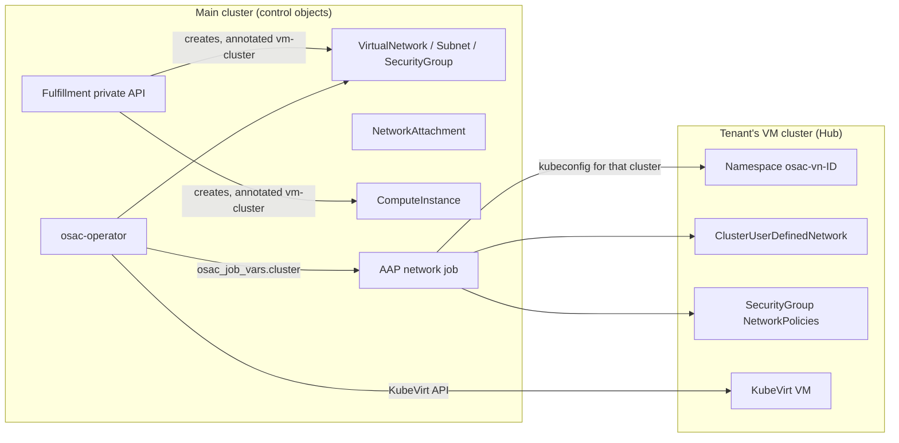
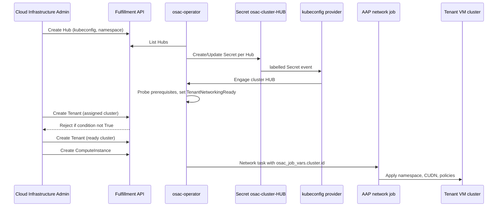

# Tenant Networking on Per-Tenant VM Clusters

| Field       | Value                                                                    |
|-------------|--------------------------------------------------------------------------|
| Author(s)   | Yoni Bettan (yonibettan@gmail.com)                                       |
| Jira        | [OSAC-7305](https://redhat.atlassian.net/browse/OSAC-7305)               |
| Task        | [OSAC-7308](https://redhat.atlassian.net/browse/OSAC-7308)               |
| PRD         | [prd.md](prd.md)                                                         |
| Date        | 2026-11-16                                                               |

Requirement identifiers `R-1`–`R-12`, `US-1`–`US-8`, `DS-1`–`DS-3`, and
`NG-1`–`NG-8` are the traceability keys derived from the PRD in
[`prd.md`](prd.md); the PRD states requirements as prose.

# 1. Overview

OSAC runs tenant VirtualNetworks and the VMs that use them on one cluster. The
accepted networking contract binds every Kubernetes Manager task to "the cluster
the job runs in" and the operator carries exactly one optional remote cluster as
a process-wide setting, so a deployment that hosts VMs on a workload cluster
cannot give those VMs tenant networking. This design lets tenant networking
follow the cluster that hosts the tenant's VMs while keeping every OSAC control
object on the deployment's main cluster.

The approach keeps the existing placement model rather than inventing a second
one. A cluster that may host tenant VMs is a registered `Hub` (fulfillment
private API) — the management cluster is one such `Hub`, registered like any
other [Locked: D16]. Tenant-scoped CRs stay where they are today, on the
deployment's main cluster; the VM cluster is a *provisioning target*, carried on
each CR as an immutable `osac.openshift.io/vm-cluster` annotation and forwarded
to the network manager as `osac_job_vars.cluster`. Readiness for tenant
networking becomes a condition on the `Hub`, computed by the operator from the
prerequisites it already depends on, and enforced by the fulfillment API when a
tenant is assigned. See the [PRD](prd.md) for the product requirements.

# 2. Goals and Non-Goals

## 2.1 Goals

- Express a cluster's fitness for tenant networking as a condition on the
  `Hub` object, with a reason and message that name the unmet prerequisite.
- Resolve the target cluster per tenant from the first increment, so a
  single-cluster deployment is the degenerate case [Locked: D18].
- Reuse the existing `Hub` registry, per-hub Kubernetes clients, multicluster
  provider mechanism, AAP instance-group credential channel, and network task
  engine; add no new registry, no new credential store, and no per-cluster
  manager copies.
- Keep every OSAC CR on the deployment's main cluster so that adding a VM
  cluster does not change controller watch scope, finalizer behavior, or
  tenant isolation.
- Preserve byte-for-byte observable behavior for a fresh installation whose
  tenants are assigned to the management cluster [R-12, Locked: D19].

## 2.2 Non-Goals

- Registering clusters, storing credentials, or recording the per-tenant
  assignment: consumed from the placement foundation, OSAC-977 [NG-1, NG-2].
- Moving tenant VirtualNetworks, Subnets, or SecurityGroups between clusters,
  or duplicating one tenant's networking on several clusters [NG-3, NG-4].
- Automating BGP peering, VTEP range allocation, or cluster-AS assignment,
  which require the provider's network team [R-2].
- Any UI, console, or tenant-visible placement surface [NG-7, Locked: D17].
- Networking for hosted control plane clusters and MaaS gateways [NG-8].

# 3. Motivation / Background

Three current assumptions block the feature, and each one is a single-scope
assumption rather than a missing capability.

The operator binds all remote work to one cluster. `--remote-cluster-kubeconfig`
builds one cluster and wraps it in `single.New(remoteClusterName, remoteCluster)`;
`targetClusterFromManager` then returns that name for every reconcile, or the
local cluster when the flag is absent [Codebase: osac-operator/cmd/main.go]. The
process refuses to start when that flag is set and provider networking is
enabled [Codebase: osac-operator/cmd/main.go], which is why the split-cluster
shape cannot produce a usable networking capability today.

The Kubernetes Manager runs network tasks on the cluster the AAP job runs in.
`cudn_evpn` creates the tenant namespace, the EVPN `ClusterUserDefinedNetwork`,
and the SecurityGroup `NetworkPolicy` objects using the job pod's in-cluster
service account, and its README states that "the hub is the cluster the job runs
in; no remote cluster" [Codebase: osac-aap/collections/ansible_collections/osac/templates/roles/cudn_evpn/README.md].
The task input has no way to name another cluster: the manager contract records
that tasks "reach the hub with the job pod's in-cluster service account" and that
"task input has no cluster identifier" [Codebase: enhancement-proposals/enhancements/OSAC-1433-network-manager-integration-contract-networking/design.md §4.3].

The cluster registry and credential channel already exist but are pinned to one
cluster. `Hub` records carry a kubeconfig and a namespace, `hubCache` builds a
client per hub, and every networking resource persists the hub it was written to
in `status.hub` [Codebase: fulfillment-service/internal/controllers/hub_cache.go,
proto/private/osac/private/v1/virtual_network_type.proto]. What is pinned is the
*choice*: `NetworkClass.status.hub` records one canonical hub, and
`ResolveResourceNetworkingHub` fails a resource whose recorded hub differs from
it [Codebase: fulfillment-service/internal/controllers/networking_hub_resolver.go].

This design changes the *dispatch identity*, not the storage location. Each
tenant's networking gets a per-tenant execution target carried on its own CR, so
the Kubernetes Manager learns which cluster a task applies to from the object it
is already reconciling. OSAC's control objects keep living on the deployment's
main cluster, which therefore has to be *named* rather than inferred: today
`NetworkClass` adopts the only active `Hub`, and that inference stops working the
moment a second VM cluster is registered.

# 4. Design

## 4.1 Architecture

Five components change; none gains a new responsibility class.

- **fulfillment-service** resolves the tenant's cluster from the placement
  record, validates it against the `Hub` readiness condition, stamps it on the
  tenant-scoped CRs it creates, names the hub that holds OSAC's control objects,
  and enforces removal guards.
- **osac-operator** watches every registered cluster instead of one, derives the
  target from the CR annotation, probes and reports `Hub` readiness, and forwards
  `cluster` in `osac_job_vars`.
- **osac-aap** mounts one kubeconfig per registered cluster into the networking
  instance group, and `cudn_evpn` selects the one named by the task input.
- **osac-installer** registers clusters, prepares a cluster for tenant
  networking as an explicit idempotent step, and stops staging a single
  deployment-wide remote kubeconfig.
- **The fabric manager and the fabric** are unchanged and stay registered once
  [Locked: D6].

The control-object topology is deliberate: CRs remain on the deployment's main
cluster, and only *effects* land on the VM cluster. This is what keeps the change
to controller watch scope at zero and keeps `status.hub` meaning what it means
today.



The diagram shows the split the design relies on. Fulfillment creates and the
operator reconciles every OSAC object on the main cluster. A network job is
launched from there but authenticates to the tenant's VM cluster with that
cluster's credentials, and the KubeVirt VM is created through the VM cluster's
API. The takeaway: nothing in the control plane moves; only the identity a job
authenticates with, and the cluster a VM is created on, become per-tenant.

### 4.1.1 Cluster identity

A cluster that can host tenant VMs is an existing `Hub` record
[Codebase: proto/private/osac/private/v1/hub_type.proto]. Its `metadata.name` is
the cluster identity used everywhere in this design; it is stable, human
readable, and already the key for `hubCache`. `Hub.spec.namespace` remains the
namespace the operator writes tenant objects into, and `Hub.spec.kubeconfig`
(or `kubeconfig_secret`) remains the credential source.

`TenantNetworkingReady` is a new condition type on `Hub.status.conditions`; the
readiness model is in §4.6.1.

### 4.1.2 Target resolution

Resolution has one owner per boundary.

**Placement (fulfillment, consumed).** The tenant-to-cluster assignment is the
placement foundation's [NG-2]. This design consumes it as a single read-only
value on the private tenant: the hub name of the tenant's assigned cluster. When
no assignment exists — the first increment, where the deployment has the
workload-cluster shape today's multicluster installation provides — resolution
returns the only active `Hub` [DS-1, Locked: D18]. A deployment with one `Hub`
therefore resolves, validates, stamps, and dispatches along exactly the same
path as a per-tenant deployment; only the source of the value differs, so the
second increment changes placement and not the networking path [DS-3].

Resolution fails deterministically:

| Condition | Result |
|---|---|
| Assignment names a `Hub` that does not exist or is deleting | `InvalidArgument`, naming the cluster [R-5] |
| Assignment names a `Hub` whose `TenantNetworkingReady` is not `True` | `InvalidArgument`, naming the cluster and the unmet prerequisite [R-5] |
| No assignment and more than one active `Hub` | `InvalidArgument`, "no VM cluster assigned to tenant" |
| No assignment and exactly one active `Hub` | That `Hub` [R-12] |

**Dispatch (fulfillment → CR).** Every tenant-scoped CR that fulfillment creates
for a tenant carries the resolved cluster name as the immutable annotation
`osac.openshift.io/vm-cluster`. The set is exactly the kinds that need a cluster:
`VirtualNetwork`, `Subnet`, `SecurityGroup`, `NetworkAttachment` (the four whose
Kubernetes Manager tasks act on the cluster) and `ComputeInstance` (whose KubeVirt
objects are created there). Fabric-only kinds — `NATGateway`, `ExternalIP`,
`ExternalIPAttachment`, `ExternalIPPool` — do not carry it, because their tasks
talk to the fabric rather than to a cluster and adding the annotation would
suggest a targeting relationship that does not exist. The annotation is written
once at CR creation and never patched, which is how "changing a tenant's cluster
after creation is not supported" is enforced mechanically [R-4, Locked: D10]. Its
value is the `Hub` name, not a UUID, so an operator log or an AAP job label is
diagnosable without a lookup.

Immutability rests on one writer: fulfillment writes the annotation when it
creates the CR, no API surface exposes it, and the operator never writes it. A
cluster administrator editing the CR directly is outside the threat model — that
identity already has `cluster-admin` on the cluster. The task engine therefore
trusts the value it reads and does not re-derive it from placement on every
reconcile.

**Execution (operator → AAP → cluster).** The operator reads the annotation from
the CR it is reconciling and (a) resolves the cluster client through the
multicluster manager for VM work and (b) sets `osac_job_vars.cluster.id` for
Kubernetes Manager tasks. The task engine never derives the cluster from
configuration, and no task input carries credentials.

### 4.1.3 Operator cluster engagement

The operator replaces the `single` provider with the `kubeconfig` provider from
`multicluster-runtime`, which watches Secrets in one namespace that carry
`sigs.k8s.io/multicluster-runtime-kubeconfig: "true"` and engages one cluster per
Secret, named after the Secret [Codebase: sigs.k8s.io/multicluster-runtime/providers/kubeconfig].
A new `HubRegistrationReconciler` owns those Secrets: it lists `Hub` records
through the private API and materializes exactly one Secret named
`osac-cluster-<hub-name>` per live Hub in the operator namespace, holding the
Hub's kubeconfig under the provider's key. Deleting a Hub deletes its Secret,
which disengages the cluster and cancels its caches.

This is what makes registration at installation or day 2 produce the same
result [R-1, Locked: D16]: the installer and a day-2 `Hub` create converge on the
same object, and the operator needs no restart. `--remote-cluster-kubeconfig`,
`cmd/remote_kubeconfig.go`'s digest-restart loop, and the startup guard that
refuses remote plus provider networking are deleted; the local cluster stays
engaged as `mcmanager.LocalCluster`.



The sequence shows why the operator, not the installer, owns engagement: the
same four steps run whether the `Hub` is created by an install hook or by an
administrator on day 2, and readiness follows engagement rather than preceding
it.

### 4.1.4 Network task targeting

The network manager contract is amended in two places.

- §4.3 drops the sentence "Task input has no cluster identifier" and states that
  an OSAC Kubernetes Manager task receives the identity of the cluster it must
  act on, and authenticates to that cluster with the credential the deployment
  mounted for it; the hub remains the cluster the job pod runs in.
- §4.5 adds one task-input key, `cluster: {id: <hub name>}`, present exactly for
  Kubernetes Manager tasks and absent for Fabric Manager tasks. It is
  informational like `tenant`: managers use it to select a target, never to
  authorize. No credential, token, server URL, or CA appears in task input.

`cudn_evpn` then reads the kubeconfig for `osac_job_vars.cluster.id` from
`/var/run/secrets/osac/clusters/<id>` and passes it to every `kubernetes.core.k8s`
call as `kubeconfig`. When `cluster` is absent the role keeps its current
behavior, which is what a Fabric Manager-only or hub-only deployment observes.

The namespace, CUDN, and NetworkPolicy logic is unchanged: the objects are the
same objects with the same names, labels, owner annotations, and idempotency
rules, created on a different cluster. VNI allocation is unaffected because the
fabric remains the single VNI authority and each tenant's networks live on
exactly one cluster [NG-4].

### 4.1.5 Cluster preparation

Preparation stays an administrator action, made idempotent and per-cluster:

- `osac-installer` gains `make prepare-vm-cluster`, which is `prepare-remote-cluster`
  generalized to take `HUB_NAME` and to run against any registered cluster. It
  installs LVMS and CNV, and when EVPN values are supplied it renders the
  `osac-infra` EVPN manifests and runs the existing `configure-evpn.sh` hook,
  which creates the VTEP, the `RouteAdvertisements` `osac-evpn`, the
  `FRRConfiguration`, and the NNCP/NMState objects [Codebase: osac-installer/scripts/setup-remote-cluster.sh].
- `install-multicluster` registers the workload cluster as a `Hub` from
  `REMOTE_KUBECONFIG` through the same `Hubs.Create` path the local-cluster hook
  already uses [Codebase: osac-installer/charts/osac/templates/hooks/create-hub.yaml].
  This is what makes the existing split-cluster shape resolve to a registered
  cluster in the first increment, so "one VM cluster, all tenants" needs no
  placement data [DS-1].
- The provider's network team owns the parts OSAC cannot do: a distinct VTEP
  CIDR and cluster AS per VM cluster, and BGP peering between each cluster's
  nodes and the fabric. These are prerequisites of the preparation step, not
  tasks.

An OSAC reconciler does not perform preparation. It would have to apply
half of a peering configuration that only the provider can complete, and it
would then report readiness for a cluster the fabric cannot reach. The
readiness probe in §4.1.6 is the OSAC-side proof that preparation happened,
which is what R-2 needs.

### 4.1.6 Readiness

The operator computes `TenantNetworkingReady` on each `Hub` because it is the
component that will later fail the task; keeping the gate and the failure in one
place prevents the two from disagreeing. The probe runs on Hub create/update and
every five minutes, and checks, in order:

| Prerequisite | Check | Reason when unmet |
|---|---|---|
| Credential usable | API discovery succeeds | `ClusterUnreachable`, `KubeconfigRejected` |
| Virtualization | KubeVirt API served; `HyperConverged` `Available=True` | `VirtualizationNotAvailable` |
| CUDN support | `clusteruserdefinednetworks.k8s.ovn.org` served | `CUDNNotAvailable` |
| VTEP | `VTEP` `tenant-vtep` `Accepted=True` | `VTEPNotAccepted` |
| Advertisement | `RouteAdvertisements` `osac-evpn` `Accepted=True` | `RouteAdvertisementsNotAccepted` |

With `global.networking.provisioningEnabled=false` the probe stops after the
credential check and reports `True` with reason `ProvisioningDisabled`, because
the CI-only configuration has no provider networking [R-10]. Messages name the
cluster and the object, for example:
`cluster "vw1" is not prepared for tenant networking: RouteAdvertisements "osac-evpn" is not Accepted`.

### 4.1.7 The control-object hub

`NetworkClass.status.hub` records the hub that holds OSAC's control objects, and
`ResolveResourceNetworkingHub` keeps enforcing it, so every tenant's
`VirtualNetwork`, `Subnet`, `SecurityGroup`, and `NetworkAttachment` still goes to
the same place. The selection is the part that has to change: the resolver adopts
`NetworkClass.status.hub` when it is set, and otherwise requires exactly one
active `Hub`, returning `ErrMultipleNetworkingHubs` for zero or several
[Codebase: fulfillment-service/internal/controllers/networking_hub_resolver.go].
Registering a second `Hub` therefore makes the deployment unresolvable.

`NetworkClass.spec.hub` (optional) names the control-object hub explicitly. The
installer sets it to the hub it registers for the main cluster. When it is unset
the current inference applies, so a deployment that never registers a second hub
is unaffected. It is immutable after create, matching the other `NetworkClass`
spec fields, and `NetworkClass.status.hub` continues to report the resolved
value. This is the only place where "which cluster" is allowed to be a
deployment-wide value, and it is now a stated one rather than an inference from
how many clusters happen to be registered.

### 4.1.8 External access

External access needs no new mechanism and inherits the design unchanged.
`ExternalIP`, `ExternalIPPool`, `ExternalIPAttachment`, and `NATGateway` are
Fabric Manager resources, so their tasks receive no `cluster` key and they carry
no `osac.openshift.io/vm-cluster` annotation. Address allocation, inbound DNAT,
and outbound SNAT stay fabric-global, so an `ExternalIP` allocated for a VM on one
VM cluster is the same kind of object and the same allocation as one allocated for
a VM on the main cluster [R-8]. The behavioral consequence is that attach and
detach reach the fabric through the single Fabric Manager registration, which is
why no per-cluster fabric registration is introduced [Locked: D6].

### 4.1.9 Networking-disabled configuration

`global.networking.provisioningEnabled=false` keeps its current meaning: no
Kubernetes or Fabric Manager task runs, no `NetworkAttachment` is created, the VM
is placed in the tenant namespace, and `NetworkReady` reports
`ReasonProvisioningDisabled` without an IPv4 address [Codebase: osac-operator/internal/controller/computeinstance_controller.go].
The `osac.openshift.io/vm-cluster` annotation is still written, because VM
placement is independent of provider networking; it is simply unused by any task.
VM readiness therefore does not depend on a tenant address or on provider
connectivity [R-10]. This path remains CI-only and is the one blocked in CI by
OSAC-7297.

## 4.2 Data Model / Schema Changes

**`Hub` (private API).** `HubStatus` gains conditions, following the per-resource
condition pattern the private API already uses for `TenantCondition`:

```proto
message HubStatus {
  repeated HubCondition conditions = 1;
}

message HubCondition {
  option (cleanapi.message).private = true;
  HubConditionType type = 1;
  ConditionStatus status = 2;
  google.protobuf.Timestamp last_transition_time = 3;
  optional string reason = 4;
  optional string message = 5;
}

enum HubConditionType {
  option (cleanapi.enum).private = true;
  HUB_CONDITION_TYPE_UNSPECIFIED = 0;
  HUB_CONDITION_TYPE_TENANT_NETWORKING_READY = 1;
}
```

`ConditionStatus` is the existing shared enum. A dedicated condition message is
used rather than a generic one because the private API has no cross-resource
condition type, and inventing one here would widen the proto surface beyond this
feature.

**`Tenant` (private API).** The tenant carries the assigned cluster as a
read-only private value populated by the placement foundation. Its name and
placement in `TenantSpec` or `TenantStatus` is the placement foundation's
decision [NG-2]; this design reads it and treats it as immutable.

**`NetworkClass` (private API).** `NetworkClassSpec` gains an optional
`hub` field naming the control-object hub, using the next free field number
after the existing reservations:

```proto
message NetworkClassSpec {
  // ...existing fields 1, 5, 6...
  reserved 2, 3, 4;
  reserved "disable_capabilities", "vip_prefix_length", "east_west_config";

  // Name of the Hub that holds OSAC's tenant networking objects.
  //
  // Optional. When unset, the single active Hub is adopted, which is the
  // previous behavior. Required in practice once more than one Hub is
  // registered. Immutable after create.
  string hub = 7;
}
```

Additive and optional, so an existing `NetworkClass` keeps working unchanged.

**CR annotation.** `osac.openshift.io/vm-cluster` on the five tenant-scoped CR
kinds listed in §4.1.2. It mirrors the existing `osac.openshift.io/tenant`
annotation [Codebase: osac-operator/internal/networktask/input.go] and is not
indexed or selectable.

**`osac_job_vars`.** One new key, `cluster.id`; §4.5 of the manager contract.

**No database migration.** `Hub.status`, `Tenant.status`, and the new
`NetworkClass` spec field are persisted by the existing sequential schema; the
annotation is created with the CR. No existing row is rewritten.

## 4.3 API Changes

**`Hubs.Get` / `Hubs.List`** return `status.conditions`. Additive; existing
clients ignore it. Private API only.

**`Tenants.Create`** validates the assignment (table in §4.1.2). A cluster that
is unprepared or removing yields `InvalidArgument` whose message names the
cluster and the unmet prerequisite:

```
cluster "vw1" is not prepared for tenant networking:
RouteAdvertisements "osac-evpn" is not Accepted
```

**`Hubs.Delete`** gains a reference guard: it returns `FailedPrecondition` when
any tenant is assigned to the hub, with a message naming the count of assigned
tenants [R-6]. Deleting a hub with no assigned tenant proceeds, and the operator
removes its Secret, which disengages the cluster and deletes its caches.

**`NetworkClasses.Create` / `NetworkClasses.Update`** accept the optional
`spec.hub`. An unknown, deleting, or `TenantNetworkingReady=False` hub is
rejected with `InvalidArgument`; changing `spec.hub` after create is rejected
with `InvalidArgument` like the other immutable spec fields. Unset preserves the
existing inference. Failures are reported through `status.message`, as today.

**No public API change.** Placement stays internal administration, and no field,
error, or endpoint changes for tenants or the console [NG-7, Locked: D8, D17].

## 4.4 Scalability and Performance

Bounded by the number of registered clusters, `N`, which deployments size in
single digits.

- **Operator memory.** The kubeconfig provider starts one cache per engaged
  cluster. The operator's existing watch set covers `ComputeInstance`,
  `VirtualMachine`, `VirtualMachineInstance`, and the KubeVirt-dependent kinds
  plus the worker controllers. For the supported shape the per-cluster cache is
  small — KubeVirt objects in tenant namespaces only — and the informer count
  grows as `N × kinds`. `WithClusterFilter` restricts the provider engagement to
  clusters the operator needs, so a hub that hosts no VMs adds no VM informers.
- **Readiness probes.** One probe per hub per five minutes, one API discovery
  call and four object reads each. Negligible against the existing reconcile
  volume.
- **Network task latency.** Unchanged: the same job templates, the same AAP
  polling cadence, the same retry backoff. Only the kubeconfig the role uses
  differs.
- **Database.** No new queries on the hot path. The tenant-create validation adds
  one `Hubs.Get` per create; the `hubCache` keeps per-hub Kubernetes clients warm,
  so validation constructs no client.
- **AAP.** One Secret holds one key per cluster instead of one key total. Job pods
  mount the same Secret, so pod startup cost does not grow with `N`.

## 4.5 Security Considerations

**Cluster credentials.** Each VM cluster's kubeconfig is available to the
networking instance group, which the contract already declares the trust
boundary: "Every role in the instance group can read all these values"
[Codebase: enhancement-proposals/enhancements/OSAC-1433-network-manager-integration-contract-networking/design.md §4.3].
One more key in the same Secret does not widen that boundary. Credentials never
appear in `osac_job_vars`, `osac_result`, job labels, or task logs; the contract's
existing prohibition is extended to `cluster`.

**Operator privilege.** The operator can read every registered cluster's
kubeconfig and act as `cluster-admin` on each, which it already does for the one
remote cluster. RBAC for the kubeconfig Secrets stays in the operator namespace
and is granted to the operator and the kubeconfig provider only.

**Token lifetime.** A staged service-account token is valid for 365 days and is
not renewed [Codebase: osac-installer/scripts/stage-remote-cluster-secret.sh].
With `N` clusters this becomes `N` silent expiries instead of one. The readiness
probe turns an expired credential into `KubeconfigRejected` / `ClusterUnreachable`
on the `Hub` before a tenant operation fails, and operators rotate by updating
the `Hub` record. Automated rotation is out of scope [NG-1].

**Validation and blast radius.** The assignment is validated at tenant create,
so an unprepared cluster cannot receive a tenant; and a resource's cluster is
immutable, so a task cannot be redirected after creation. A compromised or
misconfigured manager still cannot exceed `cluster-admin` on the cluster whose
kubeconfig it selected, and it selects only from the clusters the deployment
registered.

**Tenant isolation.** Unchanged and not weakened: isolation comes from
VirtualNetwork and Subnet identity plus the per-VirtualNetwork namespace on the
VM cluster, and `cluster.id` is informational like `tenant`
[Codebase: enhancement-proposals/enhancements/OSAC-1433-network-manager-integration-contract-networking/design.md §4.12].

## 4.6 Failure Handling and Recovery

| Failure | Behavior | Recovery |
|---|---|---|
| Cluster unreachable at task launch | Job fails; `osac_error.retryable=true`; entry `Retrying` with existing backoff | Probe sets `TenantNetworkingReady=False/ClusterUnreachable`; task succeeds on retry once reachable |
| Cluster becomes unprepared after assignment | Only the affected task fails, with a message naming the unmet prerequisite [R-11] | Fix the prerequisite; retry succeeds without tenant action |
| Kubeconfig rejected or expired | `KubeconfigRejected` on the `Hub`; task fails with HTTP 401 named, no token in the message | Update the `Hub` record; Secret and provider engagement refresh; no operator restart |
| Two tasks target the same cluster concurrently | Unchanged: per-VirtualNetwork slot and one operator-wide VNI lock still serialize them | — |
| Operator restart mid-job | Unchanged: `status.jobs` attempts, label lookup, `LostLaunchTimeout`, retry seeding from the attempt | — |
| Hub deleted while a tenant is assigned | `Hubs.Delete` rejected with `FailedPrecondition` [R-6] | Assign the tenant elsewhere is unsupported; the admin must not delete |
| Hub deleted with no tenant assigned | Secret removed, cluster disengaged, caches cancelled; in-flight reconciles for that cluster return `NotFound` | Re-registering the Hub resumes on the next probe |
| Annotation missing on a CR | Task is not launched; the CR reports `NetworkReady=False` with reason `VmClusterNotAssigned` | Fulfillment recreates the CR; the value is written at creation only |
| Tenant create races cluster readiness | Create is rejected; the caller retries after the condition flips | No partial tenant is persisted |
| Delete while provisioning | Unchanged: `CancelForDelete`, cleanup tasks only, delete waits for the remote namespace to be gone | — |

**Idempotency.** Every Kubernetes Manager task is already a server-side apply or
an owner-labelled lookup keyed by API ID, so retrying against the same cluster
converges. Retrying against a *different* cluster cannot happen: the annotation
is immutable, and a CR whose cluster no longer exists fails as final rather than
falling back to the main cluster [R-11].

**No fallback.** A task never runs on the main cluster because its annotated
cluster is unavailable. Falling back would place tenant traffic on the wrong
network and silently violate isolation.

## 4.7 RBAC / Tenancy

No tenant-facing RBAC change. Tenants never observe the cluster identity: no
API field, error, event, or condition exposed to tenants names it [NG-7, Locked: D17].

Provider-side:
- Cloud Provider Admin assigns the cluster at tenant creation — placement
  foundation; this design only rejects bad assignments [R-5].
- Cloud Infrastructure Admin creates and deletes `Hub` records and runs the
  preparation step, which requires `cluster-admin` on the VM cluster, as today
  [R-2].
- The operator's Kubernetes RBAC gains Secret create/update/delete in its own
  namespace for the per-cluster Secrets, and nothing cluster-scoped.

Tenant isolation edge case: two tenants assigned to the same VM cluster share the
cluster but not namespaces, VirtualNetworks, or SecurityGroups; the existing
`osac-vn-<id>` and `osac-sg-<id>` naming keeps them disjoint [R-9].

## 4.8 Extensibility / Future-Proofing

- **Adding a cluster** is register, prepare, wait for the condition. No per-tenant
  or per-VM step [R-2].
- **The second increment** changes only where the assignment comes from. The
  annotation, the task input key, the readiness condition, and the role are
  unchanged [DS-3].
- **Other managed services** (CaaS, BMaaS) can adopt `cluster.id` targeting
  without a new contract, because it is a contract-level key rather than a
  `cudn_evpn` detail.
- **Deliberately not built:** a per-cluster credential store, a per-cluster
  manager registration, a placement UI, and automated cluster preparation. Each
  would have to be undone if the placement foundation's model differs from `Hub`.

# 5. Interface Changes

## IC-1: `Hub.status.conditions` with `TenantNetworkingReady`

**Requirements:** R-2, R-5, R-10, R-11

`Hubs.Get` and `Hubs.List` return conditions. The operator sets
`TenantNetworkingReady` with the reasons in §4.1.6. This is the surface an
administrator inspects to learn why a cluster cannot be assigned. See §4.1.6.

## IC-2: Tenant-create assignment validation

**Requirements:** R-3, R-5, R-6

`Tenants.Create` rejects a missing, unknown, deleting, or unprepared cluster with
`InvalidArgument` naming the cluster and the unmet prerequisite. `Hubs.Delete`
rejects a hub with an assigned tenant with `FailedPrecondition`. See §4.1.2 and
§4.3.

## IC-3: `osac.openshift.io/vm-cluster` CR annotation

**Requirements:** R-4, R-7

Fulfillment writes the resolved cluster name on `VirtualNetwork`, `Subnet`,
`SecurityGroup`, `NetworkAttachment`, and `ComputeInstance` at creation and never
patches it. The operator reads it to select a cluster client and to populate task
input. See §4.1.2.

## IC-4: `osac_job_vars.cluster.id` task-input key

**Requirements:** R-7

Kubernetes Manager tasks receive `cluster: {id: <hub name>}`; Fabric Manager
tasks do not. Contract §4.3 and §4.5 are amended accordingly. See §4.1.4.

## IC-5: `cudn_evpn` targets the task's cluster

**Requirements:** R-7, R-9

All eight tasks accept `osac_job_vars.cluster.id`, read the kubeconfig from
`/var/run/secrets/osac/clusters/<id>`, and pass it to every Kubernetes call.
Absent `cluster` preserves current behavior. Object names, labels, owner
annotations, and idempotency are unchanged. See §4.1.4.

## IC-6: Multi-cluster engagement in the operator

**Requirements:** R-1, R-7, R-11

The operator uses the `kubeconfig` provider and a `HubRegistrationReconciler`
that materializes `osac-cluster-<hub>` Secrets from `Hub` records.
`--remote-cluster-kubeconfig`, the kubeconfig digest-restart loop, and the
remote-plus-networking startup guard are removed. ComputeInstance provisioning,
VM observation, console proxy, and deletion resolve their target per CR instead
of process-wide. See §4.1.3.

## IC-7: Per-cluster kubeconfig channel for networking jobs

**Requirements:** R-2, R-7

`network-fulfillment-ig` mounts a Secret whose keys are cluster names at
`/var/run/secrets/osac/clusters/`. The installer value
`aap.instanceGroups.networkFulfillment.secret` carries no kubeconfig; the
operator maintains the Secret. The single
`aap.configAsCode.remoteClusterKubeconfigSecretName` value is retired. See
§4.1.4 and §4.5.

## IC-8: `prepare-vm-cluster` installer target

**Requirements:** R-1, R-2, R-12

`make prepare-vm-cluster HUB_NAME=... VM_KUBECONFIG=... [EVPN_VALUES=...]`
generalizes `prepare-remote-cluster`: cluster prerequisites, EVPN host setup via
the existing `configure-evpn.sh` hook, namespace, storage-class label, and the
`osac-remote-access` service account. Idempotent; safe to re-run.
`install-multicluster` additionally registers the workload cluster through
`Hubs.Create`. See §4.1.5.

## IC-9: ComputeInstance network diagnostic

**Requirements:** R-11

When the annotated cluster is unavailable or unprepared, `ComputeInstance`
reaches `NetworkReady=False` with a reason and message naming the cluster and the
unmet prerequisite, instead of a generic provisioning failure or an `Unknown`
state. Deletion still completes only after remote cleanup. See §4.6.

**Requirements with no interface change.** R-8 (external access parity) and R-10
(networking-disabled configuration) add no field, value, endpoint, or task. R-8
keeps `ExternalIP`, `ExternalIPPool`, `ExternalIPAttachment`, and `NATGateway`
messages and pool-based allocation unchanged, with the same Fabric Manager
registration (§4.1.8). R-10 keeps today's skip behavior (§4.1.9). Both are
verified by behavior tests rather than by exercising a new surface.

## IC-10: `NetworkClass.spec.hub` names the control-object hub

**Requirements:** R-1, R-12

`NetworkClasses.Create` accepts an optional `spec.hub` naming the `Hub` that holds
OSAC's tenant networking objects; it is immutable and optional, and unset keeps
today's single-hub inference. `NetworkClass.status.hub` still reports the resolved
value. This is what lets a deployment register a second `Hub` without
`ResolveResourceNetworkingHub` failing with `ErrMultipleNetworkingHubs`. See
§4.1.7.

# 6. Alternatives Considered

**One operator instance per VM cluster.** Highest failure isolation, since a
broken cluster cannot disturb others. Rejected: it multiplies deployments,
leases, and upgrade paths by `N`, gives each instance a single-cluster world view
that cannot observe a tenant's main-cluster state, and contradicts the accepted
architecture's one-operator-per-deployment shape. It also re-implements
multicluster engagement that `multicluster-runtime` already provides.

**Move every tenant-scoped CR onto the tenant's VM cluster.** Conceptually
tidiest: the CR's location *is* the target, so no annotation and no task-input
key are needed. Rejected: it converts ten controllers, their feedback twins, two
field indexes, and `Tenant` lookups to multi-cluster semantics, changes watch
scope and finalizer behavior for every resource, and makes `status.hub` mean
something different from today. The security and tenancy review surface alone
exceeds the feature's scope, and any placement model that later differs from
`Hub` would force a second migration.

**Pass a per-job kubeconfig inside `osac_job_vars`.** No new Secret, no mount.
Rejected: it puts cluster credentials into task input, which the contract forbids
outright, and it would leak into job artifacts and error payloads.

**Keep one canonical networking hub and select a deployment-wide placement mode.**
Rejected by the PRD: placement is per tenant, one cluster per tenant, and the
management cluster has no special status [Locked: D10, D13].

**Compute readiness in fulfillment-service.** Rejected: fulfillment already holds
a client per hub, but the prerequisites are the Kubernetes Manager's (VTEP,
`RouteAdvertisements`, CUDN, KubeVirt). Duplicating that knowledge in fulfillment
puts the gate and the eventual task failure in different components, so a cluster
could pass the gate and still fail every task.

**An OSAC reconciler that prepares a cluster at registration.** Rejected: VTEP
range allocation, cluster AS, and BGP peering need the provider's network team, so
a reconciler would apply a partial configuration and could report readiness for a
cluster the fabric cannot reach. The idempotent installer step plus the readiness
probe gives the same operational outcome without a false success signal.

**Keep `--remote-cluster-kubeconfig` as a deprecated alias.** Rejected:
a second code path that must synthesize a `Hub` name, write a Secret, and stay
consistent with the provider means the single-cluster shape is permanently
special-cased. The installer registers the management cluster as a `Hub` today
via `hubAccess` [Codebase: osac-installer/charts/osac/templates/hooks/create-hub.yaml],
so removing the flag costs single-cluster deployments nothing.

# 7. Observability and Monitoring

- **Metric** `osac_hub_tenant_networking_ready{hub,reason}` — gauge, 1 when the
  condition is `True`. Alert on `0` for a hub with assigned tenants.
- **Metric** `osac_network_task_target_total{cluster,task,result}` — counter,
  emitting the cluster a job targeted. Makes a systematic mis-targeting visible
  without reading job logs.
- **Event** on `Hub` condition transitions, and on `ComputeInstance` when the
  cluster gate blocks provisioning.
- **Logs** — the network task launch line gains `cluster`; the readiness probe
  logs one line per unmet prerequisite at `Info`, not per poll.
- **Existing signals reused:** `status.jobs` entries and their `RetryMessage`
  text, which now carry the prerequisite message.

# 8. Impact and Compatibility

**Backward-compatible for a fresh single-cluster and single-workload-cluster
install** [R-12, Locked: D19]: one registered `Hub` resolves through the fallback,
the condition is `True`, and every task targets the same cluster as today. The
observable tenant behavior — attachment, address, readiness, external access,
cleanup — is unchanged. `NetworkClass.spec.hub` and `Hub.status.conditions` are
additive: an existing `NetworkClass` with neither set and a single `Hub` resolves
exactly as it does now.

**Breaking, deployment-side:**
- `--remote-cluster-kubeconfig` and `operator.remoteClusterKubeconfig*` are
  removed; the operator discovers clusters from `Hub` records.
- `aap.configAsCode.remoteClusterKubeconfigSecretName` is retired in favor of the
  operator-maintained Secret.
- The network manager contract changes (§4.3, §4.5); a provider-supplied
  Kubernetes Manager built against the old contract still works when `cluster` is
  absent, but must adopt the key to run on a non-main cluster.
- An installation that today uses the remote-cluster shape must register that
  cluster as a `Hub` and run `prepare-vm-cluster`. No data migration is involved
  because CRs stay where they are.

**Version skew.** The operator and AAP image must be upgraded together: an
operator that sends `cluster` to a role that ignores it silently targets the main
cluster, which is the one failure mode this design must not allow. The installer
gates on both images matching, and `cudn_evpn`'s `argument_specs.yaml` declares
`cluster` so a mismatched image fails the task instead of ignoring the key.

**Accepted designs amended:** OSAC-1433 Unified Networking (hub-only boundary),
the OSAC-1433 network manager integration contract (§4.3, §4.5, §4.10
Kubernetes Manager tasks), the CUDN EVPN design's hub prerequisites, and the
VMaaS networking design's non-goals. [`docs/agent-context/networking-decisions.md`](../../docs/agent-context/networking-decisions.md)
must be updated in the same change.

# 9. Open Questions

## 9.1 What is the exact shape of the tenant's assigned-cluster field?

- **Owner:** OSAC-977 owners
- **Impact:** §4.1.2 and IC-2. This design consumes one read-only value naming a
  `Hub`. If OSAC-977 records the assignment differently — for example by
  qualifying a hub with a capability rather than naming it directly — the
  resolver and the error messages change, and IC-3's annotation value changes with
  them.

## 9.2 How are VTEP CIDRs and cluster AS numbers allocated across VM clusters?

- **Owner:** Provider network team
- **Impact:** §4.1.5 and the readiness probe's VTEP advertisement check. Two VM
  clusters with overlapping VTEP CIDRs or the same cluster AS will both report
  `TenantNetworkingReady=True` and then break at the fabric. If the fabric can
  enforce uniqueness, the probe should check it; if not, the preparation step must
  validate it against the `Hub` records' recorded ranges, which would add a field.

## 9.3 Does a registered cluster need an explicit "VM hosting" capability?

- **Owner:** OSAC-977 owners
- **Impact:** IC-2's rejection reasons and IC-1's condition. Today registration
  means "the operator may write CRs here", which is a weaker claim than "tenants'
  VMs may run here". If the registry gains a capability set, the resolver filters
  on it and `TenantNetworkingReady` must report the missing capability as its own
  reason rather than folding it into a prerequisite message.

## 9.4 Should the readiness probe also verify the fabric path?

- **Owner:** Networking maintainers
- **Impact:** IC-1 reasons. The probe checks cluster-local prerequisites. A cluster
  whose BGP session is established but whose fabric VRF is missing reports ready
  and fails at the first Subnet. Adding a fabric-side check requires the fabric
  manager to expose verification, which §4.10 of the contract does not define.

---

## Provenance

Authored: draft @ design 0.14.0 - 70405a6, workspace vmaas @ 126b81a70

<!-- ai-workflow-provenance:{"schema_version":1,"provenance_kind":"session","workflow":"design","workflow_version":"0.14.0","ai_workflows":"70405a6","source_repo":"126b81a70","source_repo_branch":"vmaas","commits_behind_main":0,"commits_ahead_main":8,"main_ref":"main","phases":["draft"],"authoring_modes":["skill"],"context_changed":false,"origin_untracked":false} -->
