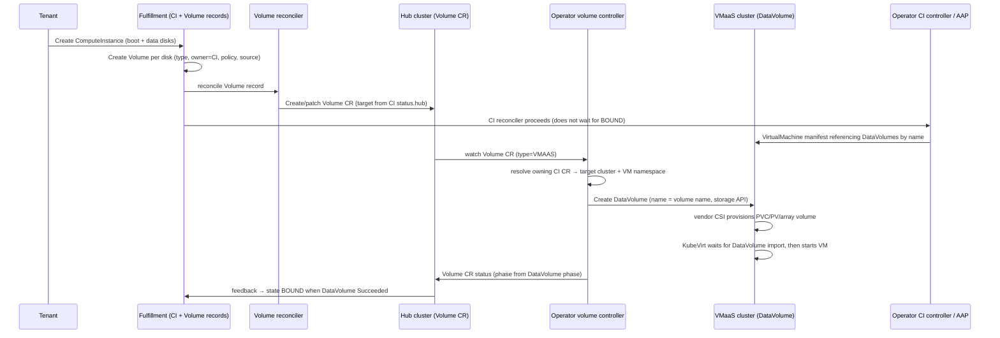
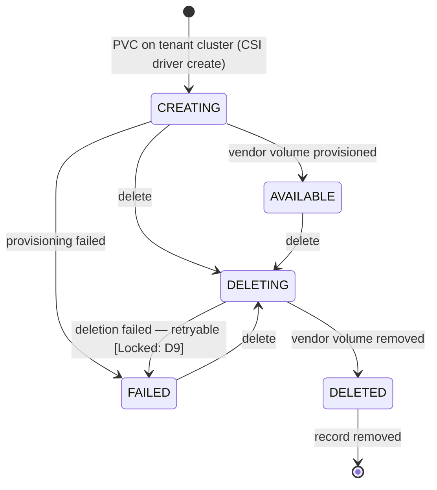
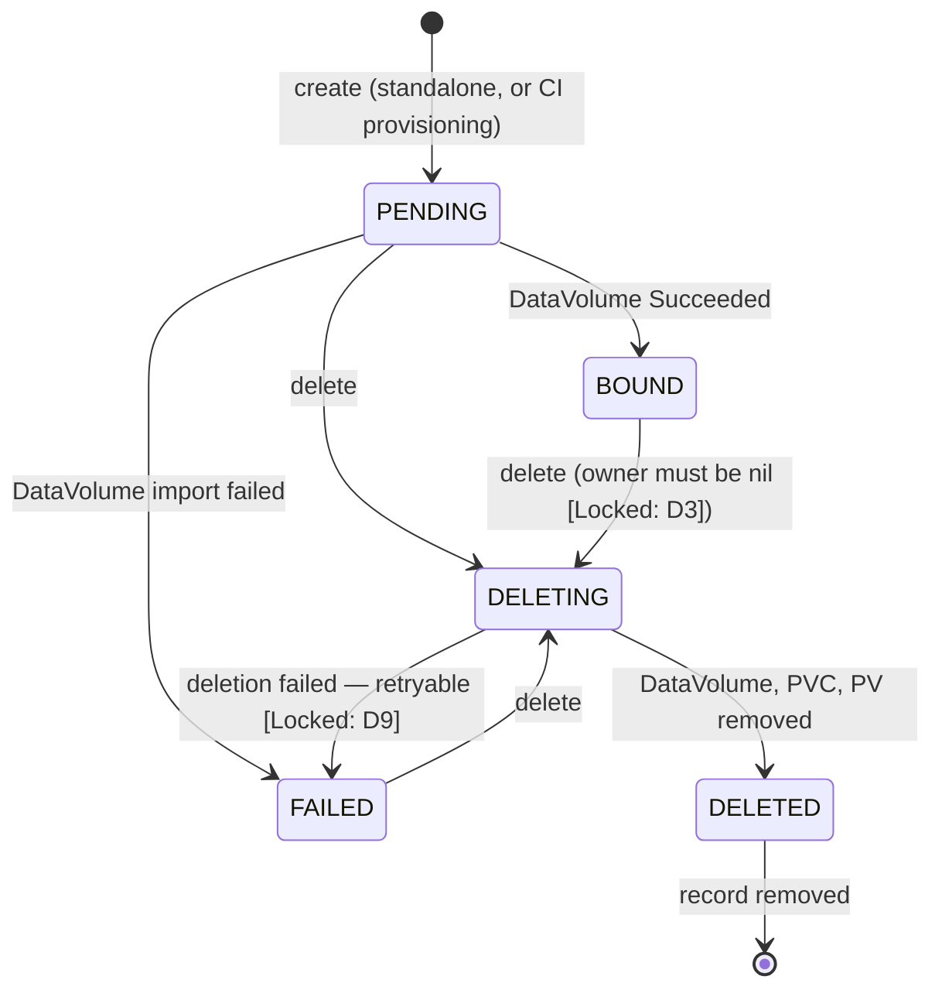

# Volume ownership and DataVolume lifecycle for VMaaS — Feature 1 design

# 1. Overview

This design makes the Volume API the owner-aware source of truth for VMaaS
ComputeInstance disks and moves their realization from the VMaaS domain to
the Storage domain. The fulfillment Volume record gains a service
type, an owner reference, a termination policy, and a DataVolume source; the osac-operator volume
controller constructs the DataVolume on the target VMaaS cluster in code;
VirtualMachine manifests reference those DataVolumes by name; and
ComputeInstance deletion cascades volume deletion through the existing
finalizer chain. See [prd.md](prd.md) for the requirements this design
implements.

Delivery is phased [User]: this design specifies the complete data model and
lifecycle for all PRD journeys, while the first implementation slice covers
the create-VM-with-volumes flow (Volume API enrichment, Volume CR, operator
DataVolume realization, VM-manifest wiring, deletion cascade). The runtime
attach/detach journeys consume the same model and are delivered by the
OSAC-5888 / OSAC-5889 implementation tracks [Locked: D11].

# 2. Goals and Non-Goals

## 2.1 Goals

- Volume creation for ComputeInstance disks flows through the Volume API:
  the fulfillment Volume record carries service type, owner, termination
  policy, and DataVolume source data, all optional so existing callers
  behave exactly as
  today.
- The Volume source is modeled as a closed-set extensible `oneof` mirroring
  CDI's source model (registry first), so adding source types later
  requires no schema redesign.
- DataVolume realization is implemented in the osac-operator volume
  controller (Go, via the Kubernetes client), resolving the target from the
  owning ComputeInstance — selected by preference over an equally viable
  AAP-playbook implementation [User].
- VirtualMachine manifests reference externally-created DataVolumes by name
  (OSAC volume name == DataVolume name), and KubeVirt's native
  wait-for-import behavior gates VM start.
- ComputeInstance deletion cascades volume deletion through the existing
  finalizer chain, driven by the fulfillment ComputeInstance reconciler.
- `spec.size_gib` is the capacity presented to the consumer;
  `status.provisioned_size_gib` is the capacity consumed on the backend
  [User].

## 2.2 Non-Goals

- Runtime attach/detach and standalone-volume user journeys — the model
  decisions appear here, the workflows are the OSAC-5888/5889 tracks
  [Locked: D11].
- Changes to the ComputeInstances API (gRPC/REST/CLI request shape):
  unchanged by this design. Referencing existing volumes in
  `additionalDisks` (OSAC-5888 track) and per-disk source selection
  (beyond this PRD, D12–D14) are future VMaaS-owned extensions; the Volume
  model defined here already accepts what they would carry.
- Sharing a volume between ComputeInstances [Locked: D1], cross-cluster
  volume move, booting from an existing volume, read-only attachment modes,
  and snapshot/clone/upload sources (the schema reserves structural room).
- Direct CSI attach/detach calls from OSAC; vendor drivers on the VMaaS
  cluster continue to perform all storage operations.
- Changes to the CaaS volume flow — its CREATING/AVAILABLE vocabulary and
  vendor-CSI realization remain; coexistence is specified in §4.2.
- Console/UI work.
- In-feature documentation beyond API reference: the model, lifecycle,
  and naming-contract documentation required by the Feature
  definition-of-done is delivered as a dedicated documentation work
  item under this feature.

# 3. Motivation / Background

Today the ComputeInstance controller creates a Volume *record* per disk for
correlation only, while the AAP role `osac.templates.ocp_virt_vm` creates
the actual DataVolumes on the workload cluster — via the legacy CDI `pvc`
API, filesystem volume mode, with the boot disk imported from a registry
image using `pullMethod: node` [Codebase:
osac-aap/collections/ansible_collections/osac/templates/roles/ocp_virt_vm/tasks/create_resources.yaml].
The linkage is one-directional (the ComputeInstance CR lists volume IDs in
`diskVolumeIDs`; DataVolumes carry a `storage-volume-id` annotation), no
volume knows its owner, nothing can prepare storage before a VM exists, and
deleting a volume record does not remove the storage the VM runs on.

Because the VM manifest and its DataVolumes are produced by the same AAP
role, VMaaS owns storage semantics it does not need to own. Moving volume
creation to the Storage domain lets one Volume model serve VMaaS now and
BMaaS/CaaS later [PRD: §Problem Statement], and lets the volume controller
own realization concerns (source mapping, sizing, naming, deletion)
independently of VM provisioning.

KubeVirt and CDI provide the platform contract this design builds on: a VM
whose volumes reference DataVolumes that exist but are still importing does
not start until import completes, and a VM referencing a DataVolume that
does not exist yet sits in a wait state (`FailedPvcNotFound`, "waiting for
it to appear") and self-heals when it appears — verified empirically
[Research: §Open Questions 1]. The VM-creation/DataVolume-creation ordering
therefore needs no coordination.

# 4. Design

## 4.1 Architecture



The diagram shows the create flow. The division of responsibility: the
fulfillment CI reconciler decides (creates volumes with type/owner/policy/
source, cascades deletion); the volume reconciler mirrors records into
Volume CRs on the owning CI's hub; the operator volume controller executes
(constructs DataVolumes on the target cluster); the operator CI controller
and AAP role build the VirtualMachine manifest referencing the DataVolumes
by name. No component waits for another: the VM manifest can be applied
before DataVolumes are ready because KubeVirt gates VM start on DataVolume
readiness [Research: §Architecture Patterns 1]. This order is the
contract, not an optimization: the VM manifest is applied as soon as the
Volume records exist, and KubeVirt — not any OSAC component — performs
the waiting. On `WaitForFirstConsumer` storage classes the CDI importer
pod is the binding consumer, so DataVolume completion does not depend on
the VM; conversely, no OSAC component ever waits for `BOUND` before
building the VM manifest (waiting would also be wrong on WFFC classes
where binding needs a consumer).

Target information is resolved just-in-time by the only component that
needs it. The CI reconciler knows the owner; the volume reconciler
learns the hub from the owning ComputeInstance; the operator volume
controller alone resolves the target cluster and VM namespace when it
constructs the DataVolume. No fulfillment component ever needs the
cluster name — which is also why a standalone volume (no owner → no hub
→ no cluster) settles in PENDING by structure rather than by choice, and
why the realized placement is recorded on the Volume CR once known.

Two realization mechanisms serve the Volume API, selected by the new
`spec.type`. Background for readers new to the CaaS side: CaaS volumes are
created by the OSAC CSI driver when a pod's PVC claims storage on a tenant
cluster — they carry no content to import and are realized by the operator
calling the vendor's CSI controller directly, cluster-free; no DataVolume
is involved, because a DataVolume is CDI's object for importing disk
images into PVCs for VMs, and pods need no image import. VMaaS volumes, by
contrast, need CDI's import machinery on the VM's cluster. The volume
controller therefore branches on declared data:

| `spec.type` | Realization | Population |
|---|---|---|
| `CAAS` | operator → vendor CSI controller directly (cluster-free, no DataVolume) | OSAC CSI driver, PVC-driven |
| `VMAAS` | DataVolume on the target VMaaS cluster (CDI import; target resolved from owner) | CI reconciler, standalone users |
| `BMAAS` *(planned)* | SAN-backed attach (OSAC-4605) | bare-metal instances |

An earlier encoding of this discriminator — source presence, with a
`blank` source member — is evaluated in §6.

## 4.2 Data Model / Schema Changes

### Volume proto (`proto/private/osac/private/v1/volume_type.proto`)

```protobuf
message VolumeSpec {
  // ... existing fields: storage_tier, size_gib, access_mode, topology ...

  // Which service population this volume belongs to; selects the
  // realization mechanism (see §4.1). Set at creation, immutable.
  VolumeType type = 5;

  // Entity that currently owns (uses) this volume. Absent = not owned.
  VolumeOwner owner = 6;

  // What happens to this volume when the owning ComputeInstance is
  // deleted. Set at creation by the creating flow; immutable after
  // creation in this feature [Locked: D4].
  VolumeTerminationPolicy termination_policy = 7;

  // DataVolume source: the content CDI places into the volume. Optional
  // for VMAAS volumes — absent means an empty (blank) disk. Must be
  // absent for CAAS volumes.
  VolumeSource source = 8;

  // The ComputeInstance that provisioned this volume. Set once at
  // creation by the CI provisioning flow; immutable. Absent for
  // tenant-created volumes. Drives the deletion cascade: a volume is
  // deleted with the CI that provisioned it (not merely the CI that
  // currently owns it), and the cascade query survives owner changes,
  // so an interrupted cascade resumes. Visible only through the private
  // API.
  string provisioned_by = 9 [(cleanapi.field).private = true];
}

enum VolumeType {
  VOLUME_TYPE_UNSPECIFIED = 0; // legacy records — treated as CAAS
  // CaaS: realized by the operator calling the vendor CSI controller
  // directly; created by the OSAC CSI driver for tenant-cluster PVCs.
  // Cluster-free; no DataVolume.
  VOLUME_TYPE_CAAS = 1;
  // VMaaS: realized as a DataVolume on the target VMaaS cluster; source
  // optional (absent = blank disk).
  VOLUME_TYPE_VMAAS = 2;
  // Planned — values land with their features:
  // VOLUME_TYPE_BMAAS — SAN-backed realization (OSAC-4605)
  // VOLUME_TYPE_MAAS
}

message VolumeOwner {
  oneof entity {
    // ComputeInstance ID. Extensible to bare-metal and other entities later.
    string compute_instance = 1;
  }
}

enum VolumeTerminationPolicy {
  VOLUME_TERMINATION_POLICY_UNSPECIFIED = 0; // treated as PRESERVE
  // The volume is detached and survives ComputeInstance deletion.
  VOLUME_TERMINATION_POLICY_PRESERVE = 1;
  // The volume is deleted with the owning ComputeInstance [Locked: D4].
  VOLUME_TERMINATION_POLICY_DELETE = 2;
}

message VolumeSource {
  oneof content {
    VolumeSourceRegistry registry = 1;
    // Future members (no schema redesign): http, s3, gcs, pvc, snapshot,
    // upload — mirroring CDI DataVolumeSource.
  }
}

message VolumeSourceRegistry {
  string url = 1;        // e.g. "docker://quay.io/containerdisks/fedora:41"
  // NODE is the default and required for registry imports that must not use
  // tenant network [Codebase: ocp_virt_vm role, pullMethod: node comment].
  enum PullMethod { PULL_METHOD_UNSPECIFIED = 0; PULL_METHOD_POD = 1; PULL_METHOD_NODE = 2; }
  PullMethod pull_method = 2;
}
```

`VolumeState` gains two values (append-only, safe for proto3):

```protobuf
enum VolumeState {
  // ... existing: UNSPECIFIED, CREATING, AVAILABLE, FAILED, DELETING, DELETED
  VOLUME_STATE_PENDING = 6; // DataVolume path: realized, not yet Succeeded
  VOLUME_STATE_BOUND = 7;   // DataVolume path: DataVolume Succeeded
}
```

`VolumeStatus` gains the realized-placement fields (append-only):

```protobuf
message VolumeStatus {
  // ... existing fields: state, message, vendor_volume_id, protocol, hub,
  // vendor_context, provider, state_transition_time, provisioned_size_gib ...

  // Realized placement, written by the operator volume controller
  // BEFORE the DataVolume is constructed (the target is resolved first),
  // and synced back by the feedback bridge. Deletion treats a missing
  // DataVolume at the recorded placement as already removed.
  // Visible only through the private API.
  string target_cluster = 11;
  string data_volume_namespace = 12;
}
```

### Volume lifecycle states

`VolumeState` is a single enum with two success-path vocabularies selected
by `spec.type`; the terminal states (FAILED, DELETING, DELETED) are
shared by both populations.

**CAAS volumes — existing lifecycle, unchanged:**



The CAAS diagram shows the existing eager, cluster-free lifecycle: the
volume is created by the OSAC CSI driver when a pod's PVC claims storage
on a tenant cluster, provisioned immediately by the operator calling the
vendor CSI controller, and consumable by any pod on any cluster that can
reach the array.

| State | Meaning |
|---|---|
| `CREATING` | the operator is calling the vendor CSI controller; the array-side volume is being provisioned |
| `AVAILABLE` | the array-side object exists, cluster-free; consumable by any pod on any reachable cluster |
| `FAILED` | provisioning or deletion failed; reason recorded |
| `DELETING` / `DELETED` | the vendor volume is being / has been removed; the record may remain visible until finalizers clear |

**VMAAS volumes — new lifecycle:**



The VMAAS diagram shows the deferred, cluster-bound lifecycle. PENDING
covers two situations with one state: a standalone volume waiting for an
owner (no target cluster exists yet) and an owned volume whose DataVolume
is being created or importing on the target cluster. BOUND means the
DataVolume reached Succeeded — the disk exists on the target cluster,
import complete, usable by the VM. Owner changes do not transition the
state: detaching leaves a realized volume BOUND with no owner, which is
the state tenants see as "available and not used" [PRD: FR-10].

| State | Meaning |
|---|---|
| `PENDING` | the record exists; either waiting for an owner (standalone — no target cluster) or the DataVolume is being created/importing on the target cluster |
| `BOUND` | the DataVolume Succeeded — the disk exists on the target cluster, import complete, usable by the VM; `BOUND` is the literal CDI phase word, so the API and `kubectl get datavolume` agree on the term |
| `FAILED` | import failed (reason from the DataVolume condition) or deletion failed — retryable [Locked: D9] |
| `DELETING` / `DELETED` | the DataVolume, PVC, and PV are being / have been removed from the target cluster |

**Why two vocabularies.** Unifying them was considered and deferred to
the CaaS reuse of this model (OSAC-4585): reusing CREATING/AVAILABLE for
VMAAS semantics would break the live CSI-driver contract (it polls
`AVAILABLE` today [Codebase: osac-csi-driver/pkg/driver/controller.go]);
PENDING covers a state CAAS never has (waiting for an owner — CaaS
volumes are always eagerly realized); and each population's ready-state
names its own mechanism's native vocabulary. The cost is that "ready" is
two raw values (`AVAILABLE` or `BOUND`), which queries and UIs must
treat as one.

**Tenant-facing presentation.** The raw states are plumbing; the
tenant-visible model D5 promises is the cross-product of state and
ownership:

| | no owner | owned by a ComputeInstance |
|---|---|---|
| `AVAILABLE` / `BOUND` | ready and not used | in use by the named instance |
| `DELETING` | being deleted | being deleted |
| `FAILED` | failed, with reason | failed, with reason |

The raw states are not virtually filtered in this feature: the Volume
API exposes no single "ready" query — consumers filter
`state IN (AVAILABLE, BOUND)` via CEL, and the UI presentation layer
collapses the two values. A server-side ready filter is a candidate for
the vocabulary unification in OSAC-4585.

`spec.size_gib` is the capacity presented to the
consumer; `status.provisioned_size_gib` (existing field, metered
FIXED_ONCE_SET) is read back from the bound PVC's capacity [User].

### Volume CR (`osac-operator/api/v1alpha1/volume_types.go`)

`VolumeSpec` gains `type` (enum mirroring the proto), `owner` (string,
ComputeInstance ID), `termination_policy` (enum mirroring the proto),
`source` (typed struct: registry url + pullMethod; absent for blank VMAAS
volumes), and `provisioned_by` (string, the provisioning ComputeInstance
ID). The controller resolves the target cluster and VM namespace by
reading the owning ComputeInstance CR on the same hub (the CI CR carries the
selected hub and network attachments; the VM namespace derivation from the
network attachment already exists in the CI controller
[Codebase: computeinstance_controller.go]). The resolution is
deterministic: each hub's operator manages a single VMaaS cluster in
this feature — no late binding, scheduling, or multi-cluster placement
[Jira DoD] — and it is the same cluster the instance's VirtualMachine
lands on. `VolumeStatus.phase` gains `Pending` and `Bound` values
mirroring the proto states, and `VolumeStatus` records the realized
placement — the DataVolume's cluster and namespace — **before** the
controller creates the DataVolume, so deletion and future re-attach do
not depend on the owner reference and a crash between placement
recording and construction leaves the DataVolume findable. Deletion
treats a DataVolume missing at the recorded placement as already
removed.

The feedback bridge syncs that placement into the fulfillment record
alongside the state and vendor fields. Its `Save` call carries a fixed
update-mask whitelist of status paths [Codebase:
volume_feedback_controller.go]; the placement paths must be added to the
mask in the same change as the proto fields — an unmasked status field is
silently dropped by the server, so the proto field, the mask entry, and
the sync function must land together.

**Why the placement propagates back to Postgres.** The fulfillment
database is the inventory of record, and the placement is born on the
Volume CR (operator-side resolution), not in fulfillment — without the
back-sync it would be visible only via `kubectl` on the hub. Recording it
in the database keeps every placement question answerable through the
Volume API, including for volumes whose owner has been cleared, where
owner-derived resolution no longer works. Example queries enabled (CEL
filters on `Volumes.List`):

- all volumes of a given instance:
  `this.spec.owner.compute_instance == "<ci-id>"`
- all volumes realized on a given cluster:
  `this.status.target_cluster == "cluster1"`
- realized-but-unowned (free for re-attach) on a cluster:
  `this.status.target_cluster == "cluster1" && !has(this.spec.owner)`
- post-detach diagnostics — the placement survives the owner change, so
  "what lives on cluster1" remains answerable

### DataVolume construction (operator volume controller)

Two equally viable mechanisms can apply this object [User]:

1. **Operator code** — the volume controller constructs the DataVolume in Go
   and applies it through the Kubernetes client.
2. **AAP playbook** — the fulfillment volume controller dispatches a storage
   playbook (tasks moved from the VMaaS role) that applies the same
   DataVolume manifest.

Both produce the identical object defined below; the Volume proto, Volume CR,
naming contract, and state mapping are mechanism-independent. This
implementation selects option 1 [User — architect preference]; the AAP
variant remains an equally valid implementation choice if operational
consistency with the other storage playbooks is later preferred.

```yaml
apiVersion: cdi.kubevirt.io/v1beta1
kind: DataVolume
metadata:
  name: <volume.metadata.name>        # naming contract: volume name == DV name
  namespace: <VM namespace from owning CI network attachment>
  labels:
    osac.openshift.io/volume-uuid: <volume id>
  annotations:
    osac.openshift.io/tenant: <tenant>
    osac.openshift.io/owner-reference: <owner CI id>
spec:
  source:
    registry: {url: <source url>, pullMethod: node}
    # VMAAS volumes without a source are constructed with source: blank: {}
  storage:                              # CDI storage API, not legacy pvc
    accessModes: [ReadWriteOnce]
    resources: {requests: {storage: <size_gib>Gi}}
    storageClassName: <tier-resolved class>
```

The `storage` API makes `size_gib` the guest-visible disk size (CDI adds the
filesystem overhead to the PVC request; today's legacy `pvc` API yields
guests ~6% smaller than requested — a user-visible improvement this design
makes explicit) [Research: §Open Questions 3]. Creation is idempotent: the
controller gets-or-creates by name, so re-attach and reconcile reuse the
existing DataVolume and never recreate data.

### ComputeInstance CR

The disk correlation map gains volume names alongside IDs:
`diskVolumeNames map[string]string` (disk key → volume name), additive to
the existing `diskVolumeIDs`. The VM manifest builder needs names (the
naming contract), not only IDs. The AAP role's DataVolume tasks are removed;
its VM manifest references `volumes[].dataVolume.name` from the new map.
The map form mirrors the existing `diskVolumeIDs` field — the general
preference for lists of named subobjects in CRDs is traded for
consistency with the established correlation shape and the
additive-change constraint.

**Born-volume naming convention.** The CI reconciler generates names for
the volumes it provisions: `ci-<tenant>-<project>-<ci-id>-<disk-key>`
(empty segments omitted; components lowercased and sanitized to DNS-1123
labels, well within the 253-character PVC-name limit). The components
are chosen for two properties:

- **Uniqueness by construction.** The ComputeInstance ID is globally
  unique, so born volumes cannot collide with anything — including
  same-named volumes in other projects of the tenant, which is exactly
  the collision the tenant-granular VM namespaces would otherwise
  expose.
- **Determinism across retries.** Every component is stable, so a
  crash-retried creation regenerates the same name and the
  get-or-create idempotency (see DataVolume construction above) reuses
  the existing volume. A creation-time timestamp was considered and
  rejected: it changes on every retry, silently defeating get-or-create
  and producing duplicate volumes.

Tenant and project are included for readability beyond the raw UUID —
they are redundant for uniqueness but make the volume's origin readable
in listings and `kubectl` output. The honest cost is verbosity: the name
is longer and less pretty than a hand-chosen one, but tenants never
type it (their handle is the ComputeInstance name), and grepping by
ComputeInstance ID finds the volume, its DataVolume, and the instance
at once. This convention does not replace the uniqueness validation:
tenant-chosen standalone names still need the per-tenant rule (Open
Question 9.1), which this convention narrows to that population only.

## 4.3 API Changes

`Volumes.Create` / `Volumes.Update` accept the new optional fields. Validation
rules, enforced with proto annotations where possible:

- `owner.compute_instance` must reference an existing ComputeInstance in the
  **same tenant and project** as the volume; cross-tenant references are
  rejected with `INVALID_ARGUMENT` [PRD: FR-1, Tenant Admin story].
- A volume owned by one ComputeInstance rejects an owner change to another
  while attached paths exist; owner mutation is only legal as clear-to-nil
  (detach) or set-on-unowned (attach) [Locked: D1].
- `type` is set at creation and immutable. Server-side defaulting preserves
  every existing caller: a request with `source` present defaults to `VMAAS`;
  a request with neither `type` nor `source` defaults to `CAAS` (the CSI
  driver and all legacy behavior continue unchanged). `type=CAAS` with
  `source` set is rejected with `INVALID_ARGUMENT`, as is an `owner` entity
  that is not valid for the volume's type.
- `source` must have exactly one `oneof` member set when present, and is
  valid only for `VMAAS` volumes — an absent source means an empty (blank)
  disk. `termination_policy` defaults server-side to `PRESERVE`; the
  ComputeInstance reconciler sets `DELETE` for the volumes it provisions.
  An absent value (legacy/CaaS volumes) is treated as `PRESERVE`.
- `delete` is rejected with `FAILED_PRECONDITION` while `owner` is set
  [Locked: D3].
- Volume names for `VMAAS` volumes must be unique within the
  **tenant** (not tenant+project), because DataVolume names are unique per
  namespace and VM namespaces are tenant-granular [Research: §Integration
  Constraints 6]. See Open Question 9.1 for the migration nuance.
- Quota enforcement is inherited unchanged from the existing Volume API
  [Locked: D10]; the quota basis is `spec.size_gib` (consumer-presented
  capacity) [User].

**ComputeInstances API:** unchanged by this design. The create request
(template, `disk_image`, per-disk `size_gib`/`storage_tier`) already carries
everything the volumes need under the PRD's source freeze [Locked: D12–D14] —
the CI reconciler derives each volume's source from the CI-level `disk_image`
reference (boot) and from the absence of an image (blank data disks). The
only ComputeInstance-side change in this design is the internal hub CR
correlation field (`diskVolumeNames`), not the public API. Symmetrically,
`owner` is visible on all public Volume read paths but is not settable
through public volume creation: its write paths are the internal CI
provisioning flow (this design) and the attach operation (OSAC-4884/5889).

Backward compatibility: every new field is optional; requests without them
are stored and realized exactly as today — neither `type` nor `source`
defaults to `CAAS`, the vendor-CSI path with CREATING/AVAILABLE states —
and the existing Volume API test suites must pass unchanged [User].

Concrete example — internal create issued by the CI reconciler (private API):

```json
{
  "object": {
    "metadata": {"name": "ci-tenant1-01a10c29-boot", "tenant": "tenant1", "project": ""},
    "spec": {
      "storage_tier": {"name": "local"},
      "size_gib": 15,
      "access_mode": "VOLUME_ACCESS_MODE_READ_WRITE_ONCE",
      "type": "VOLUME_TYPE_VMAAS",
      "owner": {"compute_instance": "01a10c29-..."},
      "termination_policy": "VOLUME_TERMINATION_POLICY_DELETE",
      "source": {"registry": {"url": "docker://quay.io/containerdisks/fedora:41"}}
    }
  }
}
```

The public Volume type exposes `type`, `owner`, `termination_policy`, and
`source` (registry URL is tenant-facing input); `pull_method` defaults to
NODE server-side. `osac create volume --blank` sets `type=VMAAS`. An
`--image` flag is deliberately excluded: D14 locks out a tenant-visible
standalone from-image workflow in this PRD; that flag belongs to the
OSAC-5888 track, whose create-time-attach journey consumes it.

## 4.4 Scalability and Performance

Minimal impact. The volume controller creates one DataVolume per volume —
the same object count the CI controller creates today, moved one component
over. The fulfillment volumes table gains three optional columns
(additive migration). Feedback volume is unchanged (one status update per
DataVolume phase transition). DataVolume creation itself is a thin object
write; the import work runs in CDI's importer pods as today.

## 4.5 Security Considerations

The feature inherits the existing security model. Tenant isolation is
enforced at the Volume API (owner must match the volume's tenant+project) and
preserved on DataVolumes via tenant annotations [Codebase: playbook
invariants]. Registry source URLs are validated as absolute
`docker://`-scheme references; no credentials support is included in this
slice (public registries and node pull only — `secretRef`/`certConfigMap`
are reserved future source fields). The volume controller's RBAC on target
clusters gains DataVolume create/get/list/watch/delete, mirroring what the
AAP execution environment holds today.

## 4.6 Failure Handling and Recovery

| Failure | Behavior | Recovery |
|---|---|---|
| DataVolume import fails | Volume CR phase → `Failed`; feedback maps it to `status.state=FAILED` with the DataVolume condition message as reason | Operator requeues; CDI retries; tenant sees FAILED + reason [PRD: FR-10, D9] |
| VM manifest applied before DataVolumes exist | VMI `Pending`, `FailedPvcNotFound` — a wait state, empirically verified self-healing | No action; VM starts when DataVolumes appear [Research: §Open Questions 1] |
| `PvcNotFound` observed by CI controller | **Reclassified from provisioning failure to transient wait**, with a configurable timeout (proposed default: 10 minutes; see Open Question 9.2) | Timeout expiry → provisioning failure with reason |
| Volume controller crash mid-DataVolume-creation | Reconcile is level-triggered; get-or-create by name is idempotent | Next reconcile converges; no duplicate DataVolumes |
| Deletion cascade partial failure (one volume's DataVolume deletion fails) | CI deletion blocks at its finalizer; per-volume failure reason visible on the CI status and the volume's FAILED state | Controller retries — the `provisioned_by`-based query re-finds volumes even after their owner was cleared; tenant-visible retry per D9; matches current "CI deletion completes only after records are cleaned up" semantics [Codebase: volume_record_cleanup.go] |
| Feedback loop down | Volume CR status advances; fulfillment record stale | Feedback bridge re-syncs on reconnect (existing pattern) |

## 4.7 RBAC / Tenancy

No new roles. Owner validation adds the tenancy rule: a volume can only be
owned by a ComputeInstance in the same tenant and project; cross-tenant
references are rejected [PRD: Tenant Admin story]. DataVolumes on the target
cluster carry tenant annotations, preserving the operator's existing tenant
isolation checks. The operator's multicluster role on VMaaS clusters gains
DataVolume permissions (moved from the AAP execution environment).

## 4.8 Extensibility / Future-Proofing

Five extension points are deliberately open: `VolumeType` values (each
planned service — BMAAS with its SAN-backed realization per OSAC-4605, then
MAAS — brings one enum value, one owner entity, and one controller branch),
`VolumeSource.content` (new CDI source types without schema redesign),
`VolumeOwner.entity` (bare-metal instances and other entities), the appended
`VolumeState` values, and `VolumeTerminationPolicy` (new deletion outcomes
such as snapshot-then-delete; making it the tenant-facing attachment knob is
the deferred OSAC-5888 DeleteOnTermination work). The runtime attach/detach journeys (OSAC-5889) need
only owner mutations plus `hotpluggable: true` volume entries in the VM
manifest — KubeVirt's declarative hotplug — both of which this model already
admits [Research: §Architecture Patterns 3]. A `volumeMode: Block` default
for VM volumes is a compatible follow-up that would remove the filesystem
overhead entirely (Open Question 9.3).

# 5. Interface Changes

## IC-1: Volume `spec.owner` field (public + private API)

**Requirements:** FR-1, FR-2

New optional field on the Volume create/update/get/list surfaces; references
the owning ComputeInstance by ID; validated for same tenant+project. See
§4.2/§4.3 for schema and validation.

## IC-2: Volume `spec.termination_policy` field (public + private API)

**Requirements:** FR-9

New optional enum stating what happens to the volume when the owning
ComputeInstance is deleted: `DELETE` (deleted with the instance, D4) or
`PRESERVE` (detached, survives). Set at creation by the creating flow and
immutable after creation in this feature. See §4.2.

## IC-3: Volume `spec.type` and `spec.source` fields (public + private API)

**Requirements:** FR-7, FR-8

`type` names the service population and selects the realization mechanism
(CAAS: vendor-CSI; VMAAS: DataVolume), with server-side defaulting that
preserves existing callers; `source` carries the content for VMAAS volumes
(registry; absent = blank disk). See §4.2 for the schema, §4.3 for
validation and the example payload.

## IC-4: Volume status states PENDING/BOUND and two-field sizing

**Requirements:** FR-7, FR-10

Appended `VolumeState` values for the DataVolume path; `provisioned_size_gib`
populated from the bound PVC capacity; `size_gib` documented as
consumer-presented capacity. See §4.2.

## IC-5: Volume CR schema extension on the hub

**Requirements:** FR-7

Volume CR gains type, owner, termination policy, source, and Pending/Bound phases — observable
via `kubectl get volumes` on the hub. See §4.2.

## IC-6: Operator volume controller DataVolume realization

**Requirements:** FR-7

Constructs DataVolumes on the target VMaaS cluster for `type=VMAAS` volumes
(name = volume name, CDI storage API, idempotent get-or-create, tenant
annotations, volume-uuid label; volumes without a source are constructed as
blank DataVolumes), resolves target cluster and namespace from the owning CI
CR, and reports DataVolume phase and the realized placement back through
the existing feedback bridge (its update-mask whitelist gains the
placement status paths — see §4.2).
`type=CAAS` volumes keep the existing vendor-CSI realization unchanged. The
interface is mechanism-independent — an AAP-playbook variant applying the
same manifest is equally viable (§4.2); operator code is the selected
implementation [User]. See §4.1/§4.2.

## IC-7: Fulfillment CI reconciler creates owner-bearing volumes

**Requirements:** FR-1, FR-3, FR-8, FR-9

For each requested disk, the CI reconciler issues a Volume create with
type=VMAAS, owner, termination_policy=DELETE, and the disk's source
(registry image for boot disks; absent for blank data disks), recording IDs
and names in the CI correlation maps. The public ComputeInstances API is
unchanged; sources are derived from existing request fields. See §4.1/§4.3.

## IC-8: VM manifest references DataVolumes by name; PvcNotFound reclassified

**Requirements:** FR-3, FR-7

The operator CI controller / AAP role builds `volumes[].dataVolume.name`
entries from `diskVolumeNames` (DataVolume creation tasks removed from the
role); `VirtualMachineStatusPvcNotFound` is treated as a transient wait with
a timeout instead of an immediate provisioning failure. See §4.2/§4.6.

## IC-9: ComputeInstance deletion volume cascade

**Requirements:** FR-9

The fulfillment CI reconciler lists volumes by `provisioned_by` and
`termination_policy=DELETE` — a query that does not depend on the
current owner, so an interrupted cascade resumes correctly. For each
listed volume: if owned by the deleting CI, detach (clear owner) then
delete; if already unowned (an earlier crashed pass), delete; if owned
by a different ComputeInstance (moved), skip — it survives per the PRD's
"provisioned with" semantics. Separately, every volume still owned by
the deleting CI that is not being deleted (attached with PRESERVE, or
moved-in with DELETE) has its owner cleared, so no volume retains a
reference to a deleted ComputeInstance. The CI finalizer is released
only when the full list is processed; the operator removes the
VirtualMachine manifest before DataVolumes. See §4.6.

## IC-10: Volume delete refused while owned

**Requirements:** FR-6

`Volumes.Delete` returns `FAILED_PRECONDITION` while `owner` is set, with a
message directing the tenant to remove the disk first [Locked: D3]. See
§4.3.

## IC-11: `osac` CLI volume blank-source flag

**Requirements:** FR-8, FR-11

`osac create volume` gains a `--blank` flag setting `type=VMAAS`;
existing invocations unchanged. A tenant-facing `--image` flag is
excluded by D14 (no standalone from-image workflow in this PRD) and is
delivered by the OSAC-5888 track. See §4.3.

## IC-12: Runtime attach/detach model surface (designed; delivered by OSAC-5889)

**Requirements:** FR-3, FR-4, FR-5

Owner mutation semantics (clear-to-nil on remove, set-on-unowned on attach)
and VM manifest updates via `hotpluggable: true` DataVolume entries; remove
preserves the volume and data. The model and validation land with this
design; the user-facing workflows are the 5888/5889 tracks [Locked: D11].
See §4.2/§4.8.

# 6. Alternatives Considered

**`dataVolumeTemplates` instead of external DataVolume references.** Templates
put the DataVolume spec inside the VM manifest and give free delete-with-VM
garbage collection, but they contradict the premise that the Storage domain
owns volume creation, and they cannot express the born-vs-attached
distinction D4 requires. Rejected; the deletion cascade is orchestrated
explicitly instead (IC-9).

**AAP-playbook DataVolume creation instead of operator code.** Two equally
viable implementations exist for applying the DataVolume: the operator
volume controller constructing it in Go via the Kubernetes client, or an AAP
storage playbook applying the same manifest (tasks moved from the VMaaS
role). Both produce the identical object and leave the data model, naming
contract, and state mapping unchanged. Operator code is selected
[User — architect preference]: the reconcile/resume loop is native to a
controller, and the DataVolume write is a thin declarative object with no
procedural logic that would benefit from playbook machinery; the AAP path
would add job-level retry orchestration for the same result. The AAP variant
remains a valid implementation choice if operational consistency with other
storage playbooks is later preferred.

**`persistentVolumeClaim` references instead of DataVolumes.** Loses CDI
orchestration and the start-gating behavior ("no mechanism to stop the VM
from starting before the import completes"). Rejected [Research:
§Recommended Approach].

**Legacy CDI `pvc` API instead of the `storage` API.** The legacy API is the
current behavior but yields guest disks ~6% smaller than requested. The
`storage` API makes `size_gib` the guest-visible size at the cost of a ~6%
larger PVC request for filesystem volumes, recorded in
`provisioned_size_gib`. Chosen (Option C sizing) [User].

**Source-presence as the realization discriminator, with a `blank` source
member (instead of the explicit `VolumeType`).** Under this encoding, the
presence of `spec.source` would select the realization: volumes with a
source are realized as DataVolumes, volumes without one keep the vendor-CSI
path, and empty VM disks are modeled as an explicit `blank: {}` source
member — mirroring CDI, whose DataVolume spec requires a source. The
context that makes any discriminator necessary: CaaS volumes are created by
the OSAC CSI driver when a pod's PVC claims storage on a tenant cluster;
they carry no content to import, are realized by the operator calling the
vendor's CSI controller directly (cluster-free — no DataVolume, because a
DataVolume exists to import disk images for VMs), and must be provisioned
immediately because a pod's PVC is waiting. VMaaS volumes need CDI's import
machinery on the VM's cluster and can only be realized once an owner
resolves the target. The volume controller's reconcile therefore branches
on population either way. Pros of the source-presence encoding: zero new
fields; backward compatibility for free (the existing source-less CaaS
population maps to the old path with no defaulting rule); and the
discriminator cannot drift from the data (a DataVolume requires a source; a
vendor-CSI volume with an image source is meaningless). Cons: `blank: {}`
models an absence as a presence — an empty disk is not "sourced from
blank" — importing CDI's mechanical quirk into the public API; the routing
rule ("no source means CaaS") is a convention readers must be told rather
than declared data the controller switches on; and it cannot name planned
populations (BMaaS's SAN-backed realization is neither DataVolume nor
vendor-CSI). The explicit `VolumeType` was chosen [User — team decision,
2026-11-15]: it is self-documenting for the humans who read and write the
API; it names the platform's planned service taxonomy (CaaS, VMaaS, BMaaS
per OSAC-4605, MaaS), so each future service arrives as one enum value, one
owner entity, and one controller branch; blank-ness becomes the natural
"VMAAS with no source"; and its costs are two visible, testable rules
(CAAS with a source is rejected; absent type with a source defaults to
VMAAS, absent both default to CAAS, preserving the CSI driver unchanged)
rather than one tribal-knowledge convention.

**`size_gib` as PVC request (Option B).** Exact storage accounting with zero
change, but permanently documents "the size you set is not the size you get."
Rejected in favor of the two-field model [User].

**Eager array-side provisioning via the vendor-CSI path (CaaS-style).**
Would create cluster-free capacity at volume-create time, but requires OSAC
to call storage arrays directly for VMaaS — explicitly out of scope for this
feature and its premises. Rejected [PRD: §Out of Scope].

**CI-side correlation only (status quo) instead of a volume-side owner
field.** The existing `diskVolumeIDs` correlation cannot drive the deletion
cascade (it dies with the CI) or the cross-tenant checks. Rejected; owner and
termination policy live on the Volume.

# 7. Observability and Monitoring

DataVolume phase maps to Volume state: import/pending/WFFC phases →
PENDING; `Succeeded`/Ready → BOUND; `Failed` → FAILED with the DataVolume
condition message as the reason. The realized placement (target cluster,
namespace) is synced into the fulfillment record by the same bridge. State
transitions emit the existing
fulfillment events and metering (state VARIES, `provisioned_size_gib`
FIXED_ONCE_SET) [Codebase: volume_type.proto metering annotations]. CI
deletion exposes per-volume cleanup status on the ComputeInstance. No new
metrics; existing monitoring applies.

# 8. Impact and Compatibility

- **Additive proto and CRD changes only.** All new fields optional; volumes
  created without them behave exactly as today (neither `type` nor `source`
  defaults to `CAAS` — vendor-CSI path, CREATING/AVAILABLE). Existing Volume
  API and operator test suites must pass unchanged [User].
- **User-visible behavior change:** VM disks created through the new path
  present the full `size_gib` to the guest (previously ~`size_gib/1.06`);
  stated here per review policy.
- **VMaaS flow change:** the AAP role stops creating DataVolumes and
  references them by name; VMaaS and Storage land their parts in parallel
  [User].
- **State vocabulary coexistence:** CaaS volumes keep CREATING/AVAILABLE;
  sourced volumes use PENDING/BOUND. Unifying the vocabularies is deferred
  to the CaaS reuse of this model (OSAC-4585).
- **DB migration:** three additive optional columns on the volumes table; no
  backfill.
- **Installer change:** the operator's multicluster RBAC on VMaaS clusters
  gains DataVolume permissions (moved from the AAP execution environment) —
  an `osac-installer` chart change shipped with this feature.
- **Version skew:** fulfillment and operator must both upgrade before the
  CI reconciler starts setting sources; the volume controller ignores
  unknown fields on old CRs (standard controller tolerance).

# 9. Open Questions

## 9.1 Should per-tenant name uniqueness apply to all volumes or only tenant-chosen names?

Born volumes are collision-free by construction (the naming convention
in §4.2 embeds tenant, project, and the ComputeInstance ID), so the
tightening matters only for tenant-chosen standalone names. Restricting
the rule to those leaves two uniqueness scopes in one API; applying it
to all volumes changes semantics for existing CaaS volumes.

- **Owner:** Storage team (Roy Golan)
- **Impact:** §4.3 validation rules; fulfillment uniqueness migration

## 9.2 What timeout should reclassify PvcNotFound from transient wait to provisioning failure?

Too short breaks legitimately slow volume creation; too long hides
genuinely missing volumes. The design proposes a 10-minute default,
configurable, so implementation is not blocked while the value is tuned
in deployment.

- **Owner:** VMaaS team
- **Impact:** §4.6 failure handling; IC-8

## 9.3 When should VM volumes default to `volumeMode: Block`?

Block mode removes the filesystem overhead entirely (guest size == PVC size)
and is Red Hat's recommended mode, but changes behavior for filesystem-mode
volumes.

- **Owner:** Storage team (Roy Golan)
- **Impact:** §4.2 sizing; would simplify IC-4 semantics

# 10. UX Alignment

Not applicable — this feature introduces no UI surface. Console work is
an explicit non-goal (§2.2); tenants interact with volumes through the
Fulfillment API and the `osac` CLI (IC-11). Console representations of
the volume model, when they arrive, are owned by the OSAC-5888/5889
journey tracks.

# 11. Risks and Mitigations

| Risk | Mitigation |
|---|---|
| Two ready-states (`AVAILABLE`, `BOUND`) in one API — "ready" queries and UIs must treat both values as one | The tenant-facing presentation table (§4.2) collapses them; unification is a named deferral to OSAC-4585 |
| Rollout windows break the system if stories deploy out of order: the CI-reconciler story without the manifest story double-provisions disks; the create flow without the deletion cascade orphans owned volumes on instance deletion | Release-unit constraints in the epic breakdown: the volume-creation and manifest-wiring stories deploy as a pair; the create and teardown epics ship as one unit |
| Feedback-mask silent drop — a new status field absent from the bridge's update-mask whitelist is discarded without error | Proto field, mask entry, and sync function land in one change; a paired envtest asserts the placement arrives in the fulfillment record, not just on the Volume CR |
| Tenant-chosen volume names may collide across projects (VM namespaces are tenant-granular) | Born volumes are collision-free by the naming convention (§4.2); the per-tenant rule for tenant-chosen standalone names is Open Question 9.1, resolved before enforcement |
| The VMaaS-side cleanup (AAP role changes) is a parallel workstream in another team's area | Explicit story dependencies and the deploy-as-pair constraint; the interface between the teams is the naming contract and `diskVolumeNames` |
| Guest-visible disk size grows ~6% on the new path (`size_gib` semantics change) | Stated as an explicit behavior change (§8); the metering basis is documented (`spec.size_gib` for quota, `provisioned_size_gib` for consumption) |

# 12. Drawbacks

The honest costs of the chosen design, beyond the alternatives in §6:

- **Two realization mechanisms and two state vocabularies live in one
  API.** Backward compatibility bought this at the price of every
  "ready" check needing to treat two values as one until OSAC-4585
  unifies them.
- **Deletion is orchestrated, not garbage-collected.** Rejecting
  `dataVolumeTemplates` means the born-with-CI cascade is explicit
  control-plane logic with crash-recovery reasoning, rather than free
  Kubernetes garbage collection.
- **Owner writes are internal-only in this slice.** Tenants cannot
  attach or detach until OSAC-4884/5889 land; the API surface exists
  but is gated — interim friction by design.
- **PENDING carries two meanings** (waiting-for-owner and importing),
  disambiguated only by the owner field. Two states were rejected
  against D5's small-state-set requirement.
- **Placement exists in two places** (Volume CR status and the
  fulfillment record), kept in step by the feedback bridge; a drift
  window exists between the CR update and the database sync.

# 13. Test Plan

The full behavioral testplan is the companion document
[testplan.md](testplan.md): 20 test cases covering all 11 PRD
requirements and all 12 interface changes, each mapped to its IC with
priority and automation flags. Tier ownership follows
`docs/INTEGRATION-TESTING.md` in the osac mono-repo:

- **Unit / Envtest (DEV):** fulfillment server validation and defaulting
  (`internal/servers` Ginkgo suites, DB-backed); volume reconciler field
  mapping; operator volume controller — target resolution, get-or-create
  idempotency, blank mapping, feedback state mapping and placement
  arrival, CAAS-unchanged regression (`make test`).
- **Component integration (DEV):** DataVolume applied through the real
  multicluster manager on Kind (`make integration-tests`); AAP role
  contract targets for the manifest-by-name wiring.
- **Contract:** the shared proto tree regeneration check; the CSI-driver
  contract suites pass unchanged (backward compatibility).
- **E2E (QE):** deployed journeys — create-VM-with-volumes (guest sees
  full-size disks, boots the image), VM-starts-while-importing, deletion
  cascade, delete-refused-while-owned, failed-delete retry, cross-tenant
  rejection (`tests/e2e/`).

The Jira definition-of-done names the required integration paths:
create-with-owner, standalone-pending, attach, detach, backend-failure,
and cross-tenant-rejection through the fulfillment API and osac-operator
boundaries; the runtime attach/detach cases execute against the
OSAC-5888/5889 tracks.

# 14. Graduation Criteria

The feature is complete when the Jira definition-of-done items hold,
each verifiable through the surfaces above:

- [ ] The Volume API models the ownership and attachment reference with
      documented semantics for nil ownership (unattached) and
      ComputeInstance ownership (attached)
- [ ] The status lifecycle is enforced: a volume moves to PENDING once a
      target cluster is resolved and to BOUND only when the backing
      DataVolume is BOUND
- [ ] The target VMaaS cluster is resolved from the owning
      ComputeInstance with no late binding or multi-cluster placement
- [ ] The OSAC volume name is the DataVolume name in the target
      VirtualMachine manifest
- [ ] A standalone volume with nil ownership settles in PENDING without
      an error and progresses once an owner is attached
- [ ] Tenant isolation is enforced and a cross-tenant attach is rejected
- [ ] The integration paths named in §13 pass through the fulfillment
      API and osac-operator boundaries
- [ ] Volume API and osac-operator documentation describe the model, the
      lifecycle, and the DataVolume naming contract

# 15. Upgrade / Downgrade Strategy

OSAC does not currently support in-place upgrades; this section assesses
compatibility for deployed sequences anyway. Upgrading is additive-only
(§8): new proto and CRD fields are optional, server-side defaulting
maps absent fields to today's behavior, and the CSI driver requires no
change. Deployment ordering: fulfillment and the operator must both be
current before the CI reconciler starts setting sources.

Downgrade is unsupported beyond the version-skew window (§16). If the
operator is rolled back, the volume controller stops reconciling VMAAS
volumes — already-created DataVolumes keep functioning (KubeVirt and the
vendor driver are unaware of OSAC), but status sync and the deletion
cascade stop, and volume records remain in their last synced state.
Rolling back fulfillment removes the new API fields while Volume CRs
carrying them remain readable by a current operator.

# 16. Version Skew Strategy

- **Old operator + new fulfillment:** the reconciler creates Volume CRs
  with the new fields; the old operator ignores unknown fields
  (standard controller tolerance) and continues the vendor-CSI path for
  CAAS volumes. VMAAS volumes are not realized — they sit in PENDING —
  which is why the CI reconciler must not set sources until the
  operator is current.
- **New operator + old fulfillment:** the feedback bridge (deployed with
  the operator) sends update masks containing paths the old server does
  not know; the update is rejected and the bridge requeues until
  fulfillment catches up — degraded but self-healing. Deploy fulfillment
  first.
- **osac-csi-driver:** untouched by this feature; its contract suites
  are the regression guard, and no skew consideration applies.

# 17. Support Procedures

- **Failure visibility:** every volume carries its state and, on
  failure, a reason [Locked: D5, D9]; intermediate progress is events,
  not states. A stuck volume is diagnosable from `osac get volume`
  alone.
- **Retry semantics:** a failed delete is tenant-retryable [Locked: D9];
  the deletion cascade blocks ComputeInstance deletion with per-volume
  reasons until cleanup completes — the block itself is the diagnostic.
- **Cross-plane diagnosis:** the naming contract (volume name ==
  DataVolume name) and the recorded placement (`status.target_cluster`,
  `status.data_volume_namespace`) take an operator from the fulfillment
  record directly to the cluster object: `kubectl get datavolume
  <volume-name> -n <data_volume_namespace>` on the target cluster.
- **Escalation:** provisioning and deletion failures that persist across
  retries are visible in the DataVolume conditions on the target
  cluster; the PvcNotFound transient window (Open Question 9.2) bounds
  how long a missing-volume wait may last before it is treated as a
  failure.

---

## Provenance

Committed: commit @ design 0.15.0 - 87d14ea, workspace design/OSAC-7318 @ 567fff0 (57 behind origin/main, dirty)

> Authoring phases not recorded this session (commit-time snapshot only).

<!-- ai-workflow-provenance:{"schema_version":1,"provenance_kind":"commit_only","workflow":"design","workflow_version":"0.15.0","ai_workflows":"87d14ea","source_repo":"567fff0 (dirty)","source_repo_branch":"design/OSAC-7318","commits_behind_main":57,"commits_ahead_main":2,"main_ref":"main","phases":["commit","commit"],"authoring_modes":["skill"],"context_changed":true,"origin_untracked":false} -->
