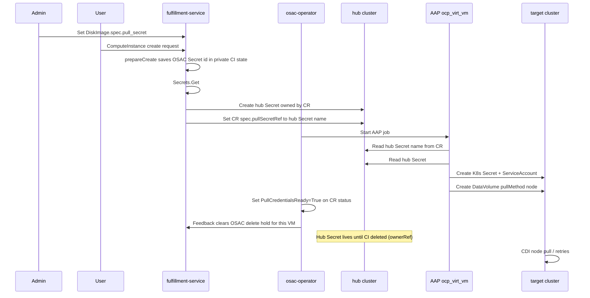

# DiskImage Pull-Secret References

## Summary

DiskImages get an optional link to an existing pull-secret. When someone
creates a VM from that image, OSAC saves which pull-secret the image had
at that time. If there is one, OSAC copies it to the cluster when it
creates the DataVolume. Changing the DiskImage later does not change
already-created VMs. See [PRD](prd.md).

## Motivation

Admins need VMs from private-registry images without giving every tenant
user the registry password.

A DiskImage is where the image source lives (including a private registry
URL). To download that image, the cluster needs matching pull credentials.
Those credentials already exist in OSAC as pull-secrets, but the DiskImage
cannot point at them. So OSAC cannot attach registry login to the image
the VM is built from. This design adds that reference on DiskImage.

The PRD also requires saving that reference when the VM is created, so a
later DiskImage edit does not change credentials for a VM that was
already accepted.

### Goals

- Add an optional **reference** to an existing pull-secret on DiskImage
  (API / CLI / UI).
- When a VM is created, save which Secret the DiskImage referenced (if
  any) on that VM.
- If a Secret was referenced, copy its contents to the cluster once when
  creating the DataVolume.
- Do not let tenants see a provider pull-secret they are not allowed to
  see.
- Block deleting that Secret while a DiskImage still references it, or
  while a new VM still needs it before the cluster copy is done.
- After the cluster copy is done, a running VM must not keep that Secret
  undeletable.

### Non-Goals

- Pull-secret on the VM or on CatalogItem.
- Default pull-secrets for the whole install or tenant.
- New ways to create/rotate secrets.
- Registry mirrors, CA trust, CaaS.
- Replacing AAP DataVolume create with the Volume API
  ([OSAC-7749](https://redhat.atlassian.net/browse/OSAC-7749) /
  [EP #518](https://github.com/osac-project/enhancement-proposals/pull/518)).

### Relationship to Volume API (OSAC-7749)

Today this design has **AAP** create the DataVolume and wire the pull
Secret/SA.

[OSAC-7749](https://redhat.atlassian.net/browse/OSAC-7749) /
[EP #518](https://github.com/osac-project/enhancement-proposals/pull/518)
will move DataVolume create to the Volume API. Then Storage must get the
pull-secret and apply it when creating the DV. DiskImage selection and
the Secret id saved at VM create (later DiskImage edits do not change
that VM) stay in this feature; only who creates the DV changes.

## Proposal

1. Add `DiskImageSpec.pull_secret` (`SecretReference` to
   `SECRET_TYPE_PULL_SECRET`).
2. On ComputeInstance create request, `prepareCreate` saves that Secret’s
   **OSAC id** in private ComputeInstance state (fulfillment DB / private
   proto — not a public create field).
3. The fulfillment ComputeInstance **reconciler** `Secrets.Get`s that id,
   creates a **hub** K8s Secret with the bytes (per-VM name, ownerRef on
   the CR — like user-data), and sets CR `spec.pullSecretRef` to that
   hub Secret **name** (`LocalObjectReference`, same idea as
   `userDataSecretRef`). Do **not** put the OSAC Secret id on the CR for
   AAP.
4. **osac-operator** starts AAP; AAP reads the hub Secret **name** from
   CR `spec.pullSecretRef` (not the OSAC Secret id; not via extra_vars;
   never password bytes). Operator does **not** create the hub Secret.
5. **AAP** reads the hub Secret and **creates** on the target: K8s Secret
   + ServiceAccount + DataVolume (pull wiring in the same job). Operator
   does **not** create those target objects.
6. When target credentials exist, Operator sets `PullCredentialsReady`
   (status condition); feedback clears the **OSAC Secret** delete hold
   (not after populate / `PROVISIONED`). The hub K8s Secret is **not**
   deleted on Ready — it stays until the ComputeInstance is deleted
   (ownerRef / GC), like user-data.

### Who does what (provision)

| Component | Role |
|---|---|
| fulfillment API | Validate DiskImage `pull_secret`; save OSAC Secret id in private CI state at VM create |
| fulfillment ComputeInstance reconciler | `Secrets.Get`; create hub K8s Secret (ownerRef); set CR `spec.pullSecretRef` to hub Secret **name** (not OSAC id) |
| **osac-operator** | Start AAP; set `PullCredentialsReady` (OSAC delete guard only). Does **not** create/delete hub Secret; does **not** create Secret/SA/DV on the target |
| **AAP `ocp_virt_vm`** | Read hub Secret name from CR; **create** (and later **delete**) target K8s Secret + ServiceAccount + DataVolume, including pull-method wiring, in one job |
| CDI | Node pull using that ServiceAccount |

### Workflow Description

**Actors:** Cloud Provider Admin or Tenant Admin (DiskImage);
Tenant User (ComputeInstance create request — an Admin doing this still
acts as a user); fulfillment-service, osac-operator, AAP, CDI.



Same pattern as today’s user-data hub Secret: reconciler creates it on
the hub and puts the hub Secret **name** on the CR; AAP reads
`spec.pullSecretRef` from the CR and copies to the target. Hand AAP the
hub **name** (via the CR), not the OSAC Secret id. Do not put the OSAC
id or password bytes in extra_vars.
`PullCredentialsReady` only releases the OSAC Secret delete guard — it
does **not** delete the hub K8s Secret.

### API Extensions

This enhancement adds **one optional field** on the existing DiskImage.
No new gRPC service, no new resource type.

**New field** on `DiskImageSpec`
(`proto/private/osac/private/v1/disk_image_type.proto`):

| Field | Type | Required | Description |
|---|---|---|---|
| `pull_secret` | `SecretReference` | No | Points at an existing Secret of type `SECRET_TYPE_PULL_SECRET`. Empty / cleared = this image has no pull-secret. |

```proto
// Added to existing DiskImageSpec (alongside source_type, source_ref, …):
SecretReference pull_secret = 7;
```

Same DiskImage Create / Get / List / Update APIs as today (public and
private). Validation reuses the existing `SecretReference` checks and
requires type `SECRET_TYPE_PULL_SECRET`.

**Persistence (fulfillment DB):** DiskImage already lives in the
`disk_images` table with a JSONB `data` column (standard OSAC entity
pattern). `pull_secret` is stored inside that `data` blob with the rest
of `DiskImageSpec`. No new table and no schema migration — only a proto
field that serializes into existing JSONB.

**Not a public API change on ComputeInstance create:** when a VM is
created, fulfillment saves the DiskImage’s OSAC Secret id in **private**
ComputeInstance state (`prepareCreate` — private proto field and/or
JSONB `data`). Tenants do not set that on the create request. That id is
so later DiskImage edits do not change that VM, for hub Secret
materialization, and for the OSAC delete guard — not for AAP.

**Hub CR field (like user-data):** `spec.pullSecretRef`
(`LocalObjectReference`) = **hub** K8s Secret **name** created by the
reconciler. Exact Go/JSON name follows existing CR style. Empty when the
DiskImage had no `pull_secret`. AAP reads this from the CR; do not put
the OSAC Secret id here.

**New ComputeInstance condition (status, for hold release):**

| Condition | When True | Purpose |
|---|---|---|
| `PullCredentialsReady` (`COMPUTE_INSTANCE_CONDITION_TYPE_PULL_CREDENTIALS_READY`) | Target-cluster dockerconfigjson Secret + ServiceAccount for this VM exist | Clear “copy still needed”; stop blocking **OSAC** Secret delete for this VM |

Today’s feedback already syncs `PROVISIONED`, `READY`, `NETWORK_READY`,
etc. There is **no** DV-specific or credentials-copied condition — add
this one on **status** (proto enum + CR condition). Do **not** reuse
`PROVISIONED` (too late for the hold).

**Scope of this condition:** OSAC Secret delete guard only. It does **not**
drive hub K8s Secret lifetime (that Secret is owned by the CR and dies
with the ComputeInstance, like user-data).

Flow: AAP creates target Secret+SA → osac-operator sets
`PullCredentialsReady` on the CR status → feedback `Update` + `Signal` →
OSAC Secret delete guard no longer treats this VM as needing the copy.
The create job may create DataVolume in the same playbook, so Operator
may not see “Secret only” vs “DV object created”; still do not wait for
populate or `PROVISIONED`.

**CLI / UI:** set, change, or clear `pull_secret` on DiskImage; only list
Secrets the caller may discover.

**Errors:** DiskImage write uses existing codes (`InvalidArgument`,
`PermissionDenied`, `FailedPrecondition`). Image download failure for a
tenant stays a generic error (no Secret id in the text).

### Who may do what

- Set `pull_secret`: DiskImage write + may select that Secret.
- Create ComputeInstance: may use the DiskImage; does **not** need Secret
  read/discover.
- Hide `pull_secret` id from callers who can use a provider DiskImage but
  cannot discover that Secret.

### How the secret gets to the cluster

**What “node pull” means:** today’s root DataVolume already sets
`pullMethod: node`. That means the **node’s container runtime** pulls the
registry image (like a Pod image pull), not CDI’s importer using
DataVolume `secretRef`. For a private registry, the node needs
credentials the same way a Pod does: a Kubernetes Secret of type
`kubernetes.io/dockerconfigjson` (key `.dockerconfigjson` — same shape
OSAC already stores for `SECRET_TYPE_PULL_SECRET`), listed on a
ServiceAccount as `imagePullSecrets`, and the DataVolume points at that
ServiceAccount with `spec.serviceAccountName` ([CDI docs](https://github.com/kubevirt/containerized-data-importer/blob/main/doc/datavolumes.md)).
`DataVolume.spec.serviceAccountName` requires **CDI ≥ v1.65.0** (upstream
PR [#4056](https://github.com/kubevirt/containerized-data-importer/pull/4056)).
Older CDI ignores that field, so node pull would not use the SA.

Baseline today
[`create_resources.yaml`](https://github.com/osac-project/osac-aap/blob/main/collections/ansible_collections/osac/templates/roles/ocp_virt_vm/tasks/create_resources.yaml):
`docker://…` + `pullMethod: node`, no credentials.

**Credential handoff (mgmt → AAP), then target objects (AAP):**

1. Fulfillment reconciler reads the **private** saved OSAC Secret id,
   calls `Secrets.Get`, and creates a **hub** Kubernetes Secret with
   those bytes (per-VM name, e.g. derived from the ComputeInstance id —
   same naming idea as user-data), with an **ownerRef** on the CR.
2. Reconciler sets CR `spec.pullSecretRef` to that hub Secret **name**
   (`LocalObjectReference`). Do **not** place the OSAC Secret id on the
   CR for AAP.
3. Operator starts AAP. AAP reads the hub Secret **name** from CR
   `spec.pullSecretRef` (like `userDataSecretRef`). Do **not** pass the
   OSAC Secret id or password bytes in extra_vars (and do not duplicate
   the hub name there either).
4. AAP reads the hub Secret and **creates on the target**: dockerconfigjson
   Secret; ServiceAccount with `imagePullSecrets` (e.g.
   `osac-diskimage-pull-<ci-id>`); root DataVolume with `pullMethod: node`
   and `spec.serviceAccountName`.
5. Operator sets `PullCredentialsReady=True` on status when target
   credentials exist (create job may also have created the DataVolume
   object in the same playbook). Do **not** wait for DataVolume Ready /
   populate / `PROVISIONED`. That condition clears the **OSAC** delete
   hold only.

**Lifetimes:**

| Object | Lifetime |
|---|---|
| OSAC pull-secret | Delete-guarded until `PullCredentialsReady` (and while DiskImages still ref it) |
| Hub K8s Secret | Owned by ComputeInstance CR; GC when the CI is deleted (align with user-data; do **not** delete on Ready) |
| Target K8s Secret + SA | AAP deletes in `delete_resources.yaml` with other per-VM objects |

Do not use DataVolume `secretRef` for this path. Operator does not create
Secret/SA/DV on the target (AAP owns workload-cluster objects / pull
wiring in one job).

**Namespace:** create the target Secret/SA in the same namespace as the
root DataVolume. Tenants have no target-cluster access, so they cannot
read that Kubernetes Secret via the cluster API. OSAC API redaction still
hides the OSAC Secret id from callers who must not discover it.

### Code touch points

| Place | Change |
|---|---|
| `proto/private/osac/private/v1/disk_image_type.proto` | Add `pull_secret` |
| `proto/.../compute_instance_type.proto` (private) | Private field for create-time OSAC Secret id; `PullCredentialsReady` condition enum |
| operator CRD | `spec.pullSecretRef` (hub Secret name); `PullCredentialsReady` status condition |
| `private_disk_images_server.go` + Secret reference validation | Existing checks + redaction for non-discoverers |
| `private_compute_instances_server.go` (`prepareCreate`) | Save OSAC Secret id from DiskImage into private CI state |
| fulfillment ComputeInstance controller | Create hub K8s Secret (ownerRef); set CR `spec.pullSecretRef` to hub name |
| `private_secrets_server.go` + DB triggers (extend mig. 111) | Block delete while DiskImage refs it, or VM still needs cluster copy; FOR SHARE on write |
| `computeinstance_feedback_controller.go` | Sync `PullCredentialsReady` like existing conditions |
| osac-operator ComputeInstance controller | Start AAP; set `PullCredentialsReady` (OSAC guard) |
| AAP `ocp_virt_vm` | Read hub Secret via CR `pullSecretRef`; **create** target Secret+SA+DV; **delete** target Secret+SA on VM delete |

`Create` only records the choice. Cluster copy runs in the provision path.

#### Server Implementation

No new gRPC server. Extend the existing DiskImage and ComputeInstance
servers (and Secret delete protection).

**`private_disk_images_server.go`** (and public DiskImages server as
needed):

- On Create / Update: if `spec.pull_secret` is set, resolve and validate
  it with the shared Secret-reference helpers
  (`secret_reference_validation.go`) — same pattern as other
  `SecretReference` fields. Require `SECRET_TYPE_PULL_SECRET`.
- On Get / List: hide `pull_secret` (id) from callers who may use the
  DiskImage but cannot discover that Secret.
- Empty / cleared `pull_secret` remains valid (image needs no registry
  credentials).

**`private_compute_instances_server.go`**:

- In `prepareCreate` (via `CreateWithCandidatePreparation`): read the
  DiskImage used for this VM; if it has `pull_secret`, save that Secret’s
  id on the ComputeInstance private state in the DB. If it has none, save
  none.
- Do not re-read DiskImage later for this choice. Create-time value wins.
- Concurrent Secret delete is covered by the same DB trigger pattern as
  other Secret refs (see Database Migration): the VM insert/update takes
  a share lock on the Secret row so a delete cannot slip through between
  validate and commit.

**Fulfillment ComputeInstance controller + hub CR:**

- Private CI state already holds the create-time **OSAC** Secret id from
  `prepareCreate`. Do **not** re-read `DiskImage.pull_secret` (create-time
  value wins).
- Same reconcile pass (or sibling helper like `ensureUserDataSecret`):
  `Secrets.Get` that private id; create the hub K8s Secret with an
  ownerRef on the ComputeInstance CR; set CR `spec.pullSecretRef` to the
  hub Secret **name** (`LocalObjectReference`, like `userDataSecretRef`).
  Empty when there was no pull-secret. Align hub Secret lifetime with
  user-data; do not delete it when `PullCredentialsReady` becomes True.
- The operator / AAP do not use the OSAC Secret id; they use
  `spec.pullSecretRef` on the CR.

**`private_secrets_server.go`**:

- Extend the existing Secret delete-protection path (DB triggers from
  migration `111_add_secret_delete_protection_trigger`): reject delete
  while any DiskImage still references the Secret, or while any
  ComputeInstance still needs the cluster copy for that saved Secret id
  (`PullCredentialsReady` not True / equivalent private flag).
- Once feedback reports credentials ready for a VM, that VM no longer
  blocks delete.

**Feedback / condition:**

- Add CR condition type `PullCredentialsReady` and proto enum
  `COMPUTE_INSTANCE_CONDITION_TYPE_PULL_CREDENTIALS_READY`.
- `computeinstance_feedback_controller` maps it like `PROVISIONED` /
  `READY` (status Update field mask + Signal).
- osac-operator sets True after target credentials exist (AAP create job).
  Same playbook may create Secret+SA and DataVolume together — Operator
  may not observe them as separate steps; still do not wait for populate /
  `PROVISIONED`. Leave False / unset until then. VMs with no pull-secret
  never need the hold.

#### Database Migration

No new business tables or columns (JSONB `data` as today). **Do** extend
the existing Secret reference / delete-protection triggers (same pattern
as `111_add_secret_delete_protection_trigger.up.sql`):

| Data | Storage |
|---|---|
| `DiskImage.spec.pull_secret` | Existing `disk_images.data` JSONB |
| Per-VM saved Secret id + “copy still needed” | Existing `compute_instances.data` JSONB (private) |
| OSAC Secret bytes | Unchanged: Vault / HUB |
| Hub handoff | Hub K8s Secret created by fulfillment reconciler; owned by CI CR |
| Target credentials | K8s dockerconfigjson Secret + SA on target (AAP) |

**Race with Secret delete (reuse existing mechanism):**

- On DiskImage / ComputeInstance insert or update that sets a Secret id:
  `check_secret_ref_exists`-style trigger — `SELECT … FOR SHARE` on the
  active Secret row so a concurrent soft-delete cannot commit first.
- On Secret soft-delete: `check_secret_not_in_use`-style trigger — reject
  while any active DiskImage references the id, or any ComputeInstance
  still needs the cluster copy for that id.
- Add JSONB indexes on those id paths (same style as
  `clusters_pull_secret_secret`).

Do not invent a separate locking API; extend these triggers for
`disk_images` and `compute_instances`.

## UX Alignment

| UI / surface | Proto / CR | Notes |
|---|---|---|
| DiskImage `pull_secret` | `DiskImageSpec.pull_secret` | Hide OSAC Secret id if the viewer cannot discover that Secret |
| (not tenant UI) | Private CI saved OSAC Secret id | Saved at VM create; later DiskImage edits do not change it; delete guard |
| (hub CR only) | `spec.pullSecretRef` | Hub K8s Secret **name** for AAP (like `userDataSecretRef`) |

### Implementation Details/Notes/Constraints

Proto field number `7` is a proposal; confirm at generation time so it
does not collide with any parallel DiskImageSpec change.

### Security Considerations

- Tenants must not learn a protected OSAC pull-secret’s id or value via
  the OSAC API (hide `pull_secret` on Get/List when they cannot discover
  that Secret).
- Tenants do not have access to the target cluster, so the per-VM
  Kubernetes Secret/SA is not tenant-readable via the cluster API.
- Do not put Secret **bytes** or the OSAC Secret id in AAP extra_vars.
  AAP uses the hub Secret **name** via CR `spec.pullSecretRef` (same as
  `userDataSecretRef`) — not via extra_vars. Hub Secret lifetime matches
  user-data (CI ownerRef), not `PullCredentialsReady`.
- Do not log secret bytes in normal AAP/job output.

### Failure Handling and Recovery

| What happens | What we do |
|---|---|
| DiskImage pull-secret changed after VM create | Old VM keeps its saved id. New VMs use the new image value. |
| OSAC Secret contents changed before cluster copy | Cluster copy uses current contents of the saved id. |
| OSAC Secret contents changed after cluster copy | Does not change that DataVolume; cluster already has its copy. |
| Delete OSAC Secret while a DiskImage still points at it | Reject delete. |
| Delete OSAC Secret after cluster copy, no DiskImage left | Allow delete. Running VM does not block it. |
| Hub Secret or target Secret/SA create fails | Keep “copy still needed”; retry same saved id; do not re-read DiskImage |
| Target credentials created, DataVolume or download fails later | OSAC hold already cleared (or clearable once credentials exist); hub Secret remains until CI delete; existing provision failure handling on the cluster |

### RBAC / Tenancy

Same as above under “Who may do what.” Platform objects on the cluster
keep normal tenant labels without exposing the OSAC Secret id.

### Observability and Monitoring

Reuse existing provision failure status for tenants (generic text).
Operator logs may use correlation ids without secret ids or bytes.

### Risks and Mitigations

- Only storing the link on DiskImage → also save it on the VM at create.
- Waiting for image download / `PROVISIONED` before allowing OSAC Secret
  delete → clear the hold on `PullCredentialsReady` (target Secret+SA)
  instead. Hub K8s Secret lifetime stays aligned with user-data.
- Putting credentials or the OSAC Secret id in AAP extra_vars → use the
  hub Secret **name** on CR `spec.pullSecretRef` instead (AAP reads the
  CR; not extra_vars); reconciler fetches via SecretsClient (like
  user-data).

### Drawbacks

- Changes DiskImage, VM private state, Secret delete, VMaaS provision,
  and adds a new ComputeInstance condition + feedback mapping.
- Needs a confirmed CDI/CNV ServiceAccount pull pattern first.

## Alternatives (Not Implemented)

- Look up DiskImage pull-secret only when provisioning runs → DiskImage
  edits could change an already-accepted VM.
- Put credentials or the OSAC Secret id in AAP extra_vars → leak /
  wrong handoff; chosen path is reconciler `Secrets.Get` + hub Secret
  owned by the CI; AAP uses the hub **name** from CR `spec.pullSecretRef`
  (like user-data), not the OSAC id and not via extra_vars.
- Delete hub K8s Secret when `PullCredentialsReady` → tighter lifetime,
  but diverges from user-data; align with ownerRef/GC for now and revisit
  both later if needed.
- AAP calls fulfillment Secrets API for this path → needs extra AAP auth
  to Fulfillment; reconciler already has SecretsClient (same as user-data).
- Operator creates target Secret/SA/DV → today AAP owns workload objects
  on the target; keep that boundary.
- Use DataVolume `secretRef` with node pull → wrong CDI pattern; use
  ServiceAccount instead.
- Block Secret delete for the whole VM lifetime → against the PRD.
- New fulfillment table just for this flow → put the saved Secret id and
  “copy still needed” state on the VM instead.
- Clear the hold on `PROVISIONED` or DataVolume Ready → simpler reuse of
  today’s status, but too late (storage/image already progressing).

## Test Plan

See [testplan.md](testplan.md). Align tests with this doc: release the
OSAC delete hold when `PullCredentialsReady` becomes True (Secret + SA
on cluster); do not wait for DataVolume Ready or `PROVISIONED`; cluster
retries stay on the cluster.

## Upgrade / Downgrade Strategy

No field → same as today. Turn on nonempty pull-secrets only after cluster
wiring works. Finish in-flight copies before rolling back.

## Version Skew Strategy

If the reconciler cannot fetch / write the hub Secret, or AAP cannot
create the target Secret/SA, fail the VM that needs a pull-secret. Do
not create the DataVolume without credentials.

**CDI / CNV:** nonempty `pull_secret` requires a target CDI that supports
`DataVolume.spec.serviceAccountName` (**CDI ≥ v1.65.0**, or an OpenShift
CNV channel that backports that API). Confirm each supported VMaaS target
meets that bar before enabling the feature. On an older CDI (no field),
fail closed for VMs that need a pull-secret — do not create a DataVolume
that would pull without credentials. Public images (empty `pull_secret`)
stay on today’s path and do not need that field.

## Support Procedures

Look at stuck “copy to cluster not done” VMs and generic image-download
failures. Do not dump secret contents.

## Infrastructure Needed

Ability for AAP to create a dockerconfigjson Secret and ServiceAccount for
the root-disk import in the DataVolume namespace, and for the fulfillment
reconciler to create the hub handoff Secret (ownerRef on the CI, like
user-data). No new fulfillment DB tables.
