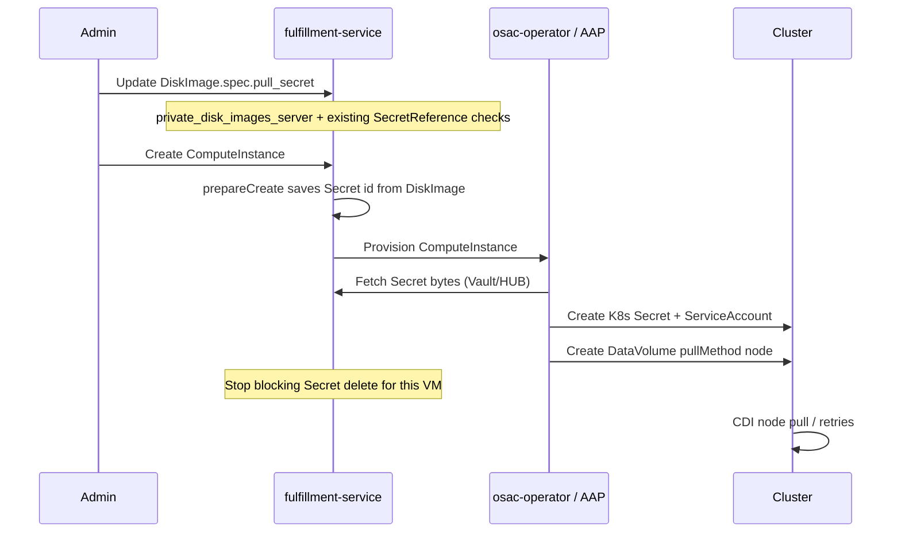

# DiskImage Pull-Secret References

## Summary

DiskImages get an optional link to an existing pull-secret. When someone
creates a VM from that image, OSAC saves which pull-secret the image had
at that time. If there is one, OSAC copies it to the cluster when it
creates the DataVolume. Changing the DiskImage later does not change
already-created VMs. See [PRD](prd.md).

## Motivation

Admins need VMs from private-registry images without giving every tenant
user the registry password.

A DiskImage is where the image source lives (including a private registry
URL). To download that image, the cluster needs matching pull credentials.
Those credentials already exist in OSAC as pull-secrets, but the DiskImage
cannot point at them. So OSAC cannot attach registry login to the image
the VM is built from. This design adds that reference on DiskImage.

The PRD also requires picking that reference when the VM is created, not
later. Create is accepted before the image downloads. If we re-read the
DiskImage only at download time, a later DiskImage change could swap
credentials for a VM that was already accepted.

### Goals

- Add an optional **reference** to an existing pull-secret on DiskImage
  (API / CLI / UI).
- When a VM is created, save which Secret the DiskImage referenced (if
  any) on that VM.
- If a Secret was referenced, copy its contents to the cluster once when
  creating the DataVolume.
- Do not let tenants see a provider pull-secret they are not allowed to
  see.
- Block deleting that Secret while a DiskImage still references it, or
  while a new VM still needs it before the cluster copy is done.
- After the cluster copy is done, a running VM must not keep that Secret
  undeletable.

### Non-Goals

- Pull-secret on the VM or on CatalogItem.
- Default pull-secrets for the whole install or tenant.
- New ways to create/rotate secrets.
- Registry mirrors, CA trust, CaaS.

## Proposal

1. Add `DiskImageSpec.pull_secret` (`SecretReference` to a
   `SECRET_TYPE_PULL_SECRET`).
2. On ComputeInstance create, `prepareCreate` saves that Secret’s id on
   the instance (private state).
3. Provisioning (`osac-operator` / AAP `ocp_virt_vm`) copies the Secret
   bytes to the target cluster and creates the root DataVolume.
4. After that copy, CDI download/retries stay on the cluster. A live VM
   does not keep the OSAC Secret undeletable.

### Workflow Description

**Actors:** Cloud Provider Admin or Tenant Admin (DiskImage);
Tenant User or Admin (ComputeInstance create); fulfillment-service,
osac-operator, AAP, CDI (provision).



What the diagram shows:

1. Admin sets `DiskImage.spec.pull_secret` via the DiskImage API.
2. Fulfillment validates it with the same `SecretReference` rules used
   elsewhere (`SECRET_TYPE_PULL_SECRET`, caller may select).
3. Admin creates a ComputeInstance. `PrivateComputeInstancesServer.prepareCreate`
   stores the Secret id from the DiskImage on the instance.
4. osac-operator / AAP read the Secret bytes from the existing Secret
   backend.
5. They create a platform-owned Kubernetes Secret + ServiceAccount on the
   target cluster.
6. They create the root DataVolume with `pullMethod: node` (today’s path
   in `ocp_virt_vm` `create_resources.yaml`, extended to use that SA).
7. Fulfillment stops blocking Secret delete for this VM (cluster copy is
   done).
8. CDI downloads the image; retries stay on the cluster.

### API Extensions

This enhancement adds **one optional field** on the existing DiskImage.
No new gRPC service, no new resource type.

**New field** on `DiskImageSpec`
(`proto/private/osac/private/v1/disk_image_type.proto`):

| Field | Type | Required | Description |
|---|---|---|---|
| `pull_secret` | `SecretReference` | No | Points at an existing Secret of type `SECRET_TYPE_PULL_SECRET`. Empty / cleared = this image has no pull-secret. |

```proto
// Added to existing DiskImageSpec (alongside source_type, source_ref, …):
SecretReference pull_secret = 7;
```

Same DiskImage Create / Get / List / Update APIs as today (public and
private). Validation reuses the existing `SecretReference` checks and
requires type `SECRET_TYPE_PULL_SECRET`.

**Persistence (fulfillment DB):** DiskImage already lives in the
`disk_images` table with a JSONB `data` column (standard OSAC entity
pattern). `pull_secret` is stored inside that `data` blob with the rest
of `DiskImageSpec`. No new table and no schema migration — only a proto
field that serializes into existing JSONB.

**Not a public API change on ComputeInstance:** when a VM is created,
fulfillment saves the Secret id from the DiskImage in private state on
that ComputeInstance (`prepareCreate`, same JSONB `data` pattern).
Tenants do not set that on the create request.

**CLI / UI:** set, change, or clear `pull_secret` on DiskImage; only list
Secrets the caller may discover.

**Errors:** DiskImage write uses existing codes (`InvalidArgument`,
`PermissionDenied`, `FailedPrecondition`). Image download failure for a
tenant stays a generic error (no Secret id in the text).

### Who may do what

- Set `pull_secret`: DiskImage write + may select that Secret.
- Create ComputeInstance: may use the DiskImage; does **not** need Secret
  read/discover.
- Hide `pull_secret` id from callers who can use a provider DiskImage but
  cannot discover that Secret.

### How the secret gets to the cluster

**What “node pull” means:** today’s root DataVolume already sets
`pullMethod: node`. That means the **node’s container runtime** pulls the
registry image (like a Pod image pull), not CDI’s importer using
DataVolume `secretRef`. For a private registry, the node needs
credentials the same way a Pod does: a Kubernetes Secret of type
`kubernetes.io/dockerconfigjson` (key `.dockerconfigjson` — same shape
OSAC already stores for `SECRET_TYPE_PULL_SECRET`), listed on a
ServiceAccount as `imagePullSecrets`, and the DataVolume points at that
ServiceAccount with `spec.serviceAccountName` ([CDI docs](https://github.com/kubevirt/containerized-data-importer/blob/main/doc/datavolumes.md)).

Baseline today
[`create_resources.yaml`](https://github.com/osac-project/osac-aap/blob/main/collections/ansible_collections/osac/templates/roles/ocp_virt_vm/tasks/create_resources.yaml):
`docker://…` + `pullMethod: node`, no credentials.

Proposed when `pull_secret` is set:

1. Create a Kubernetes Secret (dockerconfigjson) with the OSAC pull-secret
   bytes.
2. Create a ServiceAccount and set `imagePullSecrets` to that Secret.
   **Name (our choice):** e.g. `osac-diskimage-pull-<compute-instance-id>`
   (unique per VM import; exact prefix is an implementation detail).
3. Set `spec.serviceAccountName` on the root DataVolume to that SA.
4. Keep `pullMethod: node`.
5. When DataVolume create succeeds, stop blocking OSAC Secret delete for
   this VM.

Do not put secret bytes in AAP extra vars. Do not use DataVolume
`secretRef` for this path.

**Namespace note:** today the root DataVolume lives in the tenant VM
namespace. CDI runs the import under a ServiceAccount in that same
namespace, so the Secret/SA must be creatable there too. How we keep
tenants from reading that Secret is the open question below.

### Code touch points

| Place | Change |
|---|---|
| `proto/private/osac/private/v1/disk_image_type.proto` | Add `pull_secret` |
| `private_disk_images_server.go` + Secret reference validation | Existing checks + redaction for non-discoverers |
| `private_compute_instances_server.go` (`prepareCreate`) | Save Secret id from DiskImage |
| `private_secrets_server.go` delete path | Block while a DiskImage still references it, or a VM still needs the cluster copy |
| computeinstance controller / `osac-operator` / AAP `ocp_virt_vm` | Fetch bytes, create cluster Secret/SA, extend DataVolume create |

`Create` only records the choice. Cluster copy runs in the provision path.

#### Server Implementation

No new gRPC server. Extend the existing DiskImage and ComputeInstance
servers (and Secret delete protection).

**`private_disk_images_server.go`** (and public DiskImages server as
needed):

- On Create / Update: if `spec.pull_secret` is set, resolve and validate
  it with the shared Secret-reference helpers
  (`secret_reference_validation.go`) — same pattern as other
  `SecretReference` fields. Require
  `SECRET_TYPE_PULL_SECRET`.
- On Get / List: hide `pull_secret` (id) from callers who may use the
  DiskImage but cannot discover that Secret.
- Empty / cleared `pull_secret` remains valid (image needs no registry
  credentials).

**`private_compute_instances_server.go`**:

- In `prepareCreate` (via `CreateWithCandidatePreparation`): read the
  DiskImage used for this VM; if it has `pull_secret`, save that Secret’s
  id on the ComputeInstance private state. If it has none, save none.
- Do not re-read DiskImage later for this choice. Create-time value wins.

**`private_secrets_server.go`**:

- Extend delete protection: reject delete while any DiskImage still
  references the Secret, or while any ComputeInstance still needs the
  cluster copy for that saved Secret id.
- After the cluster copy succeeds for a VM, that VM no longer blocks
  delete.

#### Database Migration

**None.** This enhancement does not add tables or columns.

| Data | Storage |
|---|---|
| `DiskImage.spec.pull_secret` | Existing `disk_images.data` JSONB (migration `99_create_disk_images_tables.up.sql`) |
| Per-VM saved Secret id + “copy still needed” | Existing `compute_instances.data` JSONB (private; not a public API field) |
| OSAC Secret bytes | Unchanged: Vault / HUB via fulfillment Secret APIs |
| Cluster credentials | Kubernetes dockerconfigjson Secret + ServiceAccount (`imagePullSecrets`), referenced by DataVolume `spec.serviceAccountName` |

No SQL migration file is required. Proto + server/controller changes are
enough for persistence. Do not add a new fulfillment table for this
flow.

## UX Alignment

| UI | Proto | Notes |
|---|---|---|
| `spec.pullSecret` | `spec.pull_secret` | Hide id if the viewer cannot discover that Secret |

### Implementation Details/Notes/Constraints

Proto field number `7` is a proposal; confirm at generation time so it
does not collide with any parallel DiskImageSpec change.

### Security Considerations

- Tenants must not learn a protected pull-secret’s id or value.
- Cluster Secret must not be readable/mountable by tenants.
- Do not log secret ids or bytes in normal AAP/job output.

### Failure Handling and Recovery

| What happens | What we do |
|---|---|
| DiskImage pull-secret changed after VM create | Old VM keeps its saved id. New VMs use the new image value. |
| OSAC Secret contents changed before cluster copy | Cluster copy uses current contents of the saved id. |
| OSAC Secret contents changed after cluster copy | Does not change that DataVolume; cluster already has its copy. |
| Delete OSAC Secret while a DiskImage still points at it | Reject delete. |
| Delete OSAC Secret after cluster copy, no DiskImage left | Allow delete. Running VM does not block it. |
| Cluster copy fails | Keep “not done yet”; retry same saved id; do not re-read DiskImage. |
| DataVolume created, download fails later | Existing provision failure handling on the cluster. |

### RBAC / Tenancy

Same as above under “Who may do what.” Platform objects on the cluster
keep normal tenant labels without exposing the OSAC Secret id.

### Observability and Monitoring

Reuse existing provision failure status for tenants (generic text).
Operator logs may use correlation ids without secret ids or bytes.

### Risks and Mitigations

- Putting the cluster Secret where tenants can read it → solve namespace
  / RBAC placement (Open Questions) before enabling nonempty
  `pull_secret`.
- Only storing the link on DiskImage → also save it on the VM at create.
- Waiting for image download to finish before allowing Secret delete →
  stop blocking delete as soon as the DataVolume (and cluster Secret)
  are created.

### Drawbacks

- Changes DiskImage, VM private state, Secret delete, and VMaaS provision.
- Needs a confirmed CDI/CNV ServiceAccount pull pattern first.

## Alternatives (Not Implemented)

- Look up DiskImage pull-secret only when provisioning runs → DiskImage
  edits could change an already-accepted VM.
- Put credentials in AAP extra vars or a tenant Secret → leak risk.
- Use DataVolume `secretRef` with node pull → wrong CDI pattern; use
  ServiceAccount instead.
- Block Secret delete for the whole VM lifetime → against the PRD.
- New fulfillment table just for this flow → put the saved Secret id and
  “copy still needed” state on the VM instead.

## Open Questions

### Where can the cluster pull Secret live without tenants reading it?

CDI’s node-pull path is decided (dockerconfigjson Secret + ServiceAccount
`imagePullSecrets` + DataVolume `spec.serviceAccountName`). The ServiceAccount
**name** is also our choice (see above).

What is still open: the root DataVolume is created in the **tenant VM
namespace** today, and the Secret/SA must be usable from that import.
Putting a provider pull-secret into a namespace tenants can `get secrets`
in would leak credentials.

Decide (with security) one of:

1. RBAC / admission so tenants cannot read that Secret even if it is in
   the VM namespace; or
2. A different placement for the import objects that still works with
   CDI node pull on our CNV channel.

Until that is decided, do not enable nonempty `pull_secret` on DiskImage
in production. Empty `pull_secret` (public images) stays as today.

## Test Plan

See [testplan.md](testplan.md). Align tests with this doc: copy once when
the DataVolume is created; do not wait for DataVolume Ready to release
the OSAC delete block; cluster retries stay on the cluster.

## Upgrade / Downgrade Strategy

No field → same as today. Turn on nonempty pull-secrets only after cluster
wiring works. Finish in-flight copies before rolling back.

## Version Skew Strategy

If operator/AAP cannot place the cluster Secret/SA, fail the VM that needs
a pull-secret. Do not create the DataVolume without credentials.

## Support Procedures

Look at stuck “copy to cluster not done” VMs and generic image-download
failures. Do not dump secret contents.

## Infrastructure Needed

Ability for provisioning to create a short-lived dockerconfigjson Secret
and ServiceAccount for the root-disk import, plus whatever RBAC /
namespace placement security agrees (see Open Questions). No new
fulfillment DB tables.
