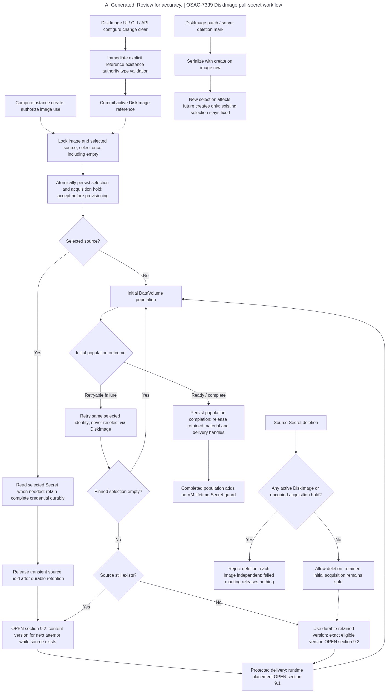
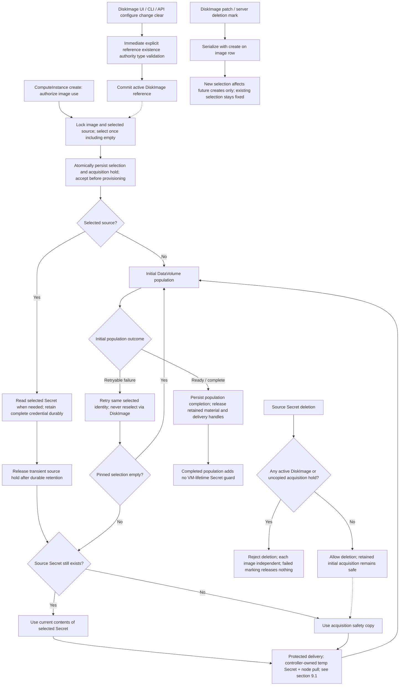

# DiskImage Pull-Secret References

## Summary

Add one optional typed pull-secret reference on DiskImage. Select the Secret
identity once at ComputeInstance creation. When initial image population (or
its retries) needs credentials, use the **current contents** of that same
Secret if it still exists. A private acquisition copy is only a safety net
when the source was deleted before acquisition finished — not a separate
content-refresh policy. See [PRD](prd.md) and PR #477 author clarification.

Local tags L1–L9 in this draft are review aids mapped from PRD In Scope
bullets, not PRD FR/NFR IDs. Named structures, flags, and error mappings
below are proposed design choices, not existing implementation claims.

## Motivation

The API already defines typed pull secrets, but DiskImage has no field to
reference one. ComputeInstance preparation is synchronous in
fulfillment-service; provisioning runs later through osac-operator and AAP.
Resolving the secret only in a later reconciler could change which credentials
apply to an already-accepted request. The current AAP root DataVolume uses node
pull without an explicit secretRef; that alone does not prove a registry-auth
defect.

### Goals

- Make creation-time selection durable before accepting an instance,
  independently of reconciliation scheduling (L4/L8).
- Enforce reference validity and deletion serialization in the backend,
  not only in UI selectors (L1/L2/L7).
- Deliver one complete selected credential through a protected provisioner
  boundary without granting tenants secret read/discovery (L3/L5/L6).
- Release acquisition retention when initial population completes or
  teardown is confirmed; never retain it merely because a VM still exists
  (L8).

### Non-Goals

- ComputeInstance pull-secret overrides or CatalogItem pull-secret
  references.
- Installation-wide or tenant default pull-secret references.
- Secret CRUD/content APIs, rotation/expiry product work, or external
  secret-manager integration.
- Registry mirrors/proxies/fallback, CA trust configuration, or CaaS
  credential management.
- Deferred OSAC-7338.
- A new general post-terminal, cancellation, or VM-deletion retry feature.
  Existing secret-content management remains unchanged.
  [PRD: Out of Scope; User]

## Proposal

High-level changes:

1. **DiskImage**: add optional `spec.pull_secret_secret` (`SecretReference`).
2. **Fulfillment create path**: at ComputeInstance create, authorize image
   use, pin the selected Secret identity (including empty), and take an
   acquisition hold before accepting the instance.
3. **Private acquisition retention**: copy the complete credential into
   controller-only storage so initial DataVolume population and retries
   do not depend on a deleted source Secret. Stability against later
   DiskImage edits comes from the create-time pinned Secret identity
   (#2), not from this safety copy.
4. **Operator / AAP / CDI**: deliver credentials through the proposed
   protected path in §9.1 (controller-owned temp Secret + existing
   `pullMethod: node`); no secret identity or bytes in ordinary extra vars
   or tenant-readable staging.
5. **Secret delete guards**: active DiskImage references and uncopied
   holds block delete; a successful VM lifetime alone does not.

### Workflow Description

**Actors:** Cloud Provider Admin or Tenant Admin (configure DiskImage
reference); Tenant User or Admin (create ComputeInstance); fulfillment,
operator, AAP, and CDI (provisioning).

Flow: authenticate DiskImage write → validate typed reference → persist
DiskImage. On ComputeInstance create: authorize image use → lock DiskImage
revision and selected Secret lifecycle → persist selection plus acquisition hold
→ accept instance → privileged worker retains the complete credential →
protected delivery → verified initial DataVolume population → release hold and
retained material. An explicit empty selection is also durable: a later
DiskImage edit cannot inject credentials into that instance. (L1–L4/L7/L8)

Fulfillment owns authorization, selection, and guard state. Only its private
acquisition worker retrieves credential bytes via the existing backend adapter.
Operator/AAP receive an opaque acquisition handle, not a source Secret identity.
A narrowly authorized delivery service materializes credentials only at the
CDI execution boundary per §9.1 (controller-owned temp Secret wired into the
root DataVolume; not tenant-readable). The opaque handle and private fetch
endpoint are proposed. (L5/L8)

No public selection-status, source indicator, or inheritance flag is added.
Public instance responses never expose selected-secret identity, existence, or
provenance. (L5)



<details>
<summary>Editable workflow source</summary>



</details>

The diagram separates once-only identity selection from later content reads.
DiskImage edits do not change an accepted instance's selection. Source deletion
is blocked by each active image and any still-uncopied hold; a durable retained
copy allows eventual deletion without breaking initial retries. After DataVolume
population is ready, that population generally does not use credentials again.
Delivery placement is proposed in §9.1. Content policy is decided: live
contents of the selected Secret when it exists; acquisition copy only if
the source is already gone. [User; L3–L8; PR #477]
Source: [assets/workflow.mmd](assets/workflow.mmd).

### API Extensions

Extend existing DiskImage create/get/list/update with the optional typed field.
No new public endpoint. Validate reference shape, write authority,
discovery/select authority, SECRET_TYPE_PULL_SECRET, and lifecycle on
create/change.

Proposed error mapping (reuse existing resolver conventions where possible):

- malformed / not found / wrong type → `InvalidArgument` (only for
  authorized discoverers)
- denied explicit selection → `PermissionDenied`
- concurrent deletion / in-use dependency → `FailedPrecondition`
- unexpected backend failure → `Internal` or existing availability mapping

Do not echo protected names or DAO denial reasons. Callers without discovery
authority must get the same generic PermissionDenied for inaccessible or unknown
targets so a guessed ID is not an existence oracle. Inherited acquisition
failures use generic image-acquisition text. (L1/L2/L5/L6)

Proposed CLI: `--pull-secret <typed-reference>` plus an explicit clear
operation. UI lists only authorized discoverable secrets; change/clear needs
server authorization. Update masks must distinguish omission from clear so a
hidden reference is not cleared when saving unrelated fields. (L1/L6)

Secret delete rejects active DiskImage references or uncopied acquisition holds
with a generic in-use error (never the protected referrer identity). Tenants
cannot create or update private acquisition records. (L5/L7/L8)

## UX Alignment

DiskImage already has console coverage. Map the new field as:

| UI field | Proto field (this EP) | Notes |
|---|---|---|
| `spec.pullSecretSecret` (TBD naming) | `spec.pull_secret_secret` | Typed Secret reference; selectors show only discoverable pull secrets; redact identity for viewers without discovery permission |

Deviations: none intended beyond existing Secret-reference UX patterns.
Confirm final `@temp-api` names during implementation.

### Implementation Details/Notes/Constraints

#### Proposed contract and storage sketches

These sketches are documentation only. At the recorded baseline `DiskImageSpec`
uses tags 1–6. Tag 7 below is a proposed available tag, subject to
compatibility/generation review; it is not reserved or implemented. Import
`secret_type.proto` when implementing this source change. Message-field absence
represents the optional reference; retain existing type-safe resource-reference
validation. No ComputeInstance or CatalogItem pull-secret field is proposed.
[Codebase: proto/private/osac/private/v1/disk_image_type.proto;
proto/private/osac/private/v1/secret_type.proto; L1/L2]

```proto
message DiskImageSpec {
  SecretReference pull_secret_secret = 7;
}
```

The snippet is an addition to the existing message, not a replacement of tags
1–6. The current `SecretReference` contains `id`, `name`, `project` and
`shared`; canonical ID resolution happens on the server, not by accepting a
caller's purported inherited selection.

```sql
CREATE TABLE image_acquisitions (
  instance_id text PRIMARY KEY,
  disk_image_id text NOT NULL,
  image_revision text NOT NULL,
  selected_secret_id text,
  selection_present boolean NOT NULL,
  state text NOT NULL CHECK (state IN (
    'awaiting_copy', 'retained', 'acquiring',
    'retryable_failure', 'complete', 'abandoned'
  )),
  retained_handle text,
  retained_generation bigint NOT NULL DEFAULT 0,
  population_complete boolean NOT NULL DEFAULT false,
  CHECK (selection_present = (selected_secret_id IS NOT NULL))
);
CREATE INDEX image_acquisitions_uncopied_source
  ON image_acquisitions (selected_secret_id)
  WHERE state = 'awaiting_copy';
```

Table/column names and text revision representation are proposed. Actual
resource IDs are strings in proto. Do not add a foreign key that prevents
deleting a source after retention: the historical selected identity survives
separately from source lifecycle. No credential bytes belong in this table. A
migration after the current baseline must add an indexed DiskImage
reverse-reference predicate, preserve current migration `114` guards and place
both new guards before its HUB exemption. Allocation of a new migration number
is implementation work. (L4/L5/L7/L8)

#### Proposed interfaces and preparation pseudocode

```go
type AcquisitionRetention interface {
    Retain(ctx context.Context, instanceID string, generation int64,
        data map[string][]byte) (string, error)
    Load(ctx context.Context, handle string) (map[string][]byte, error)
    Release(ctx context.Context, handle string) error
}
```

This is a proposed controller-only interface, distinct from current
`vault.SecretStore.Store/Fetch/Delete(ctx, tenant, project, name, ...)`. Its
opaque string is scoped to the instance/generation and authenticated
controller; possession alone grants no access. Retention is an acquisition
safety copy for source-delete races, not a freeze-vs-refresh product.
There is no production implementation or generated binding in this draft.
(L5/L8)

```text
DiskImageWrite(request, caller, transaction):
    authorize image write and explicit discovery/select authority
    resolve spec.pull_secret_secret as SECRET_TYPE_PULL_SECRET or empty
    lock referenced source and recheck lifecycle/type before committing

PrepareComputeInstanceCreate(candidate, caller, transaction):
    authorize use of selected DiskImage
    lock DiskImage and read its committed reference once
    if nonempty: lock source; recheck active state; create uncopied hold
    persist candidate and private selection atomically, including empty
    accept only after transaction commit

InitialPopulationAttempt(instance):
    load persisted identity; do not read DiskImage for reselection
    if credential needed: read same source or retained material
    if source exists: use current contents of selected Secret; else use safety copy
    retain safety copy before releasing source hold when nonempty
    deliver via section 9.1 path (controller-owned temp Secret + node pull)
    on retryable initial failure: retain safety and retry same identity
    on DataVolume ready: acknowledge completion and release material
```

Reading the selected Secret's current contents is not selecting a different
Secret. Credentials are read when needed for initial population; no automatic
in-flight hot-reload of a running importer is specified. (L4/L8; User; PR #477)

| Existing source / proposed addition | Responsibility and boundary |
|---|---|
| `proto/private/osac/private/v1/disk_image_type.proto` | Add the proposed typed field/import; generate public/private bindings during implementation, not in this draft. |
| `fulfillment-service/internal/servers/private_disk_images_server.go`, `secret_reference_validation.go` | Immediate explicit validation, update-mask semantics and discovery-safe projection. |
| `fulfillment-service/internal/servers/private_compute_instances_server.go` | Extend synchronous `prepareCreate` / `CreateWithCandidatePreparation` with atomic selection. |
| Proposed acquisition DAO/migration under `fulfillment-service/internal/database/` | Persist private identity/hold; add reverse guards using current `114` behavior, without a VM-lifetime pin. |
| `fulfillment-service/internal/servers/private_secrets_server.go`, `internal/vault/vault_secret_store.go`, `internal/servers/hub_secret_fetcher.go` | Preserve existing update/read permissions and methods; integrate source-delete guard, not new Secret CRUD. |
| `fulfillment-service/internal/controllers/computeinstance/computeinstance_reconciler_function.go` | Consume persisted selection/acquisition; do not resolve credentials anew through the current image. |
| `osac-operator/pkg/provisioning/aap_provider.go`, `extra_vars_context.go` | Proposed opaque handoff and completion acknowledgment; no credential values in ordinary extra vars. |
| `osac-aap/collections/ansible_collections/osac/templates/roles/ocp_virt_vm/tasks/create_resources.yaml` | Extend root DataVolume create: keep `pullMethod: node`; when a pull secret is selected, attach the controller-owned temp Secret per §9.1. |
| `fulfillment-service/internal/cmd/cli/create/diskimage/create_diskimage_cmd.go`, `osac-ui/apps/e2e-tests/src/vmaas/create.disk_images.spec.ts` | CLI/UI reference lifecycle and visibility coverage; change/clear syntax is proposed. |

Proposed indexed reverse lookup covers active DiskImage Secret IDs and transient
uncopied acquisition holds. Insert/update validates referenced Secret
existence/type/active state with a row lock conflicting with deletion marking.
DiskImage patch/delete and instance creation lock the same DiskImage row; lock
order is DiskImage then Secret for those operations, Secret only for source
deletion. Secret delete must not acquire DiskImage locks: it holds the Secret
row and queries committed indexed references; a waiting writer rechecks Secret
lifecycle after obtaining its lock. Serializable/retryable transaction failures
are retried before success is returned. Migration must account for `114`'s
current function, not replace it with `111`'s obsolete body, and run new
DiskImage/hold checks before HUB exemption. Preserve unrelated guards.
(L2/L7/L8)

### Scalability and Performance

Work is bounded per DiskImage write and instance create: one selected reference.
Indexed guards avoid full JSONB scans. Retention stores one complete secret per
outstanding acquisition, not for VM lifetime. Benchmark acceptance-path lock
contention and retention backlog before release; do not invent a product SLO.
Stuck acquisitions need operator-visible recovery, not time-based expiry that
breaks accepted retries. (L3/L4/L8)

### Security Considerations

Protected inheritance is a privileged operation scoped to an already-authorized
DiskImage/instance binding, never a general secret getter. Reject
caller-supplied selected IDs/handles. Controllers are least-privilege; no broad
tenant impersonation or general OPA bypass. Where existing shared Secret
metadata listing would reveal protected credentials, apply stricter discovery
exclusion without globally hiding unrelated shared resources. (L2/L5)

Project hidden references out of get/list/create/update responses, filters, and
sort/pagination. Reject filter/sort on protected relation fields without probing
a hidden target. CLI, UI, validation errors, audit payloads, and status mapping
share that visibility decision. No opaque placeholder, populated boolean, or
inherited-source badge. Tenant DiskImage references stay visible to authorized
discoverers. Denied explicit reuse is enforced server-side even if the ID was
guessed. (L5/L6)

Do not put source identity or material in CR annotations, events, ordinary AAP
extra vars, job artifacts, or logs. Ansible no_log alone does not protect stored
AAP inputs or Kubernetes Secret reads. Tenant-readable staging Secrets or
mountable pods in the target namespace violate L5. §9.1 proposes a
controller-owned temp Secret plus existing node pull, deleted when the
DataVolume is ready; fail closed if that placement cannot be made private.
(L5)

### Failure Handling and Recovery

| Event | Proposed serialization / recovery | Observable outcome |
|---|---|---|
| DiskImage patch races instance create | Shared row serialization; winner defines the revision read by create. Revalidate after lock wait. | Accepted instance uses exactly old or new complete selection; later creates use the committed new source. |
| DiskImage server delete races instance create | Delete marking and creation serialize on the image row. Create winning commits its hold; delete winning causes normal non-active-image rejection. | No accepted instance is left without its selected acquisition. |
| Secret delete races instance create | Secret lock plus atomic acquisition hold protects any accepted nonempty selection until durable retention. While the image reference is active, its independent guard already rejects source deletion. If image clear wins first, create sees empty; if create wins first, its hold survives that clear. A stale/deleting source reached through a defensive fixture rejects nonempty creation. | Every legal API ordering preserves either empty selection or a protected accepted acquisition; no source-delete win is assumed against an active image guard. |
| Copy/storage failure after instance acceptance | Keep `awaiting_copy` hold; retry same selection. Backend read/copy errors never trigger reselection. | Existing provisioning failure/pending surface reports generic image acquisition issue, without secret identity. |
| Copy succeeds, acknowledgment crashes | Idempotent object key tied to instance/generation; verify durable object before transitioning to `retained` and releasing source hold. Orphan sweep must cross-check committed records. | Retry succeeds without duplicate visible resources or credential reselection. |
| Selected source deleted after retention | Retry from retained complete credential; never reread DiskImage for selection. | Initial acquisition including node/job retry succeeds if credentials themselves remain valid. |
| Authentication/transient import failure | Keep retained credential through retryable failure and controller restart. No merge/fallback. Content-update semantics are unchanged; retention is acquisition safety, not a new rotation contract. | Generic acquisition failure; retry uses same selected source and available retained material. |
| Initial DataVolume population ready | Persist trustworthy CDI population completion before marking `complete`; delete temporary credentials/handles idempotently. Credentials are generally not used again for that completed population. | Source deletion succeeds once independent active DiskImage references are removed; running VM remains intact. |
| Existing teardown before population completes | Stop importer/jobs; confirm cessation before private retention cleanup. Unknown remote outcomes require safe cleanup reconciliation, not a newly promised cancellation/post-terminal retry feature. | No VM-lifetime source guard; no new acquisition after confirmed teardown. |
| DiskImage deletion request fails/rolls back | Only committed server deletion mark changes active guard predicate. Client metadata and failed backend work cannot release it. | Secret deletion remains blocked by each still-active DiskImage. |

Once the retention copy is durable, acquisition alone no longer holds the source
Secret, even if population is incomplete. Active DiskImages remain independent
guards. Without a durable copy, the transient hold releases only on successful
copy or confirmed teardown. No time-based release during initial retries.
(L7/L8)

Selection pins Secret identity, not frozen content. Existing Secret mutation
and Fetch-current behavior stay unchanged. Later initial attempts use current
contents when the source still exists; the acquisition copy is only for
source-delete safety. Already-started attempts are not automatically
hot-reloaded. (L4; User; PR #477)

### RBAC / Tenancy

Provider and tenant admins may select only references allowed by existing scope
and typed-reference authority. Image consumers need image-use authority, not
protected-secret discovery/read/select. Enforce in public mapping and private
backend checks; UI hiding is not sufficient. Controller-owned objects keep
osac.openshift.io/tenant and owner-reference metadata while hiding source
identity. Do not expose retained credentials as tenant Secrets or allow
arbitrary handle fetch. (L1/L2/L5/L6)

### Observability and Monitoring

Proposed controller-only metrics:
osac_image_acquisition_retries_total{failure_class} and
osac_image_acquisitions_pending, with no tenant/Secret/registry identity labels.
Alert on sustained pending growth using deployment-specific thresholds.
Acquisition correlation stays in operator logs. Tenant events/errors expose only
generic image acquisition status and authorized instance identity.
AAP/diagnostic artifacts need the same confidentiality review as public APIs.
(L5/L8)

### Risks and Mitigations

- **Delivery confidentiality (§9.1):** wrong namespace or tenant-readable
  staging leaks credentials. Mitigate with the proposed controller-owned
  temp Secret + node-pull path, fail closed if tenants can read/mount it,
  and confirm CDI field wiring with VMaaS.
- **Lock contention:** create vs DiskImage patch vs Secret delete. Mitigate
  with documented lock order, indexed guards, and benchmarks.
- **Migration/guard regressions:** new DiskImage guards must run before
  HUB exemption in migration 114 lineage. Mitigate with migration review
  and guard tests.

### Drawbacks

- Adds private retention storage and an acquisition state machine beyond a
  simple DiskImage field.
- Couples fulfillment, operator, and AAP for the §9.1 protected delivery
  contract (handle → controller-owned temp Secret → CDI node pull).
- More complex delete/race behavior than “block Secret delete while any VM
  exists,” which the PRD explicitly rejects.

## Alternatives (Not Implemented)

- **Reconcile-time selection:** simpler, but can change credentials after
  accept; reject (L4).
- **Pin Secret until VM teardown:** simpler than retention, but blocks
  delete for live VMs; reject (L8).
- **Copy inside the create RPC without outbox/hold:** needs
  storage/DB atomicity before accept; rejected in favor of durable
  hold/outbox recoverability (L8).
- **Reselect via DiskImage on each retry:** fails deletion safety and
  source-edit semantics; reject (L4/L8). Re-fetching current contents of
  the *same* selected Secret is the adopted behavior when the source still
  exists (PR #477), not DiskImage reselection.
- **Freeze a retained copy and leave P1/P2 content-refresh open (former
  §9.2):** treat acquisition retention as a content-version product with an
  unresolved “reuse A vs Fetch B” matrix. Rejected. Create-time selection
  pins Secret **identity**; provisioning uses **current contents** of that
  Secret when it exists. The acquisition copy is only a delete-safety net
  when the source is already gone — not a separate refresh policy.
- **Short-lived source guard until DataVolume ready (no safety copy at
  all):** can delay deletion through stalled retries after DiskImage refs
  are cleared. Not chosen as the sole mechanism; a safety copy still covers
  source-delete during initial acquisition while live contents are preferred
  when the source remains.
- **Credentials in ordinary AAP extra vars or tenant-readable Secrets:**
  leaks; reject (L5).
- **Merge node/default secrets:** forbidden supplementation; reject (L3).
- **Do nothing:** cannot configure image-specific existing references
  (L1).

## Open Questions

### 9.1 Protected CDI delivery placement and supported runtime

- **Owner:** VMaaS/provisioning (confirm CDI field wiring); security
  (confirm tenant cannot read/mount).
- **Status:** PROPOSED (design decision). Remaining check: exact CDI
  Secret field/key names on the supported CNV/CDI channel.

**Proposed path (from current code):** today’s root DataVolume already uses
`docker://…` with `pullMethod: node` and no pull secret
(`osac-aap/.../ocp_virt_vm/tasks/create_resources.yaml`). When a DiskImage
pull secret is selected:

1. Keep `pullMethod: node` (do not switch to pod pull for this feature).
2. Materialize credentials into a **controller-owned** temporary Kubernetes
   Secret (not a tenant-owned/readable Secret; not ordinary AAP extra vars).
3. Wire that Secret into the root DataVolume using the CDI-supported
   registry-auth mechanism for node pull (exact field name confirmed with
   VMaaS against the installed CNV/CDI version).
4. Delete the temporary Secret when DataVolume population is ready (or on
   confirmed teardown).
5. **Fail closed** if nonempty credentials cannot be placed privately:
   do not ignore the selected secret, and do not stage it where tenants can
   read or mount it.

**Not proposed:** putting source Secret identity or credential bytes in CR
annotations, events, ordinary extra vars, or job artifacts; merging with
node/default pull secrets; claiming go.mod API pins alone prove the runtime
matrix.

**Verification left:** VMaaS records the supported CNV/CDI channel and the
exact DV/Secret wiring fields used in step 3; security signs off that the
temp Secret’s namespace/RBAC is non-tenant-readable. Gate enabling nonempty
DiskImage pull-secret references until that wiring is implemented.

## Test Plan

Concrete scenarios live in [testplan.md](testplan.md). API/database
harnesses cannot alone prove node-pull authentication, namespace
confidentiality, or a real initial-population retry; those remain release
gates.

## Upgrade / Downgrade Strategy

Absent field preserves existing DiskImage behavior. Additive proto changes
need generated bindings and coordinated fulfillment, operator, and AAP
delivery. Gate nonempty references until the protected transport is
supported; fail closed. Existing instances without acquisition records keep
current behavior; no retrospective selection. Drain or cancel pending
acquisitions and clear new references before reverting schema/consumers.
No in-place upgrade product capability is introduced.

## Version Skew Strategy

Operator/AAP consumers that do not understand the acquisition handle must
not silently ignore nonempty DiskImage pull-secret references. Prefer fail
closed until versions are aligned.

## Support Procedures

Stuck `awaiting_copy` / pending acquisition metrics and operator logs
(correlation id, sanitized failure class) are the primary support signals.
Do not instruct support to dump credential payloads.

## Infrastructure Needed

Controller-only retention storage for delete-safety copies, plus the §9.1
controller-owned temp Secret used at CDI node-pull time. Existing Vault/HUB
Secret APIs are not proof that retention already exists.

## Interface Contracts (traceability)

- **IC-1** DiskImage configure/change/clear and projection (L1, L2, L6).
- **IC-2** Creation-time selection/hold; no public override (L3, L4, L8).
- **IC-3** Protected inherited use and redacted errors (L5, L6).
- **IC-4** Source-secret deletion outcomes (L7, L8).
- **IC-5** Privileged credential delivery per §9.1 proposed path (L3, L5, L8).
- **IC-6** Operator diagnostics without secret identity (L5, L8).
- **IC-7** UI/CLI/API documentation (L9).

## Provenance

Drafted from merged PRD
`198fe4349261779a8d7a29f786408a7efe60e71f` (PR #477) against OSAC baseline
`0d54f8b27a260e63d68665261c732f1e3267d5e2`, structured to match
[design_template.md](../../guidelines/design_template.md). This records
drafting, not technical approval.
