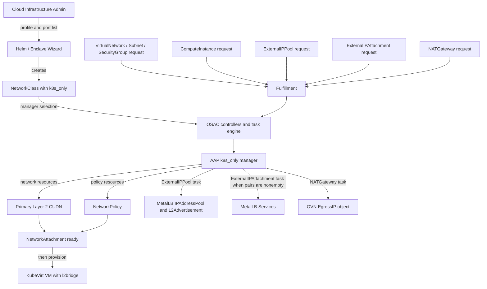
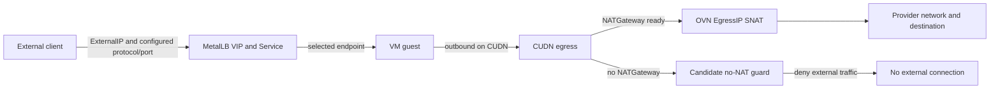

# Tenant networking for VMaaS without a Fabric Manager

| Field | Value |
|---|---|
| Author(s) | Ori Amizur |
| Jira | [OSAC-7436](https://redhat.atlassian.net/browse/OSAC-7436) |
| PRD | [prd.md](prd.md) |
| Date | 2026-11-16 |

# 1. Overview

This design adds a Kubernetes-only networking profile for new VMaaS hub installations on OpenShift 4.22 or newer. The profile uses a primary Layer 2 CUDN for tenant VM networks, NetworkPolicy for SecurityGroups, MetalLB Layer 2 Services for the installation-wide inbound protocol/port pairs, and treats OVN-Kubernetes EgressIP as the NATGateway source-address translation candidate. The provider supplies the connected underlay and address capacity; OSAC creates no Fabric Manager registration and configures no physical fabric. [Locked: D2] [Locked: D3] [Locked: D5] [Locked: D7]

Tenant networking APIs and lifecycles remain the shared OSAC model. The profile changes installation validation, NetworkClass resolution, and Kubernetes Manager task ownership. The ExternalIP port list is immutable installation configuration, not a tenant or per-ExternalIP field. EgressIP guest forwarding and fail-closed egress without a NATGateway remain implementation gates in §9. [Locked: D1] [Locked: D4] [Locked: D9] [Locked: D10] [Research: §Existing Solutions and Tools]

# 2. Goals and Non-Goals

## 2.1 Goals

- Let a Cloud Infrastructure Admin select a Kubernetes-only profile for a new VMaaS hub installation without configuring a Fabric Manager. [PRD: §In Scope, item 1] [Locked: D5]
- Preserve tenant VirtualNetwork, Subnet, SecurityGroup, VM attachment, ExternalIP, and NATGateway APIs and tenant authorization. [PRD: §In Scope, items 4–6] [Locked: D1]
- Limit inbound VM ExternalIP Services to the installation-wide protocol/port pairs, with SecurityGroups able to narrow access. [PRD: §In Scope, item 7] [Locked: D10]
- Implement NATGateway with OVN EgressIP and block outside-VirtualNetwork egress when no NATGateway exists. [PRD: §In Scope, item 8] [Locked: D3]
- Preserve the existing network-task readiness, retry, and cleanup contracts. [PRD: §In Scope, item 6] [Codebase: `osac-operator/internal/networktask/doc.go`]

## 2.2 Non-Goals

- BMaaS and CaaS networking, remote workload clusters, conversion of existing deployments, multi-hub networking, IPv6, and dual stack. [PRD: §Out of Scope]
- OSAC configuration of provider switches, routers, or BGP peers. [PRD: §In Scope, item 3]
- More than one VM-capable Subnet per VirtualNetwork or inter-Subnet VM routing. [Locked: D9]
- ICMP or arbitrary IP-level forwarding through VM ExternalIP Services. Explicit ICMP-only SecurityGroup rules remain unsupported. [Locked: D4] [Locked: D10]

# 3. Motivation / Background

The installer currently requires `global.networking.fabricManager`; VMaaS selects `cudn_evpn`, whose primary CUDN depends on Fabric Manager EVPN/VNI data. The AAP `k8s_only` composite delegates CUDN, NetworkPolicy, and MetalLB operations, but it is not registered as an installable Kubernetes Manager, lacks the complete VM attachment lifecycle, and has no NATGateway task. The operator's ExternalIP and NATGateway controllers launch Fabric tasks directly. [Codebase: `osac-installer/charts/osac/templates/_networking.tpl`] [Codebase: `osac-aap/collections/ansible_collections/osac/templates/roles/k8s_only/README.md`] [Codebase: `osac-operator/internal/controller/externalip_controller.go`] [Codebase: `osac-operator/internal/controller/natgateway_controller.go`]

**ExternalIP ingress** is MetalLB's `LoadBalancer` Service path with explicit ports. **NATGateway egress** is an OVN EgressIP path that gives selected VM traffic a stable source address. EgressIP assigns a source address; it does not by itself prevent CUDN egress from falling back to the node's address. The no-NATGateway requirement therefore needs a separate egress guard. [Research: §Existing Solutions and Tools — MetalLB Layer 2 and Kubernetes LoadBalancer Services] [Research: §Existing Solutions and Tools — OVN-Kubernetes EgressIP]

# 4. Design

## 4.1 Architecture

The Cloud Infrastructure Admin selects `global.networking.profile: kubernetesOnly`. The installer maps this profile to an empty Fabric Manager and the standalone `k8s_only` Kubernetes Manager. The default profile remains `fabric`. The Kubernetes-only profile requires provider provisioning to be enabled and rejects enabled BMaaS or CaaS. Its derived VMaaS-only address plan is `{overlay: 1.0, fabric: 0.0, lbVip: 0.0}`. [PRD: §In Scope, items 1–2] [Locked: D5] [Locked: D8] [Codebase: `osac-installer/charts/osac/templates/_networking.tpl`]

### Resource provisioning



This view shows object reconciliation. The VM waits for its CUDN-backed NetworkAttachment; its inbound Service and NATGateway EgressIP come from separate resource requests. The provider's MetalLB pool is created while provisioning the ExternalIPPool. Because default tenant networking includes an ExternalIP and NATGateway, failure to provision that pool can indirectly delay default-network readiness; it does not make a VM's per-attachment LoadBalancer Service a launch prerequisite. [PRD: §In Scope, items 1, 3, 8] [Research: §Follow-up Findings — Domain 3: Egress policy for a primary Layer 2 CUDN]

### Packet flow



This view shows packets, not resource creation. MetalLB carries inbound traffic only after an ExternalIPAttachment creates Services for the configured pairs. Outbound packets use EgressIP when the NATGateway is ready; without a NATGateway they must be stopped by a supported guard. The provider supplies node connectivity, reachable addresses, and routing. [PRD: §In Scope, items 3, 7–8] [Research: §Follow-up Findings — Domain 3: Egress policy for a primary Layer 2 CUDN]

**Installation and NetworkClass.** The chart adds a `fabric`/`kubernetesOnly` profile selector and `global.networking.externalIPProtocolPorts`. In the Kubernetes-only profile, the chart emits no Fabric Manager and selects `k8s_only`; it rejects `provisioningEnabled: false`, BMaaS, or CaaS. The NetworkClass private API accepts an empty `fabric_manager` only when the standalone Kubernetes Manager is selected. The installer derives a stable NetworkClass name from that manager when the Fabric Manager name is empty. Existing fabric profile values and behavior stay unchanged. [PRD: §In Scope, items 1–2] [Locked: D5] [Locked: D8] [Codebase: `fulfillment-service/internal/servers/private_network_classes_server.go`] [Codebase: `osac-installer/charts/osac/files/network-class-step.py`]

**Manager resolution.** The installer registers `k8s_only` as an immutable Kubernetes Manager. Operator discovery permits this standalone registration without a Fabric Manager or `network_type`; it does not perform Fabric registration lookup or Fabric network-type pairing. It records `status.networkManagers.kubernetes`, leaves `.fabric` absent, and does not require fabric VNI/segment fields. K8S-only resources copy this manager reference and launch only Kubernetes tasks. Manager resolution derives `security_group_icmp` from the selected Kubernetes Manager alone. [Codebase: `osac-operator/pkg/networkmanager/networkmanager.go`] [Codebase: `osac-operator/internal/controller/networkclass_controller.go`] [Codebase: `osac-operator/internal/controller/networking_common.go`]

The current manager contract requires a Fabric Manager and requires every Kubernetes Manager `network_type` to match a type advertised by that Fabric Manager. This profile extends the contract for the explicit no-Fabric combination: `fabric_manager` may be empty only with `k8sManager=k8s_only`; the standalone registration omits `network_type`, leaving `NetworkClass.status.networkType` empty and avoiding EVPN-only VNI waits. Paired Fabric/Kubernetes registrations retain their current validation and behavior. [Codebase: `osac-operator/pkg/networkmanager/networkmanager.go`] [Codebase: `osac-operator/internal/controller/subnet_controller.go`] [Codebase: `osac-operator/api/v1alpha1/networkclass_types.go`]

**Tenant CUDN and VM attachment.** The registered `k8s_only` role creates a namespace per VirtualNetwork and one primary Layer 2 CUDN for the VirtualNetwork's VM-capable Subnet, using the OVN default overlay transport and persistent IPv4 IPAM. It creates the baseline deny, delegates SecurityGroup policies to `network_policy`, and applies/deletes VM bindings using the ComputeInstance API ID. The VM retains one primary `l2bridge` interface. The first Subnet to claim the VirtualNetwork CUDN is its VM-capable owner; VM attachment on another Subnet in the same VirtualNetwork fails with a tenant-readable implementation-limit message. No VTEP, EVPN route advertisement, or VNI allocation is used. [Locked: D1] [Locked: D9] [Codebase: `osac-aap/collections/ansible_collections/osac/templates/roles/cudn_evpn/README.md`] [Research: §Architecture Patterns — Internal Layer 2 transit routing]

SecurityGroups remain NetworkPolicy rules over the bound VM pod labels. The manager does not declare `security_group_icmp`; explicit ICMP-only rules are rejected, while `all` continues to include ICMP. [Locked: D1] [Locked: D4] [Codebase: `osac-aap/collections/ansible_collections/osac/templates/roles/network_policy/`]

**Inbound ExternalIP Services.** The immutable NetworkClass carries `externalIPProtocolPorts`, defaulting to TCP/22, and the operator passes the list into every VM ExternalIPAttachment task. The manager groups entries by protocol and creates one `LoadBalancer` Service per protocol, with all configured ports for that protocol. Thus TCP/22 and TCP/443 share one TCP Service, while UDP/53 uses a second Service. Each Service sets the same `spec.loadBalancerIP`, uses the same `metallb.io/allow-shared-ip` value derived from the ExternalIP API ID, selects the same VM endpoint, and sets `externalTrafficPolicy: Local` to preserve client source IP. An empty pair list is valid: no inbound VM Services are created, and a VM ExternalIPAttachment fails with an actionable final status; the allocated ExternalIP remains usable by a NATGateway. The configured list is the provider maximum; SecurityGroups may narrow it. [Locked: D2] [Locked: D10] [Research: §Existing Solutions and Tools — MetalLB Layer 2 and Kubernetes LoadBalancer Services]

**ExternalIP address ownership.** The K8S-only manager maintains one cluster-wide claim per normalized IP address for both MetalLB Service and OVN EgressIP consumers. `create_external_ip` atomically creates an owner-labeled ConfigMap claim for a free address in the READY ExternalIPPool and returns it through the existing `external_ip.address` result. The ConfigMap name is derived from the normalized address, not the ExternalIP API ID, so two API objects cannot claim the same address under different names. Its data and labels record the owning ExternalIP API ID. A retry for that same ID recovers the existing claim; a different ID treats the address as occupied and tries the next candidate. The claim also records one active consumer kind and API ID. `attach_external_ip` or `create_nat_gateway` acquires that consumer slot with a resource-version-checked update before creating Services or an EgressIP; retries from the same consumer are idempotent, while a second consumer fails before creating data-plane resources. Deletion removes the consumer's Services or EgressIP before clearing the slot. The address claim remains until ExternalIP deletion after dependency guards pass. [Codebase: `osac-aap/collections/ansible_collections/osac/templates/roles/metallb_l2/tasks/create_external_ip.yaml`] [Research: §Open Questions, 4]

The claim ConfigMap is in the OSAC networking namespace. Its name is a stable hash of the normalized address, and it is labelled with tenant, `owner-kind: externalip`, and the owning ExternalIP API ID. Kubernetes create-if-absent provides the atomic claim: on `AlreadyExists`, the manager reads the claim; the same owner ID recovers it idempotently, while a different owner ID skips that address. The address-derived name serializes attempts across distinct ExternalIP IDs. `IPAddressPool` remains `autoAssign: false`, and attached Services request the exact claimed address. [Codebase: `osac-operator/internal/controller/externalip_controller.go`] [Codebase: `osac-operator/internal/networktask/result.go`]

**NATGateway EgressIP.** `create_nat_gateway` receives the VirtualNetwork and allocated ExternalIP snapshots. It creates one cluster-scoped `EgressIP` named from the NATGateway API ID, with the ExternalIP address, a namespace selector for the VirtualNetwork, and a pod selector for OSAC VM launcher pods. Eligible egress nodes must be labelled `k8s.ovn.org/egress-assignable` and have provider connectivity for the address. The task waits for `EgressIP.status.items` to show an assignment before reporting success. OCP 4.22 lists EgressIP as supported for primary Layer 2 CUDNs. OpenShift's `l2bridge` connects the VM to the CUDN switch, and KubeVirt's bridge binding delegates the CNI address to the guest; this makes EgressIP handling of guest traffic plausible, but product documentation does not confirm it. OVN's transit router is internal CUDN plumbing, not a tenant gateway pod or router VM. OCP documents the base topology by 4.18.20; upstream v1.2.0 documents Layer 2 EgressIP improvements, but the exact OCP 4.22 route placement is not identified. [Locked: D3] [Research: §Follow-up Findings — Domain 4: EgressIP, KubeVirt guests, and transit-router versions]

**No-NATGateway egress guard.** Without EgressIP, a primary Layer 2 CUDN can SNAT egress to the forwarding node's IP, so the absence of a NATGateway is not fail-closed by itself. The K8S-only manager must block destinations outside the VirtualNetwork when no NATGateway is Ready while preserving provider-infrastructure access under the existing SecurityGroup and routing rules. A namespace `EgressFirewall` is a candidate, not a confirmed choice for this profile: OpenShift documents first-match, default-allow rules and one EgressFirewall per project. A guard would need explicit provider/API exceptions before its catch-all deny. If the candidate uses a CIDR-wide deny without port restrictions, the upstream OVN ACL matches the destination IP without a transport condition, which indicates coverage of ICMP as well; verify this behavior on the target OCP build. Upstream OVN places EgressFirewall after egress NetworkPolicy, so a firewall deny can further restrict a SecurityGroup-allowed flow; the implication that it will not override an earlier SecurityGroup deny must also be verified on the target CUDN. The no-NAT guard remains active until EgressIP assignment succeeds and is restored before EgressIP deletion. If no supported mechanism satisfies the PRD's isolation and provider-connectivity requirements, the profile is blocked. [Locked: D3] [PRD: §In Scope, item 8] [Research: §Follow-up Findings — Domain 3: Egress policy for a primary Layer 2 CUDN]

## 4.2 Data Model / Schema Changes

| Surface | Change |
|---|---|
| Tenant APIs | No schema changes to VirtualNetwork, Subnet, SecurityGroup, ExternalIPPool, ExternalIP, ExternalIPAttachment, NATGateway, or ComputeInstance. Existing tenant authorization and dependency guards remain in force. [PRD: §In Scope, items 4–8] |
| Helm values | Add `global.networking.profile` (`fabric` default, `kubernetesOnly`) and `global.networking.externalIPProtocolPorts`, defaulting to `{protocol: TCP, port: 22}`. In `kubernetesOnly`, `fabricManager` must be empty; `k8sManager` is derived as `k8s_only`. [Locked: D8] [Locked: D10] |
| Private NetworkClass API and hub CR | Permit empty `fabric_manager` only with `k8s_manager=k8s_only`; add immutable `spec.externalIPProtocolPorts`. Preserve all Fabric Manager validation for existing profiles. `status.networkManagers.fabric` is absent in the K8S-only profile. [Codebase: `proto/private/osac/private/v1/network_class_type.proto`] [Codebase: `osac-operator/api/v1alpha1/networkclass_types.go`] |
| Kubernetes Manager registration | Add an immutable `k8s_only` registration. Allow omitted `network_type` only when no Fabric Manager is selected; retain current type pairing for existing Fabric/Kubernetes combinations. [Codebase: `osac-operator/pkg/networkmanager/networkmanager.go`] |
| ExternalIP port pairs | `NetworkClass.spec.externalIPProtocolPorts` is an array of `{protocol: TCP|UDP, port: 1..65535}`. Reject duplicates and unsupported protocols; allow an empty array to disable inbound VM Services. Never copy the list to a tenant resource. [Locked: D10] [Research: §Existing Solutions and Tools — MetalLB Layer 2 and Kubernetes LoadBalancer Services] |
| Hub resources | The K8S-only manager owns primary CUDN, NetworkPolicy, candidate EgressFirewall, MetalLB IPAddressPool/L2Advertisement, protocol Services, ExternalIP claim ConfigMaps, and EgressIP objects. |

The private protobuf change is on the `NetworkClassSpec` carried by `NetworkClass.spec`; it does not change tenant-facing network APIs. The excerpt shows the proposed field number after the current fields and the restricted protocol/port value shape. The installer supplies TCP/22 by default; an explicitly empty repeated field disables inbound VM Services.

```protobuf
message NetworkClass {
  // Existing NetworkClass fields are unchanged.
  NetworkClassSpec spec = 12;
}

message NetworkClassSpec {
  // Existing fields 1-3 are unchanged.
  repeated ExternalIPProtocolPort external_ip_protocol_ports = 4;
}

message ExternalIPProtocolPort {
  ExternalIPServiceProtocol protocol = 1;
  uint32 port = 2; // Validate 1..65535.
}

enum ExternalIPServiceProtocol {
  EXTERNAL_IP_SERVICE_PROTOCOL_UNSPECIFIED = 0;
  EXTERNAL_IP_SERVICE_PROTOCOL_TCP = 1;
  EXTERNAL_IP_SERVICE_PROTOCOL_UDP = 2;
}
```

Reject duplicate protocol/port pairs and protocols outside TCP or UDP. The new `NetworkClassSpec` field is immutable after creation, matching the installation-wide setting.

The installer key remains `global.networking.externalIPProtocolPorts`; the protobuf field is `external_ip_protocol_ports` (protobuf JSON name `externalIpProtocolPorts`), and the hub CR uses `spec.externalIPProtocolPorts`.

For this VMaaS-only profile, the address plan is `{overlay: 1.0, fabric: 0.0, lbVip: 0.0}`. ExternalIPPool CIDRs remain provider-supplied and must not overlap tenant or excluded infrastructure ranges. [Codebase: `osac-installer/charts/osac/templates/_networking.tpl`] [PRD: Dependencies]

## 4.3 API Changes

No tenant-facing endpoint, CLI command, or workload resource field changes. Tenants continue using the existing networking APIs and readiness contracts. [PRD: §In Scope, items 4–8]

The installer exposes profile and port-pair settings through Helm and the Enclave Wizard. In `kubernetesOnly`, the schema rejects disabled provider provisioning, enabled BMaaS/CaaS, or a non-empty Fabric Manager. The port list accepts TCP/UDP and valid Service ports; TCP/22 is the default, and an explicitly empty list is valid. The Enclave plugin renders the repeatable `{protocol, port}` list from chart schema; if its current schema consumer does not support arrays of objects, the feature adds the required plugin control and contract coverage. With an empty list, VM ExternalIPAttachment provisioning fails with an actionable final status and creates no Service; the ExternalIP remains available for a NATGateway. [PRD: §In Scope, items 1–2, 7] [Locked: D8] [Locked: D10] [Codebase: `docs/agent-context/enclave-wizard-pipeline.md`]

The installer's NetworkClass step sends the port list to the private NetworkClass API and compares it on rollout with the stored immutable value, failing the rollout if it changes. Fulfillment validates that only the `k8s_only` combination may omit `fabric_manager`. The operator stores the list in the immutable hub NetworkClass and includes it in ExternalIPAttachment task input. When the list is empty, a VM ExternalIPAttachment reports `Ready=False`, reason `NoConfiguredPorts`, with the tenant-safe message `No ExternalIP protocol/port pairs are configured for this installation.` Fabric-profile NetworkClass creation and ExternalIP behavior remain unchanged. [Codebase: `osac-installer/charts/osac/files/network-class-step.py`] [Codebase: `fulfillment-service/internal/servers/private_network_classes_server.go`]

The ExternalIP claim ConfigMap is manager-owned hub state keyed by normalized address, with the owning API ID in metadata. It is not exposed through Fulfillment; the existing `external_ip.address` typed result remains the only address output. [Codebase: `osac-operator/internal/networktask/result.go`]

## 4.4 Scalability and Performance

Each NATGateway has one EgressIP. All matching VM traffic in its VirtualNetwork can concentrate on one egress node, limiting throughput for a busy VirtualNetwork; provider capacity planning must cover that load. MetalLB Layer 2 also funnels traffic for each Service VIP through one announcing node. [Research: §Existing Solutions and Tools — OVN-Kubernetes EgressIP] [Research: §Existing Solutions and Tools — MetalLB Layer 2 and Kubernetes LoadBalancer Services]

The number of ExternalIP Services is the number of attached VMs times the number of configured protocols. Each ExternalIP adds one small claim ConfigMap, and each NATGateway adds one EgressIP object. No tenant API database tables or high-frequency polling loops are introduced. EgressIP assignment is checked during NATGateway creation; subsequent node failover remains OVN-managed.

## 4.5 Security Considerations

Tenant-scoped authorization, owner references, baseline deny for unbound workloads, and provider-configured SecurityGroup defaults remain in effect. NetworkPolicy binds to the existing ComputeInstance ID pod label. EgressIP selectors include the VirtualNetwork namespace and VM launcher pod selector so one tenant's NATGateway cannot select another tenant's pods. Only the OSAC Kubernetes Manager's in-cluster service account creates the cluster-scoped EgressIP; tenants cannot create or edit it. [Locked: D1] [Locked: D4] [Codebase: `osac-aap/collections/ansible_collections/osac/templates/roles/cudn_evpn/README.md`]

The ExternalIP protocol/port list is provider-owned. It limits Service exposure; tenant SecurityGroups may narrow traffic. `externalTrafficPolicy: Local` preserves the client's source IP at the VM endpoint. The port list does not expose ICMP; explicit ICMP-only SecurityGroup rules remain rejected while `all` includes ICMP. [Locked: D4] [Locked: D10] [Research: §Existing Solutions and Tools — MetalLB Layer 2 and Kubernetes LoadBalancer Services]

EgressIP sets a source address but does not enforce the no-NATGateway rule. The separate guard must fail closed, permit only provider-infrastructure destinations already allowed by provider configuration, and retain those SecurityGroup decisions. OpenShift does not explicitly certify EgressFirewall for the target non-EVPN primary Layer 2 CUDN; its support and policy ordering must be verified before release. The manager labels every claim and hub object with tenant and API-ID ownership and never logs secrets. [PRD: §In Scope, item 8] [Research: §Follow-up Findings — Domain 3: Egress policy for a primary Layer 2 CUDN]

## 4.6 Failure Handling and Recovery

- **Invalid profile or manager combination:** Helm fails with a message naming the incompatible values; the private NetworkClass API rejects the same combination with `INVALID_ARGUMENT`. No NetworkClass or tenant networking resources are created.
- **Missing Kubernetes Manager registration:** NetworkClass becomes FAILED with a manager-resolution message. Resource creates remain blocked by the existing NetworkClass readiness gate.
- **CUDN or NetworkPolicy conflict:** Retryable Kubernetes API conflicts/timeouts retry through the network-task engine; final ownership conflicts fail the resource with a tenant-safe condition and administrator-visible task diagnostic. VM provisioning waits for its K8S NetworkAttachment task. [Codebase: `osac-operator/internal/networktask/doc.go`]
- **ExternalIP claim conflict:** A create-if-absent ConfigMap name derived from the normalized address makes allocation atomic across all ExternalIP API IDs. On conflict, the manager reads the existing owner: the same ExternalIP ID recovers its claim idempotently; a different ID moves to the next candidate. Deletion releases the claim only after dependency guards pass.
- **ExternalIP consumer conflict:** A resource-version conflict while claiming an ExternalIP for a second NATGateway or VM ExternalIPAttachment sets `Ready=False`, reason `ExternalIPInUse`, with a tenant-safe message that the address is already consumed. No Service or EgressIP is created for the losing consumer. Retries by the same consumer recover its slot. A failed consumer retains the slot until its partial resources are cleaned up.
- **Partial multi-protocol Service creation:** Deterministic ExternalIP/protocol Service names let retries converge. Partial TCP/UDP failure leaves the attachment not Ready; detach removes every Service from its stored input before claim release.
- **No inbound port pairs:** The manager creates no Service. A VM ExternalIPAttachment reports `Ready=False`, reason `NoConfiguredPorts`, with the message `No ExternalIP protocol/port pairs are configured for this installation.` before acquiring the consumer slot; the allocated ExternalIP can still be used by a NATGateway.
- **Unassigned or lost EgressIP assignment:** NATGateway remains PENDING until EgressIP status reports an assigned node/address. The no-NAT guard is active from creation and whenever assignment is absent, including after a previously assigned EgressIP loses its node during failover. Keep the guard active until assignment returns; restore it before OVN can send unmatched guest egress using a node IP. Missing eligible nodes or address reachability returns retryable diagnostics; invalid selectors or foreign-owned objects fail finally. The target OCP build must validate that assignment-loss transition is fail-closed (§9.1 and §9.2).
- **NATGateway deletion:** Restore the no-NAT guard before deleting EgressIP; release the ExternalIP claim only after EgressIP and Service consumers are removed. A failure retains finalizers and the claim. Existing default-tenant cleanup deletes NATGateway before its ExternalIP. [Codebase: `fulfillment-service/internal/controllers` default networking lifecycle]
- **No-NAT guard failure:** Do not report the VM network as ready if an unmatched flow could escape with a node IP. If no supported guard preserves provider-infrastructure policy, the profile is blocked per the PRD, not made NATGateway-optional. [PRD: Assumptions]

OVN handles EgressIP node failover after initial assignment; the design does not promise zero packet loss during node failure. The E2E plan checks the unassigned interval as well as the state after reassignment: no packet may escape with a node-IP source while the guard is active, and new connections recover with the ExternalIP source after assignment returns. The transition and OVN behavior remain validation gates in §9.1 and §9.2. [Research: §Existing Solutions and Tools — OVN-Kubernetes EgressIP]

## 4.7 RBAC / Tenancy

No tenant permission changes. Fulfillment continues to validate tenant ownership and dependencies for public resources. Profile and port configuration are installation surfaces. CUDN, NetworkPolicy, egress guard, and claim objects carry OSAC tenant/owner labels. EgressIP selects exactly one VirtualNetwork namespace and its VM launcher pods. [Locked: D1] [Locked: D8] [Codebase: `docs/agent-context/networking-decisions.md`]

## 4.8 Extensibility / Future-Proofing

The profile is an immutable NetworkClass/manager selection; a future Kubernetes-only backend can be added without changing tenant networking APIs. Existing `cudn_evpn` and Fabric Manager task paths remain unchanged. Additional inbound protocols require platform Service support and a provider setting; tenant and per-ExternalIP port overrides remain out of scope. The no-NAT egress guard stays in the K8S-only manager until a supported common contract exists.

# 5. Interface Changes

## IC-1: Kubernetes-only installation selection

**Requirements:** PRD §In Scope, items 1–2.

Add `global.networking.profile: kubernetesOnly` and conditional schema validation. The installer derives an empty Fabric Manager and `k8sManager: k8s_only`; Enclave presents the same option and rejects BMaaS/CaaS combinations. See §4.1 and §4.3.

## IC-2: Installation-wide ExternalIP protocol/port configuration

**Requirements:** PRD §In Scope, item 7.

Add immutable `global.networking.externalIPProtocolPorts`, default TCP/22; an empty list disables inbound VM Services while leaving NATGateway use available. Pass it from NetworkClass to each VM ExternalIPAttachment task. See §4.1, §4.2, and §4.3.

## IC-3: Standalone NetworkClass manager resolution

**Requirements:** PRD §In Scope, items 1, 4, and 5.

Permit the no-Fabric NetworkClass only with `k8s_only`, store a Kubernetes-only manager reference, skip Fabric lookup/network-type pairing, and leave fabric-only VNI/segment fields unset. Update installer NetworkClass creation, Fulfillment validation/name derivation, operator resolution/status, and resource manager selection. See §4.1 and §4.2.

## IC-4: K8S-only CUDN, SecurityGroup, and VM attachment tasks

**Requirements:** PRD §In Scope, items 4–6.

Register `k8s_only` and add the no-EVPN primary CUDN, baseline deny, NetworkPolicy SecurityGroup, and VM NetworkAttachment task path. Keep the single-VM-Subnet rule. See §4.1 and §4.5.

## IC-5: Protocol-scoped ExternalIP Services and address claim

**Requirements:** PRD §In Scope, item 7.

Allocate one ExternalIP claim and create one MetalLB Service per configured protocol, with the same VIP, `metallb.io/allow-shared-ip` key, VM selector, and source-preserving traffic policy. See §4.1, §4.2, and §4.6.

## IC-6: NATGateway EgressIP and no-NAT guard

**Requirements:** PRD §In Scope, item 8.

Add K8S Manager NATGateway tasks to create/delete EgressIP and to manage the fail-closed no-NAT guard. The guard implementation remains subject to §9.1. See §4.1 and §4.6.

## IC-7: Provider setup and operations documentation

**Requirements:** PRD §In Scope, item 9.

Document profile selection, OCP/provider prerequisites, port-pair behavior, NATGateway egress, address capacity, no-NAT behavior, and troubleshooting. See §4.1 and §8.

# 6. Alternatives Considered

| Alternative | Advantages | Disadvantages and reason not selected |
|---|---|---|
| Keep the current Fabric Manager plus `cudn_evpn` | Reuses current manager pairing and VM overlay. | Depends on EVPN/VNI and a Fabric Manager; it does not meet the no-Fabric profile. [Locked: D5] |
| Select `cudn_net` directly as the Kubernetes Manager | Reuses a CUDN role and NetworkPolicy delegation. | It registers as a Fabric Manager, has per-Subnet namespace semantics, and lacks the KubeVirt NetworkAttachment, ExternalIP manager dispatch, and NATGateway tasks. [Codebase: `osac-aap/collections/ansible_collections/osac/templates/roles/cudn_net/meta/osac.yaml`] |
| Use a tenant gateway pod or router VM for NAT | Can implement custom SNAT independent of EgressIP. | Adds a per-VirtualNetwork workload, an address, a return-path owner, and separate HA/lifecycle. OVN EgressIP is the selected candidate pending guest-path validation. [Research: §Architecture Patterns] |
| Use Localnet for inbound ExternalIP | Direct Layer 2 attachment to the provider network. | The PRD limits ingress to port/protocol pairs through MetalLB Services; Localnet adds underlay attachment and does not replace the Service allowlist. [Locked: D2] [Research: §Existing Solutions and Tools — MetalLB Layer 2 and Kubernetes LoadBalancer Services] |
| Use one mixed-protocol LoadBalancer Service | Fewer Service objects. | OCP 4.22 MetalLB guidance documents separate TCP and UDP Services sharing a VIP; the design follows that product-specific layout. [Research: §Existing Solutions and Tools — MetalLB Layer 2 and Kubernetes LoadBalancer Services] |
| Rely on missing EgressIP to block outside egress | Avoids an egress guard resource. | OVN may SNAT unmatched egress to the node IP; absence of an EgressIP alone does not prove the no-NAT requirement. [Research: §Existing Solutions and Tools — OVN-Kubernetes EgressIP] |

### Drawbacks of the selected approach

- A NATGateway's single EgressIP can concentrate a VirtualNetwork's egress on one eligible node, creating a throughput bottleneck and making provider reachability and OVN failover part of the service's availability path.
- The installation-wide ExternalIP protocol/port list is immutable after NetworkClass creation. An administrator cannot add an exposed port by changing tenant or per-ExternalIP settings; changing the installation requires a supported migration or reinstall procedure.
- The profile depends on provider-supplied Layer 2 reachability, routed address capacity, and return paths. OSAC does not configure the physical fabric, so an installation can be correctly configured in Kubernetes and still fail provider connectivity checks.
- Two release-critical behaviors still need target-version evidence: EgressFirewall support and ordering on a primary Layer 2 CUDN, and EgressIP source translation for KubeVirt guest traffic. If either is unsupported, the proposed profile cannot ship as designed.
- MetalLB Layer 2 advertises each VIP through one node at a time, and each configured protocol requires a Service. This can increase per-VM Service count and provides no per-VIP multi-node ingress load spreading.

# 7. Observability and Monitoring

NetworkClass Ready/Failed reports profile and manager-resolution errors without credentials. Existing resource conditions and `status.jobs` report task state, retry/final diagnostics, and readiness. Administrators can inspect CUDN, MetalLB Services, ExternalIP claim ConfigMaps, the egress guard, and EgressIP assignment status. Tenant status continues using fixed public messages and omits raw manager diagnostics. No new metrics are proposed. [Codebase: `osac-operator/internal/controller/networkclass_controller.go`] [Codebase: `osac-operator/internal/networktask/doc.go`]

# 8. Impact and Compatibility

This is a new-installation profile. Existing NetworkClass objects and fabric-backed deployments retain their current manager registrations, address plan, MetalLB behavior, and task paths; no migration or conversion is provided. The chart defaults to the current fabric profile. [Locked: D5]

No tenant-facing API schema changes. The change updates installer values/schema, the private NetworkClass API and hub CRD, NetworkClass resolution, manager task dispatch, the registered K8S-only role, and Enclave configuration rendering. OCP 4.22 or newer is required, and BMaaS/CaaS are rejected for this profile. [Locked: D7] [PRD: §In Scope, items 1–2]

The manager selection, ExternalIP pair list, and address plan are immutable after installation. Existing deployments cannot switch profiles by changing Helm values. [Locked: D5] [Locked: D10]

# 9. Open Questions

## 9.1 Which supported mechanism blocks external egress when NATGateway is absent?

- **Owner:** OSAC Networking
- **Impact:** §§4.1, 4.5, 4.6, IC-6. OCP 4.22 documents default node-IP SNAT for CUDN egress, so a separate guard is required. EgressFirewall is default-allow, first-match, and limited to one object per project; the product documentation does not explicitly support it on this non-EVPN primary Layer 2 CUDN. Confirm a supported guard, whether OSAC can own the namespace's single EgressFirewall object, that a CIDR-wide deny without ports blocks ICMP, and how provider/API exceptions preserve existing SecurityGroup decisions. Validate that the guard is active before unmatched egress can use node-IP fallback both when no NATGateway exists and during an EgressIP assignment-loss interval. If no supported, race-free guard exists, the PRD blocks the profile. [Research: §Follow-up Findings — Domain 3: Egress policy for a primary Layer 2 CUDN]

## 9.2 Does EgressIP translate OSAC KubeVirt guest traffic on the target CUDN?

- **Owner:** OSAC Networking and QE
- **Impact:** §§4.1, 4.4, 4.6, IC-6. OCP 4.22 lists EgressIP for primary Layer 2 CUDNs; the `l2bridge` and delegated CNI address make guest traffic matching plausible but do not prove it. Verify the observed guest egress source and reply path before and after VMI/launcher recreation, while initially unassigned, and across node failover. During any interval when `EgressIP.status.items` has no assigned node, verify no guest packet escapes with a node-IP source and confirm the no-NAT guard is restored until assignment returns. OpenShift's public release notes do not map the payload to upstream OKEP-5094 route placement. If no supported NAT path exists, or failover can expose node-IP egress, the PRD blocks the profile. [Research: §Follow-up Findings — Domain 4: EgressIP, KubeVirt guests, and transit-router versions]

---

## Provenance

Authored: respond @ design 0.15.0 - cd88680, workspace main @ 74219998b
Phases: draft, revise, revise, revise, revise, revise, respond, respond

<!-- ai-workflow-provenance:{"schema_version":1,"provenance_kind":"session","workflow":"design","workflow_version":"0.15.0","ai_workflows":"cd88680","source_repo":"74219998b","source_repo_branch":"main","commits_behind_main":0,"commits_ahead_main":0,"main_ref":"main","phases":["draft","revise","revise","revise","revise","revise","respond","respond"],"authoring_modes":["skill"],"context_changed":false,"origin_untracked":false} -->
