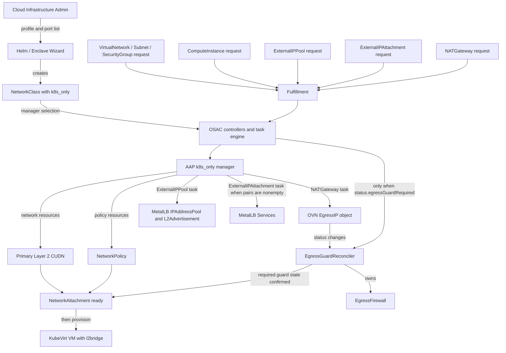
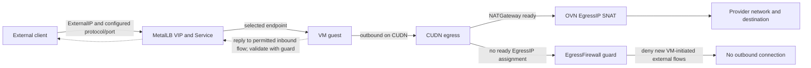

# Tenant networking for VMaaS without a Fabric Manager

| Field | Value |
|---|---|
| Author(s) | Ori Amizur |
| Jira | [OSAC-7436](https://redhat.atlassian.net/browse/OSAC-7436) |
| PRD | [prd.md](prd.md) |
| Date | 2026-11-16 |

# 1. Overview

This design adds a Kubernetes-only networking profile for new VMaaS hub installations on OpenShift 4.22 or newer. In this profile the management hub is also the only VM-hosting cluster; it cannot assign tenants to a separate host cluster. The profile uses a primary Layer 2 CUDN for tenant VM networks, NetworkPolicy for SecurityGroups, MetalLB Layer 2 Services for the installation-wide inbound protocol/port pairs, and treats OVN-Kubernetes EgressIP as the NATGateway source-address translation candidate. The provider supplies the connected underlay and address capacity; OSAC creates no Fabric Manager registration and configures no physical fabric. [Locked: D2] [Locked: D3] [Locked: D5] [Locked: D7]

Tenant networking APIs and lifecycles remain the shared OSAC model. The profile changes installation validation, NetworkClass resolution, and Kubernetes Manager task ownership. The ExternalIP port list is immutable installation configuration, not a tenant or per-ExternalIP field. EgressIP guest forwarding and fail-closed egress without a NATGateway remain implementation gates in §9. [Locked: D1] [Locked: D4] [Locked: D9] [Locked: D10] [Research: §Existing Solutions and Tools]

# 2. Goals and Non-Goals

## 2.1 Goals

- Let a Cloud Infrastructure Admin select a Kubernetes-only profile for a new VMaaS hub installation without configuring a Fabric Manager. [PRD: §In Scope, item 1] [Locked: D5]
- Preserve tenant VirtualNetwork, Subnet, SecurityGroup, VM attachment, ExternalIP, and NATGateway APIs and tenant authorization. [PRD: §In Scope, items 4–6] [Locked: D1]
- Limit inbound VM ExternalIP Services to the installation-wide protocol/port pairs, with SecurityGroups able to narrow access. [PRD: §In Scope, item 7] [Locked: D10]
- Implement NATGateway with OVN EgressIP and block outside-VirtualNetwork egress when no NATGateway exists. [PRD: §In Scope, item 8] [Locked: D3]
- Preserve the existing network-task readiness, retry, and cleanup contracts. [PRD: §In Scope, item 6] [Codebase: `osac-operator/internal/networktask/doc.go`]

## 2.2 Non-Goals

- BMaaS and CaaS networking, remote workload clusters, conversion of existing deployments, multi-hub networking, IPv6, and dual stack. [PRD: §Out of Scope]
- OSAC configuration of provider switches, routers, or BGP peers. [PRD: §In Scope, item 3]
- More than one VM-capable Subnet per VirtualNetwork or inter-Subnet VM routing. [Locked: D9]
- ICMP or arbitrary IP-level forwarding through VM ExternalIP Services. Explicit ICMP-only SecurityGroup rules remain unsupported. [Locked: D4] [Locked: D10]

# 3. Motivation / Background

The installer currently requires `global.networking.fabricManager`; VMaaS selects `cudn_evpn`, whose primary CUDN depends on Fabric Manager EVPN/VNI data. The existing AAP `k8s_only` composite uses legacy per-kind inputs, is not registered as a standalone Kubernetes Manager, lacks the generic VM attachment lifecycle, and has no NATGateway task. The operator's ExternalIP and NATGateway controllers launch Fabric tasks directly. This design adds a separate standalone manager role using the generic task contract and shared VM policy/binding logic. [Codebase: `osac-installer/charts/osac/templates/_networking.tpl`] [Codebase: `osac-aap/collections/ansible_collections/osac/templates/roles/k8s_only/README.md`] [Codebase: `osac-operator/internal/controller/externalip_controller.go`] [Codebase: `osac-operator/internal/controller/natgateway_controller.go`]

**ExternalIP ingress** is MetalLB's `LoadBalancer` Service path with explicit ports. **NATGateway egress** is an OVN EgressIP path that gives selected VM traffic a stable source address. EgressIP assigns a source address; it does not by itself prevent CUDN egress from falling back to the node's address. The no-NATGateway requirement therefore needs a separate egress guard. [Research: §Existing Solutions and Tools — MetalLB Layer 2 and Kubernetes LoadBalancer Services] [Research: §Existing Solutions and Tools — OVN-Kubernetes EgressIP]

# 4. Design

## 4.1 Architecture

The Cloud Infrastructure Admin selects `global.networking.profile: kubernetesOnly`. The installer maps this profile to an empty Fabric Manager and a Kubernetes Manager whose registration declares `fabric_manager_required: false` and `egress_guard_required: true`; `k8s_only` is the initial registration name. Its `ansible_role` points to a new role using the generic task contract, not the legacy `roles/k8s_only` composite. Other Kubernetes Managers retain the default Fabric Manager requirement and do not enable the guard by default. The profile requires provider provisioning, rejects enabled BMaaS or CaaS, and uses the management hub as its VM-hosting cluster; it does not target a separate VM-hosting cluster. Its derived VMaaS-only address plan is `{overlay: 1.0, fabric: 0.0, lbVip: 0.0}`. [PRD: §In Scope, items 1–2] [Locked: D5] [Locked: D8] [Codebase: `osac-installer/charts/osac/templates/_networking.tpl`]

### Resource provisioning



This view shows object reconciliation. The VM waits for its CUDN-backed NetworkAttachment; its inbound Service and NATGateway EgressIP come from separate resource requests. For a NetworkClass with `status.egressGuardRequired=true`, the NetworkAttachment becomes Ready only after the EgressGuardReconciler confirms the required guard state for the current NATGateway/EgressIP assignment. The guard transition and its ordering against OVN remain a target-cluster spike gate in §9.1. The provider's MetalLB pool is created while provisioning the ExternalIPPool. Because default tenant networking includes an ExternalIP and NATGateway, failure to provision that pool can indirectly delay default-network readiness; it does not make a VM's per-attachment LoadBalancer Service a launch prerequisite. [PRD: §In Scope, items 1, 3, 8] [Research: §Follow-up Findings — Domain 3: Egress policy for a primary Layer 2 CUDN]

### Packet flow



This view shows packets, not resource creation. MetalLB carries inbound traffic only after an ExternalIPAttachment creates Services for the configured pairs. VM-initiated outbound packets use EgressIP when the NATGateway is ready; without one, a supported guard must block every new flow to destinations outside the VirtualNetwork, including provider infrastructure. Replies to permitted inbound ExternalIP connections remain part of the inbound path and are validated separately in §9.3. [PRD: §In Scope, items 3, 7–8] [Research: §Follow-up Findings — Domain 3: Egress policy for a primary Layer 2 CUDN]

**Installation and NetworkClass.** The chart adds a `fabric`/`kubernetesOnly` profile selector and `global.networking.externalIPProtocolPorts`. In the Kubernetes-only profile, the chart emits no Fabric Manager and selects a Kubernetes Manager whose registration declares `fabric_manager_required: false` and `egress_guard_required: true`; `k8s_only` is the initial manager. It rejects `provisioningEnabled: false`, BMaaS, or CaaS. The management hub is registered and prepared as this profile's only VM-hosting cluster, following the [remote-cluster contract](/enhancements/OSAC-7305-remote-vm-cluster-networking/design.md); no separate VM-hosting cluster is targeted. All Kubernetes Manager tasks receive the common `cluster: {id: <hub name>}` input, which selects the hub's per-cluster credential. Fulfillment accepts an empty Fabric Manager only when a Kubernetes Manager is selected; it cannot read registration ConfigMaps. The operator validates `fabric_manager_required` and `egress_guard_required` during NetworkClass resolution; it fails the NetworkClass when the registration does not permit standalone operation. The installer derives a stable NetworkClass name from the selected manager. Existing fabric profile values and behavior stay unchanged. [PRD: §In Scope, items 1–2] [Locked: D5] [Locked: D8] [Codebase: `fulfillment-service/internal/servers/private_network_classes_server.go`] [Codebase: `osac-installer/charts/osac/files/network-class-step.py`]

**Manager resolution.** The installer registers the standalone Kubernetes Manager with `fabric_manager_required: false` and `egress_guard_required: true`. Fulfillment accepts the structurally valid empty-Fabric/Kubernetes-Manager combination; the operator reads the registration ConfigMap and rejects the NetworkClass unless the selected registration declares `fabric_manager_required: false`. It also resolves `egress_guard_required` and records the derived value as private `NetworkClass.status.egressGuardRequired`. A standalone manager omits `network_type`, so `status.networkType` is the zero-value empty string and the `omitempty` JSON tag leaves the field absent from serialized status. K8S-only resources copy the Kubernetes Manager reference and launch only Kubernetes tasks; each task receives `cluster: {id: <hub name>}` as required by the manager contract. Guard behavior is enabled only when the resolved NetworkClass has `status.egressGuardRequired=true`; this is independent of the manager name and of standalone capability itself. [Codebase: `osac-operator/pkg/networkmanager/networkmanager.go`] [Codebase: `osac-operator/internal/controller/networkclass_controller.go`] [Codebase: `osac-operator/internal/controller/networking_common.go`]

The manager contract is extended by [§4.14 of the Network Manager Integration Contract](/enhancements/OSAC-1433-network-manager-integration-contract-networking/design.md#414-standalone-kubernetes-manager-profile). A standalone registration declares `fabric_manager_required: false`; this profile does not key the exception on the manager name. The NetworkClass may omit `fabric_manager` only when its Kubernetes Manager registration has that property. The registration also omits `network_type`, leaving `NetworkClass.status.networkType` empty and avoiding EVPN-only VNI waits. Paired Fabric/Kubernetes registrations retain their current validation and behavior. [Codebase: `osac-operator/pkg/networkmanager/networkmanager.go`] [Codebase: `osac-operator/internal/controller/networkclass_controller.go`] [Codebase: `osac-operator/api/v1alpha1/networkclass_types.go`]

**Tenant CUDN and VM attachment.** The new standalone `k8s_only` role uses the generic `osac_job_vars`/`osac_result` task contract. It creates a namespace per VirtualNetwork and one primary Layer 2 CUDN for the VM-capable Subnet, using the OVN default overlay transport and persistent IPv4 IPAM. It creates the baseline deny and reuses the `cudn_evpn` SecurityGroup policy-generation and binding helpers, without invoking the legacy `network_policy` composite interface. It binds VMs by ComputeInstance API ID. The VM retains one primary `l2bridge` interface. The first Subnet to claim the VirtualNetwork CUDN is its VM-capable owner; VM attachment on another Subnet in the same VirtualNetwork fails with a tenant-readable implementation-limit message. No VTEP, EVPN route advertisement, or VNI allocation is used. [Locked: D1] [Locked: D9] [Codebase: `osac-aap/collections/ansible_collections/osac/templates/roles/cudn_evpn/README.md`] [Research: §Architecture Patterns — Internal Layer 2 transit routing]

SecurityGroups retain the current NetworkPolicy and VM binding semantics shared with `cudn_evpn`. The manager does not declare `security_group_icmp`; explicit ICMP-only rules are rejected, while `all` continues to include ICMP. [Locked: D1] [Locked: D4] [Codebase: `osac-aap/collections/ansible_collections/osac/templates/roles/cudn_evpn/`]

**Inbound ExternalIP Services.** The immutable NetworkClass carries a non-empty `externalIPProtocolPorts` list, defaulting to TCP/22, and the operator passes the list into every VM ExternalIPAttachment task. The manager groups entries by protocol and creates one `LoadBalancer` Service per protocol, with all configured ports for that protocol. Thus TCP/22 and TCP/443 share one TCP Service, while UDP/53 uses a second Service. Each Service sets the same `spec.loadBalancerIP`, uses the same `metallb.io/allow-shared-ip` value derived from the ExternalIP API ID, selects the same VM endpoint, and sets `externalTrafficPolicy: Local` to preserve client source IP. Empty lists are invalid. The configured list is the provider maximum; SecurityGroups may narrow it. Providers publish the configured pairs for tenant discovery in their setup documentation. [Locked: D2] [Locked: D10] [Research: §Existing Solutions and Tools — MetalLB Layer 2 and Kubernetes LoadBalancer Services]

**ExternalIP address ownership.** The K8S-only manager maintains one cluster-wide claim per normalized IP address. `create_external_ip` atomically creates an owner-labeled ConfigMap claim for a free address in the READY ExternalIPPool and returns it through the existing `external_ip.address` result. The ConfigMap name is derived from the normalized address, not the ExternalIP API ID, so two API objects cannot claim the same address under different names. Its data and labels record the owning ExternalIP API ID. A retry for that same ID recovers the existing claim; a different ID treats the address as occupied and tries the next candidate. Fulfillment's existing locked ExternalIP consumer check enforces the single-consumer rule before either attachment or NATGateway tasks run; the Kubernetes Manager maintains no duplicate consumer slot. The address claim remains until ExternalIP deletion after dependency guards pass. [Codebase: `osac-aap/collections/ansible_collections/osac/templates/roles/metallb_l2/tasks/create_external_ip.yaml`] [Codebase: `fulfillment-service/internal/servers/external_ip_lifecycle.go`]

The claim ConfigMap is in the OSAC networking namespace. Its name is a stable hash of the normalized address, and it is labelled with tenant, `owner-kind: externalip`, and the owning ExternalIP API ID. Kubernetes create-if-absent provides the atomic claim: on `AlreadyExists`, the manager reads the claim; the same owner ID recovers it idempotently, while a different owner ID skips that address. The address-derived name serializes attempts across distinct ExternalIP IDs. `IPAddressPool` remains `autoAssign: false`, and attached Services request the exact claimed address. [Codebase: `osac-operator/internal/controller/externalip_controller.go`] [Codebase: `osac-operator/internal/networktask/result.go`]

**NATGateway EgressIP.** `create_nat_gateway` receives the VirtualNetwork and allocated ExternalIP snapshots. It creates one cluster-scoped `EgressIP` named from the NATGateway API ID, with the ExternalIP address, a namespace selector for the VirtualNetwork, and a pod selector for OSAC VM launcher pods. The Cloud Infrastructure Admin labels only provider-connected eligible nodes with `k8s.ovn.org/egress-assignable`; the installer does not infer or apply this label. The ExternalIPPool range must be reachable by MetalLB's Layer 2 speakers and valid for EgressIP assignment on those nodes, with provider return routing to the active node. The task waits for `EgressIP.status.items` to show an assignment before reporting success. OCP 4.22 lists EgressIP as supported for primary Layer 2 CUDNs. OpenShift's `l2bridge` connects the VM to the CUDN switch, and KubeVirt's bridge binding delegates the CNI address to the guest; this makes EgressIP handling of guest traffic plausible, but product documentation does not confirm it. OVN's transit router is internal CUDN plumbing, not a tenant gateway pod or router VM. OCP documents the base topology by 4.18.20; upstream v1.2.0 documents Layer 2 EgressIP improvements, but the exact OCP 4.22 route placement is not identified. [Locked: D3] [Research: §Follow-up Findings — Domain 4: EgressIP, KubeVirt guests, and transit-router versions]

**No-NATGateway egress guard.** Without EgressIP, a primary Layer 2 CUDN can SNAT egress to the forwarding node's IP, so the absence of a NATGateway is not fail-closed by itself. The no-NAT requirement denies every new VM-initiated flow to a destination outside the VirtualNetwork, including provider-infrastructure destinations. Existing provider-configured SecurityGroup rules continue to constrain outbound flows when the NATGateway EgressIP is assigned; they do not provide an exception to the no-NAT rule. Replies to permitted inbound ExternalIP connections must return as part of that inbound path, but the guard's ability to preserve those replies without allowing new outbound flows is unverified. An operator `EgressGuardReconciler` owns one `EgressFirewall` in the VirtualNetwork namespace. It watches VirtualNetwork, NATGateway, and EgressIP objects; it installs the deny before a VM NetworkAttachment can become Ready when no NATGateway/EgressIP assignment exists and treats any EgressIP assignment change, including a direct change from one node to another, as a transition. Whether the guard can stay effective until OVN has programmed the replacement policy is unresolved: `EgressIP.status.items` reports assignment, not dataplane readiness. The `k8s_only` AAP role does not own this object. OpenShift documents first-match, default-allow EgressFirewall rules, one EgressFirewall per project, and the need to order specific allows before a catch-all deny. A CIDR-wide deny without port restrictions appears to cover ICMP; confirm this on the target OCP build. The EgressFirewall also runs after egress NetworkPolicy, so verify its interaction with SecurityGroup policy and inbound reply traffic. EgressIP status updates and EgressFirewall reconciliation are asynchronous: the target-cluster spike must cover both an empty assignment interval and a direct node-to-node reassignment, and prove no packet can fall back to a node IP. If no supported fail-closed ordering exists, the profile is blocked. [Locked: D3] [PRD: §In Scope, item 8] [Research: §Follow-up Findings — Domain 3: Egress policy for a primary Layer 2 CUDN]

## 4.2 Data Model / Schema Changes

| Surface | Change |
|---|---|
| Tenant APIs | No schema changes to VirtualNetwork, Subnet, SecurityGroup, ExternalIPPool, ExternalIP, ExternalIPAttachment, NATGateway, or ComputeInstance. Existing tenant authorization and dependency guards remain in force. [PRD: §In Scope, items 4–8] |
| Helm values | Add `global.networking.profile` (`fabric` default, `kubernetesOnly`) and `global.networking.externalIPProtocolPorts`, defaulting to `{protocol: TCP, port: 22}`. In `kubernetesOnly`, `fabricManager` must be empty; `k8sManager` is derived as `k8s_only`. [Locked: D8] [Locked: D10] |
| Private NetworkClass API and hub CR | Fulfillment accepts empty `fabric_manager` when a `k8s_manager` is selected; the operator verifies the selected registration permits standalone operation. Add immutable `spec.externalIPProtocolPorts` and private derived `status.egressGuardRequired`. In standalone mode `status.networkManagers.fabric` and serialized `status.networkType` are absent; the typed network-type value is empty because the CRD field uses `omitempty`. [Codebase: `proto/private/osac/private/v1/network_class_type.proto`] [Codebase: `osac-operator/api/v1alpha1/networkclass_types.go`] |
| Kubernetes Manager registration | Add `fabric_manager_required` (default `true`) and `egress_guard_required` (default `false`). This profile sets them to `false` and `true`, respectively, and omits `network_type`. The operator resolves both properties, not the manager name. [Codebase: `osac-operator/pkg/networkmanager/networkmanager.go`] |
| ExternalIP port pairs | `NetworkClass.spec.externalIPProtocolPorts` is a non-empty array of `{protocol: TCP|UDP, port: 1..65535}`. Reject empty lists, duplicate pairs, and unsupported protocols. Never copy the list to a tenant resource. The provider publishes the configured list for Tenant Users. [Locked: D10] [Research: §Existing Solutions and Tools — MetalLB Layer 2 and Kubernetes LoadBalancer Services] |
| Hub resources | The K8S-only manager owns primary CUDN, NetworkPolicy, MetalLB IPAddressPool/L2Advertisement, protocol Services, address-claim ConfigMaps, and EgressIP objects. A new operator `EgressGuardReconciler` owns the per-VirtualNetwork EgressFirewall. |

The private protobuf change is on the `NetworkClassSpec` carried by `NetworkClass.spec`; it does not change tenant-facing network APIs. The excerpt shows the proposed field number after the current fields and the restricted protocol/port value shape. The installer supplies TCP/22 by default; an empty repeated field is rejected.

```protobuf
message NetworkClass {
  // Existing NetworkClass fields are unchanged.
  NetworkClassSpec spec = 12;
}

message NetworkClassSpec {
  // Existing fields 1-3 are unchanged.
  repeated ExternalIPProtocolPort external_ip_protocol_ports = 4; // Require at least one entry.
}

message ExternalIPProtocolPort {
  ExternalIPServiceProtocol protocol = 1;
  uint32 port = 2; // Validate 1..65535.
}

enum ExternalIPServiceProtocol {
  EXTERNAL_IP_SERVICE_PROTOCOL_UNSPECIFIED = 0;
  EXTERNAL_IP_SERVICE_PROTOCOL_TCP = 1;
  EXTERNAL_IP_SERVICE_PROTOCOL_UDP = 2;
}
```

Require at least one pair, reject duplicate protocol/port pairs and protocols outside TCP or UDP, and validate each port in 1..65535. The new `NetworkClassSpec` field is immutable after creation, matching the installation-wide setting.

The installer key remains `global.networking.externalIPProtocolPorts`; the protobuf field is `external_ip_protocol_ports` (protobuf JSON name `externalIpProtocolPorts`), and the hub CR uses `spec.externalIPProtocolPorts`.

For this VMaaS-only profile, the address plan is `{overlay: 1.0, fabric: 0.0, lbVip: 0.0}`. ExternalIPPool CIDRs remain provider-supplied and must not overlap tenant or excluded infrastructure ranges. [Codebase: `osac-installer/charts/osac/templates/_networking.tpl`] [PRD: Dependencies]

## 4.3 API Changes

No tenant-facing endpoint, CLI command, or workload resource field changes. Tenants continue using the existing networking APIs and readiness contracts. [PRD: §In Scope, items 4–8]

The installer exposes profile and port-pair settings through Helm and the Enclave Wizard. In `kubernetesOnly`, the schema rejects disabled provider provisioning, enabled BMaaS/CaaS, or a non-empty Fabric Manager. The port list must contain one or more TCP/UDP pairs with valid Service ports; TCP/22 is the default. The Enclave plugin renders the repeatable `{protocol, port}` list from chart schema and rejects an empty list. Providers publish the configured pairs in installation documentation so tenants know which ports they can use. [PRD: §In Scope, items 1–2, 7] [Locked: D8] [Locked: D10] [Codebase: `docs/agent-context/enclave-wizard-pipeline.md`]

The installer's NetworkClass step sends the non-empty port list to the private NetworkClass API and compares it on rollout with the stored immutable value, failing the rollout if it changes. Fulfillment accepts an empty Fabric Manager only when a Kubernetes Manager is selected; it cannot inspect manager registration ConfigMaps. The operator validates `fabric_manager_required` and `egress_guard_required`, stores the derived `status.egressGuardRequired`, and fails NetworkClass resolution when the standalone registration is invalid. Empty-list configuration fails before a NetworkClass is created. Fabric-profile NetworkClass creation and ExternalIP behavior remain unchanged. [Codebase: `osac-installer/charts/osac/files/network-class-step.py`] [Codebase: `fulfillment-service/internal/servers/private_network_classes_server.go`]

The ExternalIP claim ConfigMap is manager-owned state keyed by normalized address, with the owning API ID in metadata. It is not exposed through Fulfillment; the existing `external_ip.address` typed result remains the only address output. The provider documents the installation's configured protocol/port set for Tenant Users. [Codebase: `osac-operator/internal/networktask/result.go`]

## 4.4 Scalability and Performance

Each NATGateway has one EgressIP. All matching VM traffic in its VirtualNetwork can concentrate on one egress node, limiting throughput for a busy VirtualNetwork; provider capacity planning must cover that load. MetalLB Layer 2 also funnels traffic for each Service VIP through one announcing node. [Research: §Existing Solutions and Tools — OVN-Kubernetes EgressIP] [Research: §Existing Solutions and Tools — MetalLB Layer 2 and Kubernetes LoadBalancer Services]

The number of ExternalIP Services is the number of attached VMs times the number of configured protocols. Each ExternalIP adds one small claim ConfigMap, and each NATGateway adds one EgressIP object. No tenant API database tables or high-frequency polling loops are introduced. EgressIP assignment is checked during NATGateway creation; subsequent node failover remains OVN-managed.

## 4.5 Security Considerations

Tenant-scoped authorization, owner references, baseline deny for unbound workloads, and provider-configured SecurityGroup defaults remain in effect. NetworkPolicy binds to the existing ComputeInstance ID pod label. EgressIP selectors include the VirtualNetwork namespace and VM launcher pod selector so one tenant's NATGateway cannot select another tenant's pods. Only OSAC service accounts create the cluster-scoped EgressIP and namespace EgressFirewall; tenants cannot create or edit them. The guard is selected only when the resolved Kubernetes Manager declares `egress_guard_required`; a standalone-capable manager does not automatically enable it. A separate standard NetworkPolicy is not a sufficient guard: NetworkPolicy allows are additive, so an egress allow in any selected SecurityGroup policy would remain effective. The guard uses a deny-precedence mechanism to block new VM-initiated flows outside the VirtualNetwork when no EgressIP path is usable, without provider-infrastructure exceptions. [Locked: D1] [Locked: D4] [Codebase: `osac-aap/collections/ansible_collections/osac/templates/roles/cudn_evpn/README.md`]

The ExternalIP protocol/port list is provider-owned. It limits Service exposure; tenant SecurityGroups may narrow traffic. `externalTrafficPolicy: Local` preserves the client's source IP at the VM endpoint. The port list does not expose ICMP; explicit ICMP-only SecurityGroup rules remain rejected while `all` includes ICMP. [Locked: D4] [Locked: D10] [Research: §Existing Solutions and Tools — MetalLB Layer 2 and Kubernetes LoadBalancer Services]

EgressIP sets a source address but does not enforce the no-NATGateway rule. The selected guard denies new VM-initiated flows to all destinations outside the VirtualNetwork when no usable EgressIP path exists; provider-infrastructure destinations receive no exception. When assigned, NATGateway egress uses the ExternalIP and the existing SecurityGroup rules constrain destinations. OpenShift does not explicitly certify EgressFirewall for the target non-EVPN primary Layer 2 CUDN; its support, policy ordering, inbound reply behavior, and the assignment-loss/reassignment transition must be verified before merge. [PRD: §In Scope, item 8] [Research: §Follow-up Findings — Domain 3: Egress policy for a primary Layer 2 CUDN]

## 4.6 Failure Handling and Recovery

- **Invalid profile or manager combination:** Helm fails with a message naming the incompatible values; the private NetworkClass API rejects the same combination with `INVALID_ARGUMENT`. No NetworkClass or tenant networking resources are created.
- **Missing Kubernetes Manager registration:** NetworkClass becomes FAILED with a manager-resolution message. Resource creates remain blocked by the existing NetworkClass readiness gate.
- **CUDN or NetworkPolicy conflict:** Retryable Kubernetes API conflicts/timeouts retry through the network-task engine; final ownership conflicts fail the resource with a tenant-safe condition and administrator-visible task diagnostic. VM provisioning waits for its K8S NetworkAttachment task. [Codebase: `osac-operator/internal/networktask/doc.go`]
- **ExternalIP claim conflict:** A create-if-absent ConfigMap name derived from the normalized address makes allocation atomic across all ExternalIP API IDs. On conflict, the manager reads the existing owner: the same ExternalIP ID recovers its claim idempotently; a different ID moves to the next candidate. Deletion releases the claim only after dependency guards pass.
- **Second ExternalIP consumer:** Fulfillment serializes NATGateway and ExternalIPAttachment creation on the ExternalIP record and rejects a competing consumer with `FAILED_PRECONDITION` before a manager task starts. The Kubernetes Manager maintains no second consumer lock. The address claim remains until ExternalIP deletion after dependency guards pass.
- **Partial multi-protocol Service creation:** Deterministic ExternalIP/protocol Service names let retries converge. Partial TCP/UDP failure leaves the attachment not Ready; detach removes every Service from its stored input before claim release.
- **Empty ExternalIP port list:** Installer and private NetworkClass validation reject it. No empty-list attachment state is created.
- **Unassigned, lost, or reassigned EgressIP:** The EgressGuardReconciler runs only when the resolved manager declares `egress_guard_required: true`. It treats both an empty assignment and a direct node-to-node change as transitions; status alone does not prove OVN has finished programming the replacement policy. While the guard blocks egress during a transition, the controller sets the NATGateway to its existing `PENDING` state with a message that outbound connectivity is temporarily unavailable. It restores `READY` only after the assignment and guard transition meet the target-version criteria established by the pre-merge spike. Missing eligible nodes or address reachability keeps the NATGateway pending; invalid selectors or foreign-owned objects fail finally. This state update uses existing public states, without a new reason.
- **Egress guard reconciliation failure:** Do not make a new NetworkAttachment or NATGateway Ready when the guard state is unknown or an EgressFirewall ownership conflict exists. Report the task/controller failure through the existing fixed `Failed` status reason and retain administrator-visible diagnostics. If the controller cannot establish a fail-closed state on the target CUDN, the profile is blocked.
- **NATGateway deletion:** The EgressGuardReconciler confirms the deny is active before the EgressIP is removed; release the ExternalIP claim only after the EgressIP and Service consumers are removed. A failure retains finalizers and the address claim. Existing default-tenant cleanup deletes NATGateway before its ExternalIP. [Codebase: `fulfillment-service/internal/controllers` default networking lifecycle]
- **No-NAT guard failure:** Do not report the VM network as ready if any new VM-initiated flow to a destination outside the VirtualNetwork could escape with a node IP. The guard must deny all such flows, including to provider infrastructure, while the inbound ExternalIP reply path is separately validated. If no supported guard meets both requirements, the profile is blocked per the PRD, not made NATGateway-optional. [PRD: Assumptions]

OVN handles EgressIP node failover after initial assignment; the design does not promise zero packet loss during node failure. The E2E plan checks the unassigned interval as well as the state after reassignment: no packet may escape with a node-IP source while the guard is active, and new connections recover with the ExternalIP source after assignment returns. The transition and OVN behavior remain validation gates in §9.1 and §9.2. [Research: §Existing Solutions and Tools — OVN-Kubernetes EgressIP]

## 4.7 RBAC / Tenancy

No tenant permission changes. Fulfillment continues to validate tenant ownership and dependencies for public resources. Profile and port configuration are installation surfaces. CUDN, NetworkPolicy, egress guard, and claim objects carry OSAC tenant/owner labels. EgressIP selects exactly one VirtualNetwork namespace and its VM launcher pods. [Locked: D1] [Locked: D8] [Codebase: `docs/agent-context/networking-decisions.md`]

The Cloud Infrastructure Admin prepares the provider network and labels only nodes with verified address reachability as `k8s.ovn.org/egress-assignable`; the installer does not label nodes. The ExternalIPPool addresses must be reachable by MetalLB Layer 2 announcements and valid on the primary network of EgressIP-eligible nodes, with provider return routing to the current announcer/egress node.

| Principal | Required access | Scope |
|---|---|---|
| AAP Kubernetes Manager identities | Use `cluster.id` to select the per-cluster kubeconfig for CUDNs, NetworkPolicies, Namespaces, Services, ExternalIP claims, MetalLB `IPAddressPool`/`L2Advertisement`, and EgressIP objects; use the job pod's in-cluster service account for OSAC control CR reads on the hub. | For this profile, the registered VM-hosting target is the management hub. The remote-cluster contract defines the mounted credential and permissions; the two identities remain separate even when they address the same cluster. |
| OSAC operator service account for `EgressGuardReconciler` | Get/list/watch VirtualNetwork, NATGateway, EgressIP, and NetworkClass status; get/create/patch/update/delete EgressFirewall; update NATGateway status. | OSAC control CRs in the networking namespace; EgressFirewall in OSAC-owned VirtualNetwork namespaces. The reconciler acts only when the resolved NetworkClass has `status.egressGuardRequired=true`. |
| Tenant identities | No create/update/delete access to CUDN, NetworkPolicy, EgressIP, EgressFirewall, MetalLB pools, or claims. | Tenants use the existing Fulfillment APIs and SecurityGroup authorization. |

## 4.8 Extensibility / Future-Proofing

`fabric_manager_required: false` allows a Kubernetes Manager to operate without a Fabric Manager; it does not imply that OSAC's no-NAT egress guard is needed. A manager that requires the OSAC guard declares `egress_guard_required: true`, which the operator records as `NetworkClass.status.egressGuardRequired`; this profile sets it, while other standalone managers may omit it. Existing Fabric-backed task paths remain unchanged. Additional inbound protocols require platform Service support and a provider setting; tenant and per-ExternalIP port overrides remain out of scope.

# 5. Interface Changes

## IC-1: Kubernetes-only installation selection

**Requirements:** PRD §In Scope, items 1–2.

Add `global.networking.profile: kubernetesOnly` and conditional schema validation. Fulfillment accepts an empty Fabric Manager when a Kubernetes Manager is selected; the operator verifies `fabric_manager_required: false` and resolves the standalone profile. The initial manager also declares `egress_guard_required: true`. Enclave presents the same option and rejects BMaaS/CaaS combinations. See §4.1 and §4.3.

## IC-2: Installation-wide ExternalIP protocol/port configuration

**Requirements:** PRD §In Scope, item 7.

Add immutable, non-empty `global.networking.externalIPProtocolPorts`, default TCP/22. Pass it from NetworkClass to each VM ExternalIPAttachment task, and publish the installed list in provider documentation for tenants. See §4.1, §4.2, and §4.3.

## IC-3: Standalone NetworkClass manager resolution

**Requirements:** PRD §In Scope, items 1, 4, and 5.

Fulfillment accepts a structurally valid empty Fabric Manager when a Kubernetes Manager is selected; it cannot read manager-registration ConfigMaps. During NetworkClass resolution, the operator reads the selected Kubernetes Manager registration, validates `fabric_manager_required` and `egress_guard_required`, stores the Kubernetes-only manager reference and derived guard requirement, and fails the NetworkClass if a required property is invalid or absent. It skips Fabric lookup/network-type pairing and leaves fabric-only VNI/segment fields unset. Update the installer, private API structural validation, operator resolution/status, and resource manager selection. See §4.1 and §4.2.

## IC-4: K8S-only CUDN, SecurityGroup, and VM attachment tasks

**Requirements:** PRD §In Scope, items 4–6.

Register a standalone Kubernetes Manager role on the generic task contract, using shared CUDN EVPN SecurityGroup policy/binding helpers without EVPN transport. Keep the baseline deny, VM NetworkAttachment path, and single-VM-Subnet rule. See §4.1 and §4.5.

## IC-5: Protocol-scoped ExternalIP Services and address claim

**Requirements:** PRD §In Scope, item 7.

Allocate one ExternalIP claim and create one MetalLB Service per configured protocol, with the same VIP, `metallb.io/allow-shared-ip` key, VM selector, and source-preserving traffic policy. See §4.1, §4.2, and §4.6.

## IC-6: NATGateway EgressIP and no-NAT guard

**Requirements:** PRD §In Scope, item 8.

Add K8S Manager tasks to create/delete EgressIP, plus an operator EgressGuardReconciler enabled by the resolved `egress_guard_required` registration property. The controller manages the existing NATGateway `PENDING`/`READY` status while guarding egress. Standard NetworkPolicy is not selected as an independent guard because its additive allows cannot override SecurityGroup egress allows. Guard behavior and inbound-reply interaction remain subject to §§9.1–9.3. See §4.1, §4.5, and §4.6.

## IC-7: Provider setup and operations documentation

**Requirements:** PRD §In Scope, item 9.

Document profile selection, OCP/provider prerequisites, port-pair behavior, NATGateway egress, address capacity, no-NAT behavior, and troubleshooting. See §4.1 and §8.

# 6. Alternatives Considered

| Alternative | Advantages | Disadvantages and reason not selected |
|---|---|---|
| Keep the current Fabric Manager plus `cudn_evpn` | Reuses current manager pairing and VM overlay. | Depends on EVPN/VNI and a Fabric Manager; it does not meet the no-Fabric profile. [Locked: D5] |
| Select `cudn_net` directly as the Kubernetes Manager | Reuses a CUDN role and NetworkPolicy delegation. | It registers as a Fabric Manager, has per-Subnet namespace semantics, and lacks the KubeVirt NetworkAttachment, ExternalIP manager dispatch, and NATGateway tasks. [Codebase: `osac-aap/collections/ansible_collections/osac/templates/roles/cudn_net/meta/osac.yaml`] |
| Add an OSAC-owned Fabric Manager for MetalLB and EgressIP, with no-op VirtualNetwork/Subnet tasks | Preserves Fabric task dispatch and avoids changing existing ExternalIP/NATGateway controllers. | The NetworkClass still selects a Fabric Manager, contrary to the profile's explicit no-Fabric-Manager contract. This is viable only if the product requirement means "no provider-supplied Fabric Manager." [Locked: D5] |
| Use a tenant gateway pod or router VM for NAT | Can implement custom SNAT independent of EgressIP. | Adds a per-VirtualNetwork workload, an address, a return-path owner, and separate HA/lifecycle. OVN EgressIP is the selected candidate pending guest-path validation. [Research: §Architecture Patterns] |
| Use Localnet for inbound ExternalIP | Direct Layer 2 attachment to the provider network. | The PRD limits ingress to port/protocol pairs through MetalLB Services; Localnet adds underlay attachment and does not replace the Service allowlist. [Locked: D2] [Research: §Existing Solutions and Tools — MetalLB Layer 2 and Kubernetes LoadBalancer Services] |
| Use one mixed-protocol LoadBalancer Service | Fewer Service objects. | OCP 4.22 MetalLB guidance documents separate TCP and UDP Services sharing a VIP; the design follows that product-specific layout. [Research: §Existing Solutions and Tools — MetalLB Layer 2 and Kubernetes LoadBalancer Services] |
| Store `externalIPProtocolPorts` only in the `network-fulfillment-ig` ConfigMap | Avoids carrying this install-wide setting through NetworkClass protobuf/CRD fields and permits changing job settings on rollout. | The setting becomes runtime manager configuration outside the immutable NetworkClass snapshot. Existing Services would need an explicit reconcile/update policy, and tenants still need a documented way to discover the installed list. The PRD sets the list at installation, so the NetworkClass snapshot is the selected source of truth. [Locked: D10] |
| Add a default-deny NetworkPolicy as a separate no-NAT guard | NetworkPolicy allows reply traffic for permitted inbound connections. | NetworkPolicy rules are additive. Existing SecurityGroup egress allow rules still permit their destinations, so an additional empty egress policy cannot enforce the no-NAT rule. Dynamically rewriting every selected SecurityGroup policy on EgressIP loss would couple the guard to tenant policy state. The profile uses a deny-precedence guard instead. [Research: §Existing Solutions and Tools — OVN-Kubernetes EgressIP]
| Rely on missing EgressIP to block outside egress | Avoids an egress guard resource. | OVN may SNAT unmatched egress to the node IP; absence of an EgressIP alone does not prove the no-NAT requirement. [Research: §Existing Solutions and Tools — OVN-Kubernetes EgressIP] |

### Drawbacks of the selected approach

- A NATGateway's single EgressIP can concentrate a VirtualNetwork's egress on one eligible node, creating a throughput bottleneck and making provider reachability and OVN failover part of the service's availability path.
- The installation-wide ExternalIP protocol/port list is immutable after NetworkClass creation. An administrator cannot add an exposed port by changing tenant or per-ExternalIP settings; changing the installation requires a supported migration or reinstall procedure.
- The profile depends on provider-supplied Layer 2 reachability, routed address capacity, and return paths. OSAC does not configure the physical fabric, so an installation can be correctly configured in Kubernetes and still fail provider connectivity checks.
- Two release-critical behaviors still need target-version evidence: EgressFirewall support and ordering on a primary Layer 2 CUDN, and EgressIP source translation for KubeVirt guest traffic. If either is unsupported, the proposed profile cannot ship as designed.
- MetalLB Layer 2 advertises each VIP through one node at a time, and each configured protocol requires a Service. This can increase per-VM Service count and provides no per-VIP multi-node ingress load spreading.
- The EgressGuardReconciler must update policy when EgressIP assignment changes. OVN and the operator reconcile independently, so failover can briefly interrupt egress; the design does not promise zero packet loss or node-IP leakage until the target-cluster ordering test passes.
- With `externalTrafficPolicy: Local`, VIP advertisement follows local Service endpoints. VM live migration or node drain may interrupt inbound connections while MetalLB moves the announcing node; continuity is not promised until validated on the supported OCP release.

# 7. Observability and Monitoring

NetworkClass Ready/Failed reports profile and manager-resolution errors without credentials. Existing resource conditions and `status.jobs` report task state, retry/final diagnostics, and readiness. Administrators can inspect CUDN, MetalLB Services, ExternalIP claim ConfigMaps, the egress guard, and EgressIP assignment status. Tenant status continues using fixed public messages and omits raw manager diagnostics. No new metrics are proposed. [Codebase: `osac-operator/internal/controller/networkclass_controller.go`] [Codebase: `osac-operator/internal/networktask/doc.go`]

# 8. Impact and Compatibility

This is a new-installation profile. Existing NetworkClass objects and fabric-backed deployments retain their current manager registrations, address plan, MetalLB behavior, and task paths; no migration or conversion is provided. The chart defaults to the current fabric profile. [Locked: D5]

No tenant-facing API schema changes. The change updates installer values/schema, the private NetworkClass API and hub CRD, NetworkClass resolution, manager task dispatch, the registered K8S-only role, and Enclave configuration rendering. OCP 4.22 or newer is required, and BMaaS/CaaS are rejected for this profile. [Locked: D7] [PRD: §In Scope, items 1–2]

The manager selection, ExternalIP pair list, and address plan are immutable after installation. Existing deployments cannot switch profiles by changing Helm values. [Locked: D5] [Locked: D10]

# 9. Open Questions

## 9.1 Which supported mechanism blocks external egress when NATGateway is absent?

- **Owner:** OSAC Networking
- **Impact:** §§4.1, 4.5, 4.6, IC-6. OCP 4.22 documents default node-IP SNAT for CUDN egress, so a guard is required. EgressFirewall is default-allow, first-match, and limited to one object per project; product documentation does not explicitly support it on this non-EVPN primary Layer 2 CUDN. Confirm support, exclusive ownership of the namespace's one EgressFirewall, ICMP coverage, and SecurityGroup ordering. The EgressGuardReconciler watches EgressIP status and treats loss or node-to-node reassignment as a transition; the operator and OVN update independently, and status is not dataplane readiness. A target-cluster spike must establish that no new VM-initiated flow can escape with a node IP when status empties or changes directly to a new node. No provider-infrastructure exception is allowed for new outbound flows while the EgressIP path is unavailable; §9.3 separately validates replies to permitted inbound ExternalIP connections. If no supported, fail-closed path exists, the PRD blocks the profile. [Research: §Follow-up Findings — Domain 3: Egress policy for a primary Layer 2 CUDN]

## 9.2 Does EgressIP translate OSAC KubeVirt guest traffic on the target CUDN?

- **Owner:** OSAC Networking and QE
- **Impact:** §§4.1, 4.4, 4.6, IC-6. OCP 4.22 lists EgressIP for primary Layer 2 CUDNs; the `l2bridge` and delegated CNI address make guest traffic matching plausible but do not prove it. Verify the observed guest egress source and reply path before and after VMI/launcher recreation, while initially unassigned, and across node failover. During any interval when `EgressIP.status.items` has no assigned node, verify no guest packet escapes with a node-IP source and confirm the no-NAT guard is restored until assignment returns. OpenShift's public release notes do not map the payload to upstream OKEP-5094 route placement. If no supported NAT path exists, or failover can expose node-IP egress, the PRD blocks the profile. [Research: §Follow-up Findings — Domain 4: EgressIP, KubeVirt guests, and transit-router versions]

## 9.3 Does MetalLB deliver inbound ExternalIP traffic and replies to a KubeVirt guest on the primary Layer 2 CUDN?

- **Owner:** OSAC Networking and QE
- **Impact:** §§4.1, 4.3, 4.5, 4.6, IC-5. Verify that each configured TCP/UDP Service reaches the `l2bridge` guest endpoint on OCP 4.22, preserves the external client's source, and returns replies when the VirtualNetwork has no NATGateway. Test VM-to-VM access through another VM's ExternalIP (hairpin) with a NATGateway and record the source seen by the server. The Fabric-backed contract expects the client NATGateway ExternalIP as the hairpin source; if the standalone path observes another source, document it as a profile-specific deviation and obtain approval before claiming parity. Test node drain/live migration separately; until validated, the design does not promise uninterrupted inbound sessions during endpoint movement. This is a pre-merge spike gate; if the required guest or reply path is unsupported, narrow or block the profile. [Research: §Existing Solutions and Tools — MetalLB Layer 2 and Kubernetes LoadBalancer Services]

---

## Provenance

Authored: draft @ design 0.15.0 - cd88680, workspace main @ 74219998b
Final: revise @ design 0.15.0 - 922de34, workspace main @ 032e75ead

> Context changed between draft and revise.

<!-- ai-workflow-provenance:{"schema_version":1,"provenance_kind":"session","workflow":"design","workflow_version":"0.15.0","ai_workflows":"922de34","source_repo":"032e75ead","source_repo_branch":"main","commits_behind_main":0,"commits_ahead_main":0,"main_ref":"main","phases":["draft","revise","revise","revise","revise","revise","respond","respond","respond","respond","manual-edit","revise","revise","revise","revise","revise","revise","revise","revise"],"authoring_modes":["manual","skill"],"context_changed":true,"origin_untracked":false} -->
