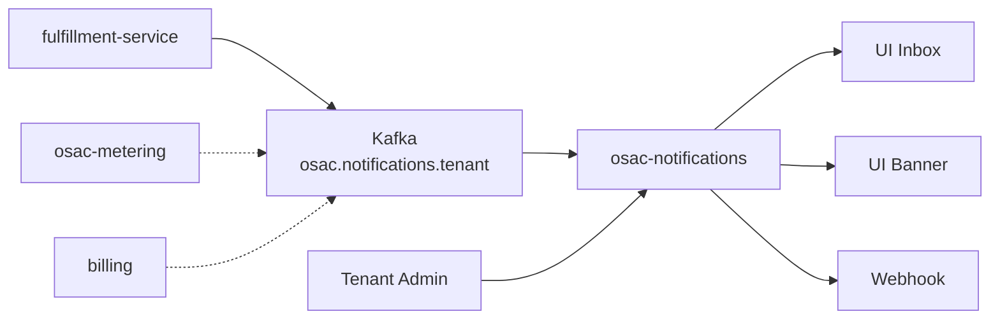
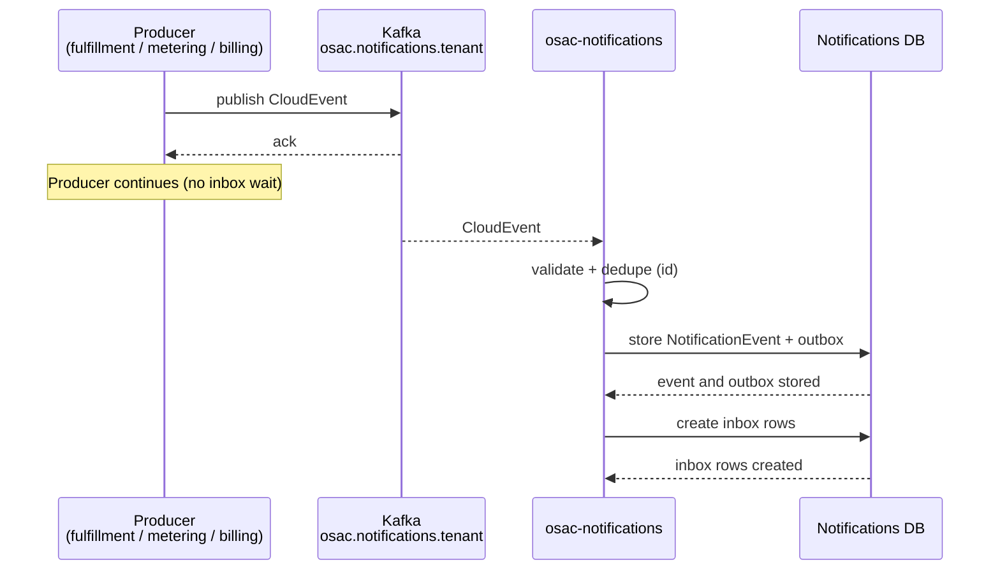
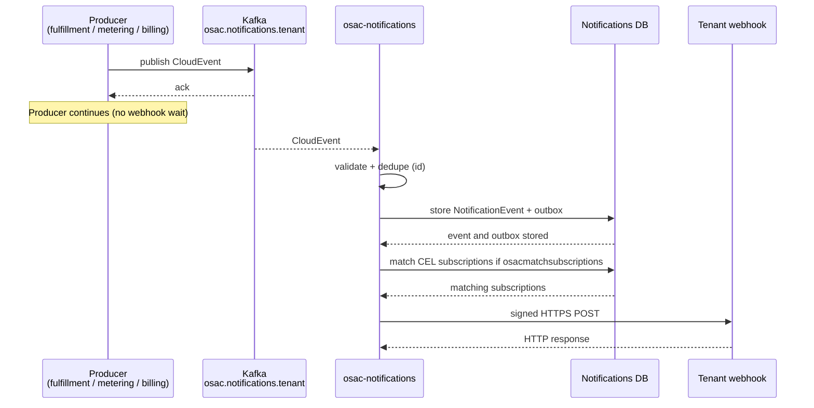

# Notifications

## Summary

A **notification** is a durable notice that something of interest happened for a Tenant User or for tenant
automation. Examples include a resource becoming ready, a quota warning, a billing notice, or a platform
announcement. It is meant to be read/consumed by users through various channels such as console inbox, email or a webhook.

This design adds a dedicated notification service (**osac-notifications**). Producers such as fulfillment-service,
metering, and billing can publish **CloudEvents** to per-tenant Kafka topics. Notification service consumes these events,
persists them, and asynchronously fans out to the per-user inbox and to matching Tenant Admin webhook subscriptions.
Tenant announcements are created by Tenant Admins, shown as a UI banner and only the Tenant Admin removes them.

## Motivation

People and tenant automation need to learn about important changes without polling the Fulfillment Events API or keeping a long-lived
client open. Today the closest option is `Events.Watch`. `Watch` streams resource lifecycle changes to clients that stay
connected, so it suits controllers and tools that can hold a stream. It does not automatically notify tenants or users
when a resource is ready, so teams poll, run custom Watch clients, or miss important changes when nobody is
listening.

Even with durable `Watch` delivery, streaming resource change is not the same as notifying a Tenant User or an
admin. Also, tenant care about notifications such as quota warnings and billing alerts, and not only resource lifecycle
changes. Those need a delivery path that reaches people and automation even when no client is watching, and
that does not block the producing business flow when an endpoint is down.

### Goals

- Ship notifications service as a separate binary and Helm chart so multiple producers publish a stable CloudEvents
  contract to Kafka.
- Consume from `osac.notifications.<tenant>` topic, persist accepted events, and fan out to inbox and webhooks.
- Expose CRUD endpoint for Tenant Admins to create and manage subscriptions.
- Expose Create, List, Get, Update, Delete on `Notifications` for event-driven notices and Admin announcements.
- Persist per-user inbox messages and Tenant Admin webhook subscriptions with CEL validation at time of creation and
  tenant isolation on every read path.
- Deliver webhooks with Standard Webhooks signatures, a published exponential retry schedule, delivery-attempt history,
  and auto-pause after sustained failure.
- Validate each webhook URL when the subscription is created and again when a delivery is attempted, and reject
  non-HTTPS or non-public destinations.

### Non-Goals

- Stateful alarms and alert management such as silence and inhibition.
- Additional channels such as email, SMS, and Slack.
- Digests (batched or summarized notices) and custom message templates.
- Tenant User managed subscriptions. Only Tenant Admins create and manage webhook subscriptions in this iteration.
- Turning Watch or `osac.events.<tenant>` object change streams into notifications automatically. Producers publish
  notification CloudEvents only when they want a notice.

## Proposal

Producers publish CloudEvents to per tenant Kafka topics. The notifications service (osac-notifications) consumes each
event, validates and stores it. It then processes the event payload along two paths. For Tenant Users, it creates inbox
rows from the event’s `recipient_ids`. Announcements skip inbox fan-out. One stored event is enough for a tenant-wide
UI banner. The Tenant Admin removes that announcement. For Tenant Admins, a subscription pattern is used. When
subscription matching is enabled, it evaluates active subscriptions against the event, and for each match it sends to
the webhook channel on that subscription. For the first iteration, the fulfillment service is the only producer and
webhook is the only supported channel for subscription.



Solid arrows mark the first iteration path. Dotted arrows show other producers that can publish on the same topics
later.

### Workflow Description

Kafka is the producer ingest path for event-driven notices. A successful Kafka write is enough for the producer.
The notification service consumes the CloudEvent, validates and dedupes it, then commits a `NotificationEvent` plus
outbox intents in one database transaction. That commit is the durable acceptance for fan-out. The service then creates
inbox rows for the intended users. When subscription matching is enabled, it evaluates Tenant Admin subscriptions and
posts signed HTTPS deliveries to matching webhook channels. Retries and attempt history are stored in the notifications
database.

Notification for announcements use the Admin API ingress. The `create` endpoint accepts the same CloudEvent contract,
stores one tenant-scoped event, and does not create inbox rows.

#### **Tenant User notifications**



**Producer → Kafka**
- Producer writes a CloudEvent to `osac.notifications.<tenant>`
- Kafka sends acknowledgement
- Producer continues without waiting for inbox delivery

**Kafka → osac-notifications**
- Service consumes the CloudEvent
- Validates schema, tenant, source allowlist, kind allowlist, and `type` pattern
- Dedupes on CloudEvent `id`

**osac-notifications → Notifications DB**
- Stores `NotificationEvent` and outbox intents
- Creates inbox rows from `data.recipient_ids`

##### Notifications

**Event-driven notifications**
- Ingress is Kafka
- Producers publish a CloudEvent when something happens (resource ready, quota warning, billing, meter)
- The notification Kind can be one of `event`, `quota`, `meter`, or `billing`
- Producer sets `data.recipient_ids`. Those subject ids become inbox recipients. Notifications does not discover
  recipients with RBAC
- Stored as one `notification_events` row plus one `inbox_notifications` row per recipient
- Can be updated or managed with `Notifications` endpoints (`List`, `Get`, `Update`, `Delete`)
- Optional webhook fan-out when `osacmatchsubscriptions` is true
- If `data.resource` is set, List/Get call fulfillment with the caller’s identity. The notification is hidden or omitted when the caller can no
  longer see the resource. See **RBAC / Tenancy**

**Announcements**
- Ingress is the Admin API
- Tenant Admin calls `create` endpoint with the same CloudEvent contract
- The notification Kind is `announcement`. Notice is for everyone in the tenant
- Server sets tenant from auth and a trusted `source`.
- Stored as one `notification_events` row and zero inbox rows
- UI shows it as a banner via `Notifications` List or Get endpoints (filter `kind=announcement`)
- Only the Tenant Admin may remove the announcement by calling the `Delete` endpoint. This removes the shared event for everyone
- Per-user dismissal is an alternative, not v1. See **Alt E**

#### **Tenant Admin webhook**



**Producer → Kafka**
- Producer writes a CloudEvent to `osac.notifications.<tenant>`
- Kafka sends acknowledgement
- Producer continues without waiting for webhook delivery

**Kafka → osac-notifications**
- Service consumes the CloudEvent
- Validates schema, tenant, source allowlist, kind allowlist, and `type` pattern
- Dedupes on CloudEvent `id`

**osac-notifications → Notifications DB**
- Stores `NotificationEvent` and outbox intents
- When `osacmatchsubscriptions` is enabled, loads active subscriptions
- Evaluates each CEL filter against the event

**osac-notifications → Tenant webhook**
- POSTs a signed HTTPS delivery to each matching webhook URL
- Records the attempt
- Retries and auto-pause follow the webhook delivery rules

##### Tenant Admin subscription

A Tenant Admin creates a subscription with a CEL filter and an HTTPS webhook URL. Creation returns a one-time signing
secret. The Admin can list, get, update (including pause and unpause) and delete in their tenant. Tenant Users cannot
create or manage subscriptions.

**Example subscription** (quota warnings for tenant `acme`):

```json
{
  "id": "sub-acme-quota-warn",
  "tenant": "acme",
  "display_name": "Quota warnings",
  "webhook_url": "https://hooks.acme.example/osac/quota",
  "filter": "osacnotificationkind == \"quota\" && severity in [\"warning\", \"critical\"]",
  "paused": false
}
```

Subscriptions `create` endpoint also returns `signing_secret` once. It is not returned in
response payload for `list` and `get` endpoints. Full delivery history is listed through
`NotificationSubscriptionDeliveries` (filter by subscription id).

**Matching an incoming event.** After osac-notifications accepts a CloudEvent for tenant `acme`:

1. If `osacmatchsubscriptions` is false, skip webhook matching. Inbox fan-out may still run.
2. Load active and unpaused subscriptions for that tenant.
3. Build a CEL input from the event: `event_type` (CE `type`), `severity`, `osacnotificationkind`, `summary`,
   `resource.kind`, `resource.id`, and tenant metadata.
4. Evaluate each subscription’s `filter` against that input. A true result is a match.
5. For each match, create a delivery for that subscription’s `webhook_url` and send it under **Webhook delivery**.

Example: the quota CloudEvent in the schema section below has `osacnotificationkind: "quota"` and
`severity: "warning"`. It matches `sub-acme-quota-warn`. An `info` quota event or an `event` kind notice does not.

#### Webhook delivery

Deliveries use a 30s timeout, a published exponential retry schedule, and per-attempt history. After sustained
failure for five days the subscription auto-pauses. Kafka is not the webhook retry ledger.

It requires HTTPS destinations. The hostname is resolved and connected only to an address that passes policy checks at
subscription creation time and again at each delivery attempt. Does not follow redirects.
Always block loopback and cloud metadata ranges.

Authenticity uses the [Standard Webhooks](https://www.standardwebhooks.com/) HMAC scheme. Each subscription gets its
own signing secret (`whsec_…`), returned once on create and on rotate. Every delivery attempt sends:

- `webhook-id`: stable id for the delivery (receivers dedupe retries)
- `webhook-timestamp`: unix time of this attempt
- `webhook-signature`: HMAC-SHA256 over `webhook-id.timestamp.body`, versioned as `v1,…`

Receivers recompute the HMAC with the shared secret and reject bad signatures. Reject timestamps outside a skew
window (libraries default to about five minutes). Treat `webhook-id` as an idempotency key. During rotate, sign with
both old and new secrets for an overlap window so either signature verifies. Then drop the old secret. Payload bodies
must not contain credentials or other secrets.

#### Error paths

**Bad or unauthorized CloudEvent**
- Schema invalid, tenant or topic mismatch, `source` or kind not allowlisted, or `type` fails the pattern
- No inbox rows and no webhooks
- Emit a metric; optionally send the record to a dead-letter queue (DLQ)

**Duplicate CloudEvent**
- Same CloudEvent `id` already accepted for that tenant
- Ignore the duplicate (idempotent consume)
- No second inbox or webhook fan-out

**Unsafe webhook URL (subscription creation)**
- URL fails SSRF checks (non-HTTPS, blocked address ranges, and so on)
- Reject the creation with `InvalidArgument`
- No subscription is stored

**Cross-tenant API access**
- Caller asks for another tenant’s inbox, subscription, or delivery
- Return empty results or `NotFound`
- Do not leak that the other tenant’s objects exist

**Fulfillment unavailable on inbox RBAC**
- Inbox item has `data.resource` and fulfillment cannot be reached for the visibility check
- Fail closed: omit or hide that item for this List/Get
- Items without `data.resource` are unaffected

### API Extensions

**Tenant-facing gRPC** on osac-notifications:

|Service|Method|Purpose|
|---|---|---|
|`NotificationSubscriptions`|`Create`|Create a webhook subscription.|
|`NotificationSubscriptions`|`List`|List subscriptions in the caller’s tenant. Supports pagination and filtering.|
|`NotificationSubscriptions`|`Get`|Get a subscription by id.|
|`NotificationSubscriptions`|`Update`|Update subscription filter, webhook URL, or pause and unpause a subscription.|
|`NotificationSubscriptions`|`Delete`|Delete a subscription and stop further deliveries.|
|`NotificationSubscriptionDeliveries`|`List`|List delivery history (paginated). Filter by subscription id and related fields (status, time).|
|`NotificationSubscriptionDeliveries`|`Get`|Get one delivery or attempt record.|
|`Notifications`|`Create`|Tenant Admin creates an announcement (same CloudEvent contract).|
|`Notifications`|`List`|List the caller’s event-driven notifications and active tenant announcements (filter by kind).|
|`Notifications`|`Get`|Get an event-driven notification or tenant announcement by id.|
|`Notifications`|`Update`|Mark an event-driven message as read, dismiss, or other state. Not used for announcements.|
|`Notifications`|`Delete`|Delete the caller’s event-driven notification, or (Tenant Admin) remove a tenant announcement for everyone.|

### UX Alignment

New `@temp-api` shapes against the **notifications** public API. Console proxy routes to osac-notifications.

### Implementation Details/Notes/Constraints

#### Component layout

```text
osac/
  osac-notifications/     # binary, Kafka consumer, chart
  fulfillment-service/    # CE publisher + RBAC authority for resource
  osac-metering/          # CE publisher
  osac-installer/         # notifications chart + topic lifecycle
```

#### CloudEvents contract

CloudEvents 1.0, JSON `data`, aligned with metering extension style (`osactenant`).

|Attribute|Required|Meaning|
|---|---|---|
|`id`|yes|Producer-stable idempotency key|
|`source`|yes|Producing service (`osac-metering`, `osac-billing`, `fulfillment-service` )|
|`type`|yes|`osac.notification.<kind>.<name>` (see validation below)|
|`time`|yes|Time of event|
|`specversion`|yes|`1.0`|
|`osactenant`|yes|Tenant id, must match topic suffix|
|`osacnotificationkind`|yes|`event` \| `meter` \| `billing` \| `quota` \| `announcement`|
|`severity`|yes|`info` \| `warning` \| `critical`|
|`osacmatchsubscriptions`|no|Whether to evaluate webhook subscriptions. Default to `true`.|
|`data`|yes|See below|

**Validation:** Reject the event if any check fails.

- `source` must be on the producer allowlist.
- `osacnotificationkind` must be on the kind allowlist (`event`, `meter`, `billing`, `quota`, `announcement`).
- `type` must be `osac.notification.<kind>.<name>` where `<kind>` equals `osacnotificationkind`.
- `<name>` is free within a pattern: nonempty, lowercase letters, digits, and underscores only (for example
  `warning`, `resource_created`, `maintenance`).

**`data` (v1):**

|Field|Required|Meaning|
|---|---|---|
|`summary`|yes|Short text that summarizes a notification message|
|`body`|no|Longer text that contains details of the message|
|`recipient_ids`|no|Targeted inbox recipients (subject/user ids). Required for non-announcement inbox fan-out. Omit for announcements (no inbox expand).|
|`resource`|no|`{ "kind", "id" }` OSAC objects that points to user's RBAC.|
|`details`|no|Kind-specific map (e.g. used/limit). Optional; empty for many announcements.|
|`links`|no|Optional deep links; UI may derive from `resource` + kind if omitted.|

**Example of quota warning** → topic `osac.notifications.acme`:

```json
{
  "specversion": "1.0",
  "id": "quota-warn-acme-compute-2026-11-07T18:00:00Z",
  "source": "osac-billing",
  "type": "osac.notification.quota.warning",
  "time": "2026-11-07T18:00:00Z",
  "datacontenttype": "application/json",
  "osactenant": "acme",
  "osacnotificationkind": "quota",
  "severity": "warning",
  "osacmatchsubscriptions": true,
  "data": {
    "summary": "Compute vCPU quota at 90%",
    "body": "You have used 90 of 100 vCPUs.",
    "resource": {
      "kind": "quota",
      "id": "quota-compute"
    },
    "details": {
      "meter": "compute.vcpu",
      "used": "90",
      "limit": "100",
      "threshold_percent": 90
    }
  }
}
```

**Example of fulfillment resource notice** → topic `osac.notifications.acme`:

Explicit producer publish (not Watch). Fulfillment puts the **requesting user’s subject id** in `data.recipient_ids`
(information it already has on the creation path). `resource` identifies the object for later visibility checks.

```json
{
  "specversion": "1.0",
  "id": "fulfillment-ci-created-vm-42-2026-11-07T18:05:00Z",
  "source": "osac-tenant",
  "type": "osac.notification.event.resource_created",
  "time": "2026-11-07T18:05:00Z",
  "datacontenttype": "application/json",
  "osactenant": "acme",
  "osacnotificationkind": "event",
  "severity": "info",
  "osacmatchsubscriptions": false,
  "data": {
    "summary": "Compute instance vm-42 created",
    "body": "Your compute instance vm-42 is ready.",
    "recipient_ids": [
      "user-123"
    ],
    "resource": {
      "kind": "compute_instance",
      "id": "vm-42"
    },
    "details": {
      "lifecycle": "created",
      "project_id": "proj-9",
      "name": "vm-42"
    }
  }
}
```

**Example of announcement** → `Notifications.Create` (This uses the same CloudEvent contract)
The server sets `osactenant` from auth and `source` to `osac-notifications`

```json
{
  "specversion": "1.0",
  "id": "announce-acme-maintenance-2026-11-10",
  "source": "osac-notifications",
  "type": "osac.notification.announcement.maintenance",
  "time": "2026-11-07T18:10:00Z",
  "datacontenttype": "application/json",
  "osactenant": "acme",
  "osacnotificationkind": "announcement",
  "severity": "warning",
  "osacmatchsubscriptions": false,
  "data": {
    "summary": "Scheduled maintenance window",
    "body": "Control-plane maintenance is planned for 2026-11-10 02:00–04:00 UTC. API calls may fail during that window."
  }
}
```

#### Persistence

osac-notifications owns its Postgres tables.

- `notification_events`: accepted event (id, source, type, kind, severity, payload, tenant). Unique on
  `(tenant, id)` for dedupe.
- `inbox_notifications`: one row per recipient user (owner subject id plus link to `notification_events`).
- `notification_subscriptions`: Tenant Admin webhook subscriptions
- `notification_deliveries` and `notification_delivery_attempts`: webhook delivery history under a subscription
- `notification_outbox`: create inbox rows or send webhooks for an accepted event. Saved with the event so
  the work is not lost if the service restarts.

#### Installer

- Chart for osac-notifications
- On tenant create, provision `osac.notifications.<tenant>` (one partition) and optional
  `osac.notifications.dlq.<tenant>`
- Consumer group `osac-notifications` with regex `^osac\.notifications\.`
- Producer charts get publish ACL and bootstrap
- Worker and retry knobs as needed

### Security Considerations

- **Who may publish.** Kafka ACLs limit each producer to the tenant topics it is allowed to use.
  osac-notifications allowlists `source` and `osacnotificationkind`. It requires `type` to match
  `osac.notification.<kind>.<name>` with free `<name>` under the pattern above. It rejects events whose
  `osactenant` does not match the topic name.
- **Who may call the public API.** OPA (or equivalent) enforces Keycloak roles on
  `NotificationSubscriptions`, `NotificationSubscriptionDeliveries`, and `Notifications`.
- **Webhook destinations.** Validate URLs at create and at each delivery so the service does not call unsafe or
  internal addresses. Sign each delivery with the subscription secret. Do not put credentials in payload bodies.
- **Calls to fulfillment.** The notifications service account may call fulfillment only to check `data.resource`
  visibility for inbox List and Get.

### RBAC / Tenancy

**API roles**
- Tenant User: Can perform List/Get/Update/Delete on their own `Notifications`.
- Tenant Admin: can create and manage subscriptions and subscription delivery history in the tenant. `Notifications.Create` and
  `Notifications.Delete` for tenant announcements (handler enforces admin for `announcement` kind).
- Cloud Provider Admin: cross-tenant webhook health.
- Kafka: tenant isolation by topic name and ACL.

**Recipient resolution vs resource visibility**

These are different jobs. Fulfillment RBAC (Get or SelfSubjectAccessReview) answers whether **this** recipient may see
**this** object. It does not efficiently answer who should receive an inbox row.

|Concern|Who decides|Mechanism|
|---|---|---|
|**Who gets an inbox row** (targeted)|**Producer**|`data.recipient_ids` (subject ids already known on the write path).|
|**Who sees an announcement**|**Tenant scope**|Tenant Admin `Notifications.Create` stores one `notification_events` row. Admin Delete removes it.|
|**May this caller see this inbox item**|**osac-notifications** at List/Get|If `data.resource` is set, call fulfillment with the caller’s identity. Deny or omit if not allowed.|
|**Webhook subscribers**|Tenant Admin subscriptions + CEL|Only when `osacmatchsubscriptions` is true. Independent of inbox recipients.|

When `data.resource` is set, List/Get (and optional write-time filter) call fulfillment for per-subject visibility.
Announcements without `resource` skip that check. Recipient discovery is never done by enumerating RBAC in v1.
Notifications SA calls fulfillment only for these `resource` checks.

### Risks and Mitigations

|Risk|Mitigation|
|---|---|
|A producer is granted the wrong Kafka ACL and can publish into another tenant’s topic.|Deny publish by default. Grant ACLs per producer and tenant. Cover ACL boundaries in integration tests.|
|A webhook URL points at an internal or non-public address (SSRF).|Validate URLs when the subscription is created and again on each delivery. Reject non-HTTPS and non-public destinations. Restrict egress at the platform layer.|
|Producers drift from the CloudEvent contract and send incompatible payloads.|Enforce the `type` pattern plus `source` and kind allowlists. Reject events that are missing required fields. Prefer additive optional `data` fields.|
|Operators confuse notification topics with Watch or metering topics.|Use the distinct `osac.notifications.` prefix. Document the topic contract next to producer setup.|
|A caller forges `osactenant` or `source` on `Notifications.Create`.|Set tenant and `source` on the server from auth and service identity. Do not trust those fields from the client.|
|A Tenant User creates or deletes a tenant-wide announcement.|Authorize Create and Delete for announcements to Tenant Admin only. Cover allow and deny cases in tests.|
|Fulfillment is unavailable during inbox List or Get for a `data.resource` item.|Fail closed for resource-scoped items. Leave items without `resource` unaffected.|

### Drawbacks

- Kafka + topic lifecycle is mandatory for producers (more moving parts than gRPC Submit).
- Inbox RBAC still depends on fulfillment for `resource`.
- In-house webhook sender vs buy Svix tradeoff remains.

## Alternatives

### Alt A — Embed notification plane in fulfillment-service binary

Rejected for multi-producer peer shape.

### Alt B — gRPC Submit as producer ingest (no Kafka)

- **Pros:** Simpler authz at RPC; no topic ops.
- **Cons:** Every producer depends on notifications availability/endpoint; weaker shared ingest log; unlike metering’s
  Kafka CE style.
- **Rejected:** Kafka-only producer path locked.

### Alt C — One Kafka topic per notification kind/type

Rejected — topic explosion; kinds via CE attributes.

### Alt D — mTLS or SNS style cert URLs for webhook authenticity

- **Pros:** Strong peer auth (mTLS). Familiar if receivers already require client certs.
- **Cons:** Cert lifecycle on every tenant receiver. Breaks behind TLS terminating load balancers. SNS cert
  URLs add download and trust chain work. OSAC mTLS today is for fixed platform peers (BCM, Kafka, DB), not
  arbitrary customer callback URLs.
- **Rejected:** Standard Webhooks HMAC covers authenticity, replay, and rotation for tenant HTTPS URLs. Defer
  mTLS until product needs private receivers that already require client certificates.

### Alt E — Per-user announcement expand and dismiss

Expand each announcement to every Tenant User (fulfillment `Users.List`), create one inbox row per user, and let each
user dismiss independently.

- **Pros:** Same dismiss UX as targeted inbox items. No separate banner semantics.
- **Cons:** `Users.List` dependency, N inbox rows per announcement, fan-out cost and failure modes.
- **Rejected for v1:** One tenant-scoped `notification_events` row and a UI banner are enough. Tenant Admin removes
  the announcement for everyone via `Notifications.Delete`. If product later needs per-user dismiss, add lazy
  inbox rows or a dismissals table without rewriting the shared event row.

## Open Questions

### OQ-1: Inbox retention and dismiss TTL

- **Owner:** To be determined (product / UX)
- **Impact:** purge job, storage, dismiss vs delete.

### OQ-2: Database topology for osac-notifications

- **Owner:** To be determined (platform)
- **Impact:** dedicated Postgres vs shared DB.

## Test Plan

### Unit Tests (osac-notifications)

- Reject CloudEvents that are missing required attributes, fail the `type` pattern, or use a disallowed `source` or kind.
- Reject events whose `osactenant` does not match the Kafka topic, and treat a duplicate CloudEvent `id` as a no-op.
- Compile subscription CEL filters and match or miss events by severity and kind.
- Reject non-public and non-HTTPS webhook URLs, and verify Standard Webhooks signature and timestamp handling.
- Enforce OPA (or equivalent) on public RPCs, including Tenant Admin–only Create and Delete for announcements.
- Cover webhook retry scheduling and auto-pause after sustained failure.

### Integration Tests

- Publish a valid event-driven CloudEvent to `osac.notifications.<tenant>` and assert inbox rows for `recipient_ids`, with webhook delivery when matching is enabled.
- Confirm an authorized second producer principal can publish, and that an unauthorized principal is rejected or the message is sent to the DLQ.
- With `osacmatchsubscriptions` set to false, create inbox rows and do not create webhook deliveries.
- Let a Tenant Admin create an announcement through `Notifications.Create`, then assert one `notification_events` row, zero inbox rows, and visibility on List for users in the tenant.
- Deny announcement Create and Delete for a Tenant User, and clear the announcement for everyone when a Tenant Admin deletes it.
- Exercise subscription severity filters, pause and unpause, subscription delete, private URL rejection, and a shortened webhook retry ladder.
- With a fulfillment mock, hide or return resource-scoped inbox items according to the caller’s RBAC result.

### E2E Tests

- From the console, create a subscription, publish an event-driven notice through the producer Kafka harness, and mark the Tenant User inbox item as read.
- Verify cross-tenant isolation for the public API and for Kafka topics.

## Infrastructure Needed

- `osac/osac-notifications` component (binary, image, chart, CI).
- Kafka topic lifecycle for `osac.notifications.<tenant>` (+ optional DLQ).
- PostgreSQL for notifications.
