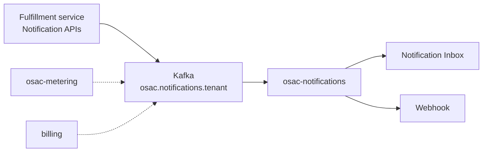
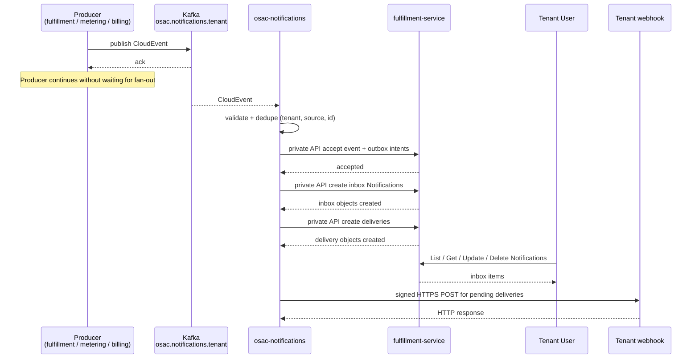

# Notifications

## Summary

A **notification** is a durable notice that something of interest happened for a Tenant User or for tenant automation.
Examples include a resource becoming ready, a quota warning, a billing notice, or a platform announcement. Users and
automation consume notifications through channels such as the console inbox and webhooks.

This design adds the Notification APIs and object tables in the fulfillment-service, and adds `osac-notifications` as a
dedicated controller. Producers such as fulfillment-service, metering, and billing can publish CloudEvents to
per-tenant Kafka topics. The `osac-notifications` consumes these events, creates inbox and delivery objects through
the private API, and asynchronously fans out to the per-user inbox and to matching Tenant Admin webhook subscriptions.
Announcements are created by Tenant Admins or Cloud Provider Admins (for the whole platform) through the public API.
They appear as a UI banner. The creating admin role deletes them.

## Motivation

People and tenant automation need to learn about important changes without polling or holding a long-lived
`Events.Watch` stream. `Watch` suits controllers that stay connected. It does not notify users when nobody is
listening, and it does not cover quota or billing notices. Those need a path that reaches people and automation
without blocking the producer when a webhook is down.

### Goals

- Define Notification APIs and object storage in fulfillment-service.
- Ship osac-notifications as a separate controller binary and Helm chart that consumes Kafka and delivers webhooks.
- Let multiple producers publish a stable CloudEvents contract to `osac.notifications.<tenant>`.
- Expose CRUD for Tenant Admin subscriptions and on `Notifications`.
- Deliver webhooks with Standard Webhooks signatures, retries, delivery history, and auto-pause after sustained
  failure.
- Reject non-HTTPS or non-public webhook URLs at subscription create and on each delivery attempt.

### Non-Goals

- Stateful alarms and alert management such as silence and inhibition.
- Additional channels such as email, SMS, and Slack.
- Digests and custom message templates.
- Tenant User managed subscriptions. Only Tenant Admins manage webhook subscriptions in this iteration.
- Turning Watch or `osac.events.<tenant>` streams into notifications automatically.
- Webhook signing-secret rotation. v1 returns a secret once on create. Admins may delete and recreate a subscription
  until rotation ships.

## Proposal

Producers publish CloudEvents to per tenant Kafka topics. The osac-notifications controller consumes each event,
validates it, and creates the accepted event through the Notifications API. It then processes the event payload along two paths.
For Tenant Users, it creates inbox rows from the event’s `recipient_ids`. Announcements skip inbox fan-out. For Tenant Admins,
a subscription pattern is used. When subscription matching is enabled, it evaluates active subscriptions against the event,
and for each match it sends to the webhook channel on that subscription. For the first iteration, the fulfillment
service is the only producer and webhook is the only supported channel for subscription.



Solid arrows mark the first iteration path. Dotted arrows show other producers that can publish in future version.

### Workflow Description

#### Event-driven fan-out



**Producer → Kafka**
- Producer writes a CloudEvent to `osac.notifications.<tenant>`
- Kafka sends acknowledgement
- Producer continues without waiting for inbox or webhook delivery

**Kafka → osac-notifications**
- Controller consumes the CloudEvent
- Validates schema, tenant match, `source` → allowed `kind` grant map, and `type` pattern
- Rejects Kafka events whose `kind` is `announcement` (Admin API only)

**osac-notifications → fulfillment-service (private API)**
- Accepts the event and outbox intents
- Commits the Kafka offset only after accept succeeds
- Workers create one inbox `Notification` per `data.recipient_ids` entry
- When `osacmatchsubscriptions` is enabled, workers create a delivery per matching subscription

**Inbox and webhook**
- Tenant Users manage inbox items through the public `Notifications` methods on fulfillment-service
- Matching subscriptions create deliveries in `pending` or `retained` state. See **Webhook delivery**

##### Notifications

**Event-driven notifications**
- Ingress is Kafka. Kind is one of `event`, `quota`, `meter`, or `billing`.
- The producer sets `data.recipient_ids`. Recipients are not discovered with RBAC.
- Stored as one inbox `Notification` per recipient, with `spec.event` set to `{id, source}`.
- Managed with public `Notifications` methods. Optional webhook fan-out when `osacmatchsubscriptions` is true.
- If `data.resource` is set, List and Get may hide the item. See **RBAC / Tenancy**.

**Announcements**
- Ingress is the Admin public API only. The consumer rejects `announcement` notification type.
- The fields `spec.kind` is `announcement` and `spec.scope` is `tenant` or `platform`.
- **Tenant Admin** creates and deletes `scope` `tenant` only. **Cloud Provider Admin** creates and deletes
  `scope` `platform`. The server sets `metadata.tenant` and `spec.source`. See **RBAC / Tenancy**.
- One announcement object is enough for a UI banner. Per-user inbox rows are out of scope for v1. See **Alt E**.

##### Tenant Admin subscription

A Tenant Admin creates a subscription with a CEL filter and an HTTPS webhook URL. During creation, a `signing_secret`
is returned once. It is not returned from `List` or `Get` endpoints. The Admin can list, get, update (including pause and unpause), and delete
subscriptions in their tenant. Delivery history uses `NotificationSubscriptionDeliveries`. See **Types and contracts**
for the object shape.

**Matching an incoming event**

1. If `osacmatchsubscriptions` is false, skip webhook matching. Inbox fan-out may still run.
2. Load all non-deleted subscriptions for that tenant, including paused ones.
3. Build a CEL input from the event: `event_type` (CE `type`), `severity`, `kind`, `summary`,
   `resource.kind`, `resource.id`, and tenant metadata.
4. Evaluate each subscription’s `filter`. A true result is a match.
5. For each match, create a `NotificationSubscriptionDelivery`. See **Persistence** for the unique key and
   **Webhook delivery** for `pending` versus `retained` and send behavior.

#### Webhook delivery

Deliveries use a 30s timeout, a published exponential retry schedule, and per-attempt history. After sustained
failure for five days the subscription auto-pauses. Kafka is not the webhook retry ledger.

**Pause and retain.** A match against a paused (or auto-paused) subscription still creates a `retained` delivery.
No POST is sent until a Tenant Admin unpauses. Retained deliveries then move to `pending` and follow the same retry
rules until `delivered` or `failed`.

Webhook destinations must use HTTPS. Validate the URL at during creation and on each delivery.
The sender does not follow redirects. It always blocks loopback and cloud metadata ranges.

Authenticity uses the [Standard Webhooks](https://www.standardwebhooks.com/) HMAC scheme with the subscription signing
secret. Every delivery attempt sends:

- `webhook-id`: stable id for the delivery (receivers dedupe retries)
- `webhook-timestamp`: unix time of this attempt
- `webhook-signature`: HMAC-SHA256 over `webhook-id.timestamp.body`, versioned as `v1,…`

Receivers reject bad signatures and timestamps outside skew. Treat `webhook-id` as an idempotency key. Payload bodies
must not contain credentials.

#### Error paths

**Bad or unauthorized CloudEvent**
- The event fails **Validation (Kafka ingest)**
- Create no inbox or webhook fan-out
- Emit a metric. Optionally write to a DLQ outside the consumer subscription
- Commit the Kafka offset after the metric is recorded, or after a successful DLQ write when that is the durable
  rejection record

**Duplicate CloudEvent**
- The same `(tenant, source, id)` was already accepted
- Ignore it. Create no additional fan-out
- Commit the Kafka offset after the duplicate is ignored

**Unsafe webhook URL (subscription creation)**
- URL fails SSRF checks (non-HTTPS, blocked address ranges, and so on)
- Reject create with `InvalidArgument`. Store no subscription

**Cross-tenant API access**
- Caller asks for another tenant’s inbox, subscription, or delivery
- Return empty results or `NotFound` without leaking that the objects exist

**Resource visibility check unavailable**
- Inbox item has `data.resource` and the visibility check cannot complete
- Fail closed: omit or hide that item. Items without `data.resource` are unaffected

### API Extensions

**Public and private gRPC** on fulfillment-service:

|Service|Method|Purpose|
|---|---|---|
|`NotificationSubscriptions`|`Create`|Create a webhook subscription.|
|`NotificationSubscriptions`|`List`|List subscriptions in the caller’s tenant.|
|`NotificationSubscriptions`|`Get`|Get a subscription by id.|
|`NotificationSubscriptions`|`Update`|Update subscription filter, webhook URL, or pause and unpause a subscription.|
|`NotificationSubscriptions`|`Delete`|Delete a subscription and stop further deliveries.|
|`NotificationSubscriptionDeliveries`|`List`|List delivery history.|
|`NotificationSubscriptionDeliveries`|`Get`|Get one delivery or attempt record.|
|`Notifications`|`Create`|Tenant Admin or Cloud Provider Admin creates an announcement as a `Notification` object.|
|`Notifications`|`List`|List the caller’s event-driven notifications and visible announcements (tenant and platform).|
|`Notifications`|`Get`|Get an event-driven notification or announcement by id.|
|`Notifications`|`Update`|Update an event-driven inbox item’s `status.state` (`unread` or `read`). Not used for announcements.|
|`Notifications`|`Delete`|Delete the caller’s event-driven notification, or remove an announcement per role rules below.|

Controllers use the private methods to accept Kafka events, create inbox notifications and deliveries, and update delivery status.
Tenants, admins, and the console use the public methods.

**List requests** take `offset`, `limit`, an optional `filter`, and an optional `order`. The `filter` field is a CEL
expression evaluated against each candidate object. Examples:

- Announcements for the UI banner: `this.spec.kind == "announcement"`
- Unread event-driven inbox items: `this.spec.kind != "announcement" && this.status.state == "unread"`
- Deliveries for one subscription: `this.spec.subscription.id == "sub-acme-quota-warn"`

### UX Alignment

New `@temp-api` shapes against the Notification public API. Console proxy routes to fulfillment-service.

### Implementation Details/Notes/Constraints

#### Component layout

```text
osac/
  fulfillment-service/    # Notification APIs + object tables; CE publisher
  osac-notifications/     # Kafka consumer, webhook workers, chart
  osac-metering/          # CE publisher
  osac-installer/         # notifications chart + topic lifecycle
```

#### Types and contracts

This section covers producer ingest payloads and the public API resource shapes.

**Kafka ingest** for notifications uses CloudEvents 1.0 with JSON `data` and the `osactenant` extension.

|Attribute|Required|Meaning|
|---|---|---|
|`id`|yes|Idempotency key that is stable for this producer. Fan-out unique keys are in **Persistence**.|
|`source`|yes|Producing service identity (for example `fulfillment-service`, `osac-metering`, or `osac-billing`).|
|`type`|yes|`osac.notification.<kind>.<name>` (see validation below)|
|`time`|yes|Time of the event|
|`specversion`|yes|`1.0`|
|`osactenant`|yes|Tenant id. Must match the topic suffix.|
|`kind`|yes|Enum. `event` \| `meter` \| `billing` \| `quota` on Kafka. `announcement` only on Admin `Notifications.Create`.|
|`severity`|yes|Enum. `info` \| `warning` \| `critical`.|
|`osacmatchsubscriptions`|no|Whether to evaluate webhook subscriptions. Defaults to `true`.|
|`data`|yes|See below|

**Validation (Kafka ingest):** Reject the event if any check fails.

- Authorize with a grant map of `source` to allowed `kind` values. Each producer KafkaUser is assigned one `source`.
  Kafka ACLs still control which principals may write tenant topics.
- Reject `announcement`. Announcements use Admin `Notifications.Create` only.
- `type` must be `osac.notification.<kind>.<name>` where the `<kind>` segment equals `kind`.
  `<name>` is nonempty lowercase letters, digits, and underscores only.
- `osactenant` must match the topic suffix.

**`data` (v1) for Kafka CloudEvents:**

|Field|Required|Meaning|
|---|---|---|
|`summary`|yes|Short text that summarizes the notification message.|
|`body`|no|Longer text with details of the message.|
|`recipient_ids`|no|Targeted inbox recipients (subject or user ids). Required for non-announcement inbox fan-out. Omit for announcements.|
|`resource`|no|Optional `{ "kind", "id" }` reference used for later RBAC visibility checks.|
|`details`|no|Optional kind-specific map (for example used and limit). Often empty for announcements.|

**Example of quota warning** → topic `osac.notifications.acme` (illustrative):

```json
{
  "specversion": "1.0",
  "id": "quota-warn-acme-compute-2026-11-07T18:00:00Z",
  "source": "osac-billing",
  "type": "osac.notification.quota.warning",
  "time": "2026-11-07T18:00:00Z",
  "datacontenttype": "application/json",
  "osactenant": "acme",
  "kind": "quota",
  "severity": "warning",
  "osacmatchsubscriptions": true,
  "data": {
    "summary": "Compute vCPU quota at 90%",
    "body": "You have used 90 of 100 vCPUs.",
    "resource": {
      "kind": "quota",
      "id": "quota-compute"
    },
    "details": {
      "meter": "compute.vcpu",
      "used": "90",
      "limit": "100",
      "threshold_percent": 90
    }
  }
}
```

**Example of fulfillment resource notice** → topic `osac.notifications.acme` (explicit publish, not Watch).
`data.recipient_ids` is the requesting user’s subject id. `resource` is for later visibility checks.

```json
{
  "specversion": "1.0",
  "id": "fulfillment-ci-created-vm-42-2026-11-07T18:05:00Z",
  "source": "osac-tenant",
  "type": "osac.notification.event.resource_created",
  "time": "2026-11-07T18:05:00Z",
  "datacontenttype": "application/json",
  "osactenant": "acme",
  "kind": "event",
  "severity": "info",
  "osacmatchsubscriptions": false,
  "data": {
    "summary": "Compute instance vm-42 created",
    "body": "Your compute instance vm-42 is ready.",
    "recipient_ids": [
      "user-123"
    ],
    "resource": {
      "kind": "compute_instance",
      "id": "vm-42"
    },
    "details": {
      "lifecycle": "created",
      "project_id": "proj-9",
      "name": "vm-42"
    }
  }
}
```

**Public API resources** use `id`, `metadata`, `spec`, and `status`. The server assigns `id` and system metadata
such as tenant. The caller supplies `metadata.name` and `spec`. `status` is system-reported.

Examples below are shapes returned by `Get` or `List`.

**Example `NotificationSubscription`:**

```json
{
  "id": "sub-acme-quota-warn",
  "metadata": {
    "name": "quota-warnings",
    "tenant": "acme"
  },
  "spec": {
    "webhook_url": "https://hooks.acme.example/osac/quota",
    "filter": "kind == \"quota\" && severity in [\"warning\", \"critical\"]",
    "paused": false
  },
  "status": {
    "last_delivery_status": "delivered"
  }
}
```

**Example `NotificationSubscriptionDelivery`:**

Deliveries are system-created on a subscription match. The server assigns a new `id` and a distinct
`metadata.name` for each delivery.

```json
{
  "id": "del-acme-quota-warn-1",
  "metadata": {
    "name": "quota-warn-acme-compute-2026-11-07t18-00-00z",
    "tenant": "acme"
  },
  "spec": {
    "subscription": {
      "id": "sub-acme-quota-warn",
      "name": "quota-warnings"
    },
    "event": {
      "id": "quota-warn-acme-compute-2026-11-07T18:00:00Z",
      "source": "osac-billing"
    }
  },
  "status": {
    "state": "retained",
    "attempt_count": 0,
    "last_http_status": 0,
    "last_error": ""
  }
}
```

`spec.event` is `{id, source}` for the CloudEvent that produced this delivery.

`status.state` is the enum `NotificationSubscriptionDeliveryState`:

|Value|Meaning|
|---|---|
|`pending`|The delivery needs a webhook POST (first attempt or a scheduled retry). The send worker selects these rows.|
|`retained`|The subscription matched while paused (or auto-paused). No POST is sent until a Tenant Admin unpauses it.|
|`delivered`|The webhook accepted the delivery.|
|`failed`|Retries are exhausted, or the delivery was reported failed.|

**Example of `Notification` (inbox item):**

```json
{
  "id": "inbox-acme-user-123-1",
  "metadata": {
    "name": "inbox-acme-user-123-1",
    "tenant": "acme"
  },
  "spec": {
    "kind": "event",
    "severity": "info",
    "type": "osac.notification.event.resource_created",
    "source": "osac-fulfillment",
    "summary": "Compute instance vm-42 created",
    "body": "Your compute instance vm-42 is ready.",
    "resource": {
      "kind": "compute_instance",
      "id": "vm-42"
    },
    "details": {
      "lifecycle": "created"
    }
  },
  "status": {
    "state": "unread"
  }
}
```

`status.state` for inbox items is an enum with v1 values `unread` and `read`. Announcements do not use this field.

**Example announcement `Notification`** (tenant scope):

```json
{
  "id": "announce-acme-maintenance-2026-11-10",
  "metadata": {
    "name": "maintenance-2026-11-10",
    "tenant": "acme"
  },
  "spec": {
    "kind": "announcement",
    "scope": "tenant",
    "severity": "warning",
    "type": "osac.notification.announcement.maintenance",
    "source": "osac-fulfillment",
    "summary": "Scheduled maintenance window",
    "body": "Control-plane maintenance is planned for 2026-11-10 02:00–04:00 UTC. API calls may fail during that window."
  },
  "status": {}
}
```

A platform announcement uses `spec.scope` `platform` and omits `metadata.tenant`.

#### Persistence

Fulfillment-service stores the Notification API objects with the same object and tenancy patterns as other OSAC
resources. The tables are:

- `notifications`: inbox items and announcements (`Notification`). Unique on
  `(tenant, source, event.id, recipient)` for event-driven inbox rows.
- `notification_subscriptions`: Tenant Admin webhook subscriptions (`NotificationSubscription`). Unique on
  `(tenant, id)`.
- `notification_subscription_deliveries` and delivery attempts: webhook history under a subscription
  (`NotificationSubscriptionDelivery`), including retained matches created while a subscription was paused. Unique on
  `(tenant, subscription, source, event.id)`.
- `notification_outbox`: durable intents to create inbox notifications or match webhooks, so fan-out is not lost if a
  controller restarts.

#### Installer

- Chart for osac-notifications
- On tenant create, provision `osac.notifications.<tenant>` (one partition) and optional
  `osac.notifications.dlq.<tenant>`
- Consumer group `osac-notifications` subscribes only to ingest topics with a regex that excludes DLQ topics (for
  example `^osac\.notifications\.[^.]+$`)
- Extend Strimzi `KafkaUser` ACLs (same pattern as `osac.events.*`) so producers can publish to
  `osac.notifications.` topics
- Wire the consumer grant map from **Validation (Kafka ingest)**
- Worker and retry knobs as needed

### Security Considerations

See **RBAC / Tenancy** for publish and API access rules.
See **Webhook delivery** for URL validation, signing, and payload rules.

### RBAC / Tenancy

**API roles**
- Tenant User: List/Get/Update/Delete on their own event-driven `Notifications`.
- Tenant Admin: Manage subscriptions and delivery history. Create/Delete announcements with `scope` `tenant` only.
- Cloud Provider Admin: Create/Delete announcements with `scope` `platform`.
- Kafka publish auth is in **Validation (Kafka ingest)** and **Installer**.

**Recipient resolution vs resource visibility**

These are different jobs. Fulfillment RBAC answers whether this caller may see this object. It does not efficiently
answer who should receive an inbox notification.

|Concern|Who decides|Mechanism|
|---|---|---|
|**Who gets an inbox notification**|**Producer**|`data.recipient_ids`|
|**Who sees an announcement**|**`spec.scope`**|`tenant` or `platform`|
|**May this caller see this inbox item**|**fulfillment-service**|If `data.resource` is set, evaluate with the caller’s identity|
|**Webhook subscribers**|Tenant Admin subscriptions + CEL|Only when `osacmatchsubscriptions` is true|

### Risks and Mitigations

|Risk|Mitigation|
|---|---|
|Unauthorized or invalid Kafka publish, including `announcement`.|ACLs and grant map per **Validation (Kafka ingest)** and **Installer**. Cover boundaries in tests.|
|Redelivery creates duplicate inbox or delivery objects.|Unique keys in **Persistence**.|
|The consumer also reads DLQ topics.|Distinct DLQ names and a consumer regex that excludes them. See **Installer**.|
|A match during pause is lost.|`retained` deliveries per **Webhook delivery**.|
|SSRF via webhook URL.|URL checks in **Webhook delivery**.|
|Wrong role or forged tenant, `scope`, or `source` on announcement Create.|Server-set tenant and source. Role rules in **RBAC / Tenancy**.|
|Resource visibility check unavailable.|Fail closed for `data.resource` items.|

## Alternatives

### Alt A — Host Notification APIs in osac-notifications

Rejected because fulfillment-service owns the public and private Notification APIs and object tables.

### Alt B — gRPC Submit as producer ingest (no Kafka)

Rejected because producers use Kafka CloudEvents only, matching the metering-style ingest path.

### Alt C — One Kafka topic per notification kind/type

Rejected because that explodes the topic count and `kind` field is part of CloudEvent attributes instead.

### Alt D — mTLS or SNS-style cert URLs for webhook authenticity

Rejected because Standard Webhooks HMAC covers authenticity and replay for tenant HTTPS URLs.

### Alt E — Per-user announcement expand

Rejected for v1 because one announcement object and a UI banner are enough (`scope` `tenant` or `platform`).

## Infrastructure Needed

- `osac-notifications` binary, image, chart, and CI
- Kafka topics and ACLs per **Installer**
- Notification object tables in fulfillment-service PostgreSQL
