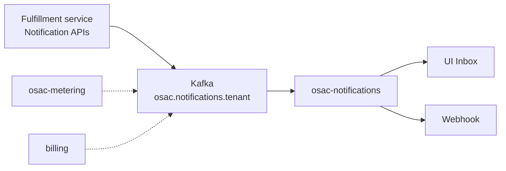
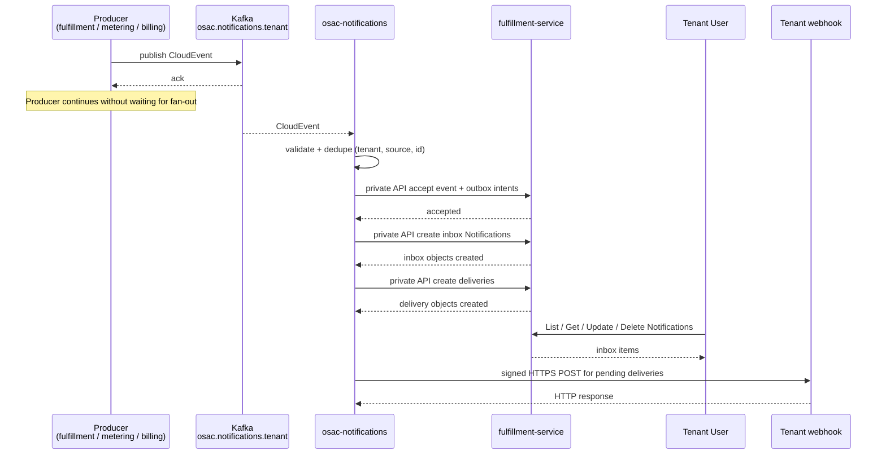

# Notifications

## Summary

A **notification** is a durable notice that something of interest happened for a Tenant User or for tenant automation.
Examples include a resource becoming ready, a quota warning, a billing notice, or a platform announcement. Users and
automation consume notifications through channels such as the console inbox and webhooks.

This design adds the Notification APIs and object tables in the fulfillment-service, and adds `osac-notifications` as a
dedicated controller. Producers such as fulfillment-service, metering, and billing can publish CloudEvents to
per-tenant Kafka topics. The `osac-notifications` consumes these events, creates inbox and delivery objects through
the private API, and asynchronously fans out to the per-user inbox and to matching Tenant Admin webhook subscriptions.
Announcements are created by Tenant Admins or Cloud Provider Admins (for the whole platform) through the public API.
They appear as a UI banner. The creating admin role deletes them.

## Motivation

People and tenant automation need to learn about important changes without polling the Fulfillment Events API or keeping
a long-lived client open. Today the closest option is `Events.Watch`. `Watch` streams resource lifecycle changes to
clients that stay connected, so it suits controllers and tools that can hold a stream. It does not automatically notify
tenants or users when a resource is ready, so teams poll, run custom Watch clients, or miss important changes when
nobody is listening.

Even with durable `Watch` delivery, streaming a resource change is not the same as notifying a Tenant User or an Admin.
Tenants also care about quota warnings and billing alerts, not only resource lifecycle changes. Those need a delivery
path that reaches people and automation even when no client is watching, and that does not block the producing business
flow when an endpoint is down.

### Goals

- Define Notification APIs and object storage in fulfillment-service.
- Ship osac-notifications as a separate controller binary and Helm chart that consumes Kafka and delivers webhooks.
- Let multiple producers publish a stable CloudEvents contract to `osac.notifications.<tenant>`.
- Expose CRUD endpoints for Tenant Admin subscriptions 
- Expose Create, List, Get, Update, Delete on `Notifications` for event-driven notices and admin announcements.
- Deliver webhooks with Standard Webhooks signatures, a published exponential retry schedule, delivery-attempt history,
  and auto-pause after sustained failure.
- Validate each webhook URL when the subscription is created and again when a delivery is attempted, and reject
  non-HTTPS or non-public destinations.

### Non-Goals

- Stateful alarms and alert management such as silence and inhibition.
- Additional channels such as email, SMS, and Slack.
- Digests (batched or summarized notices) and custom message templates.
- Tenant User managed subscriptions. Only Tenant Admins create and manage webhook subscriptions in this iteration.
- Turning Watch or `osac.events.<tenant>` object change streams into notifications automatically. Producers publish
  notification CloudEvents only when they want a notice.
- Webhook signing-secret rotation. v1 returns a secret once on subscription create. Rotation can come in a later
  release. Admins may delete and recreate a subscription until then.

## Proposal

Producers publish CloudEvents to per tenant Kafka topics. The osac-notifications controller consumes each event,
validates it, and creates the accepted event through the Notifications API. It then processes the event payload along two paths.
For Tenant Users, it creates inbox rows from the event’s `recipient_ids`. Announcements skip inbox fan-out. For Tenant Admins,
a subscription pattern is used. When subscription matching is enabled, it evaluates active subscriptions against the event,
and for each match it sends to the webhook channel on that subscription. For the first iteration, the fulfillment
service is the only producer and webhook is the only supported channel for subscription.



Solid arrows mark the first iteration path. Dotted arrows show other producers that can publish on the same topics
later.

### Workflow Description

Kafka is the producer ingest path for event-driven notices. A successful Kafka write is enough for the producer.
osac-notifications consumes the CloudEvent, validates and dedupes it, then creates the accepted objects and outbox
intents through the private Notifications API. That accept step is the durable boundary for fan-out.
The consumer commits the Kafka offset only after accept succeeds. If the process crashes before the offset
commit, the message may be consumed again and must stay idempotent under `(tenant, source, id)`. Workers process outbox
intents to create inbox notifications and matching webhook deliveries. Those are idempotent under unique inbox
and delivery keys, so replaying outbox intents after a crash does not create duplicates.

Notifications for announcements are created only by the Admin via the Notifications public API.

#### Event-driven fan-out



**Producer → Kafka**
- Producer writes a CloudEvent to `osac.notifications.<tenant>`
- Kafka sends acknowledgement
- Producer continues without waiting for inbox or webhook delivery

**Kafka → osac-notifications**
- Controller consumes the CloudEvent
- Validates schema, tenant match, `source` → allowed `kind` grant map, and `type` pattern
- Rejects Kafka events whose `kind` is `announcement` (Admin API only)
- Dedupes on `(tenant, source, id)`

**osac-notifications → fulfillment-service (private API)**
- Accepts the event and outbox intents
- Commits the Kafka offset only after accept succeeds
- Workers create one inbox `Notification` per `data.recipient_ids` entry, unique on
  `(tenant, source, event id, recipient)`
- When `osacmatchsubscriptions` is enabled, workers create a delivery per matching subscription, unique on
  `(tenant, subscription, source, event id)`
- Replaying outbox intents is a no-op when those objects already exist

**Inbox and webhook**
- Tenant Users manage inbox items through the public `Notifications` methods on fulfillment-service
- For each subscription match, set delivery `status.state` to `pending` when the subscription is active,
  or `retained` when it is paused.
- A send worker POSTs signed HTTPS requests for `pending` deliveries. See **Webhook delivery** for timeouts, retries,
  and signing.

##### Notifications

**Event-driven notifications**
- Ingress is Kafka.
- Producers publish a CloudEvent when something happens (resource ready, quota warning, billing, or meter).
- The notification kind is one of `event`, `quota`, `meter`, or `billing`.
- The producer sets `data.recipient_ids`. Those subject ids become inbox recipients. Recipients are not discovered with
  RBAC.
- Stored as accepted event metadata plus one inbox `Notification` per recipient.
- Managed with the fulfillment `Notifications` endpoints (`List`, `Get`, `Update`, `Delete`).
- Optional webhook fan-out when `osacmatchsubscriptions` is true.
- If `data.resource` is set, List and Get hide or omit the item when the caller can no longer see the resource. See
  **RBAC / Tenancy**.

**Announcements**
- Ingress is the Admin API only. Kafka consumers reject `announcement`.
- `spec.kind` is `announcement`. `spec.scope` is an enum: `tenant` or `platform`.
- **Tenant Admin** creates with `scope` `tenant` only. The server sets `metadata.tenant` from auth.
- **Cloud Provider Admin** creates with `scope` `platform`.
- The server sets `spec.source` from the service identity. It stores one announcement and zero inbox notifications.
- Tenant callers List banners with `kind == "announcement"` and (`scope == "tenant"` for their tenant or
  `scope == "platform"`).
- The Tenant Admin can delete only tenant-scoped rows for their tenant. Cloud Provider Admin can delete
  platform-scoped rows. Tenant Users cannot Create or Delete announcements.
- Per-user announcement inbox rows are an alternative for a later release, not for v1. See **Alt E**.

##### Tenant Admin subscription

A Tenant Admin creates a subscription with a CEL filter and an HTTPS webhook URL. Creation returns a one-time signing
secret. The Admin can list, get, update (including pause and unpause), and delete subscriptions in their tenant. Tenant
Users cannot create or manage subscriptions.

**Example subscription** (illustrative quota warnings for tenant `acme`):

```json
{
  "id": "sub-acme-quota-warn",
  "metadata": {
    "name": "quota-warnings",
    "tenant": "acme"
  },
  "spec": {
    "webhook_url": "https://hooks.acme.example/osac/quota",
    "filter": "kind == \"quota\" && severity in [\"warning\", \"critical\"]",
    "paused": false
  },
  "status": {
    "last_delivery_status": "delivered"
  }
}
```

The subscription `Create` endpoint also returns `signing_secret` once. It is not returned from `List` or `Get`. Full
delivery history is listed through `NotificationSubscriptionDeliveries.List`.

**Matching an incoming event.** After osac-notifications accepts a CloudEvent for tenant `acme`:

1. If `osacmatchsubscriptions` is false, skip webhook matching. Inbox fan-out may still run.
2. Load all non-deleted subscriptions for that tenant, including paused ones.
3. Build a CEL input from the event: `event_type` (CE `type`), `severity`, `kind`, `summary`,
   `resource.kind`, `resource.id`, and tenant metadata.
4. Evaluate each subscription’s `filter` against that input. A true result is a match.
5. For each match, create a `NotificationSubscriptionDelivery` linked to the subscription and event. Creates are
   idempotent on `(tenant, subscription, source, event.id)` so replaying outbox intents does not create a second delivery.
6. If the subscription is not paused, a send worker delivers under **Webhook delivery**. If it is paused, keep the
   delivery retained until a Tenant Admin unpauses the subscription.

Example: the illustrative quota CloudEvent in the schema section has `kind: "quota"` and
`severity: "warning"`. It matches `sub-acme-quota-warn` (subscription above). An `info` quota event or an
`event` kind notice does not match.

#### Webhook delivery

Deliveries use a 30s timeout, a published exponential retry schedule, and per-attempt history. After sustained
failure for five days the subscription auto-pauses. Kafka is not the webhook retry ledger.

**Pause and retain.** A match against a paused subscription still creates a delivery record in the `retained` state.
The controller does not drop the match. While paused, it does not POST for that subscription. Resumption requires a
Tenant Admin unpause. The controller then moves retained deliveries to `pending` and the send worker applies the same
retry rules until each delivery is `delivered` or `failed`. Auto-pause from sustained failure uses the same retain
behavior so matches during the pause are not lost. There is no separate endpoint-recovery probe: a paused subscription
sends no POSTs, so the controller cannot observe that the endpoint has recovered.

Webhook destinations must use HTTPS. The hostname is resolved and connected only to an address that passes policy
checks at subscription creation time and again at each delivery attempt. The sender does not follow redirects. It
always blocks loopback and cloud metadata ranges.

Authenticity uses the [Standard Webhooks](https://www.standardwebhooks.com/) HMAC scheme. Each subscription gets its
own signing secret (`whsec_…`), returned once on create. Secret rotation is out of scope for v1. Every delivery
attempt sends:

- `webhook-id`: stable id for the delivery (receivers dedupe retries)
- `webhook-timestamp`: unix time of this attempt
- `webhook-signature`: HMAC-SHA256 over `webhook-id.timestamp.body`, versioned as `v1,…`

Receivers recompute the HMAC with the shared secret and reject bad signatures. Reject timestamps outside a skew
window (libraries default to about five minutes). Treat `webhook-id` as an idempotency key. Payload bodies must not
contain credentials or other secrets.

#### Error paths

**Bad or unauthorized CloudEvent**
- Schema is invalid, tenant does not match the topic, `source` or `kind` is outside the grant map,
  `announcement` arrived on Kafka, or `type` fails the pattern.
- Create no inbox notifications and no webhooks.
- Emit a metric. Optionally send the record to a dead-letter topic outside the consumer subscription.
- Commit the Kafka offset after the metric is recorded. If a dead-letter write is used as the durable record of the
  rejection, commit the offset only after that write succeeds.

**Duplicate CloudEvent**
- The same `(tenant, source, id)` was already accepted.
- Ignore the duplicate (idempotent consume).
- Do not create a second inbox or webhook fan-out.
- Commit the Kafka offset after the duplicate is ignored.

**Unsafe webhook URL (subscription creation)**
- URL fails SSRF checks (non-HTTPS, blocked address ranges, and so on)
- Reject the creation with `InvalidArgument`
- No subscription is stored

**Cross-tenant API access**
- Caller asks for another tenant’s inbox, subscription, or delivery
- Return empty results or `NotFound`
- Do not leak that the other tenant’s objects exist

**Resource visibility check unavailable**
- Inbox item has `data.resource` and the visibility check cannot complete
- Fail closed: omit or hide that item for this List/Get
- Items without `data.resource` are unaffected

### API Extensions

**Public and private gRPC** on fulfillment-service:

|Service|Method|Purpose|
|---|---|---|
|`NotificationSubscriptions`|`Create`|Create a webhook subscription.|
|`NotificationSubscriptions`|`List`|List subscriptions in the caller’s tenant.|
|`NotificationSubscriptions`|`Get`|Get a subscription by id.|
|`NotificationSubscriptions`|`Update`|Update subscription filter, webhook URL, or pause and unpause a subscription.|
|`NotificationSubscriptions`|`Delete`|Delete a subscription and stop further deliveries.|
|`NotificationSubscriptionDeliveries`|`List`|List delivery history.|
|`NotificationSubscriptionDeliveries`|`Get`|Get one delivery or attempt record.|
|`Notifications`|`Create`|Tenant Admin or Cloud Provider Admin creates an announcement as a `Notification` object.|
|`Notifications`|`List`|List the caller’s event-driven notifications and visible announcements (tenant and platform).|
|`Notifications`|`Get`|Get an event-driven notification or announcement by id.|
|`Notifications`|`Update`|Update an event-driven inbox item’s `status.state` (`unread` or `read`). Not used for announcements.|
|`Notifications`|`Delete`|Delete the caller’s event-driven notification, or remove an announcement per role rules below.|

Controllers use the private methods to accept Kafka events, create inbox notifications and deliveries, and update delivery status.
Tenants, admins, and the console use the public methods.

**List requests** take `offset`, `limit`, an optional `filter`, and an optional `order`. The `filter` field is a CEL
expression evaluated against each candidate object. Examples:

- Announcements for the UI banner: `this.spec.kind == "announcement"`
- Unread event-driven inbox items: `this.spec.kind != "announcement" && this.status.state == "unread"`
- Deliveries for one subscription: `this.spec.subscription.id == "sub-acme-quota-warn"`

### UX Alignment

New `@temp-api` shapes against the Notification public API. Console proxy routes to fulfillment-service.

### Implementation Details/Notes/Constraints

#### Component layout

```text
osac/
  fulfillment-service/    # Notification APIs + object tables; CE publisher
  osac-notifications/     # Kafka consumer, webhook workers, chart
  osac-metering/          # CE publisher
  osac-installer/         # notifications chart + topic lifecycle
```

#### Types and contracts

This section covers producer ingest payloads and the public API resource shapes.

**Kafka ingest** for notifications uses CloudEvents 1.0 with JSON `data` and the `osactenant` extension.

|Attribute|Required|Meaning|
|---|---|---|
|`id`|yes|Idempotency key that is stable for this producer. Uniqueness is enforced as `(tenant, source, id)`.|
|`source`|yes|Producing service identity (for example `fulfillment-service`, `osac-metering`, or `osac-billing`).|
|`type`|yes|`osac.notification.<kind>.<name>` (see validation below)|
|`time`|yes|Time of the event|
|`specversion`|yes|`1.0`|
|`osactenant`|yes|Tenant id. Must match the topic suffix.|
|`kind`|yes|Enum. `event` \| `meter` \| `billing` \| `quota` on Kafka. `announcement` only on Admin `Notifications.Create`.|
|`severity`|yes|Enum. `info` \| `warning` \| `critical`.|
|`osacmatchsubscriptions`|no|Whether to evaluate webhook subscriptions. Defaults to `true`.|
|`data`|yes|See below|

**Validation (Kafka ingest):** Reject the event if any check fails.

- A consumed Kafka record does not carry the producer’s authenticated principal. The consumer authorizes using a
  configured grant map: each `source` is set to its allowed `kind` values. Reject the event when
  `source` or `kind` is outside that map.
- Each producer KafkaUser is assigned one `source` value in that map. The owning service must set that `source` on
  every event. Kafka ACLs still control which principals may write tenant topics.
- Reject Kafka events whose `kind` is `announcement`. Announcements use Admin `Notifications.Create` only.
- `type` must be `osac.notification.<kind>.<name>` where `<kind>` segment equals `kind`.
  `type` remains a string so producers can add names without a proto change.
- `<name>` is free within a pattern: nonempty, lowercase letters, digits, and underscores only (for example
  `warning`, `resource_created`, or `maintenance`).
- `osactenant` must match the topic suffix.

**`data` (v1) for Kafka CloudEvents:**

|Field|Required|Meaning|
|---|---|---|
|`summary`|yes|Short text that summarizes the notification message.|
|`body`|no|Longer text with details of the message.|
|`recipient_ids`|no|Targeted inbox recipients (subject or user ids). Required for non-announcement inbox fan-out. Omit for announcements.|
|`resource`|no|Optional `{ "kind", "id" }` reference used for later RBAC visibility checks.|
|`details`|no|Optional kind-specific map (for example used and limit). Often empty for announcements.|

**Example of quota warning** → topic `osac.notifications.acme`:

This example is illustrative only. Quota producer behavior and Admin recipient selection are out of scope for this
design.

```json
{
  "specversion": "1.0",
  "id": "quota-warn-acme-compute-2026-11-07T18:00:00Z",
  "source": "osac-billing",
  "type": "osac.notification.quota.warning",
  "time": "2026-11-07T18:00:00Z",
  "datacontenttype": "application/json",
  "osactenant": "acme",
  "kind": "quota",
  "severity": "warning",
  "osacmatchsubscriptions": true,
  "data": {
    "summary": "Compute vCPU quota at 90%",
    "body": "You have used 90 of 100 vCPUs.",
    "resource": {
      "kind": "quota",
      "id": "quota-compute"
    },
    "details": {
      "meter": "compute.vcpu",
      "used": "90",
      "limit": "100",
      "threshold_percent": 90
    }
  }
}
```

**Example of fulfillment resource notice** → topic `osac.notifications.acme`:

Explicit producer publish (not Watch). Fulfillment puts the **requesting user’s subject id** in `data.recipient_ids`
(information it already has on the creation path). `resource` identifies the object for later visibility checks.

```json
{
  "specversion": "1.0",
  "id": "fulfillment-ci-created-vm-42-2026-11-07T18:05:00Z",
  "source": "osac-tenant",
  "type": "osac.notification.event.resource_created",
  "time": "2026-11-07T18:05:00Z",
  "datacontenttype": "application/json",
  "osactenant": "acme",
  "kind": "event",
  "severity": "info",
  "osacmatchsubscriptions": false,
  "data": {
    "summary": "Compute instance vm-42 created",
    "body": "Your compute instance vm-42 is ready.",
    "recipient_ids": [
      "user-123"
    ],
    "resource": {
      "kind": "compute_instance",
      "id": "vm-42"
    },
    "details": {
      "lifecycle": "created",
      "project_id": "proj-9",
      "name": "vm-42"
    }
  }
}
```

**Public API resources** use `id`, `metadata`, `spec`, and `status`. The server assigns `id` and system metadata
fields such as tenant. The caller supplies `metadata` (for example `name`) and `spec`. `status` is
system-reported. Examples below show that resource shape.

**Example of announcement:**

```json
{
  "metadata": {
    "name": "maintenance-2026-11-10"
  },
  "spec": {
    "kind": "announcement",
    "scope": "tenant", // set to platform if created by CPA
    "severity": "warning",
    "type": "osac.notification.announcement.maintenance",
    "summary": "Scheduled maintenance window",
    "body": "Control-plane maintenance is planned for 2026-11-10 02:00–04:00 UTC. API calls may fail during that window."
  }
}
```

**Validation (`Notifications.Create`):** The request must include `metadata.name` and announcement `spec`
fields. The `spec.scope` field must be set to either `tenant` or `platform`. Reject the request if
`spec.kind` is not `announcement` and if `spec.scope` is not set. The server sets `metadata.tenant` and `spec.source`.

The following examples show public API resources as returned by `Get` or `List`.

**Example `NotificationSubscription`:**

```json
{
  "id": "sub-acme-quota-warn",
  "metadata": {
    "name": "quota-warnings",
    "tenant": "acme"
  },
  "spec": {
    "webhook_url": "https://hooks.acme.example/osac/quota",
    "filter": "kind == \"quota\" && severity in [\"warning\", \"critical\"]",
    "paused": false
  },
  "status": {
    "last_delivery_status": "delivered"
  }
}
```

**Example `NotificationSubscriptionDelivery`:**

Deliveries are system-created on a subscription match. The server assigns a new `id` and a distinct
`metadata.name` for each delivery.

```json
{
  "id": "del-acme-quota-warn-1",
  "metadata": {
    "name": "quota-warn-acme-compute-2026-11-07t18-00-00z",
    "tenant": "acme"
  },
  "spec": {
    "subscription": {
      "id": "sub-acme-quota-warn",
      "name": "quota-warnings"
    },
    "event": {
      "id": "quota-warn-acme-compute-2026-11-07T18:00:00Z",
      "source": "osac-billing"
    }
  },
  "status": {
    "state": "retained",
    "attempt_count": 0,
    "last_http_status": 0,
    "last_error": ""
  }
}
```

`spec.event` identifies the accepted notification CloudEvent under `(tenant, source, id)`. It is not a fulfillment
Watch `Event` object and not a public `Notification` id.

`status.state` is the enum `NotificationSubscriptionDeliveryState`:

|Value|Meaning|
|---|---|
|`pending`|The delivery needs a webhook POST (first attempt or a scheduled retry). The send worker selects these rows.|
|`retained`|The subscription matched while paused (or auto-paused). No POST is sent until a Tenant Admin unpauses it.|
|`delivered`|The webhook accepted the delivery.|
|`failed`|Retries are exhausted, or the delivery was reported failed.|

**Example of `Notification` (inbox item):**

```json
{
  "id": "inbox-acme-user-123-1",
  "metadata": {
    "name": "inbox-acme-user-123-1",
    "tenant": "acme"
  },
  "spec": {
    "kind": "event",
    "severity": "info",
    "type": "osac.notification.event.resource_created",
    "source": "osac-fulfillment",
    "summary": "Compute instance vm-42 created",
    "body": "Your compute instance vm-42 is ready.",
    "resource": {
      "kind": "compute_instance",
      "id": "vm-42"
    },
    "details": {
      "lifecycle": "created"
    }
  },
  "status": {
    "state": "unread"
  }
}
```

`status.state` for inbox items is an enum with v1 values `unread` and `read`. Announcements do not use this field.

**Example announcement `Notification`** (tenant scope):

```json
{
  "id": "announce-acme-maintenance-2026-11-10",
  "metadata": {
    "name": "maintenance-2026-11-10",
    "tenant": "acme"
  },
  "spec": {
    "kind": "announcement",
    "scope": "tenant",
    "severity": "warning",
    "type": "osac.notification.announcement.maintenance",
    "source": "osac-fulfillment",
    "summary": "Scheduled maintenance window",
    "body": "Control-plane maintenance is planned for 2026-11-10 02:00–04:00 UTC. API calls may fail during that window."
  },
  "status": {}
}
```

A platform announcement uses `spec.scope` `platform` and omits `metadata.tenant`.

#### Persistence

Fulfillment-service stores the Notification API objects with the same object and tenancy patterns as other OSAC
resources. The tables are:

- `notifications`: inbox items and announcements (`Notification`). Unique on
  `(tenant, source, event.id, recipient)` for event-driven inbox rows.
- `notification_subscriptions`: Tenant Admin webhook subscriptions (`NotificationSubscription`). Unique on
  `(tenant, id)`.
- `notification_subscription_deliveries` and delivery attempts: webhook history under a subscription
  (`NotificationSubscriptionDelivery`), including retained matches created while a subscription was paused. Unique on
  `(tenant, subscription, source, event.id)`.
- `notification_outbox`: durable intents to create inbox notifications or match webhooks, so fan-out is not lost if a
  controller restarts.

#### Installer

- Chart for osac-notifications
- On tenant create, provision `osac.notifications.<tenant>` (one partition) and optional
  `osac.notifications.dlq.<tenant>`
- Consumer group `osac-notifications` subscribes only to ingest topics. Use a regex that matches exactly one tenant
  segment and therefore excludes DLQ topics such as `osac.notifications.dlq.<tenant>` (for example
  `^osac\.notifications\.[^.]+$`).
- Do not put DLQ topics in the same consumer subscription as ingest topics.
- Reuse the existing Strimzi `KafkaUser` pattern (same approach as fulfillment’s `osac.events.*` ACLs). Extend
  producer users with publish rights on `osac.notifications.` topics and wire bootstrap plus credentials into producer
  charts. The Kafka broker enforces those ACLs on write.
- Configure the notifications consumer grant map so each `source` is set to its allowed `kind`
  values. Assign each producer KafkaUser one `source` value that its service must set on every event.
- Worker and retry knobs as needed

### Security Considerations

See **RBAC/Tenancy** for publish and API access rules. 
See **Webhook delivery** for URL validation, signing, and payload rules.

### RBAC / Tenancy

**API roles**
- Tenant User: List/Get/Update/Delete on their own event-driven `Notifications`.
- Tenant Admin: Manage subscriptions and delivery history in the tenant. Create/Delete announcements with
  `scope` `tenant` only.
- Cloud Provider Admin: Create/Delete announcements with `scope` set to `platform`.
- Kafka: tenant isolation by topic name and ACL. Consumer grant map sets each `source` to allowed `kind` values.

**Recipient resolution vs resource visibility**

These are different jobs. Fulfillment RBAC answers whether **this** caller may see **this** object. It does not
efficiently answer who should receive an inbox notification.

|Concern|Who decides|Mechanism|
|---|---|---|
|**Who gets an inbox notification**|**Producer**|`data.recipient_ids` (subject ids already known on the write path).|
|**Who sees an announcement**|**`spec.scope`**|`tenant`: callers in that tenant. `platform`: every tenant’s announcement List.|
|**May this caller see this inbox item**|**fulfillment-service**|If `data.resource` is set, evaluate visibility with the **caller’s** identity. Deny or omit if not allowed.|
|**Webhook subscribers**|Tenant Admin subscriptions + CEL|Only when `osacmatchsubscriptions` is true. Independent of inbox recipients.|

### Risks and Mitigations

|Risk|Mitigation|
|---|---|
|A producer publishes into the wrong tenant topic, forges `source` or `kind`, or sends an invalid CloudEvent, including `announcement` on Kafka.|Deny publish by default with per-producer ACLs. Authorize with a grant map of `source` to allowed `kind` values. Reject `announcement` and events that fail required fields or the `type` pattern. Cover ACL and grant boundaries in tests.|
|Redelivery or shared ids create duplicate inbox or delivery objects, or one producer’s event drops another’s.|Enforce unique `(tenant, source, event.id, recipient)` on inbox notifications and `(tenant, subscription, source, event.id)` on deliveries so fan-out creates are idempotent.|
|The consumer also reads DLQ topics and republishes invalid records.|Use a distinct DLQ name pattern and a consumer regex that excludes DLQ topics.|
|A match during pause is lost because no delivery was created.|Create a `retained` delivery for paused matches. On unpause, move them to `pending` and resume or fail after retries.|
|A webhook URL points at an internal or non-public address (SSRF).|Validate URLs at subscription create and on each delivery. Reject non-HTTPS and non-public destinations.|
|A caller forges tenant, `scope`, or `source` on announcement Create, or uses the wrong role.|Set tenant and `spec.source` on the server. Enforce Create and Delete by role and `scope`. Cover allow and deny cases in tests.|
|Resource visibility cannot be evaluated for a `data.resource` inbox item.|Fail closed for resource-scoped items. Leave items without `resource` unaffected.|

## Alternatives

### Alt A — Host Notification APIs in osac-notifications

Rejected because fulfillment-service owns the public and private Notification APIs and object tables.

### Alt B — gRPC Submit as producer ingest (no Kafka)

Rejected because producers use Kafka CloudEvents only, matching the metering-style ingest path.

### Alt C — One Kafka topic per notification kind/type

Rejected because that explodes the topic count and `kind` field is part of CloudEvent attributes instead.

### Alt D — mTLS or SNS-style cert URLs for webhook authenticity

Rejected because Standard Webhooks HMAC covers authenticity and replay for tenant HTTPS URLs.

### Alt E — Per-user announcement expand

Rejected for v1 because one announcement object and a UI banner are enough (`scope` `tenant` or `platform`).

## Infrastructure Needed

- `osac/osac-notifications` component (binary, image, chart, CI).
- Kafka topic lifecycle for `osac.notifications.<tenant>` (+ optional DLQ).
- PostgreSQL for notifications.
