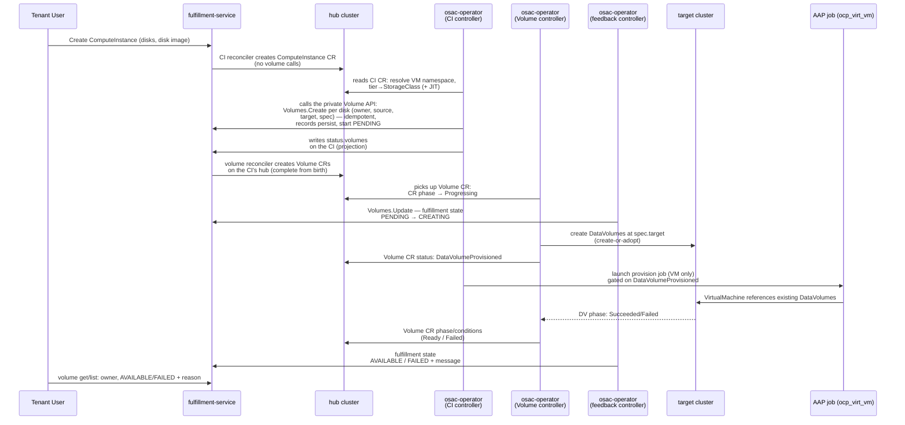
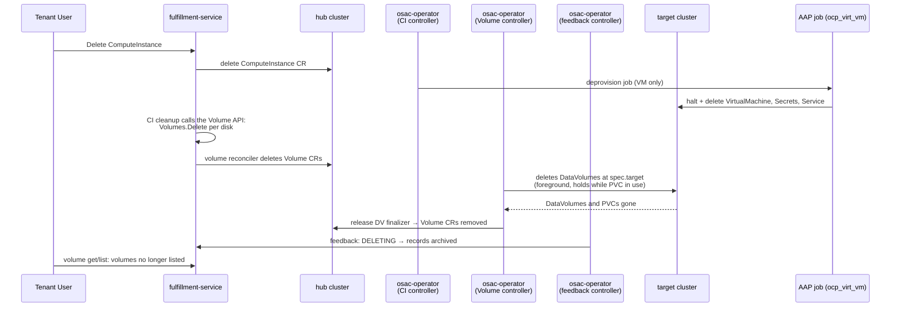

# Volume API owns VMaaS volume provisioning end-to-end

| Field       | Value                                                       |
|-------------|-------------------------------------------------------------|
| Author(s)   | Mark Bramnik <mbramnik@redhat.com>                          |
| Jira        | [OSAC-7749](https://redhat.atlassian.net/browse/OSAC-7749) (design task [OSAC-7321](https://redhat.atlassian.net/browse/OSAC-7321), outcome [OSAC-7318](https://redhat.atlassian.net/browse/OSAC-7318)) |
| PRD         | [prd.md](prd.md)                                            |
| Date        | 2026-11-17                                                  |

# 1. Overview

This design moves VMaaS ComputeInstance disk provisioning into the Volume
API's control loop. Today, disk registration creates Volume records in
fulfillment, while the real storage — CDI DataVolumes on the target
cluster — is created by the AAP `ocp_virt_vm` playbook; the two paths are
correlated only by an ID annotation, and the Volume record's own
vendor-provisioning leg fails for these volumes (OSAC-7670). The design
collapses the two paths into one: the operator's ComputeInstance
controller — which knows the instance's placement — creates volumes
through the private Volume API with complete information (owner, source,
target); the Volume CR is self-contained from birth; and the operator's
Volume controller provisions the DataVolume at the recorded target, with
a lifecycle and failure reasons derived from the DataVolume, and
cascade-deleted with
the instance. Ownerless (CaaS/CSI) volumes keep the existing
vendor-provisioner path unchanged. See [PRD](prd.md) for detailed
requirements.

The ComputeInstance create API remains the entry point; the Volume API is
called from it internally, and no public ComputeInstance API changes
[PRD: REQ-7] [User].

# 2. Goals and Non-Goals

## 2.1 Goals

- Select the provisioning strategy per Volume at the Volume CR
  reconciliation point: vendor CSI for ownerless volumes, DataVolume
  creation for ComputeInstance-owned volumes.
- Carry ownership, disk source, and placement on the Volume object so
  the provisioner has everything it needs without reading resources that
  do not belong to it.
- Derive volume state and failure reasons from the DataVolume's actual
  phase and conditions, through the existing operator→fulfillment
  feedback bridge.
- Reuse the existing cross-cluster finalizer chain for cascade delete
  instead of introducing any new agent or garbage-collection mechanism.
- Preserve the exact current DataVolume shape (registry source with
  node pull, blank sources, names, RWO) so VM behavior is unchanged.

## 2.2 Non-Goals

- Standalone volumes, add-disk, remove-disk, transfer, and hot-plug /
  hot-unplug — owned by the parent outcome OSAC-7318.
- A stable name mapping between an OSAC volume and its provisioned
  storage; DataVolume names keep the existing `<ci-name>-<disk-key>`
  derivation (OSAC-7318).
- Long-lived `PENDING` semantics for standalone volumes — a volume
  waiting for an owner before its target cluster and namespace can be
  resolved (OSAC-7318). This feature introduces `PENDING` as the initial
  state of every volume, with a quick transition to `CREATING` [User].
- Any change to the public ComputeInstance API surface, to networking
  contracts, or to the CaaS/CSI volume path.
- Backfill or migration of existing volumes and instances [PRD: REQ-7].

# 3. Motivation / Background

The current VMaaS disk flow has two independent provisioning paths per
disk. Fulfillment's disk registration creates a Volume record named
`ci-<ci-id>-<disk-key>` (with a placeholder topology segment) and
resolves its ID into `ComputeInstance.status.volumes` and the CR's
`spec.diskVolumeIDs`. The fulfillment volume reconciler then creates an
`osacv1alpha1.Volume` CR on a randomly selected hub, where the operator's
Volume controller attempts vendor-CSI provisioning through
`VendorProvisioner` — which fails for these volumes, leaving them
`FAILED` ("volume provisioning failed") while the real disk is being
created elsewhere [Codebase:
`fulfillment-service/internal/controllers/computeinstance/disk_registration.go`].
Meanwhile the AAP `ocp_virt_vm` playbook creates the actual DataVolumes on
the target cluster (root disk from the OCI registry image, additional
disks blank), stamps the fulfillment Volume ID on them as an annotation,
creates the VirtualMachine referencing them, and deletes them on teardown
[Codebase: `osac-aap/collections/ansible_collections/osac/templates/roles/ocp_virt_vm/tasks/create_resources.yaml`].

The consequences are the problems the PRD states: no ownership tracking
(the Volume record has no back-reference to the instance), an untruthful
lifecycle (OSAC-7670: volumes report FAILED while their DataVolumes are
Bound and attached to running VMs), and two writers for one disk's
storage. Tier-to-StorageClass resolution and JIT StorageClass creation
also live inside the AAP playbook, outside the storage team's control
loop.

This design supersedes the VMaaS provisioning sections of
[OSAC-6037](https://github.com/osac-project/enhancement-proposals/blob/main/enhancements/OSAC-6037-storage-api-volume-lifecycle/design.md)
— the per-disk Volume Create contract, the physical side effects, **and
the two-phase registration claim machine**, which is replaced by an
idempotent `Create` plus the operator's level-triggered reconciliation
(§4.6). Its record-cleanup finalizer flow is retained, now owner-query
based. [User]

KubeVirt and CDI provide the synchronization guarantees this design
relies on: a VM may reference DataVolumes that are still importing —
KubeVirt holds the VMI unscheduled until every referenced DataVolume
finishes its import — but the DataVolume lifecycle is not tied to the VM
(reference-based DVs are not garbage-collected with it), so ordering and
teardown remain OSAC's responsibility [Research: Domain 1].

# 4. Design

## 4.1 Architecture

The provisioning decision moves to the Volume CR, and every component
reads only its own resources. The operator's CI controller — which owns
the ComputeInstance CR and knows its placement — creates the volumes
through the private Volume API with **complete information**: owner,
disk source, and target (namespace and DataVolume name). The Volume
record is therefore stored once, complete from birth, and the Volume CR
is **self-contained**: the operator's Volume controller reconciles
`osacv1alpha1.Volume` CRs and branches on `spec.owner` — ownerless CRs
take the existing `VendorProvisioner` path (CaaS, unchanged);
ComputeInstance-owned CRs take a new VMaaS branch that creates and
watches a CDI DataVolume on the target cluster, using only the target
recorded in the CR's own spec. Fulfillment's CI reconciler no longer
performs disk registration at all — it creates the ComputeInstance CR
directly. The AAP playbook keeps creating the VirtualMachine, Secrets,
and optional Service, but no longer creates, resolves storage for, or
deletes DataVolumes.



The diagram shows the create flow. The three osac-operator participants
(CI controller, Volume controller, feedback controller) are **separate
reconcile loops in the same operator binary** — there are no network
boundaries between them; they coordinate through Volume CR conditions
(the CI controller's job-launch gate on `DataVolumeProvisioned` is the
key handoff). The diagram deliberately uses each level's own
vocabulary — DataVolume phases (CDI), Volume CR phases (`Progressing`,
`Ready`, `Failed`), and fulfillment `VolumeState` values (`PENDING`,
`CREATING`, …); the state-mapping table below defines the translation.
The key handoffs: the CI controller is a **client** of the Volume API on
both directions of the lifecycle — `Volumes.Create` with owner, source,
and target (one write, complete), and `Volumes.Delete` on teardown. The
volume reconciler reacts to the new records and creates the Volume CRs
on the CI's hub. The Volume controller's pickup of the Volume CR (CR
phase `Progressing`) is the signal for the first feedback write: the
volume feedback controller calls `Volumes.Update`, persisting the
`PENDING → CREATING` transition in fulfillment's database — this write
is asynchronous and does not gate DataVolume creation. The operator
Volume controller is the single writer of DataVolumes; and the feedback
bridge remains the only path from cluster state to fulfillment Volume
status, carrying both the `CREATING` transition and the terminal
`AVAILABLE`/`FAILED` states.

Component responsibilities:

- **fulfillment-service** — the CI reconciler creates the
  ComputeInstance CR directly (disk registration is removed); the volume
  reconciler places CI-owned Volume CRs on the CI's hub instead of
  selecting one at random; CI delete requests volume deletion through
  the private Volume API (`Volumes.Delete`) and never removes volume
  records itself.
- **osac-operator, CI controller** — reads its own ComputeInstance CR,
  resolves placement (VM namespace, StorageClasses incl. JIT), calls
  `Volumes.Create` per disk with owner, source, target, and spec
  (idempotent; §4.6), writes the CI's `status.volumes` projection from
  the Create responses, and gates AAP job launch on all owned volumes
  having created their DataVolumes.
- **osac-operator, Volume controller** — new VMaaS branch: reads only
  the Volume CR; resolves the StorageClass from the tier; creates the
  DataVolume named by `spec.target` in `spec.target`'s namespace on the
  target cluster (create-or-adopt), maps DataVolume status to the Volume
  CR, deletes the DataVolume on Volume CR deletion under a finalizer.
  It never reads the ComputeInstance CR.
- **osac-aap, `ocp_virt_vm`** — `create_resources` drops DataVolume
  creation and tier resolution; the VM spec keeps referencing the same
  DataVolume names; `delete_resources` drops DataVolume deletion and the
  DataVolume label sweep.
- **osac-operator, volume feedback controller** — unchanged mechanism;
  its source of truth (Volume CR phase/conditions) now also reflects
  DataVolume state.

### Target-location resolution [PRD: REQ-3]

"The same location as the owning ComputeInstance" resolves in the
Create call itself — the component that knows the placement passes it
in, and it is stored once:

- **Hub:** the fulfillment volume reconciler inherits `status.hub` from
  the owning ComputeInstance record (replacing random hub selection for
  owned volumes), so the Volume CR is co-located with the CI CR.
- **Target cluster and namespace:** the operator's CI controller
  computes the VM namespace — the accepted NetworkAttachment namespace
  with provider networking, else the tenant namespace
  [Codebase: osac-operator/internal/controller/computeinstance_controller.go]
  — and the DataVolume name (`<ci-cr-name>-root-disk` /
  `<ci-cr-name>-disk-N`, the names the AAP-built VM spec references),
  and passes both in the `Volumes.Create` request as `spec.target`. The
  target cluster is the operator's configured remote cluster. The
  DataVolume therefore lands in the exact namespace where the owning VM
  runs; no separate location negotiation exists, and the Volume
  controller never needs to consult the ComputeInstance CR.

The operator obtains target-cluster access through a kubeconfig Secret
supplied by the installer (the same credential AAP launch jobs use
today), consumed through the operator's existing remote-cluster
(multicluster-runtime) client. Compatibility of the remote-cluster
mechanism with provider networking is an open question (§9.1); if it
cannot be resolved, the AAP-transport alternative (§6) keeps this design
intact by swapping only the DataVolume writer.

### State mapping [PRD: REQ-4]

The Volume controller maps DataVolume state to the Volume CR, and the
existing feedback bridge maps the Volume CR to fulfillment `VolumeState`:

| DataVolume | Volume CR | Fulfillment `VolumeState` |
|---|---|---|
| (not yet picked up by the operator — no CR activity) | (no phase) | PENDING |
| Pending, PVCBound, ImportScheduled, ImportInProgress, WaitForFirstConsumer | Progressing | CREATING |
| Any other DataVolume phase (clone, snapshot, Paused, Unknown, …) | Progressing | CREATING — fallback so feedback never stalls or regresses on an unlisted phase |
| Succeeded | Ready | AVAILABLE |
| Failed (+ condition reason/message) | Failed | FAILED, `status.message` = DV condition message |
| (CR deleting, DV delete in flight) | Deleting | DELETING |

**Initial state and the PENDING → CREATING transition.** Every volume
starts in `PENDING`: the private volumes server's `Create` sets it
(previously it set `CREATING`), and the fulfillment volume reconciler's
defaulting matches (UNSPECIFIED → PENDING). `PENDING` represents the
window between "volume record exists" and "the operator has started
provisioning" [User]. The transition to `CREATING` is not set by
fulfillment: the operator writes it on the Volume CR when it picks the
CR up and begins provisioning (phase `Progressing`), and the regular
volume feedback controller loop persists the new state in fulfillment's
database, because the status change must be reflected there for
consistency [User]. In the CI flow this window is short (about a
second); for the future standalone-volume flow `PENDING` will persist
until an attach resolves the target — that long-lived semantics is
OSAC-7318's, not this feature's. The initial state applies to all volume
creation flows, including CaaS/CSI volumes [User].

The `CREATING` observation is **best-effort**: the feedback loop reads
the current Volume CR phase, and a fast-provisioned volume (e.g. a
blank disk) may reach `Ready` before the loop ever observes
`Progressing` — in that case fulfillment records `AVAILABLE` directly
from `PENDING`. Terminal states are always recorded; intermediate
states are recorded when observed. No extra database update is forced
for a transition the system has already passed.

AVAILABLE is defined as DataVolume `Succeeded`, deliberately **not** as
PVC `Bound`: on WaitForFirstConsumer storage classes the PVC binds only
when the VM's virt-launcher pod consumes it, so a Bound-based definition
would never fire before the VM exists [Research: Domain 1].

### Ordering and the benign race

DataVolumes must exist before the AAP job applies the VirtualMachine
manifest (KubeVirt waits for imports, not for missing objects). The CI
controller therefore gates job launch on every owned Volume CR reporting
the `DataVolumeProvisioned` condition true. Import itself is not gated:
the VM is created while imports run, and KubeVirt holds the VMI
unscheduled until they finish [Research: Domain 1]. No other
orchestration between VM and disks exists or is needed.

### Deletion flow (cascade delete) [PRD: REQ-5]

Deleting a ComputeInstance cascades to its volumes through the same API
boundaries as creation — with the same responsibility rule: **the
ComputeInstance delete flow never removes volume records itself.** It
issues `Volumes.Delete` per disk through the private Volume API (the
existing `releaseFinalizerAfterVolumeCleanup` chain), so the decision of
what "deleting a volume" means — record removal, Volume CR teardown,
DataVolume deletion — stays inside the Volume API, owned by the storage
team [User]. The CI side only waits for the Volume API's answer before
releasing its own finalizer.

**Deletion fence.** To prevent a `Volumes.Create` that is in flight when
the owner starts deleting from committing after the cleanup has already
released the CI finalizer, the private `Volumes.Create` rejects a
request whose owner is in a deleting state with `FailedPrecondition`
("owner is being deleted"). The fence is **serialized** through a
PostgreSQL row-level lock: within the Create transaction, the
controller acquires `SELECT … FOR UPDATE` on the owner's CI record
before the Volume insert commits, and the deletion-state update
(marking the CI as deleting) acquires the same lock. If the deletion
holds the lock, Create waits, then sees the deleting state and fails.
If Create holds the lock, the deletion waits, and the cleanup's final
owner query — a fresh read after the deletion-state update commits —
sees the new volume. Either way, no volume can commit after the
final owner query returns empty. The operator's error
classification already handles `FailedPrecondition` as a permanent
error — the CI controller stops retrying and surfaces the failure.



The diagram shows the delete flow. The three osac-operator participants
(CI controller, Volume controller, feedback controller) are separate
reconcile loops in the same operator binary, as in the create flow. The
key handoffs: the CI delete
path's only storage action is the `Volumes.Delete` call — record,
Volume CR, and DataVolume teardown all belong to the Volume API's
components; the AAP deprovision job deletes the VM, Secrets, and
optional Service, and no longer touches DataVolumes.

The chain, each link holding until the next verifiably completes (the
same "don't release until clean" semantics as OCM's Foreground deletion
[Research: Domain 3]):

1. Fulfillment's ComputeInstance finalizer — released only after every
   disk's Volume record is gone or in a terminal deleting state
   (existing `releaseFinalizerAfterVolumeCleanup` behavior). The cleanup
   lists the CI's volumes **by owner query** (`Volumes.List` filtered on
   `owner.reference`), never trusting the `status.volumes` projection —
   the owner field in the volumes table is the source of truth, so a
   crash window that left the projection incomplete cannot orphan a
   record.
2. Volume record deletion — the volume reconciler removes the Volume CR
   from the CI's hub.
3. The `osac.openshift.io/volume-datavolume` finalizer on the Volume CR
   — the operator's Volume controller deletes the DataVolume named by
   the Volume CR's own `spec.target` on the target cluster, **with
   foreground propagation**, and releases the finalizer only once the
   DataVolume *and its PVC* are gone. The lookup does not depend on
   the ComputeInstance CR existing.

   *Foreground propagation* is a built-in Kubernetes garbage-collection
   mode (`propagationPolicy: Foreground` on the delete call): the owner
   object is marked deleting and **typically stays in Terminating until
   its blocking dependents are removed**. (A dependent blocks only when
   it carries `blockOwnerDeletion: true` and is visible in the garbage
   collector's cache, so foreground propagation alone is not a hard
   guarantee — see the authoritative check below.) It
   is not the default (the default, background propagation, removes the
   owner object immediately and cleans dependents later). Here the PVC
   is a dependent of the DataVolume, and while the VM still uses the
   disk, Kubernetes PVC protection holds the PVC.
   The **authoritative guarantee** is the controller's explicit check:
   the finalizer is released only after the controller has verified
   that **both** the DataVolume object and its PVC are gone. Foreground
   propagation is chosen as defense in depth: it keeps the DataVolume
   object visible in Terminating during the wait, making the PVC-held
   window observable and the check robust — but the finalizer does not
   depend on it. Note
   that PVC protection tracks the consuming
   pod, not the VirtualMachine object, so the PVC may release before
   the VM object is deleted; the design's guarantee is that no storage
   outlives the volume record, not a VM-object deletion order. Even
   under background propagation the explicit PVC check would prevent
   premature release; what would be lost is the observable Terminating
   state and the defense-in-depth of the DataVolume object remaining
   present.

Two semantics the diagram cannot show:

- **Concurrency, not choreography.** The record cleanup and the VM
  teardown start together once deletion begins; there is no hard
  sequencing between "VM gone" and "DataVolume delete requested", and
  none is needed. The guaranteed invariant is that **no storage
  outlives the volume record**: the DataVolume typically remains in
  Terminating (foreground propagation) while its PVC is held —
  Kubernetes PVC protection tracks the *consuming pod*, so the PVC
  releases when the deprovision job halts the VM and the
  virt-launcher pod terminates, which may precede VM-object deletion —
  and the finalizer releases only after the controller's explicit
  check confirms both the DataVolume and its PVC are gone (§4.6).
  VM-object deletion order is explicitly not a guarantee of this
  design.
- **The future preserve option.** The PRD deletes volumes automatically
  "for now"; preserving a volume when its ComputeInstance is deleted is
  the remove-disk/detach territory of OSAC-7318. This design enables it
  structurally: because ownership is a field on the Volume rather than a
  naming convention, preserve-on-delete becomes a policy decision at the
  cleanup step (skip the `Volumes.Delete` for selected volumes), not a
  re-architecture.

## 4.2 Data Model / Schema Changes

### Fulfillment proto (`proto/private/osac/private/v1/volume_type.proto`)

```protobuf
// VolumeSpec additions (all immutable after creation):
message VolumeSpec {
  // ... existing storage_tier, size_gib, access_mode, topology ...

  // Owning workload. Set only by the operator's create path;
  // public Create/Update rejects a non-empty value. Absent for
  // CaaS/CSI volumes and future standalone volumes.
  VolumeOwner owner = 5;

  // Disk source for VMaaS provisioning. Private.
  VolumeSource source = 6;

  // Provisioning target for VMaaS volumes. Private. Provided by the
  // operator's CI controller in the Create request — the Volume CR is
  // self-contained from birth and the Volume controller never consults
  // the owning ComputeInstance CR.
  VolumeTarget target = 7;
}

message VolumeOwner {
  // Type of the owning entity. New owner types are additive enum
  // values — the architect-agreed shape is a typed reference
  // (type + reference) reused by every owner kind [User].
  VolumeOwnerType type = 1 [(buf.validate.field).enum.defined_only = true];
  // Fulfillment record identifier of the owning entity named by type
  // (for ComputeInstance: the ComputeInstance id, e.g. "ci-...").
  // See §9.5 for the id-vs-name confirmation.
  string reference = 2 [(buf.validate.field).string.min_len = 1];
}

enum VolumeOwnerType {
  VOLUME_OWNER_TYPE_UNSPECIFIED = 0;
  VOLUME_OWNER_TYPE_COMPUTE_INSTANCE = 1;
  // VOLUME_OWNER_TYPE_CLUSTER = 2 — the CaaS owner kind in the agreed
  // model (owner {type: cluster, reference: <cluster id>}); add when
  // CaaS cluster ownership lands. Additive, no renumbering. The enum
  // carries only supported values — a pre-declared value would pass
  // validation and fail only at reconcile time.
}

message VolumeSource {
  oneof content {
    VolumeSourceRegistry registry = 1;
    VolumeSourceBlank blank = 2;
    // Future members (additive only): http, s3, gcs, pvc, snapshot,
    // upload — mirroring CDI DataVolumeSource.
  }
}

message VolumeSourceRegistry {
  // Full URL including scheme, CDI-compatible (e.g.
  // "docker://quay.io/containerdisks/fedora:41"). Composed by the CI
  // reconciler from DiskImage.source_ref; copied to the DataVolume
  // verbatim by the operator.
  string url = 1 [(buf.validate.field).string.min_len = 1];
  // PULL_METHOD_UNSPECIFIED is treated as NODE by the operator — the
  // only supported mode today: the node pulls the image so the import
  // needs no tenant network [Codebase: ocp_virt_vm role]. The
  // create path writes NODE explicitly.
  PullMethod pull_method = 2 [(buf.validate.field).enum.defined_only = true];
  enum PullMethod {
    PULL_METHOD_UNSPECIFIED = 0;
    PULL_METHOD_NODE = 1;
    // PULL_METHOD_POD — add when pod-network imports are supported
    // (mirrors CDI's RegistryPullMethod); additive, no renumbering.
    // The enum carries only supported values: a pre-declared value
    // would pass protovalidate and fail only at reconcile time.
  }
}

message VolumeSourceBlank {}

// Placement of the provisioned DataVolume, provided by the CI
// controller in the Create request.
message VolumeTarget {
  // Disk key on the owning ComputeInstance ("boot", "disk-1", ...).
  // The server uses it to populate the owning CI's status.volumes —
  // carried explicitly so the server never parses the volume name.
  string disk_key = 1 [(buf.validate.field).string.min_len = 1];
  // VM namespace on the target cluster where the DataVolume is
  // created — the namespace the owning VM runs in.
  string namespace = 2 [(buf.validate.field).string.min_len = 1];
  // Deterministic DataVolume name ("<ci-cr-name>-root-disk",
  // "<ci-cr-name>-disk-N") — the name the VM spec references. Derived
  // from the generated ComputeInstance CR name, deliberately not from
  // the volume id: a stable volume→storage name mapping is OSAC-7318's
  // out-of-scope commitment.
  string data_volume_name = 3 [(buf.validate.field).string.min_len = 1];
}
```

Validation rules (protovalidate, not duplicated in Go):

- `owner` is either fully absent (ownerless CaaS volumes) or has both
  `type` and `reference` set; `type` must be `COMPUTE_INSTANCE` in this
  feature, and `reference` is non-empty. Consumers (CI-delete cleanup,
  same-tenant authorization) read `reference` directly — it is uniform
  across owner kinds.
- `source.content` has exactly one member set (server-side check —
  protovalidate has no oneof cardinality rule): `registry` for boot
  disks, `blank` for additional disks. `VolumeSourceRegistry.url` is
  non-empty; `pull_method` is `defined_only`, and `PULL_METHOD_UNSPECIFIED`
  is treated as `NODE` by the operator (the create path writes `NODE`
  explicitly).
- The private volumes server rejects `owner` on public Create/Update
  paths with `InvalidArgument` ("owner is system-managed"), matching the
  treatment of other system-managed fields. `source` and `target` are
  accepted only on the private (system) path.
- The operator's create path requires `owner`, `source`, and `target`
  together — a VMaaS volume is created with exactly one owner, a known
  source, and a known placement [PRD: REQ-1] [User].
- Owned volumes are created without the vendor-path topology
  placeholder — the DataVolume branch handles placement through the
  target cluster's scheduler; vendor-side topology constraints do not
  apply to the DataVolume path.

`owner` is a public field (visible in volume get/list within the
tenant — the PRD's ownership-visibility story); `source` and `target`
are private. The public Create path for standalone volumes
(OSAC-7318) will extend `owner` semantics; the field is a typed
reference (`type` + `reference`), the shape agreed with the architecture
team [User] — new owner types are additive enum values, and an
attachment representation can be added alongside it later without
reshaping the field [Research: Domain 2].

`VolumeSource` deliberately diverges from `DiskImage`'s shape
(`source_type` + `source_ref`): `DiskImage` is a tenant-facing catalog
object, while `VolumeSource` is a provisioning directive modeled as a
`oneof` mirroring CDI's `DataVolumeSource`, so future source kinds are
additive members rather than schema redesigns. The two meet at exactly
one translation point: the CI controller composes
`VolumeSourceRegistry.url = "docker://" + DiskImage source` (the
ComputeInstance CR's `spec.image.sourceRef`, resolved by fulfillment
from the DiskImage at CR build time — the reference is scheme-less; the
scheme is applied once, here) with `pull_method: NODE`, and the operator
copies `url` to the DataVolume's registry source verbatim.

The `VolumeState` enum gains `VOLUME_STATE_PENDING = 6`, appended after
the existing values 0–5 to preserve wire compatibility. `Create` and the
reconciler defaulting set `PENDING` as the initial state for every
volume (see the state mapping in §4.1); `CREATING` arrives only through
the feedback path once the operator has started provisioning [User].

### Database

No schema migration. Volumes are stored as JSONB blobs; `owner`,
`source`, and `target` are additive fields within the blob. Existing
rows without them are unaffected (ownerless CaaS volumes).

`Create` writes **only the volumes table** — no cross-resource side
effects. The ComputeInstance's `status.volumes` is a **projection**,
maintained by the operator's CI controller from the Create responses
(and healable at any time from `Volumes.List` filtered by owner);
it is eventually consistent by design, and during the short window the
truth is discoverable from the other direction — the volume itself
carries its owner.

### CRD changes (`osac-operator/api/v1alpha1`)

```go
// VolumeSpec additions, all immutable:
type VolumeSpec struct {
    // ... existing StorageTier, SizeGiB, AccessMode, Topology ...
    // Owner identifies the fulfillment workload that owns this volume.
    // Empty for CaaS/CSI volumes.
    Owner *VolumeOwner `json:"owner,omitempty"`
    // Source describes the VMaaS disk source (registry image or blank).
    Source *VolumeSource `json:"source,omitempty"`
    // Target names where the DataVolume is provisioned. The Volume CR
    // is self-contained: the Volume controller never consults the
    // owning ComputeInstance CR.
    Target *VolumeTarget `json:"target,omitempty"`
}

// VolumeTarget is the placement provided by the CI controller:
type VolumeTarget struct {
    // DiskKey on the owning ComputeInstance ("boot", "disk-1", ...).
    // +kubebuilder:validation:MinLength=1
    DiskKey string `json:"diskKey"`
    // Namespace on the target cluster where the DataVolume is created.
    // +kubebuilder:validation:MinLength=1
    Namespace string `json:"namespace"`
    // DataVolumeName is the deterministic DataVolume name the VM spec
    // references.
    // +kubebuilder:validation:MinLength=1
    DataVolumeName string `json:"dataVolumeName"`
}

// VolumeOwner is the architect-agreed typed-reference shape:
type VolumeOwner struct {
    // +kubebuilder:validation:Enum=ComputeInstance
    Type VolumeOwnerType `json:"type"`
    // Reference is the fulfillment record id of the owning entity.
    // +kubebuilder:validation:MinLength=1
    Reference string `json:"reference"`
}

// VolumeSource mirrors the proto oneof using CDI's pointer-member
// idiom (Kubernetes CRDs have no oneof):
type VolumeSource struct {
    Registry *VolumeSourceRegistry `json:"registry,omitempty"`
    Blank    *VolumeSourceBlank    `json:"blank,omitempty"`
}

type VolumeSourceRegistry struct {
    // Full URL including scheme; copied to the DataVolume verbatim.
    URL string `json:"url"`
    // PullMethod carries only supported values (Unspecified, Node —
    // the kubebuilder enum matches). Unspecified is treated as Node
    // by the controller; the create path writes Node
    // explicitly. Pod is added when pod-network imports are supported.
    PullMethod VolumePullMethod `json:"pullMethod,omitempty"`
}

type VolumeSourceBlank struct{}

// VolumeStatus additions:
type VolumeStatus struct {
    // ... existing Phase, Conditions, ... ...
    // (No DataVolume reference on status: spec.target carries the
    // placement from birth, and the Volume controller records observed
    // state in Phase/Conditions.)
}
```

New condition type `DataVolumeProvisioned` (true once the DataVolume
object exists and is adopted by this controller) with reasons such as
`Created`, `Adopted`, `CreateFailed`, `Deleting`. A new finalizer
(`osac.openshift.io/volume-datavolume`) holds Volume CR deletion until
the DataVolume is gone. **The finalizer is scoped to the owned-volume
branch only** — it is added after the owner dispatch (the controller
has confirmed `spec.owner` and `spec.target` are set) and is never
installed on ownerless CaaS/CSI volumes, which have no DataVolume to
clean up. **The finalizer is persisted before any DataVolume is
created** — it is the first action in the Volume controller's
reconcile pass (after owner dispatch), so a Volume CR cannot be
removed while its DataVolume still exists. If a deletion request
arrives before the controller has added the finalizer (the controller
checks `deletionTimestamp` at the start of each pass and skips
DataVolume creation if set), no DataVolume is created and the CR is
allowed to go. **Before deleting a DataVolume, the controller verifies
the `osac.openshift.io/storage-volume-id` annotation matches the
Volume CR's own id** — a name collision with a DataVolume belonging to
another volume is surfaced as a condition error rather than silently
deleting the wrong object.

The ComputeInstance CR **loses** `spec.diskVolumeIDs` — with placement
carried on the Volume itself, no component needs the id map on the CR
(the operator's Create responses and the owner query cover every
consumer), and the VM references DataVolumes by name as before. The
public `ComputeInstance.status.volumes` field keeps its shape, but its
writer moves: the operator's CI-status update path now includes it in
its update mask (today the CI feedback controller deliberately excludes
it, OSAC-6608, because fulfillment's registration wrote it — that
exclusion is reversed by this design), and fulfillment no longer writes
it.

## 4.3 API Changes

No new RPCs. The Volumes service (`List`, `Get`, `Create`, `Update`,
`Delete`, `Signal`) and the ComputeInstances service keep their shapes.

- **Public Volume type:** `spec.owner` becomes visible in Get/List
  responses (previously the field did not exist). Responses for
  CaaS/CSI volumes render it absent. Additive, non-breaking.
- **Public Volume Create/Update:** requests containing `spec.owner` are
  rejected with `InvalidArgument` — owner is system-managed.
- **Private Volume Create (operator path):** accepts `owner`, `source`,
  and `target`; the triple is required for owned volumes. The call is
  **idempotent**: a request whose deterministic name matches an existing
  volume with the same owner and the same spec returns the existing
  record instead of failing (§4.6). A name match with a *different*
  spec returns `AlreadyExists` naming the conflicting fields — Create
  never mutates; callers that need a change use a specialized API, not
  Create. Two concurrent identical requests are arbitrated by the
  unique name-per-tenant constraint: the loser re-reads and adopts.
  A **deletion fence** rejects Create when the named owner is in a
  deleting state, with `FailedPrecondition` ("owner is being deleted") —
  serialized through a PostgreSQL row-level lock (`SELECT … FOR UPDATE`
  on the CI record) so no Create can commit after the cleanup's final
  owner query returns empty (§4.1, deletion flow).
- **ComputeInstance status:** `status.volumes` keeps its shape; the
  operator's CI-status update path now writes it (mask change above),
  as a projection of the volumes table (queryable by owner).
- **Volume status:** `status.message` now carries DataVolume failure
  reasons (see IC-2).

Example — volume get after CI creation:

```json
{
  "id": "vol-01j...",
  "metadata": { "name": "ci-<ci-id>-boot", "tenant": "tenant-a" },
  "spec": {
    "storageTier": "tier-netapp-san",
    "sizeGiB": 10,
    "accessMode": "READ_WRITE_ONCE",
    "owner": { "type": "COMPUTE_INSTANCE", "reference": "ci-01a1..." }
  },
  "status": { "state": "AVAILABLE", "message": "" }
}
```

Example — failed import:

```json
{
  "spec": { "owner": { "type": "COMPUTE_INSTANCE", "reference": "ci-01a1..." } },
  "status": {
    "state": "FAILED",
    "message": "DataVolume import failed: registry import: unauthorized"
  }
}
```

## 4.4 Scalability and Performance

Impact is bounded by ComputeInstance disk counts (today's deployments
show 1–5 disks per instance; volume counts scale linearly with
instances). The Volume controller adds one remote-cluster watch per
target cluster for DataVolumes (single target cluster in this deployment
model) and no other cross-resource reads — placement arrives on the
Volume CR itself (`spec.target`), so there is no per-reconcile
ComputeInstance CR lookup. Fulfillment adds three fields to the JSONB
blob — no query-path changes. AAP job payloads shrink (no storage-class
resolution, no DataVolume tasks). No new retention concerns: DataVolumes
live exactly as long as their Volume CRs.

## 4.5 Security Considerations

The design inherits the existing security model. Tenant isolation is
unchanged: the owner is stamped by the operator's private create path,
which sets the volume's tenant from the owning ComputeInstance (the CR's
`osac.openshift.io/tenant` annotation) — a volume and its owner are
same-tenant by construction, and public visibility rules
(tenant-scoped List/Get) apply to the owner field as to every other
field. DataVolumes created on the target cluster carry
`osac.openshift.io/tenant` (an improvement over today's AAP-created
DataVolumes, which deliberately carry only the volume-ID annotation) and
the `osac.openshift.io/storage-volume-id` annotation. The target-cluster
kubeconfig is a mounted Secret reused from the AAP credential path —
never logged, never serialized into job vars. `source.registry.url` is a
URL validated as a non-empty string (protovalidate), passed through to
the DataVolume registry source; no credentials are embedded
(registry pull secrets, when needed, use the node pull method, which
draws on the node's runtime credentials — unchanged from today).

## 4.6 Failure Handling and Recovery

| Failure | Behavior | Recovery / user visibility |
|---|---|---|
| Operator down or Volume CR not picked up | Volume stays `PENDING` — the record exists in fulfillment, no CR activity | User sees `PENDING`, which distinguishes "not picked up" from "provisioning in progress"; transitions resume when the operator does |
| DataVolume create fails (API error, missing SC, missing namespace) | Volume controller requeues with backoff; Volume CR condition `DataVolumeProvisioned=False` reason `CreateFailed`; CI stays un-provisioned (job not launched) | Volume shows `CREATING` with the create error in `status.message`; CI `Provisioned=False` with a storage reason |
| Registry import fails | DV phase `Failed`; Volume CR phase `Failed`; feedback bridge sets fulfillment `FAILED` with the DV condition's reason/message | `status.message` carries the importer's exit reason (REQ-4's visible failure) |
| Operator restarts mid-provision | Create-or-adopt: the controller finds the existing DV by name + `storage-volume-id` annotation and adopts it; CDI rejects spec updates, so the controller never re-applies the spec [Research: Domain 1] | No duplicate storage; states converge |
| AAP job fails after DVs created | VM not created; volumes remain `AVAILABLE`; CI reports the job failure and the job retry path re-runs (existing engine semantics) | Volumes are not deleted — they belong to the CI, which still exists |
| DataVolume deletion blocked by PVC-in-use during CI teardown | The Volume controller deletes the DV with foreground propagation; the DV stays Terminating while Kubernetes PVC protection holds its PVC (the consuming virt-launcher pod still mounts the disk); the CI deprovision job halts the VM, terminating the pod, which releases the PVC — this may precede VM-object deletion — and the DV then completes | Volume CR finalizer holds deletion until the DV and its PVC are gone; volume shows `DELETING` for the duration |
| Target cluster unreachable | Volume controller requeues; volume stays `CREATING`/`DELETING` with message | Existing hub-unreachability handling applies (hub decommission path unchanged) |
| Orphaned DataVolume (Volume CR deleted out-of-band) | On re-reconcile the controller re-creates the DV with the same name; CDI continues or re-imports | Idempotent by name + annotation |
| ComputeInstance CR recreated out-of-band (lost and rebuilt with a new generated `vm-*` name) | Existing volumes' `spec.target.data_volume_name` no longer matches the CR-derived name; the CI controller detects the mismatch on its idempotent Create retry | Surfaced as a visible provisioning failure on the CI (`AlreadyExists` naming the conflicting target) — never silent duplicate storage; operator deletes and recreates the CI. A truly stable volume→storage name mapping is OSAC-7318's, deliberately out of scope |

### Crash safety (replaces the registration claim machine)

OSAC-6037's two-phase registration claim machine
(NEVER_ATTEMPTED / UNKNOWN / NON_COMMITTED_FAILURE / RESOLVED) is
**superseded**. The new model is level-triggered reconciliation plus an
idempotent Create — the database holds "real" change only once no
matter how many times the operator calls [User]:

- **Retry loop (free, from Kubernetes):** the CI controller does not
  remember where it stopped; every reconcile pass looks at the world
  and does what is missing (create missing volumes, wait for DVs,
  launch the job). A crash anywhere simply loses one pass; the next
  pass — event-driven or periodic re-sync — continues.
- **Idempotent Create (§4.3):** the "lost answer" window — the server
  committed the record but the controller crashed before reading the
  response — resolves on retry: same deterministic name + owner + spec
  → the existing record is returned. Concurrent identical requests are
  arbitrated by the unique name-per-tenant constraint (loser re-reads
  and adopts); a spec mismatch returns `AlreadyExists` and never
  mutates.
- **Error classification (one rule):** permanent errors
  (`InvalidArgument`, `FailedPrecondition` — e.g. an invalid tier or
  source) stop the retry loop and surface as a failure reason on the
  CI/volume; transient errors ride the loop's backoff.
- **`status.volumes` healing:** a crash between `Volumes.Create` and
  the projection write is healed on the next pass — the CI controller
  re-derives the projection from the Create responses or from
  `Volumes.List` filtered by owner, then stores it.
- **Single-resource writes:** `Create` touches only the volumes table;
  the projection is maintained by the CI controller, and CI-delete
  cleanup queries by owner rather than trusting the projection — so no
  crash window can orphan a record.

## 4.7 RBAC / Tenancy

- **Operator hub RBAC:** the operator ClusterRole gains
  `cdi.kubevirt.io datavolumes` verbs `create`, `update`, `patch`,
  `delete` (today: get/list/watch only)
  [Codebase: osac-operator/config/rbac/role.yaml]. The chart clusterrole
  is updated in the same change.
- **Target cluster:** the remote kubeconfig's identity must be allowed
  to manage DataVolumes (`get`, `list`, `watch`, `create`, `update`,
  `patch`, `delete`), read PersistentVolumeClaims (`get`, `list`,
  `watch`), and manage StorageClasses (`get`, `list`, `create`,
  `update`, `patch`, `delete` — required by the JIT StorageClass
  creation in IC-5), all in tenant VM namespaces (StorageClasses are
  cluster-scoped; the verbs apply cluster-wide). The PVC read is
  required by the
  finalizer's explicit check that both the DataVolume and its PVC are
  gone (§4.1). This is the same
  credential AAP jobs use today, which already creates and deletes
  DataVolumes, reads PVCs, and creates StorageClasses there — no new
  privilege is introduced,
  only a new client. A Forbidden read on any of these resources is
  treated as a retryable
  error: the controller requeues with backoff and emits an event
  naming the missing permission; the finalizer is never released on
  an unreadable PVC.
- **Fulfillment tenancy:** no new roles or policies. `spec.owner` is
  subject to the existing tenant-scoped visibility; the operator's
  private create path is the only writer (enforced by validation, §4.3).

## 4.8 Extensibility / Future-Proofing

The ownership field is a typed reference (`type` + `reference`, the
architect-agreed shape [User]) rather than a bare CI id, so BMaaS/CaaS
owners are additive enum values and, later, an attachment
representation (records or tickets, per the Cinder/EBS/Longhorn
precedents) can be added alongside it without reshaping the field
[Research: Domain 2] — this is the model
OSAC-7318 asked to be declared once. The VMaaS branch of the Volume
controller is a self-contained provisioning strategy behind the same CR;
if DataVolume creation is later moved behind the `VendorProvisioner`
interface or an AAP task (§6), the Volume CR contract defined here does
not change. `spec.target` extends naturally to the add-disk flow (a new
disk key gets its own deterministic name and Create call) and, for
standalone volumes, to a target supplied at attach time. The `PENDING`
state introduced here as the initial state of
every volume extends naturally to the standalone-volume flow, where it
persists until an attach resolves the target (OSAC-7318) — the state and
its feedback-driven transition are shared, only the duration differs.

# 5. Interface Changes

## IC-1: Volume public API `spec.owner` field

**Requirements:** REQ-1

Volume Get/List responses include `spec.owner`
(`{type: "COMPUTE_INSTANCE", reference}` — the architect-agreed typed
reference) for
VMaaS volumes; absent for
CaaS/CSI volumes. Public Create/Update requests containing `owner` are
rejected with `InvalidArgument` ("owner is system-managed"). See §4.3
for the response schema and §4.2 for the field definition.

## IC-2: Volume lifecycle and failure reasons from DataVolume conditions

**Requirements:** REQ-4

`Volumes.Get`/`List` report `status.state` transitions
(PENDING → CREATING → AVAILABLE / FAILED / DELETING / DELETED) driven by
the DataVolume lifecycle: every volume starts `PENDING` at creation; the
transition to `CREATING` is written by the operator when it picks up the
Volume CR and persisted in fulfillment through the regular volume
feedback controller loop; `status.message` carries the DataVolume
condition's reason and message on failure. See §4.1 (state mapping,
including the PENDING → CREATING transition) and §4.6 (failure table).

## IC-3: ComputeInstance create provisions disks through the Volume API

**Requirements:** REQ-2, REQ-3, REQ-6

Creating a ComputeInstance with disks (including an OCI registry disk
image) results in DataVolumes created by the osac-operator — not by the
AAP playbook. The operator's CI controller calls the private
`Volumes.Create` per disk with owner, source, and target (the
deterministic DataVolume name `<ci-name>-root-disk` /
`<ci-name>-disk-N` and the VM namespace), idempotently; the operator's
Volume controller creates the DataVolume at the recorded target, with
the root disk using `source.registry.url: docker://<image>` and
`pullMethod: node`, additional disks `source.blank`, both RWO with the
tenant-resolved StorageClass. The CI's public `status.volumes` is
populated by the operator as a projection of the created volumes. The
AAP job creates only the VirtualMachine, Secrets, and optional Service.
See §4.1.

## IC-8: Idempotent private Volumes.Create

**Requirements:** REQ-2

The private `Volumes.Create` for owned volumes is idempotent: a request
whose deterministic name matches an existing volume with the same owner
and spec returns the existing record; a name match with a different
spec returns `AlreadyExists` naming the conflicting fields and never
mutates. Repeated identical calls (retries after crashes, concurrent
requests) produce exactly one stored volume. See §4.3 and §4.6 (crash
safety).

## IC-4: ComputeInstance cascade delete removes volumes and DataVolumes

**Requirements:** REQ-5

Deleting a ComputeInstance deletes its Volume records, Volume CRs, and
DataVolumes: the CI delete flow's only storage action is calling
`Volumes.Delete` per disk through the private Volume API, listing the
CI's volumes **by owner query** — record, CR,
and DataVolume teardown belong to the Volume API (storage-team
ownership); the Volume controller holds a finalizer until the DataVolume
is gone; the AAP deprovision job deletes the VM (DataVolume teardown no
longer in its scope). After instance deletion, `volumes list` no longer
shows the instance's volumes and the DataVolumes are absent from the
target namespace. See §4.1 "Deletion flow" for the ordered flow, the
finalizer chain, and the concurrency semantics.

## IC-5: Tier→StorageClass resolution and JIT creation move to the operator

**Requirements:** REQ-2, REQ-3

The operator's CI-controller storage preparation resolves each disk's
tier to exactly one tenant StorageClass (fail-closed on ambiguity, same
rules as today's AAP `tenant_storage_class` role) and creates JIT
StorageClasses for requested tiers without a mapping (Go port of
`osac.service.storage_provider`'s `ensure_storage_class`, provisioning
target `vmaas`), before DataVolume creation. A CI create with an
unmapped tier succeeds through this path where previously the AAP
playbook performed the JIT step. See §4.1 and §9.2.

## IC-6: Operator RBAC and installer target-cluster configuration

**Requirements:** REQ-2, REQ-3

The operator ClusterRole/chart clusterrole gains DataVolume
create/update/patch/delete; the target-cluster identity requires
PersistentVolumeClaim read access (get/list/watch) for the finalizer's
PVC-cleanup check, and StorageClass management rights
(get/list/create/update/patch/delete) for JIT StorageClass creation
(IC-5). The installer exposes the target-cluster
kubeconfig Secret consumed by the operator (value shape per §9.1's
resolution). See §4.7.

## IC-7: `ocp_virt_vm` template contract change

**Requirements:** REQ-2

The published `ocp_virt_vm` template no longer creates, resolves storage
for, or deletes DataVolumes: `create_resources` drops the DataVolume
tasks, the per-disk StorageClass resolution, and the volume-ID
assertions; `delete_resources` drops DataVolume deletion and the
DataVolume label sweep; the top-level create playbook drops JIT storage
provisioning and tenant-StorageClass validation. The VM spec still
references DataVolumes by their existing names. ComputeClass template
authors who overrode `create_step_resources` must not recreate
DataVolumes — the disablement is part of the template's new published
version. See §4.1 and §8.

# 6. Alternatives Considered

*Note on REQ-2's coexistence guarantee:* the requirement that ownerless
(CaaS/CSI) volumes keep the existing vendor-provisioner path produces no
new or modified interface — it is the absence of change on an existing
path (§4.1) and is verified through that path's existing surface.

**Volume controller derives placement from the ComputeInstance CR**
(the design's earlier shape). The Volume controller watches owned
Volume CRs, reads the owning CI CR for the VM namespace
(`status.virtualMachineReference.namespace`) and derives the
DataVolume name from the CR's `spec.diskVolumeIDs` map.
Pros: no new write paths; the CI CR is where placement first exists.
Cons: the Volume controller reads a resource that does not belong to
it; a CI-CR deletion racing volume deletion leaves the finalizer unable
to locate the DataVolume (orphaned storage); and a CI CR recreated
out-of-band changes the generated `vm-*` name, which would silently
duplicate DataVolumes under the new name. Rejected in favor of passing
placement in the Create call — the Volume CR is self-contained from
birth [User].

**CI controller stamps placement onto existing Volume records via the
API.** Registration (in fulfillment) creates volume records without
placement; the operator later writes the namespace and name into the
records through the Volume API, and the volume reconciler copies them
into the Volume CRs.
Pros: same self-contained Volume CR as the chosen design.
Cons: the placement makes an extra round trip (operator → database →
Volume CR) before the Volume controller can act, and volume records
exist for a while in an incomplete state. Rejected in favor of creating
the records once, complete, from the CI controller [User].

**Keep AAP as the DataVolume writer (via the networktask engine).**
Launch a DataVolume task as an AAP job from the Volume controller
through the existing `internal/networktask` engine, reusing AAP's
target-cluster credentials and the generic task playbook pattern.
Pros: no operator target-cluster access needed (resolves §9.1 outright);
reuses the proven job/result contract; the Ansible DV modules already
exist. Cons: provisioning remains outside a continuous reconcile loop —
jobs are one-shot, so status truthfulness (REQ-4) needs polling jobs or
a new feedback channel; REQ-2's "one path owned by the Volume API"
becomes "one path executed by AAP on the Volume API's behalf". This is a
viable fallback and the design's component contracts (Volume CR owner/
source/status, feedback mapping) are intentionally transport-agnostic
[User]. Rejection reason for the primary choice: the operator already
reconciles Volume CRs continuously; a job-based writer reintroduces the
polling problem that caused OSAC-7670.

**Fulfillment volume reconciler creates DataVolumes directly.**
Pros: provisioning sits next to the Volume record; no operator changes.
Cons: fulfillment holds only hub kubeconfigs today; the VM namespace
resolution lives in the operator (NetworkAttachment status); both would
be duplicated; and fulfillment would gain a second Kubernetes-writing
surface (target clusters), crossing its current hub-only boundary.
Rejected: duplicates placement logic and widens fulfillment's blast
radius for no structural gain.

**OCM-style spoke agent (ManifestWork).** A pull-model agent on every
target cluster applying manifests declared on the hub, with built-in
status feedback and Foreground garbage collection. Pros: no hub-held
target kubeconfigs; battle-tested cross-cluster GC semantics. Cons:
OSAC runs no agent on tenant target clusters; deploying and operating
one for a single resource type is a new platform component.
Rejected: disproportionate [Research: Domain 3].

**Do nothing (keep both paths).** Pros: zero work. Cons: OSAC-7670
remains (untruthful FAILED states), no ownership tracking, and the
foundation for OSAC-7318's attach/transfer capabilities cannot be built.
Rejected: this is the PRD's problem statement.

# 7. Observability and Monitoring

No new Prometheus metrics. New Kubernetes surfaces: the
`DataVolumeProvisioned` condition (reasons `Created`, `Adopted`,
`CreateFailed`, `Deleting`) and events on the Volume CR
(`DataVolumeCreated`, `DataVolumeCreateFailed`, `DataVolumeDeleted`),
plus CI-CR events when job launch is held waiting for volumes. The
existing feedback bridge, Volume `status.state`/`status.message`, and
ComputeInstance `Provisioned` condition reasons remain the
user-visible signals; the `VolumeRegistrationPending` /
`VolumeRegistrationFailed` reasons are replaced by
volume-provisioning reasons (`WaitingForDataVolume`,
`DataVolumeProvisioningFailed`).

# 8. Impact and Compatibility

- **Additive proto changes** (new `VolumeSpec.owner`/`source`/`target`):
  non-breaking for existing clients; the
  CSI driver's CreateVolume flow (ownerless) is unaffected. Regenerate
  once via `make -C proto generate`.
- **No DB migration**; JSONB fields are additive. Existing rows render
  without owner.
- **CaaS/CSI volumes** keep the `VendorProvisioner` path unchanged —
  the branch condition is `spec.owner`, which is absent for them.
- **Removed surfaces:** the ComputeInstance CR's `spec.diskVolumeIDs`
  and fulfillment's disk-registration state machine
  (`status.volume_registration`) are removed — both are superseded by
  the owner field, the Create responses, and the owner query. The public
  `ComputeInstance.status.volumes` keeps its shape, with a new writer
  (the operator's CI-status path; the OSAC-6608 mask exclusion is
  reversed) and eventual-consistency semantics (§4.2).
- **AAP template versioning:** the `ocp_virt_vm` changes ship as a new
  published template version through the existing config-as-code
  pipeline; the deployment model is full install followed by CI creation
  (no rolling upgrade, no in-flight instances at cutover) [User], so no
  dual-path window exists. OSAC does not support in-place upgrades;
  within that constraint the change is additive (new CIs only [PRD:
  REQ-7]).
- **Supersession:** OSAC-6037's VMaaS physical-side-effect sections and
  its two-phase registration claim machine are superseded (replaced by
  idempotent Create plus level-triggered reconciliation, §4.6); its
  record-cleanup finalizer contract is retained, now owner-query based.
  The integration-testing documentation
  (`docs/INTEGRATION-TESTING.md` and the osac-aap/osac-operator
  touched-area maps) must be updated in the same PRs as the suite
  changes.
- **Out-of-band-created DataVolumes:** adoption is keyed on name +
  `osac.openshift.io/storage-volume-id` annotation, so a DV created by
  an older template run is adopted rather than duplicated.

# 9. Open Questions

## 9.1 How does the operator obtain target-cluster access under provider networking?

The operator's existing `--remote-cluster-kubeconfig` mechanism is
documented as incompatible with provider networking, while AAP jobs
receive the target kubeconfig via launch credentials today. The design
proposes an installer-supplied kubeconfig Secret consumed through the
remote-cluster client; whether the incompatibility is fundamental (e.g.
per-tenant target routing) or incidental needs verification.

- **Owner:** osac-operator maintainers (Roy Golan)
- **Impact:** §4.1 (target-location resolution); if unresolvable, the
  AAP-transport alternative in §6 becomes the primary path.

## 9.2 What is the scope of porting JIT StorageClass creation to Go?

`osac.service.storage_provider` (tier→StorageClass JIT for the `vmaas`
target, including backend-specific provisioning and block-encryption
passphrase handling) must be ported to the operator's storage
preparation. Which backend-specific behaviors are in this
feature's scope versus follow-up storage-team work?

- **Owner:** Storage team (Akshay Nadkarni)
- **Impact:** §4.1, IC-5; determines the size of the operator change
  and whether any tier backends need temporary exclusions.

## 9.3 Should `VolumeSpec.source` be public, and what owner shape does OSAC-7318 expect?

This design makes `source` private (the ComputeInstance's `disk_image`
is the user-facing surface) and `owner` a typed reference
(`type` + `reference`). OSAC-7318's
standalone-volume and DataSource work may require a public source and a
richer attachment record.

- **Owner:** OSAC-7318 outcome owner (Roy Golan) with API owners
- **Impact:** §4.2/§4.3; flipping `source` to public later is additive,
  but aligning now avoids churn in the public type.

## 9.4 Do metering consumers need changes for DataVolume-backed volumes?

Volume status fields `state`, `vendor_volume_id`, and
`provisioned_size_gib` carry metering annotations; for VMaaS volumes,
`vendor_volume_id` will be unset and `provisioned_size_gib` derives from
the DataVolume. Confirm osac-metering's expectations for VMaaS disks.

- **Owner:** metering team
- **Impact:** §4.2 (`VolumeStatus` fields), §7; may require populating
  `provisioned_size_gib` from the DV's PVC request.

## 9.5 Is `owner.reference` the fulfillment record id or the resource name?

The architect-agreed owner shape (`type` + `reference`) does not pin
down what `reference` identifies. This design defines it as the
fulfillment record id (e.g. `ci-…`), for three reasons: the operator
resolves the owning CI CR by the
`osac.openshift.io/computeinstance-uuid` label, which carries the
fulfillment id — using the id keeps a single join key between the two
planes, and unlike the generated CR name (`vm-*`) it survives a CR
recreated out-of-band; fulfillment-side logic (cleanup, owner queries,
tenancy checks) keys on record ids; and the deterministic volume name
`ci-<ci-id>-<disk-key>` embeds the id, keeping idempotency independent
of CR naming. A tenant-facing name, if wanted for
readability in volume get/list, would be added alongside — id + name
pairs are the API's existing reference convention
(`DiskImageReference`, `StorageTierReference`).

- **Owner:** Storage team architect (owner-shape agreement thread)
- **Impact:** §4.2 field definition and the operator's owner-to-CR
  resolution (label lookup). Unchanged if id is confirmed; a
  name-based reference would break on CR recreation and require a
  fulfillment lookup hop in the operator.

---

## Provenance

Committed: commit @ design 0.15.0 - 922de34, workspace design/OSAC-7749 @ 41259dc (dirty)

> Authoring phases not recorded this session (commit-time snapshot only).

<!-- ai-workflow-provenance:{"schema_version":1,"provenance_kind":"commit_only","workflow":"design","workflow_version":"0.15.0","ai_workflows":"922de34","source_repo":"41259dc (dirty)","source_repo_branch":"design/OSAC-7749","commits_behind_main":0,"commits_ahead_main":11,"main_ref":"main","phases":["commit","commit","commit","commit","commit","commit","commit","commit","commit","commit","commit"],"authoring_modes":["skill"],"context_changed":true,"origin_untracked":false} -->
