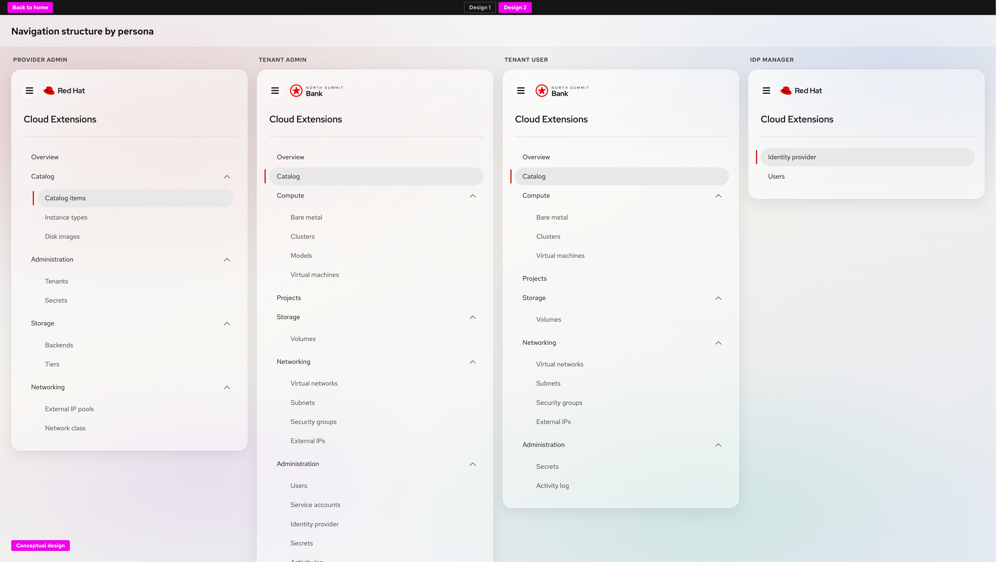

# Navigation structure by persona — UX Design (Design 2)

Conceptual UX for **role-differentiated primary navigation** across Cloud
Extensions personas
([OSAC-8108](https://redhat.atlassian.net/browse/OSAC-8108)), captured from
**Design Lab → Navigation structure → Design 2**.

Design 2 is the reorganized information architecture: **Catalog owns
templates**, **Compute owns running instances**, tenant networking leaves are
complete for VPC-style management, and Administration gathers identity and
audit surfaces. Sidebars are read-only chrome for this comparison — pages
behind placeholder leaves are out of scope for this document.

**Prototype (developers):**

- [Navigation structure — Design 2](https://heyethankim.github.io/osac-design-lab/design/navigation-structure?hub=1&topic=navigation-structure&design=2)
- [Navigation structure — Design 1 (compare)](https://heyethankim.github.io/osac-design-lab/design/navigation-structure?hub=1&topic=navigation-structure&design=1)

Related console role/nav contract (IdP manager / break-glass):
[OSAC-1030 ui-design](../OSAC-1030-organizations/ui-design.md).

## Product decisions (this release / Design 2)

- **Four persona shells.** Primary nav differs for **Provider Admin**,
  **Tenant Admin**, **Tenant User**, and **IdP Manager**. Same Cloud Extensions
  brand; different IA and default selection.
- **Catalog owns templates (Provider).** Provider **Catalog** expands to
  **Catalog items**, **Instance types**, and **Disk images**. Those template
  leaves leave the old top-level **Compute** group.
- **Compute owns instances (Tenant).** Tenant **Services** becomes
  **Compute** (Bare metal, Clusters, Models, Virtual machines). Tenant User
  omits **Models**.
- **Secrets under Administration (where present).** Provider and Tenant Admin
  keep secrets with other admin surfaces; Tenant User nests **Secrets** and
  **Activity log** under **Administration** (not top-level).
- **Fuller tenant networking.** Tenant Admin and Tenant User add **Subnets**
  and **Security groups** beside Virtual networks and External IPs. Provider
  adds **Network class** under Networking.
- **IdP Manager stays narrow.** Only **Identity provider** and **Users** (Design
  1 labeled the second item **Roles**).
- **Billing leaves the Design 2 chrome.** Provider Administration and Tenant
  Admin no longer show a **Billing** nav item in this structure (billing
  association lives on tenant flows such as OSAC-6161).

---

## Journey overview

```text
Design Lab → Navigation structure → Design 2
        │
        ├── Provider Admin   — Catalog (templates) + Admin / Storage / Networking
        ├── Tenant Admin     — Catalog + Compute + Projects + Storage + Networking + Admin
        ├── Tenant User      — Catalog + Compute (no Models) + Projects + Storage + Networking + Admin (narrow)
        └── IdP Manager      — Identity provider + Users
```

---

## 1. Side-by-side navigation by persona

**What this screen is for.** Let designers and implementers compare the
canonical Design 2 primary navigation for every persona in one view
([OSAC-8108](https://redhat.atlassian.net/browse/OSAC-8108)).

**Explanation.** Title: **Navigation structure by persona**. Four columns —
Provider Admin, Tenant Admin, Tenant User, IdP Manager — each show the Cloud
Extensions sidebar with groups expanded to the Design 2 defaults. Tooltips on
leaves describe the page job; selection highlights differ by persona (for
example Catalog items for Provider, Catalog for tenants, Identity provider for
IdP Manager).



---

## 2. Provider Admin

**What this screen is for.** Give Cloud Provider Admins a platform shell
focused on catalog templates, tenant administration, storage plumbing, and
provider networking.

**Explanation.** Design 2 nav:

| Group / leaf | Items |
| --- | --- |
| Overview | — |
| Catalog | Catalog items, Instance types, Disk images |
| Administration | Tenants, Secrets |
| Storage | Backends, Tiers |
| Networking | External IP pools, Network class |

Default selection: **Catalog items**. No separate Compute group and no Billing
leaf in this structure.

---

## 3. Tenant Admin

**What this screen is for.** Give Tenant Admins launch, inventory, project,
storage, networking, and org-admin surfaces in one shell.

**Explanation.** Design 2 nav:

| Group / leaf | Items |
| --- | --- |
| Overview | — |
| Catalog | — |
| Compute | Bare metal, Clusters, Models, Virtual machines |
| Projects | — |
| Storage | Volumes |
| Networking | Virtual networks, Subnets, Security groups, External IPs |
| Administration | Users, Service accounts, Identity provider, Secrets, Activity log |

Default selection: **Catalog**. **Services** from Design 1 is renamed
**Compute**. Billing is not in the Design 2 sidebar.

---

## 4. Tenant User

**What this screen is for.** Give Tenant Users a subset of the tenant shell —
launch and work on resources without org-wide identity or service-account
admin.

**Explanation.** Design 2 nav:

| Group / leaf | Items |
| --- | --- |
| Overview | — |
| Catalog | — |
| Compute | Bare metal, Clusters, Virtual machines |
| Projects | — |
| Storage | Volumes |
| Networking | Virtual networks, Subnets, Security groups, External IPs |
| Administration | Secrets, Activity log |

Default selection: **Catalog**. No **Models**, no Users / Service accounts /
Identity provider. Secrets and Activity log sit under Administration.

---

## 5. IdP Manager

**What this screen is for.** Keep the break-glass / IdP custodian shell
intentionally narrow for identity recovery work.

**Explanation.** Design 2 nav:

| Leaf | Purpose |
| --- | --- |
| Identity provider | Connect or recover the tenant IdP |
| Users | Assign tenant roles after IdP restore |

Default selection: **Identity provider**. No catalog, compute, networking, or
secrets. Design 2 labels the second leaf **Users** (Design 1: **Roles**).

---

## Notes vs Design 1

| Topic | Design 2 (this UX) | Design 1 |
| --- | --- | --- |
| Provider templates | Under **Catalog** (items, instance types, disk images) | Catalog link + separate **Compute** (instance types, disk images) |
| Provider secrets | Under **Administration** | Top-level **Secrets** |
| Provider networking | External IP pools + **Network class** | External IP pools only |
| Tenant inventory group | **Compute** | **Services** |
| Tenant networking | + Subnets, Security groups | Virtual networks, External IPs |
| Tenant secrets / activity | Under **Administration** | Tenant Admin: top-level Secrets; Tenant User: top-level Secrets + Activity log |
| Tenant / provider Billing nav | Omitted | Present under Administration (and Provider Admin) |
| IdP Manager second leaf | **Users** | **Roles** |

Implement shell `navRowsForRole` (and Design Lab workspace shells) against
**Design 2** unless a product decision reverts a specific leaf. Placeholder
pages may remain for leaves not yet implemented in the console.
