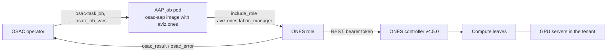

# Aviz ONES Fabric Manager

## Summary

The Aviz ONES Fabric Manager is a Fabric Manager for fabrics run by Aviz ONES,
the fabric manager for NVIDIA Spectrum-X Ethernet AI fabrics. It is the
Ansible role `aviz.ones.fabric_manager` in the `aviz.ones` collection, which
Aviz Networks maintains and OSAC vendors into its `osac-aap` image. The role
implements the Fabric tasks of the [network manager integration
contract](/enhancements/OSAC-1433-network-manager-integration-contract-networking/design.md)
by calling the ONES tenant API (v4.5.0): a VirtualNetwork is an ONES tenant
(one VRF), its Subnet is the tenant's VLAN segment, and a physical
NetworkAttachment places a GPU server in the tenant. This is the manager
design the contract asks for (§4.1): settings, network types, documented
no-ops, limits, prerequisites and hub permissions. See the [PRD](prd.md) for
the requirements.

Phase 1 delivers bare-metal servers on private tenant networks. VMs follow in
phase 2, with OSAC's EVPN Kubernetes manager. External addresses and NAT also
follow in phase 2, through the Aviz Gateway, which ONES v4.5.0 exposes in its
API. [Workload coverage](#workload-coverage) lists what each phase covers, and
[ONES capabilities](#ones-capabilities) lists what each phase needs from ONES.

## Motivation

ONES runs the Ethernet fabric of GPU data centers built on NVIDIA Spectrum-X.
It already isolates GPU tenants on that fabric: each ONES tenant is a VRF
with its own VLAN segment, VNIs and subnet, and ONES moves a server's leaf
ports into the tenant when the server is assigned. A provider on ONES that
adopts OSAC needs those tenants to follow OSAC's VirtualNetworks and
bare-metal orders.

The contract defines what a Fabric Manager does, and the [Netris
design](/enhancements/OSAC-2434-netris-fabric-manager-networking/design.md)
shows how one fabric controller meets it. This design states how ONES meets
it: the mapping of OSAC resources to ONES objects, the results it returns,
where ONES differs from the contract, what the provider prepares, and how the
partner-maintained collection is contributed and supported.

## Goals

- Phase 1: implement the Fabric tasks of the contract for VirtualNetworks,
  Subnets, physical NetworkAttachments and DHCP leases against the ONES tenant
  API, with no ONES-specific code in the operator or fulfillment service.
- Key every ONES tenant by the OSAC VirtualNetwork ID, and refuse to change
  or delete an ONES tenant that does not prove it is OSAC's.
- Let ONES allocate the identifiers it owns (VLAN, VNIs, VRF), so OSAC keeps
  no range of its own for them.
- Ship the role in a partner-maintained collection that OSAC vendors, so a
  provider builds no image and applies only a registration and settings.
- Let OSAC build, test and triage the role without Aviz.

## Non-Goals

- In phase 1: VMs, and external addresses and NAT (ExternalIPPool,
  ExternalIP, ExternalIP attachments, NATGateway). Both are phase 2.
- Cluster (CaaS) support and Ethernet east-west domains (FabricDomain).
- SecurityGroup enforcement on the fabric: the SecurityGroup tasks and the
  SecurityGroup bind of every attachment are documented no-ops.
- More than one Subnet per VirtualNetwork.
- Per-VirtualNetwork DNS (contract §4.8) and IPv6.
- Managing ONES itself, the switches, or the GPU servers.

## Proposal

The ONES manager is one Ansible role run by OSAC's generic network-task
playbook (contract §4.3). Each task reads `osac_job_vars`, talks to ONES with
the modules of the same `aviz.ones` collection, and publishes only
`osac_result` or `osac_error`. It creates no hub (Kubernetes) objects.



OSAC never talks to ONES outside a job. ONES configures the leaves; OSAC never
logs in to a switch.

### Workflow Description

#### Installation

1. OSAC's `osac-aap` image carries the vendored `aviz.ones` collection, so the
   provider builds no image.
2. The Cloud Infrastructure Admin applies the immutable registration ConfigMap
   from the installation guide (contract §4.2):

   ```yaml
   apiVersion: v1
   kind: ConfigMap
   metadata:
     name: osac-network-fabric-manager-ones
     labels:
       osac.openshift.io/network-fabric-manager: "true"
   immutable: true
   data:
     name: ones
     ansible_role: aviz.ones.fabric_manager
     capabilities: security_group_icmp,security_group_physical_noop
   ```

   In phase 1 the registration has no `network_types`, so no Kubernetes
   Manager pairs with ONES and the deployment runs no VMs (contract §4.2).
   Phase 2 adds `network_types: evpn` ([Upgrade / Downgrade
   Strategy](#upgrade--downgrade-strategy)).
3. The admin puts the [settings](#settings) into
   `aap.instanceGroups.networkFulfillment.config` and `.secret`, creates a
   NetworkClass with ONES as its Fabric Manager and no Kubernetes Manager, and
   completes the [installation prerequisites](#installation-prerequisites).
4. The NetworkClass resolves and becomes READY.

#### Tenant network lifecycle

1. A VirtualNetwork create runs `create_virtual_network`: the role creates the
   ONES tenant `osac<first 8 hex digits of the ID>` in `ONES_FABRIC`, with
   the owner marker `osac-vn:<id>` in its description, and waits until ONES
   reports the tenant's configuration as applied (`config_status` PASS). It
   returns `backend_id`, the ONES tenant ID.
2. A Subnet create runs `create_subnet`: the role finds the tenant of the
   VirtualNetwork, proves it is OSAC's, and sets the tenant's address plan
   from the Subnet: subnet `spec.ipv4Cidr`, gateway `gateway_ipv4`, DHCP pool
   over `physical_ipv4_cidrs` ([Gateway and DHCP](#gateway-and-dhcp)).
3. An ONES tenant has one VLAN segment, so a VirtualNetwork has one Subnet. A
   `create_subnet` for a second Subnet of the same VirtualNetwork fails as
   final ("ONES gives a VirtualNetwork one Subnet").
4. `delete_subnet` clears nothing on ONES: the address plan belongs to the
   tenant, which is deleted with the VirtualNetwork. `delete_virtual_network`
   deletes the tenant; ONES frees its VLAN, VNIs and VRF. ONES refuses to
   delete a tenant that still holds servers, which is retryable: OSAC deletes
   the attachments first.

#### Bare-metal servers (physical attachments)

1. BMaaS creates the NetworkAttachment after the host is provisioned on the
   provisioning network. With `ONES_BM_PROVISIONING_TENANT` set, the
   provisioning network is that ONES tenant.
2. `apply_network_attachment` checks, before its first write, that the
   tenant exists and is OSAC's, that `physical_ipv4_cidrs` is not empty, and
   that `target.host_name` is a server in the ONES fabric topology. A server
   in another tenant (other than the provisioning tenant) is a final error
   with no write.
3. It removes the server from the provisioning tenant, adds it to the
   VirtualNetwork's tenant, and waits until ONES reports the tenant's
   configuration as applied. ONES moves every tenant-facing leaf port of the
   server into the tenant's VLAN and VRF.
4. `query_dhcp_lease` reads the address ONES IPAM gave the server in the
   tenant and returns it with the input MAC. No address yet, or an address
   ONES reports for another MAC, is retryable.
5. `delete_network_attachment` removes the server from the tenant and puts
   it back in the provisioning tenant. A server or tenant that is already gone
   is a success.

#### Workload coverage

| Workload | Phase 1 | Later |
|---|---|---|
| Bare-metal servers on private tenant networks | Supported | |
| VMs, and VMs sharing a Subnet with bare metal | Not supported: no Kubernetes Manager pairs | Phase 2, with `cudn_evpn` and ONES O1, O2, O4 |
| External addresses and NAT | Tasks fail as final | Phase 2, through the Aviz Gateway API of ONES v4.5.0 |
| CaaS clusters | Not supported | After external addresses |
| Ethernet east-west domains | Not supported: no `eastWestEthernet` | Later phase |

### API Extensions

No OSAC API, CRD or proto changes. The manager uses the contract's inputs and
typed results only. Its interfaces are:

- The registration ConfigMap above (contract §4.2), applied by the provider.
- The [settings](#settings) in `network-fulfillment-ig` (contract §4.3).
- The ONES tenants it creates, named by [object naming](#object-naming), which
  a Cloud Infrastructure Admin sees in the ONES console.

## UX Alignment

No UI change. Tenants use the shared networking pages and wizards. The
ONES-specific behaviors a tenant observes are that a VirtualNetwork holds one
Subnet and that SecurityGroups do not filter bare-metal servers; the
installation guide states both.

### Implementation Details/Notes/Constraints

#### Object naming

Every name is built in one place from API IDs, so a delete finds its tenant by
name with no lookup table [Codebase:
aviz/ones/plugins/filter/ones_contract.py].

| OSAC resource | ONES object | Name |
|---|---|---|
| VirtualNetwork | Tenant (VRF, VLAN segment, VNIs) | `osac<first 8 hex digits of the ID>`; description holds `osac-vn:<id>` and the OSAC tenant |
| Subnet | The address plan of the VirtualNetwork's tenant | none of its own |
| NetworkAttachment (physical) | Server membership in the tenant | the ONES server name, `target.host_name` |

ONES limits a tenant name to 12 characters, so the name carries the first 8
hex digits of the VirtualNetwork ID and the full ID is in the owner marker.

#### Ownership

All tenants live in one ONES fabric (`ONES_FABRIC`). Before it writes, a task
proves that a tenant with its name is OSAC's: the tenant's description holds
the owner marker `osac-vn:<id>` of the VirtualNetwork. A tenant with the name
but without the marker (a provider tenant, or another VirtualNetwork whose ID
starts with the same 8 hex digits) is a final error and is never changed or
deleted. A server already in a tenant other than the target and the
provisioning tenant is refused the same way.

#### Network type and VNIs

- Phase 1 declares no network type. Fabric tasks get no `network_type`, and
  `create_virtual_network` and `create_subnet` return no VNIs.
- Phase 2 declares only `evpn`; any other `network_type` fails as final.
  ONES allocates the VNIs of a tenant: its VRF VNI (`nsVniId`) is the
  `l3_vni`, and its VLAN VNI (`vlanVniId`) the `l2_vni`. There is no OSAC VNI
  range (contract §4.9). ONES allocates them from separate pools, so an
  `l2_vni` never equals an `l3_vni`, and keeps both for the tenant's life.
  The role already returns them when it gets `network_type: evpn`.
- The tenant's east-west GPU network VNI (`vniId`) is not used by OSAC.

#### Gateway and DHCP

- `create_subnet` sets the tenant's subnet to `spec.ipv4Cidr` and its gateway
  to `gateway_ipv4` (O3). A rerun restores a plan that drifted. A tenant whose
  plan differs and that ONES cannot change (servers already attached) is a
  final error.
- The gateway is an ONES anycast gateway on the leaves, with the MAC ONES
  assigns. Phase 2 sets it to the MAC OVN-Kubernetes uses for the same
  address (O4).
- ONES DHCP (Kea) serves only `physical_ipv4_cidrs`: from the first physical
  address (or the address after the gateway, if the gateway is in the range)
  to the last physical address (or the address before broadcast, if the range
  ends the Subnet). It never reaches the overlay or LB VIP ranges. With empty
  `physical_ipv4_cidrs` the tenant has no DHCP pool, and a physical
  attachment fails as final ("no fabric address range for bare-metal DHCP").
- ONES IPAM keeps one address per server. DHCP gives MTU 1500 or no MTU
  option (contract §4.9).
- DNS: ONES DHCP hands out the resolver the provider configures in ONES. OSAC
  passes no DNS setting.
- Two tenants can use the same CIDR, including DHCP (O5).

#### Bare-metal server moves

- ONES assigns whole servers: every tenant-facing port the ONES fabric
  topology gives the server joins the tenant. `interface.name` is not used to
  pick one port; this is a documented deviation from contract §4.10.
- Adding a server makes ONES configure the leaves, which takes minutes on a
  real fabric. The task waits up to `ONES_WAIT_TIMEOUT` for the tenant's
  configuration to apply; a timeout is retryable, and the rerun continues
  the same operation.
- The operator runs at most one physical attachment task at a time per Fabric
  Manager (contract §4.7). ONES serializes changes of one tenant itself.
- A server that ONES does not know is final (the provider fixes the topology
  and recreates the order); a server ONES knows but has not finished
  configuring is retryable.

#### Error classification

Every task runs in `block`/`rescue`. Final (`retryable: false`): invalid
input, a tenant or server that is not OSAC's, an unsupported network type or
task, a second Subnet in one VirtualNetwork, an ONES validation error (HTTP
400 or 422), an unknown server, an invalid VNI. Retryable: a missing or
malformed setting, a missing parent tenant, a tenant that still holds
servers on delete, a configuration that has not applied yet, no lease yet, an
expired token (the client logs in once more and retries), and every other
failure (transport, HTTP 5xx, 409, 429). Messages carry the step name and a
sanitized ONES status and code, never the response body, the token or the
module arguments.

#### Settings

Read from the job pod environment (ConfigMap and Secret
`network-fulfillment-ig`, contract §4.3), prefixed with the registration name
in upper case. A missing or malformed required setting is retryable with a
message naming it.

| Setting | Where | Needed by |
|---|---|---|
| `ONES_URL` | config | Every task; an `http(s)` URL of the ONES gateway (`https` in production) |
| `ONES_USERNAME` | config | Every task |
| `ONES_PASSWORD` | secret | Every task |
| `ONES_FABRIC` | config | Every task; the ONES fabric that holds the tenants |
| `ONES_FM_DIRECT_URL` | config | Optional; the ONES fabric manager service for the IPAM routes the gateway does not proxy. Default: the `ONES_URL` host on port 8443 |
| `ONES_BM_PROVISIONING_TENANT` | config | Optional; the ONES tenant that holds servers between orders. Empty: a released server stays in no tenant |
| `ONES_TENANT_MAX_GPUS` | config | Optional; GPU quota of a new tenant, default `-1` (unlimited) |
| `ONES_WAIT_TIMEOUT` | config | Optional; seconds to wait for ONES to apply a tenant change, default `1200` |
| `ONES_POLL_INTERVAL` | config | Optional; default `5` |
| `ONES_VALIDATE_CERTS` | config | Optional; `"true"` (default) or `"false"` |
| `ONES_CA_PATH` | config | Optional; CA bundle of the ONES certificate inside the job |

#### Documented no-ops

- `create_security_group` and `delete_security_group`, also on rule updates.
- The SecurityGroup bind and unbind of every attachment, physical included.
- The overlay `apply_network_attachment` and `delete_network_attachment`;
  phase 1 has no overlay attachments, since no Kubernetes Manager pairs.
- `delete_subnet`.

The manager declares `security_group_icmp`, because every SecurityGroup rule
is a no-op for it, and `security_group_physical_noop`, because ONES has no
per-port enforcement and its physical SecurityGroup binds succeed without
applying policy. Bare-metal servers are therefore unfiltered, and NetworkClass
status reports it. OSAC's support for `security_group_physical_noop` and its
derived status is in the accepted contract but not implemented yet; this
manager needs it before it can declare the capability.

#### Unsupported tasks

In phase 1, the ExternalIPPool, ExternalIP, ExternalIP attachment and
NATGateway tasks fail as final with "The ONES fabric manager does not support
<task>". The installation guide tells the admin not to define ExternalIPPools
on an ONES NetworkClass in phase 1. Phase 2 implements them through the Aviz
Gateway API of ONES v4.5.0. The registration declares no `eastWestEthernet`,
so OSAC runs no FabricDomain task against ONES.

#### ONES capabilities

This design needs the following from ONES. Aviz delivers them in ONES
releases and provides each first as a development build to the OSAC team.

| ID | Capability | Phase | Needed by |
|---|---|---|---|
| O3 | Tenant address plan from the caller: subnet CIDR, gateway and DHCP pool, set at create or update and returned by Get Tenant | 1 | Subnet address plan, bare-metal addresses |
| O5 | The same subnet CIDR in two tenants, including DHCP | 1 | VirtualNetwork isolation |
| O6 | VNIs fixed for the life of a tenant, from pools that do not overlap | 2 | `l3_vni`, `l2_vni` |
| O1 | Hub nodes as EVPN VTEPs: ONES peers the leaves the hub nodes connect to with those nodes over BGP EVPN, and extends every tenant's MAC-VRF and IP-VRF to them | 2 | VMs |
| O2 | Route targets `0:<VNI>` imported and exported for every tenant's MAC-VRF and IP-VRF on the leaves | 2 | VMs and bare metal on one Subnet |
| O4 | Tenant anycast gateway MAC set by the caller | 2 | One gateway MAC for VMs and bare metal |
| — | Aviz Gateway NAT in the ONES API | 2 | External addresses and NAT |

O6 and the Aviz Gateway NAT API are in ONES v4.5.0. The ONES tenant APIs this
role calls are the same in v4.5.0 as in v4.0.

#### Installation prerequisites

The provider prepares, before the first install:

- A fabric created in ONES for OSAC, and an ONES user for it. The provider
  creates no tenant named `osac` followed by 8 hex digits in that fabric.
- The ONES controller and API reachable from the OSAC job pods over HTTPS.
- Every GPU server OSAC sells as bare metal in the ONES fabric topology, under
  the host name its BareMetalInstance uses.
- The provisioning tenant with every idle bare-metal server in it, if the
  provider uses one.
- The ONES internal pools (loopback and host links) in
  `global.networking.excludedIpv4Cidrs`, with tenant defaults outside them.
- The DHCP resolver in ONES.
- For phase 2: every hub node cabled to compute leaves and registered in ONES
  with its VTEP address and AS (contract §4.12), and the Aviz Gateway for NAT.

#### Hub permissions

None. The role creates no Kubernetes objects; it uses only the ONES API.

#### Contribution and ownership

- **Code location:** the role and modules live in the `aviz.ones` collection,
  Apache-2.0, with no dependency beyond Ansible and the Python standard
  library. Aviz Networks maintains it. OSAC vendors a pinned release into the
  `osac-aap` image; a new release enters OSAC only through a reviewed pull
  request that updates the vendored copy.
- **Review:** WG Connectivity & Fabric reviews and merges every change to the
  vendored collection and its tests, with a CODEOWNERS entry that routes them
  to that group and an Aviz maintainer.
- **Workflow:** Aviz works from a fork, with DCO sign-off on every commit.
- **Triage without Aviz:** the unit and playbook tests run in OSAC CI against
  a stateful fake ONES (`ones_fake.py`), with no ONES access or credentials.
  For live triage, Aviz provides the OSAC team an ONES development build with
  a fabric to run it on, or access to the Aviz lab ([Infrastructure
  Needed](#infrastructure-needed)). Error messages name the failed step and
  the ONES status and code, so a failure can be read from `status.jobs`
  without Aviz.

### Security Considerations

- Credentials come only from the Secret `network-fulfillment-ig`; they never
  appear in `osac_job_vars`, results, errors or logs. The `aviz.ones` modules
  mark the password `no_log` and never return the token.
- TLS verification is on unless `ONES_VALIDATE_CERTS` is exactly `"false"`.
- The ownership proof keeps a task from adopting or deleting an ONES tenant
  of the provider or of another VirtualNetwork that happens to have the name.
- One ONES user can change every tenant in the fabric; the instance group is
  the trust boundary (contract §4.3). Aviz recommends an ONES user limited to
  tenant operations.
- The vendored collection is reviewed like OSAC code and pinned by version;
  no partner-only tooling or secrets enter the repository.

### Failure Handling and Recovery

- Every task is idempotent by API ID: a rerun finds the tenant by name and
  marker and changes only what differs.
- A task stopped midway leaves a named tenant or a server membership that its
  rerun or delete finds; an ONES operation that was still running is
  continued by the rerun.
- Deletes treat a missing tenant or membership as deleted, and the
  VirtualNetwork delete retries while ONES still lists servers in the tenant.
- A delete starts only after AAP reports a cancelled create of the resource
  ended (contract §4.7), so no write of that create lands after the delete.
- An expired ONES token is renewed once inside the task.

### RBAC / Tenancy

- No OSAC RBAC change.
- Each VirtualNetwork is its own ONES tenant and VRF, so VirtualNetworks of
  one OSAC tenant are isolated from each other as well as from other OSAC
  tenants, and their CIDRs may overlap (O5).
- The ONES tenant description carries the OSAC tenant name for the admin;
  `osac_job_vars.tenant` is not used for authorization.
- Bare-metal servers have no SecurityGroup filtering on ONES.

### Observability and Monitoring

- Task outcomes and messages appear in the resource's `status.jobs` and
  `Ready` condition, with the AAP job ID (contract §4.7).
- `backend_id` puts the ONES tenant ID in `status.backendNetworkId`.
- A task is Ready when ONES reports the tenant configuration as applied, not
  when traffic flows; traffic is checked by the E2E suites.
- The ONES console shows each tenant's servers, VLAN, VNIs and configuration
  status.

### Risks and Mitigations

| Risk | Mitigation |
|---|---|
| ONES picks the tenant subnet itself until O3 lands, so a server's address can lie outside the Subnet the tenant chose. | O3 in the ONES development build; TC-R5-04 gates Tech Preview. |
| Adding a server takes minutes, and physical attachment tasks run one at a time per Fabric Manager, so ordering many servers is slow. | Measured in the ONES lab; ONES work to shorten server configuration; `ONES_WAIT_TIMEOUT` sized for the fabric. |
| Two VirtualNetwork IDs share their first 8 hex digits. | The second create fails as final on the owner marker; the tenant recreates the VirtualNetwork. ONES support for longer tenant names removes the limit. |
| The vendored collection and the ONES release drift apart. | The collection pins the ONES API version it calls; a new ONES version is supported when the live suite and the conformance suite pass against it. |
| A provider changes an OSAC tenant by hand in the ONES console. | The rerun restores the address plan; ownership refusals stop on a removed marker. |
| OSAC does not yet implement `security_group_physical_noop`. | Phase 1 graduates only after OSAC supports it; until then the NetworkClass cannot report unfiltered physical ports. |

### Drawbacks

- One VirtualNetwork holds one Subnet on ONES.
- A server joins a tenant with all its tenant-facing ports, not one
  interface.
- Without fabric SecurityGroups, a bare-metal server's only filter is the
  host itself.
- Phase 2 needs a new registration with `network_types: evpn`, and the
  registration is immutable.

## Alternatives (Not Implemented)

| Alternative | Why not |
|---|---|
| The role in an OSAC collection (`osac.templates.ones`), with an installer-rendered registration, as for Netris. | Aviz maintains the role, and the contract keeps provider roles out of `osac.*` collections (§4.2). |
| A provider-built execution environment with the collection, as the contract's default provider path. | OSAC vendors the collection, so every provider gets the reviewed version without building an image. |
| One ONES tenant per OSAC tenant, with one VirtualNetwork per ONES VLAN. | An ONES tenant is one VRF with one VLAN segment; VirtualNetworks of one OSAC tenant must be isolated from each other. |
| An OSAC VNI range with the VNIs passed to ONES. | ONES allocates VNIs itself; a second allocator would have to match it. |
| Look up tenants by stored ONES IDs instead of names. | Needs a store; the contract keys state by API ID, and the name and marker carry it. |

## Test Plan

[testplan.md](testplan.md) lists the cases. Summary:

### Unit Tests

`osac-aap/tests/unit/test_ones_contract.py` (pytest): settings and input
checks, names and owner marker, VNI checks, attachment plan, result shaping,
failure classification, and the `aviz.ones` client (login, token renewal,
waits, sanitized errors).

### Integration Tests

`osac-aap/tests/unit/test_ones_playbook.py` runs `aviz.ones.fabric_manager`
through the generic playbook against a fake ONES (`ones_fake.py`): tenant
lifecycle, reruns, ownership refusals, server moves, leases, deletes with
faults, no-ops and unsupported tasks. A check confirms the documented
registration and that the role has every Fabric task file.

### E2E Tests

On a fabric run by the ONES development build: the ONES live suite (tenant
lifecycle, multi-tenancy, resilience and scale against a real ONES), the
bare-metal traffic and address cases, and the contract's conformance task
tests and `baremetal` profile (§4.11) with ONES as the Fabric Manager.

## Graduation Criteria

- Dev Preview: the vendored collection with the role is on `main`, unit and
  integration tests pass, and the ONES live suite passes against ONES v4.5.0.
- Tech Preview: bare-metal addressing and isolation pass on the ONES lab (O3,
  O5), OSAC supports `security_group_physical_noop`, and the conformance
  suite reports the ONES manager `conformant` with the `baremetal` profile,
  except the external address checks, which phase 1 does not support.
- GA: an ONES release with O3 and O5 is generally available, and the
  conformance suite passes with ONES in OSAC's lab rotation.
- Phase 2 (VMs, external addresses and NAT) graduates on its own, with the
  `vm` profile and the external address checks.

## Upgrade / Downgrade Strategy

Fresh installations only, as for all networking (Unified — Upgrade and
Downgrade Strategy). Tenants are found by name and marker, so a newer role
manages tenants an older one created. The registration is immutable: moving
from phase 1 to phase 2 means a new registration with `network_types: evpn`
and a new NetworkClass, following the contract's NetworkClass replacement.

## Version Skew Strategy

OSAC vendors one pinned `aviz.ones` release per OSAC release, so the role
always matches the operator's contract version. The collection calls the ONES
tenant API of v4.5.0; an ONES version is supported when the live suite and
the conformance suite pass against it.

## Support Procedures

- Detect: a networking resource stays `Ready=False` with the task's message in
  `status.jobs`; the AAP job log has the failed step.
- A setting message ("Missing or malformed setting in network-fulfillment-ig")
  is fixed in the Helm values and a rollout; OSAC retries.
- A "role or task file not found" message means the image lacks the vendored
  collection or the registration names another role.
- An ownership refusal means an ONES tenant with an OSAC name exists outside
  OSAC; remove or rename it in ONES, then delete and recreate the resource.
- A server refusal means the server is in another ONES tenant; release it in
  ONES or in OSAC, and OSAC's retry completes the attachment.
- A wait timeout means ONES has not applied the tenant change; check the
  tenant's configuration status in the ONES console.
- Defects in the role go to the WG Connectivity & Fabric owners and to Aviz
  through the CODEOWNERS entry.

## Infrastructure Needed

An ONES lab for the OSAC team: Aviz provides the ONES development build (the
ONES controller images and install guide) with a fabric it manages, either a
virtual Cumulus fabric that runs on one host or access to an Aviz lab fabric,
with at least two compute leaves and GPU or stand-in servers. Phase 2 adds hub
nodes cabled to the leaves and the Aviz Gateway. Aviz updates the build as
each ONES capability lands.
