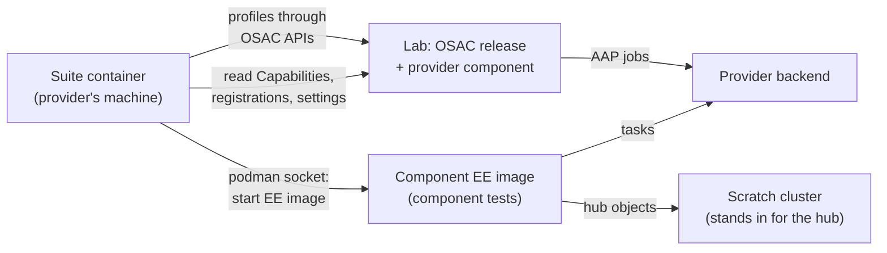
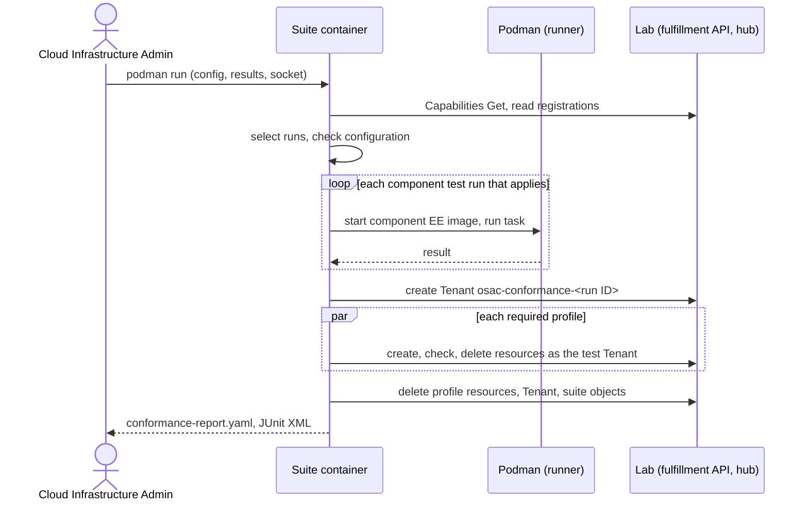

# OSAC Conformance Suite

## Summary

OSAC publishes one conformance suite image per release, `ghcr.io/osac-project/osac-conformance:<release>`, that proves a provider's component works with that release: component tests run the component exactly as OSAC runs it against the provider's backend, and profiles run end-to-end scenarios through OSAC's APIs in a lab. Each area, starting with networking, plugs its own tests, profiles, and configuration into one shared runner, configuration file, and report. See [PRD](prd.md) for detailed requirements.

## Motivation

Providers plug their own components into OSAC. The first is the network Fabric Manager, an Ansible role that OSAC runs as AAP jobs. The suite that proves a Fabric Manager works is defined inside the [Network Manager Integration Contract](/enhancements/OSAC-1433-network-manager-integration-contract-networking/design.md) (§4.11) as the networking-only image `osac-network-conformance`, which no release published. Its runner, configuration, test Tenant, cleanup, and report rules are not networking rules; they apply to any component OSAC runs on a provider's behalf.

Keeping them inside networking means the next area that accepts provider components would copy them into a second suite, with a second image, configuration file, and report format. This proposal moves the generic rules into one OSAC-wide suite. The networking contract keeps only what is networking-specific and links here. [User]

### Goals

- One runner, one configuration file, and one report format for every area; a new area adds tests and profiles, not a new tool.
- Run a component exactly as OSAC runs it, so a passing component test means the same invocation works inside OSAC.
- Work in a shared lab: the suite changes only what it creates and lists what it could not delete.
- Never ask the provider for a value the suite can read from the lab hub.
- Move networking's generic rules without changing their behavior; only the image name, the report's component and layer keys, and the place of the networking keys in the configuration change.

### Non-Goals

- Defining any area's tests, profiles, configuration keys, configuration errors, component identity, or support condition; each area defines them in its own design.
- Verifying reports independently, or enforcing an area's support condition.
- Changing any OSAC API, CRD, or controller; the suite only uses existing APIs.
- Starting the suite or showing its report from the OSAC console, API, or CLI.

## Proposal

The suite is a container image with a common core and one module per area. The core reads the configuration, reads the lab, selects the runs that apply, checks the configuration, runs the component tests and then the profiles, cleans up, and writes the report. An area module supplies what the area's design defines (see [Area plug-in contract](#area-plug-in-contract)). Networking is the first area; its module implements the Fabric Manager task tests and the `vm`, `baremetal`, and `cluster` profiles of the networking contract.

Terms used in this document:

- **Component:** a piece a provider writes that OSAC runs, such as the Fabric Manager.
- **Area:** an OSAC domain that defines a component kind and plugs into the suite, such as networking.
- **Lab:** an OSAC installation of the release under test, with the provider's components registered and the provider's services enabled.
- **Run:** one execution of a test. A test may have several runs; the networking task tests run once per task.
- **Applies / required:** a run applies when the suite selects it for the lab; a profile is required when its area's rule says so for the lab. A **required run** is a run that applies or a run of a required profile. Only required runs count toward conformance.

The diagram shows the two layers and what each touches.



Component tests never go through the lab: the suite starts the component's execution environment (EE) image itself, against the provider's backend and a scratch cluster. The suite reads the lab only to select runs and to identify the component. Profiles go through OSAC's normal APIs in the lab, so OSAC runs the component there as in production.

### Workflow Description

**Actors.** The Cloud Infrastructure Admin, who prepares the lab and runs the suite for the provider. OSAC CI and the OSAC E2E lab, which run the same suite for each release.

**Starting state.** A lab runs the OSAC release under test with the provider's component installed and registered and the provider's services enabled. The Cloud Infrastructure Admin has a scratch cluster with a writable namespace, a runner machine with podman and a running podman socket, and network access from the runner to the lab's fulfillment API and hub, to the component's backend at the address in the lab's settings (the component tests run the component on the runner), and to whatever each area's profiles reach (networking: the workloads' external addresses).

1. The Cloud Infrastructure Admin writes `conformance.yaml` into a configuration directory, with the files it names (lab hub kubeconfig, admin token, API CA, and the area's files), and creates a new, empty results directory for this run, for example `results/<date>-full/`.
2. They run the image whose tag equals the lab's release:

   ```sh
   podman run --rm --security-opt label=disable \
     -v "$PWD/conformance:/config:ro" -v "$PWD/results/<date>-full:/results" \
     -v "$XDG_RUNTIME_DIR/podman/podman.sock:/run/podman/podman.sock" \
     ghcr.io/osac-project/osac-conformance:<release>
   ```

3. The suite reads `/config/conformance.yaml`, then reads from the lab the enabled services (Capabilities `enabled_services`) and each area's registered components.
4. It selects the runs that apply and the required profiles, and checks the configuration. If a required run cannot run, it stops with a configuration error.
5. It runs the component tests, starting each component's EE image through the podman socket.
6. If a profile runs, it creates the test Tenant `osac-conformance-<run ID>` and runs the profiles in parallel in it.
7. It cleans up: what the component tests left in the backend, the profiles' resources, the test Tenant, and any provider-scoped object it created. It lists what it could not delete in `leftovers[]`.
8. It writes `conformance-report.yaml` and JUnit XML to `/results`. The Cloud Infrastructure Admin deletes any leftovers by hand and attaches the report to the component's design.



The sequence shows the fixed order: selection and checks first, component tests next, profiles in parallel last, then cleanup, which runs even when a step failed.

**Alternative paths.**

- **Configuration error.** The suite names each failing check and runs no test.
- **A component test fails.** The test reports `fail` with a message; the suite continues with the other runs and the profiles. Profiles run even when a component test failed, so one run reports both layers.
- **A profile fails or times out.** The test reports `fail`; cleanup still runs.
- **Cleanup fails.** Each object not deleted is listed in `leftovers[]`; the run is `in progress`, and the Cloud Infrastructure Admin deletes the object by hand.
- **The run is interrupted.** On the first SIGINT or SIGTERM the suite starts no new test, cleans up, writes the report, and exits with code 130; a second signal stops it at once, with no cleanup and no report.
- **OSAC CI.** For each release, CI runs the component tests against each area's reference components. The OSAC E2E lab runs the component tests and the profiles with real components.

### API Extensions

No new or changed gRPC service, REST resource, CRD, webhook, or finalizer. The suite uses existing interfaces: the Capabilities `Get` method (`GET /api/fulfillment/v1/capabilities`) for enabled services [Codebase: proto/public/osac/public/v1/capabilities_service.proto], the fulfillment private API with an admin token to create and delete the test Tenant and the profiles' resources (each with `metadata.tenant` set to the test Tenant), and the lab hub kubeconfig to read the installed release, component registrations, and what each area reads. It modifies no resource owned by another team.

The suite adds these new surfaces:

| ID | Surface | Change | Requirements |
|---|---|---|---|
| IC-1 | Suite image and its `podman run` invocation | New image `ghcr.io/osac-project/osac-conformance:<release>`, one per release, with three mounts (configuration, results, podman socket); replaces `osac-network-conformance`. | FR-1, FR-8 |
| IC-2 | `conformance.yaml` | New configuration file: common keys plus one top-level section per area; configuration errors. | FR-3, FR-5 |
| IC-3 | `conformance-report.yaml` and JUnit XML | New report with the common keys and result rules. | FR-4, FR-6, FR-9 |
| IC-4 | Area plug-in contract | What each area's design defines and its module supplies to the core. | FR-2, FR-4, FR-7 |
| IC-5 | Test Tenant in the lab | The suite creates and deletes `osac-conformance-<run ID>` and the profiles' resources through OSAC's APIs. | FR-2, FR-3 |
| IC-6 | `osac-conformance` commands, live output, and evidence files | New entry point commands (`run`, `list`, `--run`, `--keep`), the timestamped live log, and the per-test evidence directories. | FR-10 |

FR-N refers to the Nth In Scope item of the [PRD](prd.md).

## UX Alignment

Not applicable. The suite adds no API resource, so there is no `osac-ux/libs/ui-components/src/api/v1/<resource>.ts` file to align with.

### Implementation Details/Notes/Constraints

#### Code location

The suite lives in the osac repository under `tests/conformance/`, next to `tests/e2e/`: a core plus one module per area. The OSAC QE team owns the core, its CI job, and the E2E lab runs; each area's team owns its module (networking: the networking team). [User]

#### Suite image and release

- One image per OSAC release: `ghcr.io/osac-project/osac-conformance:<release>`, tagged with the release. It replaces the networking-only `osac-network-conformance`. [User] No release publishes the networking-only image, so no release ships both.
- The image contains the core and every area's module. The release pipeline (`.github/workflows/osac-release.yaml`) builds and publishes it with the other release images.
- The suite reads its own image digest through the podman socket, by inspecting its own container, and reports it as `suiteImageDigest`.

#### Running the suite

| Mount | In the container | Purpose |
|---|---|---|
| Configuration directory | `/config`, read-only | `conformance.yaml` and the files it names. Paths in `conformance.yaml` are paths in the container. |
| Results directory | `/results` | The report, JUnit XML, live log, and evidence. It must be empty: use a new directory for each run. |
| Podman socket | `/run/podman/podman.sock` | The suite starts each component's EE image through it. The runner's podman must be logged in to the registry that holds the image. |

The suite runs as UID 0 in its container. Rootless podman maps that UID to the runner user, so the suite can open the user's podman socket and write `/results`. `--security-opt label=disable` lets it open the socket on a host with SELinux enforcing.

The suite runs in this order:

1. Read `/config/conformance.yaml`.
2. Read the lab: `enabled_services` from Capabilities through `lab.apiURL` with `lab.tokenFile` and `lab.caFile`, and each area's registered components through `lab.kubeconfig`.
3. Select the runs that apply and the required profiles ([Run selection](#run-selection)).
4. Check the configuration ([Configuration errors](#configuration-errors)); stop on an error.
5. Run the component tests.
6. Run the required profiles in parallel in the test Tenant.
7. Clean up.
8. Write the report.

#### Component tests

A component test runs the provider's component exactly as OSAC runs it, against the provider's backend, without OSAC. For an Ansible-role component the suite:

- starts the component's EE image through the podman socket; the area reads which image the lab runs from the lab hub and resolves it to a digest, so the tests use the image the lab uses;
- runs OSAC's generic playbook for the area, which calls the role with `include_role` and `tasks_from: <task>`;
- passes the one input variable the area defines (networking: `osac_job_vars`), with inputs it generates and fresh API IDs on every run;
- sets the component's settings and secrets as environment variables, read from where the lab keeps them (networking: the ConfigMap and Secret `network-fulfillment-ig` on the lab hub), so the tests use the values the lab uses;
- points the job at a scratch cluster that stands in for the hub (networking: `K8S_AUTH_KUBECONFIG` set to the scratch kubeconfig, whose namespace holds the hub objects the tasks create);
- copies the job input, the scratch kubeconfig, and the playbook into the EE container through the podman API, never by a bind mount from `/config`, and starts the container in the runner's network namespace (`--network host`), so it reaches what the runner reaches;
- stops a job that runs longer than the area's component job timeout and fails the test with `job timed out after <timeout>`;
- after the component tests, runs the matching delete task once for each API ID whose create ran and was not deleted, in reverse order of the creates, and lists each delete that fails in `leftovers[]` as `<task>/<API ID>`. It leaves the scratch namespace as is.

Component tests do not call the lab's fulfillment API or AAP. An Ansible role in an EE image is the only component kind the suite runs in this release; another kind needs a change to this design.

An area may count a component test toward one of its profiles (the test's `profile` field); networking counts its host runs toward `baremetal`.

#### Profiles

- Profiles run after all component tests, in parallel, in the test Tenant `osac-conformance-<run ID>`. The suite creates the Tenant through the private API, and creates each profile's resources through the private API with `metadata.tenant` set to that Tenant. The run ID is a random 8-character lowercase alphanumeric string generated when the suite starts and printed in the first line of the live log.
- Every OSAC object the suite creates is named `osac-conformance-<run ID>` or `osac-conformance-<run ID>-<suffix>`, so a killed run's objects can be found.
- An area may create provider-scoped objects for the run (networking: its ExternalIPPool) and deletes them at the end.
- Cleanup runs also after a failure or a timeout, as best effort, in this order: the profiles' resources, then the Tenant with what OSAC created with it, then the provider-scoped objects the suite created. The suite lists each object it could not delete in `leftovers[]`.
- The lab does not need to be dedicated: other Tenants may exist. The suite changes and deletes only what it created; an area documents any side effect OSAC itself makes (networking: deleting the test Tenant releases its default NAT address).
- Every wait has a timeout; a timeout, including on delete, fails the test. Each area defines its timeout keys and defaults, and `timeouts` in the configuration overrides them.

#### Run selection

The suite selects runs from two facts it reads from the lab:

- the enabled services, from the Capabilities `enabled_services` ([OSAC-3046](/enhancements/OSAC-3046-per-service-enablement/design.md)); the proto returns `ServiceTier` values, which the report writes as `caas`, `vmaas`, `bmaas`, and `maas`;
- the components registered in the lab, per area. Each area's design also defines how the suite finds its registered components in the lab hub (networking: the Fabric registration ConfigMap).

Each area's rules map these facts to the runs that apply and the profiles that are required. A run that is not selected reports `skip` and does not block conformance. An area with no registered component contributes no component and no required profile. A run that applies but reports `skip` (for example because an optional input is missing) is never a pass, and a profile it counts toward does not pass.

#### Configuration

`conformance.yaml` has the common keys at the top level and one top-level section per area, named after the area, holding that area's keys [User]:

```yaml
osacRelease: <release>                 # equal to the suite image tag
lab:
  kubeconfig: /config/lab-hub.kubeconfig
  apiURL: https://<fulfillment internal API host>
  tokenFile: /config/admin-token
  caFile: /config/api-ca.pem
  aap:                                 # optional; for the lab's job output on a profile failure
    url: https://<AAP controller host>
    tokenFile: /config/aap-token
timeouts:                              # optional; overrides an area's defaults
  delete: 30m
networking:                            # keys defined by the networking area
  # see the Network Manager Integration Contract
```

| Key | Meaning |
|---|---|
| `osacRelease` | The OSAC release under test; equal to the image tag. |
| `lab.kubeconfig` | The lab hub. |
| `lab.apiURL` | The lab's internal fulfillment API (the `fulfillment-internal-api` route), which serves the public and private APIs. |
| `lab.tokenFile` | An admin token for the fulfillment API. |
| `lab.caFile` | The CA that signed the API certificate. |
| `lab.aap` | Optional: the lab's AAP controller URL and a read-only token file. With it, the suite saves the lab's AAP job output when a profile fails; without it, the evidence names the jobs only. The AAP certificate must be signed by `lab.caFile`. |
| `timeouts` | Overrides of the areas' timeout defaults. One flat map of duration strings such as `15m`; each area names its keys and defaults (networking: `vmReady`, `bareMetalReady`, `clusterReady`, `delete`). |
| `<area>` | That area's keys, as its design defines them (networking: `networking:`). |

The configuration never restates what the suite can read from the lab hub, such as a component's identity, its image, or the enabled services.

##### Configuration errors

The suite stops with a configuration error only when a required run cannot run, before running any test, and names each failing check. Common checks:

- `/results` is missing, not writable, or not empty;
- the lab's fulfillment API or hub cannot be reached, or rejects the token, CA, or kubeconfig (every run needs them for selection); `lab.aap`, when set, cannot be reached or rejects its token;
- the lab runs a different OSAC release than `osacRelease` (read from the installed OSAC chart on the lab hub); the suite and the lab must run the same release [User];
- the podman socket is missing, or a component's EE image cannot be pulled, while a required component test needs it;
- a key this release does not define (the error names it, and for a key a previous release defined, says what replaced it);
- each configuration error the area of a required run defines.

A missing key that only a run that does not apply needs is not an error. An area may instead report a run that applies as `skip` when an optional input is missing (networking: the host runs without `taskTests.hosts`). On a configuration error the suite writes only to standard output, writes no report, and exits with code 2.

#### Report

The suite writes JUnit XML and `conformance-report.yaml` to `/results`. The report has exactly these keys:

| Key | Value |
|---|---|
| `osacRelease` | The OSAC release. |
| `suiteImageDigest` | The digest of the suite image that ran. |
| `components[]` | Each component found in the lab: `area`, the identity fields its area defines (networking: the manager identity fields), and its own `result` (`conformant` or `in progress`). |
| `enabledServices` | The services enabled in the lab. |
| `profiles[]` | Each profile: `name`, `area`, `required`, `result` (`pass`, `fail`, or `skip`; a profile that is not required is `skip`). |
| `tests[]` | Each test run: `id` (the area's case ID, with the run for a per-run test, for example `TC-CONTRACT-01/query_dhcp_lease`; unique in the report), `name` (the test name, [Output and debugging](#output-and-debugging)), `layer` (`component` or `profile`), `profile` (the profile it counts toward, or empty), `result` (`pass`, `fail`, or `skip`), `durationSeconds`, `message`. |
| `leftovers[]` | Each object the suite could not delete, or kept with `--keep`: an OSAC object as `<kind>/<API ID>`, a backend object of a component test as `<task>/<API ID>`; empty when cleanup succeeded. |
| `focus` | The `--run` expression of a focused run; empty for a full run. |
| `result` | The overall result, `conformant` or `in progress`. |

Result rules:

- A profile passes only when every test that counts toward it passes.
- A component is `conformant` for a release when every component test that applies passes and every profile its area requires passes. Otherwise it is `in progress`. A run that does not apply does not count.
- The overall `result` is `conformant` only when `components[]` is not empty, every component in it is `conformant`, `leftovers[]` is empty, and the run was not focused.
- The JUnit XML, `/results/junit.xml`, has one `testcase` per `tests[]` entry: `name` is the test name, `classname` is `<area>.<layer>`, and `time` is `durationSeconds`. A failure has a `failure` element whose `message` is the test's `message` and whose body is its `test.log`; a skip has a `skipped` element with the reason.
- Exit codes: 0 when the overall result is `conformant`, or, in a focused run, when every selected test passed (the report still says `in progress`); 1 otherwise; 2 on a configuration error or a command-line error, with no report; 130 after an interrupt. CI gates on 0 from a full run.

Example for a VMaaS-only lab:

```yaml
osacRelease: <release>
suiteImageDigest: sha256:<digest>
components:
  - {area: networking, <networking identity fields>, result: conformant}
enabledServices: [vmaas]
profiles:
  - {name: vm, area: networking, required: true, result: pass}
  - {name: baremetal, area: networking, required: false, result: skip}
  - {name: cluster, area: networking, required: false, result: skip}
tests:
  - {id: TC-CONTRACT-01/create_subnet, name: "[networking][component] TC-CONTRACT-01/create_subnet: succeeds with valid input and returns exactly its typed output", layer: component, profile: "", result: pass, durationSeconds: 41, message: ""}
leftovers: []
focus: ""
result: conformant
```

#### Output and debugging

The output follows the OpenShift conformance tests (`openshift-tests`): readable test names, every step shown as it happens, failures with evidence, and focused reruns [User].

**Test names.** Every test has a stable name, `[<area>][<layer>][<profile>] <case ID>: <title>`, for example `[networking][component] TC-RETRY-01/create_subnet: returns the same result when run again with the same input` or `[networking][profile][vm] TC-VM-01: two VMs on one Subnet are reachable through their ExternalIPs and reach the outside`. The area's test plan gives each title; `[<profile>]` is left out for a component test.

**Commands.** The image's entry point is `osac-conformance`:

| Command | What it does |
|---|---|
| `run` (the default) | Runs everything that applies, as described above. |
| `list [--run <regex>]` | Reads the configuration and the lab, and prints, one per line, every test the matching run would select, by name, layer, and profile, then every run that does not apply with the reason (for example "BMaaS not enabled"). It checks the configuration, creates nothing, writes nothing to `/results`, and exits 0, or 2 on a configuration error. |
| `run --run <regex>` | Runs only the tests whose name matches the regular expression (Go RE2 syntax). A matched profile test runs its whole profile, and every test of that profile counts as selected and reports its result; a required profile none of whose tests is selected reports `skip`; the test Tenant is created only when a profile runs; the configuration checks cover only the selected runs. Tests that are not selected are reported `skip` with the message `not selected by --run`. The report records the expression in `focus`, and its result is always `in progress`: only a full run can be `conformant`. |
| `run --run <regex> --keep` | As above, and leaves the test Tenant and its resources in place for debugging; the report lists them in `leftovers[]`. |

`--keep` is accepted only with `--run`. An unknown command, an unknown flag, or an invalid expression exits with code 2 before the suite reads the lab.

**Live output.** The suite writes every line to standard output and to `/results/conformance.log`, each with a UTC timestamp:

- a header: the run ID and test Tenant name, the suite image digest, `osacRelease`, the lab API, the enabled services, and each component found with its identity and image digest;
- the selection: what runs, and every run that does not apply with the reason;
- for each test: `STARTED (<n>/<total>) <name>`, where `<total>` counts the tests that run; a `STEP:` line for each action, such as each component job (task, input file, exit status, duration), each API request (method, kind, API ID, the returned state), and each wait (what it waits for, the observed state each time it changes and at least once a minute, the final state); then `PASSED`, `FAILED`, or `SKIPPED` with the duration. Profiles run in parallel, so each of their lines starts with the test's `id`;
- for a failure: what the test expected, what it observed, the resource's last state (its state, message, conditions, and job entries), and the paths of the evidence files;
- a summary: counts of passed, failed, and skipped tests per layer and per profile, each failed test with its first failure line, a `--run` expression that selects exactly the failed tests, the leftovers, the overall result, and the exit code.

**Evidence.** Each test run also gets a directory, `/results/tests/<id>/`, where `<id>` is its `tests[].id` (for example `/results/tests/TC-RETRY-01/create_subnet/`):

| File | Content |
|---|---|
| `test.log` | The test's own lines from the live output. |
| `jobs/<n>-<task>/` | For each component job: `job_vars.yaml` (the input), `env.yaml` (the environment variables, secrets `<redacted>`), `ansible.log` (the job's output at verbosity `-v`), `result.yaml` (the published `osac_result` or `osac_error`), `playbook.yml` (the generic playbook), `rerun.sh` (the exact `podman run` of the EE image digest and `ansible-playbook` command; it mounts `job_vars.yaml` and `playbook.yml` from its directory and takes each secret and the scratch kubeconfig path from environment variables it names), and on a failure `hub-objects.yaml` (the objects in the scratch namespace). |
| `api.log` | For a profile: each API request and response. |
| `resources/<kind>-<API ID>.yaml` | On a failure: each of the test's OSAC resources as the API and the hub return it, with its status and job entries. |
| `lab-jobs/<job ID>.log` | On a profile failure, with `lab.aap` set: the lab's AAP job output of each job entry of the test's resources. |
| `area/` | On a profile failure: the extra objects the area collects (networking: the VirtualMachine, VirtualMachineInstance, the launcher pod's events and log, the guest serial console, the Subnet's ClusterUserDefinedNetwork). |

The suite replaces every secret value it knows (the component's secrets it read from the lab, the admin token, the AAP token, kubeconfig credentials) with `<redacted>` in all output and evidence, and never copies a file from `/config` as is.

#### Area plug-in contract

Each area defines, in its own design:

| An area defines | Networking (first area) |
|---|---|
| Its component tests and their pass conditions | The Fabric Manager task tests |
| Its profiles and when each is required | `vm`, `baremetal`, `cluster` |
| Its section of the configuration | `networking:` |
| Its component identity in the report | The manager identity fields |
| Its configuration errors | The networking configuration errors |
| Its support condition | The networking support condition |
| How the suite finds its registered components (see [Run selection](#run-selection)) | The Fabric registration ConfigMap |
| A title for each test, used in the test name | The `Title` column of its test plan |
| Its timeout keys and defaults | `vmReady` 15m, `bareMetalReady` 60m, `clusterReady` 90m, `delete` 30m |
| Its component job timeout | 60 minutes |
| Where the suite reads the component's settings and secrets | The ConfigMap and Secret `network-fulfillment-ig` |
| What it reads on the lab hub, and its extra evidence on a profile failure | The NetworkClass, the bare-metal inventory; the VM objects and the Subnet's ClusterUserDefinedNetwork |
| Its reference components for OSAC CI | The no-op and mock managers |

The networking definitions live in the [Network Manager Integration Contract](/enhancements/OSAC-1433-network-manager-integration-contract-networking/design.md), which links here for the generic rules.

#### OSAC CI and E2E lab

- For each release, OSAC CI runs the component tests against each area's reference components. A reference no-op component passes every component test it supports.
- The OSAC E2E lab runs the component tests and the profiles with real components (networking: a real EVPN Fabric Manager and `cudn_evpn`).

#### Policy

- The report is self-reported, not independently verified. The provider attaches it to the component's design.
- Each area states its own support condition; OSAC does not enforce it.
- Providers run the suite for every OSAC release and every new version of their component.

### Security Considerations

- **Podman socket.** It lets the suite start containers on the runner. The suite only pulls and starts component EE images and inspects its own container. The provider guide uses the rootless user socket (`$XDG_RUNTIME_DIR/podman/podman.sock`), which limits the suite to the runner user's rights; `--security-opt label=disable` turns off SELinux separation for the suite container only.
- **Credentials.** The configuration directory holds an admin token, the API CA, and kubeconfigs, and the suite reads the component's secrets from the lab hub; the directory is mounted read-only. The provider guide uses a time-limited token (`kubectl create token ... --duration 12h`, long enough for a full run) and tells the Cloud Infrastructure Admin to delete the token files after the run. The suite never copies a file from `/config` into its results and replaces every secret value it knows with `<redacted>` in all output and evidence ([Output and debugging](#output-and-debugging)).
- **Report.** It is self-reported and can be edited; `suiteImageDigest` lets a reader rerun the same suite. Areas state that their support condition rests on a self-reported report.
- **Tenant isolation.** The test Tenant is an ordinary Tenant; the suite creates resources through OSAC's APIs, so they carry the normal `osac.openshift.io/tenant` metadata and OPA rules apply. The suite never acts on other Tenants' resources.

### Failure Handling and Recovery

| Failure | What happens | What the user sees |
|---|---|---|
| A required run cannot run | The suite stops before any test. | Each failing check, by name. |
| A component test fails | It reports `fail`; other runs and the profiles continue. | `fail` with the message; the component is `in progress`. |
| A component job hangs | The suite stops it at the area's component job timeout; the test fails. | `job timed out after <timeout>`. |
| A resource never becomes ready, or a delete never finishes | The wait hits its timeout; the test fails; cleanup continues. | `fail` with a timeout message; an undeleted resource in `leftovers[]`. |
| Cleanup cannot delete an object | Best-effort cleanup continues with the next object. | `<kind>/<API ID>` in `leftovers[]`. |
| The suite is interrupted | On the first SIGINT or SIGTERM: cleanup and a report, exit code 130. | The report, with the tests that did not run as `skip`. |
| The suite is killed mid-run | No cleanup and no report. | The run ID is in the first line of `conformance.log`. The Cloud Infrastructure Admin deletes Tenant `osac-conformance-<run ID>`, every object named `osac-conformance-<run ID>-*`, and what the run left in the backend. Until then, a leftover provider-scoped object can make the next run fail its configuration checks (networking: an overlapping ExternalIPPool). |

The suite is not resumable; a new run starts from the beginning.

### RBAC / Tenancy

No RBAC or tenancy changes. The suite uses an admin token for the fulfillment API; read access on the lab hub to the OSAC namespace (the registration ConfigMaps, the area's settings and Secrets, and the Helm release Secret, from which it reads the installed release and image) and to what each area reads; an optional read-only AAP token; and write access to one namespace of the scratch cluster. The test Tenant and its resources follow the existing tenant model.

### Observability and Monitoring

No lab monitoring changes. The suite's own output is its observability: the timestamped live log, the per-test evidence, and the summary ([Output and debugging](#output-and-debugging)).

### Risks and Mitigations

| Risk | Mitigation |
|---|---|
| Areas drift from the common rules. | Each area's design states its plug-in definitions; the core alone writes the report, selects runs, and cleans up. |
| A shared lab lacks capacity another Tenant uses, so a profile fails. | Areas define configuration errors for missing capacity (networking counts free hosts). |
| The suite image is not ready when a release ships. | It is built with the release images, and OSAC CI runs it against reference components for each release. |
| Renaming the image and report keys breaks the networking provider guide. | The networking contract and provider guide change in the same release. |
| A report is edited before it is attached. | The report is documented as self-reported; `suiteImageDigest` allows a rerun. |

### Drawbacks

- One image carries every area's test code and dependencies; a provider of one area pulls all of it.
- An area's test change needs a new suite image, tied to OSAC's release cadence.
- A common core constrains areas: an area that needs a different run order or report shape must change this design.

The cost is accepted because providers learn one tool and OSAC maintains one runner, report, and cleanup.

## Alternatives (Not Implemented)

- **Keep one suite per area (`osac-network-conformance` and later others).** Each area copies the runner, configuration, Tenant handling, cleanup, and report. Rejected: duplicated code and a different tool per area for providers.
- **Run component tests through the lab's AAP.** Needs no podman socket. Rejected: it needs OSAC installed for component tests and mixes OSAC failures into component results.
- **Require a dedicated lab.** Simpler cleanup. Rejected: providers rarely have spare labs; a test Tenant isolates the run.
- **Ship the suite as part of `tests/e2e`.** Reuses OSAC's E2E code directly. Rejected: E2E suites are not released as a versioned image for providers.
- **An OSAC service that verifies and stores reports.** Gives verified results. Rejected for now: needs signing and hosted infrastructure; out of scope in the PRD.

## Test Plan

The requirement-anchored [testplan](testplan.md) lists every case. Summary:

### Unit Tests

- Configuration parsing: common keys, per-area sections, timeout overrides.
- Run selection from enabled services and registered components; `skip` for runs that do not apply.
- Result rules: profile pass, component `conformant` and `in progress`, overall result, a required `skip` never a pass.
- Report and JUnit XML have exactly the defined keys and matching outcomes.

### Integration Tests

- In OSAC CI, the suite runs the component tests against each area's reference components (no-op and mock), with a Kind scratch cluster and podman; no OSAC lab services beyond selection inputs.

### E2E Tests

- In the OSAC E2E lab, the suite runs the component tests and every required profile with real components: all passing, one failing, a killed delete, a VMaaS-only lab, and a lab shared with another Tenant.

Tricky areas: parallel profiles and best-effort cleanup, delete timeouts, and proving that other Tenants stay untouched.

## Graduation Criteria

Graduation criteria will be defined when targeting a release. Expected stages: Dev Preview -> Tech Preview -> GA based on production deployment feedback. The suite ships in the same release as its first area, networking.

## Upgrade / Downgrade Strategy

The suite is not installed in OSAC and has no upgrade impact on a lab. Each release has its own image; the Cloud Infrastructure Admin runs the image whose tag equals the lab's release. A report covers one release only, so a provider reruns the suite after upgrading the lab or the component.

## Version Skew Strategy

The suite and the lab must run the same OSAC release; the suite stops with a configuration error on a mismatch ([Configuration errors](#configuration-errors)). Skew between the suite and a component version is what the suite tests; each area defines which component versions a release accepts.

## Support Procedures

- **Detect:** the report's `result`, each failing `tests[]` entry's `message`, the JUnit XML, the live log, and each failed test's evidence directory.
- **Clean up:** delete each `leftovers[]` entry by hand. After a killed run, read the run ID from the first line of `conformance.log`, then delete Tenant `osac-conformance-<run ID>`, every object named `osac-conformance-<run ID>-*`, and what the run left in the backend.
- **Disable:** nothing runs in the lab after the suite exits; stopping the suite stops all its activity. Other Tenants and workloads are not affected.

## Infrastructure Needed

- A new image repository, `ghcr.io/osac-project/osac-conformance`, published with each release.
- A CI job with podman and a Kind scratch cluster to run the component tests against reference components.
- Time in the OSAC E2E lab, with real components, for each release.
- The suite source under `tests/conformance/` in the osac repository.

---

## Provenance

Authored: draft @ design 0.11.5 - e2b0d87, workspace provider-networking-docs @ d3d48c727
Final: revise [manual] @ design 0.11.5 - e2b0d87, workspace provider-networking-docs @ 28ffb6868

> Context changed between draft and revise.

<!-- ai-workflow-provenance:{"schema_version":1,"provenance_kind":"session","workflow":"design","workflow_version":"0.11.5","ai_workflows":"e2b0d87","source_repo":"28ffb6868","source_repo_branch":"provider-networking-docs","commits_behind_main":0,"commits_ahead_main":1,"main_ref":"main","phases":["draft","revise","revise"],"authoring_modes":["manual","skill"],"context_changed":true,"origin_untracked":false} -->
